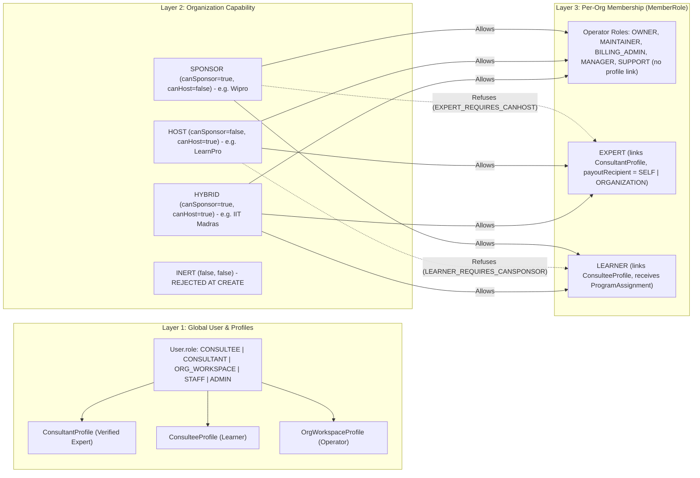

# The three authorization matrices

| Field         | Value                                                                                         |
| ------------- | --------------------------------------------------------------------------------------------- |
| Status        | Stable                                                                                        |
| Audience      | All engineers                                                                                 |
| Last reviewed | 2026-11-16                                                                                    |
| Source files  | `lib/auth/backoffice-permissions.ts`, `lib/auth/org-permissions.ts`, `lib/auth/role-ranks.ts` |

## 1. Background

This folder documents **what a user may do**. That question has three answers in
this codebase, held in three places, and the tempting move is to merge them. This
document is the argument against that, because the three are not three views of
one thing — they are three different questions that happen to arrive in the same
request.

| #   | Matrix                           | Cardinality | Key               | Source                                                                           |
| --- | -------------------------------- | ----------- | ----------------- | -------------------------------------------------------------------------------- |
| 1   | `UserRole`                       | 5 values    | `User.role`       | `prisma/schema.prisma:6618`                                                      |
| 2   | `MemberRole` × `OrgSurface`      | 7 × 57      | `Membership.role` | [`lib/auth/org-permissions.ts`](../../lib/auth/org-permissions.ts)               |
| 3   | `UserRole` × `BackofficeSurface` | 5 × 49      | `User.role`       | [`lib/auth/backoffice-permissions.ts`](../../lib/auth/backoffice-permissions.ts) |

A fourth axis exists and is **not** in this folder: the session count, which is
a property of one _purchased subscription_ and is owned by
`subscriptionEntitlement()` in [`lib/booking/entitlement.ts`](../../lib/booking/entitlement.ts)
(#1766). There is no plan-entitlement matrix; §6 says why a session cap must not
become one.

## 2. Scope

| In scope                                                                              | Out of scope                                                                      |
| ------------------------------------------------------------------------------------- | --------------------------------------------------------------------------------- |
| What each matrix authorises and where it is enforced                                  | Session counts — see `lib/booking/entitlement.ts`                                 |
| Why there are three and they are not merged                                           | `PlanLevel`, which is a catalogue facet and gates nothing                         |
| Why a matrix beat a rank ladder                                                       | The `Refusal` rail — see [`docs/errors/01-refusals.md`](../errors/01-refusals.md) |
| The capability gates and the 401/403/404/409 conventions ([`README.md`](./README.md)) |                                                                                   |

## 3. Matrix 1 — `UserRole`: the platform axis

| Value           | What it means                                                            |
| --------------- | ------------------------------------------------------------------------ |
| `CONSULTEE`     | The default. `admin({ defaultRole: "CONSULTEE" })`                       |
| `CONSULTANT`    | A person who delivers                                                    |
| `STAFF`         | Support and moderation. Privileged, bounded                              |
| `ADMIN`         | The account that answers for the irreversible ones                       |
| `ORG_WORKSPACE` | Enterprise org operator — manages orgs, no booking or consulting (#1132) |

**What it authorises.** Platform-level operator reach. Not a hierarchy: the
_only_ two privileged values are `ADMIN` and `STAFF`, and
`isPrivileged()` is true for exactly those. `CONSULTANT`, `CONSULTEE` and
`ORG_WORKSPACE` are mutually exclusive product shapes, not rungs.

**Where it is enforced.** `isPrivileged()` in
[`lib/auth-helpers.ts`](../../lib/auth-helpers.ts) answers the coarse question
inside a handler (for example, an operator recording their own consent, or a
read that widens its scope for an operator). It never guards a back-office
route: every `/api/admin/**` and `/api/staff/**` route asks matrix 3.

## 4. Matrix 2 — `MemberRole`: the organisation axis

7 roles, 57 surfaces, and a rank ladder that is **display order only**.

| Role            | Rank | Role      | Rank |
| --------------- | ---- | --------- | ---- |
| `OWNER`         | 100  | `EXPERT`  | 40   |
| `MAINTAINER`    | 80   | `SUPPORT` | 30   |
| `BILLING_ADMIN` | 70   | `LEARNER` | 20   |
| `MANAGER`       | 60   |           |      |

**What it authorises.** What a member of one organisation may do inside it.
`ORG_PERMISSIONS: Record<OrgSurface, ReadonlySet<MemberRole>>` is the single
source of truth; the sidebar, the page guards and the API routes all read it, so
a surface cannot drift into the "tab shown, page redirects, API 403s" state the
2026-07 role audit found nine of.

**Where it is enforced.** `hasOrgPermission(role, surface)`,
`hasAnyOrgPermission`, and `rolesWithOrgPermission` — consumed by
`requireOrgAccess(orgId, …)` and by the layout's visibility check. A jest pin
walks `app/api/organizations/**` and fails on a handler with no matrix key or a
raw rank check.

**The rank ladder survives as an ordering, not a permission.**
[`lib/auth/role-ranks.ts`](../../lib/auth/role-ranks.ts) is explicit: _"Display
order for org roles — never an authorization input."_ One reader remains, and
it is an ordering question: picking the most operator-like org to land on
(`lib/labels/org-labels.ts`).

## 5. Matrix 3 — `BackofficeSurface`: the internal axis

49 surfaces, and a policy stated once at the top of the file:

- **STAFF own support end-to-end** — tickets, feedback, moderation,
  appointments, user verification. This is the job.
- **STAFF read every money surface and mutate none of it.** A support agent who
  cannot see a payment cannot resolve a billing ticket; one who can issue a
  refund is not a support agent.
- **STAFF read recording metadata; ADMIN alone plays a recording** (#1270). The
  split is `recordings.read` / `recordings.play`, and the asymmetry is
  deliberate: the session content belongs to the two people who agreed to record
  it, not to the operator.
- **ADMIN alone executes money, owns org lifecycle and platform config, and
  takes the destructive user actions.**

`refunds.manage` is admin-only while `refunds.read` is not;
`payments.manage` likewise; `users.moderate` (suspend / reactivate, add staff,
reset 2FA, force sign-out) is admin-only while `users.read` and `users.verify`
are not. There is no in-app role change.

`team.read` (#1927) is the newest row and the shape to copy. It is split out of
`users.read` because "who else is on staff" is a normal ticket while a roster
listing every operator's 2FA state and last activity is reconnaissance for the
door that suspends them. Its **mutations** — add staff, resend setup link, reset
2FA, suspend, reactivate — deliberately reuse `users.moderate` rather than a
`team.manage` key, because they are the same act as "change someone's access"
and a second key for the same act is a second place to get the policy wrong.
See [`../authentication/staff-onboarding.md`](../authentication/staff-onboarding.md).

**Where it is enforced.** `requireBackofficeSurface(surface)` in
`lib/auth-helpers.ts`, backed by `hasBackofficePermission(role, surface)`. A
bare `isPrivileged(session.user.role)` in a route is not merely coarse — it
makes the grant invisible to the file that is supposed to enumerate every grant.
If a surface needs a role distinction, add the key.

**Why it exists at all.** Admin and staff were two ~85 %-identical dashboards
whose only difference was which route tree you landed in. Merging them into one
`(backoffice)/[tree]` (#1527) means the difference has to live somewhere real.

### Backoffice surfaces by category

| Backoffice Surface Category              | Surface Keys                                                                                                                                                                                                                                                                                                                                    |                  **`ADMIN`** (Olivia Brown)                  |                    **`STAFF`** (Maria Brown)                    | Policy Rationale                                                                                                                         |
| :--------------------------------------- | :---------------------------------------------------------------------------------------------------------------------------------------------------------------------------------------------------------------------------------------------------------------------------------------------------------------------------------------------- | :----------------------------------------------------------: | :-------------------------------------------------------------: | :--------------------------------------------------------------------------------------------------------------------------------------- |
| **Support & Triage**                     | `tickets.manage`, `threads.manage`, `feedback.manage`, `moderation.manage`, `supportChat.read`, `supportChat.intervene`, `appointments.manage`, `newsletter.manage`, `users.read`, `users.verify`, `team.read`, `analytics.read` (Metrics), `opsLog.read`                                                                                       |                       **Read + Write**                       | **Read + Write** (Staff see only their own `OpsActionLog` rows) | Staff own day-to-day support, appointment triage, and expert verification.                                                               |
| **Class Series Non-Money Doors**         | `classSeries.support` (Cancel 1 session for host, grant make-up + 14d bypass, flag/clear reliability, add ops note)                                                                                                                                                                                                                             |                         **Execute**                          |                           **Execute**                           | Moves schedule state, never moves money.                                                                                                 |
| **Money Surfaces (Read vs Execute)**     | `payments.*`, `refunds.*`, `disputes.*`, `invoices.*`, `subscriptions.*`, `payouts.*`, `referrals.*`                                                                                                                                                                                                                                            |           **`.read` + `.manage` (Execute Money)**            |                        **`.read` ONLY**                         | Staff can inspect every payment, refund, dispute, invoice, and payout to answer billing tickets, but **cannot execute money mutations**. |
| **Admin-Only Money & Tax Doors**         | `classSeries.money` (Skip make-up early refund, cancel whole series with refunds, run 14d sweep), `approvalPayments.manage`, `tds.read`                                                                                                                                                                                                         |                        **Admin Only**                        |                                —                                | Directly moves cash/credits or exposes cross-org tax aggregates.                                                                         |
| **Sensitive Content & Platform Control** | `recordings.play` (watch private video), `users.moderate` (suspend, reactivate, operator revoke), `organizations.manage` (KYB verify/suspend), `systemJobs.manage`, `maintenance.manage`, `compliance.manage` (DPDP erasure), `leads.manage`, `trialPricing.manage` (the platform trial-price floor), `announcements.manage`, `newsletter.send` | **Admin Only** (`recordings.read` metadata is open to Staff) |                                —                                | Irreversible account/org actions and private video playback are restricted strictly to `ADMIN`.                                          |

### Every back-office route asks the matrix

A route is on the matrix when its first line is `requireBackofficeSurface(key)`, or when it is a `withOpsAction` door (`lib/backoffice/ops-action-log.ts`), which calls the same helper and then writes the audit row. A refused role gets 403 with `code: "FORBIDDEN"`. The routes below were moved from a raw role guard (one asked for ADMIN only, the other for ADMIN or STAFF) onto a key with the same people, and both raw guards are deleted:

| Route                                                                                                                                       | Key                    | Who passes     | What changed                                                                                                                                                                                              |
| ------------------------------------------------------------------------------------------------------------------------------------------- | ---------------------- | -------------- | --------------------------------------------------------------------------------------------------------------------------------------------------------------------------------------------------------- |
| `/api/admin/leads`, `/api/admin/leads/[leadId]`                                                                                             | `leads.manage`         | ADMIN          | A direct STAFF call was allowed before; the Leads screen was already admin-only. A status change now needs a reason and is audited.                                                                       |
| `/api/admin/trial-pricing` (`GET` and `PATCH`)                                                                                              | `trialPricing.manage`  | ADMIN          | Was ADMIN or STAFF. `PATCH` is now an audited door that needs a reason. Plan routes still enforce the floor for every expert.                                                                             |
| `/api/admin/stats`, `/api/admin/analytics/cancellations`, `/api/staff/metrics`                                                              | `analytics.read`       | ADMIN or STAFF | Same people as before; the key now names the grant.                                                                                                                                                       |
| `/api/admin/maintenance`, `maintenance/preflight`, `maintenance/booking-remediation`                                                        | `maintenance.manage`   | ADMIN          | Same people as before. The actor of every transition is required and recorded.                                                                                                                            |
| `/api/staff/appointments`, `/api/staff/appointments/[appointmentId]/timeline`                                                               | `appointments.manage`  | ADMIN or STAFF | Same people as before; the key now names the grant.                                                                                                                                                       |
| `/api/admin/payments`, `/api/admin/payments/[paymentId]`                                                                                    | `payments.read`        | ADMIN or STAFF | Same people as before. Both answer an allowlist: no payer hashes, idempotency keys or refund-owed notes.                                                                                                  |
| `/api/admin/refunds` (`GET`)                                                                                                                | `refunds.read`         | ADMIN or STAFF | Same people as before. The list sends no gateway metadata or failure text. `POST` stays on `refunds.manage` (ADMIN).                                                                                      |
| `/api/admin/disputes`, `/api/admin/disputes/[disputeId]` (`GET`)                                                                            | `disputes.read`        | ADMIN or STAFF | Same people as before. The buyer's email, evidence and the evidence pack still need `disputes.manage` (ADMIN).                                                                                            |
| `/api/admin/subscriptions` (`GET`)                                                                                                          | `subscriptions.read`   | ADMIN or STAFF | Same people as before. `?limit` is clamped to 100.                                                                                                                                                        |
| `/api/admin/compliance/tds-return`                                                                                                          | `tds.read`             | ADMIN          | Same people as before.                                                                                                                                                                                    |
| `/api/admin/compliance/gst-register`, `erasure-requests/[id]/process` and `/reject`                                                         | `compliance.manage`    | ADMIN          | Same people as before. A refusal is a 403 with `code: "FORBIDDEN"`.                                                                                                                                       |
| `/api/admin/settlements/lines`                                                                                                              | `payouts.read`         | ADMIN or STAFF | Same people as before; the key now names the grant.                                                                                                                                                       |
| `/api/admin/users`                                                                                                                          | `users.read`           | ADMIN or STAFF | Same people as before. `?page` is read through zod, and the list breaks ties by `id`.                                                                                                                     |
| `/api/admin/verification`, `/api/admin/verification/[verificationId]`, `/api/admin/documents`                                               | `users.verify`         | ADMIN or STAFF | Same people as before. A decision (`PATCH`) is an audited door that needs a reason. The list no longer sends a document's stored `fileUrl`.                                                               |
| `/api/admin/organizations`                                                                                                                  | `organizations.manage` | ADMIN          | Same people as before.                                                                                                                                                                                    |
| `/api/staff/feedbacks`, `/api/staff/feedbacks/[feedbackId]`                                                                                 | `feedback.manage`      | ADMIN or STAFF | Same people as before.                                                                                                                                                                                    |
| `/api/staff/moderation/reports`, `reports/[reportId]` and its `action` door, `/api/staff/moderation/reviews`, `/api/staff/moderation/stats` | `moderation.manage`    | ADMIN or STAFF | Same people as before. A report status change and a moderation action are audited doors that need a reason; banning, suspending and removing a public review still need `users.moderate` inside the door. |
| `/api/staff/moderation/reports/[reportId]/unban`, `DELETE /api/staff/moderation/reviews/[reviewId]`                                         | `users.moderate`       | ADMIN          | Same people as before (each checked for ADMIN inside the handler). Both are audited doors that need a reason.                                                                                             |
| `/api/admin/newsletter`                                                                                                                     | `newsletter.manage`    | ADMIN or STAFF | Same people as before.                                                                                                                                                                                    |
| `/api/admin/newsletter/broadcast`                                                                                                           | `newsletter.send`      | ADMIN          | Same people as before. A send (test, warm-up or all) is an audited door that needs a reason; `preview` only counts.                                                                                       |
| `/api/admin/support/compliance-report`                                                                                                      | `compliance.manage`    | ADMIN          | Same people as before.                                                                                                                                                                                    |
| `/api/admin/support/health`, `/api/admin/system-events`, `/api/admin/exchange-rates`                                                        | `systemJobs.manage`    | ADMIN          | Same people as before. None of them has a screen key of its own.                                                                                                                                          |

`POST /api/user/consent` is an operator recording their own consent, not a back-office surface, so it asks `requireApiAuth()` and then `isPrivileged()` (ADMIN or STAFF), and answers 403 `FORBIDDEN` to anyone else. `GET /api/admin/users/[userId]` (no caller; it returned phone, bio and city) and `GET /api/staff/stats` (no caller) were deleted rather than moved.

**Emails on the money rows.** STAFF see the emails a money row names: the creator and approvers on Org payouts, the buyer on Payments, Refunds, Earnings and the refunds waiting for a human, and the person behind an Audit or Support spend target. This matches the payment detail. Three gates still withhold an email from STAFF: the disputes list and detail (`disputes.manage`), and Invoices and TDS (`showPii`, ADMIN only). The decision is D10 in the back-office record.

`__tests__/backoffice/route-surface-gates.test.ts` pins each moved route's key and its 403 for a refused role, and `__tests__/backoffice/raw-role-guards-removed.test.ts` fails if a role-named guard comes back. The decision record is [the 2026-11-16 back-office record](../decisions/2026-11-16-train-6-back-office.md).

### What an operator sees: time and totals

Every back-office screen prints times in India Standard Time (`Asia/Kolkata`), whatever the operator's profile zone or browser zone, and the tooltip on a time shows the exact UTC instant. The helper is `lib/time/operator-zone.ts` (`OperatorTime` is in `lib/time/operator-time.tsx`), and the back-office layout (`app/dashboard/(backoffice)/[tree]/layout.tsx`) pins the zone once for the whole tree, so the server render and the browser print the same text. A screen that has not yet moved onto the helper may still print in another zone **(planned)**; read its tooltip or the stored UTC instant before acting on a deadline.

Metrics (`/dashboard/admin/metrics` and `/dashboard/staff/metrics`) is the one Insights page in both trees and needs `analytics.read`. Both ADMIN and STAFF see its revenue and refund cards, because STAFF already read every payment row through `payments.read`. Its "this month (IST)" cards start at 00:00 IST on the 1st, and its support-queue periods (today, this week, this month) are also cut in IST: a payment of ₹1,000 (100,000 paise) at 03:00 IST on 1 December, which is 21:30 UTC on 30 November, counts in December.

## 6. Why three, and why not merged

### The load-bearing reason: privilege here is not one-dimensional

A rank comparison is a total order. Our privileges are not, and the org ladder
is the proof that has the sharpest teeth:

> **`BILLING_ADMIN` outranks `MANAGER` numerically (70 > 60) yet must see
> _fewer_ operational things.**

And the same table breaks the other direction too: `SUPPORT` (30) sees **more**
than `EXPERT` (40) on operations surfaces. An org has an **operations track**
(`MANAGER`, `SUPPORT`), a **finance track** (`BILLING_ADMIN`), and **member
roles** (`EXPERT`, `LEARNER`) that are not a track at all — they are the people
being served. `70 > 60` is true and means nothing. A rank ladder can only answer
"is this role at least that role", and every interesting question about
`BILLING_ADMIN` is "what is this role _not_ allowed to see".

`MAINTAINER` (80) outranking `BILLING_ADMIN` (70) while holding **no money
write** is the same fact from the other side. #1851 moved every org gate onto the
matrix and the jest pin refuses a rank check under `app/api/organizations`.

### Why not BetterAuth's `ac` / `hasPermission`

The obvious move is to express all of this with the plugin's access-control
statements, which is what the `admin` plugin is for — and `lib/auth.ts` _does_
wire them (`roles: { ADMIN: adminAc, STAFF: staffAc, user: userAc }`,
`adminRoles: ["ADMIN", "STAFF"]`). Three reasons it is the wrong home anyway.

**1. `ac` is a statement list per role, which is a rank ladder wearing a
different hat.** A statement is a set of verb/resource strings, and a role is a
set of statements. To express "BILLING_ADMIN must _not_ see operations" you have
to enumerate everything it _may_ see and hope nothing is left over. That is
deny-by-omission, and the omission is invisible in review: there is no row
saying "and nothing else". A matrix row is deny-by-default, because a surface
with no row does not exist.

**2. `ac` has no org scoping.** It answers "may this _role_ do X" and has no
notion of _which_ organisation. `MAINTAINER` of org A and `MAINTAINER` of org B
are the same string. The org axis is inherently two-keyed — `(orgId, role)` —
and a statement list cannot be scoped per row of a `Membership` table.

**3. `hasPermission` is role-name lookup, not a policy engine, so we do not
put a security guard on it.** In the installed `better-auth@1.7.14`
(`node_modules/better-auth/dist/plugins/admin/has-permission.mjs`):

```js
const acRoles = input.options?.roles || defaultRoles;
for (const role of roles)
  if (acRoles[role]?.authorize(input.permissions)?.success) return true;
```

When `roles` is supplied, as `lib/auth.ts` does with an explicit uppercase map
(`ADMIN`, `STAFF`), the built-in `defaultRoles` (`{ admin: adminAc, user:
userAc }`) is never consulted. An earlier version of this page said a role named
`admin` falls back to `defaultRoles` (better-auth issue #7822). That issue
concerned the organization plugin's dynamic roles, is closed, and does not apply
here. The real risks are narrower: if the `roles` option were ever dropped, every
role would resolve against `defaultRoles`, and the check knows nothing about
organisations (point 2).

`staffAc` grants only `user: ["list", "get"]`: no `set-role`, no `ban`, no
`session:*` (#1132 — `/admin/set-role` never compared actor to target rank, so
holding it let STAFF make themselves ADMIN).

None of the three matrices uses `hasPermission` as its guard. The plugin's
statements are wired for the plugin's own endpoints, and those endpoints are
all in `disabledPaths` (lib/auth.ts), so nothing reachable over HTTP consults
them; our own guards read our own maps. That separation is the mitigation.

### The deliberate non-merge: session caps belong to the subscription

This is the one that gets re-proposed roughly once a quarter, so it is worth
stating with its consequence.

A **B2C session cap belongs to a purchased subscription, not to a plan.**
One person may hold three subscriptions from three different
experts, each with its own `sessionsTotal`, its own cycle and its own expiry.
`subscriptionEntitlement()` in `lib/booking/entitlement.ts` is the ONE counter
every surface reads (#1766): it freezes `sessionsTotal` at purchase and derives
cycles from it.

Add a per-plan session limit anywhere else and there are two answers to _"how
many sessions are left"_. That is not a style disagreement — **two answers is
how an allocator oversells a subscription.** The allocator writes to one
counter; the gate reads the other, and the two numbers are not comparable.
Every session limit routes through the counter.

## 7. The three axes side by side

|                          | Platform                                 | Organisation                           | Back office                                       |
| ------------------------ | ---------------------------------------- | -------------------------------------- | ------------------------------------------------- |
| **Key**                  | `User.role`                              | `Membership.role`                      | `User.role`                                       |
| **Shape**                | 5 values                                 | 7 × 57 matrix                          | 5 × 49 matrix                                     |
| **Answers**              | "is this person an operator?"            | "what may this member do in this org?" | "which internal surface may this operator reach?" |
| **Enforced by**          | `isPrivileged` (inside a handler)        | `requireOrgAccess`                     | `requireBackofficeSurface`                        |
| **Composed with**        | the operator 2FA gate                    | capability gates                       | the operator 2FA gate                             |
| **Never merged because** | the other two are per-tenant or internal | the platform axis has no org           | the back-office axis is internal-only             |

The composition rule is the last row of that table: a route that needs two axes
checks both, and neither is allowed to imply the other. A platform `ADMIN`
reaching an org endpoint gets a _synthesized_ OWNER membership for
`requireOrgAccess` only on `readOnly` gates; every write gate refuses it with
403 `ADMIN_READ_ONLY`, and admin writes go through the audited `/api/admin/*`
doors (`withOpsAction`). Capability gates still apply, so an admin hitting a
WALLET-only endpoint on an INVOICE org gets a **404**, because that endpoint
genuinely does not exist for that org shape. Authority to look is not authority
to call a route that does not apply.

### Worked permutations of `UserRole`, organisation capability and `MemberRole`

Every user has one global `User.role` (`UserRole`), independent global profile links (`consultantProfileId`, `consulteeProfileId`, `orgWorkspaceProfileId`), and one `Membership` (`MemberRole`) per organization ([`docs/onboarding/02-identity-and-org-permutations.md`](../onboarding/02-identity-and-org-permutations.md)).



#### Exhaustive Permutation Table (`UserRole × Org Capability × MemberRole`)

| Global `User.role`  | Org Capability (`SPONSOR` / `HOST` / `HYBRID`) | Target `MemberRole`                                              | Status & Exact System Behavior                                                                                                                                                                                                                                    | Real Seeded / Concrete Example                                                                                                                                 |
| :------------------ | :--------------------------------------------- | :--------------------------------------------------------------- | :---------------------------------------------------------------------------------------------------------------------------------------------------------------------------------------------------------------------------------------------------------------- | :------------------------------------------------------------------------------------------------------------------------------------------------------------- |
| **`ORG_WORKSPACE`** | `SPONSOR` / `HOST` / `HYBRID`                  | `OWNER` / `MAINTAINER` / `BILLING_ADMIN` / `MANAGER` / `SUPPORT` | **Allowed** (Canonical operator setup). Only `ORG_WORKSPACE` and `ADMIN` can call `POST /api/organizations` to create an org. Profile links on `Membership` are cleared.                                                                                          | **Charlotte Anderson** (`charlotte.anderson@gmail.com`) is `ORG_WORKSPACE` + `OWNER` of **IIT Madras** (`HYBRID`).                                             |
| **`ORG_WORKSPACE`** | `HOST` / `HYBRID`                              | `EXPERT`                                                         | **Refused (`400 NOT_A_CONSULTANT`)** unless the user first completes the onboarding wizard's Add-Consultant mode (`/form/onboarding?add=CONSULTANT`), which creates a `ConsultantProfile` while keeping `User.role = ORG_WORKSPACE`.                              | Operator adding a consulting practice to their account.                                                                                                        |
| **`ORG_WORKSPACE`** | `SPONSOR` / `HYBRID`                           | `LEARNER`                                                        | **Allowed** via invitation accept; lazily creates `ConsulteeProfile` (`ensureConsulteeProfile`).                                                                                                                                                                  | Operator learning through a sponsor org.                                                                                                                       |
| **`CONSULTANT`**    | `HOST` / `HYBRID`                              | `OWNER` / `MAINTAINER` / `BILLING_ADMIN` / `MANAGER` / `SUPPORT` | **Allowed by invitation** (or seeded). Cannot create a new org via `POST /api/organizations` unless role is `ORG_WORKSPACE`/`ADMIN`.                                                                                                                              | **Daniel Anderson** (`daniel.anderson@outlook.com`) is `CONSULTANT` + `OWNER` of **LearnPro Academy** (`HOST`); **Arjun Anderson** is `OWNER` of his solo org. |
| **`CONSULTANT`**    | `HOST` / `HYBRID`                              | `EXPERT` (`payoutRecipient = SELF`)                              | **Allowed**. Links `ConsultantProfile`; flips `ConsultantProfile.isIndependent = false`. Expert receives their `consultantBps` share into `ConsultantEarnings`.                                                                                                   | **Aarav, Aditi, Alex, Amit, Ananya Anderson** at **LearnPro Academy**; **Arjun, Benjamin, Catherine Anderson** at **IIT Madras**.                              |
| **`CONSULTANT`**    | `HOST` / `HYBRID`                              | `EXPERT` (`payoutRecipient = ORGANIZATION`)                      | **Allowed** (Salaried / Internal Faculty). Expert's `consultantBps` share is routed directly into `OrganizationEarnings` (`CONSULTANT_PAYABLE = 0`).                                                                                                              | **Andrew Anderson** & **Angela Anderson** at **IIT Madras** (`HYBRID`).                                                                                        |
| **`CONSULTANT`**    | `SPONSOR`                                      | `EXPERT`                                                         | **Refused (`400 EXPERT_REQUIRES_CANHOST`)**. A pure `SPONSOR` org cannot host experts.                                                                                                                                                                            | Attempting to invite **Aarav Anderson** as `EXPERT` to **Wipro** is rejected.                                                                                  |
| **`CONSULTANT`**    | `SPONSOR` / `HYBRID`                           | `LEARNER`                                                        | **Allowed**! Lazily creates `ConsulteeProfile` (`ensureConsulteeProfile`). A consultant in Org A can be a sponsored `LEARNER` in Org B. **Self-Deal Guard**: `revalidateInsideLock` blocks them from booking their _own_ `ConsultantProfile`'s plans!             | A consultant who is also an enrolled learner at **Wipro**.                                                                                                     |
| **`CONSULTEE`**     | `SPONSOR` / `HYBRID`                           | `LEARNER`                                                        | **Allowed** (Canonical B2B learner). Links `ConsulteeProfile`. Lands on `/dashboard/organization/[orgId]/my-program`.                                                                                                                                             | **Olivia, Patrick, Priya Anderson** at **Wipro** (`SPONSOR`); **Rachel, Raj, Rebecca, Robert Anderson** at **IIT Madras** (`HYBRID`).                          |
| **`CONSULTEE`**     | `HOST`                                         | `LEARNER`                                                        | **Refused (`400 LEARNER_REQUIRES_CANSPONSOR`)**. A pure `HOST` org cannot sponsor learners.                                                                                                                                                                       | Attempting to invite **Olivia Anderson** as `LEARNER` to **LearnPro Academy** is rejected.                                                                     |
| **`CONSULTEE`**     | `HOST` / `HYBRID`                              | `EXPERT`                                                         | **Refused (`400 NOT_A_CONSULTANT`)** until the user completes `/form/onboarding?add=CONSULTANT`, which creates `ConsultantProfile` and promotes `User.role` from `CONSULTEE` → `CONSULTANT`.                                                                      | Learner upgrading to become an expert.                                                                                                                         |
| **`CONSULTEE`**     | `SPONSOR` / `HOST` / `HYBRID`                  | `OWNER` / `MAINTAINER` / `BILLING_ADMIN` / `MANAGER` / `SUPPORT` | **Allowed by invitation** (or seed).                                                                                                                                                                                                                              | **Samantha Anderson** (`samantha.anderson@yahoo.com`) is `CONSULTEE` + `OWNER` of **Wipro Limited**.                                                           |
| **Any User**        | Same Org                                       | `LEARNER` ↔ `EXPERT`                                             | **Refused (`409 ROLE_TRANSITION_BLOCKED`)** & `@@unique([userId, organizationId])` prevents holding both roles in the same org. Must remove (`REMOVE_AND_REINVITE` if obligations cleared) and re-invite.                                                         | Prevents `ProgramAssignment` attribution ambiguity and in-org self-dealing.                                                                                    |
| **`ADMIN`**         | Any Org                                        | Synthetic `OWNER` Stub                                           | **Read-only gates only.** `requireOrgAccess` returns an `__admin_stub_<userId>` OWNER membership on `readOnly` gates and answers 403 `ADMIN_READ_ONLY` on every other gate; admin writes go through the audited `/api/admin/*` doors. `STAFF` gets no org bypass. | **Olivia Brown** (`ADMIN`) or **Maria Brown** (`STAFF`).                                                                                                       |

## 8. Open items

| #   | Item                                            | Why it is open                                                                                                                                                                                                                         |
| --- | ----------------------------------------------- | -------------------------------------------------------------------------------------------------------------------------------------------------------------------------------------------------------------------------------------- |
| 1   | `hasPermission` (#7822) is not pinned by a test | No guard uses it, and `__tests__/security/admin-plugin-fenced.test.ts` pins every admin endpoint (including `/admin/has-permission`) to `disabledPaths`. A pin on server-side `auth.api.userHasPermission` calls would close the rest. |

## 9. Related docs

- [`README.md`](./README.md) — the helper inventory, the capability gates and the
  401/403/404/409 conventions, including the structural-404 pattern.
- [`lib/booking/entitlement.ts`](../../lib/booking/entitlement.ts) — the one
  session counter this folder does not duplicate.
- [`../authentication/errors.md`](../authentication/errors.md) — why a
  refusal's code must be one the client already knows.
- [`../authentication/sso.md`](../authentication/sso.md) — `enforceSSO`, which
  is a _policy_ about an axis, not a role.
