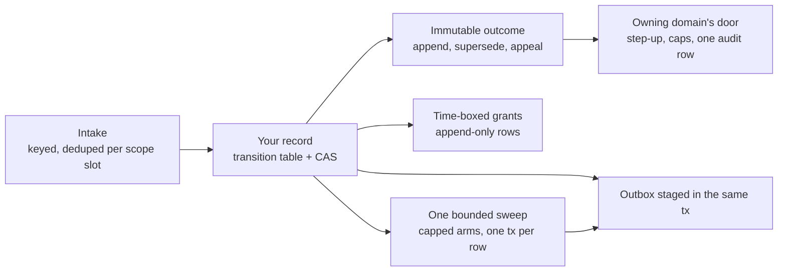

# Support platform blueprint — patterns to reuse

This guide is for an engineer building a subsystem that has to **deliberate before it acts**: collect a complaint or request, hear more than one side, record an outcome people can rely on, and then change state that another domain owns. Trust and safety reviews, payout disputes, enterprise escalations and content appeals all have this shape. The support system already solves it, and the parts below can be copied or reused directly.

Read [start-here 05](../../start-here/05-support-system-design.md) first for the design these patterns come from. The module-level detail is in [`docs/support/`](../../support/README.md).

## 1. Deliberate in your record, execute through the owner's door

Your subsystem owns its record and its timeline, and nothing else. When an outcome needs money, bookings or chat to change, call the owning domain's door instead of writing its tables.

1. Build each side effect as a door with `withOpsAction()` (`lib/backoffice/ops-action-log.ts`). It checks the back-office surface, validates the body with a required reason, optionally demands a step-up sign-in within 15 minutes (`requireFreshSession()` in `lib/auth/step-up.ts`), runs the handler, and writes exactly one `OpsActionLog` row. Use `mode: "tx"` when the effect is a database write and `mode: "gateway"` when it calls a vendor.
2. Reuse the domain's existing function inside the door. Support refunds call `refundBookingPayment()` rather than a support-specific refund, so they inherit the rails, ledger reversal, credit notes and dedupe keys.
3. Reuse the money guards rather than writing new ones: `assertBoundedRefund()` and `lockStaffRefunds()` for staff limits (`lib/support/money-policy.ts`), the `secondApprover` option for amounts above ₹25,000 (`lib/backoffice/ops-proposals.ts`), and `assertMoneyDoorsOpen()` for maintenance (`lib/backoffice/maintenance-gate.ts`).
4. Write the door's result back onto your timeline as an event. `applySupportHoldDoor` in `lib/support/case-doors.ts` is a compact example: it places an ordinary `EarningsHold` row and records `HOLD_APPLIED` on the case.

If the owning domain has no door for what you need, add one to that domain. Do not add a private table that duplicates its state; support once had its own payment-hold table and folded it into `EarningsHold` so payouts understand one kind of hold.

## 2. Make every status move explicit and compare-and-set

1. Put the allowed moves in one table keyed by from-status and to-status, with the actors allowed for each pair, as `CASE_TRANSITIONS` does in `lib/support/case-transitions.ts`. A missing pair is a refusal.
2. Every writer still does its own compare-and-set: an `updateMany` whose `WHERE` names the expected status or `updatedAt`, so a lost race matches zero rows.
3. Refuse expected conflicts with a typed 409 body (`CaseConflictError`) that the route returns as is. Expected refusals never go to Sentry.

## 3. Key every action and replay it safely

1. Give each user-initiated write a client key and a database unique on it, such as `@@unique([caseId, clientActionId])` on decisions, recommendations and evidence requests.
2. On a repeat, compare the stored row with the new request. Return the stored result only if every field and the actor match; otherwise refuse with `IDEMPOTENCY_KEY_REUSED` (`replayCaseActionTx()` in `lib/support/case-actions.ts`).
3. Run the action in a serializable transaction with `withSerializableRetry()` (`lib/db/serializable-retry.ts`), and when a unique-violation race is lost (`isUniqueViolation()` in `lib/db/pg-errors.ts`), answer with the winner's row.
4. Pass the client key on to the domain as its dedupe key, as support does with `case-recommendation:<id>` on refunds.

## 4. Record outcomes as immutable rows

1. Store each outcome as a row that a trigger refuses to update or delete, as `support_case_decision_immutable` does in `prisma/sql/check-constraints.sql`.
2. Correct mistakes by appending a new row that names the one it replaces. A unique foreign key plus a partial unique index (`support_decision_one_original_per_case`) make concurrent corrections impossible.
3. Fix the appeal window at the first outcome and let corrections inherit it, so a correction cannot reset anyone's rights.
4. Make an appeal its own record that points at the outcome, with one appeal per person enforced by a unique index, and refuse the original decider as reviewer.

## 5. Model privileged access as grant rows with an append-only trigger

Support's chat access (`SupportCaseChatAccess`) is the template for any "staff may look at or act in something private, for a while, for a reason" feature.

1. One row per grant, written through a door so the reason lands in `OpsActionLog`. Store what the grant covers (scope users, window start, organisations notified) when it is created.
2. Add a `CHECK` constraint for the row's shape, and partial unique indexes for "only one live at a time" rules (`support_chat_one_live_intervention_per_channel`, `support_chat_one_live_read_per_operator`).
3. Add an append-only trigger (`support_chat_access_append_only`) that refuses deletes, freezes every grant column including the expiry, and lets lifecycle timestamps such as `endedAt`, `streamJoinedAt` and `reviewNoticeAt` be set once. A grant is then extended only by issuing a new one.
4. End grants eagerly in the same transaction that closes the parent record, do vendor calls after commit, and let the sweep retry them.
5. Audit each read before you return it, with a strict `SystemEvent` that fails the request if it cannot be written (`readTranscriptPage()` in `lib/support/chat-transcript.ts`).

## 6. Run one bounded sweep with capped arms

1. Register one job in `lib/cron/cleanup-registry.ts` and run it from the ticker. Wrap it in `withCronLock()` (`lib/cron/with-cron-lock.ts`) so runs never overlap. Do not add wrapper scripts or a second scheduler (AGENTS.md §1).
2. Give each arm its own cap below the run limit (support uses 10 for the cascade, 5 for the purge and 10 for chat access) and process rows one small transaction at a time, because serverless runtimes have a single database connection.
3. Scan a few times past the cap and order by age, so rows that keep failing cannot hold the oldest slots forever (`HELD_OPEN_SCAN_FACTOR`, `PURGE_SCAN_FACTOR`).
4. Collect row errors, keep going, and report once per run with `reportSentryError()` (`lib/observability/report.ts`). Never report per row.
5. Do not add a sweep that re-checks something a database constraint already guarantees.

`runSupportSlaSweep()` in `lib/support/sla-sweep.ts` shows all five rules in one place.

## 7. Stage notifications in the same transaction

Write bells with `stageBell()` (`lib/novu/stage-bell.ts`) and emails with `stage()` (`lib/email/deliver.ts`) inside the business transaction, then send them after commit with `flushNotificationsAfter()` (`lib/novu/stage-then-attempt.ts`). A rolled-back change then notifies nobody, and a crash after commit leaves the notice in `NotificationOutbox` to be sent later. Never send email around `deliver()`; the pre-launch delivery guard must see every recipient (AGENTS.md §4.6).

## 8. Retain evidence on a clock with holds

If your record collects personal evidence, purge it on a clock measured from the last close of the record and anything that depends on it, as `purgeExpiredSupportEvidence()` does. Let an ADMIN-only legal hold block it, derive holds from live disputes or open appeals, delete storage before scrubbing text, and keep the outcome and money records. Lock the row during the purge so a legal hold placed at the same moment either waits or wins.

## What is not part of the blueprint

- **Private Prisma overlays.** Generating a worktree-local Prisma client against unapplied schema changes was a development technique for parallel branches. It is not an architecture pattern; never ship code that depends on it, and never regenerate the shared client from a branch.
- **Support-specific UI and copy**, such as the guided help trees, are product choices rather than reusable mechanics.
- **Per-row Sentry reports, Redis cron locks and JS reconcilers for rules Postgres already enforces.** AGENTS.md bans all three.

## Checklist for a new subsystem

1. Does every cross-domain effect go through that domain's door, with one audit row?
2. Is there one transition table, and does every writer compare-and-set?
3. Does every user action carry a client key with a unique index and a fingerprint replay?
4. Are outcomes immutable rows corrected by append?
5. Are privileged grants append-only with a shape check and "one live" indexes?
6. Is background work one leased job with capped arms and one Sentry report per run?
7. Are notifications staged in the business transaction?
8. Is retained evidence purged on a clock with legal and derived holds?

## Deprecated & Superseded Approaches

1. **A subsystem-private copy of another domain's state.** Support's own payment-hold table was folded into `EarningsHold`; do the same instead of adding a parallel table.
2. **Outcomes that could be replaced at will.** Support once let a repeat decision replace the first and reset the appeal clock. Outcomes are now immutable rows, corrected only by supersede within the original window.
