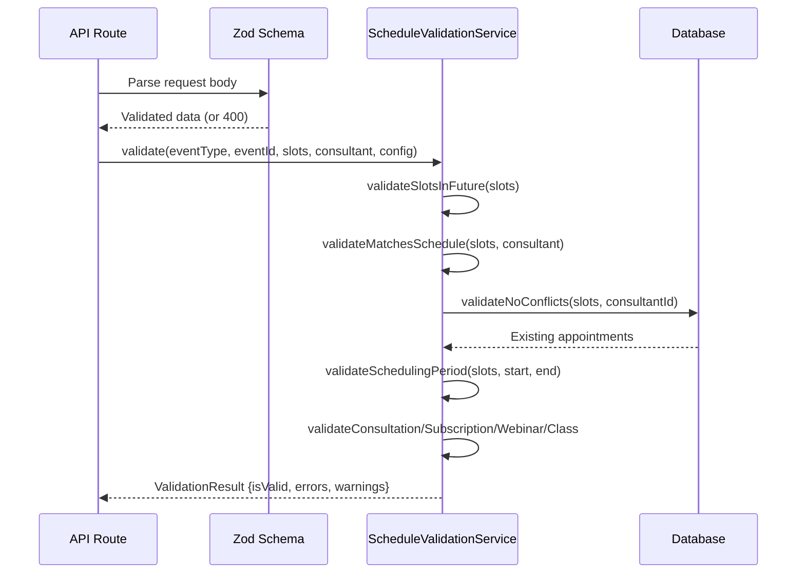
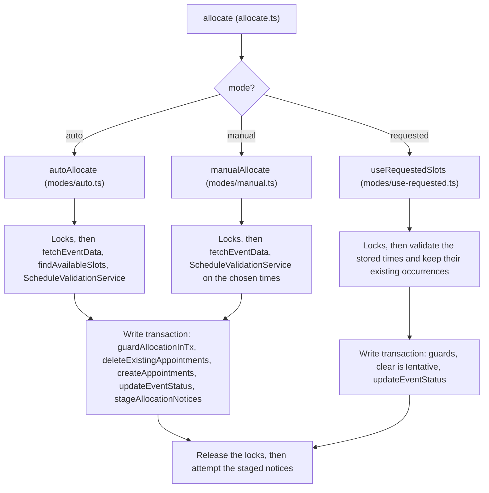
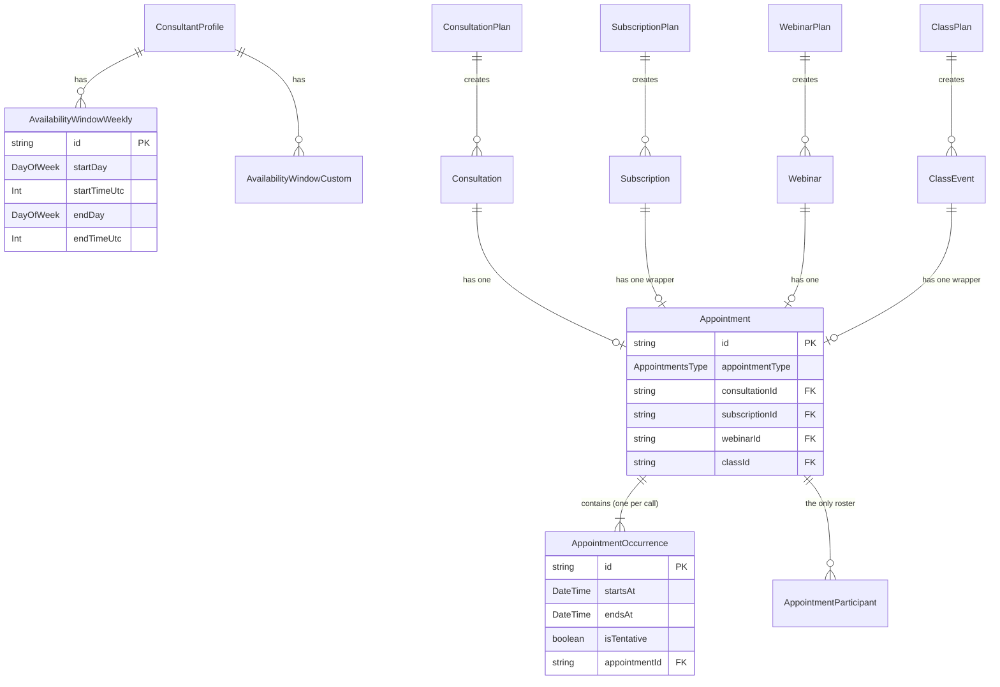
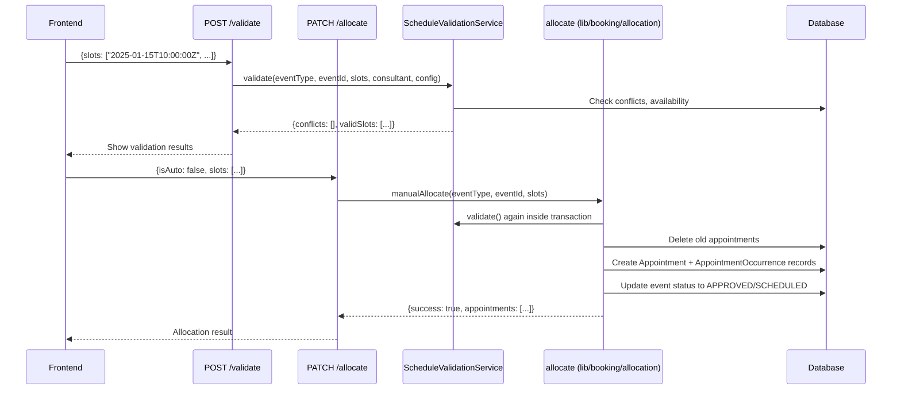
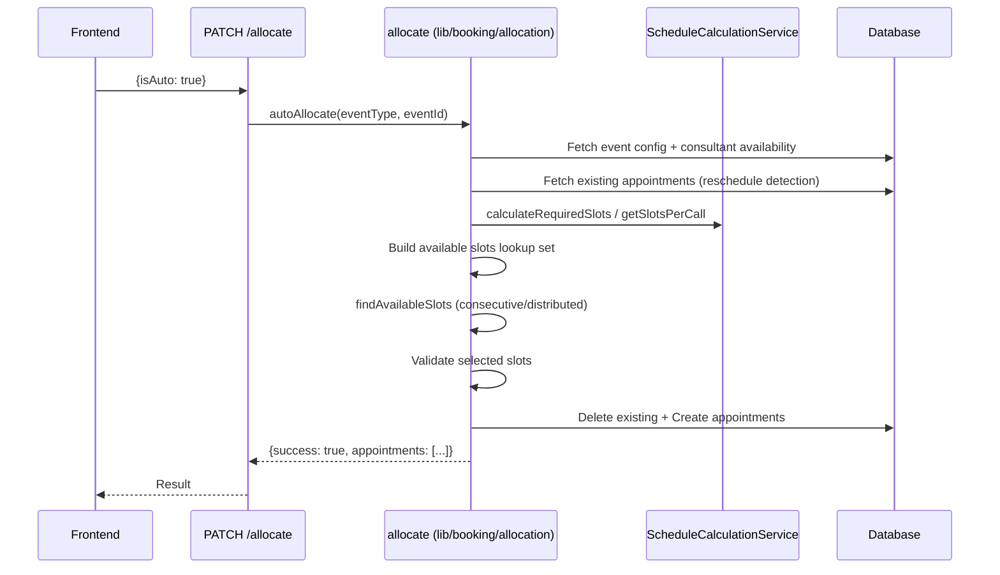
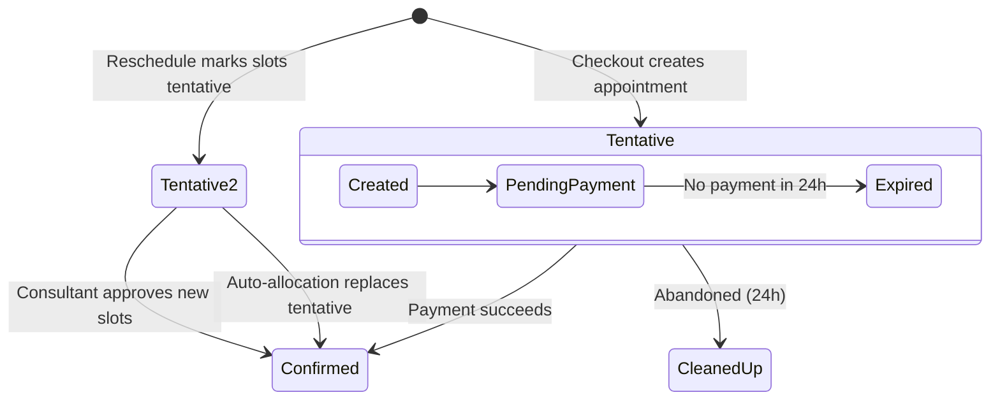

# Architecture

## Service Layer

### ScheduleCalculationService

**File**: `utils/scheduling-engine/ScheduleCalculationService.ts`

Pure-function service with no database access. Single source of truth for all slot math.

| Method                                                | Purpose                                                 |
| ----------------------------------------------------- | ------------------------------------------------------- |
| `countWeeks(start, end)`                              | Count Sunday-to-Saturday weeks overlapping a date range |
| `startOfWeekSunday(date)`                             | Get the Sunday 00:00 of the week containing a date      |
| `validateDuration(duration, fieldName)`               | Safety check: positive, finite, >= 0.5h, <= 24h         |
| `calculateRequiredSlots(eventType, config)`           | Total 30-min slots needed for an event                  |
| `getSlotsPerCall(sessionDurationInHours)`             | Slots per session: `Math.ceil(duration / 0.5)`          |
| `calculateProgress(selectedSlots, eventType, config)` | UI progress: scheduled vs required vs remaining         |
| `countCompletedCalls(slots, slotsPerCall)`            | Count complete consecutive-slot groups per day          |
| `groupSlotsByDay(slots)`                              | Map\<dateString, slots[]\>                              |
| `groupSlotsByWeek(slots)`                             | Map\<sundayISO, slots[]\>                               |

### ScheduleValidationService

**File**: `utils/scheduling-engine/ScheduleValidationService.ts`

Unified validation for all 4 event types. Takes a `PrismaClient` or transaction in the constructor.

**Entry point**: `validate(eventType, eventId, slots, consultant, config)` runs universal checks first, then routes to event-specific validation.

**Universal validators** (all event types):

| Validator                  | What it checks                                                                                                                                                                                                                                                                                                                                                       |
| -------------------------- | -------------------------------------------------------------------------------------------------------------------------------------------------------------------------------------------------------------------------------------------------------------------------------------------------------------------------------------------------------------------- |
| `validateSlotsInFuture`    | All slots > now + 5 seconds (buffer prevents race conditions)                                                                                                                                                                                                                                                                                                        |
| `validateNoConflicts`      | Range overlap detection: `slotStart < existingEnd AND existingStart < slotEnd`. Uses `buildOccupiedAppointmentFilter()` to exclude terminal-status appointments (CANCELLED, REJECTED, EXPIRED). Checks APPROVED subscriptions, PENDING/APPROVED/APPROVED_PENDING_PAYMENT consultations, SCHEDULED webinars/classes. Detects expired payments (orphaned payment fix). |
| `validateMatchesSchedule`  | WEEKLY: day-of-week + time-of-day within availability ranges. CUSTOM: overlap detection with available slots.                                                                                                                                                                                                                                                        |
| `validateSchedulingPeriod` | All slots within [startDate, endDate] -- server-side enforcement                                                                                                                                                                                                                                                                                                     |
| `validateConsecutiveSlots` | Sort + check 30-min diff with 1-second tolerance                                                                                                                                                                                                                                                                                                                     |
| `validateSameDaySlots`     | All slots share the same `toDateString()`                                                                                                                                                                                                                                                                                                                            |

**Event-specific validators**:

| Validator              | Rules                                                              |
| ---------------------- | ------------------------------------------------------------------ |
| `validateConsultation` | Same day + consecutive + exact slot count                          |
| `validateSubscription` | Delegates to `SubscriptionValidationService`                       |
| `validateWebinar`      | Consecutive + exact slot count                                     |
| `validateClass`        | Complete sessions per day + consecutive within day + two-a-day cap |



### Allocation module

**Directory**: `lib/booking/allocation/`. Callers import one function, `allocate`, from `@/lib/booking/allocation` (`index.ts`). There is no allocator class.

The allocator picks or confirms the concrete times of a booking and writes them. `allocate()` in `allocate.ts` is the only entry point. It routes by mode through `dispatch()`, classifies any error into a typed answer (`classify.ts`), and, after a successful commit, attempts the notices that were staged inside the transaction (`notify.ts`).

Each mode file owns its whole lock envelope and its write transaction. That is deliberate: a mode reads and validates under its locks, then opens one short write transaction, so each file can be read top to bottom as a single story.

| Area               | Files                                                                                                                        | Responsibility                                                                                                                                                                      |
| ------------------ | ---------------------------------------------------------------------------------------------------------------------------- | ----------------------------------------------------------------------------------------------------------------------------------------------------------------------------------- |
| Entry              | `index.ts`, `allocate.ts`, `classify.ts`, `types.ts`                                                                         | The public `allocate`, the mode router, error classification and shared types.                                                                                                      |
| Modes              | `modes/auto.ts`, `modes/manual.ts`, `modes/use-requested.ts`                                                                 | `autoAllocate`, `manualAllocate` and `useRequestedSlots`. Each acquires and releases its own locks and runs its own transaction.                                                    |
| Commit steps       | `commit/release-tentative.ts`, `commit/create-appointments.ts`, `commit/reconnect-enrolled.ts`, `commit/subscription-cap.ts` | Free the tentative rows being replaced (`deleteExistingAppointments`), write the occurrences (`createAppointments`), re-link enrolled attendees and debit the subscription org cap. |
| Search             | `search/find-available-slots.ts`, `search/window-walk.ts`, `search/blocks.ts`, `search/recurrence.ts`, `search/constants.ts` | `findAvailableSlots` and its day-by-day walk over weekly and custom availability.                                                                                                   |
| Event and identity | `event-data.ts`, `identity.ts`, `counts.ts`, `preference.ts`, `collaborators.ts`                                             | Load the event (`fetchEventData`), resolve the consultant and consultee, count held and tentative sessions, read the stored preference and check co-host availability.              |
| Guards and replay  | `guards.ts`, `idempotency.ts`                                                                                                | The in-transaction multi-tab and overlap guards, and replay of an earlier identical request.                                                                                        |
| Status and notices | `event-data.ts` (`updateEventStatus`, `holdUntilPaid`, `approveByMoney`), `notify.ts`                                        | Move the event to its next status and stage the allocation notices in the outbox.                                                                                                   |



**Lock envelope.** All three modes take the same Redis locks from `utils/appointmentlock.ts`, always in the same order: first the consultant lock (`lockAutoAllocate`), then the consultee lock (`lockConsulteeBooking`). Only consultation and subscription allocations have a single consultee, so only they take the consultee lock; webinar and class allocations skip it (`getConsulteeUserId` in `identity.ts` returns null for them). They release in the `finally` block. The consultant key is consultant-wide, except for a manual allocation of a one-off event with no weekly cap, which uses a per-day key. Recurring events always take the consultant-wide key because a weekly cap spans days. The write transaction runs with `ALLOCATION_TX_MAX_WAIT_MS` and `ALLOCATION_TX_TIMEOUT_MS` from `lib/prisma.ts`.

**What the database enforces.** Two confirmed sessions of one expert never overlap: Postgres refuses the second with `occurrence_no_confirmed_overlap` (`prisma/sql/check-constraints.sql`). The Redis locks keep two allocations from racing to that point, and `guardAllocationInTx` (`guards.ts`) re-checks the replay and held-session conditions inside the transaction.

**Auto allocation** (`autoAllocate`):

1. Resolve the consultant profile outside any transaction, so the lock key is known.
2. Replay check (`findIdempotentAllocation`), then take the two locks, then repeat the replay check, because a concurrent first submit may have stamped its key while this call waited.
3. Load the event and its availability (`fetchEventData` reads only custom availability rows that have not ended).
4. Detect a reschedule or top-up from the tentative and confirmed rows (`counts.ts`), and search (`findAvailableSlots`): consultations and webinars take the first consecutive block, subscriptions and classes are spread across the weeks of the scheduling period.
5. Validate the chosen times with `ScheduleValidationService`.
6. In one write transaction, run the guards, free the replaced tentative rows, create the occurrences and move the event status.

**Manual allocation** (`manualAllocate`): the same envelope, with the consultant's chosen times in place of the search. It rejects duplicates and a count that is not a whole number of sessions, validates, then replaces the old tentative rows and creates the new ones.

**Requested allocation** (`useRequestedSlots`): confirms the times the consultee stored. It checks the stored occurrences exist and match the required count, validates them, clears `isTentative` and moves the event to its approved status.

**Appointment structure**:

The 30-minute interval is only the unit the allocator counts and validates candidate time in; it is never the persisted shape. `createAppointments` groups every `slotsPerCall` consecutive 30-minute blocks into one call and writes exactly one AppointmentOccurrence per call, spanning from the first block's start to the last block's end.

```
1 Appointment record = 1 wrapper (consultation/webinar: 1 call, subscription/class: N calls)
  1 AppointmentOccurrence per call, not per 30-min block
    [startsAt, endsAt] = the full call window, isTentative flag
    Who is attending is answered by AppointmentParticipant on the Appointment, not by a relation on the occurrence
```

---

## Frontend Hooks

### useScheduling

**File**: `hooks/scheduling/useScheduling.ts`

Central React hook (exported as `useEventSlotAllocation`) managing slot selection state for all event types.

**Key behaviors**:

- `toggleSlot()` -- event-specific interactive blocking: weekly limits (subscription only), daily session limits (class), consecutive enforcement, delegated to the pure rules in `lib/scheduling/intervalSelectionValidation.ts`. A pick that runs past local midnight is one session, keyed to the day it starts (`sessionDayKeys`), so the per-day limits, the consecutive check and deselect all treat it as a single session
- Auto-expansion -- when selecting a slot, auto-select consecutive adjacent slots to fill `slotsPerSession`
- Progress tracking -- scheduled/required/remaining calls
- Submission for manual and requested modes goes through `lib/scheduling/allocationAlgorithms.ts` (`AllocationAlgorithms.manualAllocate` / `allocateRequestedSlots`); auto mode just posts `isAuto: true` and lets the server pick

### useCalendarData

**File**: `hooks/scheduling/useCalendarData.ts`

Unified calendar data synchronization. Fetches availability, appointments, and event slots, and drives the visibility-gated poll defined in `lib/scheduling/availabilityPolling.ts` (`AVAILABILITY_POLL_INTERVAL_MS = 60_000`, #1164).

**Key function**: `getSlotStatusForInterval()` returns:

- `isAvailable` / `isBookedForDisplay` (fully booked) / `isPartiallyBooked`
- `isDisabled` / `isInPast`
- `overlappingAppointments` for tooltips

Uses server-calculated `bookingStatus` (available / partially-booked / fully-booked) as source of truth.

There is no `useSubscriptionValidation` hook in this repo today — no file of that name exists, and the API it would imply (`validateSlots()`, `getAvailableWeeks()`, `canScheduleInWeek()`) has no matching functions anywhere. The subscription-specific week math it would have covered lives server-side in `utils/subscriptionValidation.ts` (`getSubscriptionWeek`, `getSubscriptionType`), which `ScheduleValidationService`, `lib/scheduling/allocationService.ts`, and `useScheduling.ts` all call directly.

### Where allocation happens

There is one allocator and it lives on the server. The client engine that used to pick slots for auto mode — strategies, time-of-day and day-of-week scoring, weekly distribution, same-day spacing — was deleted along with the tests that could only have exercised it, because product code has submitted `isAuto: true` and left the picking to the allocator in `lib/booking/allocation`, under its Redis locks and timezone-aware caps. Auto-mode preference scoring now lives server-side in `utils/scheduling-engine/preferenceScoring.ts`, which orders candidate slots but never filters them. `lib/scheduling/allocationAlgorithms.ts` was not deleted along with the auto engine: the file and class still exist, still export `manualAllocate()` and `allocateRequestedSlots()`, and are still imported — by `hooks/scheduling/useScheduling.ts` alone, which `UnifiedCalendar.tsx` and `RequestRequestSchedulingTab.tsx` both consume through that hook rather than importing the file directly — they now do pre-submission validation and submission for the manual and requested modes only, so nothing on the client can any longer be mistaken for a second auto-allocation engine. The hooks above are correspondingly a selection and display layer: `useScheduling` guards selection and submits, while `useCalendarData` polls date-dependent availability every 60 seconds whenever the tab is visible (#1164), so the heatmap reflects slots other people have taken instead of staying green until allocation rejects the choice.

---

## Data Model



> Note: we are using ClassEvent instead of Class because Class is a reserved keyword in Mermaid.

**Key relationships**:

- One-time events (consultation, webinar) have **1 appointment wrapper** with a single AppointmentOccurrence, the one held call.
- Recurring events (subscription, class) also have **1 appointment wrapper**, but that wrapper holds N AppointmentOccurrence rows, one per call/session, instead of N separate Appointment records.
- `slotsPerSession = Math.ceil(sessionDurationInHours / 0.5)` still describes the arithmetic the allocator uses to size a call in 30-minute units; it does not describe how many rows get persisted per call, which is always one occurrence regardless of `slotsPerSession`.
- Weekly availability uses `startDay` / `endDay` DayOfWeek enums and `startTimeUtc` / `endTimeUtc` Int fields (minutes since midnight UTC, 0-1439)

---

## Data Flows

### Manual Allocation (Validate-then-Allocate)



### Auto Allocation



---

## Tentative Appointment Lifecycle

Tentative appointments handle two scenarios: pending payment and rescheduling.



**Retry protection**:

- User deduplication: 5-minute window blocks same-user duplicate attempts
- Rate limiting: max 3 pending attempts per slot per 30 minutes
- Cleanup job: runs every 2 hours, releases tentative slots older than 24 hours with no successful payment (`TENTATIVE_EXPIRATION_HOURS = 24`, cut from 7 days by #833); users can also self-release via `DELETE /api/checkout/pending/[paymentId]` (#849) (see [13-cron-jobs-and-background-tasks.md](./13-cron-jobs-and-background-tasks.md))
- Expired payment detection: `APPROVED_PENDING_PAYMENT` consultations with expired payments are treated as available slots

---

## Deprecated & Superseded Approaches

- **One allocator file.** The `SchedulingService` class, deleted from `utils/scheduling-engine/`, was about 6,000 lines and held the mode router, all three allocation modes, the slot search, the appointment writes and the event-status helpers. It was split into `lib/booking/allocation/` so that each mode file shows its own lock envelope and transaction, and so that the search and commit steps can be read and tested on their own. Delete any reference to `SchedulingService` you still find. The pure helpers that were never part of the class (`ScheduleCalculationService`, `ScheduleValidationService`, `intervals.ts`, `availabilityCoverage.ts`) stay in `utils/scheduling-engine/`.
- **One checkout file.** The `operations/checkout` module, deleted from `lib/payments/`, held the whole checkout: the lock, the pricing, the four event handlers and the booking transaction. It was split into `lib/payments/checkout/`, where `commit/index.ts` is the only place that opens the booking transaction. See [10-checkout-payment-integration.md](./10-checkout-payment-integration.md).
- **A 60-second catch-all transaction.** Older text described every allocation as running inside one long transaction. Reads, search and validation now run before it, under the Redis locks, and the write transaction holds only the guards and writes.
