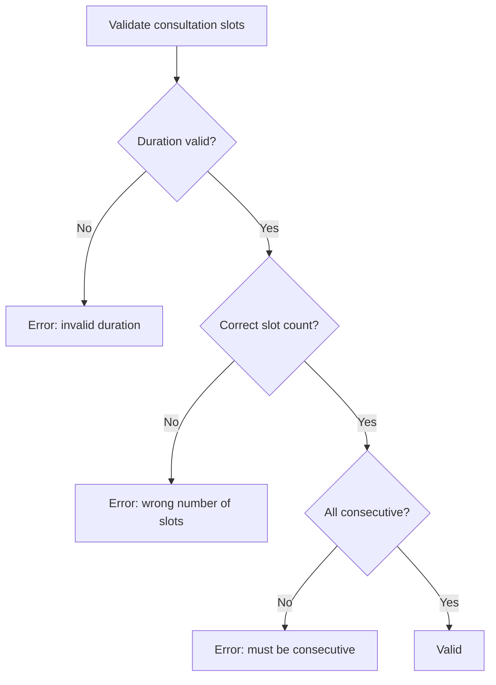
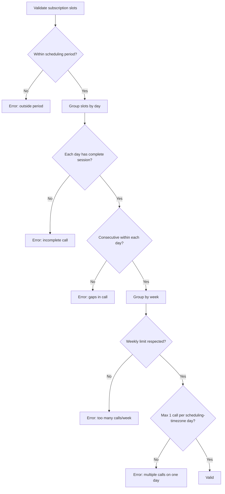
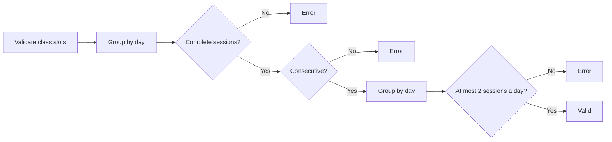
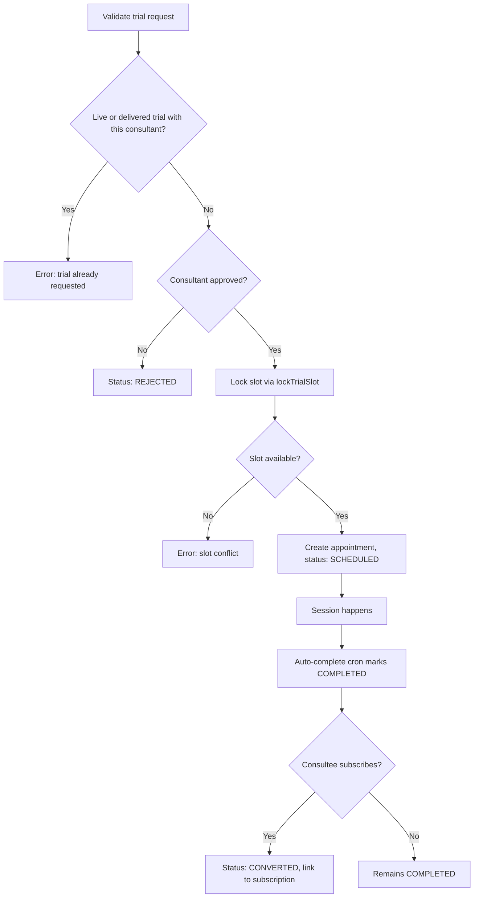
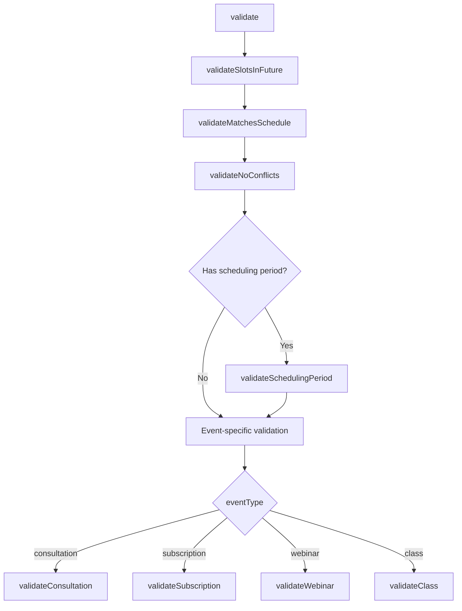

# Event Types & Validation

## Event Type Comparison

| Aspect                   | Consultation                     | Subscription                                             | Webinar                   | Class                                                       | Trial                            |
| ------------------------ | -------------------------------- | -------------------------------------------------------- | ------------------------- | ----------------------------------------------------------- | -------------------------------- |
| **Relationship**         | 1:1                              | 1:1                                                      | 1:many                    | 1:many                                                      | 1:1                              |
| **Frequency**            | One-time                         | Recurring                                                | One-time                  | Recurring                                                   | One-time (free)                  |
| **Duration field**       | `durationInHours` (total)        | `sessionDurationInHours` (per call) + `durationInMonths` | `durationInHours` (total) | `sessionDurationInHours` (per session) + `durationInMonths` | Fixed 0.5h (1 slot)              |
| **Slot grouping**        | Consecutive (may cross midnight) | 1 call/day max, consecutive within day                   | Consecutive               | Max 2-3 sessions/day, consecutive within session            | Single slot                      |
| **Scheduling period**    | None                             | Required [startDate, endDate]                            | None                      | Required [startDate, endDate]                               | None                             |
| **Appointments created** | 1                                | 1 per call (many)                                        | 1                         | 1 per session (many)                                        | 1                                |
| **Weekly limit**         | N/A                              | `sessionsPerWeek` (0-7)                                  | N/A                       | None (two a day at most)                                    | N/A                              |
| **Status field**         | `status`                         | `status`                                                 | `status`                  | `status`                                                    | `status` (TrialStatus)           |
| **Allocation modes**     | auto, manual, requested          | auto, manual, requested                                  | auto, manual              | auto, manual                                                | Consultant-scheduled             |
| **Min duration**         | 0.5h                             | 0.5h per session                                         | 0.5h                      | 0.5h per session                                            | 0.5h (fixed)                     |
| **Payment**              | Required                         | Required                                                 | Required                  | Required                                                    | Free                             |
| **Uniqueness**           | Multiple allowed                 | Multiple allowed                                         | Multiple allowed          | Multiple allowed                                            | One per consultant per consultee |

---

## Consultation

Single one-time session between consultant and consultee.

**Config**: `durationInHours` (0.5-4 hours) on the plan. Each request keeps the price it was made at in `Consultation.agreedPricePaise`; the length is read from the booked session (see "Agreed price and booked length" in [the booking lifecycle](./06-booking-lifecycle.md)).
**Slots**: `slotsPerSession = Math.ceil(minutes / 30)`, where the minutes are the length of the session the booking holds (`bookedSessionMinutes` in `lib/appointments/occurrences.ts`), or the plan's length when the booking has no session row at all.
**Rules**: The slots must be one consecutive block of exactly the booked length. The block may cross midnight, because contiguity and length, not the calendar day, keep it one session. Exactly one Appointment is created. `validateConsultation` (`utils/scheduling-engine/ScheduleValidationService.ts`) enforces this on the server, and `validateConsultationSelection` (`lib/scheduling/intervalSelectionValidation.ts`) applies the same rule in the browser.

**Example.** Hannah Anderson sells a 1-hour consultation. Priya Anderson requests Mon 16 Nov 2026 from 23:30 to 00:30 IST. That is two half-hour atoms, back to back, one on each side of midnight. The server accepts it as one session. The old rule judged the day in Asia/Kolkata for every host, so a session that crossed 18:30 UTC was refused on allocate, reschedule-accept and incident rebook even though the request door had accepted it.



**Booking flows**:

- **Direct checkout**: Consultee selects slot, pays. Appointment created with `isTentative: true`, confirmed on payment webhook.
- **Request-based**: Consultee submits preferred slots. Consultant approves/rejects via "Use Requested Slots" mode.

---

## Subscription

Recurring sessions over a period of months. Most complex event type.

**Config**: `sessionDurationInHours` (per call) + `durationInMonths` + `sessionsPerWeek` (0-7) + `schedulingPeriodStartsAt/EndsAt`
**Total calls**: `Subscription.sessionsTotal`, the entitlement frozen at purchase (#1766); a pre-#1766 row falls back to `plan.totalSessions`
**Slots this run**: `nextBatch * Math.ceil(sessionDurationInHours / 0.5)`, where `nextBatch` is the current cycle's remaining capacity from `subscriptionEntitlement`

Since #1766 the stored `schedulingPeriodStartsAt/EndsAt` describe the first cycle only, and the validated period is the current cycle's window, which starts at the latest of the stored start, the last held session's end and now and runs one cycle in the scheduling timezone. The plan-total gate compares every live call plus the proposed ones against `sessionsTotal`, so a call delivered in an earlier cycle still draws down the entitlement even though it sits outside the window in view.

**Rules**:

- All slots within the current cycle's window (`SubscriptionValidationResult.subscriptionPeriod`)
- Max 1 call per **scheduling-timezone** day (consecutive slots within that call). The same-day check buckets by `ScheduleCalculationService.dayKey()` in the event's `schedulingTimezone` (default Asia/Kolkata) on both the client and the server (ADR B9), so the verdict is identical everywhere; the old browser-local `toDateString()` bucketing disagreed with the server's for slots near day boundaries.
- Weekly limit: `sessionsPerWeek` calls per Sunday-Saturday **scheduling-timezone** week (`ScheduleCalculationService.weekKey()`)
- Weekly distribution validation counts **calls** (complete session groups), not raw slots

**Important**: The weekly cap still buckets by Sunday-to-Saturday scheduling-timezone weeks, while a cycle window is seven zone-days from wherever the last held session ended. A window that straddles two Sunday weeks therefore only has room in the days of the week that is not already at its cap.



**Delegates to**: `SubscriptionValidationService` for full validation.

---

## Webinar

Single one-time event with multiple attendees.

**Config**: `durationInHours` (0.5-4 hours)
**Slots**: `slotsPerSession = Math.ceil(durationInHours / 0.5)`
**Rules**: Consecutive slots required. Exactly one Appointment created. Consultant-scheduled (no request-based flow).

**Setting its time**: the host picks the start on their own calendar with the single-session picker (`SingleSessionPicker`). The picker lists every half-hour start of a day, labelled Free (inside published hours, unbooked), Outside your hours (allowed for an event), Busy or Too soon, in the host's zone. The server applies `eventTimeRefusal` (`lib/booking/event-time-rules.ts`) on create and on a changed time: the start must be on the UTC half hour and at least an hour away, or it answers 400 `EVENT_TIME_INVALID`. The end is the start plus whole minutes, so a 90-minute webinar's slot (and its co-host check) covers 90 minutes. For example, an IST host picks Thu 18:30, a 1.5 h webinar, and the session is stored as 13:00–14:30 UTC.

**After it sells**: once any buyer seat is live, the webinar is never re-planned through Manage timings (409 `USE_RETIME`); the host re-times it at least 24 hours out, and every attendee may leave with a full refund until `retimeBy`.

**Enrollment**: Consultees enroll via checkout. A full event is sold out — registration closes until the organizer raises its capacity.

---

## Class

Recurring sessions with multiple attendees over months.

**Config**: `sessionDurationInHours` (per session) + `durationInMonths` + `sessionsPerWeek`
**Total sessions**: `countWeeks(startDate, endDate) * sessionsPerWeek`
**Rules**: Complete sessions per day (slot count % slotsPerSession == 0), consecutive within day, at most two sessions a day, scheduling period. There is no weekly limit: a host may run a class faster than the plan's `sessionsPerWeek`, and only the per-day cap limits it. This is a deliberate owner decision (2026-11-12); "enforce the plan's cadence" is the fallback if learners complain. Subscriptions keep their plan-week rules. Auto-schedule still spreads sessions at the plan's cadence.



Consultant-scheduled. Consultees enroll via checkout; a full event reads as sold out.

**Scheduling a class**: the host schedules from a weekly pattern on the Manage timings page (`ClassPatternScheduler`): a first possible day plus weekday and time rows ("Mon and Thu at 18:00"). The pattern is projected into the plan's N sessions on the host's wall clock (`projectPattern` in `lib/booking/class-pattern.ts`), so a daylight-saving change keeps 18:00 at 18:00. Each session is labelled against the host's calendar before saving, and saving sends exactly those times through the allocator's manual mode, which re-checks overlap, co-hosts and the two-a-day cap. A pattern is checked against the UTC half-hour grid, so a host in a :45-offset zone such as Asia/Kathmandu is offered :15 and :45 local times (see the DST and timezone posture page). The week grid stays available as the calendar view. The editor's start date produces the default series through the same projection (`seriesStartsFrom`). The offering card's "Schedule now" link opens the scheduler for a class with no sessions yet.

**Creating a class with a start**: the class create route (`app/api/bookings/classes/crud-with-plan/route.ts`) refuses with 400 `EVENT_TIME_INVALID`, before any write, a start that is off the UTC half-hour grid, less than an hour ahead, or unable to place every session of the series. The editor rounds a class start up to the next half hour before it sends it (`components/offerings/editor/adapters.ts`), so a start that was a few minutes off the grid no longer publishes an empty class.

**Cancelling a draft**: a `DRAFT` webinar or class, including one with sessions already placed, can move to `CANCELLED` through the normal cancel door (`EVENT_ALLOWED_FROM` in `lib/booking/transitions.ts`), so the host is never stuck with it. `SCHEDULED` is still reachable from `DRAFT` only by publishing.

**After it sells**: the allocator refuses to re-plan a class with a live buyer seat (409 `USE_RETIME`). The host either moves every session at least 24 hours away to a new pattern in one step (`retimeClassSeries`, "Move upcoming sessions"), or cancels one session and schedules a make-up within 14 days with the single-session picker. A series move records no host miss and gives every seat a free leave until `retimeBy`; a cancel counts as a miss toward learners' exit right.

---

## Capacity

Capacity applies to the two group event types, webinars and classes. It lives in
two places, and the difference matters.

`WebinarPlan.maxParticipants` and `ClassPlan.maxParticipants` are the plan's
default: the number a newly created instance starts with.
`Webinar.maxParticipants` and `Class.maxParticipants` are nullable per-instance
overrides. The effective capacity of an event is its own value when it has one
and the plan's otherwise, which is what `effectiveMaxParticipants` in
`lib/events/capacity.ts` computes. Every surface that counts seats — the
checkout gates, the explore pages, the planner cards, the participants screen —
reads from that module, so there is one answer to "is this event full".

A seat is a live `AppointmentParticipant` row with the `CONSULTEE` role, whether
or not its payment has settled: a `HELD` seat holds its place for the checkout
window, and an abandoned checkout releases it when
`scripts/payments/cleanup-abandoned-payments.ts` flips the row to `CANCELLED`
(or immediately, if the buyer cancels the pending checkout). The host's own row
has another role, so it never takes a seat.

Two readers count seats, and they read different things on purpose:

- **The server gates** (checkout, the allocation lock, the revalidation) read
  the roster inside the lock through `getWebinarCapacity` and `getClassCapacity`.
- **Public payloads** (the plan detail routes, and the explore detail and
  checkout pages built from them) carry a seat _count_ per event, taken with
  `seatHoldingParticipant(now)` so a lapsed unpaid hold stops counting, and turn
  it into capacity with `eventCapacityFromCount`. The plan list routes carry no
  seat data. No public payload carries who holds the seats: those responses are
  public and CDN-cached, so an attendee id in them would be readable by anyone.

"Am I enrolled" is the viewer's own and is read on their own request. The
explore detail pages are server components that look up the signed-in viewer's
seats with `viewerSeatAppointmentIds` and pass the result down;
the explore list asks `GET /api/participants/event-seats`, which answers
`private, no-store` with only the caller's plan ids.

The organizer edits capacity from the planner, which submits to
`PATCH /api/bookings/{webinars,classes}/crud-with-plan`. Raising it simply
reopens registration; there is no queue to notify. Lowering it below the number
of people already registered is rejected with a 400 and a message naming the
current count, and the check runs inside the update transaction so a booking
cannot slip in between the check and the write. Nobody is ever removed from an
event by a capacity change.

---

## Sharing

A webinar or class plan page is built to be shared in a chat.

- **Link-preview tags.** `generateMetadata` on both detail pages (through
  `lib/seo/event-plan-share.ts`) sets the tab title, a description (the
  subtitle, else the opening of the description), the canonical URL and the
  Open Graph and Twitter tags. It runs behind the same `canViewPlanDetail`
  gate as the page, so a hidden plan gets a generic title and `noindex`
  instead of leaking its name.
- **Preview image.** Each page's `opengraph-image` route draws a 1200x630 PNG
  with `renderEventPlanShareImage`, about 20 to 50 KB, because WhatsApp drops
  large images; a host-uploaded cover can be several MB. The image is drawn for
  an anonymous visitor, so it names the plan only when anyone may see it. It
  carries no price, date or seats left, because messaging apps cache a preview
  for days. Responses are cacheable for five minutes.
- **Search.** `app/sitemap.ts` lists the plans that are publicly discoverable
  (`eventPlanDiscoverableWhere`), owned by a profile that is not erased and
  still holding a session that has not finished (`lib/data/indexable-plans.ts`,
  capped at 5,000 per kind). It is read at request time so a build never
  queries the database, and a database failure leaves the static routes.
- **No `Event` markup.** Google's Event structured-data documentation says
  virtual-only events are not supported (checked 2026-11-01), so these pages
  carry no schema.org `Event`.

---

## Trial

Free one-time session that lets a consultee try a subscription plan before committing.

**Config**: Fixed 0.5h (1 slot), no payment
**Slots**: 1 slot per trial
**Rules**: At most one live or delivered trial per consultant and consultee (`trial_one_blocking_per_pair_key`, a partial unique index in `prisma/sql/check-constraints.sql`); a cancelled trial stays as history and the learner may request again. Uses `lockTrialSlot()` for concurrency protection.

**Status lifecycle**: `PENDING` -> `SCHEDULED` -> `COMPLETED` -> `CONVERTED` (with `CANCELLED` and `REJECTED` branches)



**Data model**: `Trial` links to `ConsulteeProfile`, `ConsultantProfile`, `SubscriptionPlan`, and optionally to `Appointment` (when scheduled) and `Subscription` (when converted via `convertedToSubscriptionId`).

For full details see [09-trials.md](./09-trials.md).

---

## Validation Layers

### Layer 1: Zod Schemas

**File**: `schemas/slotAllocation/validationSchemas.ts`

Input format validation at the API boundary. Runs before any business logic.

**Schemas**:

```typescript
// Allocation request (PATCH /allocate)
allocationRequestSchema = z
  .object({
    isAuto: z.boolean(), // Required
    useRequestedSlots: z.boolean().optional(),
    slots: z.array(z.string().datetime()).optional(),
  })
  .refine((data) => {
    if (data.isAuto) return true; // Auto: no slots needed
    if (data.useRequestedSlots) return true; // Requested: no slots needed
    return data.slots && data.slots.length > 0; // Manual: slots required
  });

// Validation request (POST /validate)
validationRequestSchema = z.object({
  slots: z.array(z.string().datetime()).min(1),
});

// Event ID (URL parameter)
eventIdSchema = z
  .string()
  .min(1)
  .refine((id) => {
    return (
      /^[0-9a-f]{8}-[0-9a-f]{4}-[0-9a-f]{4}-[0-9a-f]{4}-[0-9a-f]{12}$/i.test(
        id,
      ) || // UUID
      /^[a-z][a-z0-9]{23,24}$/.test(id)
    ); // CUID (v1: 25 chars, v2: 24 chars)
  });
```

**Error handling**: `formatZodError()` converts Zod errors to `"field: message; field2: message2"` format. `safeParse()` wrapper returns `{success, data}` or `{success: false, error}`.

### Layer 2: Business Rules (ScheduleValidationService)

**File**: `utils/scheduling-engine/ScheduleValidationService.ts`

Server-side enforcement of all business rules. Runs inside the allocation transaction.



**Conflict detection** uses range overlap, not exact match:

```
slotStart < existingSlotEnd AND existingSlotStart < slotEnd
```

This catches partial overlaps that exact-match would miss.

**Schedule matching** (weekly availability):

- Projects each row from its local columns (`timezone`, `localStartDay`, `localStartMinutes`, `localEndMinutes`, `localEndDay`) through `createWeeklyCoverage` (`utils/schedule/weekly-projection.ts`), the same generator the grid and the allocator use, so a row keeps its local clock across DST.
- Handles overnight rows, whose end lands on the next local day.
- Each 30-minute slot must sit wholly inside one occurrence of a published row.
- Refuses a row whose local columns are NULL, reported once per validation.

### Layer 3: Database Constraints

Prisma enforces:

- Foreign key relationships (appointment -> event, slot -> appointment)
- NOT NULL constraints on required fields
- Enum constraints (`AppointmentsType`, `AppointmentStatus`, `DayOfWeek`)
- All appointment creation runs inside a Prisma transaction with 60-second timeout

---

## Availability Types

Consultants configure one of two schedule types:

### Weekly

Recurring weekly patterns stored in `AvailabilityWindowWeekly`:

- `startDay`: DayOfWeek enum (SUNDAY, MONDAY, ..., SATURDAY) -- **source of truth** for which day, expressed in the consultant's own local calendar
- `startTimeUtc`: Int (minutes since midnight UTC, 0-1439)
- `endTimeUtc`: Int (minutes since midnight UTC, 0-1439)
- `endDay`: DayOfWeek enum recording whether the row crosses midnight **in UTC**, which is a narrower question than whether it crosses midnight locally; an Asia/Kolkata 23:00–02:00 row is 17:30–20:30 UTC and is therefore stored as a single same-day row
- `utcOffsetMinutes`: Int frozen at write time, derived from the consultant's `User.timezone` by `lib/scheduling/weeklyUtcOffset.ts` and never accepted from the request body

### Custom

Specific date/time ranges stored in `AvailabilityWindowCustom`:

- `startsAt`: Exact DateTime
- `endsAt`: Exact DateTime
- Validated using overlap detection: `proposedStart < availEnd AND availStart < proposedEnd`

The `scheduleType` field on `ConsultantProfile` determines which availability set is used.

Every write to either table — the onboarding wizard, the settings page, and the per-row `/api/scheduling/availability/*` routes — validates through the one contract in `lib/scheduling/availability-contract.ts` (window length, order, overlap, no already-ended custom window, at least one window for the chosen type). The WEEKLY↔CUSTOM switch is blocked while anything is booked; shrinking hours within a type is allowed and reported. The rules and the switch guard are documented in [docs/onboarding/03-availability-contract.md](../onboarding/03-availability-contract.md).
