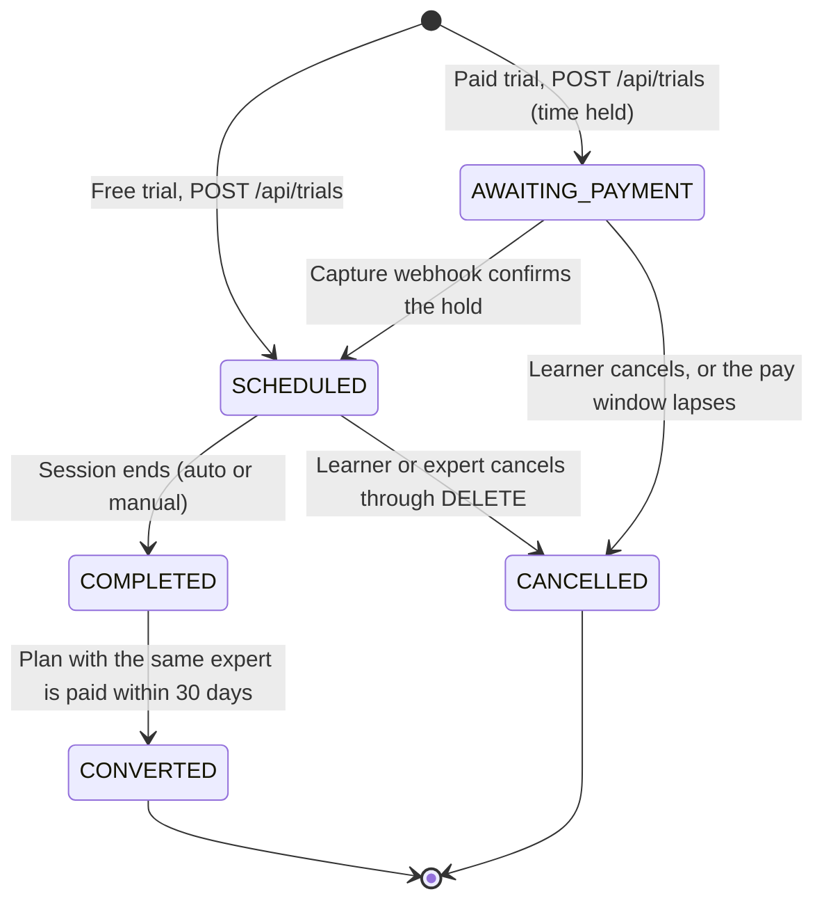
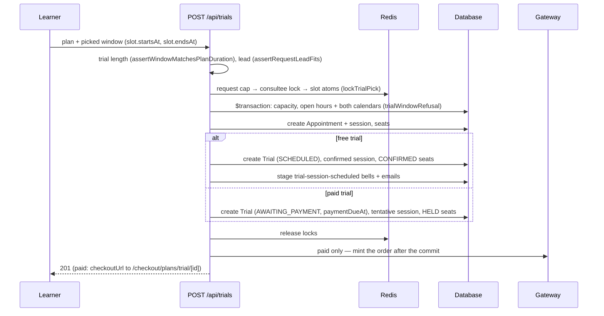

# Trial Sessions

## Overview

A trial session is a one-time session that lets a consultee try a consultant's subscription plan before committing to a paid subscription. Trials are tied to a `SubscriptionPlan` that has `trialEnabled: true`, and a consultee-consultant pair may hold at most one trial that is live or delivered at a time (enforced by a partial unique index). A pair keeps every trial it had: after a cancelled or lapsed trial the learner may ask again, and the request adds a new row beside the earlier one.

Key characteristics:

- **The buyer picks the time.** `POST /api/trials` requires one window of the plan's trial length, chosen from the expert's open times on the trial step of the dark mentorship dialog (`MentorshipTrialStep` in `app/explore/experts/[consultantId]/components/`), which uses the single-time picker (`components/scheduling/SingleTimePicker.tsx`).
- Priced per plan via `trialPriceInPaise`, which defaults to 0 (a free trial). A platform-wide minimum sits under every plan's trial price: only an ADMIN sets `PlatformPricingConfig.minTrialPriceInPaise`, via `PATCH /api/admin/trial-pricing`, which the matrix key `trialPricing.manage` gates (`ADMIN_ONLY` in `lib/auth/backoffice-permissions.ts`; STAFF get 403 on `GET` and `PATCH`). The plan create/update routes reject prices below it for every expert.
- **A free trial is confirmed at once**: the request writes the trial as `SCHEDULED` with a confirmed session. **A paid trial holds its time** as `AWAITING_PAYMENT` with a tentative session until the capture confirms it, and the hold lapses through the expire-unpaid-trials sweep if nobody pays.
- Duration configured per plan via `trialDurationMinutes`: 30 or 60 minutes (default 30), checked on write by `SubscriptionPlanSchema` against `TRIAL_DURATION_MINUTES` (`schemas/trial-length.ts`) and offered in the editor as two radio buttons. A plan saved earlier with another length keeps booking at it until its next save, which asks for 30 or 60. `assertWindowMatchesPlanDuration` refuses a window of any other length than the plan's.
- **The price is agreed at request.** `bookTrialInTx` writes `Trial.agreedPricePaise` from the plan's `trialPriceInPaise`, and a later plan edit never moves it. The length is not stored: it is read from the session the trial holds (see "Agreed price and booked length" below).
- Each side may **reschedule** a trial once, at least 24 hours before it starts; the **expert can cancel** a scheduled trial, which refunds the learner in full and records a reliability strike.
- Successful trials can convert into a full subscription.

**Source files:**

- Model: `prisma/schema.prisma` (Trial, TrialStatus)
- API: `app/api/trials/route.ts`, `app/api/trials/[trialId]/route.ts`, `app/api/trials/check-eligibility/route.ts`, and the shared reschedule routes under `app/api/appointments/[appointmentId]/reschedule/`
- Booking: `lib/trials/book-trial.ts` (`bookTrialInTx`, `lockTrialPick`), `lib/trials/slot-check.ts` (`trialWindowRefusal`)
- Reschedule: `lib/booking/trial-reschedule.ts` (`confirmTrialProposal`), `lib/booking/reschedule-caps.ts` (`trialCapReached`)
- Cancellation: `lib/trials/cancellation.ts`
- Locking: `utils/appointmentlock.ts` (`lockConsulteeBooking`, `lockSlotBatch` — the shared slot-atom lock)
- Auto-completion: `scripts/appointments/auto-complete-appointments.ts`
- Notifications: `lib/novu/workflows.ts`

---

## Data Model

### Trial

| Field                       | Type               | Default  | Description                                                                 |
| --------------------------- | ------------------ | -------- | --------------------------------------------------------------------------- |
| `id`                        | `String` (cuid)    | auto     | Primary key                                                                 |
| `status`                    | `TrialStatus`      | none     | Written at request: `SCHEDULED` (free) or `AWAITING_PAYMENT` (paid)         |
| `notes`                     | `String?` (Text)   | null     | Consultee's questions or goals for the trial                                |
| `consulteeProfileId`        | `String`           | required | FK to ConsulteeProfile                                                      |
| `consultantProfileId`       | `String`           | required | FK to ConsultantProfile                                                     |
| `subscriptionPlanId`        | `String`           | required | FK to SubscriptionPlan (must have trial enabled)                            |
| `agreedPricePaise`          | `BigInt?`          | null     | Trial price agreed at request; null reads the plan (rows before the column) |
| `appointmentId`             | `String?` (unique) | null     | FK to Appointment, created with the trial and its picked session at request |
| `convertedToSubscriptionId` | `String?` (unique) | null     | FK to Subscription (set when CONVERTED)                                     |
| `requestedAt`               | `DateTime`         | `now()`  | When the trial was requested                                                |
| `completedAt`               | `DateTime?`        | null     | When the session was completed                                              |
| `createdAt`                 | `DateTime`         | `now()`  | Record creation timestamp                                                   |
| `updatedAt`                 | `DateTime`         | auto     | Last update timestamp                                                       |

### Constraints

| Constraint                                                                      | Type           | Purpose                                                                                |
| ------------------------------------------------------------------------------- | -------------- | -------------------------------------------------------------------------------------- |
| `trial_one_blocking_per_pair_key` (sidecar, `prisma/sql/check-constraints.sql`) | Partial unique | At most one `AWAITING_PAYMENT`, `SCHEDULED`, `COMPLETED` or `CONVERTED` trial per pair |
| `appointmentId @unique`                                                         | Unique         | One-to-one relationship with Appointment                                               |
| `convertedToSubscriptionId @unique`                                             | Unique         | One-to-one relationship with Subscription                                              |

The index's status list is `TRIAL_REQUEST_BLOCKING_STATUSES` in `lib/trials/eligibility.ts`, and the two must stay equal. Only `CANCELLED` frees the pair, and it is terminal, so a row enters the blocking set only at insert; no transition can make the index refuse a status change. `__tests__/db/booking/trial-history.db.test.ts` runs every status against the index.

### One pair, several trials

Learner X requests a paid trial with expert Y and never pays; the expire-unpaid-trials sweep cancels it. X asks again for a later time. The table now holds two rows for (X, Y): the first `CANCELLED`, still linked to its own appointment, payment order and price, and the second `AWAITING_PAYMENT` with a new appointment. A third request while the second is open is refused with 409 `TRIAL_ALREADY_REQUESTED`. Readers that ask whether the pair may book read the blocking trial (`blockingTrialWhere`); readers that show history read every row.

### Indexes

| Index                                       | Purpose                                     |
| ------------------------------------------- | ------------------------------------------- |
| `[consulteeProfileId, consultantProfileId]` | Read a pair's trials (eligibility, history) |
| `consultantProfileId`                       | Filter trials by consultant                 |
| `subscriptionPlanId`                        | Filter trials by plan                       |

### TrialStatus Enum

| Value              | Description                                                        |
| ------------------ | ------------------------------------------------------------------ |
| `AWAITING_PAYMENT` | A paid trial holding its picked time until the capture confirms it |
| `SCHEDULED`        | Time confirmed (free at request, paid at capture)                  |
| `COMPLETED`        | Trial session finished                                             |
| `CONVERTED`        | Consultee subscribed after trial                                   |
| `CANCELLED`        | Cancelled by either party, or lapsed unpaid                        |

---

## Agreed price and booked length

A trial keeps the price it was requested at, and the length of the session it holds. `bookTrialInTx` stamps `agreedPricePaise` on the row when it is created, from the plan's `trialPriceInPaise` that the request was just checked against. If the expert later changes the trial price, the plan edit route (`PUT /api/plans/subscriptions/[subscriptionPlanId]`) first calls `freezeTrialPrice` (`lib/booking/sold-terms.ts`) inside its own transaction, which stamps every trial of that plan that is still null, and only then changes the plan. A change to the trial length alone freezes nothing. The database refuses a negative price through `trial_agreed_price_valid` in `prisma/sql/check-constraints.sql`.

The price readers use `agreedTrialPricePaise`: the approval pay-link price (`calculateAmount` in `lib/payments/operations/approval-payment.ts`). The length is never stored on the trial, because a trial holds its time from the moment it is requested and that session already records the length. `bookedSessionMinutes` (`lib/appointments/occurrences.ts`) returns the live session's length, else the latest session row's, and the plan's `trialDurationMinutes` is used only when the booking has no session row at all. The trial reschedule confirmation (`confirmTrialProposal` in `lib/booking/trial-reschedule.ts`) and the reschedule pages under `app/dashboard/` read the length that way.

**Example.** Raj Anderson requests Hannah Anderson's trial when the plan says ₹200 (20,000 paise) and 30 minutes. Hannah then edits the plan to ₹500 and 60 minutes. Raj's pay link is still ₹200 plus tax, and when he moves the call the new window must still be exactly 30 minutes, because his held session is 30 minutes long.

**Known leftovers.** Several display-only readers also still show the plan's current figures for a booking. A row with a null price is a row created before the column, so it reads the plan by design.

---

## Status Lifecycle



`POST /api/trials` creates the row directly in its final state and writes one `BookingStatusHistory` creation row; the expert is never asked to accept or decline. A reschedule does not change `Trial.status`: the trial stays `SCHEDULED` while its one session is released (see "Rescheduling a trial").

Valid transitions, as `TRIAL_ALLOWED_FROM` in `lib/booking/transitions.ts` encodes them and `transitionTrial` enforces them; `AWAITING_PAYMENT` is server-set only and is deliberately absent from the client-facing `TrialSessionStatusEnum`, so a request body can never assert it:

| From               | Allowed targets          |
| ------------------ | ------------------------ |
| `AWAITING_PAYMENT` | `SCHEDULED`, `CANCELLED` |
| `SCHEDULED`        | `COMPLETED`, `CANCELLED` |
| `COMPLETED`        | `CONVERTED`              |
| `CONVERTED`        | (terminal)               |
| `CANCELLED`        | (terminal)               |

The `PATCH /api/trials/[trialId]` route offers a narrower set than the map. It never moves `AWAITING_PAYMENT` to `SCHEDULED` (only the capture webhook confirms a paid hold, so an unpaid hold can never be confirmed by hand), and it answers 409 `USE_CANCEL_ENDPOINT` to `CANCELLED` on a `SCHEDULED` trial, because `DELETE` is the one door that owns the cancel window, the quoted refund, the strike and any open reschedule.

### Cancellation behaviour

`DELETE /api/trials/[trialId]` is the door that ends a trial. It accepts `AWAITING_PAYMENT` and `SCHEDULED` trials, from the learner or the trial's own expert. An operator who is not a party is refused with 403 `PLATFORM_CANCEL_DOOR_REQUIRED` (`platformCancelDoorRefusal` in `lib/booking/platform-cancel.ts`), and there is no staff door for a trial yet; the decision to build one is tracked in the issue "[backoffice][trials][P3] Decide a staff door to end a paid trial (deferred at Train 6; revisit with F8)" (#2836), see [the back-office decision record](../decisions/2026-11-16-train-6-back-office.md).

- **One transaction, under the appointment lock.** The status CAS (narrowed to the status the caller read), an expert's strike, `declineOpenReschedules` for any open reschedule request, the tombstone (`softCancelTrialAppointmentInTx` in `lib/trials/cancellation.ts`: the sessions move to `CANCELLED` with `deletedAt`, the appointment gets `deletedAt`, the seats move to `CANCELLED`) and the refund-owed marker commit together. Doctrine rule 2 forbids deleting anything a `Payment` points at, so nothing is deleted.
- **The cancel window.** `trialCancelWindowRefusal` reads `cancelWindowRefusal` (`lib/booking/session-window.ts`): from 15 minutes before the session until it ends the answer is 409 `SESSION_IN_PROGRESS`, and a delivered trial answers 409 `SESSION_ALREADY_DELIVERED`.
- **A paid trial shows its refund quote first.** The cancel dialog calls `GET /api/trials/[trialId]/cancel/preview` (`quoteTrialRefund`) and sends `DELETE` with `confirmedRefundPaise`; `DELETE` re-quotes under the lock and refunds exactly that quote. A missing confirmation answers 409 `REFUND_QUOTE_REQUIRED`, a stale one 409 `REFUND_QUOTE_CHANGED`, and both carry the current quote. The click also carries `expectedPaid`, as the appointment door's does: the preview answers `expectedPaid: true` with a paid quote, and the learner's dialog for a held trial sends `false` (the expert's dialog on an unpaid trial sends an empty body, which a paid trial refuses with `REFUND_QUOTE_REQUIRED`). A click made on an unpaid screen is refused with `REFUND_QUOTE_CHANGED` ("Your payment just went through") whenever the trial is now paid, even when the new quote is also ₹0, and the learner's dialog closes on that toast. For example, Riya opens her ₹100 trial while it is still awaiting payment, her payment lands in another tab, and she presses Cancel 30 minutes before the session: the server sees a paid trial in the 0 % tier, refuses, and she sees the paid quote before anything is cancelled. An older client that sends no `expectedPaid` is logged as unbound and checked on the amount alone (`assertTrialQuoteConfirmed`). The marker (`trialRefundOwed`, key `trial-cancel:<trialId>:<paymentId>`) is stamped with `stampRefundOwed` in the cancel commit and driven through `refundBookingPayment` by `refundCancelledTrial`; the retry sweep re-drives it if the gateway leg fails. A trial with no payment answers `{ paid: false }`, and a `free_` ₹0 payment that holds no referral credit answers `freeBooking: true`, so the dialog says there is nothing to refund instead of quoting ₹0.
- **Who pays.** The learner's own cancel is quoted on the booking-time policy's notice tiers. Anyone else cancels on the consultant's side, so the quote uses `consultantInitiatedPct` (100 %) whatever the notice: the learner gets everything still refundable back.
- **The expert's cancel records a strike.** When the trial's own expert cancels a `SCHEDULED` trial, `recordExpertStrike` (`lib/booking/expert-reliability.ts`) writes one `EXPERT_CANCEL` strike in the same transaction, for a free trial too. A staff cancel records none, and cancelling a trial that was never confirmed records none.
- **A held trial's payment dies with it.** When the trial still has a `PENDING` payment (a paid trial that is `AWAITING_PAYMENT`), `DELETE`, the `PATCH` cancel, the learner's "Request again" (`closeOrderForRequestAgain`) and the expire-unpaid-trials sweep call `expirePendingPaymentsInTx` (`lib/booking/pending-payment-expiry.ts`) inside the same transaction, before the trial moves: the payment first, then the trial, which is the capture's own lock order (payment, then trial). The gateway order is cancelled after the commit (`cancelGatewayOrders`, best effort); "Request again" instead asks the gateway before the transaction and closes nothing while it holds a live payment. A capture that still lands on the expired payment is parked and refunded. A payment that was already captured is left alone and goes through the quoted refund below. For example, Daniel Brown holds a ₹500 (50,000 paise) paid trial with Hannah Anderson and never pays: when the sweep cancels it, the ₹500 order is `EXPIRED` in the same commit, so a late payment cannot revive a trial that no longer exists.
- **Notices.** The other party gets `trial-session-cancelled`; the learner gets the `trial-refunded` bell only once money actually moved.

The `PATCH` route cancels only a trial awaiting payment (409 `USE_CANCEL_ENDPOINT` for `SCHEDULED`), and refuses a paid one with 409 `REFUND_QUOTE_REQUIRED`; its CAS carries `paymentId: null`, so a capture that commits first turns the cancel into a 409. A learner who has not paid can also leave through the abandon door, `POST /api/bookings/[bookingId]/abandon` ([06-booking-lifecycle.md](./06-booking-lifecycle.md)).

#### Worked example: the expert cancels a paid trial

A ₹500 trial (`trialPriceInPaise` 50,000) is `SCHEDULED` for Thursday 10:00. On Thursday at 09:30 the expert opens "Cancel trial". The preview quotes 50,000 paise at 100 % (the consultant tier ignores the 30 minutes of notice that would give the learner 0 % on their own cancel). The expert confirms; `DELETE` re-quotes 50,000, and one transaction moves the trial to `CANCELLED`, writes the strike, tombstones the session and stamps `refundOwedKey = trial-cancel:<trialId>:<paymentId>` with 50,000 paise. After the commit `refundBookingPayment` refunds 50,000 to the card and the learner gets the refunded bell. Had the expert tried at 09:50, the answer would have been 409 `SESSION_IN_PROGRESS` and nothing would have moved.

### Conversion Handler (PATCH CONVERTED)

The `CONVERTED` transition requires a `subscriptionId` in the request body. The handler validates:

1. The subscription exists and belongs to the same plan as the trial (`subscriptionPlanId` match).
2. The subscription belongs to the same consultee as the trial.
3. The trial is linked to the subscription via `convertedToSubscriptionId`.
4. An activity log entry is created via `logTrialConverted()`.

```json
{
  "status": "CONVERTED",
  "subscriptionId": "subscription-uuid-here"
}
```

---

## Booking Flow



### Step-by-step

1. **Pick** — on the expert page, "Book Trial" opens the mentorship dialog on its trial step (step one is the start-date choice; Back returns to it). The step shows the dark single-time picker: a month of the expert's availability read with the learner's own busy times (`consulteeUserId`), cut into windows of the trial's length by `windowsForDay` at `leadMsFor("request", { settled })` — 15 minutes for a free trial, 2 hours for a paid one, which still has to be paid. Before `POST /api/trials` the step checks `/api/trials/check-eligibility`; after a free booking it calls `invalidateAvailability`.
2. **Validate before anything is held** — the route refuses a window of the wrong length (400 `WINDOW_DURATION_MISMATCH`) or one inside the lead (409 `REQUEST_TOO_SOON`) before it reads the pair's trials. It then reads the pair's blocking trial (live or delivered) and refuses with 409 `TRIAL_ALREADY_REQUESTED` if one exists; an earlier cancelled trial is left exactly as it is. Every validity check, including the plan lookup, runs before the request limiter, so a refused request costs no attempt.

   The limiter (`trialRequestLimiter`, 3 trials per 24 hours per caller, privileged roles included) is read without spending by `trialRequestRefusal` and spent by `spendTrialRequest` only once a trial has been created (`lib/rate-limit.ts`). A caller who has already created three answers 429 `RATE_LIMITED` with `retryAfterSeconds`, `retryAt` and a `Retry-After` header, and the trial step shows when they may retry in their own zone. If Redis is slow or down the read lets the request through. For example, Daniel Brown's requests are refused twice because the plan is still a draft; he then books a trial once, and he has spent one of his three, not three.

3. **Lock** — the expert's request-cap lock (its count and the insert run under it), then `lockTrialPick`: the consultee lock and one all-or-nothing slot batch over the host and, for a learner who is an expert too, their own calendar. Contention answers 423 `SLOT_BUSY`; Redis down answers 503.
4. **Write** — `bookTrialInTx` (`lib/trials/book-trial.ts`) checks `trialWindowRefusal` on the transaction's client (400 `OUTSIDE_AVAILABILITY`, 409 `SLOT_TAKEN`), creates the appointment with its one session (stamped with `consultantProfileId`), the seats and the trial in its final status (with the sold price frozen on the row), and appends the one creation history row. A free trial's session is confirmed, so a concurrent confirmed overlap meets `occurrence_no_confirmed_overlap` and answers 409 `SLOT_TAKEN`. Two requests for the same pair that both passed the route's read are caught twice: `bookTrialInTx` re-reads the pair's blocking trial under the consultee lock (`TrialPairHeldError`), and `trial_one_blocking_per_pair_key` refuses the loser's insert. Either way the loser answers the same 409 `TRIAL_ALREADY_REQUESTED`, and a unique violation on any other constraint stays a 500.
5. **Pay (paid trial only)** — the order is minted after the commit against the trial's appointment and persisted as the pay page (`persistTrialPayLink`). The pay window, `Trial.paymentDueAt` and `Payment.expiresAt` alike, is `payWindowEnd`: 24 hours, but never later than 15 minutes before the session. The capture webhook moves the trial `AWAITING_PAYMENT → SCHEDULED`, stamps `Trial.paymentId`, and `confirmExistingAppointment` confirms the held session and seats in place. An unpaid hold past `paymentDueAt` is cancelled and tombstoned by the expire-unpaid-trials sweep, which frees the time. A capture that lands after the held session already started (between the pay window closing and that sweep) never confirms it: the capture webhook cancels the trial, tombstones the hold and parks the payment for the full automatic refund, answering `captured_after_release`.
6. **Session, completion, conversion** — both parties join through Stream; the auto-complete pass (every 30 minutes) completes the trial once its confirmed session has ended (1-hour buffer); a plan with the same expert paid within 30 days converts it.

The consultant never schedules, accepts or declines a trial: `PATCH /api/trials/[trialId]` accepts only `COMPLETED`, `CONVERTED` and `CANCELLED` (`TrialSessionStatusEnum`).

#### Worked example: two learners pick the same free time

Learners A and B both pick Tuesday 18:00 on the same expert's free 30-minute trial. Both requests take their own consultee locks, then race for the same slot atom; B waits while A holds it. A's transaction finds the window open, writes a confirmed session and commits `SCHEDULED`; A's locks release. B now gets the atom, but `trialWindowRefusal` sees A's session and B's request answers 409 `SLOT_TAKEN` ("That time was just taken. Pick another time."), and the trial step drops B's pick and re-reads the grid. If B's request had somehow skipped the atoms, the overlap constraint would have refused B's confirmed session with the same 409. A paid hold behaves the same way through the atoms and the occupancy read, because an `AWAITING_PAYMENT` trial's session occupies its time.

### Paying for a trial

A priced trial is paid for on our own checkout page at `/checkout/plans/trial/[trialId]`, a single card centred under the site header (the route keeps the public header through `CHROME_SHOWN_PREFIXES` in `lib/navigation/public-chrome.ts`), and every "Pay Now" affordance in the product has to land there: the page names the amount, shows the held session in the viewer's own timezone and states when the hold lapses, then hands off to `/checkout/pay/[paymentId]`. The one place that decision is made is `bookingPayHref` in `lib/appointments/trial-checkout-href.ts`: the branded trial page for a trial row, our pay page for a Razorpay order, and a hosted link only when one is an https URL. The `Trial` id survives only in the synthetic view-model id the mappers mint (`trial-<id>`), which is why the helper parses that prefix. A new surface that offers to pay for a booking must call the helper rather than link to `pendingPaymentUrl`.

A lost pay link is re-minted from the learner's own read (`remintTrialPayLink` in `lib/trials/pay-link.ts`) while the pay window is open, reusing a live PENDING intent before minting a second order. The persist is a CAS on the payable statuses, so a mint that lands after the sweep cancelled the trial tombstones the orphaned order (`reconcileOrphanedPayLink`).

---

## Rescheduling a trial

A trial is one session (ordinal 1), and each side may move it **once**, through the same `RescheduleRequest` machinery as consultations (`POST /api/appointments/[appointmentId]/reschedule`).

- **Who and when.** Only the trial's learner or expert (403 `TRIAL_PARTY_ONLY` otherwise, even for an organisation operator). A booking that holds a live, unexpired `PENDING` payment cannot be rescheduled at all (409 `PAY_LINK_LIVE`). The trial must be `SCHEDULED`, its session at least 24 hours away (`RESCHEDULE_MIN_LEAD_HOURS`), and the new time at least 24 hours away too (`leadMsFor("reschedule")`).
- **Always a named time.** A trial has no allocator to place it later, so the request must carry the new window (400 `PROPOSAL_REQUIRED`), sent as its 30-minute atoms (`trialProposalAtoms`). The release flips the session to `RESCHEDULED` (tentative) and opens the booking's one request with `originStatus: SCHEDULED`; `Trial.status` stays `SCHEDULED` behind a locking touch.
- **Confirming.** `confirmTrialProposal` (`lib/booking/trial-reschedule.ts`) closes the request and moves the released session in place onto the new window in one transaction, under the appointment lock, the consultee lock and the window's slot atoms, after checking the trial's length, the lead, the expert's open hours and both calendars (`trialWindowRefusal`, excluding the trial's own appointment). A **learner's** proposal confirms at once when it passes (`AUTO_ACCEPTED`); if the time was just taken or cannot be booked, the request is withdrawn on the spot, the trial keeps its time, and the route answers 409 `TIMES_TAKEN` or `TIME_NOT_BOOKABLE`. An **expert's** proposal waits for the learner, who answers on the appointment's `RescheduleProposalCard` (`POST …/reschedule/respond`): Accept runs the same confirm (`ACCEPTED`), Decline restores.
- **Endings that restore.** Decline, the initiator's withdraw and the expiry sweep all call `restoreRescheduledBooking`, which puts the session back at its original time and stamps `restoredAt`, so the request costs no move. A trial that is cancelled while a request is open has it declined in the cancel commit.
- **Caps.** `trialCapReached` (`lib/booking/reschedule-caps.ts`, `MAX_TRIAL_RESCHEDULES_PER_SIDE = 1`) counts the side's earlier requests that really moved the trial (`countedReleases`). The learner's second move answers 422 `MAX_RESCHEDULES_EXCEEDED`, the expert's 409 `EXPERT_RESCHEDULE_CAP`.
- **Pickers.** Both sides pick on the light single-time picker at the reschedule lead (`purpose="reschedule"`, 24 hours), offering only free times inside the expert's published hours: the learner on `/dashboard/consultee/[consulteeId]/appointments/[appointmentId]/reschedule` with their own busy times, the expert on the consultant reschedule page ("Propose a new trial time") with the learner's `consulteeUserId`, so the learner's busy times apply too.

#### Worked example: one move each

A free trial is booked for Friday 10:00. On Monday the learner moves it to Saturday 11:00: the time is in the expert's open hours and both calendars are free, so it confirms at once and the session row now reads Saturday 11:00. On Tuesday the learner tries Sunday: 422 `MAX_RESCHEDULES_EXCEEDED`. On Wednesday the expert proposes Saturday 15:00; the session is released and the learner sees the proposal. The learner declines, so the session goes back to Saturday 11:00 and the request is stamped `restoredAt` — the expert has not used their move, and may propose again. Had the learner accepted, the expert's next attempt would answer 409 `EXPERT_RESCHEDULE_CAP`.

---

## How Trial Differs from Consultation

| Aspect               | Trial                                                                                                | Consultation                              |
| -------------------- | ---------------------------------------------------------------------------------------------------- | ----------------------------------------- |
| **Payment**          | Per plan's `trialPriceInPaise` (0 = free, the default); a priced trial holds its time until captured | Required (via checkout)                   |
| **Duration**         | Fixed per plan (`trialDurationMinutes`, 30 or 60 min, default 30)                                    | Variable (`durationInHours`, 0.5-4h)      |
| **Locks**            | Consultee lock + shared `slot-booking:` atoms (`lockTrialPick`)                                      | Consultee lock + shared atoms             |
| **Uniqueness**       | At most one live or delivered trial per pair; ended trials stay as history                           | Multiple allowed                          |
| **Conversion**       | Leads to Subscription (`convertedToSubscriptionId`)                                                  | Standalone                                |
| **Status field**     | `status` (TrialStatus enum)                                                                          | `status` (AppointmentStatus enum)         |
| **Appointment type** | `TRIAL`                                                                                              | `CONSULTATION`                            |
| **Booking flow**     | The learner picks; free confirms at once, paid at capture                                            | Direct checkout or request-based          |
| **Reschedule**       | Once per side, a named window, confirmed in place                                                    | Per-session caps, placed by the allocator |
| **Slot count**       | Single session (1)                                                                                   | `Math.ceil(durationInHours / 0.5)` atoms  |

---

## Concurrency Protection

Every trial time writer — the buyer's pick and a reschedule confirm — takes the same locks as every other direct slot writer, in checkout's global order: the consultee lock (`lockConsulteeBooking`), then one all-or-nothing slot batch (`lockSlotBatch`, one `slot-booking:{consultantProfileId}:{atomStartISO}` key per 30-minute atom) over the host and, for a learner who is an expert too, their own calendar. The request also takes the expert's request-cap lock first, and a reschedule confirm takes the appointment lock first. The availability check (`trialWindowRefusal`) runs inside the writing transaction and covers both calendars, because the consultant-keyed exclusion constraint cannot see the consultee's other bookings. Every trial session is stamped with `consultantProfileId`, so a confirmed one is inside `occurrence_no_confirmed_overlap`; a paid hold is tentative and outside it, so the atoms and the occupancy read (an `AWAITING_PAYMENT` trial occupies its time, `buildOccupiedAppointmentFilter`) are what serialise it until the capture confirms it.

Lock contention answers 423; when Redis is unreachable, acquisition fails closed with 503 (`BookingLockUnavailableError`). Locks are released in a `finally` block.

---

## Auto-Completion

**File:** `scripts/appointments/auto-complete-appointments.ts`
**Schedule:** every 30 minutes on the five-minute ticker (`TARGET_EVERY_MINUTES` in `lib/cron/schedule.ts`)
**Buffer:** 1 hour after session end time

The `completeTrials()` function:

1. Queries `Trial` records where `status = SCHEDULED` and every confirmed (non-tentative, live) session ended before `now - 1 hour` (`completableTrialWhere`)
2. Updates each to `status = COMPLETED` with `completedAt = now()`

A session released by an open reschedule is tentative, so a trial being moved is never completed on its old time; the request expires at least 24 hours before that time and restores it.

Additionally, the `GET /api/trials` endpoint performs an inline auto-complete check (without the buffer) to keep the UI current between cron runs.

---

## Conversion to Subscription

**The prompt to continue.** The buyer's trial detail page carries a "Continue with {expert}" card, quiet before the session and prominent once it completes. When the trial completes, the learner gets one bell and one email headed "Continue with {expert}" that open the plan's checkout page, and the expert gets a bell only (`stageTrialCompletedNotices`, `lib/booking/trial-completed-notice.ts`, called by the trial route and the auto-complete sweep). See [the booking follow-up train](../decisions/2026-11-12-booking-follow-up-train.md), decision 6, and [the required notices record](../decisions/2026-11-15-required-notices-and-deadline-alerts.md), decision 4.

When a consultee decides to subscribe after a trial, the trial status transitions from `COMPLETED` to `CONVERTED`:

```
Trial.convertedToSubscriptionId --> Subscription.id
Subscription.convertedFromTrial --> Trial
```

This is a one-to-one relationship (both FKs carry `@unique`). The conversion is triggered by a `PATCH` to `/api/trials/[trialId]` with `status: "CONVERTED"` and a `subscriptionId` in the body. The handler:

1. Validates the `subscriptionId` is provided (returns 400 if missing).
2. Confirms the subscription belongs to the same plan and consultee as the trial.
3. Sets `convertedToSubscriptionId` on the trial record.

The link enables:

- Tracking trial-to-subscription conversion rates
- Displaying conversion status on the consultant dashboard
- Activity log entries with `activityType = TRIAL_CONVERTED`

---

## Notifications

Trial events trigger Novu workflows defined in `lib/novu/workflows.ts`. All trial workflows use the `TrialPayload` type.

| Workflow ID               | Trigger                              | Recipients                                                                         |
| ------------------------- | ------------------------------------ | ---------------------------------------------------------------------------------- |
| `trial-session-scheduled` | A free trial is booked               | Both parties                                                                       |
| `trial-session-completed` | Trial session ends                   | Both parties (learner: bell and email "Continue with {expert}"; expert: bell only) |
| `trial-session-cancelled` | Trial cancelled                      | The other party                                                                    |
| `trial-refunded`          | A cancelled paid trial's money moved | Learner                                                                            |

**Payload type** (`TrialPayload`):

| Field            | Type      | Description                     |
| ---------------- | --------- | ------------------------------- |
| `consultantName` | `string`  | Consultant display name         |
| `consulteeName`  | `string`  | Consultee display name          |
| `planTitle`      | `string`  | Subscription plan title         |
| `dateTime`       | `string?` | Scheduled time (ISO format)     |
| `status`         | `string`  | Current trial status            |
| `dashboardUrl`   | `string`  | Link to relevant dashboard page |

A paid trial's confirmation reaches both parties through the capture's booked emails. A trial reschedule uses the shared `appointment-rescheduled` family. Its bell is staged on the move's transaction through the outbox and goes only to the party who did not make the move (`stageTrialMovedBells` in `lib/booking/trial-reschedule.ts`), and its notices name the trial's parties through `rescheduleParties` (`lib/booking/reschedule-outcome-notice.ts`). A paid trial whose payment is captured after its held session started is cancelled by the capture, and both parties get the existing `trial-session-cancelled` notice, staged with the release and sent after commit (`stageTrialPaidAfterStartNotice` in `lib/payments/webhooks/handlers.ts`).

Users can disable trial notifications via `NotificationPreference.trialNotifications`.

---

## API Reference

| Method   | Endpoint                                    | Auth Required               | Purpose                                                                                |
| -------- | ------------------------------------------- | --------------------------- | -------------------------------------------------------------------------------------- |
| `GET`    | `/api/trials`                               | Yes (session)               | List trials (paginated, filterable)                                                    |
| `POST`   | `/api/trials`                               | Yes (session)               | Book a trial at the picked `slot` (free: confirmed; paid: held, returns `checkoutUrl`) |
| `GET`    | `/api/trials/[trialId]`                     | Yes (session)               | Get a specific trial session                                                           |
| `PATCH`  | `/api/trials/[trialId]`                     | Yes (session)               | Update notes, cancel an unpaid trial, complete or convert                              |
| `DELETE` | `/api/trials/[trialId]`                     | Yes (session)               | Cancel an AWAITING_PAYMENT or SCHEDULED trial; a paid one needs `confirmedRefundPaise` |
| `GET`    | `/api/trials/[trialId]/cancel/preview`      | Yes (session)               | Refund quote for cancelling the trial now, for the caller's side                       |
| `POST`   | `/api/appointments/[id]/reschedule`         | Yes (session, party)        | Move the trial once per side to a named window (see "Rescheduling a trial")            |
| `POST`   | `/api/appointments/[id]/reschedule/respond` | Yes (session, counterparty) | Accept or decline the other side's proposed trial time                                 |
| `GET`    | `/api/trials/check-eligibility`             | Yes (session)               | Check if consultee can request a trial                                                 |
| `GET`    | `/api/trials/stats`                         | Yes (session + ownership)   | Trial session statistics (own profile only)                                            |

**Note**: `/api/trials/stats` was previously in `PUBLIC_API_PREFIXES` (no auth required). It now requires authentication and enforces an ownership check -- users can only view stats for their own consultant profile.

---

## Deprecated & Superseded Approaches

- **One trial row per pair (`@@unique([consulteeProfileId, consultantProfileId])`), deleted on re-request.** A request after a cancelled trial deleted the earlier row so the insert could pass the unique, leaving its appointment with no trial. Superseded by the partial unique index and a new row per request ([decision record](../decisions/2026-11-15-trial-history-many-per-pair.md)).
- **A trial request with no time ("the expert will contact you to schedule").** The learner now picks the time on the trial step of the mentorship dialog; `POST /api/trials` requires `slot`.
- **Charging a paid trial at request against a session-less placeholder, then the consultant accepting it.** A paid trial now holds the learner's picked time as `AWAITING_PAYMENT` and the capture confirms it.
- **A `PENDING` "awaiting the expert" trial, its accept and decline (`REJECTED`), and the 48-hour `TRIAL_UNANSWERED` refund.** A trial is created directly as `SCHEDULED` or `AWAITING_PAYMENT`, so nothing waits on the expert; `PENDING` and `REJECTED` were removed from `TrialStatus`, with `TrialAcceptDialog` and the inbox's "Pick a time" and "Decline" trial actions.
- **`PATCH` moving `AWAITING_PAYMENT` to `SCHEDULED`.** It could confirm an unpaid hold by hand; only the capture webhook confirms one now.
- **Trials could not be rescheduled, and the consultant could not cancel a scheduled trial.** Each side moves a trial once through the shared reschedule routes, and the expert cancels through `DELETE` with a full refund and a strike.
- **`PATCH` cancelling a scheduled trial.** It skipped the strike and any open reschedule; it now answers 409 `USE_CANCEL_ENDPOINT`.
- **A trial priced and sized from the live plan.** A plan edit moved a pending trial's pay-link amount and the length a reschedule had to match. Superseded by `Trial.agreedPricePaise` and the booked session's length (`bookedSessionMinutes`).
- **Trial lengths from 15 to 120 minutes in 15-minute steps.** A 45-minute trial on the 30-minute grid left a quarter hour of the expert's time unsellable; new saves accept 30 or 60 minutes only.
- **`TrialBookingModal` and `TrialSlotPicker`.** A separate light modal with a two-week day strip; replaced by the trial step of the dark mentorship dialog and the single-time picker. The light trial reschedule pages moved from `TrialSlotPicker` to the same picker, and `TrialScheduleCalendar` went with the expert's accept dialog.
