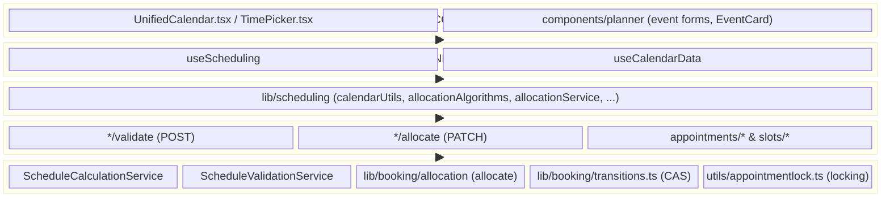
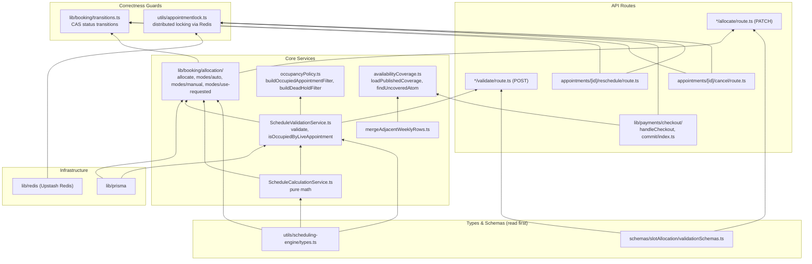
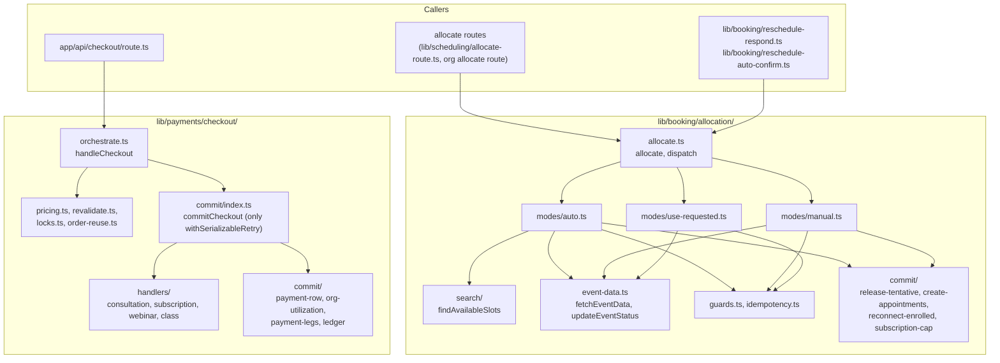
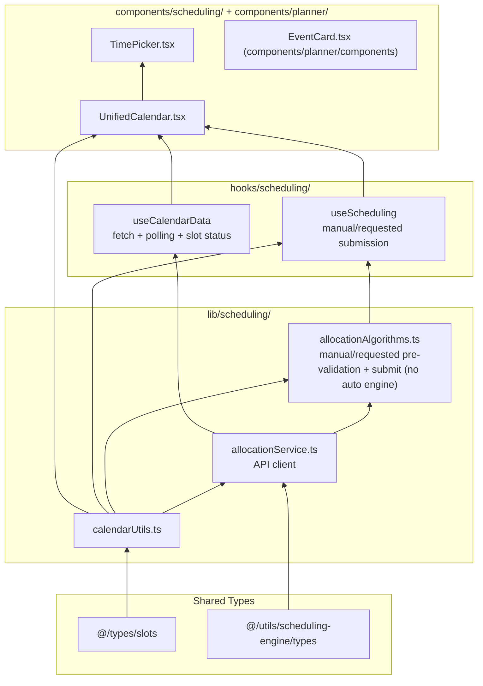
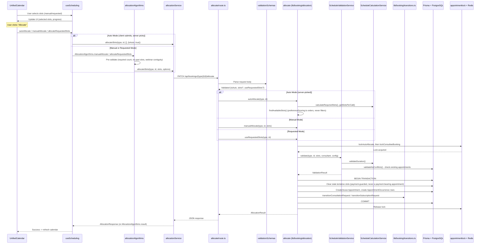
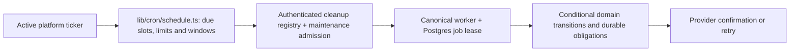
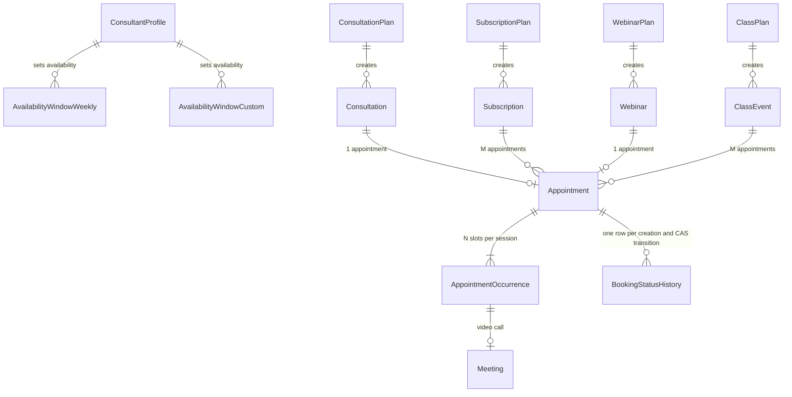

# Dependency Graphs

Maps of how files in the booking system relate to each other, regenerated from the current imports.

---

## 1. System Layer Architecture

Each layer only calls the layer directly below it.

---

## 2. Backend Dependency Graph

Which backend file imports which, read bottom-up (leaf nodes first). `lib/booking/transitions.ts` is imported directly by API routes and by the allocator (`event-data.ts` and the mode files), not only by the service layer — every status write in the booking subsystem goes through it.

### 2.1 The allocation and checkout modules

Two modules do the booking writes. The diagram shows who calls whom. Callers enter through one function each: `allocate` from `@/lib/booking/allocation` and `handleCheckout` from `@/lib/payments/checkout`.

The transaction boundaries are explicit. In allocation, each mode file opens its own write transaction after taking its locks (`lockAutoAllocate`, then `lockConsulteeBooking`). In checkout, `orchestrate.ts` takes the locks and `commit/index.ts` opens the one booking transaction, renewing the lock grant at the top of every retry.

---

## 3. Frontend Dependency Graph

**Reading order**: `calendarUtils` -> `allocationService` -> `allocationAlgorithms` -> `useCalendarData` + `useScheduling` -> `UnifiedCalendar`. Server-side auto-allocation (`lib/booking/allocation`) has no frontend counterpart in this chain — the client only pre-validates and submits.

---

## 4. Request Flow: Slot Allocation (The Main Path)

What happens when the consultant clicks "Allocate Slots":

---

## 5. Maintenance & Cleanup Flow

The active platform ticker dispatches booking recovery through authenticated cleanup handlers and their canonical implementations. Maintenance admission runs at the cleanup boundary; financial classification determines DEGRADED holds, and OFFLINE holds non-exempt cleanup work. Job leases, domain CAS and vendor idempotency protect different failure boundaries.

The catalog runs appointment completion and consultant no-show detection every 30 minutes; request expiry, tentative cleanup, reschedule expiry and unpaid-trial expiry have their own configured slots. Exact offsets and request bounds belong to the [generated job inventory](../maintenance/04-cron-jobs-reference.md), not a duplicate list of former Actions workflows. `reconcile-occurrence-availability` remains a configured non-money Actions job, currently budget-blocked; it is not a second ticker owner. Legacy cleanup functions are not automatically scheduled just because their files remain.

The completion worker shares the session-outcome verdict with no-show handling. Retention and expiry writers recheck current eligibility; a timeout does not establish process cancellation or completed business effects. Use the [SRE orientation](../start-here/10-infra-and-maintenance-sre-orientation.md) for cross-job races and recovery evidence.

---

## 6. Data Model Relationships (Simplified)

> Note: the diagram labels the Prisma `Class` model as `ClassEvent` because `class` is a reserved keyword in Mermaid.

---

## How to Read This

**Backend algorithm**: `types.ts` -> `ScheduleCalculationService` -> `ScheduleValidationService` -> `lib/booking/allocation`, with every status write routed through `lib/booking/transitions.ts` and every slot-occupying write holding a lock from `utils/appointmentlock.ts`.

**Frontend**: `calendarUtils` -> `allocationService` -> `allocationAlgorithms` -> `useCalendarData` + `useScheduling` -> `UnifiedCalendar`. Auto-allocation is server-only; the client never scores or picks slots itself.

**Tracing a full request**: `UnifiedCalendar` -> `useScheduling` -> `allocationAlgorithms` (manual and requested modes only; auto mode calls the service directly) -> `allocationService` -> API route -> `allocate` -> `ScheduleValidationService` -> `ScheduleCalculationService` -> Prisma -> PostgreSQL (see Diagram 4).
