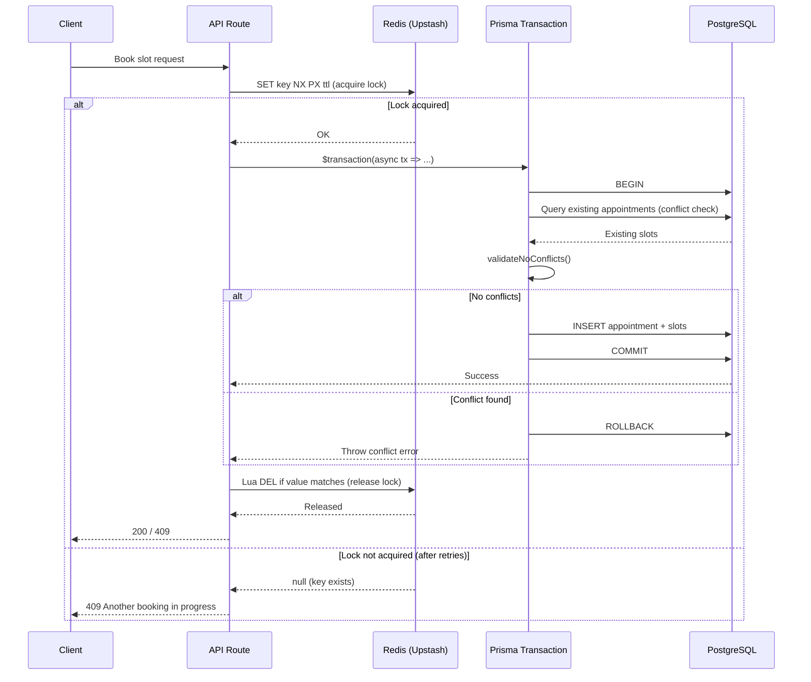
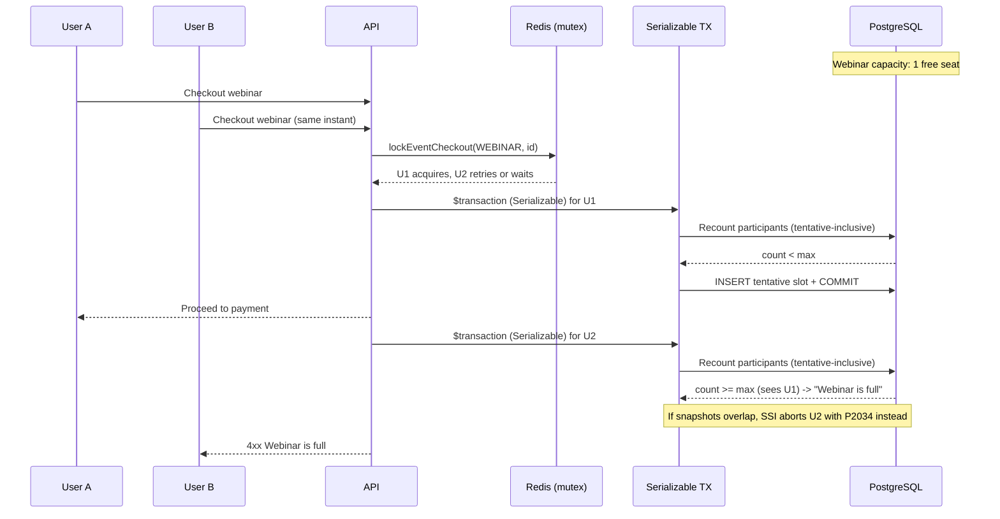

# Concurrency & Locking

## Overview

Booking operations defend against double-booking, race conditions, and data corruption with three complementary mechanisms. The Redis distributed lock is a cheap first gate that removes common-case contention, but it is never the correctness guarantee on its own, because it can expire under a slow operation. The database is the source of truth: the booking transaction re-reads the contended state inside the transaction, and for one-to-one bookings the `occurrence_no_confirmed_overlap` exclusion constraint is the final backstop, with a violation surfacing as Postgres `23P01` (mapped to a 409). Event checkout additionally runs at Serializable isolation so that its finite-capacity participant recount is conflict-safe. This is the booking-subsystem expression of the platform-wide posture recorded in [ADR 13](../enterprise/70-design-decisions/13-postgres-native-concurrency.md), which keeps concurrency control Postgres-native with no message broker or workflow engine, and [ADR 14](../enterprise/70-design-decisions/14-async-queue-posture.md), which keeps async work queue-less for launch.

The three mechanisms are described below in the order a request meets them.

The first mechanism is a **Redis distributed lock**, acquired before the transaction opens. It serializes concurrent requests for the same resource across processes, so the expensive database work runs without contention in the common case. The lock functions live in `utils/appointmentlock.ts`.

The second mechanism is **in-transaction re-validation**, which carries the real correctness guarantee — though the two booking paths enforce it differently. For a one-to-one interval, the allocation transaction (default Read Committed isolation) re-scans committed appointments for a conflict inside the transaction, and the `occurrence_no_confirmed_overlap` exclusion constraint is the database backstop: a concurrent overlap that slips past the scan is rejected at write time with Postgres `23P01`, which `classifyError` (`lib/booking/allocation/classify.ts`) maps to a 409. The payment webhook's own confirm-time recheck (#827) runs this same re-scan a second time, inside the Serializable transaction that confirms a captured payment, so that two concurrent capture webhooks for overlapping intervals cannot both confirm — under Serializable Snapshot Isolation one side aborts with Prisma `P2034` and retries into a `doubleBookingBlocked` result rather than a second confirmed occurrence (`lib/payments/webhooks/handlers.ts`). For a finite-capacity event, checkout opens the transaction at `isolationLevel: "Serializable"` and recounts participants (tentative-inclusive) via `AppointmentParticipant`; PostgreSQL serializable snapshot isolation then aborts the loser of a last-seat race with Prisma error `P2034`. In both cases the database, not the application, enforces the invariant.

The third mechanism is the **`occurrence_no_confirmed_overlap` database exclusion constraint**, defined in `prisma/sql/check-constraints.sql`. It is a `btree_gist` `EXCLUDE` on `AppointmentOccurrence` keyed on `consultantProfileId WITH =` and `tstzrange("startsAt", "endsAt") WITH &&`, restricted to rows where `consultantProfileId IS NOT NULL`, `NOT "isTentative"`, `"deletedAt" IS NULL` and `"completionStatus" NOT IN ('CANCELLED', 'RESCHEDULED')`. The range is half-open, so back-to-back sessions do not conflict. A companion CHECK, `occurrence_confirmed_requires_consultant_chk`, forbids a confirmed live occurrence without a host id, so the exclusion cannot be bypassed with a null.

The constraint covers only confirmed, non-tentative host rows. Every occurrence of every offering type (consultation, subscription, webinar, class and trial) carries its host's `consultantProfileId`, so a host can never hold two overlapping confirmed sessions of any type. It does not cover tentative holds, a co-host's time, a consultant booking as a client, a consultee's own overlapping bookings, or seat capacity; those are enforced by application code under the locks and the Serializable recounts described here, and the busy-time ledger planned for Wave 3 moves them into the database. The constraint is applied by the sidecar step (`npm run db:sidecars`), never by a plain `prisma db push`, which would not create it.

**Source**: `utils/appointmentlock.ts`, `lib/payments/checkout/locks.ts`, `lib/payments/checkout/commit/index.ts`

---

## Architecture



---

## Distributed Locking

Seven lock functions cover all booking-related operations. Each wraps the core `acquireLockWithRetry()` function with a domain-specific key pattern and error message.

| Function                             | Key Pattern                                                                                                               | Default TTL | Purpose                                                                                                                                                                                                                                                                                                                                                                             |
| ------------------------------------ | ------------------------------------------------------------------------------------------------------------------------- | ----------- | ----------------------------------------------------------------------------------------------------------------------------------------------------------------------------------------------------------------------------------------------------------------------------------------------------------------------------------------------------------------------------------- |
| `lockConsultationApproval`           | `consultation-approval:{consultationId}`                                                                                  | 60s         | Prevents concurrent approval of the same consultation                                                                                                                                                                                                                                                                                                                               |
| `lockSubscriptionApproval`           | `subscription-approval:{subscriptionId}`                                                                                  | 60s         | Prevents concurrent approval of the same subscription                                                                                                                                                                                                                                                                                                                               |
| `lockSlotBatch` / `tryLockSlotBatch` | `slot-booking:{consultantProfileId}:{atomStartISO}` — one key per 30-minute atom of the interval                          | 60s         | Prevents double-booking any part of a consultant interval; shared by checkout, request-for-approval, AND trial scheduling (#1169 PR 1)                                                                                                                                                                                                                                              |
| `lockEventCheckout`                  | `event-checkout:{appointmentType}:{eventOrPlanId}`                                                                        | 60s         | Serializes checkout for a specific event (webinar/class/subscription)                                                                                                                                                                                                                                                                                                               |
| `lockAutoAllocate`                   | `auto-allocate:{consultantProfileId}` (plus `:{scope}` when the target day is known)                                      | 150s        | Serializes slot allocation for one consultant, whose slots are discovered dynamically under the lock                                                                                                                                                                                                                                                                                |
| `lockConsulteeBooking`               | `consultee-booking:{consulteeUserId}` — on request-for-approval acquired BEFORE the slot atoms, matching checkout's order | 150s        | Serializes booking activity for one consultee across consultants, closing the cross-consultant double-book the consultant-keyed GiST net cannot see. On request-for-approval this is also what stops a user racing their own approval request against their own checkout (audit B8a); that route additionally caps each user at 3 ACTIVE pending requests (anti-scalper, audit B1). |
| `lockAppointment`                    | `appointment-lock:{appointmentId}`                                                                                        | 75s         | Legacy lock for appointment-level operations (cancel, reschedule, withdraw)                                                                                                                                                                                                                                                                                                         |

Every booking-path acquisition now goes through a guarded front door (`acquireGuarded`): a Redis health probe plus the shared circuit breaker, failing CLOSED with a typed `BookingLockUnavailableError` (503) when Redis is unreachable, while genuine contention still fails OPEN with a retryable message. Interval locks retry less per key (5 attempts instead of 10) because a held atom almost always means a real concurrent booking, and the correct outcome is a fast 409 rather than a minute of backoff. A slot batch is taken atomically by one Lua script (`tryLockSlotBatch` in `utils/appointmentlock.ts`; `lockSlotBatch` is its waiting variant for buyer doors): every atom of every profile the write makes busy is set in one round trip or none is, with one shared TTL, so no atom's TTL is spent waiting on another. An acquire that times out releases whatever the script may have written (`releaseAbandonedBatch`).

All locks use Redis `SET key value NX PX ttl`:

- **NX** -- only set if key does not exist (mutual exclusion)
- **PX** -- expire in milliseconds (auto-cleanup on crash)

The lock value is a `crypto.randomUUID()`, used for safe release verification (see [Safe Release](#safe-release)).

`lockSlotBatch` throws `SlotLockError` (see `utils/errors/SlotLockError.ts`) with structured fields (`consultantId`, `slotTime`, `retryAfterSeconds`) for type-safe error handling via `instanceof`. The retired `lockTrialSlot` no longer exists; trials take the same slot batch like every other direct writer.

> Cross-reference: `docs/upstash/redis/locking/` for Redis infrastructure and migration details.

---

## Retry Strategy

Lock acquisition retries up to 10 times with exponential backoff and jitter.

**Default configuration** (`DEFAULT_RETRY_CONFIG`):

| Parameter            | Value  | Description                        |
| -------------------- | ------ | ---------------------------------- |
| `retryCount`         | 10     | Maximum retry attempts             |
| `retryDelay`         | 200ms  | Base delay between retries         |
| `retryJitter`        | 200ms  | Random jitter added to each delay  |
| `exponentialBackoff` | `true` | Doubles base delay on each attempt |
| `driftFactor`        | 0.01   | Clock drift compensation (1%)      |

**Delay formula** (`calculateRetryDelay`):

```
delay = (retryDelay * 2^attempt) + random(0, retryJitter)
```

Example delays per attempt:

| Attempt | Base (ms) | + Jitter Range (ms) | Total Range (ms) |
| ------- | --------- | ------------------- | ---------------- |
| 0       | 200       | 0--200              | 200--400         |
| 1       | 400       | 0--200              | 400--600         |
| 2       | 800       | 0--200              | 800--1000        |
| 3       | 1600      | 0--200              | 1600--1800       |
| 4       | 3200      | 0--200              | 3200--3400       |

The effective TTL is reduced by the drift factor: `effectiveTTL = floor(ttl * (1 - driftFactor))`. For a 60-second lock, the effective TTL is 59,400ms. This accounts for clock skew between the application server and Redis.

---

## Safe Release

Lock release uses an atomic Lua script to prevent releasing another client's lock. This is critical because:

1. Client A acquires lock with value `uuid-A`
2. Lock TTL expires while Client A is still working
3. Client B acquires the same lock with value `uuid-B`
4. Client A finishes and tries to release -- without value checking, it would delete Client B's lock

**Lua script** (`releaseLock`):

```lua
if redis.call("get", KEYS[1]) == ARGV[1] then
  return redis.call("del", KEYS[1])
else
  return 0
end
```

- Returns `1` if the lock was successfully released (value matched).
- Returns `0` if the lock was already expired or owned by another client.
- The `GET` + `DEL` executes atomically within Redis (single-threaded Lua evaluation).

`releaseLock()` never throws. It catches all errors and logs them. This makes it safe to call from `finally` blocks without masking the original error. A single-key acquire whose `SET` errors (a timeout after the write may have landed) compare-deletes its own token before it retries or gives up (`releaseIfOurs`), so the key is never orphaned for the full TTL and the retry never meets its own key as contention.

---

## Lock Extension

For long-running operations, `extendLock()` implements a heartbeat pattern that extends the lock TTL without releasing and re-acquiring.

**Lua script** (`extendLock`):

```lua
if redis.call("get", KEYS[1]) == ARGV[1] then
  return redis.call("pexpire", KEYS[1], ARGV[2])
else
  return 0
end
```

- Checks ownership (value match) before extending.
- Uses `PEXPIRE` to set a new TTL in milliseconds.
- Default extension: 30,000ms (30 seconds).
- Returns `true` on success, `false` if ownership was lost.

**Usage pattern**: Call periodically during operations that may exceed the lock TTL. If `extendLock()` returns `false`, the operation should abort because another client may have acquired the lock.

---

## Event Capacity Control

Finite-capacity events — webinars and classes — must admit at most `maxParticipants` enrollments no matter how many buyers arrive at the same instant. There is no Redis counting semaphore for this; capacity is guarded entirely by the database. Two cooperating mechanisms enforce it, and `lib/payments/checkout/` is the single source (`locks.ts` for the mutex and the capacity read, `commit/index.ts` for the Serializable transaction).

The first is a **per-event distributed mutex**, `lockEventCheckout` (key pattern `event-checkout:{appointmentType}:{eventOrPlanId}`). It serializes checkouts for one event so the common case never contends, and it fails closed: if Redis is unreachable, `lockEventCheckout` throws `EventCheckoutLockUnavailableError` (HTTP 503) rather than letting an unlocked buyer through, because an unlocked checkout could clear the same finite capacity twice. Genuine contention — another buyer already holding the lock — is a benign retry-later case that fails open with a "please try again" message.

The second, and the real capacity guard, is a **Serializable participant recount inside the checkout transaction**. The checkout `prisma.$transaction` runs at `isolationLevel: "Serializable"`, and inside it the code re-reads every enrollment for the event and recounts participants with `countWebinarParticipants` (webinars) or `countUniqueParticipants` (classes, where a buyer enrolled across N sessions still counts once). The recount is tentative-inclusive: it counts the in-flight tentative slots of other concurrent checkouts, not only confirmed enrollments, so two buyers racing for the last seat both observe the contended rows. If the recount is at or above `maxParticipants`, the transaction rejects with a "Webinar is full" / "Class is full" 4xx. When two last-seat checkouts interleave such that neither sees the other's write under the snapshot, PostgreSQL serializable snapshot isolation aborts the loser with Prisma error `P2034`; exactly one enrollment commits. The mutex makes that abort rare; the Serializable recount is what makes the cap correct when it is not.

For the host's own time, the `occurrence_no_confirmed_overlap` exclusion constraint described in the [Overview](#overview) is the database-level backstop. Many participants legitimately share one webinar or class occurrence, so the constraint says nothing about how many people attend; it only stops the host from running two overlapping confirmed sessions. The attendance cap is the Serializable recount above.

This event-capacity design follows [ADR 13](../enterprise/70-design-decisions/13-postgres-native-concurrency.md): the database is the correctness authority and Redis is load-bearing only for cheap mutual exclusion, never for the count itself.

### Concurrent Checkout Flow



---

## Prisma Transaction Layer

All slot allocation and cancellation operations run inside Prisma interactive transactions. Transaction timeouts vary by operation complexity:

| Operation                               | Timeout                                  | Max Wait                                 | Source                                                            |
| --------------------------------------- | ---------------------------------------- | ---------------------------------------- | ----------------------------------------------------------------- |
| Slot allocation (auto/manual/requested) | `ALLOCATION_TX_TIMEOUT_MS` (30s default) | `ALLOCATION_TX_MAX_WAIT_MS` (8s default) | `lib/booking/allocation/modes/*.ts`, constants in `lib/prisma.ts` |
| Appointment cancellation                | 30s                                      | 10s                                      | `appointments/[id]/cancel/route.ts`                               |
| Payment / checkout transactions         | 25s                                      | Default                                  | `lib/payments/checkout/commit/index.ts`                           |
| Webinar CRUD                            | 10s                                      | 5s                                       | `app/api/bookings/webinars/crud-with-plan/route.ts`               |

The transaction provides two guarantees:

1. **Atomicity** -- All database writes succeed or all roll back. No partial bookings.
2. **Isolation** -- The contended state is re-read inside the transaction. The slot-booking transaction runs at the default Read Committed isolation and relies on the `occurrence_no_confirmed_overlap` exclusion constraint as its commit-time backstop: a racing transaction that would create a confirmed overlap on the same consultant is rejected with a Postgres `23P01` exclusion violation (mapped to a 409). The event-checkout transaction additionally runs at Serializable isolation, so two buyers racing for the same last seat cannot both commit -- PostgreSQL aborts the loser with a `P2034` serialization failure.

The pattern in every booking route is to take the cheap Redis lock first, then do the authoritative re-read and write inside the transaction, and always release the lock in `finally`:

```ts
grant = await lockSlotBatch(...)     // Redis atoms, all or nothing
try {
  await prisma.$transaction(             // default Read Committed isolation
    async (tx) => {
      validate(tx, ...)                  // Re-read contended state inside the tx
      create(tx, ...)                    // occurrence_no_confirmed_overlap rejects a confirmed
    },                                   // overlap at commit -> Postgres 23P01 -> 409
    { timeout: 30_000 },
  )
} finally {
  await unlockSlotInterval(grant)        // Always release
}
// Event checkout follows the same shape but adds { isolationLevel: "Serializable" }
// so the last-seat participant recount aborts the loser with P2034.
```

---

## Race Condition Scenarios

| Scenario                                             | Protection Mechanism                                      | Key/Strategy                                                                                                                                                                                                                                                                                            |
| ---------------------------------------------------- | --------------------------------------------------------- | ------------------------------------------------------------------------------------------------------------------------------------------------------------------------------------------------------------------------------------------------------------------------------------------------------- |
| Two users book overlapping consultant intervals      | `lockSlotBatch`                                           | One `slot-booking:{profileId}:{atomStart}` key per 30-minute atom, taken in one atomic batch -- a 10:00-12:00 booking and an 11:00-12:00 booking collide on their shared atoms instead of passing on different instant keys                                                                             |
| Two admins approve the same consultation             | `lockConsultationApproval`                                | `consultation-approval:{id}` -- only one approval proceeds                                                                                                                                                                                                                                              |
| Two admins approve the same subscription             | `lockSubscriptionApproval`                                | `subscription-approval:{id}` -- only one approval proceeds                                                                                                                                                                                                                                              |
| Multiple webinar checkouts at capacity               | `lockEventCheckout` + Serializable recount                | Per-event mutex, then a tentative-inclusive `countWebinarParticipants` recount inside the Serializable checkout tx; SSI aborts the last-seat loser with P2034                                                                                                                                           |
| Multiple class checkouts at capacity                 | `lockEventCheckout` + Serializable recount                | Same path with `countUniqueParticipants` (a buyer across N sessions counts once)                                                                                                                                                                                                                        |
| A trial and any other booking race for the same time | `lockSlotBatch`                                           | Trials take the SAME `slot-booking:` atom keys as every other direct writer; the old `trial-slot-booking:` namespace (which contended with nothing) is retired                                                                                                                                          |
| Concurrent cancel and reschedule on same appointment | `lockAppointment`                                         | `appointment-lock:{appointmentId}` -- 75s TTL (`APPOINTMENT_LOCK_TTL_MS`, `utils/appointmentlock.ts`)                                                                                                                                                                                                   |
| Lock expires during slow DB operation                | Transaction timeouts under the grant; per-attempt renewal | Every booking transaction's timeout sits under the grant that protects it (the cancel route 30 s and the reschedule route 60 s under the 75 s appointment lock; allocation 8 s wait + 30 s under its slot batch), and retry loops re-grant per attempt (`renewAppointmentLock`, `renewAllocationBatch`) |
| Client crashes while holding lock                    | Redis TTL auto-expiry                                     | Lock expires after TTL, no manual intervention needed                                                                                                                                                                                                                                                   |
| Lock released by wrong client                        | Safe release Lua script                                   | `GET` + `DEL` atomic with value verification                                                                                                                                                                                                                                                            |
| Slot passes validation but conflicts at commit       | `occurrence_no_confirmed_overlap` exclusion constraint    | The DB exclusion constraint rejects any confirmed, non-tentative, live overlap for the same host even if application validation was bypassed, raising Postgres `23P01` (mapped to a 409). SSI/P2034 covers the event-checkout last-seat race above, not slot booking.                                   |
| Payment abandoned mid-checkout (events)              | Tentative-slot cleanup cron                               | The tentative slot is released by the 24-hour idempotent cleanup (and the buyer can free it early via `DELETE /api/checkout/pending/[paymentId]`); see [ADR B5](./00-architecture-decisions.md)                                                                                                         |
| Cancelled/rejected slots blocking new bookings       | `buildOccupiedAppointmentFilter()`                        | Conflict check excludes appointments with terminal statuses (CANCELLED, REJECTED, EXPIRED)                                                                                                                                                                                                              |

## Lock order and failure posture (ADR B13)

- **Postgres is the authority; Redis only removes contention.** Every status write is a CAS with its allowed-from set in the `WHERE` (`lib/booking/transitions.ts`), and 1:1 overlap is refused at commit by `occurrence_no_confirmed_overlap` (`23P01`). A Redis outage costs a 503, never correctness.
- **One acquisition order: event/consultant → consultee → slot atoms.** Checkout follows it too: a slot checkout takes the consultee lock and then its slot batch; an event checkout takes the event key, then the consultee lock, then the buyer's own seat atoms (`lockBuyerSeatAtoms` in `lib/payments/checkout/orchestrate.ts`). Both are the same event → consultee → slot batch order every host-time writer uses, so no cycle can form. The allocator joins that order for a webinar or class: `allocate` (`lib/booking/allocation/allocate.ts`) takes the event checkout lock before the appointment lock, so a re-plan waits for seat checkouts in flight and no seat is sold mid-plan. A held checkout key answers 409 `EVENT_CHECKOUT_BUSY` (a retry, not a fault). The full order for an event is event checkout, appointment, auto-allocate, consultee, slot batch. The class series move (`retimeClassSeries`) uses the same order, with the host and accepted co-host slot batch last, and re-reads the class and its movable sessions inside the transaction (see [the rescheduling flow](./07-rescheduling-flow.md)).
- **An incident rebook holds the buyer's own calendar too.** `rebookIncidentRemedy` (`lib/booking/incident-rebook.ts`) takes the appointment lock, then the consultee lock, then one all-or-nothing `lockSlotBatch` over every profile the new session makes busy: the expert's, and the buyer's own `ConsultantProfile` when the buyer is also an expert. Before, it took only the expert's atoms through `lockSlotInterval`, so a learner-expert could be double-booked across the two calendars. Example: Priya Anderson is a learner and also an expert. Her 60-minute session with Hannah Anderson is rebooked to Tue 17 Nov 2026 at 10:00 IST. Both Hannah's and Priya's atoms for 10:00 to 11:00 IST are locked together, so a booking Priya's own clients make at 10:30 IST cannot slip in between.
- **Fail closed on Redis loss, fail open on contention.** `acquireGuarded` answers `BookingLockUnavailableError` (503) when Redis is unreachable and a typed 409 when a key is genuinely held. The consultation and subscription approval routes keep that split: a `BookingLockUnavailableError` from `lockConsultationApproval` or `lockSubscriptionApproval` answers its typed 503, and any other lock error answers 409.
- **Retries.** `withSerializableRetry` replays P2034 and deadlocks (40P01, read from the raw `DriverAdapterError` by `isDeadlock`), up to 3 retries; business errors propagate on the first attempt. The Read Committed booking transactions (the three allocation modes, the reschedule route and the cancel route) run through `bookingTransaction` (`lib/db/booking-transaction.ts`), which replays a deadlock victim once, so a transient lock cycle no longer surfaces as a 500. It takes a `beforeAttempt` hook that runs ahead of every attempt, outside the transaction; the cancel and reschedule routes renew their locks in it (the event checkout lock and the appointment lock), so a replay never writes under a lapsed grant. The approval and appointment locks are re-granted per attempt (`renewApprovalLock`, `renewAppointmentLock`) because four attempts outlive their TTL. A re-grant that finds the appointment lock taken over throws `LockLostError` (409 `LOCK_LOST`, a typed refusal), so no attempt runs unserialised; the allocator answers it as `LOCK_CONTENTION`.
- **Known gaps (closing in Wave 3).** The allocator (lock family `auto-allocate:`, Read Committed) and checkout (lock family `slot-booking:`, Serializable) share no lock, and tentative rows sit outside the exclusion, so an allocator-versus-checkout clash ends in a charge followed by a refund. Co-host, consultant-as-client and consultee overlaps are application-only under disjoint lock families. Only checkout ↔ checkout is serialised in Postgres for the cross-consultant consultee double-book (both Serializable); the allocator, request-for-approval, trials and reschedule writers rely on the Redis `consultee-booking:` lock alone.

## Deprecated & Superseded Approaches

1. **A `slot_no_confirmed_overlap` constraint in a `prisma/sql/slot-exclusion.sql` file.** That name and file do not exist; the live constraint is `occurrence_no_confirmed_overlap` in `prisma/sql/check-constraints.sql`.
2. **Treating the exclusion as covering only consultations and subscriptions.** It covers the host side of all five offering types, and nothing else.
3. **A separate `trial-slot-booking:` lock namespace.** It contended with nothing; trials take the same `slot-booking:` atoms as every other direct writer.
4. **Releasing a lock with a bare `DEL`.** Release is a value-checked Lua script so one client can never free another's lock.

5. **Sequentially acquired slot atoms and a 120 s booking transaction.** Atoms were once taken one key at a time and re-armed to a shared deadline, under a 120-second transaction; one atomic batch and transaction timeouts under the grant replaced both.
6. **An incident rebook that locked only the expert's slot interval, and an approval route that answered every lock failure with 409.** Both are replaced by the buyer-inclusive slot batch and the typed 503.
