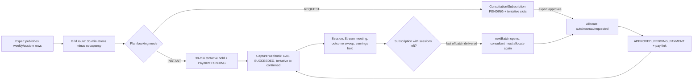

# V2A — Booking product & system review (post-megafix)

> **Status:** Research snapshot of dev @ 39f98669f on 2026-11-03; findings fixed in the booking v2 correctness PR are marked in the [decision record](../../decisions/2026-11-03-booking-v2-direction.md).

**TRACK_ID:** `V2A-booking-product-and-system-review`. **Repo:** `familiarise_web`, branch `dev` @ 39f98669f. It includes #2449 (megafix) and #2554 (IA rework). This was a read-only review on 2026-11-03.

**How it was built.** The coordinator read the code first-hand for the multi-week core (§1.4). Four sub-tracks then wrote detailed reports, which are merged here. Their full tables and copy are the appendices:

- A: [Requests, reschedule and cancel](./02-v2a-appendix-a-requests-reschedule-cancel.md) (27 findings)
- B: [Heat map](./03-v2a-appendix-b-heatmap.md) (21 findings, with a mismatch matrix)
- C: [Allocation, multi-week and naming](./04-v2a-appendix-c-allocation-multiweek-naming.md) (24 findings)
- D: [Competitors](./05-v2a-appendix-d-competitors.md) (the patterns that shaped the design, 15 findings)

Every behaviour claim carries `path:line` and is marked **V** (VERIFIED: the code path was read) or **S** (SUSPECTED). Finding IDs keep their sub-track prefix (A-, B-, C-, D-). The coordinator re-verified A-01, C-01 and C-03 against the code.

---

## 0. Executive summary

**Two P0 bugs on the Requests tab, both reachable with a normal click:**

- **A-01.** On a booking being rescheduled, "Decline" in the inbox ends a paid, confirmed booking. It cancels every session, refunds in full and records no expert strike. The same word on the detail page only turns down the proposal.
  - Cause: a whole-booking reschedule re-enters `PENDING` (`app/api/appointments/[appointmentId]/reschedule/route.ts:642-652`). The inbox then offers Approve/Decline, and Decline PATCHes `REJECTED` (`components/dashboard/shared/requests/RequestsInbox.tsx:540`). That path has no reschedule guard (`app/api/bookings/consultations/[consultationId]/route.ts:481-516`). It runs `releaseDeclinedRequestHold`, which cancels all occurrences (`lib/booking/request-route-guards.ts:191-220`). **V** (re-verified)
- **A-02.** The consultant's _own_ reschedule shows in their inbox as an incoming request. "Approve" there lets them impose a time without the client's consent, and "Decline" triggers A-01. **V**

**The multi-week subscription engine works as designed, but the design does not serve the product. Recommendation: replace it (§3.1).**

- **The pacing is wrong.** The "3 per week" cap is a rolling 7-day window that only opens after the previous batch is _delivered_. The auto search places earliest-fit at one session per day, and subscriptions have no calendar-week cap.
  - Result: a consultant who schedules promptly turns "3 a week for 6 months" into a session almost every day. 72 sessions get used up in about 10 weeks.
  - Evidence: `lib/booking/entitlement.ts:264-304`, `lib/booking/allocation/search/find-available-slots.ts:477-495`, `utils/scheduling-engine/sessionCaps.ts:12`. **V** (re-verified)
- **The consultant must come back about 24 times, and only on desktop.** They get no notification when a week opens (cycle 1 is the only exception). The "hourly top-up" never schedules the next week in steady state, because it only retries after an availability edit (`scripts/appointments/reconcile-occurrence-availability.ts:898-905`). **V**
- **Mid-plan stalls are invisible and unrefunded until plan end** (C-04).

**The heat map is mostly sound after WS-8, with six P1/P2 places where a green cell is refused at submit:**

- **B-01:** viewers in `:45` time zones (Nepal) get off-grid cells.
- **B-02:** the 24 h reschedule rule isn't shown.
- **B-03:** subscription reschedule past the cycle window silently drops the picked times.
- **B-04/B-05:** the 2 h unpaid lead time isn't shown, so requests are created that can never be approved.
- **B-06:** "partly booked" cells are offered as a "Request".

**Naming.** "Scheduling period" means four different things (C §1.4). No logic needs the stored first-cycle end. Proposal (§3.4): rename the column to `planStartsAt` via `@map`, deprecate `schedulingPeriodEndsAt`, use "Week N of W" in copy, and rename the allocator's window to `selectableFrom/Until`.

**Recommended multi-week design (§3.1, option E).** Four parts:

1. **Fixed plan weeks** anchored on the plan start.
2. A **"Regular time" pattern** set once.
3. The system keeps a **rolling 4-week horizon** of real sessions filled from that pattern.
4. Clashes become a **per-week "needs a time" list**. The consultant fixes them, or the client does if the plan allows self-scheduling.

The make-up and catch-up allowance comes from plan slack. Phase 0 (no schema changes) fixes pacing, notifications and copy first.

---

## 1. Current system (HLD + journeys as they exist now)

### 1.1 Pipeline (unchanged by this review; HLD §1 is accurate)



### 1.2 Actor journeys today

| Journey               | Consultant                                                                                                                                                                                                                                                                               | Consultee                                                                                                                                                                                                                                                               | Org operator                                                                                                                                                                                                                  |
| --------------------- | ---------------------------------------------------------------------------------------------------------------------------------------------------------------------------------------------------------------------------------------------------------------------------------------- | ----------------------------------------------------------------------------------------------------------------------------------------------------------------------------------------------------------------------------------------------------------------------- | ----------------------------------------------------------------------------------------------------------------------------------------------------------------------------------------------------------------------------- |
| Inbound request       | Requests tab: tabs Consultation/Subscription/Trial, chips Answer today/Awaiting payment/Next cycle/Declined, buckets by deadline. Checkout holds show as "Checkout in progress" with no actions (`components/dashboard/shared/requests/InboxRow.tsx:123-174`, `labels.ts:104-106`) **V** | No Requests item. Their state shows on Appointments and on the Home "Needs you" card (`docs/dashboard/information-architecture.md:40-43`) **V**                                                                                                                         | With a consultant profile: same inbox with `orgScope`. Without one: redirected to `appointments?tab=unscheduled`, can only allocate expert-approved rows (`app/dashboard/organization/[orgId]/requests/page.tsx:52-59`) **V** |
| Subscription purchase | Must "Schedule cycle 1" within 48 h or the buyer is refunded in full. A bell nudges this (`scripts/appointments/expire-stale-requests.ts:118-123`, `lib/novu/templates/b2c.ts:193`) **V**                                                                                                | Copy: "Your consultant schedules one cycle at a time; the first cycle starts on the date you pick." (`app/explore/experts/[consultantId]/components/SubscriptionPricingToggle.tsx:474-521`) **V**                                                                       | Can allocate only inside published hours. `allowPartial`/`topUp` are silently dropped (`lib/scheduling/allocate-route.ts:95,144-149`) **V**                                                                                   |
| Each later week       | Comes back after the last session of the week is _delivered_. Places ≤ `nextBatch`. Gets no bell, only an inbox chip "Next cycle" and a card button "Schedule the next N" with no deadline (`lib/dashboard/money-state.ts:727-731`) **V**                                                | Gets the bell "Cycle N is done — {consultant} will schedule your next N sessions" (`lib/booking/subscription-cycle.ts:196-234`). Card reads "Cycle done · schedule the next 3." — an instruction aimed at the consultant (`lib/dashboard/money-state.ts:465-469`) **V** | —                                                                                                                                                                                                                             |
| Reschedule            | Propose times or "Any time works". Cap: 2 per booking in total (`lib/booking/reschedule-caps.ts:15`). Can override a client proposal by placing other times on the grid (`lib/booking/allocation/preference.ts:113-140`) **V**                                                           | ≥24 h ahead. Green cells confirm instantly. Cap: 2 moves per session (ordinal). "Any time works" submits with no confirm (`components/scheduling/TimePicker.tsx:515-525`) **V**                                                                                         | Funding-org admin can do it through the ops hint. No strike for operator cancels **V**                                                                                                                                        |
| Cancel                | Reuses the consultee dialog ("You paid ₹X…"). The strike is never mentioned (`ConsultantAppointmentsAdapter.tsx:468-479`) **V**                                                                                                                                                          | Policy quote bound by `expectedRefundPaise`. Frozen from 15 min before start until the session ends (`lib/booking/session-window.ts:28-84`) **V**                                                                                                                       | —                                                                                                                                                                                                                             |
| Webinar / class       | Re-time (webinar), or cancel a class session for a 14-day make-up **V**                                                                                                                                                                                                                  | Free leave until `retimeBy`, but **no consultee UI reads `retimeBy`** (A-19) **V**                                                                                                                                                                                      | —                                                                                                                                                                                                                             |
| Mobile                | **No allocation possible** (`components/scheduling/TimePicker.tsx:369-379`) **V**                                                                                                                                                                                                        | Day list picker for reschedule (`components/scheduling/MobileDayListPicker.tsx`) **V**                                                                                                                                                                                  | —                                                                                                                                                                                                                             |

### 1.3 Heat map pipeline (detail: B §1)

`GET /api/scheduling/availability-with-allocation/[consultantId]` projects the weekly rows and subtracts occupancy, including live holds; dead holds are dropped by `isOccupiedByLiveAppointment`. It then splits blocks at the viewer's midnight, slides 30-minute windows and adds the `tooSoon` (15 min) and `limitReached` flags (`app/api/scheduling/availability-with-allocation/[consultantId]/route.ts:661-704,1096-1123`; `utils/scheduling-engine/intervals.ts:355-404,673-753`). The client draws UTC `:00/:30` atom rows in the display zone and looks up each cell by exact start time (`lib/time/grid-zone.ts:134-174`, `lib/scheduling/week-grid-model.ts:79-128`). On mobile, the consultee gets a 14-day day list. **V**

### 1.4 Multi-week engine, exactly (coordinator-verified, detail C §1.1)

| Quantity              | Definition                                                                                                                                              | Evidence                                                                                                |
| --------------------- | ------------------------------------------------------------------------------------------------------------------------------------------------------- | ------------------------------------------------------------------------------------------------------- |
| `total`               | `sessionsPerWeek × durationInMonths × 4`, frozen as `Subscription.sessionsTotal`. **6 mo × 3/wk = 72, not 78**                                          | `lib/booking/entitlement.ts:227-230`, `:241-247` **V**                                                  |
| Plan end              | Start + N calendar months on the consultant's wall clock (about 26 weeks for 6 months). Stored `planEndsAt` moves +7 d per return or incident           | `entitlement.ts:142-179` **V**                                                                          |
| completed / scheduled | COMPLETED or UNVERIFIED / SCHEDULED and not tentative. VOIDED is live but counts as neither, so it frees a session                                      | `entitlement.ts:71-98,253-260` **V**                                                                    |
| cycle ordinal         | `min(floor(completed / capacity), count−1)`, i.e. it advances on **delivery**                                                                           | `entitlement.ts:265` **V**                                                                              |
| `nextBatch`           | `min(capThisCycle − (completed − ordinal·cap + scheduled), remaining)`                                                                                  | `entitlement.ts:266-268,301-304` **V**                                                                  |
| window                | `[max(planStart, last held end, now), min(zone-midnight + 7 days, planEnd))`. It **floats**                                                             | `entitlement.ts:275-300`, `cycleEnd` `:126-133` **V**                                                   |
| Weekly cap in search  | Only for **classes**. A subscription's weekly limit is the rolling window. Per-day cap is 1                                                             | `find-available-slots.ts:477-495`; `sessionCaps.ts:12` **V**                                            |
| Hourly top-up         | Runs only if availability rows changed after `Subscription.updatedAt`. Completions never touch the subscription                                         | `reconcile-occurrence-availability.ts:898-905`; `subscription-cycle.ts:93-133` **V**                    |
| Stall handling        | The 30-day unallocated expiry matches only plans that have _never_ had a confirmed session. Otherwise the plan waits for plan end and a pro-rata refund | `expire-stale-requests.ts:146-152`; `scripts/appointments/settle-cancelled-sessions.ts:1000-1078` **V** |
| Classes               | The whole series is placed up front (`counts.ts:73-94`). `allowPartial` plus the top-up fill gaps after availability edits                              | `reconcile-occurrence-availability.ts:736-822` **V**                                                    |

**Answers to "what does the consultant experience?"**

- **Can they only place the current cycle?** Yes. Manual mode refuses more: "This cycle takes N sessions. Pick no more than that." (`lib/booking/allocation/modes/manual.ts:371-390`) **V**
- **Must they come back weekly?** Yes, about 24 times for a 72-session plan, each time after the previous batch has been delivered and classified (at least 1 h after the session ends). **V**
- **Do they get reminders?** Only for cycle 1. Later weeks surface only as a passive inbox chip. **V**
- **Can they do it on a phone?** No. **V**
- **What does the consultee see?** At most one week ahead, plus a "Cycle done · schedule the next 3" line meant for someone else. **V**
- **What happens if the consultant stops?** Nothing until plan end, then a pro-rata refund and a "Session complete — rate the session" bell (`lib/novu/templates/b2c.ts:162-170`). **V**

---

## 2. Findings

Severity: **P0** means a wrong money or booking outcome from a normal click. **P1** means a core journey broken or wrong for a segment, or a green cell the server refuses on the main path. **P2** means confusing, with a workaround. **P3** means polish. Full copy for each row is in the appendix named by its prefix.

### 2.1 P0 and P1 findings

| ID         | Sev                     | Type          | Evidence                                                                                                                                                                                                                                                                       | User impact                                                                                                                                                                                                       | Proposed fix (engineering + UI)                                                                                                                                                                                                                                                                                                                                                                                                           |
| ---------- | ----------------------- | ------------- | ------------------------------------------------------------------------------------------------------------------------------------------------------------------------------------------------------------------------------------------------------------------------------ | ----------------------------------------------------------------------------------------------------------------------------------------------------------------------------------------------------------------- | ----------------------------------------------------------------------------------------------------------------------------------------------------------------------------------------------------------------------------------------------------------------------------------------------------------------------------------------------------------------------------------------------------------------------------------------- |
| A-01       | **P0**                  | bug           | `reschedule/route.ts:642-652` (parent goes back to PENDING); `RequestsInbox.tsx:540` → `request-decision.ts:150` (PATCH REJECTED); `consultations/[consultationId]/route.ts:481-516` (no reschedule guard); `request-route-guards.ts:191-220` (cancels all occurrences). **V** | "No to the new time" ends a paid booking, refunds it, frees the slot and records **no strike**. That also makes it a strike-free cancel door for experts.                                                         | Server: refuse REJECTED with 409 `USE_RESCHEDULE_RESPOND` whenever an open `RescheduleRequest` exists, or the wrapper was ever confirmed. Decline is for requests only (A §D3). UI: the row's secondary action becomes **"Keep the original time"** → `/reschedule/respond {decline}`. Dialog: "Their booking stays at {original}. Nothing is refunded or cancelled."                                                                     |
| A-02       | **P0**                  | bug           | `InboxRow.tsx:86-97` (admits only consultee-initiated proposals); `allocation/preference.ts:113-140`; counted in `lib/data/needs-you.ts:114-126`. **V**                                                                                                                        | The consultant's own outbound proposal appears as an inbound request. "Approve" imposes a time with no consent, "Decline" triggers A-01, and the badge is inflated.                                               | Put the row in "Waiting on the client": "You asked to move this to {t} · they have until {expiresAt}" `[Withdraw my request]`. Exclude it from the badge. The allocator answers 409 `PROPOSAL_AWAITING_CLIENT` while that proposal is open.                                                                                                                                                                                               |
| C-01       | **P1**                  | bug/design    | `entitlement.ts:265,275-304`; `find-available-slots.ts:477-495` (no sub week cap); `sessionCaps.ts:12`. **V**                                                                                                                                                                  | "3 a week for 6 months" becomes almost daily sessions when the consultant schedules promptly (Mon/Tue/Wed, then Thu/Fri/Sat…). The plan burns out in about 10 weeks, and the grid's "this week" wording is false. | **Fixed plan weeks** anchored on `planStartsAt` in `schedulingTimezone`: `week k = [day0+7k, day0+7k+7)`. Cap `sessionsPerWeek` per plan week in both the search and the validator (generalise `validateClassWeeklyLimits`). Spread auto picks (minimum gap of one day, reuse the previous week's weekday/time as a preference). Regression test: a 3/wk plan whose week 1 is delivered Mon–Wed must not place week 2 before next Monday. |
| C-02 / D-2 | **P1**                  | gap           | Consultee-only bell `subscription-cycle.ts:196-234`; no consultant template (`lib/novu/templates/b2c.ts`, `lib/email/senders/booking.ts:812-863`). **V**                                                                                                                       | Plans silently stall. The consultee is promised "{consultant} will schedule" with no date.                                                                                                                        | Send a consultant bell and email in the same commit: **"Priya's week 5 is ready — 3 sessions, Mon 16–Sun 22 Mar. [Auto-schedule] [Pick times]"**. Remind at +24 h, escalate at +72 h, with an org digest for org plans. Consultee gets a "Nudge" button (once per 24 h).                                                                                                                                                                  |
| C-03       | **P1**                  | bug           | `reconcile-occurrence-availability.ts:898-905`. **V**                                                                                                                                                                                                                          | The "hourly top-up" never schedules the next week. The docs imply it fills shortfalls.                                                                                                                            | Give it a dedicated attempt marker (`Subscription.horizonCheckedAt`). For subscriptions the trigger becomes "pattern exists and the horizon has room" (§3.1). Ship only after C-01.                                                                                                                                                                                                                                                       |
| C-04       | **P1**                  | gap/money     | `expire-stale-requests.ts:146-152`; `settle-cancelled-sessions.ts:1000-1078`. **V**                                                                                                                                                                                            | A consultee abandoned in week 3 waits until month 6 for money back. Neither side ever sees the problem.                                                                                                           | A "missed week" rule: when a plan week closes with sessions never placed (and no open reschedule), offer the consultee **"{C} didn't set 3 sessions for week 5. [Get ₹1,450 back now] [Keep them for later]"**. Route it through `refundBookingPayment` with key `missed-week:<sub>:<k>:<payment>`. Count it toward expert reliability after 2 missed weeks.                                                                              |
| C-12       | **P1** (raised from P2) | gap/mobile    | `TimePicker.tsx:369-379`. **V**                                                                                                                                                                                                                                                | Combined with the weekly cadence, the consultant must be at a desk every week. Notification deep links land on "Please access this on desktop".                                                                   | A mobile **"Auto-schedule this week"** sheet: a preview list, then [Confirm] or [Pick on desktop]. In allocate mode, manual picks reuse `MobileDayListPicker`.                                                                                                                                                                                                                                                                            |
| A-03       | P1                      | bug           | `lib/data/requests-inbox.ts:328-346,445-453` ignores the proposal's `expiresAt` (`lib/booking/reschedule-proposals.ts:82-104`). **V**                                                                                                                                          | The countdown says "1d 23h" when the proposal lapses in 20 h.                                                                                                                                                     | `deadline = proposal.expiresAt`. Row copy: "Answer by Tue 4 Nov, 6:00 pm — after that {Name} keeps the original time."                                                                                                                                                                                                                                                                                                                    |
| A-04       | P1                      | bug           | `lib/dashboard/requests-inbox-state.ts:181-183`, `labels.ts:58-61`. **V**                                                                                                                                                                                                      | A paid plan that must have cycle 1 scheduled within 48 h (or it is refunded in full) sits at the bottom, under "the other side acts next".                                                                        | Bucket by **who acts** (`nextAction.kind`). Rename the bucket "Waiting on the client". Countdown: "Schedule by Wed 6 pm or {Name} is refunded in full".                                                                                                                                                                                                                                                                                   |
| A-05       | P1                      | bug           | `lib/data/needs-you.ts:143-171`, `lib/booking/request-caps.ts:30-47` count a reschedule re-entering PENDING. **S**                                                                                                                                                             | In-flight reschedules trip `CONSULTANT_AT_CAPACITY` or the consultee's 429 cap.                                                                                                                                   | Exclude wrappers that are paid or have an open reschedule from both cap counts. Add a jest test that locks this in.                                                                                                                                                                                                                                                                                                                       |
| A-06       | P1                      | design/bug    | `allocation/preference.ts:79-140`. **V**                                                                                                                                                                                                                                       | The consultant can impose a time the client never saw, while the history says "declined".                                                                                                                         | Every time the consultant picks becomes a proposal the client accepts. Add one counter-round (`supersedesId`) (A §D1). The client's "Any time works" stays auto-placing, because that is consent.                                                                                                                                                                                                                                         |
| A-07       | P1                      | bug           | `lib/booking/cancellation-scope.ts:268-283`; `lib/payments/operations/cancellation-policy.ts:467-476`. **S**                                                                                                                                                                   | A stranded booking (released, never re-placed) is quoted the lowest refund tier when cancelled.                                                                                                                   | A RESCHEDULED row whose start has passed, or one on a parked booking, contributes +∞ notice unless the consultee released it. Copy: "This session was never given a new time, so cancelling refunds it in full."                                                                                                                                                                                                                          |
| A-08       | P1                      | UX            | `ConsultantAppointmentsAdapter.tsx:468-479`, `CancelConfirmationDialog.tsx:274-283`. **V**                                                                                                                                                                                     | The consultant reads "You paid ₹X", and the reliability strike comes as a surprise.                                                                                                                               | Add a `viewerRole` dialog: "{Client} gets a full refund of ₹X. This counts against your reliability (n in 90 days)." Lead with [Propose a new time instead].                                                                                                                                                                                                                                                                              |
| B-01       | P1                      | bug           | `utils/scheduling-engine/intervals.ts:365-376,707-744`; `lib/scheduling/week-grid-model.ts:84-86`; `lib/payments/utils/slot-validation.ts:47-48`. **V** (code plus simulation)                                                                                                 | Viewers at `:45` offsets (Nepal, Eucla, Chatham) lose post-midnight supply on the heat map. The expert page offers `:15Z` times that are then refused with "Times start on the hour or half hour".                | Enumerate atoms on the absolute UTC lattice, keyed by the viewer day of each atom (B §4 C2). Assert server-side that every cell satisfies `startMs % 30min === 0`. Add Kathmandu × New York DST tests.                                                                                                                                                                                                                                    |
| B-02       | P1                      | bug           | `reschedule/route.ts:457-469` (24 h); `TimePicker.tsx:383-400` (no `minLeadHours`). **V**                                                                                                                                                                                      | Moving a session to later today or tomorrow shows green with "confirms straight away", then fails.                                                                                                                | Server-authoritative lead time: `?purpose=book                                                                                                                                                                                                                                                                                                                                                                                            | request | allocate | reschedule`→`leadMs` returned and folded into the ETag (B §4 L2). New cell state **"Too soon to move"**. Banner: "You can pick times from Wed 9:00 am." |
| B-03       | P1                      | bug           | `lib/scheduling/time-picker-subject.ts:125-130` (plan-wide window) vs the allocator's cycle window (`event-data.ts:458-459`); final refusal drops the times (`reschedule-proposals.ts:307-317`). **V**                                                                         | The consultee thinks they rebooked. In fact their picks were dropped and the session is still released.                                                                                                           | Short term: clamp the picker to the allocator's window. With §3.1, reschedule may target any plan week with room before plan end, so the grid, auto-confirm and copy all agree.                                                                                                                                                                                                                                                           |
| B-04       | P1                      | bug/design    | `lib/scheduling/booking-windows.ts:81,97`; `request-for-approval/route.ts:394-406`; `lib/booking/lead-time.ts:28-39`. **V**                                                                                                                                                    | A request 15 min–2 h ahead on a priced plan is accepted but can **never be approved**. Meanwhile it blocks the expert's calendar and uses one of the consultee's 3 request slots.                                 | Refuse with `REQUEST_TOO_SOON` at request-for-approval. Grid shows "Too soon to request".                                                                                                                                                                                                                                                                                                                                                 |
| C-14       | P1 (raised from P2)     | bug (classes) | `scripts/appointments/auto-complete-appointments.ts:144-150,403-456`; top-up stops at `reconcile-occurrence-availability.ts:741`. **S** (strong)                                                                                                                               | A class allocated partially and never topped up completes, and seats paid for N sessions get fewer with no refund.                                                                                                | Completion gate: `delivered == N` or the class dates have ended. At the end, settle each seat's never-scheduled share through the event refund door, with key `class-end:<class>:pay:<payment>`.                                                                                                                                                                                                                                          |

### 2.2 P2 and P3 findings (compact; full rows in the appendices)

| ID                                                   | Sev | Type                      | One-line finding (evidence)                                                                                                                                                                                                                                                           | Fix gist                                                                                          |
| ---------------------------------------------------- | --- | ------------------------- | ------------------------------------------------------------------------------------------------------------------------------------------------------------------------------------------------------------------------------------------------------------------------------------- | ------------------------------------------------------------------------------------------------- |
| A-09                                                 | P2  | gap                       | Withdraw → `ORIGINAL_TIME_TAKEN` dead end; the card says "Error" (`reschedule/withdraw/route.ts:88-97`) **V**                                                                                                                                                                         | State "Your original time is gone" with [Message] [Cancel for a full refund] / [Place a new time] |
| A-10                                                 | P2  | bug                       | Org allocate "Back to requests" and links point at the personal tree (`requests/[requestId]/allocate/page.tsx:142`) **V**                                                                                                                                                             | Thread `orgScope` through `hrefsFor`                                                              |
| A-11                                                 | P2  | UX                        | No link from an inbox row to the booking detail (`InboxRow.tsx:331-339`) **V**                                                                                                                                                                                                        | Name and plan link to detail; full note in the mobile sheet                                       |
| A-12                                                 | P2  | UX                        | Empty state depends only on the type tab; the default tab is always Consultations (`labels.ts:64-77`) **V**                                                                                                                                                                           | Chip-aware empty copy; open the first non-empty tab                                               |
| A-13                                                 | P2  | copy                      | "Proposed new times" shown for preference-only and consultant-initiated proposals (`InboxRow.tsx:498-500`) **V**                                                                                                                                                                      | "{Name} asked to move · any time works — you pick"                                                |
| A-14                                                 | P2  | bug                       | Preview failure leaves "Yes, Cancel" enabled, so the click is unbound (`CancelConfirmationDialog.tsx:218-229`) **V**                                                                                                                                                                  | Disable for paid bookings; offer Retry                                                            |
| A-15                                                 | P2  | UX                        | Cancel offered in lists without checking the window (`ConsulteeAppointmentsAdapter.tsx:448-511`) **V**                                                                                                                                                                                | Disabled item: "Can't cancel — starts in 12 min"                                                  |
| A-16 / D-7 / D-8                                     | P2  | design                    | Caps only appear on submit. The expert cap is 2 per _booking_ (one 72-session plan gets 2 moves). The return cap is 2 per plan (`reschedule-caps.ts:15`; money-boundary §11) **V**                                                                                                    | Expose an allowance; scale caps with plan size (see §3.3)                                         |
| A-17                                                 | P2  | design                    | Two doors for a subscription ("Reschedule" vs "Return to plan"); "book again" implies the client books (`session-return-rules.ts:45`) **V**                                                                                                                                           | One "Can't make it?" sheet (§3.3)                                                                 |
| A-18                                                 | P2  | UX                        | "Any time works" has no confirmation (`TimePicker.tsx:515-525`) **V**                                                                                                                                                                                                                 | Confirm sheet that explains the restore deadline                                                  |
| A-19                                                 | P2  | gap                       | Free leave after a re-time is invisible to attendees (no consultee reader of `retimeBy`) **V**                                                                                                                                                                                        | Banner: "{Host} moved this to Thu 7 pm. [Keep my seat] [Leave and get ₹X back] until Sun 7 pm"    |
| A-20                                                 | P2  | bug                       | A paid booking under reschedule reads "Requested — consultant is asked to approve" (`money-state.ts:477-484`) **V**                                                                                                                                                                   | Derived state `RESCHEDULING`, labelled "Moving"                                                   |
| A-21                                                 | P2  | gap                       | Trials can't be moved by anyone (`lib/appointments/consultee-affordances.ts:13-15`) **S**                                                                                                                                                                                             | Consultant "Pick another time" ≥24 h ahead                                                        |
| B-05                                                 | P2  | bug                       | The allocate grid ignores the 2 h unpaid lead (`time-picker-policy.ts:165-178`) **V**                                                                                                                                                                                                 | `leadMs` from purpose (L2)                                                                        |
| B-06                                                 | P2  | bug                       | On 30-min plans, "Partly booked" is offered as "Request" and then refused `SLOT_TAKEN` (`booking-windows.ts:103-110`) **V**                                                                                                                                                           | Buyer surfaces treat partly booked as Booked                                                      |
| B-07                                                 | P2  | bug                       | Org operator × non-member consultee → 403 for the whole grid (`route.ts:283-317`) **S**                                                                                                                                                                                               | Serve the grid without the consultee overlay, with a banner                                       |
| B-08                                                 | P2  | UX                        | The buyer's own hold or request shows to them as anonymous "taken", yet checkout would accept a re-buy (`route.ts:733-751`) **S**                                                                                                                                                     | New `yours` state: "Your hold — continue to pay"                                                  |
| B-10                                                 | P2  | a11y                      | Partly-booked and Outside-period use the same 45° hatch; Too-soon and Limit-reached differ only by a 1 px cue (`interval-status-tokens.ts:32-39,147-164`) **V**                                                                                                                       | Orthogonal glyphs (½, 135° hatch, clock, ban); a token test                                       |
| B-11                                                 | P2  | UX                        | The mobile empty state never says _why_ (plan limit, too soon, booked) (`MobileDayListPicker.tsx:361-367`) **V**                                                                                                                                                                      | Reason counts and the quota footer                                                                |
| B-12                                                 | P2  | copy                      | "Starts in less than 15 minutes" shown when the rule is 2 h or 24 h; one "Limit reached" hint covers 4 causes (`interval-status-tokens.ts:147-158`) **V**                                                                                                                             | Server returns `limitReason` and `leadMs`                                                         |
| C-05                                                 | P2  | copy                      | The consultee is told "Cycle done · schedule the next 3." (`money-state.ts:390-397,465-469`) **V**                                                                                                                                                                                    | Viewer-aware: "Week 4 done · {C} will set your next 3 sessions"                                   |
| C-06                                                 | P2  | bug                       | "Schedule the next 0" button (`money-state.ts:286-293`) **V**                                                                                                                                                                                                                         | Gate on `nextBatch > 0`; "Confirming Wednesday's session…"                                        |
| C-07                                                 | P2  | copy                      | "Next opens after {window end}" is wrong; it really opens when the last session is delivered (`entitlement.ts:348-349`, `grid-quota.ts:146-149`) **V**                                                                                                                                | Moot after C-01; until then name the session                                                      |
| C-08                                                 | P2  | bug                       | The inbox "Next cycle" predicate requires a COMPLETED row, so a voided week 1 never shows (`needs-you.ts:242-263`) **V**                                                                                                                                                              | One predicate from `subscriptionEntitlement`                                                      |
| C-09                                                 | P2  | UX                        | Operators are offered "Schedule 2 now" (partial), which the server silently ignores (`allocate-route.ts:95,144-149`) **V**                                                                                                                                                            | 403 `PARTIAL_NOT_ALLOWED`; hide the option                                                        |
| C-10                                                 | P2  | copy                      | One refusal covers "outside your hours" and "outside the period", with no time named, and says "the expert's" to the expert (`refusal-copy.ts:11-28`) **V**                                                                                                                           | Structured findings `{tag,start}`; split `OUTSIDE_PERIOD`                                         |
| C-11                                                 | P2  | copy                      | "All sessions were placed automatically." for one week of a 72-session plan; VOIDED inflates "14 of 16" (`allocationMessages.ts:265-269`) **V**                                                                                                                                       | "Week 5 is set: Mon 9, Wed 11, Fri 13 · 15 of 72 booked"                                          |
| C-13 / D-13                                          | P2  | copy                      | 72 sold while 78 is implied; the 2 slack weeks are never explained (`entitlement.ts:227-230`) **V**                                                                                                                                                                                   | "72 sessions over 6 months — 3 a week, with 2 spare weeks for make-ups"                           |
| C-15                                                 | P2  | copy                      | The plan-ended bell reuses "Session complete — rate the session" (`settle-cancelled-sessions.ts:1201-1222`) **V**                                                                                                                                                                     | Dedicated "Plan ended · 32 of 72 happened · ₹X back"                                              |
| D-4                                                  | P2  | design                    | No catch-up after a missed week; the shortfall is refunded at plan end (`entitlement.ts:266-304`) **V**                                                                                                                                                                               | Catch-up allowance (§3.1 quota maths)                                                             |
| D-6                                                  | P2  | gap                       | No pause or vacation (`prisma/schema.prisma:4155-4220`) **V**                                                                                                                                                                                                                         | Pause moves `planEndsAt` (phase 3)                                                                |
| D-9                                                  | P2  | gap                       | No class waitlist (`schema.prisma:4643-4644`) **V**                                                                                                                                                                                                                                   | `ClassWaitlistEntry` + auto-promote (phase 4)                                                     |
| D-10                                                 | P2  | gap                       | No "unbooked sessions" reminder near plan end (`scripts/appointments/send-appointment-reminders.ts:4-6`) **S**                                                                                                                                                                        | Remind at 50% and 80% of the plan's elapsed time                                                  |
| A-22..A-27, B-09, B-13..B-21, C-16..C-24, D-11, D-12 | P3  | copy/a11y/determinism/doc | Glossary drift (learner/consultee/client/attendee); page title vs nav label; last atom of each window never painted (B-09 **V**); stale `tooSoon` (B-13); DST footer offset (B-14); weekly rows loaded with no `orderBy` (C-18 **V**); HLD says a lapse is AUTO_ACCEPTED (A-27 **V**) | See appendices                                                                                    |

### 2.3 Cross-cutting patterns behind the findings

1. **The grid and the writers use different oracles.** There are three lead times (15 min, 2 h, 24 h) but the grid knows one. The window is plan-wide in one place and cycle-wide in another. Fix structurally with one server-computed `purpose → {leadMs, window, limitReason}` contract (B §4 L2), plus a contract test that lists every writer's threshold.
2. **"Request" verbs are reused for "reschedule" states.** A-01, A-02, A-13 and A-20 all come from a reschedule re-entering `PENDING` with no presentation state of its own. Fix: a derived `RESCHEDULING` state, a `reschedule` row kind, and Decline refused on confirmed bookings at the server.
3. **The consultant is the only actor, and gets no prompt and no phone.** C-02, C-03, C-04, C-12 and D-3 are one problem. The structural fix is §3.1.
4. **Copy is viewer-agnostic.** `deriveBooking` has no viewer (C-05). The cancel dialog is shared by both sides (A-08). Thread `viewerRole` through every presentation helper.

---

## 3. Design options and recommendations

### 3.1 Multi-week allocation for subscriptions and classes

**Problem statement.** Take a 6-month × 3/week plan: 72 sessions are sold and about 26 calendar weeks are available (§1.4). Today:

- the consultant places 3 at a time, about 24 times, only after each batch is delivered, only on desktop, and with no prompt;
- pacing can collapse to daily sessions (C-01);
- the client sees at most 1 week ahead;
- a stall surfaces only at plan end (C-04).

**Constraints any option must respect.** Each is verified unless noted.

- **Refund maths are per session.** The subscription quote refunds every never-scheduled session in full and every placed session at its own notice tier (100% ≥24 h, 50% ≥2 h, 0% below) (`lib/payments/operations/cancellation-policy.ts:346-405`; tiers in money-boundary §4). **So placing sessions ahead is refund-neutral for anything ≥24 h away.** **V**
- **Earnings tranches mature on the _completed_ count** (`entitlement.ts:185-225`; `subscription-cycle.ts:150-189`). They don't depend on how far ahead sessions are placed. **V**
- **The allocator hard-deletes occurrences when it re-plans** (refusing `SESSION_HAS_REMEDY`), until Wave 3 (HLD §3). Any option that later re-plans many pre-placed rows is risky until then. **V**
- **The overlap constraint `occurrence_no_confirmed_overlap` covers only confirmed rows on one host** (AGENTS.md §1.3). "Reserved" time that is not stored as rows is invisible to other buyers. **V**
- **Bookings outlive edits to availability.** The hourly reconcile only clears stuck tentative flags and detects double-booking (`scripts/appointments/reconcile-occurrence-availability.ts:1-19`). An availability edit therefore never cancels placed sessions. **S** (header plus the top-up arm read; the full sweep was not traced)
- **Doctrine: allocation is host-side only** (`SKILL.md:328`). Changing that is an owner decision, not an engineering one.

**Options**

|                            | (a) Rolling per-cycle (today) | (b) Horizon: place N weeks ahead, partial allowed     | (c) Recurring pattern auto-places **all** cycles                                                          | (d) Consultee self-schedules within quota | **(e) Hybrid: fixed plan weeks + "Regular time" pattern + rolling 4-week horizon + conflict list (+ opt-in self-pick for exceptions)** |
| -------------------------- | ----------------------------- | ----------------------------------------------------- | --------------------------------------------------------------------------------------------------------- | ----------------------------------------- | -------------------------------------------------------------------------------------------------------------------------------------- |
| Consultant effort          | ~24 manual visits, desktop    | ~6–7 visits (every 4 weeks), still choosing each time | 1 decision, then a flood of fix-ups as availability changes over 6 months                                 | ~0                                        | 1 decision, then only exceptions                                                                                                       |
| Client visibility          | ≤1 week                       | N weeks                                               | Whole plan                                                                                                | Whatever they book                        | 4 weeks real, the rest shown as "Reserved"                                                                                             |
| Live rows held             | ≤3                            | ≤3N                                                   | 72                                                                                                        | Variable                                  | ≤12 (3 × 4)                                                                                                                            |
| Pacing correctness         | Broken (C-01)                 | Needs C-01 fix                                        | Correct by construction                                                                                   | Needs the weekly cap                      | Correct (fixed weeks + pattern)                                                                                                        |
| Later availability changes | n/a                           | Moderate                                              | Many conflicts on far-future rows; re-plan hard-deletes until Wave 3                                      | Client absorbs them                       | Bounded to the 4-week window; the pattern edit prompts a consent proposal                                                              |
| Concurrency                | 3-slot batch                  | 3N-slot batch                                         | 72-slot `tryLockSlotBatch`: a single busy atom fails the whole batch (the Acuity "any clash blocks" trap) | Per booking                               | Per-week batch; a clash makes _that_ occurrence "needs a time", the rest commit                                                        |
| Cancel/refund              | Neutral                       | Neutral (≥24 h = 100%)                                | Neutral in money; many rows to cancel                                                                     | Neutral                                   | Neutral; ≤12 rows to cancel                                                                                                            |
| Doctrine change            | none                          | none                                                  | none                                                                                                      | **yes** (host-only placement)             | none for the core; opt-in self-pick is a policy decision                                                                               |
| Precedent                  | none found                    | none kept                                             | Cal.com recurring (≤32 occurrences, incompatible with payments and seats); Acuity recurring               | italki                                    | **Preply weekly lessons** ("Scheduled" inside the paid cycle, "Reserved 🔒" beyond); SimplyBook conflict modes                         |

Competitor sources (help centres via search, medium confidence; detail in D §2): help.preply.com, cal.com/docs, help.acuityscheduling.com, help.simplybook.me, support.italki.com. The wider survey is kept in Notion (Familiarise / Strategy and Competition).

**Recommendation: (e).** Why:

- It is the only option that fixes **pacing, toil, visibility and stall detection** together without changing the doctrine.
- It keeps the overlap constraint honest, because only ≤4 weeks of real rows are held.
- It sidesteps the re-plan hard-delete risk, because the horizon is small and new rows are additive.
- It matches the closest market precedent, Preply's weekly lessons.
- Self-scheduling (d) stays an **opt-in per plan for exception weeks only**, pending the owner's decision on the host-only invariant.

#### 3.1.1 How (e) works

**Plan weeks.**

- `day0` = the zone-midnight of `planStartsAt` in `schedulingTimezone`. Week `k` = `[day0 + 7k, day0 + 7k + 7)` for `k = 0…W−1`.
- `W = ceil((planEndsAt − day0) / 7 d)` (26 for 6 months). A return or incident moves `planEndsAt` +7 d, so `W` grows by 1.
- Replaces `cycle.windowStart/windowEnd` in `subscriptionEntitlement`, which stays the **one** counter.

**Quota maths.** Example plan: `T = 72`, `spw = 3`, `W = 26`, slack `S = spw·W − T = 6`.

- Pace target by the end of week `k`: `P(k) = ceil(T·(k+1)/W)`.
- `behind(k) = max(0, P(k−1) − held_before_week_k)`, where held = completed + scheduled. Voided, host-cancelled and returned sessions drop out of held, so they show up as "behind" automatically.
- Weekly cap: `cap(k) = spw + min(behind(k), spw)`. Catch-up is at most double the weekly rate, and the 1-per-day cap still applies.
- Plan cap stays `held ≤ T`.
- Feasibility: `Σ_{j≥k} cap(j) ≥ remaining` always holds because `T ≤ spw·W`. Test it as a property over all (spw, months, voids, returns) combinations.
- `nextBatch` becomes `placeableInWeek(k) = cap(k) − placed_in(k)` for each `k` in the horizon.

**Advancement.** No more "advance on delivery". A week opens on the calendar. The delivered count still drives tranche maturity (unchanged) and the plan-end settlement (unchanged).

**Regular time (pattern).**

- `spw` (weekday, local start) pairs in `schedulingTimezone`, using the same local wall-clock model as weekly availability rows (`weeklyRowIntervalsInRange`), so DST is handled once.
- Captured on the first allocation via the prompt "Make this Priya's regular time?". The client can optionally suggest it at checkout ("Preferred regular time" chips drawn from the expert's weekly hours).
- Changing it later is a **proposal to the client** (consent) that applies from the first week after the horizon. Rows already inside the horizon move only if the client accepts.

**Horizon fill.**

- The hourly sweep (re-purposed C-03), triggered on plan-week rollover and pattern change, places pattern occurrences for weeks `k…k+H−1`. `H` defaults to 4 and is configurable from 1 to 8.
- It goes through `allocate(mode=manual)` as a system actor, under the global lock order (`auto-allocate:` → consultee → `tryLockSlotBatch`, never waiting).
- Idempotency key `horizon:<sub>:<week>:<patternVersion>`.
- A held or busy atom does not fail the week. That occurrence becomes a **"needs a time"** item and the rest commit (system `allowPartial` per occurrence).

**Conflict policy per plan** (SimplyBook's modes):

- default `ASK`: a needs-a-time item, with the consultant notified and the client notified if self-pick is on;
- `ADD_AT_END`: use the slack;
- `SKIP`: refund at plan end, as today.

**Display beyond the horizon.**

- The client and consultant see later weeks as **"Reserved"** ghost entries (Preply's 🔒), drawn from the pattern and not stored.
- Optional phase 3: the grid treats pattern projections beyond the horizon as busy _for other buyers only_ (a soft reserve outside the overlap constraint), released on plan cancel or end. This trades a little hidden supply for honest promises. It is the owner's call.

**Stall detection.**

- A plan week that closes with `placed_in(k) + delivered_in(k) < min(spw, P(k) − held_before)` and no open reschedule counts as **missed**.
- This feeds C-04 (refund-now offer) and expert reliability (2 missed weeks in 90 days = 1 strike), and it replaces the cycle-1-only nudge with one ladder: +0 h bell, +24 h email, +72 h escalation to the org operator or Backoffice.

**Reschedule.**

- Any target in a plan week with room (`cap(j)`), before plan end, 1 per day, ≥24 h ahead. This fixes B-03, since the grid window equals the allocator window.
- Moving one occurrence **detaches** it from the pattern (`standingSlotId = NULL`), and the pattern stays.

**Plan cancel.** Cancels the ≤12 live rows through the existing route. The quote is unchanged (per-session tiers). Reserved ghosts simply disappear.

**Plan ends with slack unused.** Unchanged pro-rata settlement, with the dedicated "Plan ended" notice (C-15).

**Classes.**

- Keep all-at-once placement (Cal.com-style fixed occurrences).
- Fix C-14: never complete a class with unscheduled owed sessions; settle at the class end.
- Add the waitlist later (D-9).
- Re-label class windows as "Class dates".

#### 3.1.2 Journeys and screens for (e)

**Consultant: first allocation** (desktop allocate page and mobile sheet).

1. After placing week 1, a toast: **"Week 1 is set: Mon 2, Wed 4, Fri 6 Mar, 6:00 pm. Make this Priya's regular time? We'll keep the next 4 weeks booked and tell you if a week clashes."** `[Make it regular] [Not now]`
2. If the client suggested a time at checkout: **"Priya asked for Mon/Wed/Fri evenings — 6:00 pm fits all three."** prefilled.

**Consultant: plan panel** (booking detail plus a Requests row, `reschedule`/`plan` kind).

```
Plan with Priya · 1-on-1 coaching                     Week 5 of 26 · 14 of 72 done · ends Sun 12 Jul
Regular time  Mon · Wed · Fri  6:00 pm IST   [Change]
Booked through Sun 12 Apr (4 weeks ahead)
Needs a time (1)
  Wed 25 Mar · you're busy then (Custom block: "Conference")   [Pick a time]  [Add at the end]
Behind by 1 · you can add 1 extra this week
```

States:

- _no regular time yet_: weekly bell, "Set week 6 (3 sessions, 6–12 Apr)", plus a [Set a regular time] CTA;
- _paused_ (phase 3);
- _ending soon_: "5 sessions left, 2 weeks — add 1 extra a week to fit them";
- _ended_.

**Consultee: plan card.**

```
Your plan with Arjun                                  Week 5 of 26 · 14 of 72 done
Your regular time  Mon · Wed · Fri  6:00 pm (your time 7:30 pm)
Next  Mon 16 Mar, 7:30 pm        Booked through 12 Apr · later weeks reserved
⚠ Wed 25 Mar needs a new time — Arjun will pick one by Fri.   [Pick it yourself]*   (*only if self-pick is on)
[Can't make a session?]
```

Bell and email copy (one ladder for both sides):

| Event                                    | Consultant                                                                                         | Consultee                                                                                           |
| ---------------------------------------- | -------------------------------------------------------------------------------------------------- | --------------------------------------------------------------------------------------------------- |
| Horizon filled                           | (silent; weekly digest)                                                                            | "Week 9 is booked: Mon 30, Wed 1, Fri 3 Apr, 7:30 pm." (digest, not per week)                       |
| Conflict                                 | "Wed 25 Mar clashes with your 'Conference' block. Pick another time for Priya by Fri 20 Mar."      | "Arjun is away Wed 25 Mar. He'll pick another time by Fri 20 Mar — we'll tell you."                 |
| Conflict unresolved by its deadline      | "Priya still has no time for Wed 25 Mar. If it isn't set by Mon, it moves to the end of her plan." | "We've moved your Wed 25 Mar session to the end of your plan (now ends 19 Jul)." (ADD_AT_END)       |
| Missed week (no pattern, nothing placed) | "Priya has no sessions this week. Set them now — this counts toward your reliability."             | "Arjun didn't set your 3 sessions for week 7. [Get ₹1,450 back now] [Keep them for later]"          |
| Pattern change proposed                  | —                                                                                                  | "Arjun asked to move your regular time to Tue/Thu 7:00 pm from 20 Apr. [Accept] [Keep Mon/Wed/Fri]" |

#### 3.1.3 Phase 0, before (e): what to fix in the current engine (no schema change)

1. **C-01.** Fixed plan weeks with a per-week cap in both the search and the validator. Under today's model, `nextBatch = cap − placed_in(current plan week)`. Remove the requirement that a week be delivered before the next opens; let the current and next week be placeable. This alone fixes the pacing, B-03 and C-07.
2. **C-02.** Consultant bell and email when a plan week opens with room, staged in the same commit as the consultee bell, with the +24 h / +72 h ladder (deduped via `SystemEvent` correlation until the §4 columns land).
3. **C-05, C-06, C-11, C-13, C-15, D-5.** Viewer-aware copy, "Week N of W", and the 72-sessions sentence.
4. **C-08.** One "needs scheduling" predicate drawn from `subscriptionEntitlement`.

### 3.2 Allocation algorithms (auto, manual, requested)

| Question       | Today                                                                                                                                             | Recommendation                                                                                                                          |
| -------------- | ------------------------------------------------------------------------------------------------------------------------------------------------- | --------------------------------------------------------------------------------------------------------------------------------------- |
| Determinism    | Greedy earliest-fit. Weekly rows loaded without `orderBy` (`lib/booking/allocation/event-data.ts:284`); the stable sort ties on heap order. **V** | `orderBy [localStartDay, localStartMinutes, id]` plus an `id` tie-break (C-18)                                                          |
| Spread         | Earliest-fit at 1 per day packs consecutive days (C-01). **V**                                                                                    | Prefer a minimum gap of one day inside a week; seed the preference from the pattern or the previous week                                |
| Re-search      | ≤2 re-searches in one 10 s budget, then `ALLOCATION_RACE` "try again in a moment" (`slot-batch.ts:26,39-45`). **V**                               | Include the earliest hold expiry: "held by another client's checkout until 6:40 pm" (C-19)                                              |
| Partial        | `allowPartial` returns the placeable prefix; silently dropped for operators (C-09). **V**                                                         | 403 `PARTIAL_NOT_ALLOWED` plus `canSchedulePartially` in the payload; under (e), partial placement per occurrence is the system default |
| Requested mode | For a mid-plan subscription, `requestedSlots` includes completed rows (`event-data.ts:464-466`). **S**                                            | Filter to tentative, future rows; typed `NO_REQUESTED_TIMES`                                                                            |
| Error copy     | First tag wins; "the expert's hours or this plan's scheduling period" (C-10). **V**                                                               | Structured `{tag,start}` findings; name the time and the reason; second person to the expert                                            |

### 3.3 Reschedule and cancel

**What each actor sees today and what should change** (verified rules from A §2):

| Type                    | Actor      | Today: deadline, cap, refund                                                                                   | Gap                                                                                                                     | Recommended journey                                                                                                                                                                                   |
| ----------------------- | ---------- | -------------------------------------------------------------------------------------------------------------- | ----------------------------------------------------------------------------------------------------------------------- | ----------------------------------------------------------------------------------------------------------------------------------------------------------------------------------------------------- |
| 1:1                     | Consultee  | Move ≥24 h, 2 per session; green confirms instantly; cancel per tier (100/50/0 at 24 h/2 h) with a bound quote | The grid shows green within 24 h (B-02); "Any time works" has no confirm (A-18)                                         | "Can't make it?" sheet (A §D4): Move (shows "1 move left"), Cancel (live quote)                                                                                                                       |
| 1:1                     | Consultant | Propose or "Any time works", 2 per booking; cancel = 100% + strike                                             | Can impose times (A-06); the cancel dialog says "You paid" (A-08); Decline on a re-entry = cancel with no strike (A-01) | Every consultant time is a proposal; one counter-round (`supersedesId`); a role-aware cancel dialog that offers "Propose a new time instead" first                                                    |
| Subscription session    | Consultee  | Move ×2 per ordinal; Return ×2 per plan (+7 d)                                                                 | Two doors (A-17); the cycle window drops picks (B-03); return cap 2 for 72 sessions (D-7)                               | One sheet: **Move** (any plan week with room), **Return to plan** ("Arjun schedules it later; your plan runs 7 days longer"), **Pause** (phase 3). Caps scale: return `max(2, ceil(T/12))` (6 for 72) |
| Subscription            | Consultant | 2 reschedules per _booking_ in total, then "cancel instead" (whole plan) (`reschedule/route.ts:527-537`)       | It forces a whole-plan cancel for a third clash                                                                         | Cap per session ordinal (as for the consultee), plus a 90-day rate-based reliability signal (Preply precedent); add a per-session host cancel for subscriptions (1-session refund + strike)           |
| Class series            | Consultant | Cancel a session → 14-day make-up or one-unit refund                                                           | No partial-series settlement (C-14)                                                                                     | Keep; settle unscheduled sessions at the class end                                                                                                                                                    |
| Webinar / class re-time | Attendee   | Free leave until `retimeBy` (≤7 d)                                                                             | Invisible in the UI (A-19)                                                                                              | Banner plus row badge "New date": [Keep my seat] (records `retimeAcknowledgedAt`) / [Leave and get ₹X back], with a clash flag                                                                        |
| Trial                   | Both       | No move; consultant has no Cancel in the list                                                                  | Clash = cancel and re-request against the 3-request cap (A-21)                                                          | Consultant "Pick another time" ≥24 h ahead; consultee "Ask for another time" keeps their place                                                                                                        |
| Any                     | Operator   | Funding-org admin can reschedule/cancel; no strike                                                             | Org links go to personal pages (A-10)                                                                                   | Thread `orgScope`; org arm in Today's reschedule replies                                                                                                                                              |

**Server semantics (A §D3).** Decline (`REJECTED`) is only for bookings that were never confirmed. Ending a confirmed booking is Cancel (policy plus strike) or respond-decline (restore).

**Requests IA (A §D2).**

- Bucket by **who acts**. Add a `reschedule` row kind sourced from `RescheduleRequest{PENDING_REVIEW}`, including per-session and org rows, bucketed by `expiresAt`.
- Rename "Declined" to "Closed (30 days)".
- Default to the first non-empty tab.
- Page title "Booking requests", matching the nav label.

**Proposal card states** (copy in A §D1):

1. They asked, with times.
2. They asked, any time works.
3. You asked.
4. The original time is gone.
5. Lapsed.

Also fix the HLD edge: a lapse means restore, not AUTO_ACCEPTED (A-27).

### 3.4 Naming: "scheduling period" vs first cycle

| Today                                                                                                                        | Code / schema                                                                                                                                                                                          | User-facing                                                                                      |
| ---------------------------------------------------------------------------------------------------------------------------- | ------------------------------------------------------------------------------------------------------------------------------------------------------------------------------------------------------ | ------------------------------------------------------------------------------------------------ |
| `Subscription.schedulingPeriodStartsAt`                                                                                      | `planStartsAt` via `@map("schedulingPeriodStartsAt")` (no DB change)                                                                                                                                   | "Starts 12 Jan"                                                                                  |
| `Subscription.schedulingPeriodEndsAt` (first-cycle end; logic readers are only order-reuse and the legacy pay-link metadata) | **Deprecate.** Make it nullable now, stop writing it, have the two readers recompute `firstCycleWindow`, and drop it at the reset window (owner already agreed to "rename/drop at reset", #2449 notes) | —                                                                                                |
| `Subscription.planEndsAt`                                                                                                    | keep (exclusive)                                                                                                                                                                                       | "Ends 12 Jul", rendered with `lastInstantBefore`                                                 |
| Allocator `EventConfig.schedulingPeriodStartsAt/EndsAt`                                                                      | `selectableFrom` / `selectableUntil`                                                                                                                                                                   | sub: "This week: 16–22 Mar" (Phase 0) / "Plan dates" (e); class: "Class dates"                   |
| `entitlement.cycle.{ordinal,nextBatch,windowStart,windowEnd}`                                                                | `planWeek.{index,placeable,startsAt,endsAt}`                                                                                                                                                           | "Week 3 of 26", "Pick 3 for this week"                                                           |
| `Class.schedulingPeriod*`                                                                                                    | `classStartsAt/classEndsAt` via `@map`                                                                                                                                                                 | "Class dates"                                                                                    |
| Grid token "Outside period"                                                                                                  | per-subject label                                                                                                                                                                                      | "Not in this week" / "Outside plan dates" / "Outside class dates"                                |
| "cycle", "allocate", "slots", "consultee", "learner"                                                                         | —                                                                                                                                                                                                      | "week", "schedule", "times", "client" (consultant surfaces) / "your expert" (consultee surfaces) |

**Is a stored first-cycle value needed?** **No** (C §1.4, **V**). Every live reader derives the cycle from `subscriptionEntitlement`. Under (e), "week k" derives from `planStartsAt` and the timezone.

### 3.5 Heat map (from B §4)

- **L2 (recommended): one server-authoritative lead time.** The grid takes `purpose=book|request|allocate|reschedule`, returns `leadMs`, `limitReason` and the window, and the client re-applies `leadMs` between polls. Fixes B-02, B-04, B-05, B-12 and B-13.
- **C2: enumerate atoms on the UTC lattice**, keyed by the viewer day of each atom, plus an exclusive window end. Fixes B-01, B-09 and B-19.
- **Holds:** strangers' holds stay "Booked". Add only a `yours` state for the viewer's own hold or request (B-08).
- **Buyer legend:** Free / Booked / Too soon / Your hold. "Partly booked" appears only on the consultant's allocate grid (B-06, B-10).
- **Mobile:** reason-aware empty states plus the quota footer (B-11). Counts show startable sessions, not half-hours (B-20).

---

## 4. Schema changes needed

All changes follow the doctrine: additive and nullable, no backfill (`SKILL.md:309-319`). New code writes them from day one, and readers treat NULL as "derive as today". Constraints go in `prisma/sql/*.sql`. **None is needed for Phase 0** (§3.1.3), because fixed plan weeks derive from the existing start and timezone.

| #   | Change                                                                                                                                                                                                                                                                       | Shape                                                                      | Justifies                                                                                                                                           | Phase                        |
| --- | ---------------------------------------------------------------------------------------------------------------------------------------------------------------------------------------------------------------------------------------------------------------------------- | -------------------------------------------------------------------------- | --------------------------------------------------------------------------------------------------------------------------------------------------- | ---------------------------- |
| S1  | Rename `Subscription.schedulingPeriodStartsAt` → `planStartsAt`                                                                                                                                                                                                              | Prisma field rename with `@map("schedulingPeriodStartsAt")`; no DB change  | §3.4, C-22                                                                                                                                          | 1                            |
| S2  | `Subscription.schedulingPeriodEndsAt` → nullable, `/// @deprecated`, stop writing; **drop at the reset window**                                                                                                                                                              | relax NOT NULL (reset-window change)                                       | §3.4; no logic needs it (C §1.4)                                                                                                                    | 1 → reset                    |
| S3  | Replace `@@index([schedulingPeriodStartsAt, schedulingPeriodEndsAt])` with `@@index([status, planEndsAt])`                                                                                                                                                                   | index swap                                                                 | The plan-end settle pass keysets on `planEndsAt` (`settle-cancelled-sessions.ts:787-795`)                                                           | 1                            |
| S4  | `RescheduleRequest.supersedesId String? @unique` (self-relation)                                                                                                                                                                                                             | additive                                                                   | A-06 counter-round; history chain                                                                                                                   | 2                            |
| S5  | `RescheduleRequest.resolution` enum? {`ANSWERED`,`COUNTERED`,`PLACED_DIFFERENT`,`RESTORE_MISSED`} and `restoreMissedAt DateTime?`                                                                                                                                            | additive                                                                   | A-06, A-07, A-09: the truth behind "DECLINED" and stranded bookings                                                                                 | 2                            |
| S6  | `AppointmentParticipant.retimeAcknowledgedAt DateTime?`                                                                                                                                                                                                                      | additive                                                                   | A-19 "Keep my seat"                                                                                                                                 | 2                            |
| S7  | `SubscriptionStandingSlot` table: `id`, `subscriptionId` FK, `weekday` SmallInt 1–7, `localStartMinutes` SmallInt, `timezone`, `activeFrom` Timestamptz, `activeUntil` Timestamptz?, `createdByUserId`, `createdAt`, `deletedAt?`. CHECK that minutes are on the 30-min grid | new table                                                                  | (e) Regular time. A table (not JSON) so occurrences can point at it, and a pattern change is a new version row (`activeFrom`) instead of a mutation | 3                            |
| S8  | `AppointmentOccurrence.standingSlotId String?` FK `onDelete: SetNull`                                                                                                                                                                                                        | additive                                                                   | Detach-on-move (`NULL`); "change regular time" touches only attached future rows                                                                    | 3                            |
| S9  | `Subscription.horizonWeeks SmallInt?` (NULL = 4 when a pattern exists; CHECK 1–8) and `Subscription.conflictMode` enum? {`ASK`,`ADD_AT_END`,`SKIP`} (NULL = `ASK`)                                                                                                           | additive                                                                   | Horizon size and the SimplyBook-style conflict policy                                                                                               | 3                            |
| S10 | `Subscription.horizonCheckedAt DateTime?`                                                                                                                                                                                                                                    | additive                                                                   | The sweep's own attempt marker, instead of overloading `updatedAt` (C-03)                                                                           | 3 (or 1 if C-03 ships first) |
| S11 | `Subscription.hostNudgedWeek Int?`                                                                                                                                                                                                                                           | additive                                                                   | Dedupes the reminder ladder across sweeps (+0/+24/+72 h per plan week); Novu keys cannot express escalation                                         | 1                            |
| S12 | `Subscription.missedSessions Int @default(0)` with CHECK `0 ≤ missed ≤ sessionsTotal`, and a refund key family `missed-week:<sub>:<k>:<payment>`                                                                                                                             | additive (default)                                                         | C-04: the plan-end settlement must not refund a missed session twice                                                                                | 2                            |
| S13 | `SubscriptionPlan.clientMaySelfSchedule Boolean?` (NULL = false)                                                                                                                                                                                                             | additive                                                                   | (d) as an opt-in for exception weeks; **gated on the owner amending the host-only invariant**                                                       | 4                            |
| S14 | `Subscription.returnCap SmallInt?` (NULL = `max(2, ceil(T/12))`) and widening the `subscription_sessions_returned_range` CHECK to read it                                                                                                                                    | additive + CHECK change (reset window if the CHECK cannot read the column) | D-7                                                                                                                                                 | 3                            |
| S15 | `Subscription.pausedFrom/pausedUntil Timestamptz?`, `pauseDaysUsed SmallInt @default(0)`                                                                                                                                                                                     | additive                                                                   | D-6 pause that moves `planEndsAt`                                                                                                                   | 4                            |
| S16 | `Subscription.planEndExtensionReason String?` (or an FK to the incident)                                                                                                                                                                                                     | additive                                                                   | B-16 "extended 2 days after the 28 Feb outage"                                                                                                      | 3                            |
| S17 | `Class.unscheduledSettledAt DateTime?`                                                                                                                                                                                                                                       | additive                                                                   | C-14 idempotency of the class-end settlement                                                                                                        | 2                            |
| S18 | `ClassWaitlistEntry` table + `ClassPlan.waitlistCutoffMinutes SmallInt?`                                                                                                                                                                                                     | new table                                                                  | D-9                                                                                                                                                 | 4                            |

**Not needed:**

- No status-enum changes. `RESCHEDULING` is derived from an open `RescheduleRequest` (A-20).
- No change to availability tables for the heat-map fixes (B §5).
- `ConsultantProfile.minimumNoticeMinutes` only if notice becomes a product requirement (it fits L2).

---

## 5. Suggested phased roadmap

| Phase                                         | Scope                                                                                                                                                                                                                                                                                                                                                                                                                                                                                    | Effort       | Findings closed                                      | Exit check                                                                                                  |
| --------------------------------------------- | ---------------------------------------------------------------------------------------------------------------------------------------------------------------------------------------------------------------------------------------------------------------------------------------------------------------------------------------------------------------------------------------------------------------------------------------------------------------------------------------- | ------------ | ---------------------------------------------------- | ----------------------------------------------------------------------------------------------------------- |
| **0: Stop the bleeding** (days)               | A-01 server guard + inbox "Keep the original time"; A-02 classification + allocator 409; A-14 disable unbound confirm; A-05 cap predicate                                                                                                                                                                                                                                                                                                                                                | **S**        | A-01, A-02, A-05, A-14                               | Jest: REJECTED with an open reschedule → 409; a consultant proposal is not counted in the badge             |
| **1: Correct the engine and the grid oracle** | C-01 fixed plan weeks + per-week cap in search and validator + spread; next week placeable early; C-02 consultant ladder (S11); C-03 sweep marker (S10); C-06/C-08 predicates; B-01 atom lattice; B-09 exclusive end; L2 purpose → `leadMs`/`limitReason`/window (B-02/04/05/12/13); B-03 window parity; B-04 `REQUEST_TOO_SOON`; S1–S3 naming                                                                                                                                           | **M–L**      | C-01..03, C-06..08, B-01..05, B-09, B-12, B-13, C-22 | Property test over the quota maths; Kathmandu×NY DST grid test; a writer-threshold contract test            |
| **2: Journeys and copy**                      | Viewer-aware presentation (C-05, A-08, A-20 `RESCHEDULING`); Requests IA (buckets by who acts, `reschedule` kind, chip-aware empty states, detail links, org links); A §D1 counter-round (S4, S5); A-07 stranded refund; A-09 dead end; A-15/16 predicates on rows; A-18/A-19 (S6); C-04 missed-week refund (S12); C-11/C-13/C-15 copy; C-14 class settlement (S17); B-06/B-08/B-10/B-11 buyer legend + `yours` + glyphs + mobile reasons; mobile "Auto-schedule this week" sheet (C-12) | **L**        | A-03..A-20, B-06..B-11, C-04, C-05, C-09..C-15       | Seeded QA cohort journeys (consultant, consultee, operator × desktop and mobile); refund-quote parity tests |
| **3: Regular time (option e)**                | S7–S10, S14, S16; first-allocation prompt; horizon sweep as a system actor; conflict list + `ADD_AT_END`; detach on move; pattern-change proposal; reserved ghosts; plan panel and plan card; scaled caps; "Can't make it?" sheet (A §D4); optional soft reserve beyond the horizon                                                                                                                                                                                                      | **L**        | D-1, D-2, D-4, D-7, D-8, D-11, A-16, A-17            | 72-session plan simulation: ≤12 live rows, ~0–3 consultant actions over 26 weeks, cancel quote unchanged    |
| **4: Policy-dependent extras**                | Consultee self-pick for exception weeks (S13, needs owner sign-off on the host-only invariant); Pause (S15); class waitlist (S18); renewal prompt (D-12); unbooked-sessions reminders (D-10)                                                                                                                                                                                                                                                                                             | **M–L** each | D-3, D-6, D-9, D-10, D-12                            | —                                                                                                           |

### Open decisions for the owner

1. **Host-only placement.** Is it a deliberate curation stance? This decides whether (d) self-pick ever ships (Phase 4).
2. **Missed week.** Is the default refund-now offer or add-at-end? Does a missed week count toward expert reliability, and at what threshold?
3. **Soft reserve.** Should the grid hide a subscriber's regular time from other buyers beyond the 4-week horizon? Doing so trades hidden supply for honest "Reserved" promises.
4. **Expert caps.** Should the expert reschedule cap become per session plus a 90-day rate (recommended), or stay 2 per booking?
5. **Return cap.** Should the return cap scale with plan size (`max(2, ceil(T/12))`)?

---

## Appendix: verification notes

- **Re-verified by the coordinator:**
  - A-01: `reschedule/route.ts:642-652`, `consultations/[consultationId]/route.ts:481-516`, `request-route-guards.ts:191-220`.
  - C-01: `find-available-slots.ts:477-495`, `sessionCaps.ts:12`, `entitlement.ts:264-304`.
  - Subscription refund tiers per session: `cancellation-policy.ts:346-405`.
- **SUSPECTED items still to confirm:**
  - A-05: cap predicate behaviour at runtime.
  - A-07: tier at −1 notice.
  - A-21: trial detail page.
  - B-07: an org route rendering the allocate page for a non-member.
  - B-08: self-hold exclusion internals.
  - B-17: `formatDateTimeLabel`.
  - C-14: class completion with partial allocation.
  - C-20: requested mode on a mid-plan subscription.
  - D-10: absence of an unbooked-sessions reminder.
  - The claim that availability edits never cancel placed sessions.
- **Competitor claims** come from vendor help centres via search; they are medium confidence and cited at domain level (D §2). Preply's rollover rules were inconsistent across sources.
