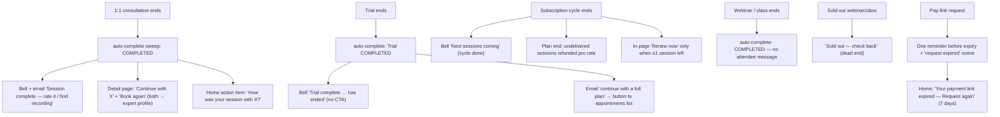
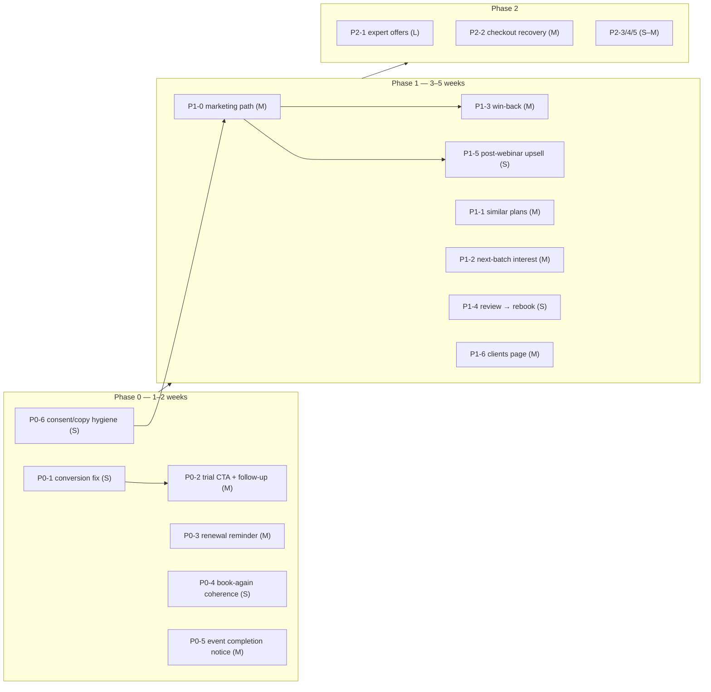

# V2B — Retention, conversion and the post-session lifecycle

> **Status:** Research snapshot of dev @ 39f98669f on 2026-11-03; findings fixed in the booking v2 correctness PR are marked in the [decision record](../../decisions/2026-11-03-booking-v2-direction.md).

Repo: `familiarise_web` on `dev` at 39f98669f. This was a read-only review: no edits, no database access, no dev server. Every claim about current behaviour cites `path:line` and is marked **VERIFIED** (I read the code) or **SUSPECTED** (inferred, not traced end to end).

**Short version.** The platform handles money and state after a session very carefully: trial completion, cycle-done notices, plan-end pro-rata refunds, a one-time pay-link reminder, lapsed-link recovery and "notify me" for held 1:1 windows. Almost nothing turns a finished booking into the next one. The trial-completed email has no link to the plan, there is no renewal reminder before a plan ends, a finished webinar or class sends attendees nothing, sold-out events are a dead end, and no surface recommends anything. The trial-conversion metric is also wrong today, because a trial is marked CONVERTED when checkout _starts_, before any payment (R-01). The rails for consented marketing already exist (DPDP consent artifacts, an opt-in `marketingEmails`, the outbox; quiet hours were also counted here, but see the 2026-11-06 correction below), but nothing sends through them yet, and two consent gaps must be closed first (R-10, R-11).

---

## 1. Current system (HLD and journeys as they exist now)

### 1.1 Delivery plumbing that every lifecycle message rides on

| Piece              | What it does today                                                                                                                                                                                                                                                                                                                              | Evidence                                                                                          |
| ------------------ | ----------------------------------------------------------------------------------------------------------------------------------------------------------------------------------------------------------------------------------------------------------------------------------------------------------------------------------------------- | ------------------------------------------------------------------------------------------------- |
| Novu "families"    | The Novu plan allows only 20 workflows and the app has about 80 events, so each Novu workflow is a _family_ and the event travels as `payload.event`. 16 families are deployed, and none of them is for marketing.                                                                                                                              | `lib/novu/templates/families.ts:1-8`, `:13-29` VERIFIED                                           |
| Novu plan limits   | The Free plan allows 10,000 runs a month and 20 workflows. The checklist says retention is 7 days; the vendor page now says 24 hours.                                                                                                                                                                                                           | `.claude/skills/billing-guardrails/references/novu.md:5` VERIFIED                                 |
| Resend plan limits | The Free plan **blocks** sending after 100 emails a day or 3,000 a month.                                                                                                                                                                                                                                                                       | `.claude/skills/billing-guardrails/references/resend.md:5,9` VERIFIED                             |
| Outbox             | Notifications are staged in a transaction and drained every 10 minutes, 20 rows per run.                                                                                                                                                                                                                                                        | `novu.md:17` VERIFIED                                                                             |
| Email gate         | There are nine category switches. A required notice (`category === null`) ignores them. **`marketingEmails` is not one of the nine**, so no send reads it.                                                                                                                                                                                      | `lib/email/preferences.ts:17-46`, `:91-101` VERIFIED                                              |
| `marketingEmails`  | An opt-in column, default `false`. The DPDP consent API syncs it with `MARKETING_COMMS`.                                                                                                                                                                                                                                                        | `prisma/schema.prisma:1001`; `app/api/user/privacy/consent/route.ts:11-20,126-150` VERIFIED       |
| Quiet hours        | **Superseded 2026-11-06.** The snapshot found they applied to bells only, through a `notBefore` floor on the Novu outbox. In-app quiet hours were removed; the `quietHours*` columns now feed only the consultant planning reminder (`lib/booking/week-nudge.ts`), for both its email and its bell. `lib/novu/quiet-hours.ts` no longer exists. | `lib/novu/quiet-hours.ts:1-20`; `lib/novu/policy.ts:58-92,128-131` VERIFIED                       |
| Unsubscribe link   | Sets `emailEnabled=false`, which silences every optional email category.                                                                                                                                                                                                                                                                        | `app/api/notifications/unsubscribe/route.ts:68-72` VERIFIED                                       |
| Org routing        | Removed 2026-11-07: the bell policy reads only the personal switches (was `notificationRoutingMode`, EMAIL_ONLY or NEITHER meant no bell).                                                                                                                                                                                                      | `lib/novu/policy.ts:37-55` VERIFIED                                                               |
| Product analytics  | None. There is no PostHog, Mixpanel or gtag; `SystemEvent` is for operational errors only. Conversion today is logged with `console.log` (`trial_converted`).                                                                                                                                                                                   | `prisma/schema.prisma:3701-3722`; `lib/payments/checkout/handlers/subscription.ts:66-76` VERIFIED |

### 1.2 What happens after each kind of booking

| Moment                                  | Learner sees                                                                                                                                                                                                                                                                                           | Expert sees                                                              | Evidence                                                                                                                                                                                                                                                                         |
| --------------------------------------- | ------------------------------------------------------------------------------------------------------------------------------------------------------------------------------------------------------------------------------------------------------------------------------------------------------ | ------------------------------------------------------------------------ | -------------------------------------------------------------------------------------------------------------------------------------------------------------------------------------------------------------------------------------------------------------------------------- |
| 1:1 completed                           | A bell and email: "has ended. Open it to rate the session or find the recording." The primary action is RATE. The detail page shows **two** buttons, "Continue with {expert}" and "Book again", and both go to `/explore/experts/{id}`.                                                                | The same completion bell.                                                | `lib/novu/templates/b2c.ts:161-171`; `lib/dashboard/money-state.ts:761-762`; `app/dashboard/consultee/[consulteeId]/(features)/appointments/[appointmentId]/DetailPageClient.tsx:217-219,257-260,360-375`; `scripts/appointments/auto-complete-appointments.ts:570-600` VERIFIED |
| Rate prompt                             | A Home action item, "How was your session with X? A short review helps other learners choose." After posting, a toast only: "Thanks for your review". There is no next step.                                                                                                                           | A "New review" bell.                                                     | `lib/dashboard/action-items.ts:326-336`; `components/reviews/ReviewComposer.tsx:95-99`; `b2c.ts` NEW_REVIEW_RECEIVED VERIFIED                                                                                                                                                    |
| Trial completed                         | Bell: "The trial session for {plan} with {expert} has ended." Email body: "…continue with a full plan". The email button goes to the appointments dashboard, not the plan. On the detail page, "Continue with {expert}" goes to the profile, not the trial's subscription plan.                        | The same bell, and an email asking them to "follow up with your client". | `b2c.ts:431-441`; `emails/booking/TrialAndSubscriptionEmail.tsx:119-135,234-236`; `auto-complete-appointments.ts:899-951` VERIFIED                                                                                                                                               |
| Trial → subscription                    | The conversion link is written when the subscription row is created at checkout (status PENDING), **before payment**. It matches any COMPLETED trial with the same expert, whichever plan the trial was for.                                                                                           | —                                                                        | `lib/payments/checkout/handlers/subscription.ts:44-77,213-214,243-249` VERIFIED                                                                                                                                                                                                  |
| Subscription cycle done                 | "Cycle N of {plan} is done — {expert} will schedule your next sessions."                                                                                                                                                                                                                               | —                                                                        | `b2c.ts:381-394` VERIFIED                                                                                                                                                                                                                                                        |
| Subscription low on sessions            | An amber in-page nudge with "Renew now", linking to `/checkout/plans/subscription/{planId}?renewsSubscriptionId=…`. It appears only on the appointment detail page and only when one session or fewer is left. No email and no bell.                                                                   | —                                                                        | `DetailPageClient.tsx:231-255,376-392` VERIFIED                                                                                                                                                                                                                                  |
| Renewal mechanics                       | A renewal is a same-plan re-purchase. Only an APPROVED or COMPLETED prior subscription can anchor it. The new plan starts no earlier than the prior plan's end. A unique link prevents a double renewal.                                                                                               | —                                                                        | `lib/payments/checkout/renewal.ts:20-53,90-126`; `prisma/schema.prisma:4205-4208`; `subscription.ts:230-241` VERIFIED                                                                                                                                                            |
| Plan end                                | Undelivered sessions are refunded pro rata once, with no forfeit. No "your plan ends in N days" notice.                                                                                                                                                                                                | —                                                                        | `scripts/appointments/settle-cancelled-sessions.ts:15-20,784-798` VERIFIED                                                                                                                                                                                                       |
| Webinar or class completed              | **Nothing.** The status moves to COMPLETED and the sweep moves on.                                                                                                                                                                                                                                     | Nothing.                                                                 | `auto-complete-appointments.ts:361-383` (webinar); `:443` (class) VERIFIED                                                                                                                                                                                                       |
| Webinar or class sold out or closed     | "Sold out — all N seats taken. Enrollment … closed. Check back in case the instructor opens more seats." The button is disabled. A closed class says "Check back when the instructor … schedules the next batch." The capacity error toast says "…or join the waitlist", but no event waitlist exists. | Participants page shows "· sold out".                                    | `app/explore/programs/plans/classes/[classPlanId]/components/ClientClassRegistration.tsx:95-110,189-216`; `ClientWebinarRegistration.tsx:238-263`; `components/dashboard/shared/requests/labels.ts:155-156`; `prisma/schema.prisma:4642-4644` VERIFIED                           |
| Held 1:1 window                         | "Notify me if this time opens": notify-only, a cap of 3, and everyone waiting is told at once.                                                                                                                                                                                                         | —                                                                        | `lib/booking/backup-interest.ts:1-29` VERIFIED                                                                                                                                                                                                                                   |
| Pay-link request                        | One reminder email and bell before expiry, then a "request expired" notice. Home shows lapsed links for 7 days with "Request again".                                                                                                                                                                   | —                                                                        | `scripts/payments/cleanup-abandoned-payments.ts:840,1390-1424`; `lib/dashboard/action-items.ts:315-323`; `app/api/dashboard/consultee/[consulteeId]/pending-payments/route.ts:25` VERIFIED                                                                                       |
| Direct checkout failed or window closed | "You can book again whenever you are ready." The button is **Book again → `/explore`**, which drops the plan context.                                                                                                                                                                                  | —                                                                        | `app/checkout/pending/[paymentId]/PendingCheckoutClient.tsx:170-185` VERIFIED                                                                                                                                                                                                    |
| Learner Home with nothing upcoming      | "No upcoming sessions. Book a session with an expert to get started." The CTA is "Find experts", **even for a returning learner**.                                                                                                                                                                     | —                                                                        | `app/dashboard/consultee/[consulteeId]/(features)/home/HomeTab.tsx:797-811` VERIFIED                                                                                                                                                                                             |

### 1.3 Discovery and cross-sell

- **Expert list default sort is Name A–Z.** VERIFIED: `app/explore/experts/utils.ts:30-45`. Other options are rating, review count, trending and newest (`app/explore/experts/components/SearchBar.tsx:16,100-103`; `lib/data/explore-experts.ts:254-261`). Plan lists sort by newest, price, title or a 60-second cached trending rank (`app/api/plans/shared/plan-filters.ts:170-181,209-230`; `app/api/plans/classes/route.ts:71-88`). VERIFIED.
- **No recommendations exist** ("similar plans", "more from this expert", "you may also like"). A grep for these terms finds only maintenance and org-programme "Recommended Golden Path" UI. VERIFIED. Plan detail pages link back only to the expert profile (`SubscriptionDetails.tsx:155`, `ConsultationDetails.tsx:124,135`). VERIFIED.
- **Expert storefront.** The profile lists every offering: 1:1, subscriptions, classes and webinars, and digital products (`app/explore/experts/[consultantId]/ExpertProfileClient.tsx:21,557`). This is the only cross-sell surface. VERIFIED.
- **Org badge precedent.** `/explore/programs` badges a plan "Recommended by {org}" when the viewer's org sponsors it. The data is fetched per viewer and kept out of the shared cache (`app/explore/programs/(index)/page.tsx:15-30`; `ProgramCard.tsx:452`). VERIFIED. This is the right model for org-scoped recommendations.
- **Digital products.** The purchase email links to the Library (`emails/payments/DigitalProductPurchaseEmail.tsx:60-61`). No session-to-product or product-to-session cross-sell. VERIFIED.

### 1.4 Data that already exists for a retention loop (no schema needed to read it)

| Need                          | Already in schema                                                                                                                                        | Evidence                                                                                                                       |
| ----------------------------- | -------------------------------------------------------------------------------------------------------------------------------------------------------- | ------------------------------------------------------------------------------------------------------------------------------ |
| "Your experts" / past clients | `ExpertCustomerRelationship(consultantProfileId, buyerUserId, source, firstPaymentId)`, unique per pair. It is read today only for fees and attribution. | `prisma/schema.prisma:7131-7146`; `lib/payments/pricing/platform-fee.ts:35,103`; `lib/referrals/attribution.ts:68-77` VERIFIED |
| Repeat-learner baseline       | `repeatLearners` and `repeatLearnerRate` in consultant earnings analytics                                                                                | `lib/data/consultant-earnings-analytics.ts:152-156,259-335` VERIFIED                                                           |
| Trial outcome                 | `Trial.status`, `completedAt`, `convertedToSubscriptionId`, `organizationId` (attribution only)                                                          | `prisma/schema.prisma:4243-4312` VERIFIED                                                                                      |
| Renewal chain                 | `Subscription.renewedFromSubscriptionId` (unique)                                                                                                        | `prisma/schema.prisma:4205-4208` VERIFIED                                                                                      |
| Plan end                      | `Subscription.planEndsAt`, `sessionsTotal`, `sessionsReturned`                                                                                           | `prisma/schema.prisma:4161-4164,4196-4202` VERIFIED                                                                            |
| Expert paused                 | `ConsultantProfile.acceptingRequests` (a paused expert refuses 1:1 bookings and trials)                                                                  | `prisma/schema.prisma:3351`; HLD `docs/start-here/01-booking-system-hld.md:77` VERIFIED                                        |
| Reminder once-guard precedent | `BillingSubscription.renewalReminderSentAt` ("Stamped when renewal-upcoming reminder fires")                                                             | `prisma/schema.prisma:1744-1745`; `jobs/billing/generate-subscription-invoices.ts:52,75` VERIFIED                              |
| Discount codes                | `DiscountCode` is global: no consultant, plan or user scope, and it is **platform-funded**                                                               | `prisma/schema.prisma:6934-6956`; `lib/payments/checkout/pricing.ts:515-516` VERIFIED                                          |
| Referral programme            | `ReferralProgramConfig` has `monthlyBudgetPaise` default 0 ("programme effectively off until ops sets a budget")                                         | `prisma/schema.prisma:7103-7129` VERIFIED                                                                                      |
| Interest list for events      | `WaitlistSource.EVENT_SOLD_OUT` exists, but `Waitlist` is the newsletter list, unique per email, and nothing writes that source                          | `prisma/schema.prisma:4642-4690`; grep of `app/api/waitlist`, `lib/waitlist` VERIFIED                                          |

---

## 2. Findings

Severity: P0 = wrong money or legal exposure now; P1 = a broken journey or a blocker for this track; P2 = meaningful UX or growth gap; P3 = polish.

| ID   | Sev | Type          | Finding                                                                                                                                                                                                                                                                                                                                                                                              | Evidence                                                                                                                                                                                                                                                  | User impact                                                                                                                                                                          | Proposed fix                                                                                                                                                                                                                             |
| ---- | --- | ------------- | ---------------------------------------------------------------------------------------------------------------------------------------------------------------------------------------------------------------------------------------------------------------------------------------------------------------------------------------------------------------------------------------------------- | --------------------------------------------------------------------------------------------------------------------------------------------------------------------------------------------------------------------------------------------------------- | ------------------------------------------------------------------------------------------------------------------------------------------------------------------------------------ | ---------------------------------------------------------------------------------------------------------------------------------------------------------------------------------------------------------------------------------------- |
| R-01 | P1  | bug           | **A trial is marked CONVERTED before payment.** `linkCompletedTrialToSubscription` runs inside checkout, right after the PENDING subscription row is created, and CONVERTED is terminal. Nothing reverts it when the checkout is abandoned: `cleanup-abandoned-payments.ts` has no trial handling. The link also matches any COMPLETED trial with the same expert, whichever plan the trial was for. | `lib/payments/checkout/handlers/subscription.ts:44-77,213-214,243-249`; `app/api/trials/[trialId]/route.ts:388-389`; grep `trial` in `scripts/payments/cleanup-abandoned-payments.ts` (none) VERIFIED                                                     | Trial-conversion numbers are inflated. `convertedToSubscriptionId` can point to an abandoned subscription. Any later trial→plan nudge would be suppressed for people who never paid. | Move the link to capture: call it from the subscription arm reached by `handlePaymentSuccess`, still with CAS on `COMPLETED → CONVERTED`. Keep the any-plan-of-the-same-expert match (see design question Q2).                           |
| R-02 | P1  | UX/gap        | **Trial-completed messages have no next step.** The bell has no CTA. The email says "continue with a full plan", but its button goes to the appointments list. "Continue with {expert}" goes to the profile, not the trial's plan. No trial credit is applied at checkout.                                                                                                                           | `b2c.ts:431-441`; `TrialAndSubscriptionEmail.tsx:119-135,234-236`; `auto-complete-appointments.ts:905-909`; `DetailPageClient.tsx:257-260,360-367`; grep `trial` in `lib/payments/checkout/pricing.ts` and the subscription checkout page (none) VERIFIED | Peak intent is wasted. The learner has to find the plan again.                                                                                                                       | Point the CTA at `/checkout/plans/subscription/{trial.subscriptionPlanId}`, change the bell and email copy (§5), and send one follow-up 48 h later if they have not subscribed (P0-2).                                                   |
| R-03 | P1  | gap           | **No B2C renewal or plan-end reminder.** Renewal is offered only by an in-page nudge, on the detail page, when one session or fewer is left. The subscription COMPLETED email is the generic "session complete". The org-billing precedent (`renewalReminderSentAt`) has no B2C twin.                                                                                                                | `DetailPageClient.tsx:231-255,376-392`; `b2c.ts:381-394`; `auto-complete-appointments.ts:759-775`; `prisma/schema.prisma:1744-1745` VERIFIED                                                                                                              | A plan quietly ends and the habit breaks. Renewal depends on the learner opening one specific page.                                                                                  | A T-7-day reminder in the `subscriptions` category with a deep link to renew, guarded by a nullable stamp column (P0-3). Add a Renew CTA to the plan-completed email.                                                                    |
| R-04 | P2  | UX            | **Duplicate CTAs on a past 1:1.** "Continue with {expert}" (primary) and "Book again" (outline) appear together and go to the same URL. Neither pre-selects the plan just used.                                                                                                                                                                                                                      | `DetailPageClient.tsx:217-219,257-260,360-375` VERIFIED                                                                                                                                                                                                   | Two buttons that do the same thing confuse people, and the extra click costs conversions.                                                                                            | Show one primary "Book again with {expert}" that deep-links to the same consultation plan (`/explore/programs/plans/consultations/{planId}`); show "View profile" as a link.                                                             |
| R-05 | P1  | gap           | **Webinar and class completion sends attendees nothing.**                                                                                                                                                                                                                                                                                                                                            | `auto-complete-appointments.ts:361-383,443` VERIFIED                                                                                                                                                                                                      | The best upsell moment (straight after a live group session) is silent. Attendees do not learn that a recording, a review prompt or a next batch exists.                             | A completion notice to seated attendees: thanks, recording expected, rate. Add a "More from {host}" block only with marketing consent (P0-5).                                                                                            |
| R-06 | P2  | copy bug      | **The EVENT_SOLD_OUT toast promises a waitlist that does not exist.** The schema comment says outright that "a full webinar or class is simply sold out". The `WaitlistSource.EVENT_SOLD_OUT` value has no writer.                                                                                                                                                                                   | `components/dashboard/shared/requests/labels.ts:155-156`; `prisma/schema.prisma:4642-4644,4687` VERIFIED                                                                                                                                                  | Learners look for a waitlist they cannot find, and lose trust.                                                                                                                       | Change the copy now to "This session is full — pick another time." Replace it with "Notify me about the next batch" when P1-2 ships, and delete the dead enum value then.                                                                |
| R-07 | P2  | gap           | **Sold-out or closed classes are a dead end.** "Check back…" with a disabled button and no way to register interest. The backup-interest mechanism covers 1:1 windows only.                                                                                                                                                                                                                          | `ClientClassRegistration.tsx:95-110,189-216`; `ClientWebinarRegistration.tsx:238-263`; `lib/booking/backup-interest.ts:1-10` VERIFIED                                                                                                                     | Demand is lost, and the expert never learns that people wanted another batch.                                                                                                        | Plan-level "Notify me about the next batch" (notify-only, user-requested, so transactional), plus "Similar programmes" (P1-1, P1-2).                                                                                                     |
| R-08 | P2  | UX            | **Home treats returning learners like new ones.** "Book a session with an expert to get started."                                                                                                                                                                                                                                                                                                    | `HomeTab.tsx:797-811` VERIFIED                                                                                                                                                                                                                            | The learner's own experts are one search away instead of one click.                                                                                                                  | When the learner has past counterparts, show a "Your experts" row: avatar, last session date and "Book again". The data is in `ExpertCustomerRelationship` and past appointments.                                                        |
| R-09 | P2  | UX            | **A failed or closed direct checkout sends people to `/explore`** rather than back to the plan. Lapsed pay links are handled better: there is a deep "Request again" link and a reminder.                                                                                                                                                                                                            | `PendingCheckoutClient.tsx:170-185`; contrast `action-items.ts:315-323` VERIFIED                                                                                                                                                                          | The learner has to rediscover the expert and the plan.                                                                                                                               | Make the button "Try again", going to the plan's checkout or detail page, and keep "Browse experts" as a secondary link.                                                                                                                 |
| R-10 | P1  | compliance    | **`marketingEmails` can be switched on without DPDP proof.** `PUT /api/novu/preferences` writes it straight from the Notifications panel ("Marketing & Promotions"), but only `/api/user/privacy/consent` writes a `ConsentArtifact`.                                                                                                                                                                | `app/api/novu/preferences/route.ts:68-94`; `schemas/user.ts:528`; `components/notifications/NotificationPreferencesPanel.tsx:116-120`; `app/api/user/privacy/consent/route.ts:126-150` VERIFIED                                                           | A marketing send to a user who opted in through the panel has no consent record. That is an audit gap under the DPDP Rules (consent must be provable).                               | Route the panel toggle through the consent API (grant or withdraw `MARKETING_COMMS`), or make the preferences PUT reject `marketingEmails`. Must land before any marketing send.                                                         |
| R-11 | P1  | compliance/UX | **The one-click unsubscribe is all-or-nothing.** It sets `emailEnabled=false`, which also stops appointment reminders and payment notices.                                                                                                                                                                                                                                                           | `app/api/notifications/unsubscribe/route.ts:68-72`; `lib/email/preferences.ts:91-101` VERIFIED                                                                                                                                                            | Someone who unsubscribes from a promo email later misses a session reminder. DPDP expects withdrawal to be as easy as granting consent, and also specific to its purpose.            | A marketing email's unsubscribe link should carry `scope=marketing`: withdraw `MARKETING_COMMS` (artifact plus `marketingEmails=false`) and leave service mail alone. Keep today's global behaviour for service emails.                  |
| R-12 | P2  | gap           | **There is no marketing send path.** No `marketing` `PreferenceCategory`, no family for it (16 of 20 used) and no frequency cap.                                                                                                                                                                                                                                                                     | `lib/email/preferences.ts:17-46`; `lib/novu/templates/families.ts:13-29`; `novu.md:5,12` VERIFIED                                                                                                                                                         | Nothing can be sent lawfully today. A future feature might borrow a transactional category instead, which would breach purpose limitation.                                           | Add a `marketing` category mapped to `marketingEmails` (default off), a `growth` family (17th of 20) or email-only sends, and a per-user frequency cap (P1-0).                                                                           |
| R-13 | P2  | gap           | **Emails ignore quiet hours.** _Superseded 2026-11-06: in-app quiet hours were removed, so no bell reads them either. Only the planning reminder does. Whether marketing email should respect quiet hours stays an open design question (Q9)._                                                                                                                                                       | `lib/novu/quiet-hours.ts:1-20`; no `quiet` reference in `lib/email/**` VERIFIED                                                                                                                                                                           | Promotional mail could land at 2 am.                                                                                                                                                 | Apply the quiet-hours floor to _marketing_ emails only, via the same `computeQuietHoursNotBefore`. Service emails keep sending immediately.                                                                                              |
| R-14 | P2  | gap           | **Discovery is generic.** Experts sort by Name A–Z by default. No "similar plans" anywhere. Plan pages link only to the expert profile.                                                                                                                                                                                                                                                              | `app/explore/experts/utils.ts:30-45`; `plan-filters.ts:170-181`; `SubscriptionDetails.tsx:155`; `ConsultationDetails.tsx:124,135` VERIFIED                                                                                                                | A learner who did not convert, or who hit a sold-out or paused expert, has nowhere to go next.                                                                                       | A rule-based "More from {expert}" and "Similar plans" module (same expert first, then the same subdomain or tags), excluding paused experts and respecting org scope (P1-1). Change the default expert sort to rating or trending (Q12). |
| R-15 | P2  | gap           | **Experts have no view of their clients and no trial-conversion metric.** `ExpertCustomerRelationship` is read only by the fee and attribution code.                                                                                                                                                                                                                                                 | `prisma/schema.prisma:7131-7146`; `platform-fee.ts:103`; `attribution.ts:68`; grep of consultant dashboard (no client list) VERIFIED                                                                                                                      | Experts cannot see who to follow up with. Preply makes trial-to-subscription rate its headline tutor metric.                                                                         | A "Clients" page under Reputation & growth: last session, plan, "Message" (existing chat), "Send plan link" (P1-6). Add trial conversion to earnings analytics.                                                                          |
| R-16 | P2  | gap           | **Experts cannot issue discount codes or returning-client offers.** `DiscountCode` is global and platform-funded.                                                                                                                                                                                                                                                                                    | `prisma/schema.prisma:6934-6956`; `lib/payments/checkout/pricing.ts:515-516` VERIFIED                                                                                                                                                                     | There is no lever for "come back at 15% off". Topmate creators have coupon codes.                                                                                                    | Expert-scoped, expert-funded codes (P2-1, money-boundary review; Q7).                                                                                                                                                                    |
| R-17 | P3  | UX            | **Posting a review is a dead end.** A toast only. There is no rebook or renew step, and no review reminder email (only the completion bell and the Home action item).                                                                                                                                                                                                                                | `components/reviews/ReviewComposer.tsx:95-99`; `action-items.ts:326-336`; `b2c.ts:161-171` VERIFIED                                                                                                                                                       | The moment of highest satisfaction is not used.                                                                                                                                      | After a 4–5★ review, show an inline card: "Book your next session with {expert}" (1:1) or "Renew {plan}" (subscription). For a referral prompt see P2-3.                                                                                 |
| R-18 | P3  | UX            | **Notification copy says "Subscription renewals and changes"**, but B2C has no auto-renewal and no renewal notices.                                                                                                                                                                                                                                                                                  | `NotificationPreferencesPanel.tsx:111-114`; `b2c.ts:381-394` VERIFIED                                                                                                                                                                                     | Sets an expectation that nothing meets.                                                                                                                                              | Becomes accurate once P0-3 ships. Until then: "Subscription updates and plan-end notices".                                                                                                                                               |
| R-19 | P2  | design        | **Retargeting risks breaching org programmes and expert trust.** Nothing stops a future cross-expert recommendation from reaching an OWN_LINK client (the expert brought them and pays a lower fee) or an org-sponsored learner (whose programme limits the catalog).                                                                                                                                | `platform-fee.ts:35`; `prisma/schema.prisma:6132-6136`; `lib/novu/resolve-href.ts:44` SUSPECTED (no feature yet)                                                                                                                                          | Experts would see it as poaching. Org admins would see learners nudged to spend personally outside the programme.                                                                    | Rules in §5: never cross-recommend to OWN_LINK clients by email; org-context nudges recommend only the org's sponsored catalog and route to the org workspace.                                                                           |
| R-20 | P3  | gap           | **Renewing an org-sponsored subscription is undefined.** The "Renew now" nudge renders for any APPROVED or COMPLETED subscription, whatever paid for it.                                                                                                                                                                                                                                             | `DetailPageClient.tsx:231-238` VERIFIED (the gate does not look at the funding source); renewal checkout funding not traced, SUSPECTED                                                                                                                    | An org learner may be sent to a personal-pay renewal, or blocked by programme caps without a clear message.                                                                          | Gate the renewal CTA by funding source. For org-funded plans show "Ask your programme admin" or the org checkout, per the programme's rules.                                                                                             |

---

## 3. Design options per open question

### 3.0 Competitor precedent (web research, 2026-11-03)

Only the precedents that shaped a recommendation below are kept, each cited by site and help topic (search returned grounding redirect links, not direct URLs). The full comparison of platforms, the vendor-reported conversion figures and the platforms that shaped no recommendation are kept in Notion (Familiarise / Strategy and Competition / Competitor Register).

- **Preply** (help: "How do subscriptions work", "Trial lesson replacement"): a paid trial is followed by a prompt to pick a plan, and a learner who is disappointed gets a free replacement trial with a different tutor, up to two times. Subscriptions renew every 28 days and can be paused once per cycle for up to 20 days.
- **italki** (support: "Packages", "Recurring lessons"): a "Book again" path after a lesson, and a notice to the student when a package is close to expiring or running out.
- **Calendly** (help: "Workflows"): an "Event ends" workflow trigger sends an email with a rebooking link, and a separate "No-show marked" trigger covers rebooking after a miss.
- **Topmate** (help: "Coupons"): creators issue percentage or fixed discount coupon codes on calls, webinars and products.
- **Mindbody** (help: "Marketing Suite automations"): a lapsed-client journey fires on the last visit date and excludes clients with upcoming bookings or active memberships, with the offer held back to the second touch.
- **Practo** (help: "Free follow-up"): a free follow-up with the same doctor for 7 days, up to 30 messages, after an online consultation.
- **Cult.fit** (support: "Pause membership", "Renewal"): expiry reminders with early-renewal offers, and a pause that extends validity.

**What carries over to Familiarise.** (1) A same-plan deep link at the moment intent peaks: Calendly "event ends", italki "book again". (2) An expiry or plan-end reminder: italki, Cult.fit. (3) Trial conversion as a visible expert metric, plus a no-regret replacement for a bad trial: Preply. (4) Win-back only for people with no upcoming booking, offer in the 2nd touch: Mindbody. (5) Expert-issued coupons: Topmate. (6) A short free follow-up window that builds the relationship without a discount: Practo.

### 3.1 Questions and options

**Q1. Is the trial → plan follow-up a transactional or a marketing message?**

- A. **RECOMMENDED: transactional, in the existing `trials` category.** One message, 48 h after trial completion, only about the plan the trial was for, with the same expert and no discount. Rationale: the learner asked for a trial _of that plan_ (`Trial.subscriptionPlanId`, `prisma/schema.prisma:4256-4257`), so one follow-up stays within the purpose. They can turn it off under "Trial Sessions". Precedent: Preply's post-trial plan prompt.
- B. Marketing only: needs `MARKETING_COMMS`. Safer legally, but it reaches perhaps a small fraction of learners, since consent defaults off.
- C. No follow-up; only the fixed completion email (R-02). Lowest risk, lowest upside.
- _Owner and legal sign-off needed_: whether option A is "necessary for the service requested" under DPDP purpose limitation.

**Q2. What counts as a trial conversion?**

- A. **RECOMMENDED: a _captured_ subscription to any plan of the same expert, within 30 days of `Trial.completedAt`.** The CONVERTED stamp is written at capture (fixes R-01). Rationale: learners often pick a bigger or smaller plan than the one they trialled, and the expert earned the conversion either way.
- B. The trial's own plan only. Purer, but under-counts.
- C. Today's behaviour (on subscription creation, before payment). Wrong, see R-01.

**Q3. When to remind about renewal?**

- A. **RECOMMENDED: one reminder at T-7 days before `planEndsAt`** (derived end for null rows via `subscriptionPlanEnd`). Skip it if a renewal already exists (`renewal` relation) or the plan is org-funded (R-20). Keep the in-page ≤1-session nudge. Precedent: italki and Cult.fit expiry reminders.
- B. Trigger when remaining sessions ≤1. Session-based, but plans with unscheduled sessions never trigger it.
- C. Both triggers, with a once-guard. More reach, two code paths.

**Q4. Who may be recommended to whom?**

- A. **RECOMMENDED: same expert first, everywhere. Cross-expert ("similar plans") only on-site, and in emails only with marketing consent. Never cross-expert in an email to a client whose relationship with that expert is `OWN_LINK`.** For an org-context learner, recommend only plans in the org's sponsored catalog, with the "Recommended by {org}" badge. Rationale: experts who bring their own audience pay the lower `ownLinkBps` (`platform-fee.ts:35`) and would see platform emails pushing other experts as poaching. Org programmes cap the catalog.
- B. Cross-expert everywhere. Highest marketplace liquidity, but it damages trust with experts who bring supply.
- C. Same expert only. Safe, but leaves learners stranded when the expert is paused or sold out.

**Q5. Where do the once-guards and frequency caps live?**

- A. **RECOMMENDED: nullable stamp columns for P0** (`Subscription.renewalReminderSentAt`, `Trial.conversionNudgeSentAt`). These follow the repo's existing pattern (`BillingSubscription.renewalReminderSentAt`, `seatsSettledAt`), where the sweep cohort is simply the rows whose stamp is null. Add **one `MarketingSend` table only when the first marketing message ships (P1)**, because a per-user frequency cap and attribution need a cross-entity log. Rationale: AGENTS.md §1.2 forbids speculative abstractions.
- B. A `MarketingSend` table from day one for all nudges. One mechanism, but it builds P1 infrastructure before P1 exists.
- C. Novu digest or throttle only. Not visible in our DB, so no attribution, and it spends Novu runs.

**Q6. Novu: a new family, or reuse existing ones?**

- A. **RECOMMENDED: transactional nudges reuse existing families** (`trial`, `subscription`, `appointment`; new event ids map through `EVENT_FAMILY`). **Marketing sends are email-only through Resend, with no Novu run.** Add a `growth` family (17th of 20) only if an in-app marketing bell is wanted later. Rationale: protects the 10,000-run and 20-workflow ceilings (`novu.md:5,12`). Marketing in a bell inbox is also low value.
- B. A `growth` family now, for bell plus email. It costs runs, and the in-app inbox gets cluttered with promotions.

**Q7. Who funds a returning-client discount?**

- A. **RECOMMENDED: expert-funded, expert-scoped codes** (P2). The discount comes out of the expert's earnings and the platform fee is applied to the discounted price. This needs a money-boundary review, because discounts are platform-funded today (`pricing.ts:515-516`). Precedent: Topmate creator coupons.
- B. Platform-funded win-back credits, reusing the `ReferralCredit` style. Fast, but it spends the platform's budget (`ReferralProgramConfig.monthlyBudgetPaise` defaults to 0).
- C. Split 50/50. Complex ledger legs; no evidence it is needed.

**Q8. What does the unsubscribe link do?**

- A. **RECOMMENDED: scoped links.** A marketing email's link withdraws `MARKETING_COMMS` only (artifact plus `marketingEmails=false`). Service emails keep today's global `emailEnabled=false`, and the landing page offers "Only stop promotions" as the default choice.
- B. Keep global for everything. Over-blocks reminders (R-11).

**Q9. Should email respect quiet hours?**

- A. **RECOMMENDED: marketing emails yes, service emails no.** Defer to the end of the quiet window, or else to 09:00–20:00 in the recipient's zone.
- B. Both. Delays a reschedule or payment email; bad.
- C. Neither (today, apart from the consultant planning reminder).

**Q10. Next-batch interest for a sold-out or closed class or webinar: notify-only, or hold a seat?**

- A. **RECOMMENDED: notify-only**, mirroring #1778 backup interest. Everyone interested is told when a new batch is created or capacity is raised, and the first to pay wins. No locks, no money.
- B. A priority hold with a 24 h claim window. Fairer, but it adds tentative seats and a sweep, which is a state machine AGENTS.md discourages without demand.

**Q11. Win-back rules?**

- A. **RECOMMENDED: 45 days since the last completed session, no upcoming session, no live subscription, marketing consent given.** At most one win-back per 90 days. Send the first touch with no offer; an expert-funded offer only after P2-1. Precedent: Mindbody's 60–90-day "last visit", excluding active clients.
- B. 30 days. Too aggressive for consultations, which are lower-frequency than fitness classes.

**Q12. Default expert sort?**

- A. **RECOMMENDED: "Highest rating" with a minimum review count, tie-broken by trending.** Fall back to newest for experts with no reviews.
- B. Keep Name A–Z (today). It surfaces "Aarav" over better-matched experts.

---

## 4. Schema changes (all additive and nullable; no backfill; no `db push` by agents)

| #   | Change                                                                                                                                                                                                            | Phase | Justification                                                                                                                                                                                                                                                                         | Notes                                                                                                                                                                                                                                    |
| --- | ----------------------------------------------------------------------------------------------------------------------------------------------------------------------------------------------------------------- | ----- | ------------------------------------------------------------------------------------------------------------------------------------------------------------------------------------------------------------------------------------------------------------------------------------- | ---------------------------------------------------------------------------------------------------------------------------------------------------------------------------------------------------------------------------------------- |
| S-1 | `Subscription.renewalReminderSentAt DateTime? @db.Timestamptz`                                                                                                                                                    | P0    | Once-guard for the T-7d reminder (P0-3). The sweep cohort is `renewalReminderSentAt IS NULL AND planEndsAt BETWEEN now AND now+7d AND status IN live`.                                                                                                                                | Mirrors `BillingSubscription.renewalReminderSentAt` (`schema.prisma:1744`). Partial index in `prisma/sql/*.sql` on `(planEndsAt) WHERE renewalReminderSentAt IS NULL AND deletedAt IS NULL`.                                             |
| S-2 | `Trial.conversionNudgeSentAt DateTime? @db.Timestamptz`                                                                                                                                                           | P0    | Once-guard for the 48 h follow-up (P0-2). The cohort is `status=COMPLETED AND completedAt < now-48h AND conversionNudgeSentAt IS NULL`.                                                                                                                                               | The existing index `[status, paymentDueAt]` does not cover this, so add `@@index([status, completedAt])`.                                                                                                                                |
| —   | _No column for R-01._                                                                                                                                                                                             | P0    | The fix moves an existing write from checkout to capture.                                                                                                                                                                                                                             | —                                                                                                                                                                                                                                        |
| S-3 | New `PlanInterest` table: `id, userId, classPlanId?, webinarPlanId?, createdAt, notifiedAt?, cancelledAt?`; unique `(userId, classPlanId)` and `(userId, webinarPlanId)`; CHECK exactly one plan FK (sidecar SQL) | P1    | Next-batch "notify me" (P1-2). The existing `Waitlist` is a unique-per-email newsletter list (`schema.prisma:4642-4672`) and `WindowBackupInterest` is keyed to a 1:1 time window, so neither fits.                                                                                   | Cap per user (for example 10). Delete `WaitlistSource.EVENT_SOLD_OUT` in the same PR.                                                                                                                                                    |
| S-4 | New `MarketingSend` table: `id, userId, kind (String), subjectId, consultantProfileId?, organizationId?, sentAt`; unique `(userId, kind, subjectId)`; index `(userId, sentAt)`                                    | P1    | Frequency cap ("≤1 marketing email per 7 days and ≤2 per 30 days"), idempotency and attribution. Attribution is computed as a **query**: a captured payment by the same user to the same expert within 14 days of `sentAt`. No write is added to the `handlePaymentSuccess` hot path. | Retention: delete rows after 12 months via the existing prune pattern (registry job).                                                                                                                                                    |
| S-5 | `DiscountCode.consultantProfileId String?`, `DiscountCode.restrictedToUserId String?` (both nullable; null means today's global, platform-funded behaviour)                                                       | P2    | Expert-issued and returning-client codes (P2-1).                                                                                                                                                                                                                                      | **Money-boundary change**: the earnings base moves for expert-funded codes (`pricing.ts:515-516`). Needs `.claude/skills/booking/references/money-boundary.md` review and ledger tests. Possibly a `fundedBy` enum, if Q7 picks a split. |
| S-6 | `Appointment.reviewReminderSentAt DateTime? @db.Timestamptz`                                                                                                                                                      | P1    | Once-guard for the single +24 h review reminder (P1-4); service class, so not in `MarketingSend`.                                                                                                                                                                                     | Ship only with P1-4.                                                                                                                                                                                                                     |
| —   | **Not needed**: a "saved experts" table, a recommendations table, a feature flag                                                                                                                                  | —     | "Your experts" comes from `ExpertCustomerRelationship` plus past appointments. Recommendations are a query.                                                                                                                                                                           | AGENTS.md §1.2.                                                                                                                                                                                                                          |

---

## 5. Prioritised feature set and phased roadmap

### 5.0 Guardrails that every item below obeys

1. **Message class.** _Service_ messages concern the learner's own purchase or request: same plan or same expert, no discount, existing category. _Marketing_ messages are everything else: cross-expert, win-back, offers, upsell to a different product type. Marketing requires `marketingEmails=true` **and** an active `MARKETING_COMMS` artifact (after R-10 is fixed), carries a marketing-scoped unsubscribe (R-11), honours quiet hours (R-13), is email-only, and is frequency-capped (S-4).
2. **Org scope.** If the source booking has `Appointment.organizationId`, the nudge is built with `notificationHref(orgId, …)` (`lib/novu/resolve-href.ts:44`) and the recipient's personal switches apply (`lib/novu/policy.ts`). Recommendations come only from the org's sponsored catalog. No personal-pay "Renew" for org-funded plans (R-20). B2C marketing never goes to the org workspace identity.
3. **Expert trust.** No cross-expert recommendation by email to OWN_LINK clients (Q4). Paused experts (`acceptingRequests=false`) are excluded from recommendations, and their own "Book again" shows "{expert} isn't taking new bookings right now. See similar experts."
4. **Budget.** Each sweep is one function in `lib/cron/cleanup-registry.ts`, run on the ticker with a windowed `limit` (AGENTS §1.1, §1.4). Failures go to Sentry once per run (AGENTS §4.2). Before enabling marketing, count recipients against Resend's 100/day Free cap, and move to Pro first (`resend.md:21`).
5. **No speculative abstractions.** No feature flags or "campaign engine". Each nudge is a fixed trigger, a fixed template and a once-guard.

### 5.1 P0: fix and wire the moments that already exist (service class, no consent change)

| ID   | Feature                                         | Journey and copy                                                                                                                                                                                                                                                                                                                                                                                                                                                                                                                                                                                                                                                                                   | Trigger / event                                                                                                                                                                                                                                                         | Data                                                                             | Schema | Measure                                                                                                            | Effort |
| ---- | ----------------------------------------------- | -------------------------------------------------------------------------------------------------------------------------------------------------------------------------------------------------------------------------------------------------------------------------------------------------------------------------------------------------------------------------------------------------------------------------------------------------------------------------------------------------------------------------------------------------------------------------------------------------------------------------------------------------------------------------------------------------- | ----------------------------------------------------------------------------------------------------------------------------------------------------------------------------------------------------------------------------------------------------------------------- | -------------------------------------------------------------------------------- | ------ | ------------------------------------------------------------------------------------------------------------------ | ------ |
| P0-1 | **Correct trial conversion** (R-01)             | Not user-facing                                                                                                                                                                                                                                                                                                                                                                                                                                                                                                                                                                                                                                                                                    | Move `linkCompletedTrialToSubscription` from `handleSubscriptionCheckout` to the subscription capture arm of `handlePaymentSuccess`, CAS `COMPLETED → CONVERTED` (shipped as `convertCompletedTrial`, run at capture and at a no-gateway checkout that settles at once) | Trial, Subscription                                                              | none   | Trial CONVERTED ÷ COMPLETED (30-day window); the count of CONVERTED trials whose sub was never paid should be zero | S      |
| P0-2 | **Trial → plan CTA and one follow-up** (R-02)   | **Bell** (trial completed): "Your trial with {expert} is done. Ready to continue? {plan} — {sessions} sessions over {months} months." → `/checkout/plans/subscription/{planId}`. **Email** button: "Continue with {plan}". Secondary link: "See {expert}'s other plans". **Detail page** primary: "Continue with {plan}". **+48 h follow-up** (only if no captured subscription to that expert and the expert is accepting bookings): subject "{expert} has a spot for you"; body "Your trial was on {date}. Pick up where you left off — {plan} starts as soon as you choose a date." Expert side, on Today: "{learner}'s trial ended 2 days ago — they haven't picked a plan yet. Message them." | Existing `TRIAL_SESSION_COMPLETED` (payload adds `planHref`); a new event `TRIAL_FOLLOW_UP` → family `trial` (category `trials`); a sweep `trial-follow-up` in the registry                                                                                             | Trial (`subscriptionPlanId`, `completedAt`), plan, expert `acceptingRequests`    | S-2    | Trial→paid within 14 and 30 days, before vs after; follow-up sends and conversions (query)                         | M      |
| P0-3 | **Plan-end renewal reminder** (R-03, R-18)      | **Email and bell** at T-7d: subject "Your {plan} plan with {expert} ends on {date}"; body "You've had {delivered} of {total} sessions. Any session not delivered by {date} is refunded automatically. Want to keep going? Renewing starts your next plan right after this one ends." CTA "Renew {plan}" → `/checkout/plans/subscription/{planId}?renewsSubscriptionId={id}`. The **plan-completed email** gets the same CTA. **Skip** when a renewal exists, the plan is org-funded, or the expert is paused (then: "{expert} isn't taking new plans right now").                                                                                                                                  | A new event `SUBSCRIPTION_PLAN_ENDING` → family `subscription`; a sweep `plan-end-reminders`                                                                                                                                                                            | `planEndsAt` / `subscriptionPlanEnd()`, `renewal`, funding source                | S-1    | Renewal rate: subscriptions with `renewal` ÷ plans that reached their end, before vs after                         | M      |
| P0-4 | **"Book again" coherence** (R-04, R-08, R-09)   | Detail page: one primary "Book again with {expert}", going to the **same plan's** page, plus a "View profile" link. Home: a "Your experts" row (up to 4; avatar, "Last session {date}", "Book again"). Empty-state copy for returning learners: "Nothing booked right now. Book again with someone you know, or find a new expert." Failed or closed checkout: "Try again" → plan checkout; secondary "Browse experts".                                                                                                                                                                                                                                                                            | UI only                                                                                                                                                                                                                                                                 | `ExpertCustomerRelationship` + last COMPLETED appointment per expert (one query) | none   | Share of 1:1 bookings by repeat learners; `repeatLearnerRate` (existing analytics)                                 | S      |
| P0-5 | **Webinar and class completion notice** (R-05)  | **Email and bell** to seated attendees: "Thanks for joining {title}. The recording will appear in your Library when {host} publishes it. How was it? [Rate]." For classes: "Batch complete — {n} of {n} sessions." With marketing consent only, a block: "More from {host}: {next class or webinar}" (same host only).                                                                                                                                                                                                                                                                                                                                                                             | Reuse `APPOINTMENT_COMPLETED` with `appointmentType: webinar or class`, staged in the completion transaction or right after it (outbox)                                                                                                                                 | Webinar/Class participants (seated)                                              | none   | Attendee review rate; next purchase from the same host within 30 days                                              | M      |
| P0-6 | **Consent and copy hygiene** (R-06, R-10, R-11) | The panel's "Marketing & Promotions" toggle calls the consent API. A marketing-scoped unsubscribe token. EVENT_SOLD_OUT copy becomes "This session is full — pick another time."                                                                                                                                                                                                                                                                                                                                                                                                                                                                                                                   | —                                                                                                                                                                                                                                                                       | ConsentArtifact                                                                  | none   | 0 users with `marketingEmails=true` and no active `MARKETING_COMMS` artifact (audit query)                         | S      |

### 5.2 P1: recommendations, next batch, first consented marketing

| ID   | Feature                                             | Journey and copy                                                                                                                                                                                                                                                                                                                                                                                                      | Trigger                                                                                                                                                                       | Data                                                                 | Schema                                                                             | Measure                                                           | Effort |
| ---- | --------------------------------------------------- | --------------------------------------------------------------------------------------------------------------------------------------------------------------------------------------------------------------------------------------------------------------------------------------------------------------------------------------------------------------------------------------------------------------------- | ----------------------------------------------------------------------------------------------------------------------------------------------------------------------------- | -------------------------------------------------------------------- | ---------------------------------------------------------------------------------- | ----------------------------------------------------------------- | ------ |
| P1-0 | **Marketing send path** (R-12, R-13)                | Not user-facing                                                                                                                                                                                                                                                                                                                                                                                                       | `PreferenceCategory 'marketing'` → `marketingEmails`; email-only sender with consent and artifact check, quiet-hours floor, cap from `MarketingSend`                          | —                                                                    | S-4                                                                                | Send volume vs Resend quota; unsubscribe rate below 0.5% per send | M      |
| P1-1 | **"More from {expert}" and "Similar plans"** (R-14) | Shown on plan detail pages, the sold-out or closed state, a declined or expired request, and a trial that did not convert. Sections: "More from {expert}" (same expert's other live offerings), then "Similar plans" (same subdomain or overlapping tags, rating ≥ X, `acceptingRequests`, live). Org learners in org context see only sponsored plans, badged "Recommended by {org}". Empty state: hide the section. | A server query (no ML), cached per plan for 5 minutes like the curated lists; viewer-specific org filter outside the shared cache (`programs/(index)/page.tsx:15-18` pattern) | Plan topics/subdomain, ratings, `acceptingRequests`, org sponsorship | none                                                                               | Click-through and booking rate from the module                    | M      |
| P1-2 | **Next-batch interest** (R-06, R-07)                | Sold-out or closed card: "Notify me about the next batch" → "We'll email you when {host} opens seats or schedules a new batch." Notice when it fires: "{title} has a new batch starting {date} — seats are first come, first served." Expert's plan page: "{n} people want the next batch."                                                                                                                           | Fires on new Class/Webinar under the plan, or a capacity increase (inside that write's transaction, via the outbox, like backup interest)                                     | PlanInterest                                                         | S-3                                                                                | Interest→purchase rate; time from interest to the new batch       | M      |
| P1-3 | **Win-back (marketing)**                            | 45 days inactive (Q11). Subject: "Pick up where you left off with {expert}". Body: "It's been a while since your session on {date}. {expert} has times this week." CTA "See times". Secondary (non-OWN_LINK, non-org only): "Or try: {2 similar plans}".                                                                                                                                                              | Weekly registry sweep, capped                                                                                                                                                 | Last completed session, no upcoming, no live sub, consent            | S-4                                                                                | Reactivation within 30 days of the send (query); unsubscribes     | M      |
| P1-4 | **Review → rebook** (R-17)                          | After a 4–5★ review, an inline card: "Glad it helped. Book your next session with {expert}" (1:1) or "Renew {plan}" (subscription). One review reminder at +24 h if not rated (service, `appointments` category): "How was your session with {expert}? It takes 30 seconds."                                                                                                                                          | `ReviewComposer` `onSaved`; a sweep for the reminder (service class, so a stamp column rather than `MarketingSend`)                                                           | Review, appointment                                                  | `Appointment.reviewReminderSentAt DateTime?` (nullable; added only with this item) | Review rate; rebook within 14 days of a review                    | S      |
| P1-5 | **Post-webinar upsell (marketing)**                 | 24 h after the webinar: "Liked {webinar}? {host} runs {class or subscription} — next batch {date}." Same host only.                                                                                                                                                                                                                                                                                                   | Sweep, capped                                                                                                                                                                 | Webinar attendance, host's live plans                                | S-4                                                                                | Webinar→class/subscription purchase within 30 days                | S      |
| P1-6 | **Expert "Clients" page and trial metric** (R-15)   | Reputation & growth → Clients: name, first source (Marketplace, Own link, Referral), last session, active plan, "Message", "Send plan link" (pre-filled chat message with the plan URL; no new messaging channel). Earnings analytics gains "Trial → plan: {x}% (last 90 days)".                                                                                                                                      | UI plus a query                                                                                                                                                               | ExpertCustomerRelationship, appointments, trials                     | none                                                                               | Expert-sent plan links → purchases                                | M      |

### 5.3 P2: offers and cross-sell

| ID   | Feature                                                                                                   | Notes                                                                                                                                                                                                              | Schema                                                                                                                                            | Effort |
| ---- | --------------------------------------------------------------------------------------------------------- | ------------------------------------------------------------------------------------------------------------------------------------------------------------------------------------------------------------------ | ------------------------------------------------------------------------------------------------------------------------------------------------- | ------ |
| P2-1 | Expert-funded discount codes, optionally for one past client ("Send an offer")                            | Money-boundary change (Q7). Copy: "{expert} sent you 15% off your next {plan}. Valid until {date}." Delivery is service-class when the expert sends it to their own client from chat.                              | S-5                                                                                                                                               | L      |
| P2-2 | Abandoned direct-checkout email (1 h after a gateway order is created but not paid)                       | Service class (the learner started the purchase). Copy: "Your booking with {expert} isn't confirmed yet — the time is held until {time}." Respect the existing hold window; send only when the hold is still live. | Reuse the pay-link reminder's once-guard pattern (`cleanup-abandoned-payments.ts:1390-1424`); confirm in implementation whether it needs a column | M      |
| P2-3 | Referral prompt after a 5★ review                                                                         | Only when `ReferralProgramConfig` has budget (`monthlyBudgetPaise` default 0).                                                                                                                                     | none                                                                                                                                              | S      |
| P2-4 | Session → digital product cross-sell ("{expert}'s templates") on the completion email and the detail page | Same expert; service-class on-site, marketing-class by email.                                                                                                                                                      | none                                                                                                                                              | S      |
| P2-5 | Free 7-day async follow-up window (Practo-style) for 1:1 plans the expert opts into                       | A product decision; needs chat-freeze rules (`chatFrozenAt`).                                                                                                                                                      | possibly a plan flag (only if the owner wants it)                                                                                                 | M      |

### 5.4 Roadmap

### 5.5 Metrics (all computed from the DB; no new analytics vendor)

| Metric                         | Definition                                                                                                                                                     | Baseline source                                   |
| ------------------------------ | -------------------------------------------------------------------------------------------------------------------------------------------------------------- | ------------------------------------------------- |
| Trial→paid (30 days)           | Trials COMPLETED in the window that have a paid subscription (captured, or settled through wallet, invoice, licence or free) to the same expert within 30 days | `Trial` + `Payment` (after P0-1)                  |
| Renewal rate                   | Subscriptions reaching their plan end with `renewal` set ÷ all reaching their plan end                                                                         | `Subscription.renewedFromSubscriptionId`          |
| 60-day rebook                  | Learners with a completed session who book again (any expert) within 60 days                                                                                   | Appointments                                      |
| Repeat-learner rate per expert | Existing                                                                                                                                                       | `consultant-earnings-analytics.ts:152-335`        |
| Nudge attribution              | Captured payment to the same expert within 14 days of a send                                                                                                   | Stamp columns (P0); `MarketingSend` (P1)          |
| Safety                         | Unsubscribe rate per marketing send; Resend daily peak vs 100; Novu runs vs 10,000 a month                                                                     | Resend and Novu dashboards (`billing-guardrails`) |

### 5.6 Remaining design questions for the owner (with recommendation)

1. Is the trial follow-up legally service-class? **Recommended: yes, one message, same plan, no discount** (Q1). Needs legal confirmation.
2. Can recommendations cross to other experts for OWN_LINK clients? **Recommended: on-site only, never by email** (Q4).
3. Who funds returning-client discounts? **Recommended: the expert** (Q7), deferred to P2.
4. Should the default expert sort change from A–Z? **Recommended: rating, with a minimum review count** (Q12).
5. Should unsubscribe links be scoped? **Recommended: a marketing link withdraws marketing only** (Q8).
6. Should Resend move to Pro before P1 marketing? **Recommended: yes**. The Free plan blocks sending at 100 emails a day, which a single win-back batch could exceed.
