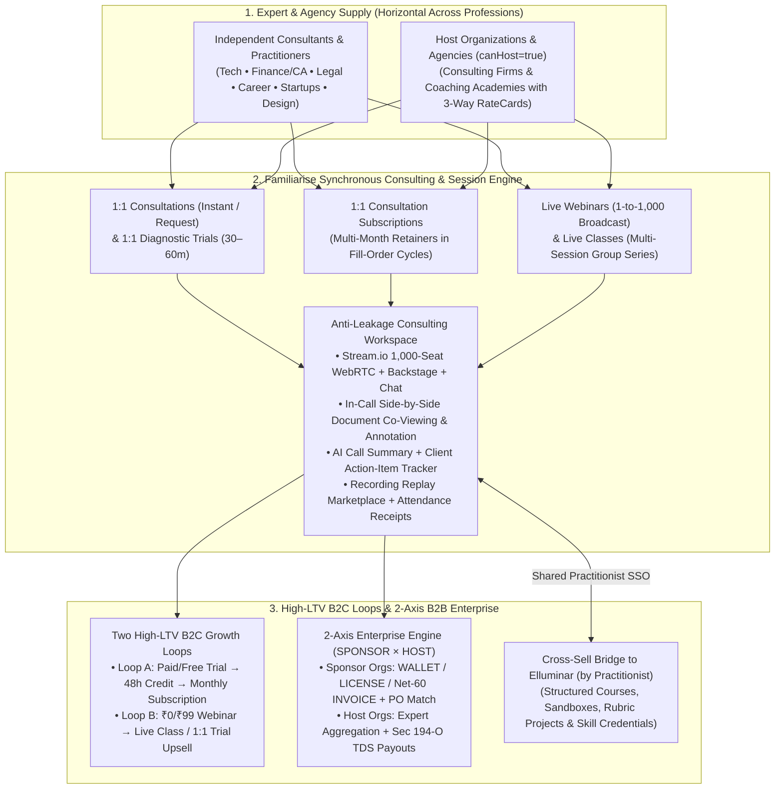

# Familiarise (`familiarise_web` + `familiarise_mobile`) — Business Strategy, Product Vision & System Architecture (`docs/business/`)

> **Document Status:** Canonical Decision of Record (October 2026)
> **Parent Legal Entity:** **Practitionist (OPC) Private Limited** (`CIN: U62012HR2026OPC146217`, `https://practitionist.com`)
> **Live Product Domain:** `https://familiarisenow.com`
> **Scope:** Software Requirements Specification (SRS), High-Level Design (HLD) and Low-Level Design (LLD). The business model, competitive teardown, roadmap and portfolio docs live in the founders' private Notion workspace.
> **Relation to Existing Docs:** Preserves all 41 existing technical and compliance directories under `docs/` (`docs/start-here/`, `docs/prisma/`, `docs/enterprise/`, `docs/payments/`, `docs/stream/`, `docs/compliance/`, etc.) untouched.

---

## 1. Executive Thesis: What `Familiarise` Actually Is

**Familiarise is a Synchronous Expert Consulting, Retainer & Live Session Platform (B2C + B2B Enterprise)** that combines the best of **Preply / Preplaced** (_Trial $\to$ Recurring Subscription Retainers_), **Maven / Luma** (_Live Webinars $\to$ Multi-Session Group Classes_), and **Moxo / Simply.Coach** (_Persistent Client-Consultant Workspace with Joint Document Review & Stream.io HD Video_) across **all professional advisory verticals** (Technology, Business, Finance/Tax, Legal, Career Coaching, Design, Marketing, Startups, Healthcare Second Opinions, and Languages).

---

## 2. Key Strategic Decisions Locked In (`October 2026`)

| Dimension                                                 | Strategic Decision of Record                                                                                                                                                                                                                                                                                                                                                                                                         | Why This Wins in the 2026 Market                                                                                                                                                                                                                                                               |
| :-------------------------------------------------------- | :----------------------------------------------------------------------------------------------------------------------------------------------------------------------------------------------------------------------------------------------------------------------------------------------------------------------------------------------------------------------------------------------------------------------------------- | :--------------------------------------------------------------------------------------------------------------------------------------------------------------------------------------------------------------------------------------------------------------------------------------------- |
| **1. `Practitionist` Portfolio Identity**                 | **One Legal Company (`Practitionist OPC Pvt. Ltd.`), Two Focused Products:** • **`Familiarise`** = Synchronous Human Time & Advisory (_1:1 Consultations, Trials, Subscriptions, Webinars, Live Classes, Document Review_). • **`Elluminar`** = Pedagogical Mastery & Verified Execution (_Courses, Interactive Workshops, Quizzes/Assignments, Sandboxes/Canvases, Mentor-Guided Projects, Fellowships & Skill Credentials_). | Keeps Familiarise frictionless and horizontal for _all_ advisory professions (lawyers, CAs, career coaches, engineers) while keeping `familiarise_web` (`155 models`, `#705` frozen) and `familiarise_mobile` (`93/93 models` synced) launch-ready without 6 months of schema-merge paralysis. |
| **2. Anti-Leakage Consulting Workspace (Zero LMS Bloat)** | **Upgrade Meetings & Relationships Without Adding Quizzes/Sandboxes:** 1. **In-Call Side-by-Side Document Co-Viewing & Pin Annotation** (`AppointmentDocument`). 2. **AI Consultation Summary + Shared Client Action-Item Checklist**. 3. **In-Room Last-5-Min Next-Slot & Subscription Upgrade Prompt**.                                                                                                                   | Makes switching to "personal Google Meet + WhatsApp" a massive downgrade in organization and escrow safety, while preserving strict separation from Elluminar's LMS quizzes and coding sandboxes.                                                                                              |
| **3. Receipts vs. Skill Credentials**                     | **Familiarise Issues `Attendance Receipts`; Elluminar Issues `Verified Skill Credentials`:** Deprecate/rename `certificateProvided` on Familiarise `WebinarPlan` and `ClassPlan` to **Session Attendance Receipts** (for corporate L&D reimbursement).                                                                                                                                                                            | Because Familiarise has no quizzes, assignments, sandboxes, or graded rubrics, reserving **Skill Certificates (`/verify/[code]`)** exclusively for **Elluminar** protects credential prestige across both brands.                                                                              |
| **4. Multi-Gateway & MoR Compliance (`#2000`)**           | **Primary INR: Razorpay + Cashfree Backup; Cross-Border: Tazapay / Xflow (No MoR for 1:1 Coaching):** Keep 1:1 live consulting off Dodo/Paddle/Polar (whose AUPs ban live human coaching).                                                                                                                                                                                                                                        | Prevents sudden account freezes and reserve holds while enabling compliant Indian B2C/B2B GST invoicing, Sec 194-O TDS, and MSME Sec 43B(h) payout automation.                                                                                                                                 |

---

## 3. Documentation Map (`docs/business/`)

| File                                                                                         | Document Title                                        | Primary Contents                                                                                                                                                                                                                                  |
| :------------------------------------------------------------------------------------------- | :---------------------------------------------------- | :------------------------------------------------------------------------------------------------------------------------------------------------------------------------------------------------------------------------------------------------ |
| **[01-software-requirements-specification.md](./01-software-requirements-specification.md)** | **Software Requirements Specification (SRS)**         | Formal Functional (`FR-ID`, `FR-BOOK`, `FR-SCHED`, `FR-EVT`, `FR-STREAM`, `FR-DOC`, `FR-FIN`, `FR-ENT`, `FR-MOB`) and Non-Functional (`NFR-*`) requirements across all 155 Prisma models.                                                         |
| **[02-high-level-design-hld.md](./02-high-level-design-hld.md)**                             | **Company-Wide High-Level Design (HLD)**              | System Context, C4 Container Topology (`familiarise_web` + `familiarise_mobile` Dart Frog + Stream.io + Supabase + Upstash), 3-Layer Slot Lock Architecture, Double-Entry Ledger and Resumable Projection Audits, and 2-Axis Enterprise Topology. |
| **[03-low-level-design-lld.md](./03-low-level-design-lld.md)**                               | **Low-Level Design (LLD) & Subsystem Specifications** | GiST Slot Exclusion & Preference Scoring Specs, Fill-Order Subscription Cycle Math, Multi-Leg `PaymentLeg` & Trigger Specs, In-Call Doc Co-Viewing & AI Action-Item Schemas (`#705`-safe), and 48h Trial Credit Conversion Logic.                 |
