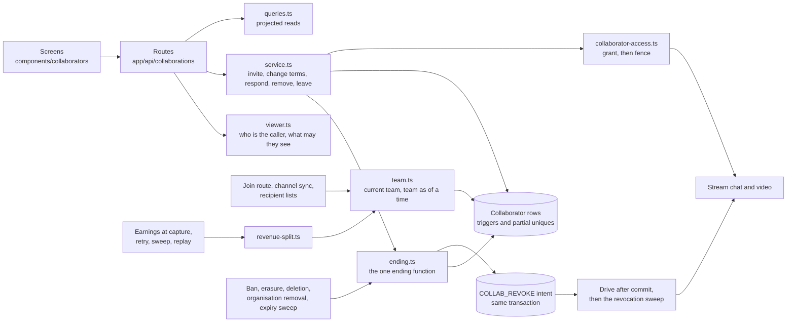

# Collaborators: overview

A webinar or class plan can carry a small team beside its host: one co-presenter and supporting crew. Each collaborator has a role, which decides what they can do in the live room and in chat, and a share, which is their part of every seat sold while they are on the team. This page explains how the subsystem is put together. The pages after it are the reference for each part.

Only `WebinarPlan` and `ClassPlan` carry collaborators. The plan may belong to a solo expert, to an expert inside an organisation, or to an organisation with no owning expert.

## Glossary

| Term            | Meaning                                                                                                                                                                    |
| --------------- | -------------------------------------------------------------------------------------------------------------------------------------------------------------------------- |
| Host            | The plan's own expert (`consultantProfileId` on the plan). An organisation plan may have none.                                                                             |
| Manager         | Whoever may change a plan's team: the host, or an operator of the plan's organisation who holds `catalog.manage`.                                                          |
| Presenter       | The one co-presenter a plan may carry: `CO_HOST` on a webinar, `CO_INSTRUCTOR` on a class.                                                                                 |
| Crew            | Every other role. Speaking crew (`GUEST_SPEAKER`, `GUEST_LECTURER`, `TEACHING_ASSISTANT`) and support crew (`MODERATOR`, `TECHNICAL_SUPPORT`, `CONTENT_CREATOR`).          |
| Live row        | A `Collaborator` row that is `PENDING` (invited) or `ACCEPTED` (on the team).                                                                                              |
| Period          | The time one row was on the team: from `acceptedAt` until `endedAt`.                                                                                                       |
| Basis points    | How a share is stored (`revenueShareBps`). 100 basis points are one percent, so 2,000 is 20%.                                                                              |
| Compare-and-set | An update that names the status it expects in its `WHERE`, so two racing requests cannot both apply. Written "CAS" in code comments.                                       |
| Intent          | A row written in a transaction that records work owed outside the database. Here: a `StreamRevocationRetry` row of kind `COLLAB_REVOKE`, "take this person's access back". |
| Fence           | A re-check after a grant: read the row again and take the grant back if the collaboration has ended meanwhile.                                                             |
| Sweep           | A scheduled job that finishes what a request left undone.                                                                                                                  |

## The design in five sentences

1. **One source of truth.** The `Collaborator` row is the only record of who is on a plan's team. Chat membership, call roles, recipient lists and revenue splits are all derived from it.
2. **One row per period.** A row is born as an invitation, may be accepted, and ends once. An ended row never changes, so inviting the same expert again creates a new row and the earlier period stays as history. "Who was on the team at 10:00 on 10 March" has one answer forever.
3. **Access is derived, endings are owed.** A grant on Stream is a copy of the row and is re-checked after it is written. An ending writes, in its own transaction, the order to take the access back, so a crash after the commit loses nothing.
4. **Money is a function of the plan and a time.** A sale is divided among the team as of one instant: the payment's capture, or for a replay the start of the recorded session.
5. **Postgres binds every writer.** The legal status changes, the team size, the share total and the period timestamps are enforced by triggers and indexes, whatever code issues the write.

## How the pieces fit

## Modules and what each may import

Everything lives in `lib/collaborators/` unless a path says otherwise. The import rules keep the money and scheduled-job paths from loading the Stream and notification code, and keep the two modules that browser code imports free of server code.

| Module             | Responsibility                                                                                                                                                  | Imports                                                                                                                         |
| ------------------ | --------------------------------------------------------------------------------------------------------------------------------------------------------------- | ------------------------------------------------------------------------------------------------------------------------------- |
| `rules.ts`         | The numbers the rules turn on (team size, share total, invitation window, cooldown) and the date arithmetic over them.                                          | Nothing. Browser code imports it.                                                                                               |
| `roles.ts`         | Which roles are presenters and speaking crew, the tier a role grants, and `ROLE_INFO`: the one table of each role's label and abilities for screens and emails. | Prisma types only. Browser code imports it.                                                                                     |
| `team.ts`          | The plan reference type, the plan lock (`lockPlanRow`), the team now (`currentTeam`) and the team as of a time (`teamAsOf`).                                    | Prisma types only. No Stream, no notifications.                                                                                 |
| `viewer.ts`        | Who the caller is to a plan's team (`resolveCollaborationViewer`) and what each audience is shown (the projections).                                            | `rules.ts`, `team.ts`, the organisation permission and membership helpers.                                                      |
| `queries.ts`       | Every read behind the screens, returned already projected for the caller.                                                                                       | `team.ts`, `viewer.ts`, `live-plan.ts`. Never the service.                                                                      |
| `service.ts`       | The writes a person makes: invite, change pending terms, accept or decline, remove, leave. Every refusal is a `CollaborationError`.                             | `ending.ts`, `team.ts`, `rules.ts`, `roles.ts`, `notifications.ts`, the calendar hold, and `lib/stream/collaborator-access.ts`. |
| `ending.ts`        | `endCollaboration`, the one function that ends a row, plus the batch form for a user who lost their standing and the after-commit step.                         | `notifications.ts`. It loads the Stream revocation module on first use, so ban and erasure code can import it cheaply.          |
| `cleanup.ts`       | The expiry sweep: ends lapsed invitations as `EXPIRED`.                                                                                                         | `ending.ts`, `rules.ts`.                                                                                                        |
| `revenue-split.ts` | `calculateRevenueSplit`: divides one sale among the owner and the team as of a time.                                                                            | `team.ts` only. The money code never imports the service.                                                                       |
| `notifications.ts` | Stages the bell and emails of one transition inside its transaction.                                                                                            | The email and bell staging helpers.                                                                                             |
| `recipients.ts`    | The user ids of a plan's current team, for the recipient lists of booking notices and reminders.                                                                | The database client only.                                                                                                       |
| `availability.ts`  | The calendar check an accept and a schedule change run against a collaborator's other sessions.                                                                 | The scheduling occupancy policy.                                                                                                |

Two Stream modules do the vendor work so the service holds no Stream client: `lib/stream/collaborator-access.ts` (grant and revoke) and the collaborator helpers in `lib/stream/access-revocation.ts` (the intent, the budgeted drive, the fence).

## Invariants

Each rule names what makes it true. The tests are described in [06 — API, lifecycle and testing](06-api-and-lifecycle.md#testing).

| Rule                                                                                 | Enforcer                                                                                                                          | Repair                                                            |
| ------------------------------------------------------------------------------------ | --------------------------------------------------------------------------------------------------------------------------------- | ----------------------------------------------------------------- |
| An expert holds at most one live row on a plan; ended rows are kept.                 | Database: `collaborator_one_active_webinar`, `collaborator_one_active_class`.                                                     | None needed.                                                      |
| A row starts `PENDING`, follows the legal transitions, and never changes once ended. | Database: trigger `collaborator_transition_guard`. App: compare-and-set writes in `service.ts` and `ending.ts`.                   | None needed.                                                      |
| Accepted terms never change.                                                         | Database: the same trigger. App: `updatePendingTerms` answers `TERMS_LOCKED`.                                                     | None needed.                                                      |
| `acceptedAt` and `endedAt` are the database's own clock.                             | Database: the same trigger overwrites whatever a writer sends; `collaborator_period_is_coherent` ties them to the status.         | None needed.                                                      |
| A plan has at most three live collaborators, sharing at most 90%.                    | Database: trigger `collaborator_plan_caps` behind a lock on the plan row. App: `assertTeamHasRoom` answers first with a sentence. | None needed.                                                      |
| A plan has at most one live presenter.                                               | Database: `collaborator_one_presenter_webinar`, `collaborator_one_presenter_class`.                                               | None needed.                                                      |
| Every ending of an accepted collaborator owes a Stream revocation.                   | `endCollaboration` writes the `COLLAB_REVOKE` intent in the ending transaction (`persistCollaboratorRevocationInTx`).             | The `retry-moderation-enforcement` job retries it until it lands. |
| A Stream grant never outlives the row.                                               | `fenceCollaboratorGrant` after every grant: at accept, at channel sync, at team-chat open, at join.                               | The same job, when the fence could not read the row.              |
| A sale is split among the team as of one stored instant.                             | `calculateRevenueSplit` requires `at`; `CreateEarningsParams.teamAt` is required.                                                 | The earnings sweep passes the payment's stored capture time.      |
| A share is visible to its two parties only.                                          | `projectTeamForViewer` and the projections in `viewer.ts`; public selects use `planCollaboratorScalars`.                          | None needed.                                                      |
| A collaborator is never counted or admitted as a learner.                            | Seat readers select `role: "CONSULTEE"`; gates spread `NOT_COLLABORATOR_ROW` (`lib/booking/participants.ts`).                     | None needed.                                                      |
| A collaborator cannot also hold a learner's seat on the plan they share in.          | `assertHoldsNoSeat` at invite and at accept; the split leaves a buyer out of their own seat (`excludeBuyerUserId`).               | None needed.                                                      |

## The pages

| Page                                                            | Type      | What it holds                                                                                                         |
| --------------------------------------------------------------- | --------- | --------------------------------------------------------------------------------------------------------------------- |
| [01 — Database schema and state machine](01-database-schema.md) | reference | The table, the status machine with every legal transition and who may cause it, the database rules.                   |
| [02 — Permissions and roles](02-permissions-and-roles.md)       | reference | Who may manage a team, what each audience sees, what each role may do in the room and in chat.                        |
| [03 — Revenue sharing](03-revenue-sharing.md)                   | reference | The split as of capture, retries, replays, removal, sponsored seats, with worked rupee examples.                      |
| [04 — Stream chat](04-stream-chat-integration.md)               | reference | Channels and rosters, the grant and its fence, the revocation from intent to sweep, what happens when Stream is down. |
| [05 — Stream video](05-stream-video-integration.md)             | reference | Call roles at join, removal from a live room.                                                                         |
| [06 — API, lifecycle and testing](06-api-and-lifecycle.md)      | reference | Routes and error codes, the invite, accept and schedule-change sequences, concurrency, operations, tests.             |

The decisions behind the design, the options not chosen and the known limits: [the collaborators decision record](../decisions/2026-11-16-collaborators.md). The rule list an agent follows: `.claude/skills/collaborators/SKILL.md`.

## Deprecated & Superseded Approaches

- **Staff participant rows.** A collaborator once also held an `AppointmentParticipant` row with the `COLLABORATOR` role on every event, and gates read it. Nothing writes those rows; existing ones are inert history and every reader filters them out. Delete any code that writes one.
- **One row per expert per plan.** A re-invite once reset the old row to `PENDING`. A re-invite is a new row.
- **`standing.ts` and `removeCollaboratorStanding`.** Replaced by `ending.ts`.
- **Reads inside `service.ts`.** The list functions moved to `queries.ts`; the split moved to `revenue-split.ts`.
- **Role label maps in components and emails.** Replaced by `ROLE_INFO`.
