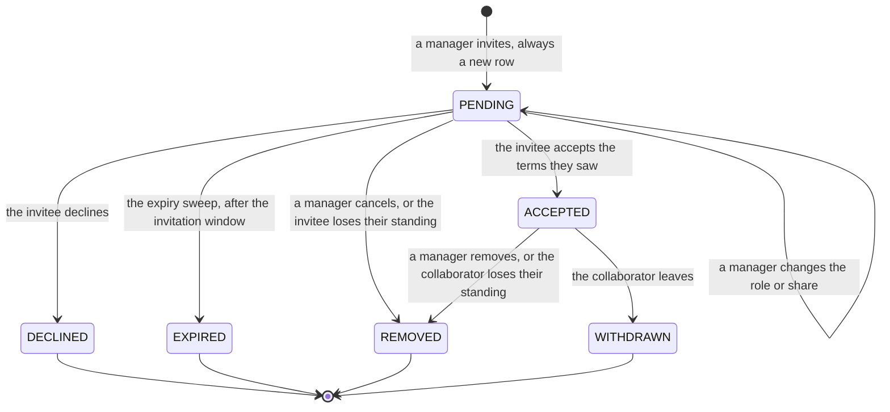

# Collaborators: database schema and state machine

All collaborator state is one table, `Collaborator`, in `prisma/schema.prisma`. The rules that Prisma's schema language cannot express (partial unique indexes, triggers, checks) live in `prisma/sql/check-constraints.sql` and are applied with the schema. This page lists the columns, the status machine, and every database rule with what it refuses.

## The `Collaborator` table

One row is one period of one expert on one plan's team.

| Column                | Type                         | Meaning                                                                                                                                           |
| --------------------- | ---------------------------- | ------------------------------------------------------------------------------------------------------------------------------------------------- |
| `id`                  | `String` (cuid)              | Primary key.                                                                                                                                      |
| `consultantProfileId` | `String`                     | The invited expert. Deleting the profile deletes the row.                                                                                         |
| `collaboratorType`    | `WEBINAR` or `CLASS`         | Which of the two plan columns is set.                                                                                                             |
| `webinarPlanId`       | `String?`                    | Set for a webinar plan. Deleting the plan deletes the row.                                                                                        |
| `classPlanId`         | `String?`                    | Set for a class plan. Deleting the plan deletes the row.                                                                                          |
| `role`                | `CollaboratorRole`           | One of the four webinar roles or the four class roles.                                                                                            |
| `tier`                | `PRESENTER` or `CREW`        | What the role grants, written with the role by `tierForRole` (`lib/collaborators/roles.ts`).                                                      |
| `revenueShareBps`     | `Int`                        | The share in basis points: 2,000 is 20%.                                                                                                          |
| `status`              | `CollaboratorStatus`         | `PENDING`, `ACCEPTED`, `DECLINED`, `EXPIRED`, `REMOVED` or `WITHDRAWN`.                                                                           |
| `invitedById`         | `String?`                    | The inviting expert's profile. Null when an organisation operator with no profile of their own invited, or once that profile is deleted.          |
| `acceptedAt`          | `DateTime?` (with time zone) | When the row joined the team. Stamped by the database.                                                                                            |
| `endedAt`             | `DateTime?` (with time zone) | When the row ended. Stamped by the database.                                                                                                      |
| `endedByUserId`       | `String?`                    | The person who ended the row. Null when the platform did (expiry, erasure, account deletion), or once that user is deleted.                       |
| `respondedAt`         | `DateTime?`                  | Maintained by the database on accept and decline. Web code neither reads nor writes it; the mobile backend reads `respondedAt`.                   |
| `createdAt`           | `DateTime`                   | When the invitation was created.                                                                                                                  |
| `updatedAt`           | `DateTime`                   | When the row last changed. For a pending row this is when it was sent or its terms last changed, which is what the invitation window counts from. |

A row is on the team **now** when `status = ACCEPTED`. A row was on the team **at time T** when `acceptedAt <= T` and `endedAt` is null or later than T. Both readers are in `lib/collaborators/team.ts` (`currentTeam`, `teamAsOf`).

Roles by plan type (`COLLABORATOR_ROLES_BY_PLAN_TYPE` in `schemas/collaborators.ts`):

| Plan    | Presenter (`PRESENTER` tier) | Crew (`CREW` tier)                                        |
| ------- | ---------------------------- | --------------------------------------------------------- |
| Webinar | `CO_HOST`                    | `MODERATOR`, `GUEST_SPEAKER`, `TECHNICAL_SUPPORT`         |
| Class   | `CO_INSTRUCTOR`              | `TEACHING_ASSISTANT`, `GUEST_LECTURER`, `CONTENT_CREATOR` |

## The status machine

Every arrow, who may cause it and the function that writes it:

| From       | To          | Who                                                                                         | Writer                                                                                        |
| ---------- | ----------- | ------------------------------------------------------------------------------------------- | --------------------------------------------------------------------------------------------- |
| (none)     | `PENDING`   | A manager of the plan.                                                                      | `inviteCollaborator` (`lib/collaborators/service.ts`). Always an insert.                      |
| `PENDING`  | `PENDING`   | A manager of the plan.                                                                      | `updatePendingTerms`. Changes role, tier and share only.                                      |
| `PENDING`  | `ACCEPTED`  | The invited expert.                                                                         | `respondToInvitation` with `ACCEPTED` and the terms seen.                                     |
| `PENDING`  | `DECLINED`  | The invited expert, by declining or by ending their own pending row.                        | `respondToInvitation` with `DECLINED`, or `leaveCollaboration`. Both call `endCollaboration`. |
| `PENDING`  | `EXPIRED`   | The platform.                                                                               | `expireStaleCollaboratorInvites` (`lib/collaborators/cleanup.ts`) through `endCollaboration`. |
| `PENDING`  | `REMOVED`   | A manager cancelling the invitation, or the platform when the invitee loses their standing. | `removeCollaborator`, `endCollaborationsForUser`, the organisation member removal.            |
| `ACCEPTED` | `REMOVED`   | A manager, or the platform when the collaborator loses their standing.                      | The same three.                                                                               |
| `ACCEPTED` | `WITHDRAWN` | The collaborator.                                                                           | `leaveCollaboration`.                                                                         |

"Loses their standing" means a permanent ban, a profile un-verified by moderation, erasure, account deletion, the expert deactivating or deleting their profile, or removal from the plan's organisation. A suspension with an end date does not end a collaboration. The list of callers is in [02 — Permissions and roles](02-permissions-and-roles.md#standing).

Three consequences follow from the machine:

- **An ended row is final.** There is no arrow out of `DECLINED`, `EXPIRED`, `REMOVED` or `WITHDRAWN`. Inviting the expert again inserts a new row, and the old one keeps its terms and its period.
- **Accepted terms are fixed.** The only self-loop is on `PENDING`. To change an accepted collaborator's role or share, the host removes them and invites them again, and they accept the new terms.
- **`WITHDRAWN` always means someone who was on the team.** A pending invitee who walks away is `DECLINED`. A `REMOVED` row may or may not have been on the team; its `acceptedAt` says which.

Application code makes every status change as a conditional update that names the expected status in its `WHERE` (a compare-and-set), so two racing requests get one winner and one clean refusal. The database then enforces the same machine for every writer.

## Database rules

Each rule is in `prisma/sql/check-constraints.sql`. A trigger or check refusal raises SQLSTATE `23514` with the constraint name shown; a unique index refusal raises `23505`. The service maps a unique refusal to `ALREADY_ON_PLAN` and a check refusal to `CONFLICT` (`asTeamConflict` in `lib/collaborators/service.ts`, using `lib/db/pg-errors.ts`), after its own friendly pre-checks have had the chance to answer with a more specific sentence.

| Rule                                                                     | Kind                                                                                                   | What it does                                                                                                                                                                                                                                                                                                                                                                                                                                                                                                                                                                                                                                               |
| ------------------------------------------------------------------------ | ------------------------------------------------------------------------------------------------------ | ---------------------------------------------------------------------------------------------------------------------------------------------------------------------------------------------------------------------------------------------------------------------------------------------------------------------------------------------------------------------------------------------------------------------------------------------------------------------------------------------------------------------------------------------------------------------------------------------------------------------------------------------------------- |
| `collaborator_one_active_webinar`, `collaborator_one_active_class`       | Partial unique index                                                                                   | One `PENDING` or `ACCEPTED` row per expert per plan. Ended rows are outside the index, so an expert may hold any number of them.                                                                                                                                                                                                                                                                                                                                                                                                                                                                                                                           |
| `collaborator_one_presenter_webinar`, `collaborator_one_presenter_class` | Partial unique index                                                                                   | One `PENDING` or `ACCEPTED` row of the `PRESENTER` tier per plan.                                                                                                                                                                                                                                                                                                                                                                                                                                                                                                                                                                                          |
| `collaborator_transition_guard`                                          | Trigger, before insert or update, per row (function `assert_collaborator_transition`)                  | A row is inserted as `PENDING` with no period times. An update may not move the row to another expert, plan or plan type. Role, tier and share may change only while the row is `PENDING`. A status change must be one of the arrows above. The trigger sets `acceptedAt` on accept and `endedAt` on every ending from the database's wall clock at the moment of the status change (one `clock_timestamp()` reading per trigger call, used for every stamp that call writes), so a row's end is never earlier than its accept, and restores both on any other update, so a writer cannot set them. It also maintains `respondedAt` on accept and decline. |
| `collaborator_plan_caps`                                                 | Trigger, after insert or update of status or share, per row (function `assert_collaborator_plan_caps`) | For a row that is `PENDING` or `ACCEPTED`: locks the plan row (`FOR NO KEY UPDATE`), then counts the plan's live rows and sums their shares. More than three raises `collaborator_plan_team_size`; more than 9,000 basis points raises `collaborator_plan_share_total`. The lock makes two concurrent invites on one plan queue, so they cannot both pass the count.                                                                                                                                                                                                                                                                                       |
| `collaborator_period_is_coherent`                                        | Check                                                                                                  | `PENDING` has neither time. `ACCEPTED` has `acceptedAt` and no `endedAt`. `DECLINED` and `EXPIRED` have `endedAt` and no `acceptedAt`. `REMOVED` and `WITHDRAWN` have `endedAt`.                                                                                                                                                                                                                                                                                                                                                                                                                                                                           |
| `collaborator_share_bps_in_range`                                        | Check                                                                                                  | One row's share is from 1 to 9,000 basis points.                                                                                                                                                                                                                                                                                                                                                                                                                                                                                                                                                                                                           |
| `collaborator_plan_xor`                                                  | Check                                                                                                  | Exactly one of `webinarPlanId` and `classPlanId` is set, and it matches `collaboratorType`.                                                                                                                                                                                                                                                                                                                                                                                                                                                                                                                                                                |
| `collaborator_role_matches_plan_type`                                    | Check                                                                                                  | A webinar row carries a webinar role and a class row a class role.                                                                                                                                                                                                                                                                                                                                                                                                                                                                                                                                                                                         |
| `collaborator_tier_matches_role`                                         | Check                                                                                                  | `CO_HOST` and `CO_INSTRUCTOR` are `PRESENTER`; every other role is `CREW`.                                                                                                                                                                                                                                                                                                                                                                                                                                                                                                                                                                                 |

The transition trigger lets two foreign keys clear on an ended row: `invitedById` when the inviting profile is deleted and `endedByUserId` when that user is deleted. Nothing else about an ended row can change.

The same file carries an idempotent statement that fills `acceptedAt` and `endedAt` on rows written before those columns existed, from the nearest recorded times, and runs before the transition trigger is created.

## The plan lock

Team changes and schedule changes on one plan queue behind a row lock on the plan. `lockPlanRow` (`lib/collaborators/team.ts`) takes it with a value-preserving update (`UPDATE "WebinarPlan" SET "updatedAt" = "updatedAt" WHERE id = ...`, or the same on `ClassPlan`). It is an update and not a lock-only read for one reason: a Serializable transaction that queued behind a holder who only locked the row would carry on with its old snapshot, whereas one that queued behind a write fails with a serialization error (`40001`) and is replayed on a fresh snapshot by `withSerializableRetry`. The update changes no key column, so it takes the `NO KEY UPDATE` row lock, the same lock the caps trigger takes, and never blocks the insert of a row that references the plan. The order in which locks are taken is in [06 — API, lifecycle and testing](06-api-and-lifecycle.md#concurrency-and-failure).

## Related rows

- **`StreamRevocationRetry` of kind `COLLAB_REVOKE`.** The order to take a former team member's Stream access back. It carries the user, the plan id and the plan type, is written in the ending transaction, and is described in [04 — Stream chat](04-stream-chat-integration.md#revocation).
- **`ConsultantEarnings` and `OrganizationEarnings`.** One row per party per payment, with `role` `OWNER` or `COLLABORATOR`. They are written at settlement from the team as of the capture and are not touched when a collaboration ends. See [03 — Revenue sharing](03-revenue-sharing.md).
- **`AppointmentParticipant` with role `COLLABORATOR`.** Not written. Rows that exist are history: they open no room, join no chat and count as nobody. When a former collaborator buys a seat, `recordParticipants` (`lib/booking/participants.ts`) takes such a row over as a new learner seat.

## Deprecated & Superseded Approaches

- **`@@unique([consultantProfileId, webinarPlanId])` and the class twin.** One row per expert per plan, re-activated on re-invite. Replaced by the partial unique indexes over live rows, so history survives.
- **`respondedAt` as the response time read by the web.** Replaced by `acceptedAt` and `endedAt`.
- **`assertCollaboratorPlanXor()` in application code.** The check constraint is the rule; the mirror is gone.
- **A status list without `EXPIRED`.** A lapsed invitation was recorded as `DECLINED`; it has its own status.
