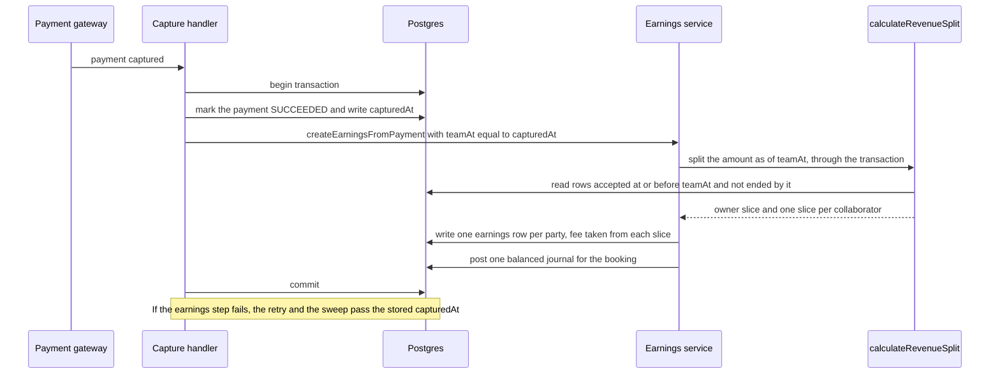

# Collaborators: revenue sharing

When a seat on a webinar or class is sold, the money is divided between the plan's owner and the collaborators who were on the team at one instant. This page states which instant each money path uses, how the division is computed, and what happens when the team changes. Every amount is integer paise and every share is integer basis points (100 basis points are one percent), so no rounding drift exists to reconcile.

## The rule

**A sale is split among the team as of one stored time.** The team at time T is every row with `acceptedAt <= T` whose `endedAt` is null or later than T (`teamAsOf` in `lib/collaborators/team.ts`). Because the rows' own timestamps answer the question, the answer does not depend on when it is asked.

| Money path                                            | The time it passes                                                                         | Where                                                                            |
| ----------------------------------------------------- | ------------------------------------------------------------------------------------------ | -------------------------------------------------------------------------------- |
| A seat's capture                                      | The capture time, the same value the capturing transaction writes to `Payment.capturedAt`. | The capture handler in `lib/payments/webhooks/handlers.ts`.                      |
| A checkout commit that settles in its own transaction | The capture time that commit stamped, else the payment row's creation in that commit.      | `lib/payments/checkout/commit/ledger.ts`.                                        |
| A retry of earnings that failed in the first attempt  | The payment's stored `capturedAt`, else its creation time. Never the current time.         | The retry in `lib/payments/webhooks/handlers.ts`.                                |
| A capture parked for staff recovery, recovered later  | The capture time the parking update wrote to `Payment.capturedAt`.                         | The recovery path of the capture handler in `lib/payments/webhooks/handlers.ts`. |
| The earnings sweep (`sync-payment-earnings`)          | The same stored time.                                                                      | `syncPaymentEarnings` in `scripts/earnings/sync-payment-earnings.ts`.            |
| A replay (recording) purchase                         | The start of the recorded session.                                                         | `lib/payments/webhooks/recording-purchase.ts`.                                   |

What enforces it: `calculateRevenueSplit(ref, totalAmount, db, { at, excludeBuyerUserId })` in `lib/collaborators/revenue-split.ts` has no default for `at`, and `teamAt` is a required field of `CreateEarningsParams` in `lib/payments/payouts/earnings-service.ts`. A new money path cannot compile without choosing a time.

Three consequences:

- **Removal changes no earning.** Ending a collaboration writes nothing to any earnings row. Seats captured while the collaborator was on the team keep their split, and seats captured after they left exclude them.
- **A retry settles what the first attempt would have.** A capture whose earnings step failed is settled later by the retry or the sweep, at the stored capture time, even if the team has changed in between.
- **A replay pays the team that delivered the session.** Someone who joined the team after the session was recorded takes nothing from its replay; someone who presented it and has since left still takes their share.

## How one sale is divided

`calculateRevenueSplit` reads the team through the database handle it is given, so inside a transaction it sees that transaction's view.

1. **Each collaborator's slice** is the floor of `totalAmount × revenueShareBps / 10,000`.
2. **The owner's slice** is the remainder, `totalAmount` minus the collaborators' slices. The owner is the plan's expert, or the plan's organisation when it has no owning expert. No paisa is created or lost.
3. **Two people are left out of the team for this sale:** a buyer who is on the team earns no share of their own seat (`excludeBuyerUserId`), and a collaborator whose profile has been erased takes no slice (`liveProfilesOnly`); the owner keeps the remainder in both cases.
4. **With no team at that time,** the function returns nothing and settlement gives the owner the whole sale.

The platform fee is then taken **once, from each party's own slice**, by the earnings service. A party settling on their own pays the rate stamped on the payment at checkout (`Payment.platformFeeBps`). A party who settles through an organisation's rate card has their slice divided once by that card into the platform's fee, the organisation's share and their own. No slice is charged twice.

A capture may plan its earnings before it opens the transaction, to keep the transaction short. The team is read again inside the transaction, as of the capture, and the plan is reused only when it saw the same team.

## Worked examples

Each example is pinned by a test, named beside it. Amounts are shown in rupees with the paise the test asserts.

### A seat sold while the collaborator is on the team

A ₹10,000 class seat (1,000,000 paise). The co-instructor holds 20% (2,000 basis points) and the order is stamped at a 20% platform fee. The collaborator accepted on 9 March 2026 at 12:00 UTC and the seat is captured on 10 March at 09:00 UTC.

| Party         | Slice            | Platform fee (20% of the slice) | Net              |
| ------------- | ---------------- | ------------------------------- | ---------------- |
| Host          | ₹8,000 (800,000) | ₹1,600 (160,000)                | ₹6,400 (640,000) |
| Co-instructor | ₹2,000 (200,000) | ₹400 (40,000)                   | ₹1,600 (160,000) |
| Platform      |                  |                                 | ₹2,000 (200,000) |

Test: `__tests__/payments/collaborator-split-as-of.test.ts`, "pays the host ₹6,400, the collaborator ₹1,600 and the platform ₹2,000".

### The same seat, settled after the collaborator was removed

The co-instructor is removed on 20 March. The seat captured on 10 March is settled, or settled again by a retry, after that date. The split is unchanged: host ₹6,400, co-instructor ₹1,600, platform ₹2,000.

Tests, same file: "splits the same way once the collaborator has been removed", and for the sweep "splits a deferred seat by its capture time, after the collaborator was removed" and "... by its creation time when no capture time was stamped".

### A seat sold after the removal

A second ₹10,000 seat is captured one millisecond after the removal. The co-instructor is not on the team at that time.

| Party    | Slice               | Platform fee     | Net              |
| -------- | ------------------- | ---------------- | ---------------- |
| Host     | ₹10,000 (1,000,000) | ₹2,000 (200,000) | ₹8,000 (800,000) |
| Platform |                     |                  | ₹2,000 (200,000) |

Test, same file: "gives a removed collaborator nothing from a seat captured afterwards". The mirror cases are beside it: "gives a collaborator who accepts later nothing from a seat already captured" and "gives an erased collaborator no slice; the host keeps the remainder" (host ₹8,000 in both).

### The team changes between planning and capture

A capture planned its earnings while the co-instructor was on the team (slices ₹8,000 and ₹2,000), and the co-instructor was removed before the capture committed. The capturing transaction reads the team as of the capture and pays the host ₹8,000 and the collaborator nothing. The opposite order, an accept between the plan and the capture, pays ₹6,400 and ₹1,600.

Tests, same file: "does not pay a collaborator removed between the pre-plan and the capture", "pays a collaborator who accepted between the pre-plan and the capture", "reuses a pre-plan that saw the same team, adding only the team read".

### A replay sold after the presenter left

A ₹500 replay (50,000 paise) of a recorded session is bought after the presenter who delivered it has left, and after a newcomer has joined. The split is as of the session's start: the host nets ₹300 (30,000), the presenter who delivered it nets ₹100 (10,000), the platform keeps ₹100 (10,000), and the newcomer takes nothing.

Test, same file: "pays the co-host who presented, not the one who joined afterwards".

### A sponsored seat

An organisation pays for a ₹10,000 class seat from its wallet. There is no special rate for a sponsored seat: checkout stamps the fee rate on every order, and each party pays it on their own slice. With a 20% collaborator and a 20% stamped fee the result is the first table again: host ₹6,400, collaborator ₹1,600, platform ₹2,000.

Test: `__tests__/payments/multi-party-split.test.ts`, case 4, "Sponsored seat: an organisation pays for a ₹10,000 class seat and each party still pays the stamped 20% fee on their own slice". The suite runs the real fee module.

### Remainders

A ₹100.03 sale (10,003 paise) with a collaborator at 3,333 basis points. The collaborator's slice is the floor, 3,333 paise; the owner takes the remainder, 6,670 paise; the two add up to 10,003. At a 20% fee the collaborator pays 666 and nets 2,667, and the owner pays 1,334 and nets 5,336.

Test: `__tests__/payments/multi-party-split.test.ts`, case 1.

### Parties who settle through an organisation

A ₹1,000 webinar seat (100,000 paise) hosted inside one organisation, with a 30% collaborator who belongs to another. Each slice is divided once by its own party's rate card.

| Party        | Slice  | Platform fee | Expert's net | Organisation's share |
| ------------ | ------ | ------------ | ------------ | -------------------- |
| Host         | 70,000 | 10,500       | 52,500       | 7,000                |
| Collaborator | 30,000 | 3,600        | 24,000       | 2,400                |

Test: `__tests__/payments/multi-party-split.test.ts`, case 2 (the two organisation shares sum to 9,400 and the journal balances at 100,000).

### A plan owned by an organisation alone

A ₹1,000 seat on a plan with no owning expert, with a 30% collaborator who settles on their own at 20%. The collaborator's slice of 30,000 pays a 6,000 fee and nets 24,000. The owner's slice of 70,000 settles to the organisation as an `OrganizationEarnings` row: a 7,000 fee and a 63,000 organisation share, with no expert earnings row for the owner.

Test: `__tests__/payments/multi-party-split.test.ts`, case 3. The sweep settles such a plan too: `collaborator-split-as-of.test.ts`, "settles a seat on a plan an organisation owns, and pages nobody".

## Who can be on the receiving end

- **Shares are whole percents from 1 to 90** at the API (`sharePercentSchema` in `schemas/collaborators.ts`), stored as basis points, and a plan's live shares sum to at most 9,000 basis points (the `collaborator_plan_caps` trigger). The owner therefore always keeps at least a tenth.
- **A non-resident expert cannot join a team.** `readStanding` in `lib/collaborators/service.ts` refuses them at invite and again at accept (409 `NOT_PAYABLE` to the invitee), because earnings cannot yet be paid to a non-resident.
- **A missing payout account does not block joining.** The Collaborations page warns the expert that earnings cannot be paid out until one is verified.
- **Each party is paid independently.** Every earnings row belongs to one party and is held, released and paid out on its own, so one collaborator's unfinished payout setup does not delay the host or the others.
- **A refund reverses each party's row** for that payment (`refundEarnings` in `lib/payments/payouts/earnings-service.ts`). Case 5 of the multi-party suite covers the organisation-owned plan.

## Where in code

- `lib/collaborators/revenue-split.ts`: `calculateRevenueSplit`.
- `lib/collaborators/team.ts`: `teamAsOf`.
- `lib/payments/payouts/earnings-service.ts`: `createEarningsFromPayment`, `planEarningsForPayment`, `refundEarnings`.
- `lib/payments/webhooks/handlers.ts`, `lib/payments/checkout/commit/ledger.ts`, `lib/payments/webhooks/recording-purchase.ts`, `scripts/earnings/sync-payment-earnings.ts`: the callers and the time each passes.
- Known limits of the as-of rule (two clocks, an erased collaborator on a retry, a recovered capture): [the decision record](../decisions/2026-11-16-collaborators.md#limits-that-remain).

## Deprecated & Superseded Approaches

- **Splitting by the current team.** `calculateRevenueSplit` once read whoever was `ACCEPTED` when it ran. Replaced by the required as-of time, so every attempt at one sale reads the same team.
- **A split computed before the capture transaction and reused inside it.** Replaced by the team read inside the transaction.
- **`calculateRevenueSplit` in `lib/collaborators/service.ts`.** It lives in `revenue-split.ts`, so money code does not load the service.
- **The two `revenue-split` preview routes.** Removed; the screens compute their rupee example in the browser from the listed price.
- **A zero platform fee on sponsored seats.** The doc and the test once said so; the code always charged the stamped rate.
