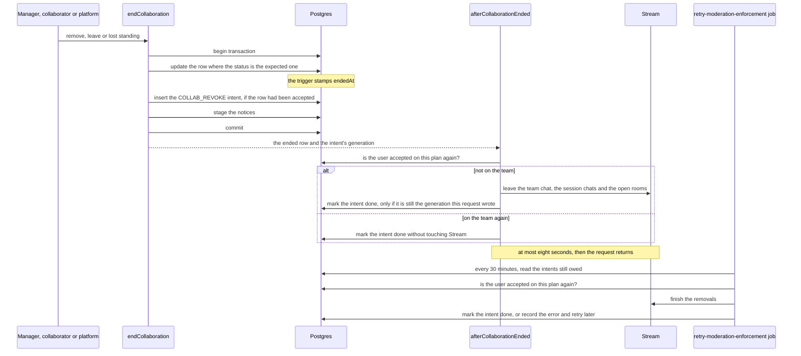

# Collaborators: Stream chat

A place on a plan's team opens two kinds of chat: the plan's private team channel and each session's channel. Stream holds a copy of that membership; Postgres holds the truth. This page describes which channels a collaborator is in, how the copy is granted and re-checked, and how it is taken back when a collaboration ends, including when Stream is unreachable.

## Channels

| Channel         | Id                                                                                                    | Stream type | Who is in it                                                                                                                                                 | Who moderates                                                                                                              |
| --------------- | ----------------------------------------------------------------------------------------------------- | ----------- | ------------------------------------------------------------------------------------------------------------------------------------------------------------ | -------------------------------------------------------------------------------------------------------------------------- |
| Team chat       | `collab-webinar-<planId>`, `collab-class-<planId>` (`collabChannelId` in `lib/stream-channel-ids.ts`) | `messaging` | The host and every accepted collaborator. On an organisation's plan, also its active members who may read messaging or manage the catalogue. Never learners. | The host                                                                                                                   |
| Session chat    | One per webinar or class event                                                                        | `team`      | The host, every accepted collaborator, and learners who hold a seat on that event.                                                                           | The host, the presenter and the `MODERATOR` role (`MODERATOR_COLLABORATOR_ROLES` in `lib/stream/event-channel-service.ts`) |
| Direct messages | One per pair of users                                                                                 | `messaging` | A learner with a seat and the host or the plan's presenter. Crew are not offered as a direct-message target.                                                 | Not applicable                                                                                                             |

One predicate decides who may be in a team chat: `collabChannelAccess` in `lib/stream/channel-access.ts`. Both the route that opens the channel and the daily membership reconciler (`lib/stream/membership-reconciler.ts`) call it, so one cannot admit someone the other removes. It answers `collaborator` when the caller's admission rests on their collaboration alone, which is the case that is re-checked after the grant. A deactivated organisation's team chats stay closed to everyone but staff.

## Granting

Access is granted in three places. Each one reads the `Collaborator` row, writes to Stream, and then calls `fenceCollaboratorGrant` (`lib/stream/access-revocation.ts`).

| Where                                                                                      | What it grants                                                                                                                                                                 |
| ------------------------------------------------------------------------------------------ | ------------------------------------------------------------------------------------------------------------------------------------------------------------------------------ |
| After an accept commits: `grantCollaboratorAccess` in `lib/stream/collaborator-access.ts`  | Creates or reconciles the team chat (`createCollaboratorChannel`), tags it with the plan's organisation, and adds the new member to every session channel that already exists. |
| When the collaborator opens the team chat: `app/api/stream/channels/open/route.ts`         | Adds the caller to the team chat.                                                                                                                                              |
| When the collaborator's session channels are synced: `lib/stream/event-channel-service.ts` | Adds the caller to a session channel, with the moderator role if their collaborator role carries it.                                                                           |

### The fence

A grant and an ending can cross: the ending's Stream removal runs, finds no membership to remove, and then the grant's write lands. The fence closes that gap. After the write, `fenceCollaboratorGrant(ref, userId)` reads Postgres again:

- **Still accepted:** `{ verified: true, lost: false }`. The grant stands.
- **No longer accepted:** it calls `revokeCollaboratorAccess`, which records the revocation and drives it, and returns `{ verified: true, lost: true }`. The team-chat route answers 403.
- **The row could not be read:** it records a revocation for the sweep to judge, reports once (throttled), and returns `{ verified: false }`. The team-chat route answers 503 `COLLABORATION_UNVERIFIED`. The sweep spares anyone who is still on the team, because the drive re-reads the row before it removes anything.

### When Stream is down at accept

The accept does not depend on Stream. The row becomes `ACCEPTED` in Postgres and the response succeeds. `grantCollaboratorAccess` never throws: a failure is reported once with the `collaborators` tag and the grant is simply missing. Nothing has to be queued, because every later visit grants again from the row: opening the team chat adds the member, the session channel sync adds them, and the join route admits them to the room. A missing grant heals on the collaborator's next visit.

## Revocation

An ending is different: nothing the former collaborator does afterwards would remove their access, so the obligation is written down.

Step by step:

1. **In the ending transaction.** `endCollaboration` (`lib/collaborators/ending.ts`) calls `persistCollaboratorRevocationInTx`, which inserts a `StreamRevocationRetry` row of kind `COLLAB_REVOKE` for the user and the plan and returns its generation (a timestamp that identifies this writer's order). The status change and the intent commit or roll back together. A row that was never accepted held no access, so no intent is written and no Stream call is made.
2. **After the commit.** `afterCollaborationEnded` calls `revokeCollaboratorAccess(ref, userId, generation)`. It drives the removal inside a budget of eight seconds (`SYNC_COLLABORATOR_REVOCATION_BUDGET_MS`). It never throws; whatever is left stays owed.
3. **Postgres is re-read first.** `driveCollaboratorIntent` checks whether the user is an accepted collaborator on the plan again (removed and then re-invited and accepted before the drive ran). If so, it does no Stream work and the intent settles.
4. **The Stream work** is `driveCollaboratorRevocation` (`lib/stream/collaborator-access.ts`). Chat and video run side by side so a stall in one does not starve the other. On the chat side it removes the user from the team chat, then asks Stream which of the plan's session channels still have the user as a member (one query per 30 events, leaving out events where the user holds a paid seat) and removes the user from those, counting failures and carrying on. A drive therefore spends its removals only on channels the user is still in. It returns the list of what is still owed, or null.
5. **Only the writer's own generation settles.** `settleIntents` marks the intent done only if the row is still at the generation this request wrote. If another ending re-armed it in the meantime, it stays owed.
6. **The sweep finishes.** The `retry-moderation-enforcement` job runs every 30 minutes (`TARGET_EVERY_MINUTES` in `lib/cron/schedule.ts`) and re-drives every owed revocation through `redriveAccessRevocation`, with the same re-read first. `COLLAB_REVOKE` is one of `UNCAPPED_REVOCATION_KINDS` (`lib/stream/revocation-retry-policy.ts`): after the normal backoff's attempt cap it retries once a day and never gives up, because giving up would leave someone with access the database already took away.

### A seat keeps its own chat

A former collaborator may also hold, or later buy, a learner's seat on one of the plan's events. The drive leaves them in that event's chat: `eventsWithoutPaidSeat` selects only the events where the user has no paid learner seat, and only those channels are left. Their team-chat membership still ends.

### When Stream is down at removal

The removal still succeeds. The row is `REMOVED` or `WITHDRAWN` in Postgres, the intent is committed with it, and from that moment every gate that reads the row refuses the user: the team-chat route, the session channel sync and the join route. The request's own drive fails or runs out of budget and logs "left owed". The job retries on its schedule until Stream answers. When Stream's keys are not configured at all, no vendor call is made and the intent stays owed until they are.

## Where in code

- `lib/stream/collaborator-access.ts`: `grantCollaboratorAccess`, `driveCollaboratorRevocation`.
- `lib/stream/access-revocation.ts`: `persistCollaboratorRevocationInTx`, `revokeCollaboratorAccess`, `fenceCollaboratorGrant`, `redriveAccessRevocation`.
- `lib/stream/revocation-retry-policy.ts`: the attempt cap and the kinds that never give up.
- `lib/stream/channel-access.ts`: `collabChannelAccess`.
- `scripts/cleanup/retry-moderation-enforcement.ts`: the job.
- The general revocation machinery shared with seats and refunds: [channel lifecycle](../stream/17-channel-lifecycle.md).

## Deprecated & Superseded Approaches

- **Revoke first, queue a retry on failure** (`enqueueCollaboratorRevocationRetry`). Replaced by the intent written in the ending transaction.
- **A capped `COLLAB_REVOKE`.** It retries daily past the cap.
- **Syncing chat from inside the accept transaction.** The grant runs after the commit and is best effort.
- **A separate roster definition for the team chat in the open route.** Both the route and the reconciler use `collabChannelAccess`.
