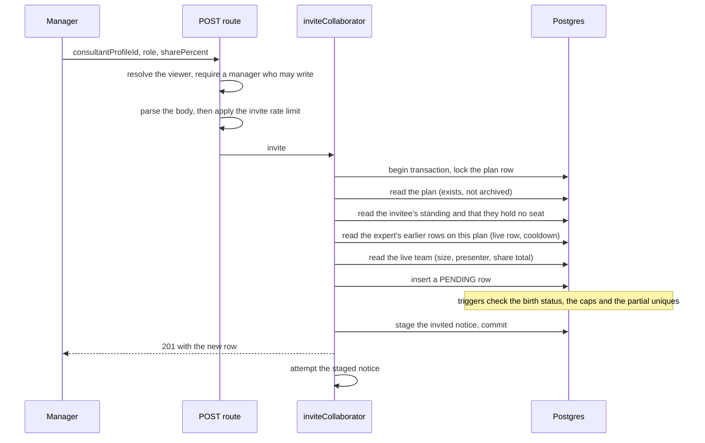
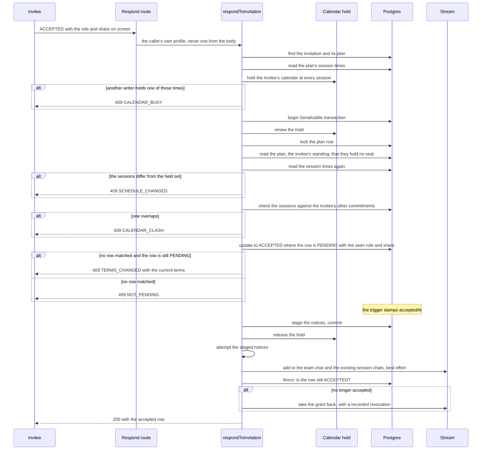
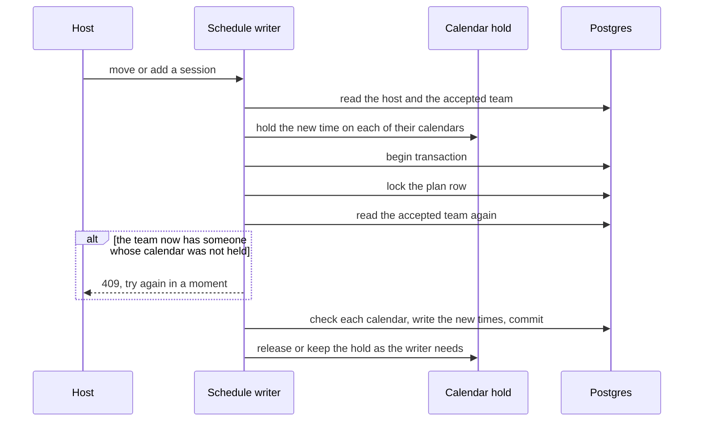

# Collaborators: API, lifecycle and testing

This page is the contract of the collaborator routes, the sequence of each write, what happens when two things run at once or a dependency is down, the notices each change sends, the scheduled work behind it, and the tests that pin all of it.

## Routes

Every route needs a signed-in session (401 `UNAUTHORIZED` otherwise). Bodies and route params are parsed with the Zod schemas in `schemas/collaborators.ts`; bodies are strict, so an unknown field is refused. A share is sent as `sharePercent`, a whole number from 1 to 90, and returned as `revenueShareBps`.

| Route                                                       | Who                                                     | Body                                                                                        | Success                                                                                                     |
| ----------------------------------------------------------- | ------------------------------------------------------- | ------------------------------------------------------------------------------------------- | ----------------------------------------------------------------------------------------------------------- |
| `GET /api/collaborations/{webinar\|class}/[planId]`         | A manager, a collaborator or an invitee of the plan.    | None                                                                                        | `{ data: CollaboratorView[], viewer, canManage }`, projected for the caller.                                |
| `POST /api/collaborations/{webinar\|class}/[planId]`        | A manager who may write.                                | `{ consultantProfileId, role, sharePercent }`                                               | 201 `{ data }`, the new `PENDING` row.                                                                      |
| `PATCH /api/collaborations/{webinar\|class}/[planId]/[id]`  | A manager who may write.                                | `{ role?, sharePercent? }`, at least one.                                                   | `{ data }`. Pending rows only.                                                                              |
| `DELETE /api/collaborations/{webinar\|class}/[planId]/[id]` | A manager (any row), or a collaborator (their own row). | None                                                                                        | `{ data }`, the ended row.                                                                                  |
| `PATCH /api/collaborations/[id]/respond`                    | The invited expert.                                     | `{ response: "ACCEPTED", seenTerms: { role, sharePercent } }` or `{ response: "DECLINED" }` | `{ data }`.                                                                                                 |
| `GET /api/collaborations`                                   | Any signed-in user.                                     | Query `orgScope`, and `view=org` for an organisation's catalogue managers.                  | `{ data: { webinarCollaborations, classCollaborations, hostedWebinarPlans, hostedClassPlans, hostUser } }`. |

`data` on a write is a `CollaborationSummary`: the row's id, expert, role, tier, status and share, with the plan type and id. Nothing else about the row leaves a write.

The handlers are thin. `lib/api/collaborations/plan-route.ts` and `lib/api/collaborations/member-handlers.ts` resolve the caller with `resolveCollaborationViewer`, require a manager where one is needed (`requireManager`), parse, and call one function of `lib/collaborators/service.ts`. The plan type on the respond route comes from the row, never from the request. A `DELETE` by a manager is a removal (`removeCollaborator`); by anyone else it must be the caller's own row and is a departure (`leaveCollaboration`).

## Refusals

Every refusal a write gives is a `CollaborationError`, and `collaborationErrorResponse` (`lib/api/collaborations/http.ts`) answers it as `{ error, code, ...detail }`. `error` is a sentence the person can act on; `code` is stable for clients; `detail` carries the facts a screen needs to recover.

| Code                 | HTTP | When                                                                                                                                                          | Detail                                   |
| -------------------- | ---- | ------------------------------------------------------------------------------------------------------------------------------------------------------------- | ---------------------------------------- |
| `UNAUTHORIZED`       | 401  | No session.                                                                                                                                                   |                                          |
| `FORBIDDEN`          | 403  | The caller is not a manager, the organisation is not active, or the row to end is not the caller's.                                                           |                                          |
| `NOT_FOUND`          | 404  | The plan, the row or the invitation does not exist for this caller, or a route param does not parse.                                                          |                                          |
| `INVALID_TERMS`      | 400  | The body fails its schema, the role does not belong to the plan type, or the share is not a whole percent from 1 to 90.                                       |                                          |
| `INVITEE_INELIGIBLE` | 400  | The invitee is the host or the inviter, or lacks the standing to join (one sentence for every standing reason at invite; the invitee's own reason at accept). |                                          |
| `NOT_PAYABLE`        | 409  | The accepting expert is not resident in India.                                                                                                                |                                          |
| `ALREADY_ON_PLAN`    | 409  | The expert already holds an invitation or a place on the plan.                                                                                                |                                          |
| `HOLDS_A_SEAT`       | 409  | The expert holds a learner's seat on the plan.                                                                                                                |                                          |
| `PLAN_ARCHIVED`      | 409  | The plan is archived.                                                                                                                                         |                                          |
| `TEAM_FULL`          | 409  | The plan already has three live rows.                                                                                                                         |                                          |
| `PRESENTER_TAKEN`    | 409  | The plan already has a live presenter.                                                                                                                        |                                          |
| `SHARES_EXCEEDED`    | 409  | The share would take the team above 90%.                                                                                                                      | `availablePercent`                       |
| `COOLDOWN`           | 409  | The expert declined or left this plan within the last seven days.                                                                                             | `retryAt` (ISO time)                     |
| `TERMS_LOCKED`       | 409  | A change of terms on an accepted row.                                                                                                                         |                                          |
| `NOT_PENDING`        | 409  | The invitation is no longer open.                                                                                                                             |                                          |
| `TERMS_CHANGED`      | 409  | The accept named terms the row no longer carries.                                                                                                             | `terms: { role, sharePercent }`, current |
| `SCHEDULE_CHANGED`   | 409  | The plan's sessions changed while the accept was in flight.                                                                                                   |                                          |
| `CALENDAR_CLASH`     | 409  | A session of the plan overlaps another session on the invitee's calendar. Not retryable as it stands.                                                         |                                          |
| `CALENDAR_BUSY`      | 409  | Another writer holds the invitee's time at one of the sessions right now. Retry in a moment.                                                                  |                                          |
| `CONFLICT`           | 409  | The plan's team changed under the request, or the accept ran out of retries. Reload and retry.                                                                |                                          |
| `INTERNAL`           | 500  | Anything unexpected. Reported once with the `collaborators` tag; the body says nothing more.                                                                  |                                          |

Two answers come from shared machinery and keep its shape: the invite limiter's 429 (ten invitations an hour for one inviting user, `collaboratorInviteLimiter` in `lib/rate-limit.ts`) is passed through untouched, and a calendar lock that cannot be taken at all is answered with that error's own code and status.

## Invite



The transaction runs at the default isolation level. The plan lock is what makes it safe: two invites on one plan queue, and the second reads the first's row before it checks the caps. If something still slips past the friendly checks, the database refuses and `asTeamConflict` turns that into `ALREADY_ON_PLAN` or `CONFLICT`.

Changing a pending invitation's terms (`updatePendingTerms`) follows the same shape: plan lock, read the row, refuse `TERMS_LOCKED` or `NOT_PENDING`, re-check the caps leaving this row out, update where the status is still `PENDING`, stage the terms-changed notice. A change that changes nothing writes nothing and tells nobody. The update moves `updatedAt`, so the invitation's fourteen days start again.

## Accept



Why each step is there:

- **The calendar hold** (`withHostSlotBatch` in `lib/booking/host-slot-batch.ts`) takes the same short-lived locks on the invitee's time that checkout and the allocator take, so nobody can book the invitee at a session while the accept is deciding. It is taken before the transaction and renewed at the top of each attempt.
- **The plan lock comes first inside the transaction**, so the accept queues behind any team or schedule change on the plan and reads what that change committed.
- **The schedule is read twice.** The hold was taken for the sessions read before the transaction. If the host re-timed or added a session in between, the held set no longer covers the plan, and the accept answers `SCHEDULE_CHANGED` instead of joining a team at times it never checked.
- **The update names the terms.** Its `WHERE` carries the status, the role and the share the invitee saw, so one statement both decides the race with a concurrent edit and binds the accept to those terms.
- **Standing is re-read.** An invitee may have been suspended, un-verified or have moved abroad since the invitation.
- **The grant and its fence** run after the commit and cannot fail the accept. See [04 — Stream chat](04-stream-chat-integration.md#granting).

A decline is one small transaction: `endCollaboration` to `DECLINED`, conditional on the row being the caller's and still `PENDING`. It applies whatever the plan's state.

## A schedule change

A host who re-times a webinar, re-times a class, or adds a make-up session moves time on every team member's calendar. The schedule writers therefore take the same plan lock before they read the team.



`lockPlanForMove` and `lockPlanAndCheckBatch` (`lib/booking/host-slot-batch.ts`) do the middle of this: lock the plan row, read the accepted team inside the transaction, and report whether every member's calendar is in the held batch. The webinar re-time (`lib/booking/event-retime.ts`), the class re-time (`lib/booking/class-retime.ts`), the make-up session (`lib/booking/class-sessions.ts`) and the allocator (`lib/booking/allocation/collaborators.ts`) call them. An expert who accepted between the writer's first read and its transaction is found by the second read, and the writer refuses with its ordinary "being booked right now" conflict; the retry holds their calendar too.

Together with the accept's second schedule read, this closes the pair of races between "someone joins the team" and "the schedule moves": whichever takes the plan lock second sees the other's commit.

## Endings

Removal, leaving, declining, expiry and loss of standing all call `endCollaboration` (`lib/collaborators/ending.ts`) inside their transaction and `afterCollaborationEnded` after it. The sequence, including the Stream revocation, is in [04 — Stream chat](04-stream-chat-integration.md#revocation). The function returns null when the row was not in a status the ending applies to, so a second removal, or a removal racing a departure, changes nothing and the caller answers `NOT_FOUND` or `NOT_PENDING`.

## Concurrency and failure

**What queues behind the plan lock.** Invite, change of pending terms, accept, and every schedule writer above. Two of them on one plan run one after the other. The caps trigger takes the same row lock on any insert or change of a live row, so a writer that skipped the application lock would still queue there.

**Which transactions are Serializable.** The accept only, inside `withSerializableRetry` (`lib/db/serializable-retry.ts`). A Serializable transaction that had to wait for the plan lock fails with a serialization error by design and is replayed on a fresh snapshot; when the attempts run out the answer is `CONFLICT`. Invite, change of terms and the endings run at the default level and rely on the plan lock and on conditional updates.

**The lock order.** Every path takes locks in the same order: first the calendar hold (outside the database), then the plan row, then collaborator and session rows. No path takes the plan row and then asks for a calendar hold, which is what keeps the accept and the schedule writers from waiting on each other in a cycle.

**Conditional updates.** Every status change names the expected status in its `WHERE`. Of two requests racing on one row, one matches and one does not, and the loser gets a clean refusal.

**When Stream is down at accept.** The accept succeeds. The grant is missing and heals on the collaborator's next visit. Details in [04](04-stream-chat-integration.md#when-stream-is-down-at-accept).

**When Stream is down at removal.** The removal succeeds, every gate refuses the user from that moment, and the recorded revocation is retried until it lands. Details in [04](04-stream-chat-integration.md#when-stream-is-down-at-removal).

**When the request dies after a commit.** After an accept: the row is accepted and its notices are staged; the grant heals as above. After an ending: the row is ended, and the notices and the revocation are rows in the same commit; the notification outbox delivers the first and the `retry-moderation-enforcement` job drives the second.

**What the scheduled jobs finish.** Owed Stream revocations (`retry-moderation-enforcement`, every 30 minutes). Lapsed invitations and their reminders (`expire-stale-collaborator-invites`, daily). Earnings a capture could not write (`sync-payment-earnings`, at the stored capture time; see [03](03-revenue-sharing.md)). Staged notices that were not attempted (the notification outbox).

**Known limits.** The capture time and the period timestamps come from two clocks; the meeting extension does not take the plan lock; freedom from deadlock is argued from the lock order. They are listed with the rest in [the decision record](../decisions/2026-11-16-collaborators.md#limits-that-remain).

## Notices

`stageCollaboratorNotifications` (`lib/collaborators/notifications.ts`) stages the bell and emails of one change inside that change's transaction; they are attempted after the commit and delivered by the outbox if that attempt does not happen. Each change is told to the party that did not make it.

| Change                              | The collaborator or invitee                       | The host side  | Required                                          |
| ----------------------------------- | ------------------------------------------------- | -------------- | ------------------------------------------------- |
| Invited                             | Bell and email, with the day it lapses.           | Not told       | Yes                                               |
| Terms changed while pending         | Bell and email, with the new lapse day.           | Not told       | Yes                                               |
| Invitation lapses in three days     | Bell and email, once per set of terms.            | Not told       | No                                                |
| Accepted                            | Email: their copy of the terms.                   | Bell and email | Yes                                               |
| Declined                            | Not told                                          | Bell and email | Yes                                               |
| Left                                | Not told                                          | Bell and email | Yes                                               |
| Removed, or an invitation withdrawn | Bell and email, naming whoever did it when known. | Not told       | Yes                                               |
| Expired                             | Bell and email                                    | Bell and email | Yes                                               |
| The plan's presenter joined or left | Not applicable                                    | Not applicable | Yes, to learners who hold a paid seat on the plan |

- **Required** means the notice is sent whatever the recipient's notification switches say. The lifecycle notices carry the required kind `COLLABORATION_CHANGED` and the learners' notice carries `COHOST_CHANGED` (`lib/notifications/required-notices.ts`). The reminder is the one optional notice.
- **The host side** is the plan's owning expert. On a plan with none it is the organisation's active members who hold `catalog.manage` (`hostSideUserIds`). The collaborator and whoever ended the row are left off it, because they already know. On an organisation's plan the host's link opens the organisation's Collaborations page and the bell is filed under that organisation.
- **A manager who ends their own row** has left or declined; the host side is told that, and nobody is told they were "removed".
- **Loss of standing** is told to the host side as an unnamed collaborator leaving, because the account may be leaving the platform (`endCollaborationsForUser`). Removal from an organisation is told to the host side per plan; the member hears of the removal itself from the organisation's own notice.
- **Learners.** When a presenter (`CO_HOST`, `CO_INSTRUCTOR`) is accepted, or one who was on the team leaves or is removed, every user holding a paid seat on one of the plan's live events is told by bell and email (`stageCohostChange`). The notice states the fact and nothing more. Crew changes are not announced.
- **The reminder is claimed once.** Staging it inserts an `IdempotencyRecord` (scope `collaborator.invite-expiring`) keyed on the row and its `updatedAt`, in the same transaction as the notice. A second run finds the claim and stages nothing; a change of terms moves `updatedAt` and so earns a fresh reminder.
- **No notice claims a fact about access, earnings or refunds.** The emails state the role, the share and who acted. The accept email shows the share on an example seat of ₹1,000.

A collaborator also receives the booking notices of the plan's events (session reminders, re-times, make-ups, a cancelled or voided session) because `collaboratorUserIds` in `lib/collaborators/recipients.ts` adds the current team to those recipient lists.

## Operations

### The expiry sweep and the reminder

`expireStaleCollaboratorInvites` (`lib/collaborators/cleanup.ts`) is the job `expire-stale-collaborator-invites` in `lib/cron/cleanup-registry.ts`. It is due once a day and runs under a job lock.

1. **Expire.** It reads up to 50 `PENDING` rows whose `updatedAt` is more than fourteen days old (`INVITE_TTL_DAYS`), oldest first, and ends each as `EXPIRED` through `endCollaboration` in a transaction of its own, conditional on the row still being that old. A row answered or edited since the read is left alone. Both sides are told.
2. **Remind.** If time remains, it reads the pending rows that lapse within three days (`INVITE_REMINDER_DAYS_BEFORE`), drops those already claimed, and stages the reminder for each in its own transaction.
3. **Time budget.** No row is started after half of the job's start budget (about eight seconds). What is left is reported as `hasMore` and taken by the next run.
4. **One report.** Failures are collected and reported once per run with the `collaborators` tag, and the rest of the run carries on. The job's summary is `{ expired, reminded, scanned, failed, hasMore }`.

Worked example: an invitation is sent on 1 March at 10:00 IST and never answered. It lapses on 15 March at 10:00, so the first run after 12 March 10:00 finds it inside the reminder window and reminds the invitee once. The first run after 15 March 10:00 ends it as `EXPIRED` and tells the invitee and the host side. Had the host changed the share on 10 March, the window would start again from that day: the reminder would be due from 21 March and the lapse on 24 March.

### Revocations still owed

The ops digest (`lib/observability/ops-digest.ts`, section "Access revocations") carries one line when any `COLLAB_REVOKE` row is still `PENDING` or `FAILED`: the count and the age of the oldest, for example "2 collaborator access revocations still owed (oldest 3 days)". A former team member keeps their Stream membership until that row is done, although every gate that reads Postgres already refuses them. A line that stays for more than a day means Stream has been refusing the removal; the row's recorded error says why.

### The back-office list

Staff with the `payouts.read` capability have a read-only Collaborations page in the back-office tree (`app/dashboard/(backoffice)/[tree]/collaborations/page.tsx`, read by `readCollaborations` in `lib/backoffice/collaborations-read.ts`). It lists every collaboration on the platform, most recently changed first, 50 to a page: the plan and its organisation, the expert, the role, the share, the status, when it was accepted and ended, and who ended it. Staff who may manage payouts also get a link to the earnings-holds screen. The page changes nothing.

### One Sentry tag

Every report from this subsystem carries `subsystem: "collaborators"` and an `op` that names the function. Loops collect their failures and report once.

## Testing

Two tiers. The mocked tier runs everywhere; the database tier runs the real triggers and needs a disposable Postgres.

```bash
node_modules/.bin/jest __tests__/collaborators __tests__/payments/collaborator-split-as-of.test.ts \
  __tests__/payments/multi-party-split.test.ts --coverage=false
scripts/dev/db-tier-local.sh /tmp/collab-db.log __tests__/db/collaborators
```

| Rule                                                                                                               | Suite                                                                                                                                                                                                                 |
| ------------------------------------------------------------------------------------------------------------------ | --------------------------------------------------------------------------------------------------------------------------------------------------------------------------------------------------------------------- |
| A row is born pending, the legal transitions, ended rows are final, terms fixed on accept                          | `__tests__/db/collaborators/state-machine.db.test.ts` ("the state machine")                                                                                                                                           |
| One live row per expert per plan, history kept, two simultaneous invites commit one                                | Same file ("one live row per expert per plan, with history kept")                                                                                                                                                     |
| The team-size and share caps, also under two simultaneous invites                                                  | Same file ("the team and share caps")                                                                                                                                                                                 |
| The team as of a time holds a member from accept to ending, whenever asked                                         | `__tests__/db/collaborators/team-and-endings.db.test.ts` ("the team as of a time")                                                                                                                                    |
| A removal and its revocation commit or roll back together; an invitation owes none                                 | Same file ("an ending")                                                                                                                                                                                               |
| Invite: a new row beside an ended one, the plan lock first, cooldown, caps, standing                               | `__tests__/collaborators/invite-and-terms.test.ts`                                                                                                                                                                    |
| Accept: seen terms, calendar hold, `CALENDAR_CLASH` against `CALENDAR_BUSY`, retry then `CONFLICT`                 | `__tests__/collaborators/accept.test.ts`                                                                                                                                                                              |
| The one ending function, the batch for a user, the after-commit step, the expiry sweep and its budget              | `__tests__/collaborators/ending.test.ts`                                                                                                                                                                              |
| Who the caller is and what each audience is shown                                                                  | `__tests__/collaborators/viewer.test.ts`                                                                                                                                                                              |
| Route contracts: status, code and detail of each refusal, who may call                                             | `__tests__/collaborators/plan-route.test.ts`, `__tests__/collaborators/member-route.test.ts`, `__tests__/collaborators/respond-route.test.ts`                                                                         |
| Who each notice reaches, the host side, the reminder claimed once, learners told                                   | `__tests__/collaborators/lifecycle-notices.test.ts`, `__tests__/collaborators/lifecycle-email.test.tsx`                                                                                                               |
| The split as of capture, retries, the sweep and replays, in rupees                                                 | `__tests__/payments/collaborator-split-as-of.test.ts`                                                                                                                                                                 |
| One fee per slice, remainders, organisation parties, the sponsored seat                                            | `__tests__/payments/multi-party-split.test.ts`                                                                                                                                                                        |
| The split reads through the handle it is given; a buyer earns nothing from their own seat                          | `__tests__/collaborators/revenue-split-reads-through-tx.test.ts`                                                                                                                                                      |
| The Stream revocation, the team chat's admission, a former collaborator's seat, the plan lock before the team read | `__tests__/stream/collaborator-revocation.test.ts`, `__tests__/stream/collab-channel-open.test.ts`, `__tests__/booking/former-collaborator-buys-seat.test.ts`, `__tests__/booking/plan-lock-before-team-read.test.ts` |
| Collaborators are not counted as seats; a removed one is kicked from an open room                                  | `__tests__/collaborators/seat-count-and-live-revocation.test.ts`                                                                                                                                                      |
| The digest line and the back-office read                                                                           | `__tests__/observability/ops-digest.test.ts`, `__tests__/backoffice/collaborations-read.test.ts`                                                                                                                      |
| The screens and the one hook module                                                                                | `__tests__/collaborators/collaboration-screens.test.tsx`, `__tests__/collaborators/use-collaborations.test.tsx`                                                                                                       |

What the database tier covers and the mocked tier cannot: the triggers and partial unique indexes themselves, the period stamped by the database clock, and two real sessions racing on one plan. The two "simultaneous" cases in `state-machine.db.test.ts` need two connections, so they are meaningful only against a real Postgres server. How the tier is set up and guarded: `.claude/skills/booking/references/verification.md`.

## Where in code

- Routes: `app/api/collaborations/**`, `lib/api/collaborations/{http,plan-route,member-handlers}.ts`.
- Writes: `lib/collaborators/service.ts`, `lib/collaborators/ending.ts`.
- Reads: `lib/collaborators/queries.ts`, `lib/collaborators/viewer.ts`.
- Schemas: `schemas/collaborators.ts`.
- Screens: `components/collaborators/**`, with every query and mutation in `hooks/use-collaborations.ts`.

## Deprecated & Superseded Approaches

- **`revenueSharePercentage` in bodies and `planType` in the respond body.** Replaced by `sharePercent` and by reading the plan from the row.
- **Service functions that returned `null` for "something was wrong".** Every refusal is a `CollaborationError` with a code.
- **A Serializable retry loop around the invite.** The invite runs at the default level behind the plan lock.
- **Expiry recorded as `DECLINED`, and a pending invitee's departure recorded as `WITHDRAWN`.** Expiry is `EXPIRED`; a pending invitee who leaves has `DECLINED`.
- **Re-invite by moving an ended row back to `PENDING`.** A re-invite is a new row.
- **The two `revenue-split` preview routes.** Removed.
- **Participant rows and the presenter call role written at accept.** Neither is written; see [05](05-stream-video-integration.md).
- **Host-side notices sent to whoever invited.** The host side is the owning expert or the organisation's catalogue managers.
