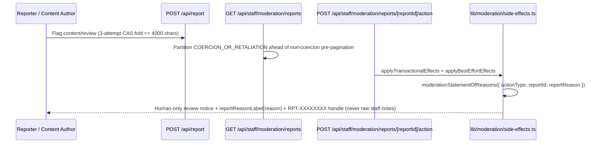

# 03 — Consumer Protection, Grievance Redressal & Review Transparency

> **Status:** Active across public statutory disclosures (`lib/company.ts`, `app/(pages)/constants.ts`, `app/(pages)/grievance/page.tsx`, `app/(pages)/reviews-policy/page.tsx`), unauthenticated/authenticated grievance intake (`app/api/contact/route.ts`), moderation statements of reasons (`lib/moderation/side-effects.ts`), priority report queuing (`app/api/staff/moderation/reports/route.ts`), multi-reporter aggregation (`app/api/report/route.ts`), and dispute evidence governance (`app/api/admin/disputes/**`).

## 1. Corporate Identity, Live-MX Mailbox & Statutory SLA Standard

Familiarise publishes verified corporate registry disclosures from `lib/company.ts` (`COMPANY_INFO`, rendered by the footer, `/about`, `/contactus`, `/grievance` and the contact block of `/terms`, `/privacy` and `/refund`, and printed as the supplier on tax invoices, credit notes and IRP payloads) and binds consumer support, grievance redressal, and content/review moderation SLAs to a platform standard stricter than every statutory ceiling below. The standard is **acknowledge within 24 hours and resolve within 7 days** (`STATUTORY_ACK_HOURS = 24` and `STATUTORY_RESOLUTION_DAYS = 7` in `lib/support/sla.ts`, rendered by `GRIEVANCE_OFFICER` in `app/(pages)/constants.ts`). Every page in this repo quotes those two numbers as the promise and the statute as the ceiling:

- **Registered Entity, CIN & Registered Office:** `Practitionist (OPC) Private Limited`, `CIN: U62012HR2026OPC146217`, the mailing address on record at the ROC (M3M Merlin, Sector 67, Gurgaon 122018, Haryana), and registered jurisdiction `Haryana, India` (`COMPANY_INFO.jurisdiction` in `lib/company.ts`, a constant). PAN and TAN are never published.
- **One Live Mailbox:** `SUPPORT_EMAIL` in `lib/company.ts` is `connect@practitionist.com`, the only working mailbox. It serves support, the contact form (`CONTACT_INBOX_ADDRESS`), billing (`BILLING_EMAIL`), the grievance officer (`COMPANY_INFO.email` and `GRIEVANCE_OFFICER.email`) and the compliance alerts (`COMPLIANCE_ALERT_EMAIL`); none is an environment variable. `familiarisenow.com` has no inbound mail, so switching later means changing that one constant.
- **Unfabricated Phone, Officer Name & Accurate Policy Dates:** `COMPANY_INFO.phone` (shared by `GRIEVANCE_OFFICER.phone`) and `COMPANY_INFO.grievanceOfficerName` (shared by `GRIEVANCE_OFFICER.name`) are empty-string constants in `lib/company.ts` until a support line exists and an officer is appointed; while either is empty the footer, `/contactus`, `/about`, `/grievance` and the policy contact blocks omit that row entirely rather than rendering placeholder text or invented values. `POLICY_DATES` in `app/(pages)/constants.ts` carries the last-updated stamp of each statutory page.

| Regime                                                                  | Statutory Ceiling                                                                                      | Implemented Platform Standard                                                                                                             | Tracking Handle                    |
| ----------------------------------------------------------------------- | ------------------------------------------------------------------------------------------------------ | ----------------------------------------------------------------------------------------------------------------------------------------- | ---------------------------------- |
| **IT (Intermediary Guidelines) Rules, 2021 — Rule 3(2)**                | Acknowledge <= 24 hours; dispose <= 15 days                                                            | Acknowledge **within 24 hours**; resolve **within 7 days** (`lib/support/sla.ts`)                                                         | `FAM-YYYY-NNNNNN` / `RPT-XXXXXXXX` |
| **Consumer Protection (E-Commerce) Rules, 2020 — Rule 4(4)–4(5)**       | Acknowledge <= 48 hours; redress <= 1 month with ticket number                                         | Held to the stricter **within 24 hours** acknowledgement and **within 7 days** resolution standard                                        | `FAM-YYYY-NNNNNN`                  |
| **Digital Personal Data Protection Act, 2023 — Sec. 13 and Rule 14(3)** | Respond to a data principal grievance within the prescribed period (Rule 14(3): not more than 90 days) | Routed through the designated Grievance Officer and the unified support ticket queue, under the same **24 hours** and **7 days** standard | `FAM-YYYY-NNNNNN`                  |
| **BIS IS 19000:2022 & EU DSA Art. 16(5) / 17(3)**                       | Verified reviews, equal treatment, human moderation, reason & appeal                                   | Verified paid bookings only; two-track rating aggregation; human-only moderation; statement of reasons + `RPT-` Support route             | `RPT-XXXXXXXX`                     |

## 2. Public Compliance Pages & Atomic Public Grievance Intake

1. **Grievance Redressal Page (`app/(pages)/grievance/page.tsx`):**
   - Renders `GRIEVANCE_OFFICER` name, designation (`"Grievance & Nodal Compliance Officer"`), live-MX `mailto:` link, optional phone row, jurisdiction (`Haryana, India`), the promised timelines (`ACK_PROMISE_COPY` = `"within 24 hours"` and `GRIEVANCE_OFFICER.resolutionPromise` = `"within 7 days"`), anti-scam notice (`ANTI_SCAM_NOTICE`), and direct CTAs to `/dashboard/go?to=support` and `/contactus?category=grievance`.
   - Lists statutory appellate forums: **Grievance Appellate Committee** (`https://gac.gov.in`, 30-day appeal window under IT Rules Rule 3A), **National Consumer Helpline** (`https://consumerhelpline.gov.in`), and **Data Protection Board of India** (DPDP Act Section 13(3)).
2. **Atomic Public Grievance Intake (`POST /api/contact` in `app/api/contact/route.ts`):**
   - Protected by per-IP sliding-window limiting (`spamLimiter` on `contact:<ip>`), Zod validation (`ContactBodySchema`), and silent honeypot rejection (`website`).
   - When `category === "grievance"`, the route creates a `SupportCase` inside `prisma.$transaction` (`category: "GRIEVANCE"`, `activeChannel: "HUMAN"`, `priority: "HIGH"`), allocates `FAM-YYYY-NNNNNN` from `SupportCaseCounter`, records `receivedAt`, and snapshots the category's absolute `statutoryDueAt` from `lib/support/deadline-policy.ts`. Anonymous complainants are stored in `externalRequesterName`/`externalRequesterEmail`; the operator foreign keys record queue custody only. Staff replies to anonymous cases go through the guarded email outbox.
   - If the visitor is unauthenticated and no `ADMIN`/`STAFF` operator exists, no reference is allocated and `POST /api/contact` returns HTTP `202` with `referenceNumber: null` and a 24-hour officer follow-up notice after staging `sendContactInquiryEmail`.
3. **Reviews & Moderation Policy Page (`app/(pages)/reviews-policy/page.tsx`):**
   - Documents verified paid-booking eligibility, BIS IS 19000:2022 non-suppression and zero-editing rules, two-track aggregation (`ONE_TO_ONE` vs `GROUP`), the five report grounds (`COERCION_OR_RETALIATION`, `SPAM_OR_FAKE`, `HARASSMENT_OR_ABUSE`, `OFF_TOPIC`, `OTHER`), `"Not counted in rating"` exclusions, human-only review, and internal/out-of-court/judicial appeal paths.

## 3. Moderation Statement of Reasons, Priority Queue & Report Folding

- **DSA Art. 16(5) & 17(3) Statement of Reasons (`moderationStatementOfReasons` in `lib/moderation/side-effects.ts`):**
  - Attached to every disposition and enforcement notice (`MODERATION_REPORT_OUTCOME`, `CONTENT_REMOVED_NOTICE`, `REVIEW_EXCLUDED_FROM_RATING`, warnings, suspensions, bans, and profile unverification).
  - Cites the formatted policy ground via `reportReasonLabel(params.reportReason ?? "OTHER")` (`lib/labels/report-reasons.ts`) — **never exposing raw internal moderator `notes`** to reporters or moderated targets.
  - States explicitly that **a human moderator reviewed the report and no automated decision was used**, and instructs the recipient to open a Support request quoting `RPT-XXXXXXXX` (`formatReportReference(reportId)`) to appeal.
- **Pre-pagination `COERCION_OR_RETALIATION` priority (`GET /api/staff/moderation/reports`):**
  - Splits queries into `coercionWhere` (`reason: "COERCION_OR_RETALIATION"`) and `nonCoercionWhere` (`reason: { not: "COERCION_OR_RETALIATION" }`), computing exact cross-partition `skip` and `take` offsets before pagination so coercion, extortion, and retaliatory review flags always appear at the top of page 1 ahead of older or higher-count non-coercion reports.
- **Tail-preserving `4000`-char second-reporter fold (`POST /api/report`):**
  - When aggregating an additional report onto an existing `PENDING` or `UNDER_REVIEW` report, a 3-attempt CAS loop (`where: { id, reportCount: currentCount, status: { in: ["PENDING", "UNDER_REVIEW"] } }`) formats `\nReporter N+1 (reason): <280-char excerpt>` and clamps the existing prefix to `4000 - newestLine.length` (`MAX_AGGREGATED_DESCRIPTION_LENGTH = 4000`), guaranteeing the newest reporter's reason and excerpt are preserved intact at the tail.

## 4. Disputes & Chargeback Evidence Governance

- **Actionable Open Disputes & Overdue Visibility (`GET /api/admin/disputes` in `app/api/admin/disputes/route.ts`):**
  - Derives `ACTIONABLE_OPEN_STATUSES` directly from `OPEN_DISPUTE_WHERE.status.in` (`lib/backoffice/queue-predicates.ts`) excluding `"UNDER_REVIEW"`.
  - Computes `urgentDisputes` over `status: { in: ACTIONABLE_OPEN_STATUSES }` with `dueBy: { lte: now + 3d }` and **no lower-bound `gte: now` cutoff**, ensuring overdue open disputes remain surfaced as urgent until submitted or resolved, and orders actionable open rows ahead of closed/under-review rows by earliest `dueBy`.
- **Permission-Gated `evidencePack` & PII Redaction (`GET /api/admin/disputes/[disputeId]/route.ts`):**
  - Gates raw `evidence`, payer billing `email`, and `evidencePack` strictly behind `hasBackofficePermission(role, "disputes.manage")` (`ADMIN` only; `STAFF` receives `evidencePack: null` and redacted billing contact details).
  - Omits raw participant PII across both `payment.appointment` and `evidencePack`: session `attendances` rows are reduced to aggregate counts (`presentCount`, `recordsFound`, summary text) without user IDs or timestamps, and raw `supportThreads` / `supportCases` arrays are stripped from `payment.appointment` and normalized into summary status/reference metadata under `evidencePack.supportHistory`.

## 5. Consumer Protection (E-Commerce) (Amendment) Rules, 2026

The Amendment Rules (G.S.R. 789(E), notified 9 September 2026) come into force on **1 January 2027** and turn the 2023 dark-pattern guidelines into binding duties for e-commerce entities. The launch target is before that date, so the work is P0 and due **31 December 2026**. The sources are secondary and consistent across firms (Khaitan & Co. ERGO of 18 September 2026, Bar & Bench, Moneylife); confirm each duty against the Gazette text before the certificate is signed. The tracking issue is #2666 ("1 Jan 2027 consumer rules: dark-pattern self-audit, displayed certificate, prior-price display"). **None of the deliverables below exists yet.**

| Duty                                                                                | What it means for Familiarise                                                                                                                                                                                                                                                                                                             | State                                                        |
| ----------------------------------------------------------------------------------- | ----------------------------------------------------------------------------------------------------------------------------------------------------------------------------------------------------------------------------------------------------------------------------------------------------------------------------------------- | ------------------------------------------------------------ |
| Annual dark-pattern self-audit and a prominently displayed compliance certificate   | The rules prescribe no method, so we define one: every buyer flow checked against the 13-pattern list, findings fixed or recorded, the owner signs. The certificate is a public page linked from the footer, and the audit repeats every year (see the [compliance calendar](./05-india-compliance-calendar.md)).                         | Planned (#2666)                                              |
| Prior price: any announced reduction shows the lowest price of the previous 30 days | Today no page shows a strike-through price, so the rule bites only when early-bird or "X% off" pricing is built. Any such feature must store and show the 30-day low.                                                                                                                                                                     | Nothing to change today; a constraint on future pricing work |
| Seller identity on the invoice at the same prominence as the platform               | Under the principal-supplier model Familiarise is the seller (`COMPANY_INFO` on every tax invoice), so confirm the expert attribution line with counsel.                                                                                                                                                                                  | To confirm                                                   |
| Dark-pattern checklist from the 2023 guidelines                                     | False urgency (no fake countdowns), basket sneaking, drip pricing (answered by the all-in, GST-inclusive display once registered; the owner decision is in `docs/decisions/2026-11-09-tax-compliance-and-pricing-levers.md`), confirm-shaming, forced action, subscription traps, interface interference, bait and switch, disguised ads. | The audit's checklist                                        |

## Deprecated & Superseded Approaches

- **Dead-MX `support@familiarisenow.com` address, `Bengaluru, Karnataka` jurisdiction, fabricated phone numbers, and mass-overwritten policy dates:** Superseded in `lib/company.ts` by the single live mailbox `connect@practitionist.com` (`SUPPORT_EMAIL`; the former env-driven `resolveLiveMailbox()` was deleted), registered jurisdiction `Haryana, India` for `Practitionist (OPC) Private Limited` (`CIN: U62012HR2026OPC146217`), phone and officer-name rows omitted while their `COMPANY_INFO` constants are empty, and preserved historical dates (`July 12, 2026` / `September 26, 2026`) on untouched legal documents.
- **Unbacked public grievance emails without a `SupportTicket` or orphan sequence burns:** Previously, `/contactus?category=grievance` sent email without creating a tracked ticket, or allocated a `FAM-` reference before checking whether a `userId` existed. Superseded by atomic `recordPublicGrievanceTicket` inside `POST /api/contact`.
- **Leaking raw internal moderator `notes` in user notifications, post-pagination report sorting, and truncating newest reporter context:** Superseded by `moderationStatementOfReasons` citing `reportReasonLabel(reason)`, pre-pagination `COERCION_OR_RETALIATION` partitioning, and tail-preserving `4000`-char CAS folding.
- **Dropping overdue disputes (`dueBy >= now`) or exposing raw attendance/thread PII to non-`disputes.manage` staff:** Superseded by lower-bound-free `urgentDisputes` over `ACTIONABLE_OPEN_STATUSES` and `disputes.manage`-gated `evidencePack` redaction.
- **Env-driven contact identity**: `NEXT_PUBLIC_COMPANY_JURISDICTION`, `NEXT_PUBLIC_SUPPORT_PHONE` and `NEXT_PUBLIC_GRIEVANCE_OFFICER_NAME` no longer exist. Filling in the phone or officer name is an edit to `lib/company.ts`.
- **Grievance numbers of 15 days, 48 hours and 30 days as the platform standard (replaced 2026-11-09):** This page and the compliance calendar once quoted `STATUTORY_RESOLUTION_DAYS = 15` and a 48-hour acknowledgement. The code promises 24 hours and 7 days (`lib/support/sla.ts`); 15 days, 48 hours and one month are the statutory ceilings, not our promise.
