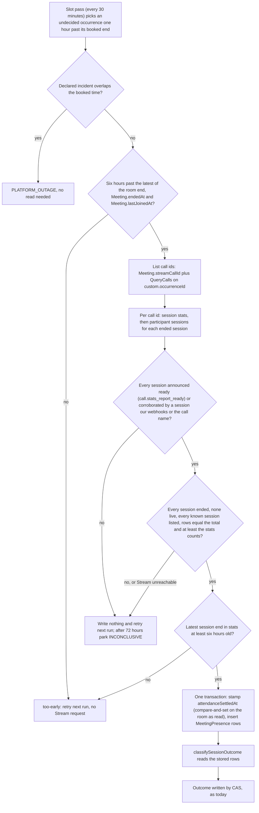

# ADR: Session outcomes are decided from Stream's settled participant record, not a live webhook mirror

- **Status**: Accepted. The owner approved this record on 2026-11-22 together with its proposals: the 72-hour park, the ops "read from Stream again" action until about day 80, the incident check before any Stream read, one shared idempotent settle step used by the sweep, the consultant no-show detector and the rating gate, and the five-minute reconnect grace. Section "How it was built" records where the build differs from the text above it.
- **Date**: 2026-11-22
- **Author**: Platform engineering
- **Related**: issue #2959 "Decide session outcomes from Stream's settled participant record, not a live webhook mirror" (the issue and its spike write-up); the interim fix #2957 "fix(stream): a late session-end webhook leaves a newer session live and its presences open", closed unmerged as superseded by this record's build, which also closes #2933 "A late session-end webhook closes a newer session's presences and marks a live meeting ended"; [Session outcomes](2026-09-25-session-outcomes.md) (the record this supersedes in part); [Stream ADR-06, the attendance witness](../stream/18-architecture-decision-records.md#adr-06-stream-participant-sessions-are-the-attendance-witness); [Data retention windows](2026-11-01-data-retention-windows.md); [One Stream app until launch](2026-11-06-shared-stream-app-until-launch.md); [Schema freeze and cutover](../prisma/02-schema-freeze-and-migration-cutover.md)
- **Supersedes**: the presence rows and their webhook writers in [Session outcomes](2026-09-25-session-outcomes.md) rule 1, and [Stream ADR-06](../stream/18-architecture-decision-records.md#adr-06-stream-participant-sessions-are-the-attendance-witness). Rules 2 to 9 of the session outcomes record stand.

## Context

### What the outcome decides

A session's outcome (`HELD`, `CUT_SHORT`, `PLATFORM_OUTAGE`, `HOST_ABSENT`, `LEARNER_ABSENT`, `NOBODY_JOINED`, `INCONCLUSIVE` or `OFFLINE`) is read by money and by people:

- **Refunds and make-ups.** A voided session is owed a make-up within 14 days and is then refunded (`MISS_WHERE` and `UNSETTLED_MISS` in `lib/booking/misses.ts`).
- **Forfeits.** A learner who never joins forfeits the session (`LEARNER_ABSENT`, counted as held).
- **Payout holds and releases.** An unsettled miss holds its booking's earnings (`EARNINGS_HOLDING_MISS`), and a session parked for ops holds them too (`AWAITING_HUMAN`).
- **The expert's private reliability flag and completion rate.** Only `CUT_SHORT` and `HOST_ABSENT` count (`HOST_ATTRIBUTED_OUTCOMES` in `lib/booking/session-outcome.ts`).
- **Support and ops.** The needs-human queue (`NEEDS_HUMAN`) and the ops overturn door (`lib/backoffice/session-outcomes.ts`) read the same fields, and the dispute view shows attendance (`app/api/admin/disputes/[disputeId]/route.ts`).
- **Detection and display.** The consultant no-show detector (`scripts/appointments/detect-consultant-no-shows.ts`) runs the same classifier. The maintenance preflight counts live rooms (`lib/meetings/active-calls.ts`), the usage estimate sums presence minutes (`lib/stream/usage-estimator.ts`), the host's attendance view reads them (`lib/booking/session-attendance.ts`), and the organisation seat list shows who attended (`lib/data/org-sponsored-seats.ts`).
- **The rating gate.** A learner may review a session only if they were demonstrably there (`resolveReviewableSession` in `lib/reviews.ts`, which today asks for a `MeetingAttendance` row).

### How the outcome is built today (on `dev`)

Stream sends a webhook for every join and leave. `handleSessionParticipantJoined` and `handleSessionParticipantLeft` in `lib/stream/session-handlers.ts` turn each one into a `MeetingPresence` interval (one row per Stream `user_session_id`, unique on `(meetingId, userSessionId)`) and a `MeetingAttendance` summary row per person. `call.session_ended` and `call.ended` stamp `Meeting.endedAt` and close every open interval at that stamp, marked `closedByEnd = true` (`stampEnd`, `closeSegmentPresences` in `lib/meetings/segment-presence.ts`). A join after a non-deliberate end reopens the room. A reopen or a pre-start end rotates the call id (`occurrence-<id>-r<base36>`) and overwrites `Meeting.streamCallId`, so a prior call id survives only on `MeetingPresence.streamCallId`. `lib/meetings/reconcile-orphaned-sessions.ts` closes rooms Stream never reported as ended.

One hour after a session's booked end, the `auto-complete-appointments` slot pass runs `decideSlotOutcome` (`lib/booking/session-outcome-sweep.ts`). It treats an open or assumed-closed interval as unresolved, and for those it asks Stream: `getCallPresenceEvidence` reads the call report, and `getCallParticipantSessionsFromStream` (`lib/stream/call-presence.ts`) reads the participant sessions of the call's latest session. It patches our rows from Stream's answer, then calls the pure `classifySessionOutcome`. Where the rows show only one side and Stream did not answer, the sweep waits 24 hours (`STREAM_EVIDENCE_WAIT_MS`) and then parks the session `UNVERIFIED` as `INCONCLUSIVE`.

The pull request #2957 changes the end handling of this mirror: a late non-host end is skipped when a newer presence is open, `closeSegmentPresences` closes only rows that joined before the end, and the end and the join take a row lock on `Meeting`. That fix is right for the mirror, it merges first, and it stays until the design below is built.

### Why the live mirror is fragile

Our own tables are a second copy of a record Stream already keeps, built from webhooks that Stream does not promise to deliver in order, or at all (Stream's webhook overview describes up to five attempts inside a 15-second budget and points to a queue for reliability). Every defect found so far is a symptom of that choice: a lost leave stretched a host's presence to the room end, a late join from an old call was written to the new segment, a late `call.session_ended` stamped a live room ended, and with zero rows the sweep once wrote `NOBODY_JOINED`. Each fix added state (`closedByEnd`, segments, the Stream fallback, the row lock), and each piece of state is a new way to disagree with Stream.

The mirror has also barely run. Stream's single event hook delivers to production only (`docs/decisions/2026-11-06-shared-stream-app-until-launch.md` records that the app is shared), so previews and dev cannot exercise it end to end. Read-only counts on the shared database on 2026-11-22: `Meeting` 1,199 rows, of which 1,168 are seed rows with uuid-shaped call ids created within four minutes of each other on 2026-09-14 and only 31 are real `occurrence-*` calls; `MeetingPresence` 27 rows across two calls; `MeetingAttendance` 19 rows; no rotated call id at all. The code that decides money from these rows has almost never been exercised on real traffic, which is the cheapest moment to replace it.

Stream's own API is the better source for a money decision. `queryCallParticipantSessions` returns one row per device stay with millisecond join and leave times, and Stream states the final data is available after the call ends. On the only two real calls where we hold mirror rows, Stream's record reproduced all six device stays one to one.

## Worked example

Hannah hosts a one-hour 1:1 consultation with Priya, booked Monday 23 Nov 2026, 10:00 to 11:00 IST. Priya paid ₹1,500.00 (150000 paise). Both names come from the seeded cast pool in `prisma/seedFiles/1a-create-users.ts`. The times below are illustrative.

1. **9:58:03 IST.** Priya joins on her laptop (device stay A).
2. **10:02:10 IST.** Hannah joins, 2 minutes 10 seconds late.
3. **10:20:10 IST.** Priya's connection drops, and stay A ends. **10:23:12 IST:** she reconnects (stay B), a gap of 3 minutes 2 seconds.
4. **10:59:40 IST.** Hannah leaves. **10:59:50 IST:** Priya leaves.
5. **11:04:50 IST.** Stream ends the idle session 300 seconds after the last leave (the `default` call type's `inactivity_timeout_seconds`), and `call.session_ended` stamps `Meeting.endedAt` and records the session as `Meeting.lastStreamSessionId`. Shortly after, Stream sends `call.stats_report_ready` for the session, and its id is added to `Meeting.streamReportReadySessionIds` as evidence that this session is final.
6. **17:15 IST.** The slot pass runs every 30 minutes on the ticker (`TARGET_EVERY_MINUTES` in `lib/cron/schedule.ts`, at a 15-minute offset). It looks at the occurrence from 12:15, an hour after the booked end, but nothing is read until six hours past the room end (`ATTENDANCE_SETTLE_DELAY_MS`), so the 17:15 run is the first to read. It asks Stream for the calls whose `custom.occurrenceId` is this occurrence (one call id), then for that call's sessions. Stream reports one session, announced ready, with `ended_at` 11:04:50, no live sessions and three participant sessions. The sweep reads all three rows (Hannah's one stay, Priya's two), sees that three rows were collected out of three reported, and writes them in one transaction together with `Meeting.attendanceSettledAt`.
7. **The classifier reads the stored rows.** Hannah's host side is present from 10:02:10. Priya's two stays are merged, because the 3-minute gap is shorter than the five-minute reconnect grace. The only host-side loss is the two whole minutes (10:00 and 10:01) in which Priya was waiting and no host was in the room. Priya's own drop counts for nothing, because Hannah was there. The void line is min(15 minutes, half of 60) = 15 minutes, and 2 is below it, so the outcome is `HELD`, with 58 delivered and 2 lost minutes, `COMPLETED`, and Priya's seat moves to `ATTENDED`. No money moves.

Variants (the same stored rows with different times; the numbers were checked against `classifySessionOutcome`):

- **Hannah also drops for 3 minutes mid-session.** The same grace merges her two stays, so the result is still `HELD`, 58 delivered.
- **Hannah drops from 10:10:00 to 10:24:00 IST (14 minutes).** The loss is 14 + 2 = 16 minutes, at or over 15, and the outcome is `CUT_SHORT` (16 lost, 44 delivered), `VOIDED` and attributed to the host. Priya's seat is owed a make-up within 14 days and is then refunded in cash (session outcomes rule 5).
  Between 12:15 and 17:00 IST each pass defers without asking Stream: the six-hour wait has not passed. The failure variants below start at the first eligible pass, 17:15.

- **Stream is unreachable at 17:15.** Nothing is written and the occurrence stays `SCHEDULED`. The next run, 30 minutes later, retries. Money never moves on a failed read.
- **The report announcement never arrived.** The record is accepted anyway, because `call.session_ended` named the session and session stats list it; without that corroboration the sweep defers and retries every 30 minutes.
- **Stream lists a session that ended later than the room recorded.** Suppose a session the webhooks never saw ended at 15:30. The 17:15 pass reads Stream but stores nothing, and the record is stored only from 21:30, six hours after that end.
- **Stream answers with two rows but reports three.** The read is not accepted and nothing is stored.
- **A call nobody ever joined.** The empty list is believed at 17:15 on the same terms, when no session is known from any other source. The sweep then settles it with zero rows, and the classifier answers `NOBODY_JOINED`, backed by Stream's own statement rather than by our rows being empty.

## Decision

### 1. One read of Stream's settled record per call id, stored as the evidence

After a call ends, the existing slot pass in `auto-complete-appointments` (every 30 minutes on the ticker; the session outcomes record calls it hourly) reads Stream's participant sessions once for every call id the occurrence used, writes them as the snapshot, and classifies from the stored rows. Nothing that the classifier or any money code reads is written by a webhook. The settle read is the only writer of attendance.

- **Which call ids.** The current `Meeting.streamCallId`, plus every call Stream lists for the occurrence with `QueryCalls` filtered on `custom.occurrenceId`. `buildRoomCallPlan` in `lib/meetings/call-provisioning.ts` writes both `slotId` and `occurrenceId` into the call's custom data. This is needed because a reopen overwrites `Meeting.streamCallId` and nothing else records the earlier ids once presence rows are gone. The query is one page of at most a handful of calls (an occurrence has its original id plus each rotation), well inside the one-page limit that `lib/meetings/active-calls.ts` already works within.
- **Which sessions.** One `queryCallSessionStats` per call id (the endpoint refuses `$in` on `call_cid`), which lists the call's sessions with `call_session_id`, `ended_at` and `live_sessions`. A call id can hold several sessions (the `default` call type's lifecycle is `reusable`), so the settle reads every ended session, not only the latest one as `getCallParticipantSessionsFromStream` does today.
- **How.** Each session's participant sessions are paged with the `next` cursor.

### 2. Storage: reuse `MeetingPresence`, add one column, drop the rest

- **`MeetingPresence` becomes the snapshot's interval table**, written only by the settle read. Its unique `(meetingId, userSessionId)` keeps a re-read idempotent (`createMany` with `skipDuplicates`). `closedByEnd` is dropped, because no row is ever an assumed close. `streamCallId` becomes required, because every row now names the call it came from.
- **One new nullable column, `Meeting.attendanceSettledAt`.** It records that we hold Stream's final read of this occurrence, and nothing else in the schema records that: `Meeting.endedAt` records that the room closed, which is a different fact. It is stamped once, by a compare-and-set that moves it from null to the read time in the same transaction that inserts the rows (the stamp first, so a second settler that loses the race writes nothing). An occurrence that Stream says never had a session settles with zero rows and a stamp.
- **`MeetingAttendance` is dropped.** Its readers move to the snapshot (decision 5).
- **Option not chosen: a new `AttendanceSnapshot` table plus an interval table.** The names would be clearer, but it adds two tables for a fact one column and an existing table already carry. The owner can still prefer it before the schema freeze.
- **No backfill.** The 27 presence rows and 19 attendance rows are seed and QA data and are dropped with the old shape.
- **Enforcement.** The unique index and the compare-and-set are the guards. There is no new sidecar. A settled snapshot is immutable, so a wrong early read would be permanent, which is why readiness (decision 3) is strict.

### 3. Readiness: six hours past the room end, then the checks

Owner decision, 2026-11-23: no attendance settles before six hours (`ATTENDANCE_SETTLE_DELAY_MS`) past the room's last known activity: the latest of the room end (the booked end plus any extension), the recorded end (`Meeting.endedAt`) and the last join (`Meeting.lastJoinedAt`). A session that session stats list as ending later still gets its own six hours, so an overrun counts. The record is read once and never corrected, so the six hours give late webhooks and lagging session stats time to arrive first. Stream's `call.stats_report_ready` webhook stays subscribed as evidence that one session is final (Stream's event list uses that name; its docs give the payload `type` as `call.report_ready` while the SDK's event union says `call.stats_report_ready`, so the route accepts both and stores the one name). The handler records the event's `session_id` in `Meeting.streamReportReadySessionIds`, resolving a rotated call through the occurrence. From six hours past the room end, a read is accepted only when all of these hold:

- every session of every call id has `ended_at` set, and session stats report `live_sessions == 0`;
- each session is announced ready, or is corroborated: our room-state webhooks or the call itself name a session (`Meeting.lastStreamSessionId`, or the call's current session) and session stats list it. Corroboration stands in for a missing ready event on purpose: Stream does not promise webhook delivery, and a lost report event must not leave a held session unreadable;
- every session known from another source is listed in session stats: each announced ready, the call's own current session, and the latest session our room-state webhooks saw (`Meeting.lastStreamSessionId`, written by the join, session-end and call-end handlers);
- each session's detail rows equal its `total_participant_sessions` and hold at least as many distinct stays and people as session stats count, with no stay repeated.

An empty session list (a call nobody joined) is accepted on the same terms, when no session is known from any other source, and is judged `NOBODY_JOINED`.

**Worked example.** A 10:00 to 11:00 consultation. At 09:55 the consultant tests their camera in session A and leaves at 09:57; Stream's five-minute idle timeout ends A at 10:02, after the booked start, and announces its report. Host and learner hold the hour in session B on the same call, but when the slot pass first looks at 12:15, no webhook for B has been processed and session stats list only A. Every check above would pass on A alone, so only the wait protects the hour: nothing is read until 17:15, by which time B is listed and announced, and the outcome is `HELD`. A record that still holds only the device check at six hours is accepted as it stands, so a session nobody joined is judged `NOBODY_JOINED`, and one where the learner waited in a session our webhooks name reaches the consultant no-show detector.

A read that cannot be accepted writes nothing. The occurrence stays `SCHEDULED` and the next run, 30 minutes later, tries again. If 72 hours past the booked end it is still unreadable, the sweep parks it `UNVERIFIED` with outcome `INCONCLUSIVE` (no host attribution, no money moves), and a standing finding (`reportStandingFinding`) names it for ops. The 72 hours replaces today's 24 (`STREAM_EVIDENCE_WAIT_MS`) so a Stream incident of a day does not park every session. The figure is for the owner to confirm. Ops get a "read from Stream again" action in the needs-human queue, which runs the same settle function, until about day 80 after the session, because Stream's detail is gone after day 90. No environment variable and no flag is added.

The read distinguishes six answers and never merges them into one `null` as `getCallPresenceEvidence` does today: **read** (accepted), **no session** (Stream affirms none), **not final** (a session still live or counts disagreeing), **expired** (past the retention window, an HTTP 404), **unavailable** (Stream down or the circuit breaker open) and **out of time** (the caller's own deadline passed first). A "no session" is strong evidence for `NOBODY_JOINED`; the others are doubt, never absence. An out-of-time read says nothing about Stream, so it never counts toward the 72-hour park: the sweep always tries it again at the next run.

### 4. Webhooks shrink to room state

`call.session_ended` and `call.ended` stay: they stamp `Meeting.endedAt` and `endedReason`, which the classifier needs for the host-end and outage rules, and which the participant record does not carry. The recording events stay. `call.session_participant_joined` stays subscribed for room state only: one compare-and-set clears a non-deliberate, rejoinable end older than the join on the current call id, because Stream resumes a timed-out room on the same call and Extend, recording and the seat pre-add need an open room; its stored payload keeps only `call_cid` and `created_at`, and it writes no attendance. `call.session_participant_left` is dropped: its handler, its schema and entry in `lib/stream/webhook-dispatch.ts`, its entry in `HANDLED_EVENT_TYPES` (`lib/stream/webhook-events.ts`), and its hook subscription kept by `scripts/stream/ensure-webhook-subscription.ts`, which the owner re-applies. No webhook writes `MeetingPresence` or `MeetingAttendance`. `call.stats_report_ready` must be subscribed: it is Stream's finality signal, and its handler records each announced session on the room for decision 3 (the route accepts the payload `type` as either `call.stats_report_ready` or `call.report_ready`). The owner re-applies the subscription with `scripts/stream/ensure-webhook-subscription.ts --apply`. `reconcile-orphaned-sessions` stays for rooms Stream never reported as ended, but it no longer closes any presence.

### 5. Readers of the old tables move to the snapshot

- **The classifier and the no-show detector.** The slot pass settles then classifies. The detector (its grace is 120 minutes, `NO_SHOW_GRACE_MINUTES`, so it is already a post-call reader) calls the same settle function and reads the stored rows. If the occurrence is not settled it skips, which is `INCONCLUSIVE` for the detector, so no refund and no strike.
- **The rating gate.** A learner's review prompt must appear soon after a call, and a join webhook is no longer kept for it. `resolveReviewableSession` runs the same idempotent "settle this occurrence" function on demand once `Meeting.endedAt` is set, and the prompt appears when the snapshot shows the learner was there. When Stream is not final yet (for example the learner left first and the room is still inside its 300-second idle timeout), the prompt waits for a later page load instead of guessing. The `UNVERIFIED` path for sessions nobody could record is unchanged.
- **Organisation seat list, dispute view and host attendance view.** All three derive "attended" and minutes from the stored intervals.
- **Usage estimate.** It reads the stored intervals, or alternatively Stream's own `total_participant_duration`; either is acceptable, and the build picks one.
- **Maintenance preflight.** `countActiveCalls` keeps asking Stream for ongoing calls; the "open room with a fresh open presence row" shortcut goes, so every open room Stream cannot confirm counts as uncertain, which is the safe side.

### 6. A declared incident is checked before any read

`overlapsDeclaredIncident` already outranks every other rule in `classifySessionOutcome`. The slot pass now evaluates it before spending a Stream read, so a declared outage needs no snapshot to void and is not blocked by a Stream outage.

## Rules carried over unchanged

`classifySessionOutcome` stays a pure function of intervals, hosts, the meeting's end fields and maintenance windows. Its inputs are the stored snapshot rows instead of mirror rows. Every one of these rules stays as it is in `lib/booking/session-outcome.ts`:

- A declared platform incident that overlaps the booked time at all gives `PLATFORM_OUTAGE`, before any other rule.
- No `Meeting` (no room) gives `OFFLINE`.
- A plan with no host side on record gives `INCONCLUSIVE`, because attribution is unknowable.
- No intervals gives `NOBODY_JOINED`. A host without any learner gives `LEARNER_ABSENT`. A learner who waited with no host side ever present gives `HOST_ABSENT`, unless maintenance overlapped, which gives `INCONCLUSIVE`.
- The host side is the plan's consultant plus every accepted collaborator (`sessionHostUserIds`), and each user's devices are merged.
- The loss counts whole minutes of the booked window, after the first learner arrived, in which no host-side person was present (`countLoss`, sampling each minute's midpoint). Minutes the learner lost on their own never count.
- Credits: both sides present in the 15 minutes before the start (`EARLY_START_BUFFER_MINUTES`), and up to 30 minutes after the booked end (`OVERRUN_CREDIT_MINUTES`), are credited against the loss.
- The void line is min(15 minutes, half the booked length) (`VOID_LOSS_MINUTES`). Under it, `HELD`. At or over it, `CUT_SHORT` when the host's loss is the larger part, `PLATFORM_OUTAGE` when the platform's is.
- A deliberate host "End for everyone" that everyone left together with counts as the host's loss.
- A doubtful verdict never moves money. An interval with no leave stays `INCONCLUSIVE`. With a settled snapshot no row is ever open, so this guard now fires only if Stream returned a stay with no `left_at`, which the readiness test prevents.
- Completion statuses, host attribution, the 14-day make-up and refund by product, the learner forfeit, and the ops overturn door are untouched (`COMPLETION_FOR_OUTCOME`, `HOST_ATTRIBUTED_OUTCOMES`, `lib/booking/misses.ts`).

Two inputs go away. The `report: { unique }` cross-check (a Stream call report that saw more people than our rows) has no second source to disagree with once there is one source, so the input and its guard are deleted. The "attendance feed gap" watchdog (`onFeedGap`) and the "attendance witness unavailable" message go with it, replaced by the single standing finding in decision 3.

### The reconnect grace is five minutes

The reconnect grace is `RECONNECT_GRACE_MINUTES = 5` in `lib/booking/session-outcome.ts`. It decides which gaps between one person's device stays are ignored, and it is also the tolerance for "everyone left together". **The owner decided on 2026-11-22 to keep five minutes.** Four texts say "two minutes" and are corrected by this record, and the build pull request fixes them in place: the header comment of `lib/booking/session-outcome.ts`, rule 3 of [Session outcomes](2026-09-25-session-outcomes.md), the `PLATFORM_OUTAGE` row in [the booking HLD](../start-here/01-booking-system-hld.md), and the `PLATFORM_OUTAGE` row in [the booking state machines](../booking/18-state-machines.md). Every new classifier fixture must import the constant rather than repeat the number.

## Limits and what Stream does not promise

- **Retention of the detail is 90 days.** Stream keeps per-device participant detail for 90 days after the session ends. After that the call returns a 404 ("participant session details are not available"), not an empty list, so expiry is an error to handle, not an empty answer. This is why the snapshot is stored, why the 72-hour park and the ops re-read door both sit well inside the window, and why our copy keeps the existing three-year evidence retention (`MeetingPresence` rows are pruned three years after the occurrence's end by `prune-system-job-executions`; see [Data retention windows](2026-11-01-data-retention-windows.md)).
- **Rate limits observed.** `QueryCallParticipantSessions` and `QueryCalls` show 1,000 requests a minute; `QueryCallSessionStats` and `GetCallReport` show 60 a minute; Stream documents only `QueryCallStats` at 60 a minute. The limits are app-wide, and the app is shared by dev, previews and production until launch.
- **Load.** About 7 occurrences a day ended in the last 60 days, 23 on the busiest day, almost all QA and seed. Per occurrence the settle costs one `QueryCalls`, one session-stats query per call id and one participant-sessions read per session, under 100 requests on the busiest day. Even a thousand sessions a day would average about two requests a minute; only an hourly burst of dozens would touch the 60-a-minute bucket, and a throttled read is just "unavailable" and retried.
- **Cost.** Stream's pricing page says call stats are monitored at no cost, but it does not name these endpoints, so "free" is inferred, not stated.
- **User erasure rewrites ids.** On a 2025 call Stream shows the creator as a `deleted-user-…` id. After a Stream-side user deletion a re-read would no longer carry our user id, another reason to snapshot early. The stored copy must follow our own erasure rules (open item below).
- **Call deletion.** The app never deletes a Stream call (nothing under `lib/`, `actions/` or `app/` calls `deleteCall`). Stream's documentation says a soft delete hides the call and its sessions from the API and a hard delete wipes them asynchronously, and it says nothing about stats and reports, so the record does not reliably survive a deletion. Take the snapshot first.
- **Precision.** Stream timestamps carry milliseconds; `duration_in_seconds` truncates. Against Stream's record, our webhook rows differed by 0.2 to 1.5 seconds per stay. The classifier samples each whole minute at its midpoint, so differences that small usually change nothing, but near a boundary they can: a host joining 14 minutes 29.5 seconds into a 60-minute booking counts as present for the fifteenth minute, and one joining a second later does not, which can cross the 15-minute void line. That is why the stored record is Stream's own, never a mirror.
- **Roles.** Stream's per-row `roles` are call roles, not our host and learner sides, so the host side keeps coming from `sessionHostUserIds`.
- **Abrupt disconnects.** Stream stamps `left_at` for a dead connection only after the call type's disconnection timeout (`DISCONNECTION_TIMEOUT_SECONDS` is 90 in `lib/stream/connection-state.ts`). That is the same source the leave webhook used, so the limit is unchanged.

## Corrections to existing docs and comments

- **"Reports expire at roughly six months".** The doc comment on `getCallPresenceEvidence` in `lib/stream/call-presence.ts` says so. Stream states no retention for the call report. Live checks found one report readable at 71 days and one expired for a 2025 call, so the figure is somewhere between 71 days and about 21 months. The comment should say the retention is unstated.
- **"The participant-session record outlives the call report's participant summary".** Stream ADR-06 says so. Stream's text says participant detail lasts 90 days, and nothing found supports the claim that it outlives the report. Session stats (aggregates only) are retained far longer.
- **"Two minutes"** for the reconnect grace: see the section above.

The build pull request corrects the comment and ADR-06 in place. This record is where the corrections are decided.

## Consequences

- **Schema, now (additive, applied by the owner).** Four `Meeting` columns: `attendanceSettledAt`, `streamReportReadySessionIds`, `lastStreamSessionId` and `lastJoinedAt`. They are additive and land before the schema freeze.
- **Schema, deferred (destructive, a later step).** Dropping the `MeetingAttendance` table, dropping `MeetingPresence.closedByEnd` and making `MeetingPresence.streamCallId` required wait until the rating gate's pre-rollout arm is retired, because that arm still reads `MeetingAttendance`. Those drops need the owner's explicit data-loss consent for the push, and the three sidecar uniques must be re-checked after it, by the ordered procedure in [the schema freeze plan](../prisma/02-schema-freeze-and-migration-cutover.md).
- **Code removed, about 500 net source lines.** Estimates from file sizes, not a diff. Roughly 700 to 750 lines go: the join and leave handlers and the reconcile, clamp and attendance helpers in `lib/stream/session-handlers.ts` (about 440 of its 844 lines), `lib/meetings/segment-presence.ts` (the whole file), presence closing in `lib/meetings/reconcile-orphaned-sessions.ts`, `readStreamEvidence`, `resolvePresencesFromStream` and `persistStreamResolution` in the sweep (about 150), the dispatch, schema and event-list entries, and the `MeetingAttendance` model. Roughly 200 to 250 lines are added: the settle function (sessions, pagination, the count check, the transaction), call-id enumeration and typed read outcomes in `lib/stream/call-presence.ts`, and reader updates in five files.
- **What #2957's machinery becomes.** The late-end skip, the `joinedAt <= endedAt` close filter, and the `Meeting` row lock that orders an end against a join all protect presence rows that no webhook writes any more, so they are deleted together with the join handler. Their job (never judge a room that is still live) is done instead by the readiness test: a live session fails `live_sessions == 0`. Until this lands, #2957 stays.
- **Tests to rework.** Eleven test files, about 3,800 lines, reference the mirror: `__tests__/stream/*`, `__tests__/meetings/*`, `__tests__/appointments/no-show-stream-corroboration.test.ts`, `__tests__/maintenance/no-show-auto-complete-handoff.test.ts` and `__tests__/enterprise/org-sponsored-seats.test.ts`. Most are deleted or rewritten. The new set is smaller: a settle write and replay on the database tier (the stamp compare-and-set, `skipDuplicates`, the count check), and classifier fixtures fed from snapshot rows. The estimate is about 2,000 lines out and 700 in.
- **Previews can exercise the path.** The settle read calls Stream's API, so a preview can test it with a real call, which the webhook path never allowed.
- **Docs and skills ship in the build pull request,** including `.claude/skills/stream/SKILL.md`, `docs/start-here/06-chat-and-video-system-hld.md`, `docs/stream/05-video-implementation.md`, `docs/booking/18-state-machines.md` and `docs/booking/21-schema-reference.md`.
- **A session now settles six hours after its room end at the earliest, and up to 72 hours when Stream is unreadable.** The outcome, the learner's attendance view and the rating prompt all wait for it. Today an unreadable Stream parks after 24 hours. Money still never moves on a doubtful read.

## Open items for the build

- **Several sessions under one call id.** One old QA call returned at least five sessions under a single call id. The settle reads every ended session, but no live example has real intervals across two sessions of one call; test against a staged call before the build merges.
- **Rotation on live data.** No rotated call id exists in the database (0 of 1,199). Verify `QueryCalls` on `custom.occurrenceId` against one real rotated call, and that older `slot-` calls are found by the same filter or by their own custom fields, before relying on it.
- **Room state and the join webhook.** Resolved in the build: rejoining needs no reopen (`endBlocksRejoin` admits a rejoinable end), but Extend, recording start and the seat pre-add require an open room, so the join webhook stays for the reopen alone (see "How it was built").
- **Erasure.** The stored intervals carry user ids. The three-year evidence retention and the DPDP erasure path must be reconciled for them, and so must a Stream-side id rewrite after a user's deletion.
- **Whether a client fast reconnect keeps one `user_session_id`.** Stream does not document it. The classifier tolerates both shapes, because it merges a user's devices, so this affects test fixtures, not rules.
- **Event name.** Resolved by the 2026-11-23 decision: subscribe to `call.stats_report_ready` and accept either payload `type`. Confirm on the first real delivery which `type` Stream sends.
- **Which usage-estimate source,** the stored intervals or Stream's `total_participant_duration`.

## Not verified here

These come from the spike's live checks on Stream and were not re-run, or cannot be checked from code: the latency and delivery rate of `call.stats_report_ready` (subscribed since 2026-11-23, not yet seen delivered); the exact retention of the call report; whether `QueryCalls` on `custom.occurrenceId` survives a real rotation; whether an empty session list can appear transiently right after a call starts; how quickly Stream stamps `left_at` after an abrupt disconnect; the 2025 `deleted-user-…` rewrite; the observed rate-limit ceilings and the refusal of `$in` on `call_cid`; and the documented behaviour of soft and hard call deletion. The database counts and the `default` call type's `reusable` lifecycle and 300-second idle timeout were re-read on 2026-11-22.

## How it was built

The build follows the decisions above, with these differences, each chosen for precision because the snapshot feeds money and is immutable.

- **The join webhook stays, for room state only.** A call whose session timed out (most often a host's device test before the start) is resumed by Stream on the same call id when people join again. Without a reopen, `Meeting.endedAt` would stay stamped for the whole real session, and the Extend route, recording start and the seat pre-add all require an open room. So `call.session_participant_joined` stays subscribed, its stored payload keeps only `call_cid` and `created_at`, and `handleSessionParticipantJoined` is one compare-and-set that clears a non-deliberate end older than the join on the current call id. It writes no attendance. `call.session_participant_left` is dropped.
- **The end webhooks compare-and-set on the call id and the end they read.** `call.session_ended`, `call.ended` and the host's synchronous end stamp the end only `WHERE` the call id, `endedAt` and `endedReason` still match what was read, and re-decide once on a miss, so a host's deliberate end replaces a timeout on the same call while an end of a rotated-away call never stamps the new room. This piece of #2957 is kept because room state still comes from webhooks.
- **No settle before six hours past the room's last activity.** The settle step refuses (`too-early`) before `ATTENDANCE_SETTLE_DELAY_MS` past the latest of the room end, `Meeting.endedAt` and `Meeting.lastJoinedAt` (`attendanceReadableAt`), and again after the read when session stats list a session that ended less than six hours ago. Example: an eight-hour consultation booked 08:00 to 16:00 overruns, and the host ends it for everyone at 21:56; our server stamps that end, so nothing is read before 03:56 the next morning, though the booked end plus six hours is 22:00. That is far past the 30-minute rejoin grace (`REJOIN_GRACE_MS`), so no rejoin or host reopen can add a session after the read. The rating prompt and the learner's attendance view therefore appear about six hours after the room end. The on-demand settle in `settleRecentAttendance` asks only for rooms whose booked end is six hours past and reads one room per page load, so a Stream outage costs a page at most one read; the sweep settles the rest.
- **A 404 is `expired` only past Stream's 90 days.** Stream's 404 for participant detail also covers detail that is not generated, so a 404 on a session that ended less than 90 days ago is `not-final` and retried; only an older one is `expired`, which parks at once. An empty detail list with Stream's total kept, which Stream's docs describe for expired detail, is `expired` on the same 90-day rule.
- **The outcome is judged with the end as it stands after the settle.** The sweep re-reads `endedAt` and `endedReason` after settling, classifies with them, and its outcome compare-and-set requires the room to still hold that end, so a host's deliberate end that lands during the Stream reads, or after the stamp, is never judged with the earlier timeout.
- **A late-settled no-show still reaches the detector.** Every record settles later than the detector's 120-minute grace, so the handoff clock starts 120 minutes before the stamp instead of at the booked end, and the detector gets its runs on the settled record before the sweep parks a consultation `HOST_ABSENT` for ops.
- **Rows stored before settling are replaced.** The settle transaction stamps `attendanceSettledAt` first and then deletes any earlier `MeetingPresence` row of the room before inserting Stream's rows, so the snapshot is exactly Stream's record.
- **A consultant seen at all is not a no-show.** The owner decided on 2026-11-23 that any settled presence of the consultant on a judged call, including a join only after the booked end during the rejoin grace, stops the detector's automatic refund and strike, as Stream's participant count did before this build; the session's own outcome and the ops door can still remedy it.
- **The ops re-read stores the record and reports a verdict; it does not apply it.** `POST /api/admin/sessions/[occurrenceId]/attendance` (`session.reread-attendance`, surface `classSeries.support`, reason required) runs the settle step and answers the verdict the stored rows give. Ops apply it through the existing `session.set-outcome` door, so the re-read adds no status transition and moves no money. It is offered until 80 days after the session (`ATTENDANCE_REREAD_DAYS`), including once the record is stored, when it recomputes the verdict from the stored rows without asking Stream.
- **Schema in two steps.** This build adds four additive `Meeting` columns (`attendanceSettledAt`, `streamReportReadySessionIds`, `lastStreamSessionId`, `lastJoinedAt`) and nothing destructive. Nothing writes `MeetingAttendance` (only the rating gate's pre-rollout arm reads it, so every session the earlier rule accepted stays rateable without a backfill) and nothing reads `MeetingPresence.closedByEnd` any more; dropping the table and the column and making `MeetingPresence.streamCallId` required is a later schema step for the owner. Until then `prune-system-job-executions` keeps pruning old `MeetingAttendance` rows on the three-year retention.
- **Usage estimate.** `lib/stream/usage-estimator.ts` reads the stored intervals; it has no production caller today.
- **Only a rejoinable end is reopened.** The join's compare-and-set clears only an end that is both non-deliberate and rejoinable (`session_timeout`, `ended_early`); a sealed `stream_ended` or reconciled end stays, matching `endBlocksRejoin`.
- **Bounded reads.** Every caller bounds its whole Stream read, and a read that runs out answers `out-of-time` and stores nothing. The rating gate's on-demand settle has 8 seconds (`ON_DEMAND_SETTLE_BUDGET_MS`), the ops re-read 12 seconds (`REREAD_SETTLE_BUDGET_MS`, so its answer and audit write land inside the ~26-second edge limit; ops then read again), and the slot pass and the consultant no-show detector the end of the run's start budget. The slot pass stops starting sessions at half that budget, as the class pass does, so the parent passes keep their time. An out-of-time read is deferred at any age, never parked.
- **The orphan close keeps the join guard.** `reconcileOrphanedSessions` closes a room only while it still holds the `lastStreamSessionId` and `lastJoinedAt` it read before asking Stream, whether or not Stream named a session; a join during the lookup leaves the room open for the next run, so a live room is never sealed with a reason that blocks rejoining.
- **Stream's announcement is per-session evidence.** See decision 3: the `call.stats_report_ready` handler records ready session ids on the room, a session without one is read only with corroboration, and the join records a watermark (`Meeting.lastJoinedAt`) that a non-deliberate end older than it cannot pass in its compare-and-set. A join replaces `lastStreamSessionId` only when it postdates both the last join and any recorded end, so an earlier session's late join never overwrites a later session's identity. A pre-start end's reserved replacement id that no join created reads as a call with no session, not as an unexplained missing call. An unreadable park takes the session row, then the room row, and re-reads the stamp, so a snapshot that committed first wins. The schema step is three additive `Meeting` columns: `streamReportReadySessionIds`, `lastStreamSessionId`, `lastJoinedAt`.
- **Readiness also covers the call's own current session and Stream's counts.** A call the listing names with a current session that session stats do not list yet, or that is still running, is not final, so a running real session is never hidden behind a device test's earlier one. A session's detail must hold at least as many distinct device stays and people as session stats count for it, with no stay repeated, before it is accepted. The room's own call is read with `call.get()` when the occurrence listing misses it.
- **The six-hour wait closes the device-check variant of an incomplete idle read.** On an idle call a ready device-check session can be the only one stats list while the real session's webhooks and stats lag, and Stream's idle timeout can end that check after the booked start. No rule on the record itself tells the two apart, so the settle waits. A server-side end also names the session (owner decision, 2026-11-23): when our server stamps an end, the host's "End for everyone" or the orphan reconciler, it asks Stream with `call.get()` which session the call holds and records that id as `Meeting.lastStreamSessionId` in the same compare-and-set, so the read waits until session stats list it. The call's current or last session is the latest on that call, so it may replace the recorded id. The residual risk is a session whose every webhook was lost, whose end our server never stamped, or whose end lookup failed at that moment (the end is then stamped without the id, and the failure is logged once), with session stats still lagging at the read; the read then holds only the sessions Stream listed.
- **A server-side end records Stream's session.** `recordMeetingEndedSynchronously` asks `call.get()` through the circuit breaker, bounded at 3 seconds (`SESSION_LOOKUP_BUDGET_MS`), and passes the call's session id to the end's compare-and-set, which holds only while the room keeps the `lastStreamSessionId` and `lastJoinedAt` it read; if another end landed during the lookup, the session id is still written on that guard alone, so only a join can displace it; `reconcileOrphanedSessions` records the session from the `call.get()` it already makes. A failed or slow lookup stamps the end without the id and logs one warning, never a Sentry event.
- **The ops re-read judges the end as it stands after the settle.** `rereadSessionAttendance` reads the room's end again (`readRoomEnd`, the sweep's own read) once the settle returns, so a host's end that commits during the Stream read is the one its suggested verdict uses.
- **The outcome write re-checks the end under lock.** Every classified write takes the occurrence row, then the room row (`FOR NO KEY UPDATE`), and compares the room's `endedAt` and `endedReason` with the values it classified, and its `streamCallId` with the call id the settle read (loaded before it), so a room rotated during the settle is not judged on the old call's record; for an unreadable park it also requires the room still unsettled. If any changed, nothing is written and the occurrence stays `SCHEDULED` for the next run, so a host's deliberate end that commits while the write waits is the end the session is judged with.
- **The stamp is taken on the room exactly as read.** The settle transaction's compare-and-set also matches the call id, `extendedSeconds`, `lastStreamSessionId`, `streamReportReadySessionIds`, and the readiness fields `endedAt`, `endedReason` and `lastJoinedAt` the read used; if a rotation, an extension, an end or a join landed in between, nothing is stamped and the room is judged afresh (stored rows only when another settler did stamp it, `too-early` when the new six-hour cutoff is not reached). Example: a host ends an overrun eight-hour consultation at 22:01 while the 22:02 read is in flight; the read stamps nothing, and the room is read again after 04:01.
- **A late timeout of an earlier session no longer ends a resumed room.** Before stamping a `session_timeout`, `handleSessionEnded` reads the call: when Stream runs a session that began after that timeout, the end is skipped. A failed read stamps as before, and the join's reopen still wins when the end arrives first.

## Rollout

- **Decided occurrences are untouched.** The slot pass selects only `SCHEDULED` occurrences (`undecidedSlotWhere` in `scripts/appointments/auto-complete-appointments.ts`), and its outcome write is a compare-and-set from `SCHEDULED`, so an occurrence decided before this build keeps its outcome and its room gets no stored record.
- **Occurrences still undecided at deploy park for ops.** No room from before this build has a ready report id or `lastStreamSessionId`, and an idle call names no current session, so an unannounced session cannot be corroborated (a read-only check of the 31 real calls on 2026-11-23 confirmed this; the reader's rows otherwise matched the old mirror one to one, within 1.5 seconds). Such an occurrence defers and, 72 hours past its booked end, parks `UNVERIFIED` as `INCONCLUSIVE` with no host attribution and no money moved; one whose calls never had a session settles as `NOBODY_JOINED`. Ops decide the parked ones by hand; "Read from Stream again" cannot corroborate them either. This is acceptable before launch, where these sessions are QA data.
- **Apply the webhook subscription at deploy.** Run `scripts/stream/ensure-webhook-subscription.ts --apply` immediately after the release, so every new session records its report id and `lastStreamSessionId` from its first webhooks (go-live step 13).

## Deprecated & Superseded Approaches

- **The live webhook mirror as the source of truth for attendance.** `MeetingPresence` rows built from `call.session_participant_joined` and `call.session_participant_left`, and the `MeetingAttendance` summary built beside them, are superseded. Stream does not guarantee delivery or order, so a lost or late event silently changed a verdict, and each fix added state that could again disagree with Stream. The leave handler and every attendance write in the join handler are deleted; the join event stays only to reopen a resumed room. Do not add a webhook writer of attendance or a new reader of `MeetingAttendance`.
- **Segments, prior-segment lookups and row locks.** `MeetingPresence.streamCallId` as the only memory of earlier call ids, `resolveMeeting`'s prior-segment lookup, and the `Meeting` row lock ordering an end against a join existed only to keep a mirror consistent. With no webhook writing attendance they have nothing to order; the remaining reopen is one compare-and-set on the current call id, and the end writers compare-and-set on the call id and the end they read.
- **Presence closing at an end stamp.** `closeSegmentPresences`, `closedByEnd` and the sweep's cap of an open row at the room end (`persistStreamResolution`) assume our rows are the truth and Stream is a patch. Delete them; a settled row is never an assumed close.
- **The Stream fallback and its watchdogs.** `readStreamEvidence`, `resolvePresencesFromStream`, `STREAM_WITNESS_READS_PER_RUN`, the `report.unique > seen` cross-check, the "attendance feed gap" and "attendance witness unavailable" messages, and the 24-hour `STREAM_EVIDENCE_WAIT_MS` exist because there were two sources. With one source they are removed.
- **A latest-session-only read that collapses every failure to `null`.** `getCallParticipantSessionsFromStream` reading only the session `getCallReport()` names, and `getCallPresenceEvidence` returning `null` for "no session", "expired" and "unreachable" alike, are replaced by the typed read in decision 3. Do not reintroduce a `null` that money code can read as either proof or doubt.
- **Not subscribing to `call.stats_report_ready` (2026-11-22 to 2026-11-23).** The first version of decision 4 left the event unsubscribed, to add later only as a nudge once a real delivery was seen, because Stream's docs and SDK name its payload type differently. Superseded by the 2026-11-23 decision: it is subscribed, as evidence that one session is final.
- **Readiness by heuristics alone (2026-11-22 to 2026-11-23).** The first build accepted a read once every session had ended, none was live and the counts matched, without waiting for Stream's announcement. A call that went idle after its real session could then be read while session stats listed only an earlier device-test session, freezing an incomplete snapshot. Superseded by decision 3.
- **Settling before six hours (2026-11-22 to 2026-11-23).** The build first read a room 30 minutes after its end once each session was announced ready, with a 6-hour fallback for unannounced ones, and then added a booked-window rule: before the fallback, an announced session had to have ended after the booked start. Both were superseded by the 2026-11-23 owner decision in decision 3, because a device check that Stream's idle timeout ends after the start passed the rule while the real session still lagged in stats. `bookedStartsAt`, the reader's `fallback` flag and `REPORT_READY_FALLBACK_MS` are deleted; do not reintroduce an early settle.
- **Options considered and not chosen.** Keeping the mirror and adding `call.stats_report_ready` as a trigger (it would still be a second source, and its latency is unknown); a new snapshot table pair (more schema than one column and an existing table need); and holding a join webhook only for the rating prompt (the on-demand settle gives the same answer without a second writer).
