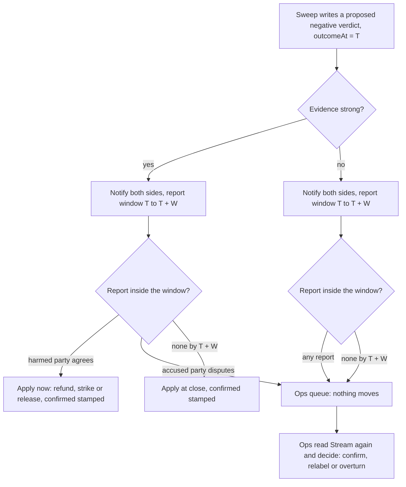

# ADR: A negative session outcome needs strong evidence, a participant report or an ops confirmation inside a report window

- **Status**: Accepted (2026-11-23); build-plan steps 1 to 4 of 5 are built, and step 5 is **(planned)**. The owner approved the four decisions in the section "Decided rules" as recommended, and four more for step 3 on 2026-11-24 (the addendum in the same section). Step 1 built the pure strong-or-weak judgement (`judgeOutcomeEvidence` in `lib/booking/outcome-evidence.ts`). Step 2 built the confirmed fact (`AppointmentOccurrence.outcomeConfirmedAt`), the stored announcement fact (`Meeting.attendanceCorroboratedSessionIds`), the earning gate for an unconfirmed `LEARNER_ABSENT`, the window-close pass, the needs-human entry for a weak closed verdict and the ops Confirm door. Step 3 built participant reports: the reason column `SupportCase.flowReason`, "I was there" on both sides, the session-scoped no-show case, the dispute and agreement classification (`lib/booking/outcome-reports.ts`), the report-aware window-close pass and the reported rows on the needs-human list. Step 4 built the consultation path and voids: the consultant no-show detector proposes instead of claiming, and the window-close pass or ops Confirm runs the no-show claim (cancel, full refund, strike) only on a confirmed proposal (`lib/booking/consultant-no-show.ts`); the 14-day void refund, the class exit right and the class reliability flag wait for a negative verdict's confirmation; and the pass reads every outage overlapping each booking with no row cap. The section "As built (steps 1 to 4)" describes all of it in the present tense. **Deviation, approved by the owner:** the 48-hour constant and the window-close pass moved from build-plan step 3 into step 2, because without a report path the pass is the only thing that confirms a verdict, and an unconfirmed `LEARNER_ABSENT` earning would otherwise be held for good. The notices and the corrected copy are unchanged, and everything in the design that is not described under "As built" is **(planned)**.
- **Date**: 2026-11-23
- **Author**: Platform engineering
- **Related**: issue #2996 "Negative session outcomes (forfeit, host refund + strike, void) need a report window or confirmation, not telemetry alone"; [Session outcomes from Stream's settled record](2026-11-22-session-outcomes-from-settled-stream-record.md) (where the evidence comes from); [Session outcomes](2026-09-25-session-outcomes.md) (the classifier rules and the make-up and refund per product); [Support intake and flows](../support/01-intake-and-flows.md); [Support money remedies](../support/05-money-remedies.md); [CFO and CSMO levers](2026-11-11-cfo-csmo-levers.md) (the 48-hour scope promise); [How payouts work](../finance/40-payouts/01-how-payouts-work.md)
- **Supersedes**: nothing. It adds a confirmation step after the verdict that the two records above decide.

## Context

### Why a settled record is still not the last word

The previous record made the session verdict depend on Stream's settled participant record, read once at least six hours after the room closed. That removed the fragile live mirror. It did not remove the possibility that the record is incomplete at the moment it is read. Stream does not promise webhook order or delivery, and its session statistics can lag. The settle step accepts a record only when every check in that record passes, but a session that Stream has not listed yet, and that no webhook announced, cannot fail a check, because nothing names it. Each review round of that build found another rare timing case of this kind. Because the verdict moves money directly, each one is a launch-blocking defect.

The key observation is about direction. The classifier only counts stays that the record contains. A missing stay can therefore turn a session that happened into a false _absence_ or a false _cut short_, but it can never invent presence. The errors that matter are all on the negative side, and that is where a confirmation step belongs. The positive verdict (`HELD`) can stay automatic. This is reasoning from how the classifier works, not a measurement; the section "Not verified here" says so.

### What each outcome does today

Every row below was read in code on 2026-11-23 and updated for build-plan step 2, so each row describes `dev` as it behaved with steps 1 and 2 built. Step 4 changed the consultation, void and class rows; "As built (steps 1 to 4)" describes them now. The outcome names are the `OccurrenceOutcome` values written by `decideSlotOutcome` in `lib/booking/session-outcome-sweep.ts`; `COMPLETION_FOR_OUTCOME` in `lib/booking/session-outcome.ts` maps each to a completion status. A note on vocabulary: the outcome `HELD` means the session took place. An _earning_ can also be `HELD`, which means a hold froze it (`lib/payments/payouts/earnings-holds.ts`). The two words are unrelated.

| Outcome                                                                            | Completion status                      | What moves, and when                                                                                                                                                                                                                                                                                                                                                                                                                                                                                                | Until when it can be undone                                                                                                                                                                                               |
| ---------------------------------------------------------------------------------- | -------------------------------------- | ------------------------------------------------------------------------------------------------------------------------------------------------------------------------------------------------------------------------------------------------------------------------------------------------------------------------------------------------------------------------------------------------------------------------------------------------------------------------------------------------------------------- | ------------------------------------------------------------------------------------------------------------------------------------------------------------------------------------------------------------------------- |
| `HELD`                                                                             | `COMPLETED`                            | No refund. The expert's earning matures after its hold: for a consultation, 48 hours after the end of the last live session (`PAYOUT_CONSTANTS.HOLD_PERIOD_HOURS`, `computeHoldUntil` in `lib/payments/payouts/earnings-hold.ts`), plus 3 days for a new expert (`withNewExpertHold`). `release-earnings` (every 15 minutes) then makes it `READY`, and the weekly payout batch pays it. An earning never matures while its session is still `SCHEDULED` (`UNDELIVERED_OCCURRENCE`).                                | Ops can overturn the verdict; an earning already paid out can only be clawed back.                                                                                                                                        |
| `LEARNER_ABSENT`                                                                   | `COMPLETED`                            | The learner forfeits the session: no refund. The sweep writes the verdict unconfirmed, and the expert's earning matures only once the verdict is confirmed (`UNCONFIRMED_LEARNER_ABSENT` in `RELEASABLE_PAYMENT`): by the window-close pass 48 hours after the verdict on strong evidence, or by ops; a counted dispute from the learner stops the pass from confirming it. On a subscription every tranche of the plan waits. The learner gets one bell and one email with a link to support (`stageNoShowBells`). | Until the earning is paid out, ops can overturn through `session.set-outcome` (`lib/backoffice/session-outcomes.ts`). A hold from a support case (`holdPaymentForCase`) freezes the earning until a payout is being sent. |
| `HOST_ABSENT`, a consultation                                                      | The sweep defers; the detector decides | The sweep leaves it to `detectConsultantNoShows` (`scripts/appointments/detect-consultant-no-shows.ts`, every 30 minutes). The detector settles the same record, and when the consultant has no stay on any judged call, it cancels the booking, refunds the full payment through the booking front door and records an expert strike, all in one claim. If the detector declines, the sweep parks the session `UNVERIFIED` after the four-hour handoff (`NO_SHOW_HANDOFF_MINUTES`).                                | Not after the refund is sent. A strike has no removal door: `lib/backoffice` and `app/api/admin` only read strikes.                                                                                                       |
| `CUT_SHORT` on any product, and `HOST_ABSENT` on any product except a consultation | `VOIDED`, attributed to the host       | The session is owed a make-up for 14 days (`MAKEUP_WINDOW_DAYS`); then `settle-cancelled-sessions` refunds the seat. An unsettled miss holds the booking's earnings (`EARNINGS_HOLDING_MISS`), except for a subscription. A class void also feeds the series reliability flag (`onClassSessionVoided`).                                                                                                                                                                                                             | Ops can un-void until a make-up exists or a refund moved (`assertUnvoidable`).                                                                                                                                            |
| `PLATFORM_OUTAGE`                                                                  | `VOIDED`, not attributed to the host   | A declared incident is settled by `settle-platform-incidents` with a remedy per learner. A void the classifier derives itself (a maintenance window, or everyone leaving together with no host end) follows the 14-day path above. No strike and no flag, because an outage is not the host's fault.                                                                                                                                                                                                                | Same as above.                                                                                                                                                                                                            |
| `NOBODY_JOINED`, `INCONCLUSIVE`, `OFFLINE`                                         | `UNVERIFIED`                           | Nothing. The session joins the ops needs-human list (`needsHumanWhere` in `lib/booking/misses.ts`) and its booking's earnings stay held (`AWAITING_HUMAN`) until ops decide. A session parked more than 7 days raises a standing finding (`escalateAgedNeedsHuman`).                                                                                                                                                                                                                                                | Ops decide.                                                                                                                                                                                                               |

Two facts follow from the table. First, only the consultation detector sends money out immediately and irreversibly, with no waiting period of any kind, and it is the only writer of a strike on the evidence of attendance alone. Second, a void already waits 14 days before any refund, so a void is protected from a wrong verdict by arithmetic as long as a human can overturn it inside that time. The gap there is narrower: nothing tells the learner or the host that the verdict can be disputed, and the host-attributed side effects (the class reliability flag) land at once.

A report channel existed before step 3 but was wired to no decision. The booking's "Get help" turn (`runSupportTurn` in `lib/support/service.ts`, reached through `POST /api/appointments/[appointmentId]/support`) offers a no-show flow to each side (`lib/support/flows.ts`). "The expert never showed up" escalates with the reason `provider_no_show`, "I couldn't get in" escalates as `attendee_join_issue` or `provider_join_issue`, and "the participant never showed up" is answered in the flow itself. Before step 3 the case that resulted carried the appointment, not the session: `runSupportTurn` passed no `appointmentOccurrenceId` to `createOrReuseSupportCase`, although `SupportCase` has that column, and the terminal's reason was kept only in the staff brief and on the analytics row (`SupportFlowOutcome`), not on the case. No sweep, detector or earnings job read a support case when it decided. Step 3 changed all of that for the window-close pass, which now reads the linked cases; since step 4 the consultation's refund runs only through that pass or ops, so the detector needs no case of its own.

### Worked example: before the build

This example is the behaviour before build-plan step 2. The notes marked "After step 2" and "After step 3" in variants 3 and 4 say what is different on `dev` now; the section "Worked example: with the proposal" is the full target.

Hannah is the expert and Priya the learner (both first names come from the seeded cast pool in `prisma/seedFiles/1a-create-users.ts`). Priya booked and paid ₹1,500.00 (150000 paise) for a one-hour consultation on Monday 23 November 2026, 10:00 to 11:00 IST. Hannah is past her new-expert period. Times after the call are illustrative, in the style of the previous record: the room closes about 11:05 IST, the slot pass first reads Stream at 17:15 IST (six hours past the room end), and runs every 30 minutes.

1. **Both attended.** Priya joins 09:58 and Hannah 10:02; both leave about 11:00. At 17:15 IST the outcome is `HELD`, the session `COMPLETED`, Priya's seat `ATTENDED`. Hannah's earning matures on Wednesday 25 November at 11:00 IST (48 hours after the 11:00 end), becomes `READY` at the next release run and is paid in the next weekly batch. Nothing moves for Priya.
2. **The expert is absent.** Priya joins 09:58 and waits until 11:00; Hannah never joins. The record settles at 17:15 IST and the classifier says `HOST_ABSENT` (60 minutes lost, far above the 15-minute void line). The sweep defers because this is a consultation. At the detector's next run, which can be the same half hour, it cancels the booking, refunds ₹1,500.00 (150000 paise) to Priya's original payment rail and records one strike on Hannah's private reliability record (`recordExpertStrike`). Both are told. Nobody was asked.
3. **The learner is absent.** Hannah joins at 10:02 and waits until 10:30; Priya never joins. At 17:15 IST the outcome is `LEARNER_ABSENT`, the session `COMPLETED`. Priya gets the "you did not join" bell and email. The earning for the session keeps maturing on Wednesday 25 November at 11:00 IST exactly as in the first variant. _After step 2:_ the earning does not mature at 11:00. Hannah waited 28 minutes (above the 15-minute void line), Priya has no stay and the settle stamp lists no corroborated session, so the evidence is strong. The sweep wrote the verdict unconfirmed at 17:15 IST, so the window closes on Wednesday 25 November at 17:15 IST. The first window-close pass after that confirms it, and the next `release-earnings` run (every 15 minutes) makes the earning `READY`. Nobody has to act, and the money moves a few hours later than before. _After step 3:_ if Priya says "I was there" on Tuesday 24 November at 12:00 IST (after the 11:00 booked end and before the window closes), that is a counted dispute. The pass leaves the verdict unstamped even after Wednesday 17:15 IST, Hannah's earning stays `PENDING`, and the session is on the needs-human list from Tuesday with a "Disputed by the learner" badge, until ops decide.
4. **Stream is ambiguous.** Hannah's app crashes at 10:04 after a four-minute stay (session A on the call). Stream's idle timeout closes A at 10:09. Priya joins at 10:12, and Hannah rejoins at 10:13; Stream starts a second session B on the same call, and the two hold the lesson until 10:58. Every webhook for B is lost, and at 17:15 IST Stream's session statistics list only A. Every readiness check passes on A alone: the record is final for the sessions Stream names, and no source names B. The classifier sees Hannah present for four minutes and Priya never, so it writes `LEARNER_ABSENT`. Priya is told she forfeited ₹1,500.00 for a session she attended. If she writes to support, ops can read Stream again (`session.reread-attendance`, until day 80), see B, and overturn to `HELD`. If she does not, the forfeit stands and Hannah is paid. Nothing in the design before step 2 distinguishes this case from variant 3. _After step 2:_ Hannah's four-minute stay is below the void line, so the evidence is weak. Hannah's earning stays `PENDING` from the first run, and on Wednesday 25 November, 48 hours after the verdict, the window-close pass writes nothing and the session joins the needs-human list. Hannah is not paid until ops decide. Priya is still not told (step 5), so the case reaches ops through the list or a support message; ops read Stream again, see session B and overturn to `HELD`; an ops write of a positive outcome carries no confirmation stamp. _After step 3:_ Priya can file the report herself from the booking's "Get help" ("I was there"); it is a counted dispute whenever she files it between 11:00 IST on Monday and the window close, so the row reaches ops with her statement attached. A report filed before the slot pass writes the verdict at 17:15 IST counts too, once the verdict exists.

## Peers

The model the issue cites is Preply. The following was read on the help pages on 2026-11-23, and two of the three URLs named in the issue now redirect to renamed pages, so the reading is paraphrased rather than quoted. Preply is not an Indian marketplace; it is cited as the reference the owner asked for, and the Indian search below is what the India-first rule requires.

- **A report button appears only after the lesson ends**, and "you have 72 hours after the lesson ends to report the absence or reschedule" (the tutor's page for a student who does not show up). After that the lesson auto-confirms and cannot be changed, and the tutor's earnings are added once it is confirmed ([a student does not show up](https://help.preply.com/en/articles/4178953-what-to-do-if-your-student-doesn-t-show-up)).
- **A tutor's absence must be reported before the lesson is confirmed.** The student first messages the tutor and waits 15 to 20 minutes, then reports after the scheduled time ends. A confirmed absence returns the lesson to the student's balance and the tutor is not paid, and "lessons are confirmed automatically if no issue is reported" ([the tutor did not join](https://help.preply.com/en/articles/4171553-my-tutor-is-absent-what-to-do-next), which now redirects to a page of that title).
- **A student who misses a lesson is treated as having had it.** A regular missed lesson is marked completed and the tutor is paid for the reserved time ([missed lessons](https://help.preply.com/en/articles/4934005-what-to-do-if-i-missed-my-lesson)).
- **Entering the classroom is the auto-confirm signal, and it shortens the wait.** Preply's auto-confirmation page says a lesson held in its Classroom is confirmed 15 minutes after the scheduled end, provided the Classroom was entered during the scheduled time, and a lesson held elsewhere is confirmed 72 hours after it; once confirmed and paid it cannot be reversed ([how auto-confirmation works](https://help.preply.com/en/articles/4179432-how-lesson-auto-confirmation-works)). So the issue's gloss needs one correction: the 72 hours are for lessons without platform attendance evidence. Where the platform saw people, Preply waits 15 minutes for the positive verdict.

Two lessons carry over. A positive verdict is confirmed quickly and automatically when the platform has its own attendance signal, and a negative claim is a claim that someone must make inside a fixed window. One difference matters: on Preply silence favours the payee, because an unreported tutor absence is simply paid. Our public copy for a missing consultant says the learner "doesn't need to request anything" (`lib/support/flows.ts`), so for strong evidence this design keeps the automatic refund. The owner's rule for weak evidence and silence is under "Decided rules", rule 2.

**India-first search.** On 2026-11-23 I looked for Indian tutoring or consultation marketplaces that publish a report window and did not find one. What was found: Filo's cancellation policy (the page names "Filo EdTech INC." and no country) gives a replacement or compensatory session, not cash, for a tutor no-show, treats a late-cancelled lesson as a student no-show with no replacement, and sets a four-hour cancellation deadline but no report window for tutor problems ([Filo cancellation policies](https://askfilo.com/cancellation-policies)). Wiingy's tutor policy page pays a tutor a fixed ₹300 through a claim form when a demo class is cancelled in stated night-time hours; it says nothing about learner or tutor reports ([Wiingy tutor policies](https://sites.google.com/wiingy.com/wiingy-tutor-portal/policies)). Neither company's operating country was checked. Treat both as weak evidence that Indian marketplaces lean on a replacement session and a support case rather than a stated window, and the Preply model as a US fallback.

## Decision **(steps 1 to 4 built; the notices planned)**

The two-kind split, the strong-evidence conditions, the 48-hour window, the window-close pass, the earning gate for an unconfirmed `LEARNER_ABSENT`, the needs-human entry, the ops confirmation, the participant report and its dispute and agreement paths , the detector's propose-then-claim, the void exclusion and the class flag's wait are built; section "As built (steps 1 to 4)" lists them. The corrected refund copy and every notice below are **(planned)**.

### 1. Two kinds of verdict

A **positive verdict** (`HELD`) stays automatic and unchanged. Missing evidence cannot produce it, the earning's existing hold already waits 48 hours after the session, and the existing quality flow lets a learner raise a problem inside that time (rule 4).

A **negative-money verdict** is one that moves money or a reliability record the wrong way if it is mistaken and attributes the miss to a person: `LEARNER_ABSENT` (the expert's earning is paid for a session the learner may have attended), `HOST_ABSENT` (a consultation refund and strike, or a void attributed to the host) and `CUT_SHORT` (the same attribution). `PLATFORM_OUTAGE` is outside the gate: it attributes nothing to anyone, a declared incident is already an ops decision, and a classifier-derived void is refunded only after 14 days, during which ops can un-void it. Either side can still use the report path against a void. `NOBODY_JOINED`, `INCONCLUSIVE` and `OFFLINE` already park for ops. A negative-money verdict is written by the sweep as today, with its time in `outcomeAt`, but it is **proposed**, and its money effect waits for a confirmation.

### 2. What counts as strong evidence

Evidence is **strong** for a negative verdict about person P, with Q the counterpart, only when all of these hold. The readiness checks that Stream's record passed are not enough on their own, because they cannot see a session nobody named.

1. The record was accepted because Stream **announced every session ready** (`call.stats_report_ready`, stored in `Meeting.streamReportReadySessionIds`). A session accepted only by corroboration, which the previous record allows so that a lost announcement cannot strand a held session, is weak.
2. **P has no stay at all** anywhere in the snapshot, on any call of the occurrence, inside or outside the booked window. This is stricter than the classifier, which looks only from 15 minutes before the start to 30 minutes after the end.
3. **Q was in the room for at least the void line** of the booked window, that is `min(15 minutes, half of the booked length)` (`VOID_LOSS_MINUTES`). A host who stayed four minutes is not a host who waited. For `CUT_SHORT` only conditions 1 and 4 apply: the host has stays in the record, and the learner's presence is part of the loss rule itself.
4. **No maintenance window and no incident overlapped** the booked time, which the classifier already treats as doubt for `HOST_ABSENT`.

Evidence that fails any of these is **weak**. Strong evidence reduces the chance of a wrong verdict; it cannot remove it, because condition 1 still cannot name a session Stream never listed. That is why strong evidence decides the default when nobody reports, and is not by itself a licence to move money at once (rule 3).

Whether the evidence is strong is a pure function of the stored snapshot plus one readiness fact, whether any session was accepted on corroboration. The settle step stores that fact with its stamp as `Meeting.attendanceCorroboratedSessionIds` (written in the same compare-and-set as `attendanceSettledAt` in `lib/meetings/settle-attendance.ts`), because the presence rows do not carry the Stream session id and `streamReportReadySessionIds` keeps growing after the settle. An empty list counts as every session announced. `judgeOutcomeEvidence` sits beside `classifySessionOutcome`, which stays pure and unchanged.

### 3. The window, who may report, and how

- **Length and start.** A report window of `W` hours starts when the verdict is written (`AppointmentOccurrence.outcomeAt`), not at the booked end, because a person cannot dispute a verdict they have not seen, and the settle step can take from 6 to 72 hours after the room closes. `W` is 48 hours (rule 1). It is the constant `OUTCOME_REPORT_WINDOW_HOURS` in `lib/booking/misses.ts` (`reportWindowClosesAt` adds it to `outcomeAt`), with no environment variable, as the repository rules require, and it must stay at or below `HOLD_PERIOD_HOURS.CONSULTATION`. **A report counts from the booked end of the session to the window close**, not only after the verdict (rule 7): a person who writes at 12:00 IST about a session that ended at 11:00 IST is heard even though the verdict is written hours later. A report filed before the booked end or after the window closes is recorded and changes nothing.
- **Who can report.** A learner seat holder of that booking, and the host side (the plan's consultant and accepted collaborators). The reporter must be on the side the reason belongs to: a host-side reason counts only from a host, a learner-side reason only from a live learner seat holder who is not a host (`countedEffect` in `lib/booking/outcome-reports.ts`). An organisation operator who opens a case for a sponsored seat is an ordinary support case (ownership scope `ORG_OPERATIONS`) and goes to ops without any effect on the verdict.
- **Where.** A report is about one ended session, chosen before the report opens. Each ended session on the booking page carries "Report a problem with this session", which opens the support request page for that session (`?intent=NO_SHOW&occurrence=<id>`, built by `sessionReportHref` in `lib/support/report-link.ts`). The booking's "Get help" offers the report too: with one ended session it opens on that session, with several it first asks which one, listing them by date and time in the viewer's zone, and with none the report is not offered (the no-show flows need `reportSessions` in `lib/support/context.ts`). The route (`app/api/appointments/[appointmentId]/support/route.ts`) refuses a report on a session that is not this booking's, is deleted, cancelled or rescheduled, or has not ended. `createOrReuseSupportCase` then receives that session, so a report is a `SupportCase` of its own on the scope `OCCURRENCE:<id>` (`lib/support/case-service.ts`), one open report per person, session and category. A no-show case is never booking-wide, and its reason is stored only while it is linked to a session that has ended. **No new report table.** A reminder or link in a notice, and the deadline shown in the person's own zone, are **(planned)** (step 5).
- **What a report is.** A case on that session whose `flowReason` classifies it (`REPORT_EFFECT` in `lib/booking/outcome-reports.ts`), filed by a person named above and answered inside the counted period (`SupportCase.flowReasonAt`, the time the person reached the reason, not the time the case was opened):
  - a **dispute** comes from the party the verdict is against: for `HOST_ABSENT` and `CUT_SHORT` the expert's "I couldn't get in" (`provider_join_issue`) or "I was there" (`provider_attended`), and for `LEARNER_ABSENT` the learner's "I couldn't get in" (`attendee_join_issue`) or "I was there" (`attendee_attended`);
  - an **agreement** comes from the party the verdict benefits and is harmed by the other's absence: the learner's "the expert never showed up" (`provider_no_show`), against `HOST_ABSENT` and `CUT_SHORT`. No reason agrees with `LEARNER_ABSENT`.
    Every other reason is neutral. A report from the party who gains nothing, such as the expert saying the learner never came (`attendee_no_show`, which the flow answers itself), is recorded and changes nothing. Any counted dispute outweighs any number of agreements (`judgeReports`). **A report can speed up or block a verdict. It can never create one.**
- **What counts as an ops confirmation.** An ops decision through the existing outcome door (`session.set-outcome`, surface `classSeries.support`, a reason required, one audit row), or the "Confirm" action beside "Read from Stream again" on the needs-human list (`session.confirm-outcome`, same surface). A verdict that ops write themselves is confirmed at that moment and needs no window. The two doors are separate because giving a session the outcome it already has goes through `relabel` in `lib/backoffice/session-outcomes.ts`, which writes `outcomeAt` again and would restart the window; Confirm sets only `outcomeConfirmedAt` and leaves `outcomeAt` alone.

### 4. What happens

| Evidence | A participant reports                                | Nobody reports    | Result                                                                                                                                             |
| -------- | ---------------------------------------------------- | ----------------- | -------------------------------------------------------------------------------------------------------------------------------------------------- |
| Strong   | The harmed party agrees (`HOST_ABSENT`, `CUT_SHORT`) | n/a               | **Apply at once.** The verdict and a human agree, so the refund and the strike do not wait for the rest of the window.                             |
| Strong   | The accused party disputes                           | n/a               | **Ops queue.** Nothing moves. Ops read Stream again and decide. The verdict stays unconfirmed after the window closes, so no pass ever applies it. |
| Strong   | None                                                 | The window closes | **Apply at close.** This is the automatic path, and it is the default for strong evidence.                                                         |
| Weak     | Either side                                          | n/a               | **Ops queue.** Ops read Stream again, see both statements and decide.                                                                              |
| Weak     | None                                                 | The window closes | **Ops queue, nothing applied** (rule 2). It reuses the doubtful-verdict rule of the previous record: a doubtful verdict never moves money.         |

"Apply" means the existing remedy runs and nothing about it changes: for a consultation the detector's claim (cancel, full refund through `driveRefundOwed`, `recordExpertStrike`); for a void the 14-day path; for `LEARNER_ABSENT` the expert's earning is allowed to mature. What changes is **when** and **on what basis** it is allowed to run. Money consumers read one fact, "this negative verdict is confirmed", and treat an unconfirmed one the way they already treat a parked session.

Steps 3 and 4 built this table. A strong, agreed or closed and undisputed verdict is confirmed by the window-close pass; a disputed or weak one is left unconfirmed and listed for ops, whichever side reported and whenever inside the counted period. Confirming applies the remedy: a consultation's proposed `HOST_ABSENT` is confirmed by the no-show claim itself, which in one transaction cancels the booking, records the strike and records the full refund as owed; the refund itself runs after that commit and can fail while the cancellation stands, and the owed marker then keeps it for the retry sweep; a void becomes refundable 14 days after its confirmation; a class void starts to count toward the exit right and the reliability flag; and a `LEARNER_ABSENT` earning may mature. A counted dispute holds each of them until ops decide.

### 5. Money, holds and the existing waits

- **Refunds.** A consultation's refund is no longer written at the detector's first run. The detector classifies as before and, instead of claiming, writes the proposed verdict: every judged session `UNVERIFIED` with the outcome `HOST_ABSENT` (a booking with a session of any other outcome is not proposed), `outcomeAt` now and a null `outcomeConfirmedAt`, the state the sweep already used for a consultation the detector declined, which `AWAITING_HUMAN` counts. Confirming it runs the no-show claim (`claimNoShowTx` in `lib/booking/consultant-no-show.ts`) under the same idempotency key, `consultant-no-show:<paymentId>`, with one refund per payment. A void's refund is 14 days out; the settle sweep leaves out any void whose negative verdict is unconfirmed (`SETTLEABLE_VOID_VERDICT`), so a weak or disputed void is never refunded without a human, while a strong, silent one is confirmed at 48 hours and refunded 14 days after that confirmation.
- **Payout holds.** Mature earnings are released by `release-earnings`, which filters on `RELEASABLE_PAYMENT` in `scripts/earnings/release-earnings.ts`. An unconfirmed `LEARNER_ABSENT` is one more predicate there (`UNCONFIRMED_LEARNER_ABSENT`, built), beside `EARNINGS_HOLDING_MISS` and `AWAITING_HUMAN`: **the earning stays `PENDING`, never `HELD`**, so there is no hold row to release and no state to repair. When the verdict is confirmed or the window closes strong and silent, the earning matures at the next run. Because the hold constant (48 hours from the session end) is shorter than the verdict plus `W`, this predicate is what actually delays release, not the constant.
- **The 72-hour park.** If Stream cannot be read for 72 hours past the booked end, the sweep still parks the session `INCONCLUSIVE` and moves no money (`ATTENDANCE_SETTLE_WAIT_MS`). That path is untouched and has no window: no verdict exists to dispute. When ops later read Stream again and write the outcome, it is an ops verdict and is confirmed at once.
- **Strikes stay private.** A strike is a `SystemEvent` on `expert-reliability:<consultantProfileId>`, readable only through `readOwnStrikes` (the expert's own dashboard card) and `readExpertStrikeReview` (the ops list), and it is never on a public page (`EXPERT_STRIKE_THRESHOLD` carries that rule). The design keeps both properties. The strike is written only when the verdict is confirmed, in the same transaction as the cancel and the owed refund, so a disputed, overturned or never-confirmed proposal leaves no strike behind. No notice to the learner mentions a strike, and the learner learns only whether the refund was sent. The expert's notice says what the existing cancel line says: that the record "only you and our team see".
- **Notices.** The three notices already exist: the learner's no-show bell and email (`SESSION_NO_SHOW`), the host's cancellation bell and the refund-processed bell. The proposal changes their wording and payload, and adds one: a proposed verdict tells **both sides** what the platform recorded, the date the window closes in their own zone, what happens if nobody replies, and the link to report. The Novu plan caps an environment at 20 workflows and each is a family, so these are new _events_ in an existing family, not new workflows (see [Notification workflows](../notifications/02-workflows-and-api.md)).

### Worked example: with the proposal

This is the full target design. Built are the earning gate in variant 3, the weak path in variant 4, the report paths and the consultation proposal in variant 2, with its refund and strike at the close or on Priya's agreement. The notices and the Confirm link in a notice are **(planned)**: until step 5 neither side is told of the proposal, so Priya's early agreement needs her to open the session's report herself.

Same cast, same booking. The window is 48 hours from the verdict, and the confirmation pass runs inside the slot pass every 30 minutes. All times IST, after the verdict at **Monday 23 November, 17:15**.

1. **Both attended.** Unchanged. `HELD` at 17:15, earning matures Wednesday 25 November 11:00. No window, no notice beyond today's.
2. **The expert is absent, strong evidence.** Priya waited the whole hour, Hannah has no stay on the call, every session was announced ready, no maintenance. At 17:15 the session is `UNVERIFIED` with proposed `HOST_ABSENT`. Priya is told "Hannah did not join. We will refund ₹1,500.00 (150000 paise) automatically after **Wednesday 25 November, 17:15 IST**, or sooner if you confirm", with a Confirm link. Hannah is told privately that the platform recorded that she did not join, and until when she can reply. Nothing is refunded and no strike exists.
   - _Priya confirms at 18:00._ The pass applies at once: cancel, refund ₹1,500.00, strike.
   - _Hannah writes in on Tuesday 24 November, 09:00: "my app crashed and I rejoined."_ Nothing is applied. Ops read Stream again, see the later session, and overturn to `HELD`. Hannah is paid, Priya is told, and no strike was ever written.
   - _Nobody writes._ At **Wednesday 25 November, 17:15** the pass applies the refund and the strike. The money moves 48 hours later than today, and only in the case that is also protected by the strongest evidence.
3. **The learner is absent, strong evidence.** Hannah waited 28 minutes, Priya has no stay. The session is `COMPLETED` with `LEARNER_ABSENT` at 17:15, as today, but Hannah's earning is not allowed to mature before the window closes. Priya's notice names the date, **Wednesday 25 November, 17:15 IST**, and the link. Silence from Priya: the earning matures at the next release run after that. A dispute from Priya: the earning stays `PENDING`, ops decide.
4. **Stream is ambiguous.** Hannah waited four minutes (below the 15-minute void line), so the evidence is **weak**. The verdict is proposed, both sides are told. If Priya reports on Tuesday, ops read Stream again, find session B, and overturn to `HELD`; no money ever moved wrongly. If nobody reports, the verdict goes to the ops queue on Wednesday at 17:15 and nothing is applied until a person decides. Today's design forfeited ₹1,500.00 on the spot.

## Decided rules

The owner decided these four on 2026-11-23. Each is a rule of the design above; the options that were rejected are recorded under "Deprecated & Superseded Approaches".

1. **The window is 48 hours.** It starts when the verdict is written (`outcomeAt`) and is a constant in code, so a person has at least 54 hours after the session. It matches the public 48-hour scope promise and the consultation earnings hold (`HOLD_PERIOD_HOURS.CONSULTATION`), so no payout constant changes. Any later change to 72 hours must raise that hold in the same pull request, so a claim never outlives it.
2. **Nobody reports and the evidence is weak: send it to ops and apply nothing.** The session joins the needs-human list, its earning stays held, and ops decide after reading Stream again. The existing queue already alerts at 72 hours and escalates at 7 days (`NEEDS_HUMAN_ALERT_HOURS`, `NEEDS_HUMAN_ESCALATE_DAYS`). This is the previous record's rule that a doubtful verdict never moves money.
3. **Strong evidence is exactly the four conditions in "What counts as strong evidence", and it covers `HOST_ABSENT`, `CUT_SHORT` and `LEARNER_ABSENT`.** Strong and silent applies when the window closes; strong with an agreeing report from the harmed party applies at once; anything else goes to ops. `PLATFORM_OUTAGE` stays automatic. A report can speed up or block a verdict and can never create one.
4. **A `HELD` outcome gets no new dispute door.** A learner who says a held session was not delivered uses the existing quality flow (`QUALITY_COMPLAINT`, offered after the session), which opens a case, and ops can place a support-case hold on the unpaid earning by hand (`holdPaymentForCase`) and recommend a refund. The 48-hour earning hold plus the weekly payout batch usually leave time, and a hold works until a payout for that payment is being sent. The plan was to pass the session on every "Get help" turn so such a complaint is a typed case attached to the session; step 3 passes it only on a no-show turn, so a quality complaint is still a case on the booking, and attaching it to the session is **(planned)**. Freezing the earning automatically on a report stays a **post-launch trigger**, to be revisited if ops see learners losing disputes to the weekly batch; it needs abuse limits that are not designed yet.

### Addendum, 2026-11-24: four decisions for step 3

The owner decided these four when step 3 was built. They refine rules 1 to 4 and change none of them.

5. **The reason is stored in a column.** `SupportCase.flowReason` holds the reason of the flow terminal the person reached, validated by `SupportFlowReasonEnum` (`schemas/enums.ts`), so the window-close pass reads one column of the linked case and never parses a transcript or a brief. It is written at a `NO_SHOW` terminal only. A reason fills an empty column or replaces one that counts for no verdict, so a later "I was there" is not lost behind a neutral first answer; a reason that counts (one in `CLASSIFIED_REPORT_REASONS`) is never replaced, so a person cannot turn a dispute into an agreement or back.
6. **"I was there" exists on both sides.** The attendee flow offers `attendee_attended` and the provider flow `provider_attended` (`lib/support/flows.ts`). Each escalates, and each is the accused side's dispute, so a learner marked absent and an expert marked absent have the same one-tap way to say the record is wrong.
7. **A report counts from the booked end to the window close.** The counted period is `AppointmentOccurrence.endsAt` to `outcomeAt` plus 48 hours, measured on when the reason was answered (`SupportCase.flowReasonAt`), not only the time after the verdict, so a person who writes before the sweep has written its verdict is still heard (the section "The window, who may report, and how").
8. **A no-show report is its own case on its session.** A turn that picks the no-show intent opens or reuses a case on the scope `OCCURRENCE:<id>` with the category `NO_SHOW` and does not reuse the booking's other open thread, so one conversation about a payment never carries a no-show reason and a second session of the same booking gets its own report. An organisation operator's turn keeps the old booking thread (it never counts toward a verdict).

### Addendum, 2026-11-24: the class exit waits for a verdict

9. **A learner's class exit waits while any void in the series has an unconfirmed negative verdict.** The exit refunds every undelivered session at full price, and a void whose `CUT_SHORT` or `HOST_ABSENT` verdict may yet be overturned to `HELD` is not known to be undelivered. Excluding that session from the quote would lose it if the verdict is later confirmed, because an exited seat is released and the 14-day sweep refunds only live seats. So the exit door (`planSeriesExit` in `lib/booking/seat-leave.ts`) refuses with 409 `EXIT_WAITS_FOR_VERDICT` and a sentence naming the session and when its window closes (`outcomeAt` plus 48 hours) in the learner's zone, for example "We're confirming what happened in your 12 Nov session; you can leave the series once that's settled (by 14 Nov, 5:15 pm IST)". The booking page shows the same sentence in place of the exit action. Once the verdict is confirmed or relabelled, the exit runs as before and its quote is exact. The wait covers every such void in the series, including one that predates the learner's seat, so the page and the door always agree.

10. **Every class remedy waits for a pending void verdict** (2026-11-24). The series exit was the first door; an ordinary leave, the host's whole-class cancel and a make-up skip priced or refunded the same unconfirmed void. One gate now serves them all: `UNCONFIRMED_NEGATIVE_VOID` in `lib/booking/misses.ts` and its in-memory twin `pendingVoidVerdict` in `lib/booking/pending-void-verdict.ts`, read through `pendingVoidRefusal` (`lib/booking/pending-void-gate.ts`) under each door's own lock and transaction, with the sentence in the reader's zone. An ordinary leave refuses with 409 `EXIT_WAITS_FOR_VERDICT` like the exit, and its dialog shows the sentence. The host's whole-class cancel, and its preview, refuse with 409 `CANCEL_WAITS_FOR_VERDICT` naming the session and the window's close in the host's zone, and the cancel dialog shows it with the action disabled; a single future-session cancel is unaffected. A paid consultation's cancel and its preview wait on the same gate, for the learner, the expert and staff, with the consultation's own sentence (`cancelBooking` in `lib/booking/pending-void-verdict.ts`); once the verdict is confirmed that cancel pays the voided session in full and settles it. The slot pass writes a void under the same appointment lock these doors hold (`underAppointmentLock` in `lib/booking/session-outcome-sweep.ts`), bounded by the run's time left, so a negative void cannot commit between a door's check and its refund; a session whose lock cannot be had is deferred to the next run (`appointment-busy`), never failed. Its completed and parked writes, and the window-close pass's stamp, take no lock: they cannot make a void pending. A host may still offer a make-up for a pending void, because no money moves, but the skip's refund rechecks the source session under the appointment lock that ops' outcome door takes and refuses with 409 `MAKEUP_SKIP_WAITS_FOR_VERDICT` while it is pending; once confirmed it refunds once under its key, and a source ops relabelled held is no longer a miss to skip. The 14-day settle and plan-end paths read the same predicate (`SETTLEABLE_VOID_VERDICT` is its complement). The hold applies only where money would move (decided 2026-11-24): a seat carries money unless its order is price-free (`seatCarriesMoney` in `lib/booking/pending-void-gate.ts`, so a credit- or wallet-funded seat counts), a free seat leaves or exits at once, and the host's whole-class cancel holds only while any seat carries money (`anySeatCarriesMoney`). Ops cancel-series and moderation cancellation stay ungated: they run while a void is pending, and their quote treats the pending session as undelivered. A make-up offered for a pending void stays reversible (decided 2026-11-24): when ops restore the original to `HELD`, or any outcome that is not a miss, through `session.set-outcome`, the same locked correction cancels the unstarted make-up (`cancelUnstartedMakeUp` in `lib/booking/class-sessions.ts`, by CAS, tombstoned, no refund, one live row left for the ordinal) and tells the seat holders and the team with the plain class-session-cancelled bell; a make-up that has started or been held still refuses the correction. A skip reads the seat, the payment and the make-up under the appointment lock and compares the make-up's start with the time then, so a skip whose wait crosses the start refuses with `MAKEUP_NOT_SKIPPABLE`.

## Consequences

- **A negative verdict takes up to 48 hours longer to take effect.** For the strong, silent case that is 48 hours after the verdict, the price of the guarantee that a rare Stream timing case can only delay money.
- **Four additive columns and one index, all built in the schema.** `AppointmentOccurrence.outcomeConfirmedAt` is a nullable stamp, set once from null by the window-close pass (on an agreeing report it does so before the window closes) or the ops doors. It earns its place because three jobs (`release-earnings`, the detector's confirmation pass and `settle-cancelled-sessions`) must read one fact, and deriving it from `outcomeAt`, the window and the support case table would repeat a join in each of them. It is not written for `HELD` and the positive outcomes. `Meeting.attendanceCorroboratedSessionIds` is a string list defaulting to empty, written with `attendanceSettledAt`; the owner decided to store it. `SupportCase.flowReason` is a nullable `VARCHAR(64)` that carries a no-show terminal's reason (decision 5), and `SupportCase.flowReasonAt` is the time that reason was answered, because a case opened inside the window can be answered after it closes, and a case opened before the session ended can be answered after it; the same step adds an index on `SupportCase.appointmentOccurrenceId`, because the window-close pass and the needs-human read look cases up by session. All of them are schema changes, so the owner applies them with `db push` before the schema freeze ([the freeze plan](../prisma/02-schema-freeze-and-migration-cutover.md)); no sidecar is needed, because no trigger or constraint reads them (the index is a plain Prisma `@@index`, not a partial one, so `db push` keeps it).
- **Code areas touched by steps 1 to 4.** `lib/booking/outcome-evidence.ts`, `lib/booking/misses.ts` (the constants, `UNCONFIRMED_LEARNER_ABSENT` and `needsHumanWhere`), `lib/meetings/settle-attendance.ts`, `lib/booking/session-outcome-sweep.ts` (the unconfirmed write and `confirmClosedOutcomes`), `scripts/appointments/auto-complete-appointments.ts` (the window-close pass, inside the existing job, so no new registry entry or twin route), `scripts/earnings/release-earnings.ts`, `lib/backoffice/session-outcomes.ts`, `app/api/admin/sessions/[occurrenceId]/confirm/route.ts` and `SessionOutcomesCard` with `ConfirmOutcomeDialog`. Step 3 added `lib/booking/outcome-reports.ts` (the classification), `lib/support/service.ts` (the session-scoped case and `recordFlowReasonTx`), `lib/support/flows.ts` and `lib/support/context.ts` (`reportSessions`, `reportOccurrenceId` and the host side from `sessionHostUserIds`), `lib/support/shown-thread.ts` (`readShownThread`), `lib/support/report-link.ts` (`sessionReportHref`), `schemas/support.ts` (`SupportTurnSchema`, `SupportThreadQuerySchema`) and `schemas/enums.ts` (`SupportFlowReasonEnum`), the appointment support route, the support request pages (`?occurrence=`) with `useSupportThread` and `SessionConversation`, the per-session report entry on the booking page, and the report badges in `SessionOutcomesCard`. Step 4 added `lib/booking/consultant-no-show.ts` (the no-show claim, moved out of the detector), and changed `scripts/appointments/detect-consultant-no-shows.ts` (it proposes), `lib/booking/misses.ts` (`PROPOSED_CONSULTANT_NO_SHOW`, `confirmableNoShowWhere`, `SETTLEABLE_VOID_VERDICT`), `scripts/appointments/settle-cancelled-sessions.ts` (the cohort's exclusion), `lib/booking/class-series.ts` and `lib/booking/class-sessions.ts` (the series ledger and `onClassVoidConfirmed`), `lib/booking/session-outcome-sweep.ts` (the pass's no-show and class-void branches and `readOverlappingOutages`) and `lib/backoffice/session-outcomes.ts` (Confirm on a proposal). **Still planned:** the corrected flows copy, the no-show notices and `docs/notifications/`.
- **One rule is deliberately unchanged:** a doubtful verdict never moves money, a refund is keyed so it cannot be sent twice, and every status write still goes through the CAS helpers in `lib/booking/transitions.ts`.
- **A product promise to correct.** The flows copy for a missing consultant ("an automatic full refund", the `expert` terminal of the attendee no-show flow in `lib/support/flows.ts`) is unchanged and, since step 4, overstates the speed: the refund follows the window unless the learner confirms sooner. Step 5 changes it.

### As built (steps 1 to 4)

This subsection is the present-tense description of what `dev` does with steps 1 to 4 merged. Everything else in the "Decision" section is planned.

- **The confirmed fact.** `AppointmentOccurrence.outcomeConfirmedAt` is null until a negative verdict (`NEGATIVE_MONEY_OUTCOMES` in `lib/booking/misses.ts`: `HOST_ABSENT`, `CUT_SHORT`, `LEARNER_ABSENT`) is confirmed. The slot pass (`writeSlotOutcomeTransaction` in `lib/booking/session-outcome-sweep.ts`) writes every verdict with a null stamp. A row decided before the column existed also has a null stamp and is judged by the window-close pass like any other.
- **The announcement fact.** `Meeting.attendanceCorroboratedSessionIds` is written by the settle stamp and read by the window-close pass; a room that never settled has no announcement record, so its evidence is weak.
- **The earning gate.** `UNCONFIRMED_LEARNER_ABSENT` in `lib/booking/misses.ts` matches a live occurrence with outcome `LEARNER_ABSENT` and a null stamp, on any booking. The gate is payment-level, so on a subscription every dated tranche of the plan and the host organisation's earning wait while any one session's learner absence is unconfirmed (decided 2026-11-25), the way `AWAITING_HUMAN` already holds the whole plan; a subscription's misses still do not hold it (`EARNINGS_HOLDING_MISS`). `RELEASABLE_PAYMENT` in `scripts/earnings/release-earnings.ts` requires that none match, so `release-earnings`, its idle probe and `releaseSponsorTrustPark` (which reuses the constant) all leave the earning `PENDING`. Since step 4 the claim, the void refund and the class series read the stamp too (below).
- **The window-close pass.** `confirmClosedOutcomes` in `lib/booking/session-outcome-sweep.ts` runs inside `auto-complete-appointments` before the stale-queue alerts. It owns its candidate predicate, `confirmableVerdictWhere(now)`, and the ticker's idle probe (`hasAutoCompleteWork`) wakes on the same one. A candidate is a consultation's proposed no-show (`confirmableNoShowWhere`, below) or an applied negative verdict (`COMPLETED` or `VOIDED`) with a null stamp that is either **closed** (`outcomeAt` more than `OUTCOME_REPORT_WINDOW_HOURS`, 48, old: `unconfirmedClosedVerdictWhere`) or **agreed** (`AGREED_VERDICT` in `lib/booking/misses.ts`: a `HOST_ABSENT` or `CUT_SHORT` verdict with a linked, undeleted, non-organisation case whose reason agrees with it). The pass reads candidates newest first, at most three pages of 100 per run, with the linked cases and the parties of the booking. For each row `judgeReports` returns `disputed`, `agreed` or `silent`. A **disputed** row is counted in the run's `disputed` and never stamped, even after its window closed. A row whose window is still open is stamped only when the result is `agreed`. Every other row is judged by `judgeOutcomeEvidence` on the stored snapshot: a strong verdict is stamped by its own compare-and-set that re-checks the candidate predicate, the outcome, the null stamp and the absence of a dispute in that verdict's window (see "A report that lands during the stamp"), so an ops relabel in between wins, and a weak verdict writes nothing and is counted as `weak`. The run's log line reads "Negative verdicts: N confirmed, W weak and D disputed left for ops".
- **The needs-human list.** The list is `needsHumanWhere(now)`, a function of the time rather than a constant, and it combines `AWAITING_HUMAN`, the voided paid trial, `unconfirmedClosedVerdictWhere` and `REPORTED_VERDICT`. The last matches an applied, unconfirmed negative verdict that has a linked, undeleted, non-organisation case with a reason that disputes or agrees with that outcome (`classifiedReasons`), at any time inside or after the window. It is a coarse database filter: whether a report counts (the reporter's side, the counted period) is judged per row when the page is read. `readSessionsNeedingHuman` adds one batched case read for the page's negative verdicts (`readPageReports`), and each row carries `reports`, the counted ones oldest first, as `{ caseId, side, reason }`. A weak closed verdict, a disputed one and a reported one therefore appear on "Sessions that need a decision", and the 72-hour alert and 7-day escalation count from `outcomeAt` as for any other row. `SessionOutcomesCard` shows a badge in the reason cell for the first counted dispute ("Disputed by the expert" or "Disputed by the learner") and the first counted agreement ("Learner agrees"), each linking to its case.
- **Ops writes.** `session.set-outcome` stamps a negative outcome confirmed at that moment and clears the stamp for any other outcome. **Expert absent on a consultation always has a remedy and always records the strike** (decided 2026-11-24 and 2026-11-25). When an operator sets `HOST_ABSENT` on a consultation's session and every live session of the booking is expert absent, the door does not void it: in its own transaction it parks the session as the unconfirmed proposal (from `UNVERIFIED` with any outcome, or from `COMPLETED`) and runs the same claim as Confirm and the window-close pass (`claimNoShowTx`: cancel, full refund owed, strike), then drives the refund after the commit (`decideConsultationNoShow` in `lib/backoffice/session-outcomes.ts`). The operator's verdict is their own, so the stored presence is not asked (`judgeNoShowClaim` by `operator`); the claim's compare-and-set is unchanged. Where the whole-booking cancel does not fit, the door treats that one session as missed instead: it voids it through its ordinary void path (both stamps at the same instant, so the 14-day make-up window starts now and `settle-cancelled-sessions` refunds it on day 14) and writes the strike in the same transaction (`recordExpertStrike`). That covers an unpaid booking (nothing is refunded and no owed marker is written; the sweep finds no payment and settles the session), a booking that is no longer `APPROVED` and whose only session this is (for example auto-completed), and a session that is already `VOIDED`, which is relabelled expert absent. **A paid consultation whose only session this is, completed or still approved, is refunded in full at once** (decided 2026-11-25): a consultation has no make-up to wait for. In the door's transaction the full refund is stamped owed under `expert-absent:<occurrenceId>:pay:<paymentId>` (`oweSessionNoShowRefundTx` in `lib/booking/consultant-no-show.ts`), a key neither the whole-booking claim nor the day-14 sweep uses, and the void is stamped `seatsSettledAt`, so the sweep's cohort never holds it and the owed marker, not the miss, holds the earning; the refund is driven after the commit and the learner is told (`settleSessionNoShowRefund`). The booking is not cancelled. An earning already released is reversed by the refund cascade (`applyRefundCascade`): a `READY` row becomes `REFUNDED` and is never paid, and a paid one is clawed back. A booking that is `CANCELLED` keeps what its cancel paid: the door voids and strikes and owes nothing more. The strike is written once per session: the void or relabel is a compare-and-set on the status, outcome and stamp the door read, and a session read as already confirmed expert absent writes none. No strike is written inside a declared incident or a maintenance window (`NO_SHOW_DURING_OUTAGE`, on either remedy). Three refusals remain, each naming why and what to do: `NO_SHOW_SIBLING_SESSION` (another session is parked or not yet judged; decide it first, and if the expert was absent there too the whole booking is cancelled), `NO_SHOW_OTHER_SESSIONS_STAND` (a paid booking with other sessions that stand: a voided consultation session is refunded as the whole payment on day 14, so one session cannot be voided alone until a per-session share exists; refund the share through the support case) and `NO_SHOW_NOT_CLAIMABLE` (no expert or learner on record). A class, webinar or subscription session keeps the void path. The dedicated door `session.confirm-outcome` (`POST /api/admin/sessions/[occurrenceId]/confirm`, surface `classSeries.support`, `confirmSessionOutcome` in `lib/backoffice/session-outcomes.ts`) takes the outcome the operator saw, locks the appointment and updates only where that outcome and a null stamp still hold, so `outcomeAt` keeps its time; it refuses a non-negative outcome (`OUTCOME_NOT_CONFIRMABLE`) and a changed session (`SESSION_MOVED`). The needs-human row carries `canConfirm` for an applied, unconfirmed negative verdict and for a consultation's proposed no-show (any other parked `UNVERIFIED` row is decided through set-outcome), and `SessionOutcomesCard` shows Confirm, opening `ConfirmOutcomeDialog`, beside "Read from Stream again".
- **The reason column.** `SupportCase.flowReason` is written inside the turn's transaction when the flow reaches a `NO_SHOW` terminal, whether it resolves or escalates (`recordFlowReasonTx` in `lib/support/service.ts`), by a compare-and-set in the `WHERE`: only a null column or one whose value is not in `CLASSIFIED_REPORT_REASONS` is updated, and `flowReasonAt` is set to the time of that write in the same statement, so a counted reason keeps the time it was first answered. Another category, or a reason that `SupportFlowReasonEnum` does not list, writes nothing.
- **"I was there".** The attendee no-show flow ends in `attendee_attended` and the provider flow in `provider_attended` (`lib/support/flows.ts`). Both escalate to a person at the default MEDIUM priority with no issue type, because `lib/support/priority.ts` maps neither.
- **The session-scoped case.** In `runSupportTurn`, a `NO_SHOW` intent from a person who is not an organisation operator first looks for the caller's case in this booking and ownership scope that already holds its `clientTurnId`, open or closed, and answers there (`caseHoldingTurn`); a token replayed with another explicit session is refused with 409 `IDEMPOTENCY_KEY_REUSED`. Only then does it choose the session: the one the turn names, else the booking's only ended session (`reportOccurrenceId`); with several ended and none named it refuses with 400 `SESSION_REQUIRED`, and with none it refuses the same way. It then opens or reuses its own case with `createOrReuseSupportCase` on `OCCURRENCE:<id>`. The intake key hashed from the turn's token is scoped to the booking, the ownership scope and the organisation, so one token cannot replay another booking's case. `recordFlowReasonTx` stores a reason only on a case linked to a session whose `endsAt` has passed at answer time. The context's host side is `sessionHostUserIds` (`lib/booking/session-hosts.ts`), the paid trial's plan author included, so the flow a person gets and the side their report counts for always agree. The turn body is validated by `SupportTurnSchema` (`schemas/support.ts`). Every turn returns its case and session (`threadId` and `appointmentOccurrenceId` on the turn result, and on the thread the GET returns). A follow-up turn names both (`caseId` and `appointmentOccurrenceId`), fixed when it is first sent, so a retry resends them unchanged even after the page has moved to another thread. The server resolves a named case only when it is the caller's own (requester and submitter), open, in the turn's organisation and ownership scope, on this booking and on the session the turn names (`openNamedCase`), and refuses anything else with 404 `CASE_UNAVAILABLE`. A guided choice that reaches a case a person now handles is refused with 409 `OPTION_NOT_AVAILABLE` rather than answered as accepted. What the page shows agrees with where its next turn lands (`readShownThread` in `lib/support/shown-thread.ts`), and each view has its own React Query entry (`supportKeys.thread(appointmentId, occurrenceId)`): a session's page shows only that session's report (the case it names there, else its newest no-show case) and seeds the report when there is none, whatever else is open on the booking; the booking's page shows the case it names, else the newest booking-wide thread, where a new intent other than a no-show lands, else a fresh start with the intents menu (never a session's report), lists the caller's open session reports as links to their sessions' pages (`readOpenSessionReports`), and offers "Report a problem with a session" beside any open thread. A session's page names that session on its context card. A fresh turn that lands on another case moves the page to it; only a retry bound to a case the page no longer shows leaves the page alone. The GET judges the report from the session the page names (`buildSupportContext`'s `occurrenceId`), while upcoming actions keep the next session. The route requires an ended session only on an intent turn; a reply naming its case relies on `openNamedCase`, and a reply naming only a session needs a session of this booking. Every other intent, and an organisation operator, keep the booking's newest open booking-wide thread (`openBookingThread`, which skips session-scoped cases).
- **The classification.** `lib/booking/outcome-reports.ts` is pure and client-safe. `REPORT_EFFECT` lists, per negative outcome, the reasons that dispute and the reasons that agree; `countedEffect` returns a report's effect only when the case is undeleted, is not an organisation operator's, had its reason answered (`flowReasonAt`) from the booked end to `outcomeAt` plus 48 hours, and its reporter is on the reason's side; `judgeReports` lets any counted dispute win over any agreement.
- **The consultant no-show.** `detectConsultantNoShows` (every 30 minutes) classifies each paid, ended consultation on Stream's settled record as before and, when every judged session is `HOST_ABSENT` and the consultant has no stay on any, proposes: one transaction moves every judged session `SCHEDULED` to `UNVERIFIED` with its own verdict, `outcomeAt` now and a null stamp, by one CAS each (`transitionOccurrenceCompletion`), so a session another writer took rolls the whole proposal back. It moves no money and writes no strike. Automatic action needs every live session of the booking to be `HOST_ABSENT`: a multi-session consultation with a session nobody joined (`NOBODY_JOINED`), with no room (`OFFLINE`), held, learner-absent, inconclusive, parked or still scheduled is neither proposed by the detector nor claimed by the pass; the slot pass parks its sessions and an operator decides it from the needs-human list. Past the four-hour handoff the slot pass parks a consultation's `HOST_ABSENT` in the same state. The proposal holds the booking's earnings (`AWAITING_HUMAN`) and is on the needs-human list from the moment it is written. The window-close pass treats an unconfirmed `HOST_ABSENT` on an `UNVERIFIED` consultation session as a candidate (`confirmableNoShowWhere`: closed, or the learner's agreement) and judges it on the same rules; for a strong, undisputed one it runs `confirmConsultantNoShow` instead of a bare stamp. The claim re-reads the booking and runs only when the detector's rules still hold (`noShowClaimOf`: a live, paid, `APPROVED` consultation whose every live session is a standing `HOST_ABSENT` proposal and on none of which the consultant has a stay); otherwise it declines and the row stays for ops. In one transaction it moves the consultation to `CANCELLED` (`transitionConsultationRequest`, its `WHERE` carrying the payment, the strike session and the veto on any other live session, `CLAIM_VETO`), the strike session to `CANCELLED` and tombstoned with `outcomeConfirmedAt`, under the pass's own guard (the candidate predicate, the outcome and no dispute in its window), the other proposed sessions with it, each under the same guard for its own row (the pass declines, and the booking stays for ops, when another proposed session is not one the same page judged strong, closed or agreed, and undisputed: a counted learner agreement qualifies a session before its window closes, so two agreed sessions can be claimed while both windows are open; ops Confirm carries no such guard, the verdict being the operator's), stamps the `consultant-no-show:<paymentId>` owed marker (`stampOwedOrHeld`) and writes the strike (`recordExpertStrike`). Right after the cancel's row lock it re-reads every maintenance window and incident overlapping the proposed sessions (`readOverlappingOutages`, `lib/booking/outage-windows.ts`) and rolls the whole claim back when one exists, so an outage committed while the claim waited moves no money; the pass counts that row weak and the next pass reads the outage. After the commit it drives the refund (`driveRefundOwed`) and sends the existing cancellation and refund notices. The incident job lists any consultation a claim cancelled inside the incident for ops (a WARN `SystemEvent` on the Refunds needs-human tab, asking ops to check its refund, and a standing finding), because its walk can no longer void that session; it looks again on every pass while the incident ended less than 30 days ago (`CLAIM_REVIEW_DAYS`), reading only claims not yet reported. A replay finds the consultation cancelled and does nothing; the key keeps one refund per payment. The claims and the class voids run one at a time inside the pass's share of the run, in page order. A page the deadline cut resumes at its first row not tried, so a row whose confirmation fails slowly on every run is passed over until the scan wraps instead of stalling the rows behind it; the rows whose confirmation threw are reported once per run as one standing finding (`session-outcome-sweep:confirm-failed`). Ops Confirm on a proposal runs the same claim in the door's transaction with its audit row (refused with `NO_SHOW_NOT_CLAIMABLE` when the rules no longer hold) and drives the refund after the commit; the owed marker is durable, so the owed-refund sweep retries a lost drive.
- **The void refund.** `settle-cancelled-sessions` leaves out of its 14-day cohort any `VOIDED` session whose negative verdict is unconfirmed (`SETTLEABLE_VOID_VERDICT` in `lib/booking/misses.ts`). An ops-written void is confirmed when written and a `PLATFORM_OUTAGE` void, or one with no outcome, needs no confirmation, so each is refunded as before. **The 14 days of a void that waited for a confirmation run from the confirmation** (`outcomeConfirmedAt`), not from the void, so a void confirmed on day 20 keeps a full make-up window: `makeUpWindowStart` in `lib/booking/misses.ts` answers the confirmation for a void with a negative verdict (null until it is confirmed) and `voidedAt` for any other void, and `voidWindowStartedBefore` is its database twin. Every reader of the window uses one of the two: the refund cohort (`dueWhere`, also behind the ops "Settle now" door), the make-up deadline (`makeUpWindowRefusal`, which counts 14 days from now while the verdict is still unconfirmed), the host's owed make-ups on Home (`readOwedMakeUps`, which lists the void only once confirmed) and the make-up dialog on the booking page (`ClassSessionControls`). An ops-written negative void carries both stamps at the same instant, so it still counts from when it was applied. **A relabel keeps the window's start, except for a void that was still waiting** (decided 2026-11-25): when ops relabel a void whose negative verdict was unconfirmed, to an outage or to another host-attributed outcome, its 14 days run from the relabel, which is the date the seat holders are told (voided 1 Dec as expert absent, relabelled 5 Dec, refunded no earlier than 19 Dec); a void that was already confirmed, or never needed a confirmation, keeps the start it had. `relabelStamps` in `lib/backoffice/session-outcomes.ts` writes that start where `makeUpWindowStart` reads it: `outcomeConfirmedAt` for a negative outcome, `voidedAt` for any other. So after a relabel `voidedAt` is the window's start, not always the instant the session was first voided; the only reader of `voidedAt` as a date besides the window is the series ledger's host-miss date, which reads it again only if the void is later relabelled back to a host-attributed outcome. A subscription's plan-end settlement (`settleEndedPlan`) and its catch-up for an already-completed plan wait the same way (`UNCONFIRMED_NEGATIVE_VOID`): the plan stays open, the void unsettled and nothing is refunded until the verdict is confirmed or overturned.
- **The class series.** The series ledger (`seriesLedgerFrom` in `lib/booking/class-series.ts`) counts a void whose negative verdict is unconfirmed as no miss at all, so neither the exit right nor the reliability flag can trip on it, through its own write or a later miss; the seat-leave exit door, the booking page and the ops series view read the same ledger. For a verdict that needs no confirmation the sweep's void write tells the seat holders their make-up date and `onClassSessionVoided` re-checks the series. For one that waits, the void write tells only the plan's team, because no make-up window has started. When the window-close pass or ops Confirm stamps a class void, `onClassVoidConfirmed` stages the seat holders' make-up notice in the stamp's transaction (the voided-session bell and its email, naming 14 days from the confirmation) and re-checks the series, raising the flag when due and the exit bells and emails on the first trip, all sent after the commit. `session.set-outcome` writing a host-attributed outcome on an unconfirmed void counts it as a new miss. While any void of the series has an unconfirmed negative verdict, the learner's exit waits (decision 9, `exitWaitOf` and `exitWaitMessage` in `lib/booking/class-exit-wait.ts`).
- **The outage read.** The pass reads, per page, every maintenance window and declared incident overlapping any of its rows' booked times, with no row cap (`readOverlappingOutages`): incidents with `startsAt` before the booked end and `endsAt` after the booked start, and maintenance windows started before the booked end that are still open or ended after the booked start. The capped read of the recent window, `readOutageWindows`, stays for the slot pass, the detector and the ops re-read.
- **What is not wired yet.** No notice mentions the proposal, the window or the report, so a learner's early agreement and a consultant's dispute both need the person to open the session's report; the flows copy still promises an automatic full refund.

### Build plan

1. **Evidence strength. Built.** The pure strong-or-weak function with fixtures for the four variants above, and the list of corroborated sessions on the settle read. No behaviour change.
2. **Confirmed fact, window and the earning gate. Built.** The two additive columns (`outcomeConfirmedAt` and `attendanceCorroboratedSessionIds`), the `LEARNER_ABSENT` unconfirmed predicate in `release-earnings`, the ops confirm door, the needs-human entry for a weak closed verdict, and, moved here from step 3 with the owner's approval, the 48-hour constant and the window-close pass. The owner applies the push first.
3. **Reports. Built.** The no-show turn passes the session and files its own case, `SupportCase.flowReason` stores the terminal's reason, "I was there" exists on both sides, and `lib/booking/outcome-reports.ts` classifies a report as a dispute, an agreement or neutral. The window-close pass confirms a strong verdict early on an agreeing report and leaves a disputed one for ops; the needs-human list and `SessionOutcomesCard` show the reports. The owner applies the push first (the column and the index).
4. **The consultation path and voids. Built.** The detector proposes instead of claiming and the window-close pass or ops Confirm claims on confirmation; the settle sweep leaves unconfirmed negative voids out; the class exit right and the reliability flag, with the exit-right bells and emails, wait for confirmation; and the pass reads every outage overlapping each booking with no row cap. No schema change.
5. **Notices, copy and docs. (planned)** The notices in both directions, the corrected flows copy, the strike privacy text, and the doc and skill updates for support, booking and stream.

Steps 1 to 4 are built; 5 ships right after 4. All of it must land before launch. The `automatic full refund` copy in the attendee no-show flow changes in step 5.

## Not verified here

- **That an incomplete Stream record can only under-count presence.** It follows from the classifier counting only stored stays. That Stream never lists a participant who was absent was not tested.
- **Peer wording.** The Preply pages were read once on 2026-11-23 through a fetch tool that summarises pages; short phrases are quoted from its output, the rest is paraphrased, and one of the three URLs in the issue returned content that did not match its slug. Re-read before quoting externally. Whether any Indian tutoring marketplace publishes a report window is unknown: none was found, and the two companies cited were not checked for operating country.
- **That the weekly payout batch leaves a hold room.** It is true only if a payout for the payment has not started; the batch day and time were not checked.
- **Subscription sessions.** A subscription releases earnings per delivered tranche, and an unconfirmed `LEARNER_ABSENT` session holds every tranche of its plan, not only the one its cycle matured, because the gate reads the payment and no column ties a session to a tranche. A per-tranche hold was considered and not built; whether the whole-plan hold delays too much pay on long plans was not measured.
- **Rooms settled before the column existed.** `attendanceCorroboratedSessionIds` defaults to an empty list, which the window-close pass reads as "every session announced". A room settled before the owner applied the push therefore reads as announced even if Stream's announcement was missing, so the weak-evidence guard is exact only for rooms settled afterwards. How many such rooms exist in the shared database was not checked.
- **That the schema push is applied.** The two earlier columns, `SupportCase.flowReason`, `SupportCase.flowReasonAt` and the `appointmentOccurrenceId` index are in `prisma/schema.prisma` and the code reads them; whether the owner has run `db push` against the shared database was not checked. A database without `flowReason` or `flowReasonAt` fails every full-row read of `SupportCase`.
- **A report that lands during the stamp.** The pass judges the reports it read, and each strong verdict is stamped by its own compare-and-set, which also requires that the verdict has no undeleted case, outside an organisation operator's scope, carrying one of that outcome's dispute reasons answered inside that verdict's own window, from its booked end to its `outcomeAt` plus 48 hours (`disputeSinceReadWhere` in `lib/booking/session-outcome-sweep.ts`). The guarantee is bounded by the database's isolation: the stamp is one statement under READ COMMITTED, so it sees a dispute that committed before the statement began and makes the stamp miss, and the verdict waits for ops. A dispute still uncommitted while the stamp runs, or committed after it, is not seen: the verdict stays confirmed, and ops overturn it with `session.set-outcome` when they read the dispute. No lock joins the support turn and the pass, by design. One rule stays with the per-row judgement because Prisma cannot compare one table's column with another's: the reporter's side (a host for a host reason, a learner seat holder who is not a host for a learner reason). It makes the recheck hold more stamps than `countedEffect` would, never fewer, and every row it holds still matches the needs-human list's reported-verdict arm (`REPORTED_VERDICT`), so it is visible to ops. In practice the flows offer host reasons only to hosts and learner reasons only to learners, so a wrong-side dispute reason needs a path outside the flows.
- **Whether a person finds the report.** Each ended session on the booking page links to its report, and "Get help" offers it beside any open thread. No bell or email builds that link yet; those links are step 5, so a person who does not open the booking page is not reminded of the window.
- **Ops volume.** The weak path's volume is unknown before real traffic; the dev database holds only seed and QA sessions.
- **A no-show claim and an incident declared in the same moment.** The claim re-reads outages after its row lock, so it sees an incident committed while it waited; one committed after that read is caught only by the incident job's report on its next pass, which lists the claimed session for ops (`INCIDENT_NO_SHOW_CLAIM_PREFIX`) but cannot undo the refund, and the earning side of that race is #3027 "(P2) An incident declared before its enumeration runs does not stop the overlapping session's earning from becoming READY".
- **A session parked after the handoff.** The slot pass's park of a consultation `HOST_ABSENT` the detector did not propose is the same state as a proposal, so the pass claims it at the close when it is strong and the detector's rules hold. Before step 4 such a row was never refunded automatically. How often the detector misses a booking for four hours was not measured.
- **The live claim.** The claim, the refund and the strike were exercised on a disposable Postgres with the front door's refund rows (`__tests__/db/stream/no-show-confirmation.db.test.ts`), not against Razorpay or on a preview, where the job fleet is paused.

## Deprecated & Superseded Approaches

- **Telemetry-only negative outcomes.** Deciding a forfeit, a host refund with a strike, or a void from attendance data alone, with money moving on the first run after the settle, is the behaviour this record would replace. Before step 4 it was `decideSlotOutcome` writing a negative verdict with immediate effect, and `claimConsultantNoShow` in the detector refunding and striking in the same run that judged the session. The settled-record design made the telemetry correct in the common case; it does not make it a safe sole judge of an irreversible money move. The direct claim is deleted: the only claim is `claimNoShowTx`, run on a confirmed proposal. Do not reintroduce a refund, a strike or a series miss that runs before its verdict is confirmed.
- **A support case that decides nothing.** Before step 3 a "the expert never showed up" case was a conversation on the booking, with the reason only in the brief and on the analytics row. The session-scoped case with `flowReason` replaces it as a typed report that the window-close pass reads, so do not add a second report table, and do not reintroduce a no-show reason that lives only in a message body or the brief. A no-show turn that reuses the booking's other open thread is the behaviour to delete if it reappears.
- **Considered and not chosen.** A flat 72-hour window for every outcome (it lengthens the positive path for no gain, because missing evidence cannot make a session look held); a status such as `PENDING_CONFIRMATION` on the completion status (a new state every reader of `completionStatus` must learn, where one nullable stamp serves); a new `Report` table (a support case already carries the session, the reporter, the reason and the audit trail); and reporting by the favoured party (it can only confirm what the evidence already says).
- **Rejected options for the four decisions (2026-11-23).** _Window length:_ 24 hours (a Friday-night session would be judged before anyone reads email on Saturday, and it ends before the public 48-hour promise) and 72 hours (Preply's figure for lessons without attendance evidence; it would need the consultation hold raised and lengthens every strong-evidence refund and learner-absent payout). _Weak evidence and silence:_ applying the verdict anyway, as Preply's auto-confirm does (it brings back the exact risk the issue exists to remove: a missing-session error with a silent learner ends in a wrong refund or forfeit), and falling back to `HELD` so the expert is paid (cheapest for ops, but a real host no-show with a weak record then pays the expert, the wrong side for a platform whose copy promises a refund). _Scope of strong evidence:_ nothing applying on telemetry alone (every missed session would reach ops) and strong evidence applying immediately (it leaves the irreversible consultation refund on a record that can be incomplete in a way no check detects). _Disputing `HELD`:_ an automatic earning freeze on a learner's report (any learner could freeze any expert's pay with one tap) and a report that changes the verdict without a human (a claim can never create a verdict).
- **Rejected shape for the step 3 decisions (2026-11-24).** A report that counts only after the verdict was written: a person who writes before the sweep runs would be ignored, although the verdict arrives hours after the room closes.
