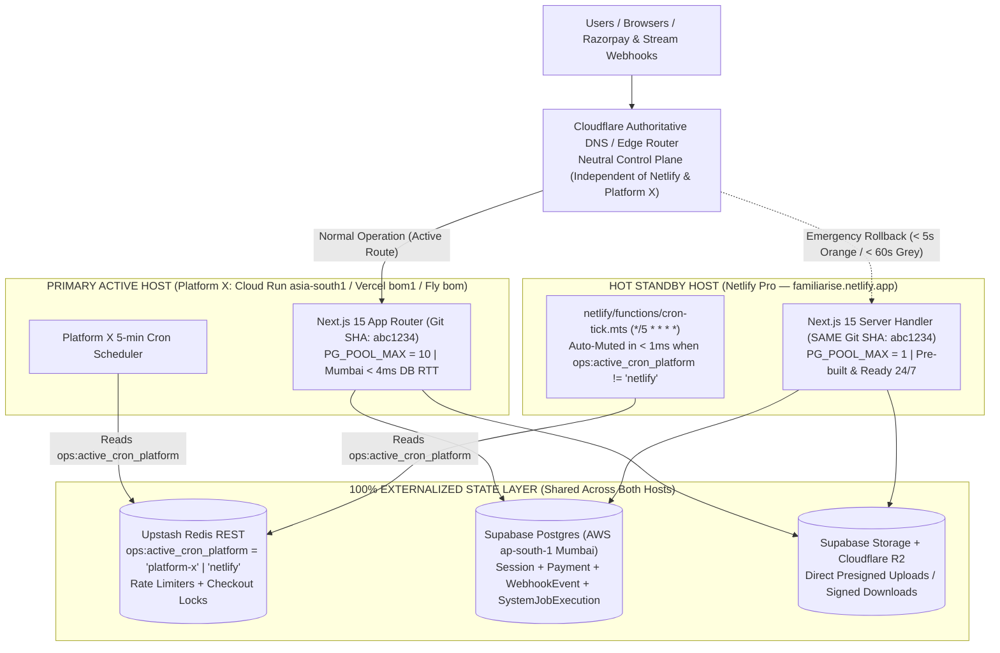

# Emergency Rollback & Hot-Standby Failback Runbook (`Platform X -> Netlify`)

> Canonical SRE runbook for reverting production (`familiarisenow.com`, `familiarise.in`) and staging (`dev.familiarisenow.com`) from any primary host (`Platform X`: Google Cloud Run `asia-south1`, Vercel Pro `bom1`, Fly.io `bom`, DigitalOcean `blr1`, or Railway) back to **Hot-Standby Netlify (`familiarise.netlify.app`)** in **`< 90 seconds` with zero code reverts, zero build wait, zero user sign-outs, and zero lost webhooks**.
> Cross-reference: GitHub Issue **#2097**.

---

## 1. Architecture Overview

Every merge to `dev` and `prod` builds **simultaneously** on both `Platform X` (active compute in Mumbai) and **Standby Netlify** (`familiarise.netlify.app` / `dev--familiarise.netlify.app`). All stateful layers — **Supabase Postgres (`ap-south-1` Mumbai)**, **Upstash Redis REST**, **Supabase Storage**, **Cloudflare R2**, **Razorpay**, **Stream**, **Resend**, and **Novu** — live completely outside the compute hosts.



---

## 2. Five Mandatory Pre-Cutover Safeguards (`T - 72h` Before Leaving Netlify)

### 2.1 Safeguard 1 — Authoritative DNS Independence on Cloudflare (`T - 72h`)

Never leave authoritative registrar nameservers on Netlify DNS (`ns1.p0*.nsone.net`) when serving traffic on `Platform X`, and never delegate authoritative NS to `Platform X` itself.

- **At `T - 72h`**: Point registrar nameservers for `familiarisenow.com`, `familiarise.in`, and `practitionist.com` to **Cloudflare DNS** while all web records still target Netlify:
  - `@` (`familiarisenow.com`) -> **Cloudflare `CNAME` Flattened** to `familiarise.netlify.app` (`TTL = 60s`) — **never use static `A 75.2.60.5`** (loses Anycast edge routing).
  - `www` -> **`CNAME`** to `familiarise.netlify.app` (`TTL = 60s`).
  - `dev` -> **`CNAME`** to **`dev--familiarise.netlify.app`** (`TTL = 60s`) while retaining `branch_deploy_custom_domain = "dev.familiarisenow.com"` in Netlify.
- **Never delete custom domains (`familiarisenow.com`, `www.familiarisenow.com`, `familiarise.in`, `dev.familiarisenow.com`) from Netlify `Domain management`** (`404 Not Found` on failback if deleted).

---

### 2.2 Safeguard 2 — Preventing Day-90 Standby TLS Expiry + HSTS Preload Lockout (`NET::ERR_CERT_DATE_INVALID`)

Once public DNS points to `Platform X`, Netlify's built-in Let's Encrypt HTTP-01 renewal fails at **Day 60** and **expires at Day 90**. Because `next.config.mjs` sends `Strict-Transport-Security: max-age=63072000; includeSubDomains; preload`, failing back to an expired Netlify certificate on Day 91+ causes **100% hard browser lock-out globally with no bypass button**.

Choose **one** verified standby TLS strategy (**never mix them**):

1. **Strategy A (`Grey-Cloud DNS-only` Mode): Automated Monthly ACME `DNS-01` Certificate Upload via Netlify API**
   - Validate domain ownership via `_acme-challenge.*` TXT records in Cloudflare DNS (`acme.sh --dns dns_cf` / `certbot-dns-cloudflare` in a monthly GitHub Actions schedule) — succeeds forever regardless of where HTTP traffic points.
   - Upload the publicly trusted PEM chain directly into standby Netlify:
     ```bash
     curl -sSf -X POST "https://api.netlify.com/api/v1/sites/${NETLIFY_SITE_ID}/ssl" \
       -H "Authorization: Bearer ${NETLIFY_AUTH_TOKEN}" \
       -H "Content-Type: application/json" \
       -d "$(jq -n \
         --rawfile cert fullchain_leaf.pem \
         --rawfile key privkey.pem \
         --rawfile ca intermediate_chain.pem \
         '{certificate: $cert, key: $key, ca_certificates: $ca}')"
     ```
   - **CRITICAL WARNING**: Under `Grey-Cloud DNS-only`, **never** upload a Cloudflare 15-Year Origin CA cert (`NET::ERR_CERT_AUTHORITY_INVALID` in all browsers and webhook senders because Origin CA is only trusted by Cloudflare's proxy).

2. **Strategy B (`Orange-Cloud Proxied` Mode — Fastest `< 5s` Global Failback)**:
   - Install a **15-year Cloudflare Origin CA wildcard certificate** on **both** `Platform X` and standby `Netlify` (`Site settings -> Domain management -> HTTPS -> Provide your own certificate`).
   - Enable Cloudflare **Orange-Cloud (`proxied: true`)** with SSL **`Full (strict)`** and **one explicit Cloudflare Cache Rule**: cache static assets (`/_next/static/*`, `/avif/*`, `/fonts/*`) at Edge for 1 year and **Bypass Cache** on all HTML/RSC pages, `/api/*`, and webhooks.
   - **Benefit**: Zero TLS renewal maintenance until **2041**, and switching origin targets in Cloudflare propagates globally in **`< 2–5 seconds`** with zero ISP DNS TTL lag.

---

### 2.3 Safeguard 3 — Sub-Millisecond Fleet Cron Switch (`ops:active_cron_platform` in Upstash Redis)

Netlify Scheduled Functions (`netlify/functions/cron-tick.mts`, `schedule: "*/5 * * * *"`) **continue firing every 5 minutes on Netlify's published `prod` deploy even when DNS points to `Platform X`**, and Netlify snapshots `process.env.*` at build time (requiring a 12-minute rebuild if toggled solely via env vars).

- Checking Upstash REST key `ops:active_cron_platform` (`"netlify"` vs `"cloudrun"` / `"vercel"` / `"fly"`, `250ms` timeout with `CRON_SCHEDULER_ENABLED` static override) at line 1 of `cronTick()` keeps standby Netlify completely silent (`200 OK`, `{ muted: true }`, `0` Next.js invocations, `0` DB connections, `0` Sentry check-in noise) and flips active cron execution during rollback in **`< 1 ms` with zero rebuilds**.

---

### 2.4 Safeguard 4 — Dual-Boot Codebase Parity

All six multi-host portability rules in [docs/deployment/README.md](./README.md#core-multi-host-portability-invariants-dual-boot-codebase-rules) (`netlify.toml` retained alongside `Dockerfile`/`vercel.json`, `lib/request-ip.ts`, `Vary: Cookie` alongside `Netlify-Vary`, gated `NEXT_STANDALONE` & `sharp` exclusion, per-host `PG_POOL_MAX`, and direct presigned uploads) keep the exact same `prod` Git SHA runnable on both platforms simultaneously.

---

### 2.5 Safeguard 5 — Verified State Continuity (`0%` Sign-Outs, `0` Dropped Webhooks)

- **Sessions (`__Secure-better-auth.session_token`)**: Signed via `HMAC-SHA256(token, BETTER_AUTH_SECRET)` and verified against shared Supabase Postgres `Session` (`cookieCache.enabled = false`). Zero users are logged out across failback.
- **Webhooks (`WebhookEvent` CAS Fencing)**: Both `/api/webhooks/razorpay` and `/api/stream/webhooks` persist `WebhookEvent(processed: false)` synchronously before returning `200 OK`. Any event interrupted mid-`after()` on `Platform X` is automatically re-claimed via CAS (`claimedAt`) and completed idempotently by standby Netlify's `sweep-stuck-webhook-events` job.

---

## 3. The 60-Second P0 Emergency Failback Procedure (`Platform X -> Netlify`)

### Step 1 (`T + 0s`): Flip Active Cron Ownership Atomically (`< 1 ms`)

```bash
curl -sSf -X POST "${UPSTASH_REDIS_REST_URL}/set/ops%3Aactive_cron_platform/netlify" \
  -H "Authorization: Bearer ${UPSTASH_REDIS_REST_TOKEN}"
```

### Step 2 (`T + 5s`): Repoint Cloudflare DNS Records Back to Standby Netlify

Update the 3 Cloudflare CNAME records:

- `@` (`familiarisenow.com`) -> `familiarise.netlify.app`
- `www` (`www.familiarisenow.com`) -> `familiarise.netlify.app`
- `dev` (`dev.familiarisenow.com`) -> `dev--familiarise.netlify.app`

### Step 3 (`T + 20s`): Smoke Verification & Immediate Webhook Recovery Drain

```bash
# 1. Confirm Netlify edge & DB pool health
curl -sI https://familiarisenow.com/api/health | grep -iE "^HTTP/|^server:"
curl -s https://familiarisenow.com/api/health | jq .

# 2. Immediately recover any in-flight webhooks claimed right before Platform X failed
curl -s -X POST "https://familiarisenow.com/api/cleanup/sweep-stuck-webhook-events?limit=50" \
  -H "x-cron-secret: ${CRON_SECRET}" | jq .
```

---

## Deprecated & Superseded Approaches

- **Relying on `netlify env:set` Alone to Mute/Unmute Scheduled Crons**: Netlify bakes environment variables into function bundles at build time, requiring a full ~12-minute build to toggle `cron-tick.mts`. Superseded by reading `ops:active_cron_platform` over Upstash REST (`< 1ms` zero-rebuild flip).
- **Uploading Cloudflare Origin CA Certificates While Using `Grey-Cloud DNS-only` Mode**: Breaks public browsers and Razorpay/Stream webhooks immediately with `NET::ERR_CERT_AUTHORITY_INVALID`. Use publicly trusted ACME `DNS-01` certificates for `Grey-Cloud`, or use Cloudflare `Orange-Cloud Full (strict)` with Cache Bypass for dynamic routes.
- **Deleting Custom Domains from Standby Netlify After Cutover**: Causes Let's Encrypt HTTP-01 expiry after 90 days or `404 Site Not Found` on DNS failback under HSTS Preload. Always keep custom domains attached and renew TLS automatically.
