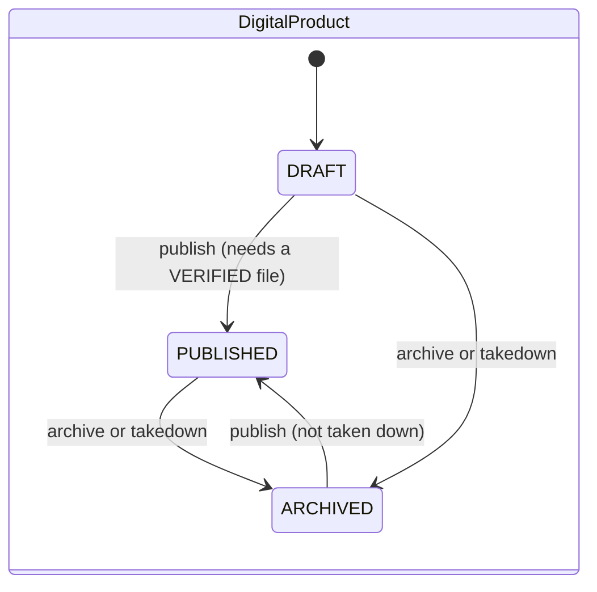
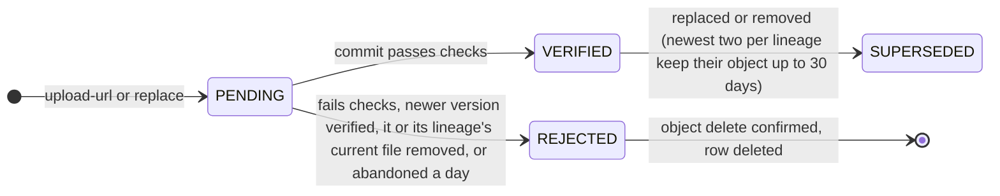
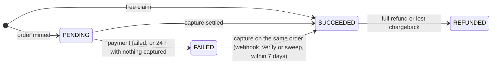
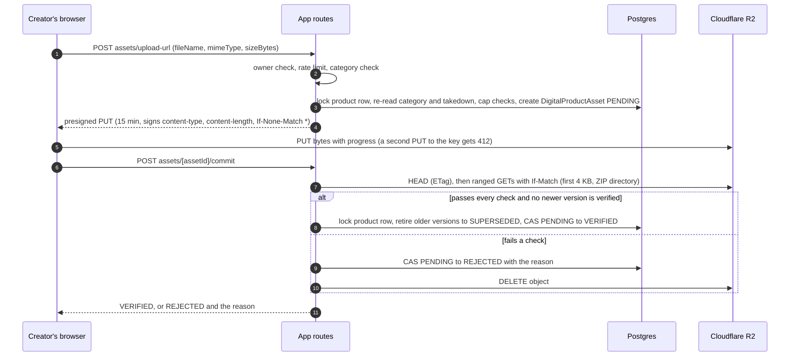
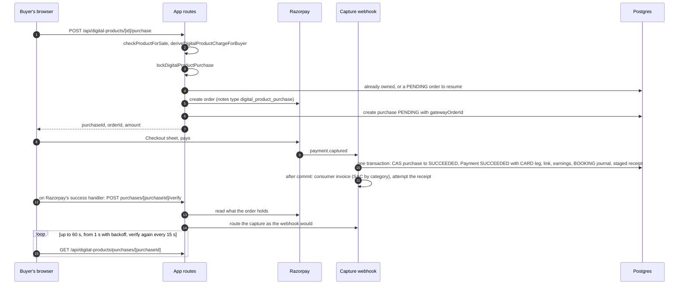
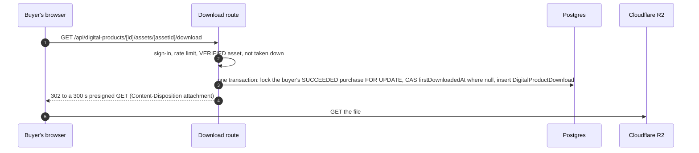

# Digital Products — Architecture

A digital product is a file sale: an expert uploads e-books, templates, ZIP bundles, images or audio, sets one price, and a buyer pays once (or claims it for free) and keeps download access for life. There is no calendar, appointment or plan behind it. Files that are part of a consultation, subscription, webinar or class stay plan materials (`PlanMaterial`); a digital product is its own offering type with its own tables, routes and money rail.

The rail is a sibling of the replay sale (`RecordingPurchase`), and the two share their capture plumbing. Everything on this page is merged on `dev` except where it says **(planned)**.

## 1. Worked example

Hannah (an expert) creates "Interview workbook" in the Document category at ₹500 (50,000 paise). She uploads `workbook.pdf` (2.4 MB). The browser sends the bytes straight to Cloudflare R2 with a create-only PUT, so that key can never be written again. The server reads the object's ETag, reads the first 4 KB back under that ETag, finds `%PDF-` and no script markers, and marks the file `VERIFIED`. She presses Publish; the product is now `PUBLISHED` and listed on her expert profile.

Priya opens `/explore/products/interview-workbook-1a2b3c4d`. The page derives her charge with the same helper the purchase route uses (`deriveDigitalProductChargeForBuyer()`), so it shows "₹590.00" with "₹500.00 + ₹90.00 GST" under it, and the button reads "Buy for ₹590.00". She presses it: ₹500 plus 18 % GST (₹90) is 59,000 paise. It mints a Razorpay order whose notes carry `type: "digital_product_purchase"`, `originalAmountPaise: "50000"` and `taxAmountPaise: "9000"`, and writes a `PENDING` purchase. Priya pays. The capture webhook settles the sale in one transaction: the purchase goes `PENDING → SUCCEEDED`, a `SUCCEEDED` Payment of 59,000 paise is created with one `CARD` leg of 59,000 paise, the purchase is linked to it, Hannah's earnings row is created with a 7-day hold together with the `BOOKING` ledger journal, and the "Your purchase: Interview workbook" receipt is staged in the email outbox. After the commit the consumer invoice is minted with SAC 998431 and the receipt is sent, linking to Priya's library.

Priya downloads the PDF the next day. That first download stamps `firstDownloadedAt`, which ends the no-questions refund window. A week later Hannah replaces the PDF with a corrected version: it is uploaded to a new key as version 2 of the same file lineage, and its commit retires version 1. Priya's library shows the product as "Updated" and her next download is the new version. Months later Hannah archives the product; it leaves her profile, but Priya's receipt link still opens its download view.

## 2. Data model

| Model                    | What one row is                                      | Key columns                                                                                                                   |
| ------------------------ | ---------------------------------------------------- | ----------------------------------------------------------------------------------------------------------------------------- |
| `DigitalProduct`         | The listing                                          | `consultantProfileId` (owner), `slug` (unique), `category`, `pricePaise`, `status`, `takenDownAt`, `coverImagePath`           |
| `DigitalProductAsset`    | One version of one file                              | `storageKey` (unique R2 key), `lineageId`, `version`, `mimeType`, `sizeBytes`, `order`, `status`, `rejectReason`              |
| `DigitalProductPurchase` | One attempt to buy or claim                          | `buyerId`, `gatewayOrderId` (null on a free claim), `paymentId`, `amountPaise`, `status`, `firstDownloadedAt`, `reconciledAt` |
| `DigitalProductDownload` | One download, kept as refund and dispute evidence    | `purchaseId`, `assetId`, `createdAt`                                                                                          |
| `DigitalProductReport`   | A signed-in user's report of a product to moderators | `productId`, `reporterId`, `reason`, `resolvedAt`                                                                             |

The R2 key is `products/<productId>/<lineageId>/<assetId>.<ext>`: every upload gets a fresh key, written once. The extension comes from the MIME type, never from the uploader's file name. All versions of one file share a `lineageId` (the first version's asset id). A replacement takes the next version number of every upload that lineage ever had, including rejected ones, so a rejected version 2 never blocks a retry, which becomes version 3. `(lineageId, version)` is unique. Each lineage keeps the objects of its two newest versions only: the current one and the one it replaced. When a replacement verifies, the commit (`verifyDigitalProductAsset()`) reads the lineage's older unpurged `SUPERSEDED` rows inside its locked transaction and, after the commit, deletes their objects and stamps `purgedAt` once R2 confirms. A delete that fails leaves `purgedAt` null for the storage sweep. The previous version keeps its object for 30 days. The rows stay as download evidence, and a superseded version is never served, so a stale link resolves to the current version (§7). Example: a file replaced from v1 to v5 holds two objects (v4 and v5), not five.

`reconciledAt` records the recovery sweep's last check of a purchase: a gateway read, or a failed attempt to prepare an owed receipt (`RecordingPurchase` has the same column for gateway reads). The sweep rotates on it; the 24-hour expiry is measured from `createdAt`. `receiptStagedAt` is set in the transaction that stages the receipt or deliberately skips it; a `SUCCEEDED` purchase with no `receiptStagedAt` still owes one.

`organizationId` and `visibility` exist from day one so organisation-owned products need only a relaxed `NOT NULL` later. Today every product is consultant-owned and `PUBLIC`.

### 2.1 Status machines







## 3. Invariants

| Rule                                                                    | Enforcer                                                                                                                                                                                                                                            |
| ----------------------------------------------------------------------- | --------------------------------------------------------------------------------------------------------------------------------------------------------------------------------------------------------------------------------------------------- |
| A buyer holds at most one `SUCCEEDED` purchase of a product             | Postgres partial unique index `digital_product_purchase_succeeded_key` in `prisma/sql/check-constraints.sql`                                                                                                                                        |
| A free claim has no order, and a paid purchase always has one           | Postgres `CHECK` `digital_product_purchase_free_has_no_order`                                                                                                                                                                                       |
| A price is free or at least ₹1 (100 paise); a file is at most 250 MB    | Postgres `CHECK`s `digital_product_price_free_or_min_paid` and `digital_product_asset_size_cap`; `DIGITAL_PRODUCT_MIN_PAID_PRICE_PAISE` mirrors the floor in `schemas/digital-products.ts`                                                          |
| One order per buyer and product at a time                               | `lockDigitalProductPurchase()` in `utils/appointmentlock.ts` around the read-mint-create in the purchase route                                                                                                                                      |
| A product is published only with a verified file and not taken down     | The publish route's CAS `updateMany` (`app/api/digital-products/[productId]/publish/route.ts`)                                                                                                                                                      |
| Every status change compares the prior status                           | CAS `updateMany` in the routes, `verifyDigitalProductAsset()` and `handleDigitalProductPurchaseSuccess()`                                                                                                                                           |
| The settle writes purchase, Payment, leg, earnings and journal together | One `prisma.$transaction` in `lib/payments/webhooks/digital-product-purchase.ts`, every helper on `tx`; the leg sum is checked by `payment_legs_sum_to_amount`                                                                                      |
| At most 20 files and 1 GB per product                                   | `reservePendingAsset()` in `lib/digital-products/creator.ts`: the cap check and the `PENDING` row are one transaction under the product row lock (`SELECT … FOR UPDATE`, `lockDigitalProductRow()`)                                                 |
| A stored file never changes after it is written                         | The presigned PUT signs `If-None-Match: *` (R2 refuses a second write to the key); inspection reads are fenced with `If-Match` on the HEAD's ETag                                                                                                   |
| One current version per file, and never an older one after a newer      | Postgres partial unique index `digital_product_asset_one_verified_per_lineage`; `verifyDigitalProductAsset()` rejects a version older than a verified one, under the product row lock                                                               |
| A removed file never comes back through a replacement in flight         | Under the product row lock the remove route rejects the lineage's `PENDING` rows (`LINEAGE_DELETED`), and `verifyDigitalProductAsset()` promotes a version above 1 only while its lineage has a `VERIFIED` row                                      |
| A sold or published product keeps its last verified file                | Under the product row lock the remove route refuses the last `VERIFIED` file with `409 LAST_PURCHASED_FILE` when any purchase is `SUCCEEDED`, whatever the status, and `409 LAST_FILE` when the product is published                                |
| A purchase becomes `SUCCEEDED` only while its product is deliverable    | `lockDeliverableDigitalProduct()` in `lib/digital-products/product-lock.ts`: the settle and the free claim take the product row lock, then require "not taken down" and one `VERIFIED` file, before the purchase CAS or insert                      |
| Every live file fits its product's category                             | `reservePendingAsset()` re-reads the category and takedown under the product row lock; a draft's category change checks the file set under the same lock                                                                                            |
| A row names its object until R2 confirms the delete                     | The storage sweep and the remove route retire `PENDING` to `REJECTED` by CAS before deleting, and delete the row only after R2 answers                                                                                                              |
| A download needs a `SUCCEEDED` purchase, ownership, or an operator role | The download route locks the buyer's `SUCCEEDED` purchase (`FOR UPDATE`) in the transaction that records the download, before it signs a URL                                                                                                        |
| The receipt email is sent at most once per purchase, and never lost     | It is staged in the settling or claiming transaction under an `IdempotencyRecord` claim (`stageDigitalProductPurchaseEmail()` in `lib/email/senders/money.ts`); one that could not be prepared leaves `receiptStagedAt` null for the recovery sweep |

**Lock order.** A transaction that takes both the product row lock and a purchase row (a `FOR UPDATE`, a CAS `updateMany`, an insert or a delete) takes the product lock first. The settle and the free claim lock the product, then CAS or insert the purchase; the erasure scrub updates the erased creator's live products before it deletes the erased buyer's purchases. The download route and refund revocation touch only the purchase row; file removal, publish and takedown touch only the product row and its files, and read purchases without locking them. So the settle and a last-file removal are ordered by the product lock: a removal that commits first leaves nothing deliverable and the capture is auto-refunded with the purchase left unsettled, and a settle that commits first makes the removal answer `409 LAST_PURCHASED_FILE`.

## 4. Upload and verification

The creator works in the offering editor (`/dashboard/consultant/<id>/offerings/digital-product/<productId>/edit`). `ProductFilesManager` (`components/offerings/editor/ProductFilesManager.tsx`) uploads each file in three steps.



A commit that finds no object yet answers `409 UPLOAD_NOT_FOUND`, and one whose object changed between reads (an `If-Match` 412) answers `409 UPLOAD_CHANGED`; both leave the row `PENDING`, and the editor retries once and offers a Verify button after that. Replacing a file uses `POST assets/<assetId>/replace` and the same commit; two replacements started together get consecutive versions, and if the newer one verifies first the older one is rejected with `NEWER_VERSION_EXISTS`. Removing a verified file supersedes it and, in the same locked transaction, rejects any replacement of it still in flight with `LINEAGE_DELETED` (its object and row are then deleted like any rejected upload), but a published product, or one any buyer holds a `SUCCEEDED` purchase of, refuses to lose its last verified file. Sold content is withdrawn through an admin takedown or a refund instead. A later commit of a version in that lineage is rejected the same way. Removing an unverified file retires it to `REJECTED` first, then deletes the object, then the row.

### 4.1 Verification rules

`inspectUploadedObject()` in `lib/digital-products/verify-asset.ts` decides, reading only the object's head, its first 4 KB and, for ZIP containers, its end-of-central-directory record, its central directory, every entry's local file header and the data of entries that carry a data descriptor.

- **Allowed types.** PDF, EPUB, DOCX, XLSX, PPTX, TXT, CSV and Markdown for Document and Template; ZIP for Archive and Template; PNG, JPEG and WebP for Image and Template; MP3, M4A and WAV for Audio. SVG is refused because it is executable markup, and video is out of scope. The list is `DIGITAL_PRODUCT_MIME_TYPES` in `lib/digital-products/constants.ts`.
- **Size.** The object must be non-empty, at most 250 MB, and exactly the size the browser declared.
- **Signature.** `checkFileSignature()` in `lib/digital-products/file-signature.ts` matches the magic bytes to the declared type, refuses executables (`MZ`, ELF, Mach-O, `#!`) whatever they claim, and refuses binary files whose header carries `<script`, `<html`, `<?php` or `<svg` (and, for PDF, `/JavaScript` or `/Launch`).
- **ZIP.** `inspectZip()` in `lib/digital-products/zip-inspect.ts` refuses more than 1,000 entries, more than 500 MB uncompressed, any entry compressed more than 100:1, absolute or `..` paths, encrypted entries, symlinks, inconsistent Zip64 records and, in a ZIP archive, nested archives and executable or script extensions. A document container (DOCX, XLSX, PPTX, EPUB) gets the macro and object rules instead of the entry-type rules: a `vbaProject.bin`, `vbaData.xml` or `macrosheets` part is `ZIP_OFFICE_MACRO`, and an OLE or ActiveX `.bin` part (`oleObject*.bin`, or any `.bin` under `embeddings` or `activeX`) is `ZIP_EMBEDDED_OBJECT`; a chart's embedded `.xlsx` workbook and printer settings stay allowed. It reads the one end-of-central-directory record whose comment ends exactly at the end of the file: none is `NOT_A_ZIP`, two are `EOCD_AMBIGUOUS`, so a decoy record hidden in the comment is never read. An extension is taken after trailing dots and spaces are stripped, as Windows does on extraction, so `evil.exe.` counts as `exe`.
- **Unicode Path names.** An entry can carry a second name in the Info-ZIP Unicode Path extra field (header `0x7075`), and libarchive and Info-ZIP extract under that name instead of the legacy one. So `guide.txt` with a Unicode Path of `payload.exe` would land on disk as `payload.exe`. `inspectZip()` therefore runs the path and extension rules on both names and refuses the entry if either fails. A Unicode Path field that is not version 1, whose CRC32 does not match the legacy name bytes, that is not valid UTF-8, or that appears twice is refused as `ZIP_UNICODE_PATH_INVALID`. A central-directory extra field whose length runs past the extra block is `CENTRAL_DIRECTORY_CORRUPT`. The Unicode Comment field (`0x6375`) names nothing, so it is ignored.
- **Local file headers.** A streaming extractor such as libarchive (`tar -tf` on macOS) walks the local file headers rather than the central directory. So an archive whose central name is `guide.txt` but whose local name or local Unicode Path is `payload.exe` would extract an `.exe`, and so would a `payload.exe` record the central directory never lists, or one hidden inside a listed entry whose local header claims a smaller size. After the central-directory pass, `inspectZip()` therefore requires the listed local records to tile everything before the central directory exactly. The first record starts at byte 0. Each record is its local header, name, extra block and compressed data, followed by a data descriptor only when bit 3 is set, and it ends exactly where the next listed record (or the central directory) begins. Every byte of the archive is accounted for: the tiled local records fill `[0, directory offset)`, the central directory runs exactly to its end record (the EOCD, or the Zip64 end record whose own length reaches its locator just before the EOCD), and after the EOCD comes only its comment, which ends the file and may hold no ZIP record signature. Anything else is `ZIP_UNLISTED_DATA`. When a Zip64 locator precedes the EOCD, the Zip64 record is followed even if no EOCD field overflows, and every EOCD field that is not a sentinel must agree with it (`ZIP_ZIP64_INCONSISTENT`), so two extractors cannot be shown two directories. An archive that lists no entries is refused as `ZIP_EMPTY_ARCHIVE`: it has nothing to sell, and with nothing listed no byte before the end record could be accounted for. A local header must repeat its central name bytes, its compression method, its encryption bits (0 and 6), its bit 3 and its UTF-8 bit (11) and, when bit 3 is clear, its CRC and sizes (through its own Zip64 extra if the sizes are sentinels). With bit 3 set, the descriptor must be 12 or 20 bytes unsigned, or 16 or 24 bytes with the `0x08074b50` signature, and carry the central CRC and sizes. A header that disagrees is `ZIP_LOCAL_HEADER_MISMATCH`; a gap, an overlap, or bytes before the first record are `ZIP_UNLISTED_DATA`. A Unicode Path field in the local extra block gets the same version, CRC, UTF-8, path and extension rules as a central one. macOS Archive Utility (signed descriptors, `__MACOSX` entries listed centrally), Info-ZIP, 7-Zip, Windows Explorer and Java's `ZipOutputStream` all write tiled archives. A self-extracting stub or an APK signing block before the central directory is refused, and neither is a sellable file type. The reads are coalesced: each header is over-read by its name length twice plus 512 bytes, which covers a Unicode Path copy of the name and the usual timestamp, unix and Zip64 extras; a bit-3 record also reads its last 24 bytes, which abut the next header's window. Windows within 64 KiB share one range read of at most 1 MiB, eight reads at a time, and a header whose extra block is longer gets one more coalesced read. A 1,000-entry archive of 4 KiB entries costs 6 range reads in all (the tail, the central directory and four local reads). One whose entries are 64 KiB or more apart costs 1,002, or 1,003 with descriptors, which the 1,000-entry cap bounds. An entry with bit 3 set gives a streaming extractor no length it can trust, because its sizes sit in the descriptor after the data, so the extractor finds the entry's end from the data itself. Python's `zipfile` writes these by default when its output is not seekable (stored), Go's `archive/zip` writes them for every file, and macOS Archive Utility and Java's `ZipOutputStream` write them deflated, so they cannot simply be refused. `inspectZip()` reads their data instead, in pieces of up to 8 MiB. A stored entry (method 0) is scanned with each piece overlapping the last by 3 bytes, and refused as `ZIP_EMBEDDED_ZIP_RECORD` on the first `PK\x03\x04`, `PK\x01\x02`, `PK\x07\x08`, `PK\x05\x06`, `PK\x06\x06` or `PK\x06\x07`, since a hidden record needs one of them; a stored entry whose own file is a ZIP container (a `.docx` inside a streamed template archive) is refused the same way. A DEFLATE entry (method 8) is inflated with `zlib.createInflateRaw()`: the stream must end exactly at the central compressed size (leftover bytes are `ZIP_UNLISTED_DATA`), and it must inflate to the central uncompressed size with the central CRC-32 (`ZIP_ENTRY_DATA_MISMATCH`). Inflation stops as soon as the output passes the declared size, which the ratio and 500 MB limits already bound. A bit-3 entry with any other method cannot be checked and is `ZIP_UNVERIFIABLE_ENTRY`. All of these entries share one budget of 64 MiB of compressed data (`ZIP_LIMITS.maxDeepScanCompressedBytes`). A larger total is refused from the central sizes before any entry is read, as `ZIP_DEEP_SCAN_TOO_LARGE`, asking the creator to re-zip on their computer (Compress, or `zip -r`) or split the files. Entries without bit 3 cost nothing extra. Measured on a developer Mac with Node 26, streaming inflate takes 0.20 s for 64 MiB of incompressible data and 0.63 s for 64 MiB of text (214 MiB inflated), and 1.56 s / 2.32 s at 250 MiB, at about 100 MiB of memory. A 64 MiB deep scan reads 12 ranges for one large entry and 124 for 1,000 entries of 60 KiB. R2 throughput from the function was not measured; at an assumed 25 MB/s, 64 MiB is about 3 s, so with a slower Lambda CPU the deep scan should stay well under 10 s of the commit route's ~26 s edge cut, where verification runs synchronously. An archive beyond the budget is refused rather than accepted unchecked, so no ZIP reaches buyers with an entry whose end was not confirmed.

A rejected file stores its reason as `CODE` or `CODE:detail`, where the detail is the matched marker, the entry name or the compression ratio (`POLYGLOT:/javascript`, `ZIP_COMPRESSION_RATIO:big.bin (512:1)`). `describeRejectReason()` in `lib/digital-products/reject-reasons.ts` turns it into one sentence the creator can act on; the editor shows that sentence with the code underneath, and lists rejected uploads apart from the product's files. A rejected upload holds no order slot and does not count toward the 20-file or 1 GB caps. A rejected replacement names the file it targeted ("Replacement for guide.pdf"). Each file reads as history, "Added 1 Nov" or "Updated 2 Nov", never a raw version number, and a replaced file whose new upload has another name shows "Buyers see it as guide.pdf". A batch of uploads refreshes the list after each verdict and ends with one toast: the reason when one file was sent, otherwise "3 files were rejected" pointing to the list. Removing a verified file of a product with buyers asks first: "2 buyers will lose access to this file". A commit for an upload that no longer exists (its replaced file was removed) answers `404 UPLOAD_DISCARDED` with that explanation.

There is no antivirus scan. Moderators take down a product a structural check missed (§8).

## 5. Purchase and settlement



The page shows the viewer the amount the route would charge them next: a fresh derivation, or the persisted `amountPaise` of their unfinished order, which the route resumes (`quoteDigitalProductForBuyer()` in `lib/payments/pricing/digital-product-price.ts`). A declined card fires `payment.failed`, which moves the purchase to `FAILED`, but the buyer can retry on the same Razorpay order. So the checkout keeps polling through `FAILED`, the verify route reads a `FAILED` purchase under 7 days old against the gateway, and the recovery sweep re-reads `FAILED` orders for 7 days. Without a webhook, the verify route applies the same `PENDING → FAILED` CAS when every attempt on the order failed; an order with no attempt yet stays `PENDING`. `REFUNDED` is never re-read. A still-unconfirmed checkout shows "Check again", and a refunded buyer revisiting the page sees the refund date and can buy again.

The verify call is on the buyer's critical path (QA measured 8.2 s on a preview). Its awaits, in order: session and rate limit, the purchase read, Razorpay, the settling transaction, the post-commit work, and the final read. Three of them used to wait on each other needlessly, and now overlap: `recoverStandaloneOrder()` reads the order's payments and its notes from Razorpay together (two API round trips became one, roughly 0.5 to 1.5 s from Netlify); `handleDigitalProductPurchaseSuccess()` renders the receipt while it checks for an already-settled Payment; and after the commit the consumer invoice and the receipt attempt (bounded by the 3 s webhook email budget) run side by side instead of one after the other. The settling transaction itself stays one sequence of statements on one connection (about 15 round trips, which is most of the remaining time when the function and the database are in different regions) and is not split, because its writes must commit together.

The settling Payment records Razorpay's own `method` (`NETBANKING`, `UPI`, `GATEWAY_WALLET`, and so on; `WALLET` stays the organisation wallet) from the webhook entity or the recovered order; its funding leg is always `CARD`, the gateway source.

The capture is routed by `routeCapturedPayment()` (`app/api/webhooks/razorpay-dispatch.ts`) on the order notes' `type`. `handleDigitalProductPurchaseSuccess()` exits early when the order's Payment is already `SUCCEEDED` with the same amount and payment id, so a redelivered webhook does nothing. A capture that cannot be granted is kept as a `SUCCEEDED` Payment under the auto-refund marker and refunded after commit, through `stageCaptureRefund()` and `refundStagedCapture()` in `lib/payments/webhooks/standalone-sale-capture.ts`. That happens when:

- the purchase row is gone (the buyer comes from the order notes);
- the captured amount differs from `amountPaise`;
- a second payment lands on an order that is already settled;
- the product was taken down, or is no longer published on a late retry of a `FAILED` purchase;
- under the product row lock, just before the purchase CAS, the product is taken down or has no `VERIFIED` file (`NO_DELIVERABLE`), which closes the race with a last-file removal;
- the buyer already owns the product through another purchase.

Earnings use the `DIGITAL_PRODUCT` type with a 168-hour hold (`lib/payments/payouts/constants.ts`). The invoice SAC comes from `DIGITAL_PRODUCT_SAC_CODES`: 998431 for Document and Template, 998439 for Archive, Image and Audio. These codes await chartered accountant sign-off.

## 6. Free claim

A product priced at ₹0 is claimed with `POST /api/digital-products/<id>/claim`. Under the same lock, in one transaction, the route takes the product row lock and answers `409 NO_DELIVERABLE` when the product is taken down or has no `VERIFIED` file, then checks for an existing `SUCCEEDED` purchase, creates one with `amountPaise = 0` and no order, and stages the receipt email. There is no Payment, invoice, earnings or journal. The partial unique index refuses a second claim even if two requests slip past the lock.

## 7. Download



A link names an asset id, and a replacement makes a new one, so the route resolves a `SUPERSEDED` (or purged) id to its file's current `VERIFIED` version and records the download against that version. When the file has no current version (the expert removed it) the route answers `410 FILE_REMOVED`, and an unknown id `404 NOT_FOUND`; a browser navigation (`Accept: text/html`) is instead redirected (`303`) to the product page with `?notice=file-removed` or `?notice=file-missing`, which shows a notice above the panel. The owner and operators download without a purchase and leave no download row. A taken-down product answers `410` to buyers. The lock decides a race with a refund: a refund that committed first leaves no `SUCCEEDED` row, so the route answers `403` and signs nothing; a download that locked first is recorded and the refund waits for it. Repeat downloads are always served and each leaves a row, within about 30 per user per 10 minutes (`digitalProductDownloadLimiter`; Upstash's sliding window can admit one or two more across a bucket boundary). The buyer's Library › Purchases and the product page link to this route; no email or page ever carries a storage URL.

## 8. Refunds, disputes and takedown

A buyer can ask for a refund until their first download; after that only a defective file justifies one. The refund goes through the existing support and admin refund doors, and the operator reads `firstDownloadedAt` and the download rows to decide. The admin payment view and the refund dialog show "Downloaded N times, first at <time>" as evidence; the doors do not check `firstDownloadedAt` themselves.

A full refund (`applyRefundCascade()` in `lib/payments/operations/refund.ts`) and a lost chargeback (`settleLostDispute()` in `app/api/webhooks/utils.ts`) revoke access through `revokeStandaloneSaleEntitlement()` (`lib/payments/digital-product-entitlement.ts`). It finds the digital product sale by its `paymentId` link and moves it `SUCCEEDED → REFUNDED`; only when no purchase is linked does it fall back to the replay sale. A partial goodwill refund keeps access.

Any signed-in user can report a product from its page or their library. An operator with `moderation.manage` takes it down through `POST /api/admin/digital-products/<id>/takedown`, which sets `takenDownAt` and the reason and archives the product in one CAS. Buyers keep their purchase rows but cannot download.

## 9. Buyer email

`DIGITAL_PRODUCT_PURCHASED` (`emails/payments/DigitalProductPurchaseEmail.tsx`) is sent from `payments@` as a required notice (`category: null` in `prepareDigitalProductPurchaseEmail()`): it is a receipt, so like `PAYMENT_SUCCESS` no notification preference skips it, and it carries no unsubscribe link. Only an address that cannot receive mail (none on the account, or on the suppression list) and the pre-launch delivery guard stop it. `lib/digital-products/purchase-email.ts` renders it before the settling or claiming transaction (`prepareDigitalProductReceipt()`), stages the outbox row inside that transaction through an `IdempotencyRecord` claim keyed on the purchase (`stageDigitalProductReceipt()`), and attempts it after the commit with `flushNotificationsAfter` (`flushDigitalProductReceipt()`). The same transaction stamps `receiptStagedAt`, including when the buyer has no deliverable address, which is final. A process that dies after the commit leaves the row `PENDING` in the outbox for the email retry sweep, and a redelivered webhook stages nothing. A lookup or render failure is reported to Sentry and commits the sale with `receiptStagedAt` null; `stageOwedDigitalProductReceipts()` in the recovery sweep prepares and stages it later, and the purchase claim keeps a re-run from staging twice. The button opens the buyer's Library › Purchases through `/dashboard/go/library?tab=purchases`, or the product page when the buyer has no personal dashboard.

## 10. Background jobs

| Job                                 | Cadence                   | What it does                                                                                                                                                                                                                                                                                                                                                                                                                                                                                                                                                                                                                                                                                         |
| ----------------------------------- | ------------------------- | ---------------------------------------------------------------------------------------------------------------------------------------------------------------------------------------------------------------------------------------------------------------------------------------------------------------------------------------------------------------------------------------------------------------------------------------------------------------------------------------------------------------------------------------------------------------------------------------------------------------------------------------------------------------------------------------------------- |
| `reconcile-standalone-purchases`    | Hourly at :45, `limit=5`  | For digital product and replay purchases, least recently checked first, asks Razorpay what the order holds and routes a capture to its handler. Each rail reads up to `limit` rows `PENDING` over 15 minutes, checked first, and a separate 2 rows `FAILED` under 7 days, so dead `FAILED` rows never crowd out `PENDING` ones. `recovered` counts only purchases that read `SUCCEEDED` after routing, never a refunded re-route. Every check, failed or not, stamps `reconciledAt`; a `PENDING` order still empty 24 hours after `createdAt` is marked `FAILED`. It then stages up to 3 receipts still owed on `SUCCEEDED` digital product purchases between 5 minutes and 7 days old. A money job. |
| `reconcile-digital-product-storage` | Every 6 hours, `limit=25` | Deletes objects of versions superseded more than 30 days ago, or with two newer versions in their lineage (a purge the replacing commit could not finish), stamping `purgedAt`; retires abandoned `PENDING` uploads older than a day to `REJECTED` before deleting their objects, deletes a `REJECTED` row once R2 confirms its object is gone, and pages the bucket for objects older than a day that no row names.                                                                                                                                                                                                                                                                                 |

Both are registered once in `lib/cron/cleanup-registry.ts`, scheduled in `lib/cron/schedule.ts`, run under `withCronLock` and report to Sentry once per run. See the [cron jobs reference](../maintenance/04-cron-jobs-reference.md).

## 11. Surfaces

- **Creator.** Studio › Products (`/dashboard/consultant/<id>/products`) lists the expert's products as one list with a single **New digital product** action, which opens the editor, and saving returns to that list: Basics (title, subtitle, description, category, cover image), Pricing and Files. The cover image is written by `/api/plans/image` under `digital-products/<productId>` in the public `plan-images` bucket; the product routes never accept a cover path. The owner's read of a product (`GET /api/digital-products/<id>`) carries each file's live versions, its previous version and the ten latest rejected uploads, never the full version history, plus `purchaseCount` (`SUCCEEDED` and `REFUNDED` sales) and `buyerCount` (`SUCCEEDED` only). Delete is offered while `purchaseCount` is 0, and the route deletes only a product with no purchase rows at all. Under the product row lock it refuses `409 HAS_PURCHASES` when any purchase is `SUCCEEDED` (a free claim included), `REFUNDED` or linked to a Payment, and `409 HAS_ORDERS` when any other purchase row exists: a `PENDING` or `FAILED` row always carries a minted Razorpay order, and a capture on that order can still land after the buyer leaves. Keeping the row is what lets `reconcile-standalone-purchases` find that order if the webhook is lost, so the route never deletes it and never asks the gateway about it. On either refusal the editor offers Archive instead (`POST /api/digital-products/<id>/archive`), which takes the product off sale and keeps every row; a product that is already archived gets the refusal as a toast, and the dialog closes. Buying or claiming one's own product answers `400 OWN_PRODUCT` with "This is your own product — buyers will see a Buy button here.", the same sentence the owner sees on the product page.
- **Public.** `/explore/products/<slug>` shows a product on sale (published, publicly visible, not taken down) and the expert profile lists them at the price before GST, labelled "+ GST" because the cached card cannot know the buyer's country, both through `digitalProductDiscoverableWhere()` in `lib/api/plans/visibility.ts`. Publish, archive, takedown and every edit of a published listing (the PATCH route and the cover image route) call `purgeDigitalProductSurfaces()` after the write commits; the slug never changes, so one path per product is purged. A buyer who holds a `SUCCEEDED` purchase also opens an archived product there (`getEntitledDigitalProductBySlug()`), with downloads and no checkout; this is the only library a buyer without a learner profile has. A taken-down product opens for nobody.
- **Browse.** `/explore/products` lists products 24 a page with search, category, price and sort filters in the URL (parsed by `parseProductsQuery()`). A product's field is its creator's field: chips under the heading link to `/explore/products/c/<field>` for every field with at least one product on sale (`listProductTopics()`, cached 5 minutes and purged with the other public product surfaces). Those pages are in the sitemap, render the same grid filtered to that field, and 404 for an unknown field.
- **Buyer.** Library › Purchases (`/dashboard/consultee/<id>/library?tab=purchases`; its empty state links to `/explore/products`) lists every product the buyer holds a `SUCCEEDED` purchase of; an expert who buys from another expert finds the same list under My library (`/dashboard/consultant/<id>/library`). The receipt and "Back to library" link use `/dashboard/go/library?tab=purchases`, which picks whichever of the two the buyer has (`digitalProductLibraryHref()`). `readBuyerFiles()` in `lib/digital-products/buyer-files.ts` builds each purchase's file view from three reads, with no acknowledgement table: the verified files, every version superseded after the purchase, and the buyer's latest download per file from `DigitalProductDownload`. A file is badged **New** when it was added after the purchase and never downloaded, and **Updated** when its current version went live after the buyer's last download of that file (or after the purchase, if never downloaded); a download clears either. A replaced file shows "Updated 2 Nov". Every buyer-facing name, the saved file name included, keeps the stem of the file's first version's name and takes its extension from the current version's MIME type (`lineageDisplayNames()` in `lib/digital-products/lineage.ts`, through the same `DIGITAL_PRODUCT_MIME_TYPES` map the storage keys use). So replacing `doc.pdf` with `doc-v3.pdf` still reaches buyers as `doc.pdf`, and replacing it with `doc-final.docx` reaches them as `doc.docx`, which opens in the right application. A file the expert removed after the purchase stays listed as "Removed by the expert on 2 Nov 2026" with a link to support (for a paid purchase, about a refund). The owned product page shows the same list in its panel only, not again under "What you get".

## 12. Setting up the R2 bucket (one-time, done by a human)

There is no Cloudflare automation in this repository, so these steps are manual.

1. In the Cloudflare dashboard, create a private R2 bucket for product files, for example `familiarise-digital-products`, with an Asia-Pacific location hint. Leave public access off.
2. Add a CORS policy for the app's origins. The editor PUTs files from the browser with a create-only `If-None-Match: *` header, so PUT and that header are required; downloads are top-level redirects, and GET is allowed so a script-initiated download also works. List every custom domain in `docs/deployment/README.md` and any origin the active host serves:
   ```json
   [
     {
       "AllowedOrigins": [
         "https://familiarisenow.com",
         "https://www.familiarisenow.com",
         "https://familiarise.in",
         "https://dev.familiarisenow.com",
         "https://<active-host-or-preview-origin>"
       ],
       "AllowedMethods": ["PUT", "GET"],
       "AllowedHeaders": ["content-type", "content-length", "if-none-match"],
       "ExposeHeaders": ["ETag"],
       "MaxAgeSeconds": 3600
     }
   ]
   ```
3. Give the existing R2 API token (the one behind `R2_ACCESS_KEY_ID` and `R2_SECRET_ACCESS_KEY`) Object Read and Write on the new bucket, or create a token scoped to the recordings bucket and this one only.
4. Set `R2_DIGITAL_PRODUCTS_BUCKET` to the bucket name on Netlify and on the active host. `R2_S3_ENDPOINT` is shared with the recordings bucket.
5. Verify: upload a small PDF from the editor and see it turn Verified, then download it from the editor's download button.

Until the variable is set, the upload, commit and download routes fail with `R2_DIGITAL_PRODUCTS_BUCKET is not configured` and the storage sweep skips.

## 13. Where in code

- Constants, key layout and MIME allow-list: `lib/digital-products/constants.ts`
- Creator helpers and upload caps: `lib/digital-products/creator.ts`; the product row lock and the deliverable check: `lib/digital-products/product-lock.ts`
- Verification: `lib/digital-products/verify-asset.ts`, `lib/digital-products/file-signature.ts`, `lib/digital-products/zip-inspect.ts`
- Sale checks: `lib/digital-products/sale.ts`; settlement: `lib/payments/webhooks/digital-product-purchase.ts`
- Entitlement and revocation: `lib/payments/digital-product-entitlement.ts`
- Storage sweep: `lib/digital-products/storage-sweep.ts`; recovery: `scripts/payments/reconcile-standalone-purchases.ts`
- Erasure: `lib/digital-products/erasure.ts`, called from `lib/compliance/erasure/scrub-user.ts`
- Schemas: `schemas/digital-products.ts`
- Public and library reads: `lib/data/digital-products-public.ts`, `lib/data/digital-product-library.ts`

## Deprecated & Superseded Approaches

- **"An appointment-less Payment is a replay sale."** Refunds and lost chargebacks used to revoke a replay entitlement for any Payment without an appointment. With a second standalone rail that guess would revoke the wrong thing, so `revokeStandaloneSaleEntitlement()` looks the sale up explicitly. Delete any new code that branches on `appointmentId === null` alone to decide what a payment bought.
- **Versioned keys inside one folder.** Keys used to be `products/<productId>/<assetId>/v<version>.<ext>` with the version computed as the replaced row's plus one, and the presigned PUT could overwrite a verified object. Two concurrent replacements could both become version 2, and a rejected version 2 blocked every retry. Any code that parses a version or a lineage out of a storage key is a leftover; use `lineageId` and `version`.
- **Post-commit receipt staging and `updatedAt` rotation.** The receipt was staged after the settling commit, so a crash in between lost it; the recovery sweep rotated on `updatedAt`, so rows whose gateway read kept failing were never touched and starved the queue. A failed preparation later still committed the sale with no record of the owed receipt, which `receiptStagedAt` now carries.
- **One recovery page per rail and the last EOCD signature.** `PENDING` and `FAILED` purchases shared one `take`, so refunded `FAILED` rows could fill it, and every re-route counted as recovered. The ZIP inspector trusted the last EOCD signature in the tail, which a comment could forge.
- **A client-writable cover path.** The first product schemas accepted `coverImagePath` in the create and update bodies. The plan-images route is now its only writer, so a cover always names an object in that bucket.
- **Raw reject codes and polling before verify.** The editor showed the bare `rejectReason` enum, and the checkout polled eight times at 2 s before asking Razorpay. Any UI that prints a reject code without `describeRejectReason()`, or waits on the webhook before calling verify, is a leftover.
- **Products under Sell.** The creator list used to sit at Sell › Products (`sell/products`) beside a Replays tab. It moved to Studio at `products`, and the Replays tab was deleted. `sell/products` answers 404 and is not redirected.
