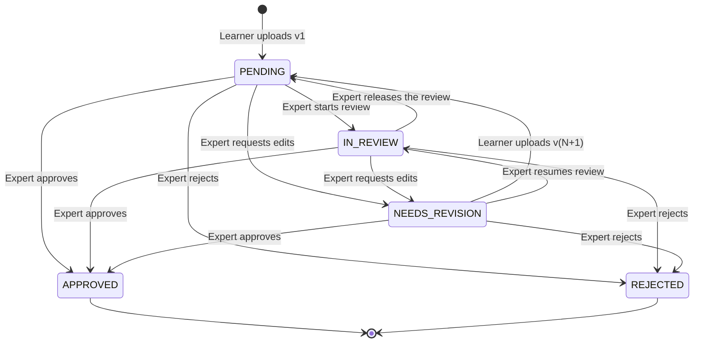
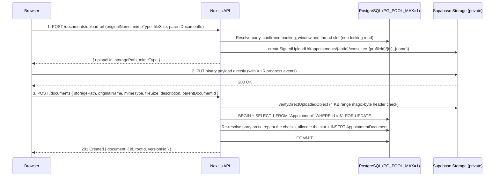

# 01 — Threaded Document Review & Storage Architecture

This page holds the invariants behind the upload pipeline and the review thread. The product overview, API contract and retention rules are in the [documents README](./README.md).

## 1. Data Model & Threading Invariants

Every deliverable uploaded to an `Appointment` is persisted in `AppointmentDocument` (`prisma/schema.prisma`):

- **Root Thread Row**: `rootDocumentId = null`, `responseToDocumentId = null`, `versionNo = 1`.
- **Child Revision / Reply Row**: `rootDocumentId = <root.id>`, `responseToDocumentId = <target.id>`, and the next `versionNo`. A thread holds at most 10 live learner versions; expert replies do not count, so `versionNo` can exceed 10.
- **Role Tag (`uploadedByRole`)**:
  - `CONSULTEE`: Learner submission awaiting expert review (`reviewStatus` starts at `PENDING`).
  - `CONSULTANT`: Expert reply or shared file. The row is stored `APPROVED`, and every reader ignores that value.
- **Thread status**: derived by `lib/documents/thread-view.ts` from the highest-`versionNo` live learner row, and `SHARED` when the root is an expert file. The stored `REJECTED` value reads as the thread status `NOT_ACCEPTED`.

---

## 2. Two-Phase Direct Upload & Serialized Slot Reservation

Under serverless connection pooling (`PG_POOL_MAX=1`), holding a database transaction open while uploading binary payloads would starve concurrent requests. Uploads are strictly separated into network transfer followed by a fast serialized database reservation:

An expert's reply file takes the same first two steps, but its row is written by the review route in the same transaction as the status change, so the commit route refuses an expert `parentDocumentId`.

### Core Server Invariants

1. **`PG_POOL_MAX=1` Transaction Discipline**:
   - Every database query inside `commitDocumentUpload` (`lib/documents/upload-pipeline.ts`) and `resolveDocumentThreadSlot` (`lib/documents/document-review.ts`) uses the transaction client `tx` exclusively.
   - If the transaction throws (`DOCUMENT_LIMIT_REACHED`, `VERSION_LIMIT_REACHED`, `INVALID_THREAD_PARENT`, or unexpected error), the catch handler deletes `storagePath` from Supabase Storage immediately so no unreferenced object lingers in the bucket. A unique-violation on `(thread, versionNo)` is retried up to twice by `withVersionConflictRetry`.
2. **Compare-and-Swap (`CAS-in-WHERE`) State Transitions**:
   - The review route (`POST .../:docId/review`) and soft deletion (`DELETE`) execute atomic `updateMany` transitions whose `WHERE` carries the expected prior state and the "no newer live learner version" guard.
   - Soft deletion sets `deletedAt`, `deletedById` and `removalReason = USER_REQUEST` (a learner may withdraw only while `reviewStatus = PENDING` and no newer version exists; an expert may delete only an own shared root). Physical object cleanup occurs after the grace window in `purge-deleted-documents`.
3. **Magic-Byte Inspection (`lib/documents/storage-verify.ts`)**:
   - Inspects the first 4,096 bytes of every uploaded object via HTTP `Range: bytes=0-4095`.
   - Unconditionally rejects binary executables (`MZ` PE, `\x7FELF`, shebang) even if renamed to `.pdf` or `.png`.
   - Verifies header signatures for `%PDF-`, PNG, JPEG (declared only as `image/jpeg`; `image/jpg` is not in the policy), GIF, RIFF/WebP, OLE2 Compound Document (`.doc`, `.xls`, `.ppt`), OOXML ZIP (`PK\x03\x04` for `.docx`, `.xlsx`, `.pptx`), and UTF-8 text or CSV without null bytes, each against the declared type from `lib/documents/file-policy.ts`.

---

## 3. Grouped, Session-Paged Libraries

The documents library pages by **session** (appointment), not by file, so a multi-version thread is never split across a page boundary. `readDocumentLibrary` (`lib/data/document-library.ts`) counts and pages appointments with `skip` and `take` (ten per page), loads each page's live rows with `threadRowSelect`, and builds the same `ThreadView` objects as the workspace. `toLibraryThread` (`lib/library/document-threads.ts`) turns each into one `LibraryDocument` row carrying `latest`, `versionCount` and `versions[]` newest first, so a library `files` entry is a thread, never a single version. Plan materials for the page's consultation and subscription plans are a separate per-group `materials` array, shown in their own table. Threads sort needs-you first, then by the latest update, then by id (`compareLibraryThreads`).

The recordings library follows the same paging and returns one row per session with its `parts[]` (`lib/data/recording-library.ts`).

- **Personal libraries**: `GET /api/dashboard/{consultant,consultee}/[profileId]/documents`, resolved by `lib/library/personal-library-route.ts`.
- **Organisation library**: `GET /api/organizations/[orgId]/documents?scope=mine|everyone`; the `everyone` scope returns counts only.
- **UI**: `LibraryBrowser` renders `ThreadTable` and `MaterialsTable` (`components/dashboard/library/DocumentTables.tsx`); expanding a thread lists its versions with "Superseded" and "Expert reply" labels.

## 4. Error Model

Document, material, recording, explore-recording, organisation-material and admin or staff document routes answer failures with `{ code, message }` from `lib/documents/file-errors.ts` (for example `REMOVAL_NOT_REQUESTED`, `SUPPORT_UNAVAILABLE`, `RECORDING_DECLINED`). The removal-request route returns `removal.supportThreadId`; if the support thread cannot be raised it withdraws the request with a conditional `updateMany` and answers 503 `SUPPORT_UNAVAILABLE`. The replay purchase route, the meeting recording-consent and recording-info routes and the verification routes keep their older shapes.

---

## Deprecated & Superseded Approaches

> [!WARNING]
> **Do NOT re-introduce these patterns.**

1. **Duplicate Upload Pipelines Across Consultant & Consultee Routes**: Previously, `app/api/appointments/[appointmentId]/documents/route.ts` and a separate `.../documents/consultant/route.ts` each duplicated 150+ lines of parsing, MIME validation, `FOR UPDATE` retry loops, and orphan rollback cleanup. All shared upload orchestration now resides in `lib/documents/upload-pipeline.ts`, and an expert's reply goes through the review route.
2. **Separate Single and Bulk Review Routes**: Previously, a single-document `PATCH` and `POST /api/documents/bulk-review` duplicated deep nested Prisma selects to resolve notification targets. Both routes are deleted; `POST .../:docId/review` is the only review path, and `lib/documents/document-notify.ts` resolves notification targets.
3. **Preflight-Only Version Cap Checks**: Earlier versions checked the version cap only during `/upload-url` preflight, permitting concurrent requests to race past it during commit. `resolveDocumentThreadSlot` now enforces the learner gate and the caps inside the `FOR UPDATE` critical section.
4. **Root-Thread Pagination Helpers**: `buildRootThreadStatusWhere` and `readConsulteeDocuments` paged root threads for each dashboard separately. They are replaced by the session-paged `readDocumentLibrary`.
5. **Flat Root-Only Library Rows**: Library `files` once held one row per thread root with the latest version's status, which hid version history. They are replaced by `LibraryDocument` threads with `versions[]`.
