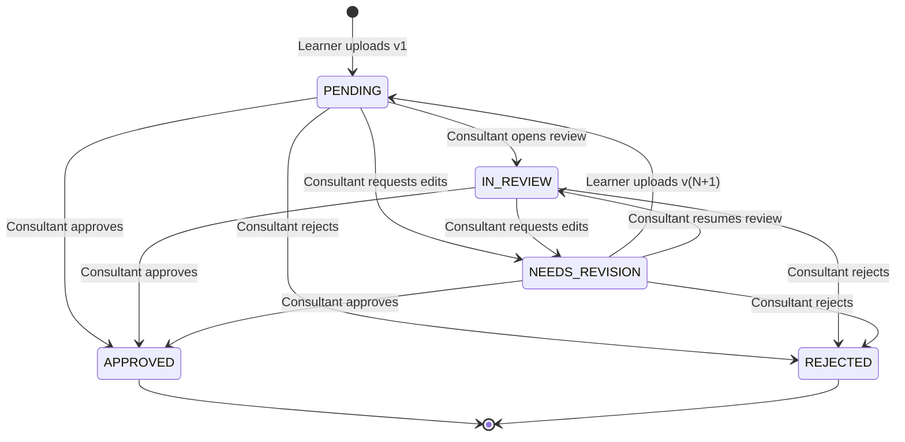
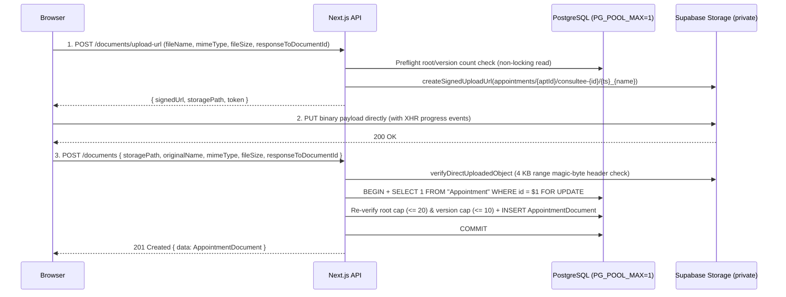

# 01 — Threaded Document Review & Storage Architecture

## 1. Data Model & Threading Invariants

Every deliverable uploaded to an `Appointment` is persisted in `AppointmentDocument` (`prisma/schema.prisma`):

- **Root Thread Row**: `rootDocumentId = null`, `responseToDocumentId = null`, `versionNo = 1`.
- **Child Revision / Reply Row**: `rootDocumentId = <root.id>`, `responseToDocumentId = <target.id>`, `versionNo = 2..10`.
- **Role Tag (`uploadedByRole`)**:
  - `CONSULTEE`: Learner submission awaiting expert review (`reviewStatus` starts at `PENDING`).
  - `CONSULTANT`: Expert feedback attachment or standalone resource (`reviewStatus` defaults to `APPROVED`).
- **Effective Thread Status (`effectiveStatus`)**:
  - Determined by the highest-`versionNo` active (`deletedAt IS NULL`) row uploaded by `CONSULTEE` within the thread (or the root row itself if the root is a standalone consultant resource).

---

## 2. Two-Phase Direct Upload & Serialized Slot Reservation

Under serverless connection pooling (`PG_POOL_MAX=1`), holding a database transaction open while uploading binary payloads would starve concurrent requests. Uploads are strictly separated into network transfer followed by a fast serialized database reservation:

### Core Server Invariants

1. **`PG_POOL_MAX=1` Transaction Discipline**:
   - Every database query inside `persistAppointmentDocumentWithRetry` (`lib/documents/upload-pipeline.ts`) and `resolveDocumentThreadSlot` (`lib/documents/document-review.ts`) uses the transaction client `tx` exclusively.
   - If the transaction throws (`DOCUMENT_LIMIT_REACHED`, `VERSION_LIMIT_REACHED`, `INVALID_THREAD_PARENT`, or unexpected error), the catch handler deletes `storagePath` from Supabase Storage immediately so no unreferenced object lingers in the bucket.
2. **Compare-and-Swap (`CAS-in-WHERE`) State Transitions**:
   - Single-document `PATCH`, bulk review (`POST /api/documents/bulk-review`), and soft-deletion (`DELETE`) execute atomic `prisma.appointmentDocument.updateMany({ where: { id, appointmentId, deletedAt: null, reviewStatus: expectedStatus }, data })` transitions.
   - Soft deletion sets `deletedAt = now()` (` CONSULTEE` allowed only while `reviewStatus = PENDING`; `CONSULTANT` allowed only on standalone `rootDocumentId = null` resources). Physical object cleanup occurs after the retention window in `reconcile-document-storage`.
3. **Magic-Byte Inspection (`lib/documents/storage-verify.ts`)**:
   - Inspects the first 4,096 bytes of every uploaded object via HTTP `Range: bytes=0-4095`.
   - Unconditionally rejects binary executables (`MZ` PE, `\x7FELF`, Mach-O 32/64/universal) even if renamed to `.pdf` or `.png`.
   - Verifies header signatures for `%PDF-`, PNG, JPEG, GIF, RIFF/WebP, OLE2 Compound Document (`.doc`), OOXML ZIP (`PK\x03\x04` for `.docx`), and UTF-8 text without null bytes.

---

## 3. SQL Root-Thread Pagination (`buildRootThreadStatusWhere`)

To guarantee that multi-version deliverable threads are never split across pagination boundaries (`limit` / `offset`), both dashboard endpoints query **root threads only** (`rootDocumentId: null, deletedAt: null`) with SQL-pushed `OR` predicates on `threadVersions`:

- **Consultant Dashboard**: `GET /api/dashboard/consultant/[consultantId]/documents`
- **Consultee Dashboard**: `GET /api/dashboard/consultee/[consulteeId]/documents` (`readConsulteeDocuments` in `lib/data/consultee-documents.ts`)

Both endpoints pass `baseRootWhere` to `buildRootThreadStatusWhere(baseRootWhere, status)` (`lib/documents/document-review.ts`), eager-load `threadVersions: { where: { deletedAt: null }, orderBy: { versionNo: "asc" } }`, apply `skip` and `take` directly on the root query, and count matching roots via `prisma.appointmentDocument.count({ where: rootWhere })`.

---

## Deprecated & Superseded Approaches

> [!WARNING]
> **Do NOT re-introduce these patterns.**

1. **Duplicate Upload Pipelines Across Consultant & Consultee Routes**: Previously, `app/api/appointments/[appointmentId]/documents/route.ts` and `app/api/appointments/[appointmentId]/documents/consultant/route.ts` each duplicated 150+ lines of JSON/FormData parsing, MIME validation, `FOR UPDATE` retry loops, and orphan rollback cleanup. All shared upload orchestration now resides in `lib/documents/upload-pipeline.ts`.
2. **Duplicate Notification Queries Across Single & Bulk Review Routes**: Previously, single review (`PATCH`) and bulk review (`POST /api/documents/bulk-review`) duplicated deep nested Prisma selects to resolve learner notification targets. Both routes now use `REVIEW_NOTIFICATION_APPOINTMENT_SELECT` and `extractReviewNotificationTarget` from `lib/documents/upload-pipeline.ts`.
3. **Preflight-Only Version Cap Checks**: Earlier versions checked `MAX_VERSIONS_PER_THREAD` only during `/upload-url` preflight, permitting concurrent requests to race past version 10 during commit. `resolveDocumentThreadSlot` now enforces `if (versionNo > maxVersionsPerThread) throw new Error("VERSION_LIMIT_REACHED")` inside the `FOR UPDATE` critical section.
