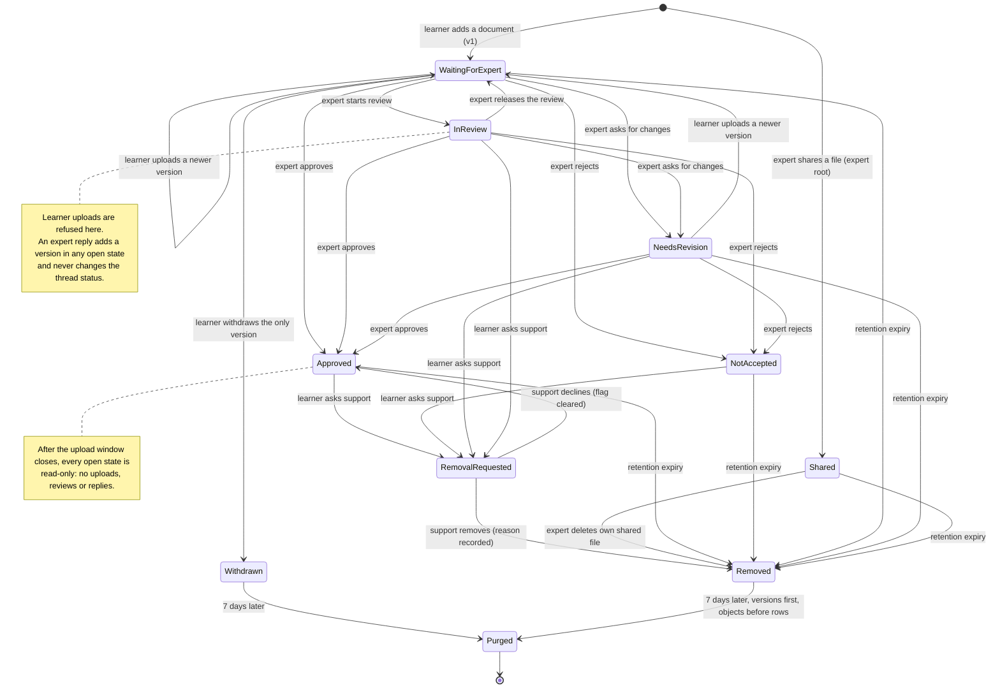
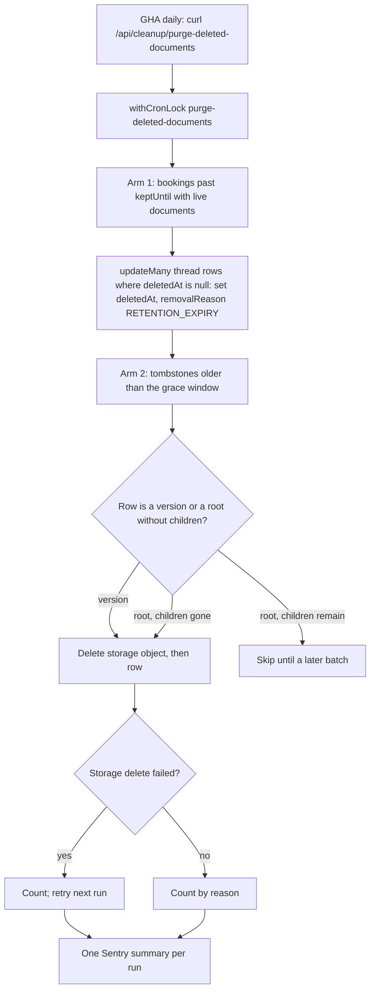
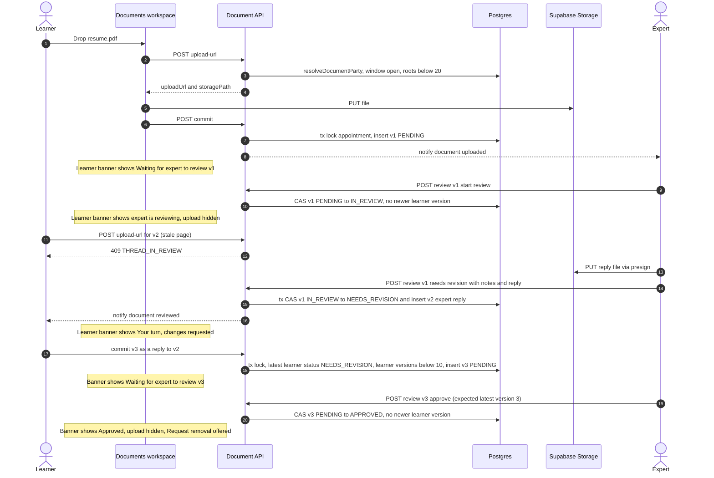
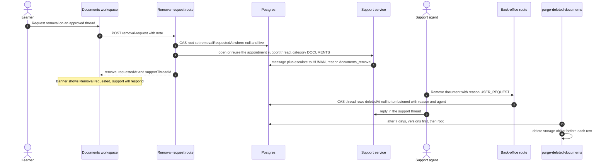
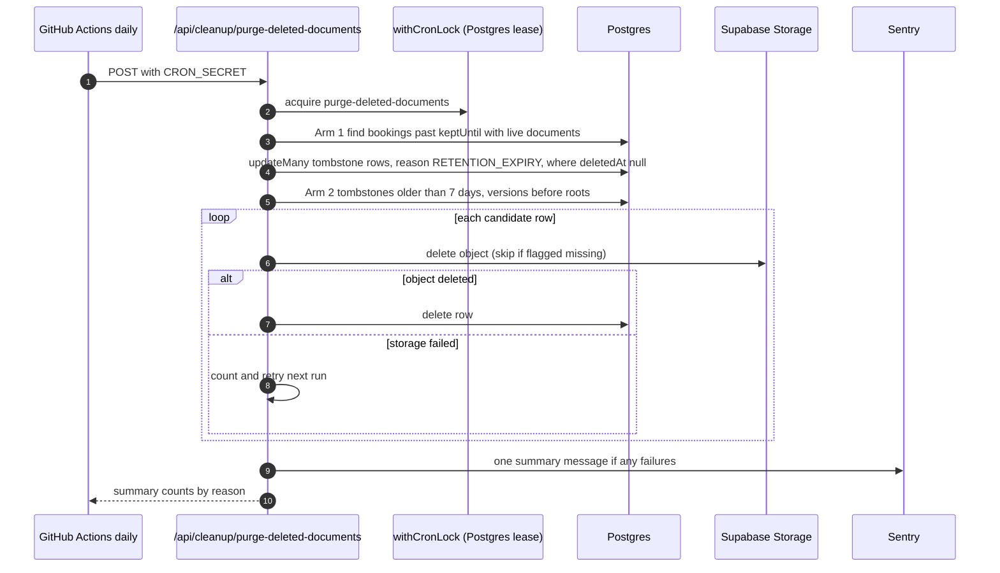

# Session Documents & Plan Materials

> Canonical architecture for the files attached to a booking: **session documents** (`AppointmentDocument`, the files a learner and an expert exchange with review rounds), **plan materials** (`PlanMaterial`, handouts an expert attaches to an offering) and how they relate to **recordings** ([stream/19](../stream/19-recordings-lifecycle-and-access.md)). The accepted decisions are recorded in [the ADR](../decisions/2026-10-12-session-documents-and-recordings.md).

> Status: parts of this architecture land with the documents & recordings mega-fix PR. They are marked inline; everything else describes code that exists today.

## Index

| #   | Document                                        | Scope                                                                                                         |
| --- | ----------------------------------------------- | ------------------------------------------------------------------------------------------------------------- |
| 01  | [Architecture & Invariants](01-architecture.md) | Threading model (`rootDocumentId`, `versionNo`), CAS state transitions, 2-phase direct upload, SQL pagination |

This README is the product and system overview. `01-architecture.md` holds the upload-pipeline details.

## What a booking can hold

| Kind             | Row                         | Who writes                                        | Who reads                       | Store                           |
| ---------------- | --------------------------- | ------------------------------------------------- | ------------------------------- | ------------------------------- |
| Session document | `AppointmentDocument`       | Learner (submission), expert (reply, shared file) | The two parties of that booking | Supabase `documents` bucket     |
| Plan material    | `PlanMaterial`              | Expert, once per offering                         | Every buyer of the offering     | Supabase `documents` bucket     |
| Recording        | `Recording` (see stream/19) | The call host, through Stream                     | Parties, by the slot rule       | Cloudflare R2 recordings bucket |

Documents are offered for consultations, subscriptions and trials (`supportsDocuments` in `lib/appointments/kind-capabilities.ts`). Group kinds (webinars, classes) have materials and recordings but no documents.

## Data model

- Each file is one `AppointmentDocument` row. A **thread** is `COALESCE(rootDocumentId, id)`, and `versionNo` is the 1-based sequence inside it. Live versions are unique per thread (sidecar index `appointment_doc_thread_version_unique` in `prisma/sql/check-constraints.sql`), and a live `storagePath` is unique (`AppointmentDocument_active_storagePath_key`). Application code never re-checks either rule.
- A learner row has `uploadedByRole = CONSULTEE` and a stored `reviewStatus` (`PENDING`, `IN_REVIEW`, `NEEDS_REVISION`, `APPROVED`, `NOT_ACCEPTED`). An expert row has `uploadedByRole = CONSULTANT` and `responseToDocumentId` set when it answers a learner version. Its stored status is ignored by every reader.
- Deletion is a tombstone: `deletedAt`, `deletedById` and a `removalReason`. The purge removes the object and then the row.
- Two nullable columns on the thread's root record the removal flow (see below). Both are additive, so the launch schema freeze is respected.

> Status: lands with the documents & recordings mega-fix PR.

| Column               | Type                                                                            | Meaning                                                               |
| -------------------- | ------------------------------------------------------------------------------- | --------------------------------------------------------------------- |
| `removalRequestedAt` | `DateTime? @db.Timestamptz`                                                     | The learner asked support to remove the thread. Set on the root only. |
| `removalReason`      | `DocumentRemovalReason?` (`USER_REQUEST`, `RETENTION_EXPIRY`, `SUPPORT_ACTION`) | Why a row was tombstoned. Survives until the purge.                   |

Run `npx prisma generate` after editing the schema, and check drift read-only with `npx prisma migrate diff --from-config-datasource --to-schema prisma/schema.prisma --script`. Never `db push`: it would drop the `prisma/sql` sidecar indexes.

The window and the retention date are computed from occurrences and `BookingStatusHistory`; no column stores them.

## The thread and version model

- A learner **submission** is a root with `versionNo = 1`. Every later learner upload or expert reply is the next version of the same thread.
- **An expert reply is a version.** It is labelled "Expert reply", can carry notes and a file, and never shows a review status. The thread's status is derived only from the latest live learner version.
- **The learner may add a version only while the latest live learner version is `PENDING` or `NEEDS_REVISION`.** While the expert is reviewing (`IN_REVIEW`) and after a final decision (`APPROVED`, `NOT_ACCEPTED`) the upload control is hidden, and the server refuses with a typed error. An expert's shared file is never revised by a learner.
- **The cap is 10 learner versions per document.** Expert replies do not count. `versionNo` keeps counting every row, so it can exceed 10. At the cap the card reads "All 10 versions used" instead of showing a button that fails.
- A booking holds at most 20 live threads.
- The server builds the thread view in one place (`lib/documents/thread-view.ts`). It returns the derived status, the banner, the removal flag, the learner-version counter, `allowedActions` and the versions without URLs. The UI renders `allowedActions` and never decides on its own.
- "Superseded" is derived, never stored: a review whose target has a newer live learner version fails with `SUPERSEDED`.

> Status: the version rules, the 10-learner-version cap, `thread-view.ts` and `allowedActions` land with the documents & recordings mega-fix PR.

### Thread state machine

The stored per-row `reviewStatus` enum is unchanged. The thread status is derived from its latest live learner version.



"Removal requested" is an orthogonal flag on the thread, drawn as a state for clarity. When support declines, the thread returns to whichever state it had.

### Guards

Every transition is a conditional write whose `WHERE` carries the expected prior state, inside the existing transaction where one exists. Inside `prisma.$transaction`, every helper receives `tx`, never the global client (`PG_POOL_MAX=1`). No status sweep exists.

| Transition                                              | Where                                                  | Guard (inside the transaction)                                                                                                                                                                            | Refusal                                                                              |
| ------------------------------------------------------- | ------------------------------------------------------ | --------------------------------------------------------------------------------------------------------------------------------------------------------------------------------------------------------- | ------------------------------------------------------------------------------------ |
| Learner adds a document                                 | Commit route via `persistAppointmentDocumentWithRetry` | `SELECT ... FOR UPDATE` on the appointment; party is the learner; booking not terminal; window open; live roots below 20                                                                                  | `APPOINTMENT_TERMINAL`, `UPLOAD_WINDOW_CLOSED`, `DOCUMENT_LIMIT_REACHED`             |
| Learner uploads a newer version                         | Same, `resolveDocumentThreadSlot`                      | Learner root; latest live learner row is `PENDING` or `NEEDS_REVISION`; live learner rows below 10; window open                                                                                           | `THREAD_IN_REVIEW`, `THREAD_CLOSED`, `VERSION_LIMIT_REACHED`, `UPLOAD_WINDOW_CLOSED` |
| Expert review (start, release, revise, approve, reject) | `POST .../:docId/review`                               | Party is the expert; `updateMany` where the row is live, learner-authored, has the expected `reviewStatus` and **no newer live learner version**; transition allowed by `REVIEW_TRANSITIONS`; window open | `SUPERSEDED`, `INVALID_REVIEW_TRANSITION`, `UPLOAD_WINDOW_CLOSED`                    |
| Expert reply file                                       | Same request, same transaction as the status write     | Thread live, window open; the reply row is inserted after the compare-and-set succeeds; a failed transaction deletes the presigned object                                                                 | `UPLOAD_WINDOW_CLOSED`                                                               |
| Learner withdraws the latest pending version            | `DELETE .../:docId`                                    | `updateMany` where learner-authored, `PENDING`, live, and no higher live version; sets the tombstone with `USER_REQUEST`                                                                                  | `DOCUMENT_NOT_DELETABLE`                                                             |
| Expert deletes an own shared file                       | `DELETE .../:docId`                                    | `updateMany` where expert-authored, root, live; tombstones the root and its versions                                                                                                                      | `DOCUMENT_NOT_DELETABLE`                                                             |
| Learner requests removal                                | `POST .../:docId/removal-request`                      | `updateMany` on the root where `removalRequestedAt` is null, live, and the latest learner status is not `PENDING`                                                                                         | `REMOVAL_ALREADY_REQUESTED`, `THREAD_CLOSED`                                         |
| Support removes or declines                             | Back-office route                                      | Remove: `updateMany` on live thread rows, sets tombstone and reason. Decline: clears `removalRequestedAt` on the root                                                                                     | 409 on a lost race                                                                   |
| Retention tombstone                                     | Purge arm 1                                            | `updateMany` where live and the booking's retention date has passed                                                                                                                                       | n/a                                                                                  |

> Status: the review route, removal-request route and back-office removal route land with the documents & recordings mega-fix PR.

### One party resolver

Every document route, the viewer page and the workspace page resolve the caller through one function, so party logic exists once and trials work.

- `resolveDocumentParty(db, appointmentId, userId)` in `lib/documents/document-party.ts` returns the caller's role (`learner` or `expert`) and the booking facts: kind, terminal state and time, the last live session's end, whether a session is upcoming, and the display names.
- Arms: consultation requester or plan owner; subscription requester or plan owner; trial learner or trial consultant.
- `terminal` extends `isBookingTerminal` with a trial arm. `terminalAt` comes from the cancelling `BookingStatusHistory` row.
- It takes `db`, so it runs on `tx` inside a transaction.

> Status: lands with the documents & recordings mega-fix PR.

## The 30-day upload window

- `uploadWindowClosesAt` = the last **live** session's `endsAt` + 30 days. Live sessions exclude deleted, `CANCELLED` and `RESCHEDULED` occurrences. For a subscription or multi-session booking this is the last occurrence.
- While any session is upcoming, or a subscription still has sessions to allocate, the window is open. A terminal booking is read-only immediately.
- The window is computed, not stored. It is checked inside the commit and review transactions, and returned by the workspace read and the hub summary.
- When it closes, the thread is read-only for **both** sides: no uploads, reviews or replies, including a review that was started before. Opening and downloading continue until the retention date, and a removal request stays available.
- The UI always states the reason and the date: "Uploads closed on 9 Nov, 30 days after the last session."

> Status: lands with the documents & recordings mega-fix PR.

## Removal requests and the status banner

A reviewed document cannot be deleted by the learner, because the expert's review refers to it. The learner asks support instead.

1. The learner chooses "Request removal" on a reviewed thread. The route sets `removalRequestedAt` on the root with a conditional write.
2. In the same request it opens or reuses the booking's `AppointmentSupportThread` in category `DOCUMENTS` through the support service, posts a message naming the document, and escalates to a human with reason `documents_removal`. The scripted documents flow gains the option "Remove a document I shared".
3. The thread banner reads "Removal requested on 5 Oct. Support will respond." The expert sees "Rahul asked support to remove this."
4. A support agent opens the case. The back-office route `POST /api/staff/appointments/:appointmentId/documents/:documentId/removal`, gated by `requireBackofficeSurface("appointments.manage")`, offers **Remove** or **Decline**.
   - Remove tombstones every version of the thread with `removalReason = USER_REQUEST` and the agent as `deletedById`. The purge removes the objects 7 days later.
   - Decline clears `removalRequestedAt`, and the agent's reply in the support thread explains why.
   - Support may also remove a document on its own initiative with `removalReason = SUPPORT_ACTION`.

> Status: lands with the documents & recordings mega-fix PR.

**Banner per state.** Every thread shows who acts next and since when, from the viewer's side. For an organisation booking, the banner names the consultancy as well as the person when the deliverer acts for an org ("Waiting for Angela Anderson (Acme Consulting) to review").

| Thread state            | Learner sees                                                                       | Expert sees                                    |
| ----------------------- | ---------------------------------------------------------------------------------- | ---------------------------------------------- |
| Waiting for expert      | "Waiting for Angela Anderson to review v3 (since 2 Oct)."                          | "Rahul uploaded v3 on 2 Oct. Your turn."       |
| In review               | "Angela Anderson is reviewing v3. You can upload again once she responds."         | "You started reviewing v3 on 3 Oct."           |
| Needs revision          | "Your turn: Angela asked for changes on 3 Oct."                                    | "Waiting for Rahul to upload a revision."      |
| Approved / Not accepted | "Approved by Angela Anderson on 4 Oct."                                            | "You approved v3 on 4 Oct."                    |
| Shared                  | "Shared by Angela Anderson on 1 Oct."                                              | "You shared this on 1 Oct."                    |
| Removal requested       | "Removal requested on 5 Oct. Support will respond in your session's support chat." | "Rahul asked support to remove this on 5 Oct." |
| Window closed (overlay) | "Read-only since 9 Nov. Kept until 7 Feb 2027."                                    | same                                           |

## Retention and the purge

Documents are tombstoned 90 days after the booking ends and purged 7 days after that, by **one** job registered in `lib/cron/cleanup-registry.ts` (`@cleanup-twin purge-deleted-documents`, reachable at `/api/cleanup/purge-deleted-documents` and from `/api/admin/system-jobs/run`). The daily GitHub Actions step calls the route with `curl`, like the `auth-tokens` step. There is no wrapper under `jobs/`, and the job is not on the Netlify ticker.

| Booking                        | Kept until                                                                                      |
| ------------------------------ | ----------------------------------------------------------------------------------------------- |
| Consultation, trial            | Last live session's `endsAt` + 90 days                                                          |
| Subscription                   | Last live session's `endsAt` + 90 days; none while sessions remain or are still to be allocated |
| Cancelled, rejected or expired | Time of the cancelling `BookingStatusHistory` row + 90 days                                     |

The date is computed and returned as `keptUntil`. The UI shows "Kept until <date>".



- **Arm 1 (retention tombstone).** Select appointments with live documents whose live occurrences all ended before `now - 90 days`, or which became terminal before the cutoff. Tombstone their rows with one conditional `updateMany` per appointment, setting `removalReason = RETENTION_EXPIRY`. Batches are bounded.
- **Arm 2 (purge).** Process versions before roots, so a root is purged only when no live or tombstoned child remains. Otherwise the `onDelete: SetNull` relation would turn surviving versions into separate one-version documents. The storage object is deleted before its row; rows flagged `isStorageMissing` skip the storage call.
- **One grace constant** is shared by the purge and `reconcile-document-storage`, so the orphan sweep never treats an object as unreferenced while the purge still owns it.
- **Reporting.** One `reportSentryMessage` per run on failures, never per row. The summary counts rows by reason: `{ tombstoned, purged, failedStorage, failedRows, byReason }`.

> Status: arm 1, the registry entry, versions-before-roots ordering, `removalReason` and the shared grace constant land with the documents & recordings mega-fix PR.

**Cancelled bookings are read-only until retention.** A cancelled, rejected or expired booking keeps its documents readable for **both** parties until the `keptUntil` date. Uploads, reviews and replies are refused with `APPOINTMENT_TERMINAL`, and both sides see one message: "This booking was cancelled on 4 Oct. Its files are read-only and kept until 2 Jan." Recordings follow the same rule, so the two halves of one booking never differ.

## Storage: Supabase for documents, R2 for recordings

|              | Session documents and plan materials                                                                                             | Recordings                                                                                                      |
| ------------ | -------------------------------------------------------------------------------------------------------------------------------- | --------------------------------------------------------------------------------------------------------------- |
| Store        | Supabase Storage, private bucket `documents`                                                                                     | Cloudflare R2 private recordings bucket, with preview clips in the public Supabase `recordings-previews` bucket |
| Object size  | Up to 10 MB each (`MAX_DOCUMENT_BYTES`)                                                                                          | Hundreds of MB to several GB                                                                                    |
| Write path   | Browser uploads straight to a presigned URL; the server verifies the object (magic bytes) and commits the row in one transaction | Server-side pull from Stream into R2 by `transfer-recordings`, with retries                                     |
| Read path    | On-demand link: 60 seconds for a download, 5 minutes for the viewer page embed                                                   | On-demand presigned link, 4 to 24 hours by recording length                                                     |
| Read pattern | Opened a few times, small                                                                                                        | Streamed with range requests, rewatched, sometimes sold                                                         |
| Cleanup      | Tombstone, purge after the grace window, daily orphan reconcile                                                                  | `expire-recordings` retention, asset deletion on expert delete and on hard delete                               |

**Why two stores.** Recordings are large, long-lived and streamed repeatedly, so egress dominates their cost, and R2 charges no egress. Supabase Storage caps the size of a single upload by plan, and a long recording exceeds the lower caps. Documents are small, opened rarely, and already sit next to the database and auth stack, so moving them to R2 would add a second signing path for no saving. The split follows object size and read pattern, and each side has exactly one signing helper. See [storage management](../storage/management-strategy.md).

Files are always reached through an access-checked route that signs a fresh link on demand. Rows store a canonical route path rather than a time-limited link, because stored links go stale; API payloads do not return a stored link.

## "Open" and "Download"

- **Open** is a plain link that opens a new tab on a same-origin viewer route: `/files/documents/[documentId]` or `/files/materials/[materialId]`. The route authorises, signs a fresh link on every load, embeds the file and renders friendly HTML on any error. Middle-click and copy-link work, and a reload re-signs.
- **Download** keeps the JSON preflight (`?format=json`) so a failure returns to the page as a toast.
- There is no in-drawer preview and no byte proxying through a function.

> Status: the viewer routes land with the documents & recordings mega-fix PR.

## Pages and routes per role

The appointment details page is the **hub**. It shows a snapshot card for each of Documents, Materials and Recordings and links to dedicated per-appointment pages. The cross-session libraries stay, grouped by appointment.

| Page                         | Consultant (owner, collaborator)                                    | Consultee                                                         | Organisation (participant)                                     |
| ---------------------------- | ------------------------------------------------------------------- | ----------------------------------------------------------------- | -------------------------------------------------------------- |
| Appointment details (hub)    | `/dashboard/consultant/[consultantId]/appointments/[appointmentId]` | `/dashboard/consultee/[consulteeId]/appointments/[appointmentId]` | `/dashboard/organization/[orgId]/appointments/[appointmentId]` |
| Documents workspace          | `.../appointments/[appointmentId]/documents`                        | same                                                              | same                                                           |
| Recording details            | `.../appointments/[appointmentId]/recordings`                       | same                                                              | same                                                           |
| Documents library (grouped)  | `/dashboard/consultant/[consultantId]/documents`                    | `/dashboard/consultee/[consulteeId]/documents`                    | `/dashboard/organization/[orgId]/documents`                    |
| Recordings library (grouped) | `/dashboard/consultant/[consultantId]/recordings`                   | `/dashboard/consultee/[consulteeId]/recordings`                   | `/dashboard/organization/[orgId]/recordings`                   |
| File viewer (new tab only)   | `/files/documents/[documentId]`, `/files/materials/[materialId]`    | same                                                              | same                                                           |

> Status: the Documents workspace, Recording details and file viewer pages land with the documents & recordings mega-fix PR.

| Role                                                         | Hub cards                        | Documents workspace                                                                                                                         | Recording details                                      |
| ------------------------------------------------------------ | -------------------------------- | ------------------------------------------------------------------------------------------------------------------------------------------- | ------------------------------------------------------ |
| Learner (requester, trial learner, seat holder; org learner) | Documents, Materials, Recordings | Own threads; new document, bulk upload, new version (while waiting or needs revision), withdraw the latest pending version, request removal | Own batch by slot, parts, catch-up; Watch              |
| Expert (plan owner, trial consultant; org deliverer)         | Same, with a "needs you" count   | Review queue; review, reply, share a file, delete an own shared file                                                                        | All parts of the appointment; manage sheet             |
| Co-host (accepted collaborator)                              | Materials, Recordings            | Not applicable (group kinds have no documents)                                                                                              | Host view for the batches of plans they collaborate on |
| Org owner or manager who is not a party                      | Session summary only             | No page (redirect to the hub with a notice)                                                                                                 | No page (redirect to the hub with a notice)            |
| Platform staff                                               | Back-office tools                | Reached from the support case; can tombstone a document with a reason                                                                       | Unchanged                                              |

### Wireframes

**Appointment details hub (learner, subscription).**

```
+----------------------------------------------------------------------------------+
| Career Coaching · 6 sessions · with Angela Anderson            [In progress]      |
+-----------------------------------------------+----------------------------------+
| Sessions / Money / Support (unchanged)        | DOCUMENTS                          |
|                                               |  3 documents · 1 needs your change |
|                                               |  Resume v3 · Waiting for Angela    |
|                                               |  Uploads open until 9 Nov          |
|                                               |  [Open documents ->]               |
|                                               |------------------------------------|
|                                               | MATERIALS                          |
|                                               |  Interview rubric.pdf    [Open ↗]  |
|                                               |  Roadmap workbook.docx  [Download] |
|                                               |  + 2 more            [See all ->]  |
|                                               |------------------------------------|
|                                               | RECORDINGS                         |
|                                               |  4 of 6 sessions recorded          |
|                                               |  Latest: Session 4 · 2 parts       |
|                                               |  Kept until 1 Jan 2027             |
|                                               |  [Open recordings ->]              |
+-----------------------------------------------+----------------------------------+
```

The hub adds no request. `readAppointmentDetail` returns a `resources` summary (documents: thread count, threads needing the viewer, latest activity, window close and `keptUntil`; materials: count and the first few; recordings: sessions recorded and total, parts, latest recording, `keptUntil`) computed in the same read.

**Documents workspace, learner.**

```
+----------------------------------------------------------------------------------+
| <- Back to session   Documents · Career Coaching with Angela Anderson             |
| Uploads open until 9 Nov 2026 (30 days after your last session).                  |
| Files are kept until 7 Feb 2027 (90 days after the booking ends).                 |
+----------------------------------------------------------------------------------+
| [ Drop files here or Browse ]  PDF, Word, images, text · 10 MB each · 3/20 used   |
|   resume.pdf ........ uploading 62%                                               |
|   cover-letter.docx . done                                                        |
|   photo.heic ........ not supported (HEIC)                     [Remove]           |
+----------------------------------------------------------------------------------+
| Filter: [All] [Your turn] [Waiting for expert] [Done]           Sort: [Recent v]  |
|                                                                                    |
| ┌ Resume ─────────────────────────────────────────────── v3 · Waiting for Angela ┐|
| │ ⓘ Waiting for Angela Anderson to review your latest version (since 2 Oct).      │|
| │ v3  You            resume-v3.pdf   2 Oct   "Fixed section 2"       [Open ↗][⬇]  │|
| │ v2  Expert reply   resume-notes.pdf 1 Oct  "Tighten the summary"   [Open ↗][⬇]  │|
| │     Needs revision · "Tighten the summary; quantify impact"                     │|
| │ v1  You            resume.pdf      28 Sep                         [Open ↗][⬇]  │|
| │ [Upload new version]  [Withdraw v3]                    1 of 10 versions left: 7 │|
| └──────────────────────────────────────────────────────────────────────────────────┘|
| ┌ Tax return 2025 ───────────────────────────────────────── v1 · Approved ───────┐|
| │ ✓ Approved by Angela Anderson on 30 Sep.                                        │|
| │ [Open ↗] [⬇]                                        [Request removal]           │|
| └──────────────────────────────────────────────────────────────────────────────────┘|
| ┌ Interview checklist ───────────────────────────────── Shared by Angela ────────┐|
| │ [Open ↗] [⬇]                                                                    │|
| └──────────────────────────────────────────────────────────────────────────────────┘|
+----------------------------------------------------------------------------------+
```

**Documents workspace, expert.**

```
+----------------------------------------------------------------------------------+
| <- Back to session   Documents · Career Coaching with Rahul Mehta                 |
| Uploads open until 9 Nov 2026 · Kept until 7 Feb 2027        [Share a file]       |
+----------------------------------------------------------------------------------+
| Filter: [Needs you (1)] [Waiting for learner] [Done] [Shared by you]              |
| ┌ Resume ───────────────────────────────────────────── v3 · Your turn ───────────┐|
| │ ⓘ Rahul uploaded v3 on 2 Oct. Waiting for you to review.                        │|
| │ timeline (as learner view)                                                      │|
| │ ── Review v3 ──────────────────────────────────────────────────────────────── │|
| │ ( ) Start review   ( ) Needs revision   ( ) Approve   ( ) Not accepted          │|
| │ Feedback: [______________________________________________]                      │|
| │ Attach a reply file (optional): [Choose file]  -> becomes v4 "Expert reply"     │|
| │                                                        [Send feedback]          │|
| └──────────────────────────────────────────────────────────────────────────────────┘|
| ┌ Tax return 2025 ─────────────── v1 · Approved · Removal requested ─────────────┐|
| │ ⓘ Removal requested by Rahul on 5 Oct. Support will respond.                    │|
| └──────────────────────────────────────────────────────────────────────────────────┘|
+----------------------------------------------------------------------------------+
```

When the upload window has closed, both variants replace the dropzone and composer with: "This booking's documents are read-only since 9 Nov 2026 (30 days after the last session). Files are kept until 7 Feb 2027."

**Documents library (expert view), grouped by appointment.**

```
+----------------------------------------------------------------------------------+
| Documents                                    Search [__________]                  |
| Learner [All v]  Kind [All v]  Status [Needs you v]  Date [from]-[to]   [Clear]   |
+----------------------------------------------------------------------------------+
| ▾ Career Coaching · Rahul Mehta · 2 Oct                 [Open workspace ->]       |
|     Resume            v3   Your turn             2 Oct                            |
|     Tax return 2025   v1   Removal requested     5 Oct                            |
| ▾ Mock Interview · Priya Shah · 28 Sep                  [Open workspace ->]       |
|     Portfolio.pdf     v2   Waiting for learner   29 Sep                            |
+----------------------------------------------------------------------------------+
| 1-2 of 14 sessions                                         [<] page 1 of 7 [>]    |
+----------------------------------------------------------------------------------+
```

In the learner's view the person filter is "Expert". Library rows never act on a file except "Open"; every action happens in the workspace. Collaborators and co-hosts see only appointments they are a party to. The status filter reads the **latest** learner version in SQL.

**File viewer (new tab).**

```
+----------------------------------------------------------------------------------+
| resume-v3.pdf · Career Coaching · v3 (You)                 [Download] [Close tab] |
|----------------------------------------------------------------------------------|
|  <iframe or img with a freshly signed URL>                                        |
+----------------------------------------------------------------------------------+
  Error state (same URL, HTML, never JSON):
+----------------------------------------------------------------------------------+
|  This file is no longer available.                                                |
|  It was removed on 5 Oct, or the booking's files are no longer kept.              |
|  [Back to the session]                                                            |
+----------------------------------------------------------------------------------+
```

The Recording details and recordings-library wireframes are in [stream/19](../stream/19-recordings-lifecycle-and-access.md#the-recording-details-page).

### Rendering, data fetching and URL state

All pages are per-user and dynamic, so there is no `revalidatePath` or tag to manage; freshness comes from TanStack Query invalidation. The server component authorises, resolves the party and prefetches; the client component renders and mutates.

| Page                | Query keys                                                                      | Freshness                                                                                                                         |
| ------------------- | ------------------------------------------------------------------------------- | --------------------------------------------------------------------------------------------------------------------------------- |
| Hub                 | `["appointment-detail", id]`                                                    | Invalidated by every document or recording mutation                                                                               |
| Documents workspace | `documentKeys.workspace(id)`                                                    | `staleTime` 30 s, refetch on focus; every mutation invalidates workspace, hub and library keys through one `documentKeys` factory |
| Recording details   | `recordingKeys.appointment(id)`                                                 | Playback URLs are never cached: each Watch calls `GET /api/stream/recordings/:id`                                                 |
| Libraries           | `documentKeys.library(scope, filters)`, `recordingKeys.library(scope, filters)` | `keepPreviousData` paging                                                                                                         |
| File viewer         | none                                                                            | Signs on every render; `Cache-Control: private, no-store`, `Referrer-Policy: no-referrer`                                         |

Every API response carrying file metadata sends `Cache-Control: private, no-store`. URL state: libraries use `useListParams` with `person`, `kind`, `status`, `from`, `to`, `q`, `view` and `page`; the workspace uses `?thread=<rootId>` and `?filter=your-turn|waiting|done|shared`; Recording details uses `?slot=<ordinal>&r=<recordingId>`.

Empty, loading and error states are explicit per page: card skeletons on the hub, a `loading.tsx` skeleton on the workspace, "No documents yet. Share files with your expert from the documents page." when empty, and for a cancelled booking the single read-only message above for both roles (never a Retry that cannot succeed).

## API contract

| Method and path                                                         | Body / query                                                                                      | Response                                                                                                                                                                    | Errors                                                                                                                                                    |
| ----------------------------------------------------------------------- | ------------------------------------------------------------------------------------------------- | --------------------------------------------------------------------------------------------------------------------------------------------------------------------------- | --------------------------------------------------------------------------------------------------------------------------------------------------------- |
| `GET /api/appointments/:id/documents`                                   | none                                                                                              | `{ booking: { kind, title, counterpart, viewerRole, terminal, uploadWindow: { closesAt, open }, keptUntil }, limits: { documents: { used, max: 20 } }, threads: Thread[] }` | 401, 404                                                                                                                                                  |
| `POST /api/appointments/:id/documents/upload-url`                       | `{ fileName, mimeType, size, parentDocumentId? }`                                                 | `{ uploadUrl, storagePath }`                                                                                                                                                | `FILE_TOO_LARGE`, `UNSUPPORTED_FILE_TYPE`, `UPLOAD_WINDOW_CLOSED`, `THREAD_IN_REVIEW`, `THREAD_CLOSED`, `VERSION_LIMIT_REACHED`, `DOCUMENT_LIMIT_REACHED` |
| `POST /api/appointments/:id/documents` (commit)                         | `{ storagePath, originalName, description?, parentDocumentId? }`                                  | `{ thread: Thread }`                                                                                                                                                        | Same as above, rechecked inside the transaction                                                                                                           |
| `POST /api/appointments/:id/documents/:docId/review` (expert)           | `{ reviewStatus?, reviewNotes?, expectedLatestVersionNo, reply?: { storagePath, originalName } }` | `{ thread: Thread }`                                                                                                                                                        | `SUPERSEDED`, `INVALID_REVIEW_TRANSITION`, `UPLOAD_WINDOW_CLOSED`, `THREAD_CLOSED`                                                                        |
| `DELETE /api/appointments/:id/documents/:docId`                         | none                                                                                              | `{ thread: Thread \| null }`                                                                                                                                                | `DOCUMENT_NOT_DELETABLE`                                                                                                                                  |
| `POST /api/appointments/:id/documents/:docId/removal-request` (learner) | `{ note?: string }` (max 500 characters)                                                          | `{ removal: { requestedAt, supportThreadId } }`                                                                                                                             | `THREAD_CLOSED`, `REMOVAL_ALREADY_REQUESTED`                                                                                                              |
| `GET /api/appointments/:id/documents/:docId/download?format=json`       | `disposition=attachment`                                                                          | `{ signedUrl, originalName, mimeType }`                                                                                                                                     | Typed errors                                                                                                                                              |
| `GET /api/dashboard/{consultant,consultee}/:profileId/documents`        | `person`, `kind`, `status`, `from`, `to`, `q`, `page`                                             | `{ groups: { appointment, threads: ThreadSummary[] }[], total, page, pageSize, facets }`                                                                                    | 401, 403                                                                                                                                                  |

Bulk upload is N independent presign-and-commit pairs run by the client with a concurrency of 3. Each commit is its own transaction against the 20-document cap, and each file reports its own result. No batch endpoint exists.

```ts
type Thread = {
  rootId: string;
  title: string; // root's originalName
  kind: "submission" | "shared"; // learner root vs expert handout
  status:
    | "WAITING_FOR_EXPERT"
    | "IN_REVIEW"
    | "NEEDS_REVISION"
    | "APPROVED"
    | "NOT_ACCEPTED"
    | "SHARED";
  banner: {
    kind: BannerKind;
    actorName: string;
    since: string;
    until?: string;
  };
  removal: { requestedAt: string; supportThreadId: string } | null;
  learnerVersions: { used: number; max: 10 };
  allowedActions: (
    | "upload_version"
    | "withdraw_latest"
    | "review"
    | "reply"
    | "delete_shared"
    | "request_removal"
  )[];
  versions: {
    id: string;
    versionNo: number;
    by: "learner" | "expert";
    label: "Your version" | "Learner version" | "Expert reply" | "Shared file";
    originalName: string;
    mimeType: string;
    fileSize: number;
    uploadedAt: string;
    note: string | null;
    feedback: string | null;
    reviewStatus: string | null; // null on expert rows
    superseded: boolean;
    storageMissing: boolean;
  }[]; // no URLs: Open and Download are built from ids
};
```

> Status: the workspace read, review and removal-request routes and the `Thread` shape land with the documents & recordings mega-fix PR.

## Typed error model and copy

Every document, material and recording route returns one error shape, parsed with Zod at the client boundary (`lib/files/error-copy.ts` maps code to copy for toasts and the viewer page).

```ts
export const FileApiErrorCode = z.enum([
  "UNAUTHORIZED",
  "FORBIDDEN",
  "NOT_FOUND",
  "APPOINTMENT_TERMINAL",
  "STORAGE_MISSING",
  "STORAGE_UNAVAILABLE",
  "SUPERSEDED",
  "THREAD_CLOSED",
  "THREAD_IN_REVIEW",
  "UPLOAD_WINDOW_CLOSED",
  "VERSION_LIMIT_REACHED",
  "DOCUMENT_LIMIT_REACHED",
  "FILE_TOO_LARGE",
  "UNSUPPORTED_FILE_TYPE",
  "REMOVAL_ALREADY_REQUESTED",
  "OWN_RECORDING_AVAILABLE",
  "LATE_JOIN_HIDDEN",
  "RATE_LIMITED",
  "GONE",
  "SERVER_ERROR",
]);
export const FileApiErrorSchema = z.object({
  code: FileApiErrorCode,
  message: z.string(),
  retryable: z.boolean().optional(),
  closedAt: z.string().datetime().optional(),
});
export type FileApiError = z.infer<typeof FileApiErrorSchema>;
```

Copy is keyed on `code` and on who is looking, never on the HTTP status alone, and server `message` text is never shown for 5xx.

| Code (HTTP)                                            | Learner copy                                                                                                                 | Expert copy                                                      | Action                          |
| ------------------------------------------------------ | ---------------------------------------------------------------------------------------------------------------------------- | ---------------------------------------------------------------- | ------------------------------- |
| `UNAUTHORIZED` (401)                                   | "You were signed out. Sign in again to open this file."                                                                      | same                                                             | Sign-in link with `callbackUrl` |
| `FORBIDDEN` (403)                                      | "You don't have access to this file."                                                                                        | same                                                             | none                            |
| `APPOINTMENT_TERMINAL` (403)                           | "This booking was cancelled, so its files are read-only."                                                                    | same                                                             | Link to the session             |
| `NOT_FOUND` (404) / `GONE` (410)                       | "This file was removed."                                                                                                     | same                                                             | Refresh                         |
| `STORAGE_MISSING` (404)                                | Own file: "This file didn't finish saving. Upload it again." Expert's file: "Ask your expert to upload it again."            | Mirror                                                           | Upload only for the uploader    |
| `STORAGE_UNAVAILABLE` (503)                            | "Files are temporarily unavailable. Try again in a moment."                                                                  | same                                                             | Retry                           |
| `SUPERSEDED` (409)                                     | "A newer version was uploaded. Refresh to see it."                                                                           | "The learner uploaded a newer version. Review that one instead." | Refresh                         |
| `THREAD_IN_REVIEW` (409)                               | "Your expert is reviewing this version. You can upload again once they respond."                                             | n/a                                                              | none                            |
| `THREAD_CLOSED` (409)                                  | "This document is closed: it was approved or not accepted."                                                                  | same                                                             | Request removal (learner)       |
| `UPLOAD_WINDOW_CLOSED` (409)                           | "Uploads closed on 9 Nov, 30 days after the last session."                                                                   | same                                                             | none                            |
| `VERSION_LIMIT_REACHED` (409)                          | "You've used all 10 versions for this document. Start a new document instead."                                               | n/a                                                              | New document                    |
| `DOCUMENT_LIMIT_REACHED` (409)                         | "This booking already has 20 documents."                                                                                     | same                                                             | none                            |
| `FILE_TOO_LARGE` (413) / `UNSUPPORTED_FILE_TYPE` (415) | "Files can be up to 10 MB." / "Upload a PDF, Word document, image (JPG, PNG, GIF) or text file." (never the raw MIME string) | same                                                             | Pick another file               |
| `REMOVAL_ALREADY_REQUESTED` (409)                      | "You already asked for this to be removed. Support will reply in your session's support chat."                               | n/a                                                              | Link to support                 |
| `OWN_RECORDING_AVAILABLE` / `LATE_JOIN_HIDDEN` (403)   | "Watch your own batch's recording of this session." / "This session took place before you joined."                           | n/a                                                              | Link to the slot                |
| `RATE_LIMITED` (429)                                   | "Too many requests. Try again in a minute."                                                                                  | same                                                             | Retry after                     |
| `SERVER_ERROR` (5xx), non-JSON, network                | "Something went wrong. Try again." / "Check your connection."                                                                | same                                                             | Retry                           |

> Status: the shared `FileApiErrorSchema` and the viewer-page copy land with the documents & recordings mega-fix PR.

## Sequence diagrams

**Multi-round review with banner states.**



**Removal request.**



**Retention purge.**



## What happens on each lifecycle event

| Event                                               | Documents                                                                                                          | Recordings                                                                                                                                                             | Storage                                                                                                         |
| --------------------------------------------------- | ------------------------------------------------------------------------------------------------------------------ | ---------------------------------------------------------------------------------------------------------------------------------------------------------------------- | --------------------------------------------------------------------------------------------------------------- |
| Learner withdraws the latest pending version        | Tombstoned (`USER_REQUEST`); the thread steps back to the previous version                                         | n/a                                                                                                                                                                    | Object purged 7 days later                                                                                      |
| Booking cancelled, rejected or expired              | Read-only immediately for both parties; uploads, reviews and replies refused; `keptUntil` = cancellation + 90 days | Stay watchable by the parties until their own retention date; released or refunded seats lose access; retention schedule unchanged                                     | Objects kept until the purge                                                                                    |
| Partial refund                                      | No change                                                                                                          | The refunded seat loses access (existing rule)                                                                                                                         | Kept                                                                                                            |
| Reschedule                                          | No change: documents hang off the appointment; the window and retention dates move with the last live session      | The recording stays on the original occurrence; the replacement inherits the ordinal, so both group under one slot                                                     | Kept                                                                                                            |
| Session voided and made up                          | No change                                                                                                          | Voided and make-up parts share the slot; make-up parts are labelled                                                                                                    | Kept                                                                                                            |
| Completion (last session ends)                      | Open for 30 more days, then read-only; tombstoned at end + 90 days                                                 | Retention 90 days (1:1, after a subscription ends) or 365 days (webinar, after the final class session); never while published or bought                               | Documents purged at +97 days; recordings by `expire-recordings`                                                 |
| Removal request fulfilled                           | Thread tombstoned (`USER_REQUEST`) by support                                                                      | n/a                                                                                                                                                                    | Purged 7 days later                                                                                             |
| Support-initiated removal                           | Thread tombstoned (`SUPPORT_ACTION`)                                                                               | n/a                                                                                                                                                                    | Purged 7 days later                                                                                             |
| Appointment hard-deleted (untouched offerings only) | Cascade deletes the rows                                                                                           | Cascade deletes `Meeting` and `Recording` rows                                                                                                                         | Document objects swept by `reconcile-document-storage`; recording objects deleted after the transaction commits |
| User erasure                                        | The erasure scrub tombstones the user's session documents and the purge removes the files                          | 1:1 recordings the user is a party to are deleted and expired unless sold; the user's published group replays are unpublished (`lib/compliance/erasure/scrub-user.ts`) | Recording objects and previews deleted by the scrub                                                             |
| Retention reached                                   | Arm 1 tombstones (`RETENTION_EXPIRY`), arm 2 purges after the grace window                                         | `expire-recordings` deletes the object, preview and thumbnail and marks the row `EXPIRED`                                                                              | Both stores cleaned by their own job                                                                            |
| Plan archived                                       | No change                                                                                                          | No change                                                                                                                                                              | Kept                                                                                                            |
| Organisation wound down                             | `Appointment.organizationId` set to null; documents unchanged                                                      | `Recording.organizationId` set to null                                                                                                                                 | Kept                                                                                                            |

> Status: the cancelled-booking read-only rule for recordings, the retention arm for documents and the post-commit recording deletion on hard delete land with the documents & recordings mega-fix PR.

## Key code locations

| Module                                                            | Responsibility                                                                                |
| ----------------------------------------------------------------- | --------------------------------------------------------------------------------------------- |
| `lib/documents/document-review.ts`                                | Review transitions, SQL root-thread filter, version slot helper (`resolveDocumentThreadSlot`) |
| `lib/documents/upload-pipeline.ts`                                | Shared request parser, preflight limit check, serialized `FOR UPDATE` inserter                |
| `lib/documents/storage-verify.ts`                                 | Magic-byte header rules, direct upload object verification, signed URL issuance               |
| `lib/documents/direct-upload.ts`                                  | Browser client helper (`uploadAppointmentDocumentWithProgress`) with multipart fallback       |
| `lib/documents/document-purge.ts`                                 | Tombstone purge (arm 2) and, with the mega-fix, the retention arm                             |
| `lib/documents/document-party.ts`, `lib/documents/thread-view.ts` | One party resolver and the server-built thread view (land with the mega-fix PR)               |
| `lib/data/consultee-documents.ts`                                 | SQL-paginated consultee root-thread reader and plan material reader                           |
| `app/api/appointments/[appointmentId]/documents/`                 | Upload, commit, review, delete, removal request, download                                     |
| `app/api/dashboard/consultant/[consultantId]/documents/route.ts`  | SQL-paginated consultant document feed with organization scope enforcement                    |
| `lib/cron/cleanup-registry.ts`                                    | Registers `purge-deleted-documents` and `reconcile-document-storage`                          |
| `scripts/cleanup/reconcile-document-storage.ts`                   | Daily bucket reconciliation (`isStorageMissing` detection and orphan cleanup)                 |

## References

- Design: [#2111](https://github.com/Practitionist/familiarise_web/issues/2111). Retention and cleanup: [#2112](https://github.com/Practitionist/familiarise_web/issues/2112).
- Follow-ups: [#2083](https://github.com/Practitionist/familiarise_web/issues/2083) (session documents), [#2084](https://github.com/Practitionist/familiarise_web/issues/2084) (recordings), [#2085](https://github.com/Practitionist/familiarise_web/issues/2085) (session page convergence), [#2086](https://github.com/Practitionist/familiarise_web/issues/2086) (file policy and signing).
- Decisions: [Session documents and recordings ADR](../decisions/2026-10-12-session-documents-and-recordings.md). Recordings: [stream/19](../stream/19-recordings-lifecycle-and-access.md).

---

## Deprecated & Superseded Approaches

> [!WARNING]
> **Do NOT re-introduce these patterns.** Residual code is listed so it can be deleted.

| Superseded approach                                                       | Why it was superseded                                                                                                           | What to do with residue                                                                                     |
| ------------------------------------------------------------------------- | ------------------------------------------------------------------------------------------------------------------------------- | ----------------------------------------------------------------------------------------------------------- |
| Public storage URLs and placeholder seed URLs in `fileUrl`                | Documents now live in a private bucket and resolve through authenticated routes                                                 | Write the canonical route path; stop returning a stored link in payloads                                    |
| Stored time-limited links                                                 | They went stale after an hour, giving a dead link the next day                                                                  | Sign on demand                                                                                              |
| Byte proxying through route handlers (`arrayBuffer()`)                    | Exhausted function memory on large files                                                                                        | Signed redirect or `?format=json`                                                                           |
| Client-side thread grouping with notes from "the latest row that has one" | Showed stale feedback under newer versions and let the UI's rules drift from the server's                                       | Server-built thread view                                                                                    |
| Expert rows displayed with their stored `APPROVED` status                 | Experts do not approve their own files                                                                                          | Readers ignore the stored status of expert rows; do not migrate the enum value                              |
| Version cap over all rows                                                 | Expert replies used up the learner's budget                                                                                     | Count live learner rows only                                                                                |
| Preflight, then `window.open` on the signed link                          | `window.open` with `noopener` returns `null`, so the fallback navigated the current tab away, and a reload broke after a minute | Delete `openAppointmentDocument`, `openPlanMaterial`, `resolveAndOpenSignedFile`; use the viewer route      |
| In-drawer preview pane                                                    | Duplicated the viewer and had its own error paths                                                                               | Delete with `DocumentReviewDrawer`; `ThreadTimeline` and `ReviewComposer` replace it                        |
| The Resources aside as the place for document work                        | Review rounds, bulk upload and history do not fit a narrow aside; three renderers drifted                                       | `ResourceSnapshot` cards; delete `ConsulteeDocuments`, `AppointmentDocumentsList`, the thread-list renderer |
| Legacy upload modal `DocumentUpload`                                      | A second upload and list implementation outside the thread model                                                                | Point its caller at the workspace and delete it                                                             |
| Three library list shells                                                 | Different filters, empty states and date definitions for one concept                                                            | `LibraryBrowser` grouped by appointment                                                                     |
| Regex-derived library links from `backHref`                               | Fragile and unscoped to the booking                                                                                             | Explicit `hrefs` from each role's page                                                                      |
| Purge as a `GITHUB_OUTPUT` wrapper outside the registry                   | One registered implementation per job                                                                                           | Register the job and delete `jobs/cleanup/purge-deleted-documents.ts`                                       |
| Purge by tombstone age only                                               | Purging a root first re-rooted its surviving versions into separate documents                                                   | Versions before roots                                                                                       |
| Separate grace windows (7 days purge, 30 days reconcile)                  | Two jobs disagreed about when an object is orphaned                                                                             | One shared constant                                                                                         |
| Full-table in-memory grouping before pagination                           | Truncated multi-version threads and exhausted serverless memory                                                                 | SQL `skip`/`take` on `rootDocumentId: null`                                                                 |
