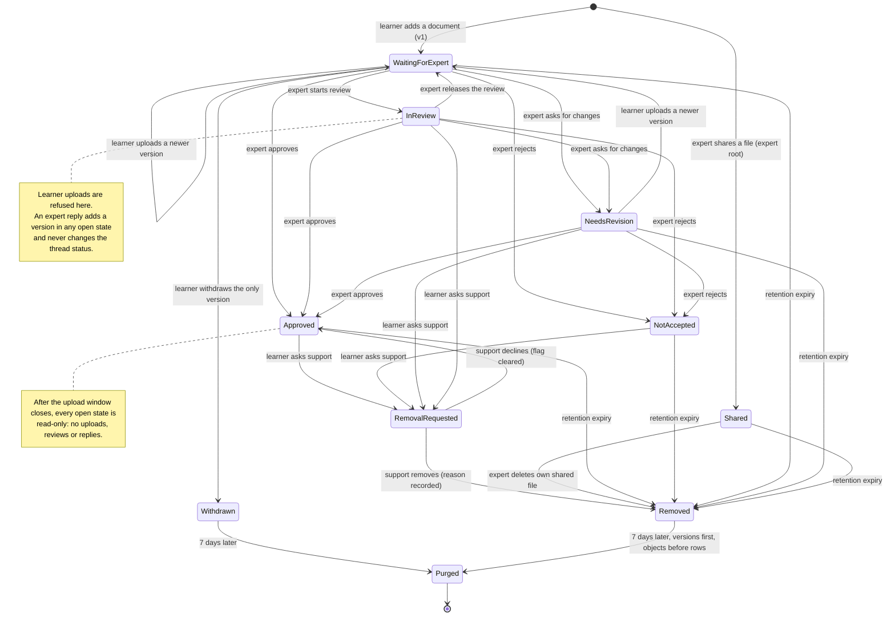
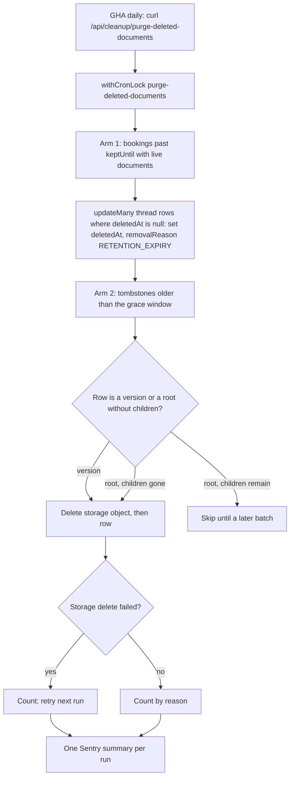
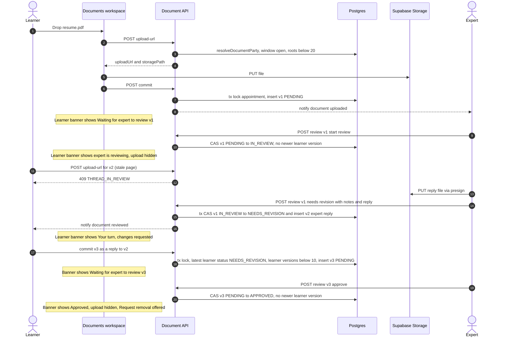
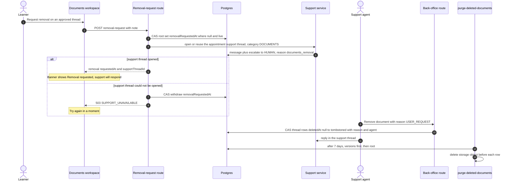
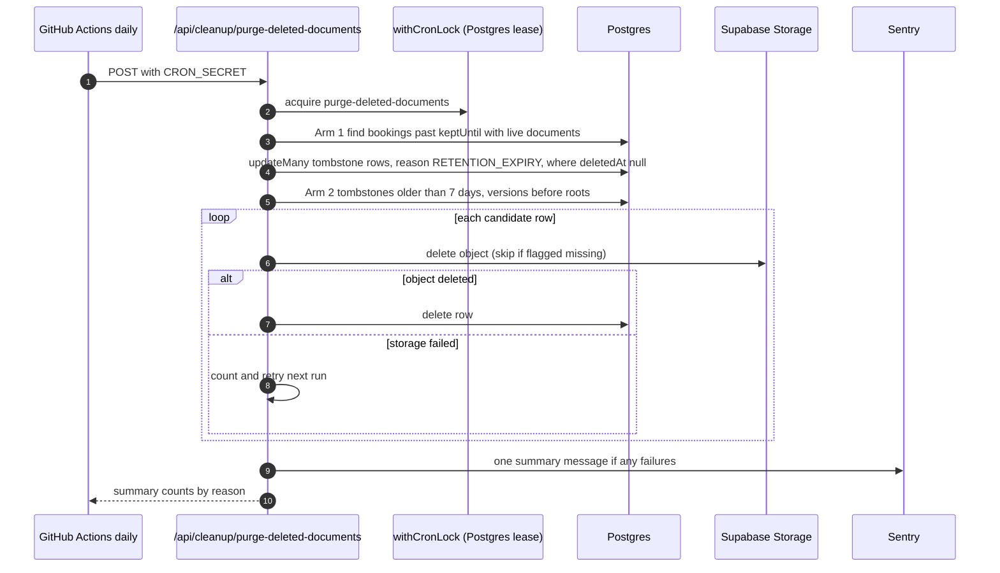

# Session Documents & Plan Materials

> Canonical architecture for the files attached to a booking: **session documents** (`AppointmentDocument`, the files a learner and an expert exchange with review rounds), **plan materials** (`PlanMaterial`, handouts an expert attaches to an offering) and how they relate to **recordings** ([stream/19](../stream/19-recordings-lifecycle-and-access.md)). The accepted decisions are recorded in [the ADR](../decisions/2026-10-12-session-documents-and-recordings.md).

## Index

| #   | Document                                        | Scope                                                                                                         |
| --- | ----------------------------------------------- | ------------------------------------------------------------------------------------------------------------- |
| 01  | [Architecture & Invariants](01-architecture.md) | Threading model (`rootDocumentId`, `versionNo`), CAS state transitions, 2-phase direct upload, SQL pagination |

This README is the product and system overview. `01-architecture.md` holds the upload-pipeline details.

## What a booking can hold

| Kind             | Row                         | Who writes                                        | Who reads                       | Store                           |
| ---------------- | --------------------------- | ------------------------------------------------- | ------------------------------- | ------------------------------- |
| Session document | `AppointmentDocument`       | Learner (submission), expert (reply, shared file) | The two parties of that booking | Supabase `documents` bucket     |
| Plan material    | `PlanMaterial`              | Expert, or an org operator for an org plan        | Every buyer of the offering     | Supabase `documents` bucket     |
| Recording        | `Recording` (see stream/19) | The call host, through Stream                     | Parties, by the slot rule       | Cloudflare R2 recordings bucket |

Documents are offered for consultations, subscriptions and trials (`supportsDocuments` in `lib/appointments/kind-capabilities.ts`). Group kinds (webinars, classes) have materials and recordings but no documents.

## Data model

- Each file is one `AppointmentDocument` row. A **thread** is `COALESCE(rootDocumentId, id)`, and `versionNo` is the 1-based sequence inside it. Live versions are unique per thread (sidecar index `appointment_doc_thread_version_unique` in `prisma/sql/check-constraints.sql`), and a live `storagePath` is unique (`AppointmentDocument_active_storagePath_key`). Application code never re-checks either rule.
- A learner row has `uploadedByRole = CONSULTEE` and a stored `reviewStatus` (`PENDING`, `IN_REVIEW`, `NEEDS_REVISION`, `APPROVED`, `REJECTED`). The stored value is `REJECTED`; the thread status and the UI call it "Not accepted". An expert row has `uploadedByRole = CONSULTANT` and `responseToDocumentId` set when it answers a learner version. Its stored status is ignored by every reader.
- Deletion is a tombstone: `deletedAt`, `deletedById` and a `removalReason`. The purge removes the object and then the row.
- Two nullable columns on `AppointmentDocument` record the removal flow. Both are additive, so the launch schema freeze is respected.

| Column               | Type                                                                                               | Meaning                                                               |
| -------------------- | -------------------------------------------------------------------------------------------------- | --------------------------------------------------------------------- |
| `removalRequestedAt` | `DateTime? @db.Timestamptz`                                                                        | The learner asked support to remove the thread. Set on the root only. |
| `removalReason`      | `DocumentRemovalReason?` (`USER_REQUEST`, `RETENTION_EXPIRY`, `SUPPORT_ACTION`, `ACCOUNT_ERASURE`) | Why a row was tombstoned. Survives until the purge.                   |

Run `npx prisma generate` after editing the schema, and check drift read-only with `npx prisma migrate diff --from-config-datasource --to-schema prisma/schema.prisma --script`. Never `db push`: it would drop the `prisma/sql` sidecar indexes.

The window and the retention date are computed from occurrences and `BookingStatusHistory`; no column stores them.

## The thread and version model

- A learner **submission** is a root with `versionNo = 1`. Every later learner upload or expert reply is the next version of the same thread.
- **An expert reply is a version.** It is labelled "Expert reply", can carry notes and a file, and never shows a review status. The thread's status is derived only from the latest live learner version.
- **The learner may add a version only while the latest live learner version is `PENDING` or `NEEDS_REVISION`.** While the expert is reviewing (`IN_REVIEW`) and after a final decision (`APPROVED`, `REJECTED`) the upload control is hidden, and the server refuses with a typed error. An expert's shared file is never revised by a learner.
- **The cap is 10 learner versions per document.** Expert replies do not count. `versionNo` keeps counting every row, so it can exceed 10. At the cap the card reads "All 10 versions used" instead of showing a button that fails.
- A booking holds at most 20 live threads.
- The server builds the thread view in one place (`lib/documents/thread-view.ts`). It returns the derived status, a banner descriptor (`kind`, `since`, `versionNo`; the client writes the sentence), the removal flag, the learner-version counter, `allowedActions` and the versions without URLs. The UI renders `allowedActions` and never decides on its own.
- "Superseded" is derived, never stored: a review whose target has a newer live learner version fails with `SUPERSEDED`.

### Thread state machine

The stored per-row `reviewStatus` enum is unchanged. The thread status is derived from its latest live learner version.



"Removal requested" is an orthogonal flag on the thread, drawn as a state for clarity. When support declines, the thread returns to whichever state it had. The stored enum value for a rejected version is `REJECTED`; the derived thread status and the label are "Not accepted" (`NOT_ACCEPTED`). Account erasure removes a thread from any state and purges it at once.

### Guards

Every transition is a conditional write whose `WHERE` carries the expected prior state, inside the existing transaction where one exists. Inside `prisma.$transaction`, every helper receives `tx`, never the global client (`PG_POOL_MAX=1`). No status sweep exists.

| Transition                                              | Where                                              | Guard (inside the transaction)                                                                                                                                                                                                                           | Refusal                                                                                                       |
| ------------------------------------------------------- | -------------------------------------------------- | -------------------------------------------------------------------------------------------------------------------------------------------------------------------------------------------------------------------------------------------------------- | ------------------------------------------------------------------------------------------------------------- |
| Learner adds a document                                 | Commit route via `commitDocumentUpload`            | `SELECT ... FOR UPDATE` on the appointment; party is the learner; booking not terminal, confirmed, window open; live roots below 20                                                                                                                      | `APPOINTMENT_TERMINAL`, `BOOKING_NOT_CONFIRMED`, `UPLOAD_WINDOW_CLOSED`, `DOCUMENT_LIMIT_REACHED`             |
| Learner uploads a newer version                         | Same, `resolveDocumentThreadSlot`                  | Learner root; latest live learner row is `PENDING` or `NEEDS_REVISION`; live learner rows below 10; booking confirmed and window open                                                                                                                    | `THREAD_IN_REVIEW`, `THREAD_CLOSED`, `VERSION_LIMIT_REACHED`, `BOOKING_NOT_CONFIRMED`, `UPLOAD_WINDOW_CLOSED` |
| Expert review (start, release, revise, approve, reject) | `POST .../:docId/review`                           | Party is the expert; `updateMany` where the row is live, learner-authored, has the expected `reviewStatus` and **no newer live learner version**; transition allowed by `REVIEW_TRANSITIONS`; booking confirmed and window open                          | `SUPERSEDED`, `INVALID_REVIEW_TRANSITION`, `THREAD_CLOSED`, `BOOKING_NOT_CONFIRMED`, `UPLOAD_WINDOW_CLOSED`   |
| Expert reply file                                       | Same request, same transaction as the status write | Thread live, window open; the reply row is inserted after the compare-and-set succeeds; a failed transaction deletes the presigned object                                                                                                                | `UPLOAD_WINDOW_CLOSED`                                                                                        |
| Learner withdraws the latest pending version            | `DELETE .../:docId`                                | `updateMany` where learner-authored, `PENDING`, live, and no higher live version; sets the tombstone with `USER_REQUEST`                                                                                                                                 | `DOCUMENT_NOT_DELETABLE`                                                                                      |
| Expert deletes an own shared file                       | `DELETE .../:docId`                                | `updateMany` where expert-authored, root, live; tombstones the root and its versions                                                                                                                                                                     | `DOCUMENT_NOT_DELETABLE`                                                                                      |
| Learner requests removal                                | `POST .../:docId/removal-request`                  | `updateMany` on the root where `removalRequestedAt` is null, live, and the latest learner status is not `PENDING`                                                                                                                                        | `REMOVAL_ALREADY_REQUESTED`, `THREAD_CLOSED`                                                                  |
| Support removes or declines                             | Back-office route                                  | Remove: `updateMany` on live thread rows, sets tombstone and reason. Decline: clears `removalRequestedAt` on the root; each successful write also records an ops-log row (`document.removal.remove`, `document.removal.decline`) in the same transaction | 409 on a lost race                                                                                            |
| Retention tombstone                                     | Purge arm 1                                        | `updateMany` where live and the booking's retention date has passed                                                                                                                                                                                      | n/a                                                                                                           |

### One party resolver

Every document route, the viewer page and the workspace page resolve the caller through one function, so party logic exists once and trials work.

- `resolveDocumentParty(db, appointmentId, userId)` in `lib/documents/document-party.ts` returns the caller's role (`learner` or `expert`) and the booking facts: kind, terminal state and time, whether the booking is confirmed, the last live session's end, the window and retention dates, and the display names. A caller who is not a party gets nothing, which the routes answer as not found.
- Arms: consultation requester or plan owner; subscription requester or plan owner; trial learner or trial consultant.
- `terminal` covers cancelled, rejected and expired requests and cancelled or rejected trials. `terminalAt` comes from the cancelling `BookingStatusHistory` row. `confirmed` means the request is approved, scheduled or completed, or the trial is scheduled, completed or converted.
- `documentWriteRefusal(booking)` gives the single reason a write is refused: `APPOINTMENT_TERMINAL`, `BOOKING_NOT_CONFIRMED` or `UPLOAD_WINDOW_CLOSED`.
- It takes `db`, so it runs on `tx` inside a transaction.

## The 30-day upload window

- `uploadWindowClosesAt` = the last **live** session's `endsAt` + 30 days. Live sessions exclude deleted, `CANCELLED` and `RESCHEDULED` occurrences. For a subscription or multi-session booking this is the last occurrence.
- While any session is upcoming, or a subscription still has sessions to allocate, the window is open. A terminal booking is read-only immediately.
- The window is computed, not stored. It is checked inside the commit and review transactions, and returned by the workspace read and the hub summary.
- When it closes, the thread is read-only for **both** sides: no uploads, reviews or replies, including a review that was started before. Opening and downloading continue until the retention date, and a removal request stays available.
- The UI always states the reason and the date: "Uploads closed on 9 Nov, 30 days after the last session."
- **Uploads need a confirmed booking.** A booking that is paid and accepted accepts writes; before that, uploads, reviews and replies are refused with `BOOKING_NOT_CONFIRMED`. `documentWriteRefusal` in `document-party.ts` orders the reasons: cancelled, then not confirmed, then window closed.

## Removal requests and the status banner

A reviewed document cannot be deleted by the learner, because the expert's review refers to it. The learner asks support instead.

1. The learner chooses "Request removal" on a reviewed thread. The route sets `removalRequestedAt` on the root with a conditional write. The option is available while the thread is in review or decided, not while it is waiting for a first review, and it stays available after the upload window closes.
2. After that commit, the route opens or reuses the booking's `AppointmentSupportThread` in category `DOCUMENTS` through the support service (`lib/documents/removal-support.ts`), posts a message naming the document, and escalates to a human with reason `documents_removal`. If opening the support thread fails, the route withdraws the request with a conditional write on the same `removalRequestedAt`, sends one warning to Sentry and answers 503 `SUPPORT_UNAVAILABLE`, so the learner can try again and no flag is left that nobody will act on. The scripted documents flow gains the option "Remove a document I shared".
3. The thread banner reads "Removal requested on 5 Oct. Support will respond." The expert sees "Rahul asked support to remove this."
4. A support agent opens the case. `GET /api/staff/appointments/:appointmentId/documents` lists the booking's threads with open requests first, and `POST .../documents/:documentId/removal`, gated by `requireBackofficeSurface("appointments.manage")`, offers **Remove** or **Decline**.
   - Remove tombstones every version of the thread with `removalReason` set to `USER_REQUEST` (the learner asked) or `SUPPORT_ACTION` (support's own initiative), and the agent as `deletedById`. The purge removes the objects 7 days later.
   - Decline clears `removalRequestedAt`, and the agent's reply in the support thread explains why. Declining a thread with no open request answers 409 `REMOVAL_NOT_REQUESTED`.

**Banner per state.** Every thread shows who acts next and since when, from the viewer's side. For an organisation booking, the banner names the consultancy as well as the person when the deliverer acts for an org ("Waiting for Angela Anderson (Acme Consulting) to review").

| Thread state            | Learner sees                                                                       | Expert sees                                    |
| ----------------------- | ---------------------------------------------------------------------------------- | ---------------------------------------------- |
| Waiting for expert      | "Waiting for Angela Anderson to review v3 (since 2 Oct)."                          | "Rahul uploaded v3 on 2 Oct. Your turn."       |
| In review               | "Angela Anderson is reviewing v3. You can upload again once she responds."         | "You started reviewing v3 on 3 Oct."           |
| Needs revision          | "Your turn: Angela asked for changes on 3 Oct."                                    | "Waiting for Rahul to upload a revision."      |
| Approved / Not accepted | "Approved by Angela Anderson on 4 Oct."                                            | "You approved v3 on 4 Oct."                    |
| Shared                  | "Shared by Angela Anderson on 1 Oct."                                              | "You shared this on 1 Oct."                    |
| Removal requested       | "Removal requested on 5 Oct. Support will respond in your session's support chat." | "Rahul asked support to remove this on 5 Oct." |
| Window closed (overlay) | "Read-only since 9 Nov. Kept until 7 Feb 2027."                                    | same                                           |

## Retention and the purge

Documents are tombstoned 90 days after the booking ends and purged 7 days after that, by **one** job registered in `lib/cron/cleanup-registry.ts` (`@cleanup-twin purge-deleted-documents`, reachable at `/api/cleanup/purge-deleted-documents` and from `/api/admin/system-jobs/run`). The daily GitHub Actions step calls the route with `curl`, like the `auth-tokens` step. There is no wrapper under `jobs/`, and the job is not on the Netlify ticker.

| Booking                        | Kept until                                                                                      |
| ------------------------------ | ----------------------------------------------------------------------------------------------- |
| Consultation, trial            | Last live session's `endsAt` + 90 days                                                          |
| Subscription                   | Last live session's `endsAt` + 90 days; none while sessions remain or are still to be allocated |
| Cancelled, rejected or expired | Time of the cancelling `BookingStatusHistory` row + 90 days                                     |

The date is computed and returned as `keptUntil`. The UI shows "Kept until <date>".



- **Arm 1 (retention tombstone).** Select appointments with live documents whose live occurrences all ended before `now - 90 days`, or which became terminal before the cutoff. Tombstone their rows with one conditional `updateMany` per appointment, setting `removalReason = RETENTION_EXPIRY`. Batches are bounded: 50 bookings per batch and at most 20 batches per run.
- **Arm 2 (purge).** Process versions before roots, so a root is purged only when no live or tombstoned child remains. Otherwise the `onDelete: SetNull` relation would turn surviving versions into separate one-version documents. The storage object is deleted before its row; rows flagged `isStorageMissing` skip the storage call.
- **One grace constant** is shared by the purge and `reconcile-document-storage`, so the orphan sweep never treats an object as unreferenced while the purge still owns it.
- **Reporting.** One `reportSentryMessage` per run on failures, never per row. The summary counts rows by reason: `{ tombstoned, purged, failedStorage, failedRows, byReason }`.

**Account erasure.** Erasing a user (`eraseUserSessionDocuments` in `lib/documents/document-erasure.ts`, called from the erasure scrub) tombstones every thread on bookings where the user is the learner and every file the user shared as the expert, with `removalReason = ACCOUNT_ERASURE`. It then purges every tombstoned session document in scope, whatever its earlier removal reason, at once and objects before rows, instead of waiting for the grace window. An incomplete purge is reported on the erasure request and re-run.

**Cancelled bookings are read-only until retention.** A cancelled, rejected or expired booking keeps its documents readable for **both** parties until the `keptUntil` date. Uploads, reviews and replies are refused with `APPOINTMENT_TERMINAL`, and both sides see one message: "This booking was cancelled on 4 Oct. Its files are read-only and kept until 2 Jan." Recordings follow the same rule, so the two halves of one booking never differ.

## File policy

One policy, `lib/documents/file-policy.ts`, covers session documents and plan materials: PDF, Word (`.doc`, `.docx`), Excel (`.xls`, `.xlsx`), PowerPoint (`.ppt`, `.pptx`), images (JPEG as `image/jpeg` for `.jpg` and `.jpeg`, PNG, GIF, WebP), plain text and CSV, at most 10 MB each (`MAX_FILE_BYTES`). The non-standard `image/jpg` type is not accepted; browsers report JPEG files as `image/jpeg`. The same module builds the picker `accept` attribute, the short file-type label (`fileTypeLabel`) and the copy shown to users, so the hint text cannot drift from the check. When a browser reports no type or a generic one, the type is resolved from the extension. A `.csv` reported as `application/vnd.ms-excel`, as Windows does when Excel is installed, is read as `text/csv`. A file name's extension must be one the resolved type allows, so file names stay consistent with their type; a mismatch is refused as `UNSUPPORTED_FILE_TYPE`. The server repeats the check against the declared metadata (`checkDeclaredFile`) and then verifies the stored object's first bytes (`lib/documents/storage-verify.ts`), refusing executables and files whose header does not match the declared type.

**Upload limits.** Presign (`upload-url`) and commit each have their own limit of 20 requests per user per minute (`documentUploadUrlLimiter`, `documentCommitLimiter`), sized so a bulk upload of a booking's 20-file cap fits in each. When the limiter refuses a commit, the route deletes the uploaded object if it sits in the caller's own folder and no document row points at it (`discardRefusedUpload`).

## Plan materials

A plan material is a handout an expert attaches to an offering; every buyer of the offering can open it.

- **Managing.** The offering editor's materials manager (`components/offerings/editor/MaterialsManager.tsx`) lets the expert upload, rename, describe, replace, reorder and delete files, up to 25 per offering. Organisation operators with `materials.manage.orgPlan` can do the same on an organisation's plans, and the plan's consultant sees those changes.
- **Reading.** The booking's Materials card reads `GET /api/appointments/:id/materials`, which returns only the materials the viewer may open: the host, or a learner whose booking is paid. Organisation roles that are not a party see metadata only. The hub card opens with "Files included with this offering." and gives every file an Open and a Download action, plus "+ n more" when the list is longer than the preview. Files open in the viewer tab (`/files/materials/[materialId]`).
- **Files included.** Public plan pages for webinars and classes list the names and types of the attached files in a "Files included" card, without links, so a buyer knows what to expect.
- **Who writes the rows.** Materials are never written through the booking: the upload-url route mints a single-use slot under the plan's folder and the commit route adds the next material.

## Storage: Supabase for documents, R2 for recordings

|              | Session documents and plan materials                                                                                             | Recordings                                                                                                      |
| ------------ | -------------------------------------------------------------------------------------------------------------------------------- | --------------------------------------------------------------------------------------------------------------- |
| Store        | Supabase Storage, private bucket `documents`                                                                                     | Cloudflare R2 private recordings bucket, with preview clips in the public Supabase `recordings-previews` bucket |
| Object size  | Up to 10 MB each (`MAX_FILE_BYTES`)                                                                                              | Hundreds of MB to several GB                                                                                    |
| Write path   | Browser uploads straight to a presigned URL; the server verifies the object (magic bytes) and commits the row in one transaction | Server-side pull from Stream into R2 by `transfer-recordings`, with retries                                     |
| Read path    | On-demand link: 60 seconds for a download, 5 minutes for the viewer page embed                                                   | On-demand presigned link, 4 to 24 hours by recording length                                                     |
| Read pattern | Opened a few times, small                                                                                                        | Streamed with range requests, rewatched, sometimes sold                                                         |
| Cleanup      | Tombstone, purge after the grace window, daily orphan reconcile                                                                  | `expire-recordings` retention, asset deletion on expert delete and on hard delete                               |

**Why two stores.** Recordings are large, long-lived and streamed repeatedly, so egress dominates their cost, and R2 charges no egress. Supabase Storage caps the size of a single upload by plan, and a long recording exceeds the lower caps. Documents are small, opened rarely, and already sit next to the database and auth stack, so moving them to R2 would add a second signing path for no saving. The split follows object size and read pattern, and each side has exactly one signing helper. See [storage management](../storage/management-strategy.md).

Files are always reached through an access-checked route that signs a fresh link on demand. Rows store a canonical route path rather than a time-limited link, because stored links go stale; API payloads do not return a stored link.

## "Open" and "Download"

- **Open** is a plain link that opens a new tab on a same-origin viewer route: `/files/documents/[documentId]` or `/files/materials/[materialId]`. The route authorises, signs a fresh link on every load, embeds the file and renders friendly HTML on any error. Middle-click and copy-link work, and a reload re-signs.
- **Download** keeps the JSON preflight (`?format=json`) so a failure returns to the page as a toast.
- There is no in-drawer preview and no byte proxying through a function.
- A signed-out visitor sees a sign-in prompt that returns to the same file.

## Pages and routes per role

The appointment details page is the **hub**. It shows a snapshot card for each of Documents, Materials and Recordings and links to dedicated per-appointment pages for Documents and Recordings. The Materials card is self-contained and there is no separate Materials page. The cross-session libraries stay, grouped by appointment.

| Page                         | Consultant (owner, collaborator)                                    | Consultee                                                         | Organisation (participant)                                     |
| ---------------------------- | ------------------------------------------------------------------- | ----------------------------------------------------------------- | -------------------------------------------------------------- |
| Appointment details (hub)    | `/dashboard/consultant/[consultantId]/appointments/[appointmentId]` | `/dashboard/consultee/[consulteeId]/appointments/[appointmentId]` | `/dashboard/organization/[orgId]/appointments/[appointmentId]` |
| Documents workspace          | `.../appointments/[appointmentId]/documents`                        | same                                                              | same                                                           |
| Recording details            | `.../appointments/[appointmentId]/recordings`                       | same                                                              | same                                                           |
| Documents library (grouped)  | `/dashboard/consultant/[consultantId]/documents`                    | `/dashboard/consultee/[consulteeId]/documents`                    | `/dashboard/organization/[orgId]/documents`                    |
| Recordings library (grouped) | `/dashboard/consultant/[consultantId]/recordings`                   | `/dashboard/consultee/[consulteeId]/recordings`                   | `/dashboard/organization/[orgId]/recordings`                   |
| File viewer (new tab only)   | `/files/documents/[documentId]`, `/files/materials/[materialId]`    | same                                                              | same                                                           |

| Role                                                         | Hub cards                        | Documents workspace                                                                                                                         | Recording details                                      |
| ------------------------------------------------------------ | -------------------------------- | ------------------------------------------------------------------------------------------------------------------------------------------- | ------------------------------------------------------ |
| Learner (requester, trial learner, seat holder; org learner) | Documents, Materials, Recordings | Own threads; new document, bulk upload, new version (while waiting or needs revision), withdraw the latest pending version, request removal | Own batch by slot, parts, catch-up; Watch              |
| Expert (plan owner, trial consultant; org deliverer)         | Same, with a "needs you" count   | Review queue; review, reply, share a file, delete an own shared file                                                                        | All parts of the appointment; manage sheet             |
| Co-host (accepted collaborator)                              | Materials, Recordings            | Not applicable (group kinds have no documents)                                                                                              | Host view for the batches of plans they collaborate on |
| Org owner or manager who is not a party                      | Session summary only             | No page (redirect to the session page)                                                                                                      | No page (redirect to the session page)                 |
| Platform staff                                               | Back-office tools                | Reached from the support case; can tombstone a document with a reason                                                                       | Unchanged                                              |

### Wireframes

**Appointment details hub (learner, subscription).**

```
+----------------------------------------------------------------------------------+
| Career Coaching · 6 sessions · with Angela Anderson            [In progress]      |
+-----------------------------------------------+----------------------------------+
| Sessions / Money / Support (unchanged)        | DOCUMENTS                          |
|                                               |  3 documents · 1 needs your change |
|                                               |  Resume v3 · Waiting for Angela    |
|                                               |  Uploads open until 9 Nov          |
|                                               |  [Open documents ->]               |
|                                               |------------------------------------|
|                                               | MATERIALS                          |
|                                               |  Interview rubric.pdf    [Open ↗]  |
|                                               |  Roadmap workbook.docx  [Download] |
|                                               |  + 2 more            [See all ->]  |
|                                               |------------------------------------|
|                                               | RECORDINGS                         |
|                                               |  4 of 6 sessions recorded          |
|                                               |  Latest: Session 4 · 2 parts       |
|                                               |  Kept until 1 Jan 2027             |
|                                               |  [Open recordings ->]              |
+-----------------------------------------------+----------------------------------+
```

The hub is three independent reads, not one summary. `ResourceSnapshot` queries the Documents workspace route (thread count, threads needing the viewer, window close and `keptUntil`), `GET /api/appointments/:id/materials` (count and the first few files) and `GET /api/appointments/:id/recordings` (sessions recorded and total, parts, latest recording, `keptUntil`). The appointment detail read carries no `resources` field, so one slow store never blocks the page and each card shows its own loading and error state.

**Documents workspace, learner.**

```
+----------------------------------------------------------------------------------+
| <- Back to session   Documents · Career Coaching with Angela Anderson             |
| Uploads open until 9 Nov 2026 (30 days after your last session).                  |
| Files are kept until 7 Feb 2027 (90 days after the booking ends).                 |
+----------------------------------------------------------------------------------+
| [ Drop files here or Browse ]  PDF, Office, images, text · 10 MB each · 3/20 used  |
|   resume.pdf ........ uploading 62%                                               |
|   cover-letter.docx . done                                                        |
|   photo.heic ........ not supported (HEIC)                     [Remove]           |
+----------------------------------------------------------------------------------+
| Filter: [All] [Your turn] [Waiting for review] [Done]           Sort: [Recent v]  |
|                                                                                    |
| ┌ Resume ─────────────────────────────────────────────── v3 · Waiting for Angela ┐|
| │ ⓘ Waiting for Angela Anderson to review your latest version (since 2 Oct).      │|
| │ v3  You            resume-v3.pdf   2 Oct   "Fixed section 2"       [Open ↗][⬇]  │|
| │ v2  Expert reply   resume-notes.pdf 1 Oct  "Tighten the summary"   [Open ↗][⬇]  │|
| │     Needs revision · "Tighten the summary; quantify impact"                     │|
| │ v1  You            resume.pdf      28 Sep                         [Open ↗][⬇]  │|
| │ [Upload new version]  [Withdraw v3]                    1 of 10 versions left: 7 │|
| └──────────────────────────────────────────────────────────────────────────────────┘|
| ┌ Tax return 2025 ───────────────────────────────────────── v1 · Approved ───────┐|
| │ ✓ Approved by Angela Anderson on 30 Sep.                                        │|
| │ [Open ↗] [⬇]                                        [Request removal]           │|
| └──────────────────────────────────────────────────────────────────────────────────┘|
| ┌ Interview checklist ───────────────────────────────── Shared by Angela ────────┐|
| │ [Open ↗] [⬇]                                                                    │|
| └──────────────────────────────────────────────────────────────────────────────────┘|
+----------------------------------------------------------------------------------+
```

**Documents workspace, expert.**

```
+----------------------------------------------------------------------------------+
| <- Back to session   Documents · Career Coaching with Rahul Mehta                 |
| Uploads open until 9 Nov 2026 · Kept until 7 Feb 2027        [Share a file]       |
+----------------------------------------------------------------------------------+
| Filter: [Your turn (1)] [Waiting for learner] [Done] [Shared by you]              |
| ┌ Resume ───────────────────────────────────────────── v3 · Your turn ───────────┐|
| │ ⓘ Rahul uploaded v3 on 2 Oct. Waiting for you to review.                        │|
| │ timeline (as learner view)                                                      │|
| │ ── Review v3 ──────────────────────────────────────────────────────────────── │|
| │ ( ) Start review   ( ) Needs revision   ( ) Approve   ( ) Not accepted          │|
| │ Feedback: [______________________________________________]                      │|
| │ Attach a reply file (optional): [Choose file]  -> becomes v4 "Expert reply"     │|
| │                                                        [Send feedback]          │|
| └──────────────────────────────────────────────────────────────────────────────────┘|
| ┌ Tax return 2025 ─────────────── v1 · Approved · Removal requested ─────────────┐|
| │ ⓘ Removal requested by Rahul on 5 Oct. Support will respond.                    │|
| └──────────────────────────────────────────────────────────────────────────────────┘|
+----------------------------------------------------------------------------------+
```

When the upload window has closed, both variants replace the dropzone and composer with: "This booking's documents are read-only since 9 Nov 2026 (30 days after the last session). Files are kept until 7 Feb 2027."

**Documents library (expert view), grouped by appointment.** Each booking lists one expandable row per document thread, then its plan materials in a separate table.

```
+----------------------------------------------------------------------------------+
| Documents                          Search [Booking, plan or file name]            |
| Kind [All v] Started by [anyone v] Learner [All v] Status [All v] Date [..]-[..] |
+----------------------------------------------------------------------------------+
| ▾ Career Coaching · Rahul Mehta · 2 Oct                 [Open documents ->]       |
|   Documents                                                                       |
|   Document                      Started by  Status         Updated        Open    |
|   ▸ Resume  [v3 · 3 versions]   Rahul       Your turn      2 Oct          [↗]     |
|     Latest: resume-final.pdf                                                      |
|   ▾ Tax return 2025             Rahul       Removal req.   5 Oct          [↗]     |
|       v2  tax-2025-b.pdf   Note: Check the totals    Rahul   Waiting      5 Oct [↗]|
|       v1  tax-2025.pdf     Rahul   Superseded                 3 Oct             [↗]|
|   Plan materials                                                                  |
|   Material             Type   Size                                        Open    |
|   Interview checklist  PDF    120 KB                                      [↗]     |
| ▾ Mock Interview · Priya Shah · 28 Sep                  [Open documents ->]       |
|   ▸ Portfolio  [v2 · 2 versions]  Priya   Waiting for learner  29 Sep      [↗]    |
+----------------------------------------------------------------------------------+
| 1-2 of 14 sessions                                         [<] page 1 of 7 [>]    |
+----------------------------------------------------------------------------------+
```

The row's title is the thread root's name. When the latest file has a different name the row adds "Latest: <name>", and a thread with more than one version shows a "vN · N versions" chip. The columns are Document, Started by, Status, Updated and Open (which opens the latest version). Expanding a row lists every version newest first with its uploader, an "Expert reply" label on expert files, the version's own review state (earlier learner versions read "Superseded"), a note excerpt and its own Open link. The flat view shows the same rows with an extra Booking column, and plan materials get their own table with the same column.

Threads sort needs-you first, then by the latest update (newest first), then by id so the order is stable. The workspace and the Library share this one order (`compareThreadOrder` in `lib/documents/thread-view.ts`). The kind chips are All, Consultation, Subscription and Trial. The "Started by" filter reads "Started by anyone", "you" or "the expert" (the learner in the expert's view), with "Plan materials only" selecting materials instead. A booking header reads, for example, "Subscription · Started 7 Sept 2026 · 6 sessions", from `sessionCount` and `startsAt`.

In the learner's view the person filter is "Expert". Library rows never act on a file except "Open"; every action happens in the workspace. Collaborators and co-hosts see only appointments they are a party to. The status filter reads the **latest** learner version in SQL.

**File viewer (new tab).**

```
+----------------------------------------------------------------------------------+
| resume-v3.pdf · Career Coaching · v3 (You)                 [Download] [Close tab] |
|----------------------------------------------------------------------------------|
|  <iframe or img with a freshly signed URL>                                        |
+----------------------------------------------------------------------------------+
  Error state (same URL, HTML, never JSON):
+----------------------------------------------------------------------------------+
|  This file is no longer available.                                                |
|  It was removed on 5 Oct, or the booking's files are no longer kept.              |
|  [Back to the session]                                                            |
+----------------------------------------------------------------------------------+
```

**Recordings library and Recording details (all booking types).** Both render one session timeline. The class example below is the layout; the per-type table and the states are in [stream/19](../stream/19-recordings-lifecycle-and-access.md#the-session-timeline).

```
Beginner Class · Ananya Anderson                    Open booking →
Your batch 5 Oct – 26 Oct 2026 · 4 sessions
Recordings available until 28 Sept 2027

SESSION          RECORDING                              LENGTH
1 · Mon 5 Oct    Foundations and vocabulary            56 min  ▶ Play
                 [Catch-up · recorded 7 Sept, other batch]
  ⌄ 2 parts      ▶ Part 1 of 2                          32 min
                 ▶ Part 2 of 2                          24 min
2 · Mon 12 Oct   Workshop: your first end-to-end build 55 min  ▶ Play
                 [Catch-up · recorded 14 Sept, other batch]
3 · Mon 19 Oct   Upcoming                                 —
4 · Mon 26 Oct   Upcoming                                 —
```

| Booking type        | Timeline rows                                              |
| ------------------- | ---------------------------------------------------------- |
| Consultation, trial | One row                                                    |
| Subscription        | Many rows; the subline reads "Started <date> · n sessions" |
| Webinar             | Catch-up only when the plan shares recordings              |
| Class               | Catch-up always, plus "Before you joined" rows             |
| Purchased replays   | Their own group, "Never expires"                           |

The header carries one retention line; a row repeats its own only when it differs or ends within 30 days. In the expert Library the per-row Manage is a link to the booking's Recordings page, and it appears only on a session that still has a part.

### Rendering, data fetching and URL state

All pages are per-user and dynamic, so there is no `revalidatePath` or tag to manage; freshness comes from TanStack Query invalidation. The server component authorises, resolves the party and prefetches; the client component renders and mutates.

| Page                | Query keys                                                                                                                  | Freshness                                                                                                                         |
| ------------------- | --------------------------------------------------------------------------------------------------------------------------- | --------------------------------------------------------------------------------------------------------------------------------- |
| Hub                 | `["appointment-detail", id]`, `documentKeys.workspace(id)`, `materialKeys.appointment(id)`, `recordingKeys.appointment(id)` | Each card reads its own route; every document or recording mutation invalidates the matching keys                                 |
| Documents workspace | `documentKeys.workspace(id)`                                                                                                | `staleTime` 30 s, refetch on focus; every mutation invalidates workspace, hub and library keys through one `documentKeys` factory |
| Recording details   | `recordingKeys.appointment(id)`                                                                                             | Playback URLs are never cached: each Watch calls `GET /api/stream/recordings/:id`                                                 |
| Libraries           | `documentKeys.library()`, `recordingKeys.library()`                                                                         | `keepPreviousData` paging; page 1 is seeded on the server when the URL has no filters                                             |
| File viewer         | none                                                                                                                        | Signs on every render; `Cache-Control: private, no-store`, `Referrer-Policy: no-referrer`                                         |

Every API response carrying file metadata sends `Cache-Control: private, no-store`. URL state: the libraries use `useListParams` with `kind`, `from`, `to`, `source`, `person`, `status`, `q`, `view` (grouped or flat) and `page`; the workspace uses `?thread=<rootId>` and `?filter=your-turn|waiting|done|shared`; Recording details uses `?slot=<ordinal>&r=<recordingId>`.

**Display zone.** All six library pages format times and dates in the same display zone as the booking pages (`useLibraryDay`, built on `useZonedFormat`), and date-only values such as retention dates are computed in that zone.

**Status filter labels and row chips.** One rule in `lib/documents/thread-copy.ts` drives both. `libraryBucket` places a thread under Your turn, the waiting status, Done or Shared, and the Library query filters on it. `libraryChip` gives the row the words of that filter while the thread is open, and its outcome ("Approved", "Not accepted", "Shared") once it is done, so a row always carries the chip of the filter that returns it. A learner sees "Waiting for review" and "Your turn", which makes a learner's in-review row read "Waiting for review". An expert sees "Waiting for learner" and "Your turn", and a mixed or organisation view lists both waiting words ("Waiting for review / Waiting for learner").

**Page-1 seeding.** All six library pages (documents and recordings for consultant, consultee and organisation) prefetch page 1 on the server through `seedLibraryPage` (`lib/library/library-seed.ts`) when the URL has no filters, so the list renders without a client round trip. A URL with `q`, `page` or any filter, and an operator inspecting another profile, fetch on the client.

Empty, loading and error states are explicit per page: card skeletons on the hub, a `loading.tsx` skeleton on the workspace, "No documents yet. Share files with your expert from the documents page." when empty, and for a cancelled booking the single read-only message above for both roles (never a Retry that cannot succeed).

### Performance

- **Documents library.** A page resolves the viewer's readable plan ids once, reads the page's rows with a narrow select and one names read, and computes the person facet with a single user query. This brought a page from about 47 statements to 18 locally.
- **Recordings library.** `loadRecordingViews` (`lib/stream/recording-slots.ts`) reads identity, bookings, sessions, late-join floors, catch-up candidates and retention labels once per request; the pure core then builds every booking's view in memory. See [stream/19](../stream/19-recordings-lifecycle-and-access.md#performance).
- **Round-trip cost.** Under `PG_POOL_MAX=1` each statement is serial and costs about 95 ms per round trip, so statements per page, not row count, set the latency.
- **Pattern.** Batch every input for a page into a few reads, then compute in memory. Never run a per-row resolver in a loop.
- **Slow-read log.** `timedLibraryRead` (`lib/library/timed-read.ts`) wraps all six library routes and logs once when a read exceeds 10 s, or while it is still running at 20 s.

## API contract

| Method and path                                                         | Body / query                                                                                  | Response                                                                                                                                                                                                                                             | Errors                                                                                                                                                                                                                                              |
| ----------------------------------------------------------------------- | --------------------------------------------------------------------------------------------- | ---------------------------------------------------------------------------------------------------------------------------------------------------------------------------------------------------------------------------------------------------- | --------------------------------------------------------------------------------------------------------------------------------------------------------------------------------------------------------------------------------------------------- |
| `GET /api/appointments/:id/documents`                                   | none                                                                                          | `{ booking: { id, kind, title, viewerRole, learnerName, expertName, organizationName, terminal, terminalAt, confirmed, readOnlyReason, uploadWindow: { open, closesAt }, keptUntil }, limits: { documents: { used, max: 20 } }, threads: Thread[] }` | 401, 404                                                                                                                                                                                                                                            |
| `POST /api/appointments/:id/documents/upload-url`                       | `{ originalName, mimeType, fileSize, parentDocumentId? }`                                     | `{ uploadUrl, storagePath, mimeType }`                                                                                                                                                                                                               | `FILE_MISSING`, `FILE_TOO_LARGE`, `UNSUPPORTED_FILE_TYPE`, `BOOKING_NOT_CONFIRMED`, `APPOINTMENT_TERMINAL`, `UPLOAD_WINDOW_CLOSED`, `THREAD_IN_REVIEW`, `THREAD_CLOSED`, `VERSION_LIMIT_REACHED`, `DOCUMENT_LIMIT_REACHED`, `INVALID_THREAD_PARENT` |
| `POST /api/appointments/:id/documents` (commit)                         | `{ storagePath, originalName, mimeType, fileSize, description?, parentDocumentId? }`          | `201 { document: { id, rootId, versionNo } }`                                                                                                                                                                                                        | The same checks, repeated inside `commitDocumentUpload`'s transaction; an expert may not pass `parentDocumentId` (`INVALID_INPUT`)                                                                                                                  |
| `POST /api/appointments/:id/documents/:docId/review` (expert)           | `{ reviewStatus?, reviewNotes?, reply?: { storagePath, originalName, mimeType, fileSize } }`  | `{ document: { id, reviewStatus }, reply: { id, versionNo } \| null }`                                                                                                                                                                               | `SUPERSEDED`, `INVALID_REVIEW_TRANSITION`, `THREAD_CLOSED`, `BOOKING_NOT_CONFIRMED`, `APPOINTMENT_TERMINAL`, `UPLOAD_WINDOW_CLOSED`                                                                                                                 |
| `DELETE /api/appointments/:id/documents/:docId`                         | none                                                                                          | `{ removed: true }`                                                                                                                                                                                                                                  | `DOCUMENT_NOT_DELETABLE`                                                                                                                                                                                                                            |
| `POST /api/appointments/:id/documents/:docId/removal-request` (learner) | `{ note?: string }` (max 500 characters)                                                      | `{ removal: { rootId, requestedAt, supportThreadId } }`                                                                                                                                                                                              | `THREAD_CLOSED`, `REMOVAL_ALREADY_REQUESTED`, `SUPPORT_UNAVAILABLE` (503; the request is withdrawn)                                                                                                                                                 |
| `GET /api/appointments/:id/documents/:docId/download?format=json`       | `disposition=attachment`                                                                      | `{ signedUrl, originalName, mimeType }`; without `format=json` it answers a 302 to the same link                                                                                                                                                     | Typed errors                                                                                                                                                                                                                                        |
| `GET /api/appointments/:id/materials`                                   | none                                                                                          | `{ materials: { id, name, mimeType, fileSize, description }[] }` in display order                                                                                                                                                                    | 401, 404                                                                                                                                                                                                                                            |
| `GET /api/appointments/:id/recordings`                                  | none                                                                                          | `{ appointmentId, kind, title, batchLabel, viewerRole, audience, sharedAcrossRuns, slots: Slot[] }` (see stream/19)                                                                                                                                  | 401, 404                                                                                                                                                                                                                                            |
| `GET /api/staff/appointments/:id/documents`                             | none                                                                                          | `{ threads: { rootId, title, uploadedBy, uploadedAt, versions, removalRequestedAt }[] }`                                                                                                                                                             | back-office `appointments.manage`                                                                                                                                                                                                                   |
| `POST /api/staff/appointments/:id/documents/:docId/removal`             | `{ action: "remove", reason: "USER_REQUEST" \| "SUPPORT_ACTION" }` or `{ action: "decline" }` | `{ removed: <rows> }` or `{ declined: true }`                                                                                                                                                                                                        | 404, 409 on a lost race, `REMOVAL_NOT_REQUESTED` (409) when declining without an open request                                                                                                                                                       |

**Libraries.** `GET /api/dashboard/{consultant,consultee}/:profileId/{documents,recordings}` and `GET /api/organizations/:orgId/{documents,recordings}?scope=mine|everyone` return one `LibraryPage`: `{ groups: { session, files, materials?, summary? }[], total, page, pageSize, facets?, purchased? }`. A page is ten sessions (appointments), each carrying its own rows, so the grouped and flat views page the same way. `total` counts sessions, not files. The document library reads every live version of a thread, with no version cap, so a thread's status always reflects its newest version. For recordings, `total` counts only the groups that render, decided in memory over the newest 200 candidate bookings. `session` carries `startsAt` and `sessionCount`. For documents, `files` are threads (`LibraryDocument` in `lib/library/library-query.ts`): the root's `title`, `startedBy`, derived `status`, `needsYou`, `removalRequested`, `latest` (`id`, `versionNo`, `originalName`, `uploadedAt`, `url`), `versionCount` and `versions[]` newest first, each with `uploadedBy`, `isExpertReply`, `reviewStatus` (earlier learner versions read `SUPERSEDED`), `reviewNotesExcerpt` and `url`. Plan materials are a separate per-group `materials` array of `{ id, title, fileType, fileSize, url }`, never threads. For recordings, each group also carries a `timeline` header summary (`sessionCount`, `firstSessionAt`, `lastSessionAt`, `retention`, `moreUpcoming`) and `files` are session rows (`LibraryRecording`) with a `state` (recorded, catch_up, removed, declined, not_recorded, preparing, expired, upcoming, before_you_joined), `slotOrdinal`, `sessionAt`, `catchUp`, `removed`, `declinedBy`, `keptUntil`, `parts[]` and `removedParts[]`; the shape is in [stream/19](../stream/19-recordings-lifecycle-and-access.md#the-session-timeline). The query accepts `q`, `kind`, `from`, `to`, `source` (`materials`, `mine`, `expert`, `learner`), `person`, `status` (`your-turn`, `waiting`, `done`, `shared`) and `page`; an unknown value is dropped rather than rejected. The organisation `everyone` scope needs `operations.read` and returns counts in `summary` instead of files.

**Plan-material management.** For each offering type there are `GET` and `POST` on `/api/plans/{consultations,subscriptions,webinars,classes}/:planId/materials`, `POST .../materials/upload-url` and `PUT .../materials/order`. Single files are handled by `PATCH`, `PUT` (replace the file) and `DELETE` on `/api/plans/materials/:materialId` and opened through `/api/plans/materials/:materialId/download`. The handlers are shared in `app/api/plans/shared/materials-handler.ts`, and an offering holds at most 25 materials (`MATERIAL_LIMIT_REACHED`).

Bulk upload is N independent presign-and-commit pairs run by the client with a concurrency of 3. Each commit is its own transaction against the 20-document cap, and each file reports its own result. No batch endpoint exists.

```ts
type Thread = {
  rootId: string;
  title: string; // root's originalName
  kind: "submission" | "shared"; // learner root vs expert handout
  status:
    | "WAITING_FOR_EXPERT"
    | "IN_REVIEW"
    | "NEEDS_REVISION"
    | "APPROVED"
    | "NOT_ACCEPTED" // derived from the stored REJECTED
    | "SHARED";
  // The client builds the sentence from the kind, the version number and the booking's two names.
  banner: {
    kind: ThreadStatus | "REMOVAL_REQUESTED";
    since: string;
    versionNo: number;
  };
  removal: { requestedAt: string } | null;
  learnerVersions: { used: number; max: 10 };
  allowedActions: (
    | "upload_version"
    | "withdraw_latest"
    | "review" // covers start, release, revise, approve, reject and the reply file
    | "delete_shared"
    | "request_removal"
  )[];
  reviewTargetId: string | null; // the latest live learner version
  latestVersionNo: number;
  updatedAt: string;
  versions: {
    id: string;
    versionNo: number;
    by: "learner" | "expert";
    label: "Your version" | "Learner version" | "Expert reply" | "Shared file";
    originalName: string;
    mimeType: string;
    fileSize: number;
    uploadedAt: string;
    note: string | null;
    feedback: string | null;
    reviewStatus: string | null; // the stored value; null on expert rows
    reviewedAt: string | null;
    superseded: boolean;
    storageMissing: boolean;
  }[]; // no URLs: Open and Download are built from ids
};
```

## Typed error model and copy

The document, material, recording, explore-recording, organisation-material and admin and staff document routes return one error body, `{ code, message, closedAt? }`, parsed with Zod at the client boundary. Four route groups keep their own older error shapes: the replay purchase route, the meeting recording-consent and recording-info routes, and the verification routes. The vocabulary, the HTTP status per code and the fixed copy live in `lib/documents/file-errors.ts`; `lib/documents/api-error.ts` turns a thrown `FileRouteError` into the response. The body has no retry hint, and the server `message` is a fixed neutral string that the UI never shows.

```ts
export const FileApiErrorSchema = z.object({
  code: FileErrorCode, // the enum below
  message: z.string(),
  closedAt: z.string().datetime().optional(), // UPLOAD_WINDOW_CLOSED only
});
```

The full code set is the `FileErrorCode` enum in `lib/documents/file-errors.ts`: `UNAUTHORIZED`, `FORBIDDEN`, `NOT_FOUND`, `GONE`, `INVALID_INPUT`, `APPOINTMENT_TERMINAL`, `BOOKING_NOT_CONFIRMED`, `UPLOAD_WINDOW_CLOSED`, `STORAGE_MISSING`, `STORAGE_UNAVAILABLE`, `SUPERSEDED`, `INVALID_REVIEW_TRANSITION`, `THREAD_CLOSED`, `THREAD_IN_REVIEW`, `INVALID_THREAD_PARENT`, `VERSION_LIMIT_REACHED`, `DOCUMENT_LIMIT_REACHED`, `MATERIAL_LIMIT_REACHED`, `DOCUMENT_NOT_DELETABLE`, `REMOVAL_ALREADY_REQUESTED`, `REMOVAL_NOT_REQUESTED`, `SUPPORT_UNAVAILABLE`, `FILE_MISSING`, `FILE_TOO_LARGE`, `UNSUPPORTED_FILE_TYPE`, `SLUG_TAKEN`, `STORAGE_POLICY`, `PLAN_ARCHIVED`, `ORG_VISIBILITY`, `PREVIEW_TRANSCRIPT_REQUIRED`, `RECORDING_HAS_BUYERS`, `RECORDING_CHANGED`, `RECORDING_NOT_ENABLED`, `RECORDING_DECLINED`, `RECORDING_IN_PROGRESS`, `RECORDING_NOT_IN_PROGRESS`, `VENDOR_UNAVAILABLE`, `PREVIEW_UPLOAD_FAILED`, `PARTIAL_UPLOAD`, `OWN_RECORDING_AVAILABLE`, `LATE_JOIN_HIDDEN`, `RATE_LIMITED`, `NETWORK` and `MEDIA_UNPLAYABLE` (both raised only by the browser) and `SERVER_ERROR`. Each code has fixed UI copy in the same module; the table below shows the document codes. The middleware answers a signed-out API call with a coded 401 `{ code: "UNAUTHORIZED", message }`. File routes write one function-log line per unhandled error, because previews sample only 10% of handled errors to Sentry. The recording player shows "This recording can't be played" (`MEDIA_UNPLAYABLE`) after one failed retry or when the video never loads. When a body carries no known code, the client falls back to the HTTP status.

Copy is keyed on `code` and on who is looking, never on the HTTP status alone.

| Code (HTTP)                                           | Learner copy                                                                                                            | Expert copy                                                            |
| ----------------------------------------------------- | ----------------------------------------------------------------------------------------------------------------------- | ---------------------------------------------------------------------- |
| `UNAUTHORIZED` (401)                                  | "You were signed out. Sign in again to open this file." (the viewer page adds a sign-in link that returns to the file)  | same                                                                   |
| `FORBIDDEN` (403)                                     | "You don't have access to this file."                                                                                   | same                                                                   |
| `NOT_FOUND` (404), `GONE` (410)                       | "This file was removed."                                                                                                | same                                                                   |
| `INVALID_INPUT` (400)                                 | "Check the details and try again."                                                                                      | same                                                                   |
| `APPOINTMENT_TERMINAL` (403)                          | "This booking was cancelled, so its files are read-only."                                                               | same                                                                   |
| `BOOKING_NOT_CONFIRMED` (409)                         | "You can share files once the booking is confirmed."                                                                    | same                                                                   |
| `UPLOAD_WINDOW_CLOSED` (409)                          | "Uploads closed on 9 Nov, 30 days after the last session."                                                              | same                                                                   |
| `STORAGE_MISSING` (404)                               | Own file: "This file didn't finish saving. Upload it again." Expert's file: "Ask your expert to upload it again."       | Mirror, naming the learner                                             |
| `STORAGE_UNAVAILABLE` (503)                           | "Files are temporarily unavailable. Try again in a moment."                                                             | same                                                                   |
| `SUPERSEDED` (409)                                    | "A newer version was uploaded. Refresh to see it."                                                                      | "The learner uploaded a newer version. Review that one instead."       |
| `INVALID_REVIEW_TRANSITION` (409)                     | "This document's review has already finished. Refresh to see it."                                                       | same                                                                   |
| `THREAD_IN_REVIEW` (409)                              | "Your expert is reviewing this version. You can upload again once they respond."                                        | n/a                                                                    |
| `THREAD_CLOSED` (409)                                 | "This document is closed: it was approved or not accepted."                                                             | same                                                                   |
| `INVALID_THREAD_PARENT` (404)                         | "The version you're responding to was removed. Refresh and try again."                                                  | same                                                                   |
| `VERSION_LIMIT_REACHED` (409)                         | "You've used all 10 versions for this document. Start a new document instead."                                          | n/a                                                                    |
| `DOCUMENT_LIMIT_REACHED` (409)                        | "This booking already has 20 documents."                                                                                | same                                                                   |
| `MATERIAL_LIMIT_REACHED` (409)                        | "This offering already has the most files it can hold. Remove one first."                                               | same                                                                   |
| `DOCUMENT_NOT_DELETABLE` (409)                        | "Only the latest version that is still waiting for review can be withdrawn."                                            | same                                                                   |
| `REMOVAL_ALREADY_REQUESTED` (409)                     | "You already asked for this to be removed. Support will reply in your session's support chat."                          | n/a                                                                    |
| `REMOVAL_NOT_REQUESTED` (409)                         | n/a                                                                                                                     | "There's no open removal request on this document. Refresh to see it." |
| `SUPPORT_UNAVAILABLE` (503)                           | "Your removal request wasn't sent. Try again in a moment."                                                              | n/a                                                                    |
| `RECORDING_DECLINED` (409)                            | "A participant asked not to be recorded, so this session can't be recorded."                                            | same                                                                   |
| `FILE_MISSING` (400)                                  | "Choose a file to upload."                                                                                              | same                                                                   |
| `FILE_TOO_LARGE` (413), `UNSUPPORTED_FILE_TYPE` (415) | "Files can be up to 10 MB." and "Upload a PDF, Word, Excel, PowerPoint, image (JPG, PNG, GIF, WebP), text or CSV file." | same                                                                   |
| `OWN_RECORDING_AVAILABLE`, `LATE_JOIN_HIDDEN` (403)   | "Watch your own batch's recording of this session." and "This session took place before you joined."                    | n/a                                                                    |
| `RATE_LIMITED` (429)                                  | "Too many requests. Try again in a minute."                                                                             | same                                                                   |
| `SERVER_ERROR` (500), `NETWORK`                       | "Something went wrong. Try again." and "Check your connection and try again."                                           | same                                                                   |

## Sequence diagrams

**Multi-round review with banner states.**



**Removal request.**



**Retention purge.**



## What happens on each lifecycle event

| Event                                               | Documents                                                                                                                     | Recordings                                                                                                                                                                  | Storage                                                                                                         |
| --------------------------------------------------- | ----------------------------------------------------------------------------------------------------------------------------- | --------------------------------------------------------------------------------------------------------------------------------------------------------------------------- | --------------------------------------------------------------------------------------------------------------- |
| Learner withdraws the latest pending version        | Tombstoned (`USER_REQUEST`); the thread steps back to the previous version                                                    | n/a                                                                                                                                                                         | Object purged 7 days later                                                                                      |
| Booking cancelled, rejected or expired              | Read-only immediately for both parties; uploads, reviews and replies refused; `keptUntil` = cancellation + 90 days            | Stay watchable by the parties until their own retention date; released or refunded seats lose access; retention schedule unchanged                                          | Objects kept until the purge                                                                                    |
| Partial refund                                      | No change                                                                                                                     | The refunded seat loses access (existing rule)                                                                                                                              | Kept                                                                                                            |
| Reschedule                                          | No change: documents hang off the appointment; the window and retention dates move with the last live session                 | The recording stays on the original occurrence; the replacement inherits the ordinal, so both group under one slot                                                          | Kept                                                                                                            |
| Session voided and made up                          | No change                                                                                                                     | Voided and make-up parts share the slot; make-up parts are labelled                                                                                                         | Kept                                                                                                            |
| Completion (last session ends)                      | Open for 30 more days, then read-only; tombstoned at end + 90 days                                                            | Retention 90 days (1:1 and trial after the session, subscription after it ends) or 365 days (webinar, after the final class session); never while published or bought       | Documents purged at +97 days; recordings by `expire-recordings`                                                 |
| Removal request fulfilled                           | Thread tombstoned (`USER_REQUEST`) by support                                                                                 | n/a                                                                                                                                                                         | Purged 7 days later                                                                                             |
| Support-initiated removal                           | Thread tombstoned (`SUPPORT_ACTION`)                                                                                          | n/a                                                                                                                                                                         | Purged 7 days later                                                                                             |
| Appointment hard-deleted (untouched offerings only) | Cascade deletes the rows                                                                                                      | Cascade deletes `Meeting` and `Recording` rows                                                                                                                              | Document objects swept by `reconcile-document-storage`; recording objects deleted after the transaction commits |
| User erasure                                        | The erasure scrub tombstones the user's session documents with `ACCOUNT_ERASURE` and purges them at once, objects before rows | 1:1 recordings the user is a party to are deleted and expired unless sold; the user's published group replays are unpublished (`lib/compliance/erasure/scrub-user.ts`)      | Recording objects and previews deleted by the scrub                                                             |
| Retention reached                                   | Arm 1 tombstones (`RETENTION_EXPIRY`), arm 2 purges after the grace window                                                    | `expire-recordings` deletes the object, preview and thumbnail and marks the row `EXPIRED` with `removedAt` and `removalReason = RETENTION` (see the tombstone in stream/19) | Both stores cleaned by their own job                                                                            |
| Plan archived                                       | No change                                                                                                                     | No change                                                                                                                                                                   | Kept                                                                                                            |
| Organisation wound down                             | `Appointment.organizationId` set to null; documents unchanged                                                                 | `Recording.organizationId` set to null                                                                                                                                      | Kept                                                                                                            |

## Key code locations

| Module                                                                                                             | Responsibility                                                                                                    |
| ------------------------------------------------------------------------------------------------------------------ | ----------------------------------------------------------------------------------------------------------------- |
| `lib/documents/document-review.ts`                                                                                 | Caps, `REVIEW_TRANSITIONS`, the learner version gate and `resolveDocumentThreadSlot`                              |
| `lib/documents/upload-pipeline.ts`                                                                                 | Request schemas, `checkDeclaredFile`, `lockAppointment`, `requireWritableParty` and `commitDocumentUpload`        |
| `lib/documents/file-policy.ts`                                                                                     | The one upload policy for documents and materials: types, 10 MB limit, `accept` attribute and copy                |
| `lib/documents/file-errors.ts`, `lib/documents/api-error.ts`                                                       | The shared error vocabulary, status map and fixed copy; `answerFileRoute` and `FileRouteError` for route handlers |
| `lib/documents/storage-verify.ts`, `lib/documents/direct-upload.ts`                                                | Magic-byte header rules, signed-URL issuance; the browser upload helpers (`uploadBookingDocument`)                |
| `lib/documents/document-dates.ts`                                                                                  | The window, retention and purge-grace constants and the pure date rule                                            |
| `lib/documents/document-party.ts`, `lib/documents/thread-view.ts`, `lib/documents/workspace.ts`                    | One party resolver, the server-built thread view and the workspace read                                           |
| `lib/documents/document-purge.ts`, `lib/documents/document-erasure.ts`                                             | Retention tombstone and purge (the registered job); erasure of a user's session documents                         |
| `lib/documents/removal-support.ts`                                                                                 | Opens the support thread for a removal request                                                                    |
| `lib/documents/file-access.ts`, `lib/documents/file-download.ts`, `lib/documents/urls.ts`                          | Access checks and per-request signing for documents and materials; canonical route builders                       |
| `lib/library/library-query.ts`, `lib/data/document-library.ts`, `lib/data/recording-library.ts`                    | The shared library contract and the two grouped reads                                                             |
| `lib/stream/recording-slots.ts`, `lib/library/timed-read.ts`, `lib/library/library-seed.ts`                        | The recording slot core and batched loader, the slow-read wrapper, and server seeding of library page 1           |
| `lib/stream/recording-timeline.ts`, `components/recordings/RecordingTimeline.tsx`                                  | The session timeline rows, header summary and shared renderer                                                     |
| `lib/library/document-threads.ts`, `components/dashboard/library/{LibraryBrowser,DocumentTables,LibraryTable}.tsx` | Thread rows with version history, the materials table, session rows with parts                                    |
| `lib/plans/booking-materials.ts`, `lib/plans/material-access.ts`                                                   | The materials a viewer may open on a booking                                                                      |
| `app/api/plans/shared/materials-handler.ts`                                                                        | The plan-materials management handlers shared by the four offering types                                          |
| `app/api/appointments/[appointmentId]/{documents,materials,recordings}/`                                           | Workspace read, upload, commit, review, delete, removal request, download; the materials and recordings reads     |
| `app/api/staff/appointments/[appointmentId]/documents/`                                                            | Support list of threads and the remove or decline action                                                          |
| `app/files/{documents,materials}/[id]/page.tsx`                                                                    | The same-origin file viewer                                                                                       |
| `components/documents/workspace/`, `components/appointments/detail/ResourceSnapshot.tsx`                           | The Documents workspace and the hub cards                                                                         |
| `components/offerings/editor/MaterialsManager.tsx`                                                                 | The expert's materials manager in the offering editor                                                             |
| `lib/cron/cleanup-registry.ts`                                                                                     | Registers `purge-deleted-documents` and `reconcile-document-storage`                                              |
| `scripts/cleanup/reconcile-document-storage.ts`                                                                    | Daily bucket reconciliation (`isStorageMissing` detection and orphan cleanup)                                     |

## Not built

These items appear in the design discussion but do not exist in code.

- "Copy from another offering" when attaching materials. An expert uploads files to each offering separately.
- A separate "Plan materials" library page. Materials appear in the booking's Materials card and in a "Plan materials" table under each booking in the Documents library.
- Removing the "Materials provided" text field from the offering form. It is deferred by the schema freeze and still renders.

## References

- Design: [#2111](https://github.com/Practitionist/familiarise_web/issues/2111). Retention and cleanup: [#2112](https://github.com/Practitionist/familiarise_web/issues/2112).
- Follow-ups: [#2083](https://github.com/Practitionist/familiarise_web/issues/2083) (session documents), [#2084](https://github.com/Practitionist/familiarise_web/issues/2084) (recordings), [#2085](https://github.com/Practitionist/familiarise_web/issues/2085) (session page convergence), [#2086](https://github.com/Practitionist/familiarise_web/issues/2086) (file policy and signing).
- Decisions: [Session documents and recordings ADR](../decisions/2026-10-12-session-documents-and-recordings.md). Recordings: [stream/19](../stream/19-recordings-lifecycle-and-access.md).

---

## Deprecated & Superseded Approaches

> [!WARNING]
> **Do NOT re-introduce these patterns.** Residual code is listed so it can be deleted.

| Superseded approach                                                                                                                                              | Why it was superseded                                                                                                           | What to do with residue                                                                                                              |
| ---------------------------------------------------------------------------------------------------------------------------------------------------------------- | ------------------------------------------------------------------------------------------------------------------------------- | ------------------------------------------------------------------------------------------------------------------------------------ |
| `resolveRecordingViewer` and `readRecordingSlots` (per-booking slot resolution)                                                                                  | Issued hundreds of serial statements per library page and hit the platform timeout                                              | Replaced by `recordingViewerOf`, `buildRecordingView` and the batched `loadRecordingViews`; delete any remaining caller              |
| Public storage URLs and placeholder seed URLs in `fileUrl`                                                                                                       | Documents now live in a private bucket and resolve through authenticated routes                                                 | Write the canonical route path; stop returning a stored link in payloads                                                             |
| Stored time-limited links                                                                                                                                        | They went stale after an hour, giving a dead link the next day                                                                  | Sign on demand                                                                                                                       |
| Byte proxying through route handlers (`arrayBuffer()`)                                                                                                           | Exhausted function memory on large files                                                                                        | Signed redirect or `?format=json`                                                                                                    |
| Client-side thread grouping with notes from "the latest row that has one"                                                                                        | Showed stale feedback under newer versions and let the UI's rules drift from the server's                                       | Server-built thread view                                                                                                             |
| Expert rows displayed with their stored `APPROVED` status                                                                                                        | Experts do not approve their own files                                                                                          | Readers ignore the stored status of expert rows; do not migrate the enum value                                                       |
| Version cap over all rows                                                                                                                                        | Expert replies used up the learner's budget                                                                                     | Count live learner rows only                                                                                                         |
| Preflight, then `window.open` on the signed link                                                                                                                 | `window.open` with `noopener` returns `null`, so the fallback navigated the current tab away, and a reload broke after a minute | Delete `openAppointmentDocument`, `openPlanMaterial`, `resolveAndOpenSignedFile`; use the viewer route                               |
| In-drawer preview pane                                                                                                                                           | Duplicated the viewer and had its own error paths                                                                               | Delete with `DocumentReviewDrawer`; `ThreadTimeline` and `ReviewComposer` replace it                                                 |
| The Resources aside as the place for document work                                                                                                               | Review rounds, bulk upload and history do not fit a narrow aside; three renderers drifted                                       | `ResourceSnapshot` cards; delete `ConsulteeDocuments`, `AppointmentDocumentsList`, the thread-list renderer                          |
| Legacy upload modal `DocumentUpload`                                                                                                                             | A second upload and list implementation outside the thread model                                                                | Point its caller at the workspace and delete it                                                                                      |
| Three library list shells                                                                                                                                        | Different filters, empty states and date definitions for one concept                                                            | `LibraryBrowser` grouped by appointment                                                                                              |
| Regex-derived library links from `backHref`                                                                                                                      | Fragile and unscoped to the booking                                                                                             | Explicit `hrefs` from each role's page                                                                                               |
| Purge as a `GITHUB_OUTPUT` wrapper outside the registry                                                                                                          | One registered implementation per job                                                                                           | Register the job and delete `jobs/cleanup/purge-deleted-documents.ts`                                                                |
| Purge by tombstone age only                                                                                                                                      | Purging a root first re-rooted its surviving versions into separate documents                                                   | Versions before roots                                                                                                                |
| Separate grace windows (7 days purge, 30 days reconcile)                                                                                                         | Two jobs disagreed about when an object is orphaned                                                                             | One shared constant                                                                                                                  |
| Full-table in-memory grouping before pagination                                                                                                                  | Truncated multi-version threads and exhausted serverless memory                                                                 | SQL `skip`/`take` on `rootDocumentId: null`                                                                                          |
| `POST /api/documents/bulk-review`, `GET /api/appointments/:id/documents/consultant`, `GET /api/dashboard/consultee/:id/resources`                                | Each duplicated the single-review, upload and library paths and returned its own response shapes                                | Deleted. Review is `POST .../:docId/review`; the workspace read and the two libraries replace the lists                              |
| Plan-level and per-profile recording lists (`/api/consultants/:id/recordings`, `/api/consultees/:id/recordings`, `/api/plans/{classes,webinars}/:id/recordings`) | Each applied its own cross-run rule, so the lists and playback disagreed                                                        | Deleted. `GET /api/appointments/:id/recordings` and the two profile libraries share the slot rule                                    |
| A `resources` summary inside the appointment detail read                                                                                                         | Coupled the hub to every file store and made one slow read block the page                                                       | Deleted. The hub cards read the documents, materials and recordings routes separately                                                |
| `lib/files/error-copy.ts`, `retryable` on the error body, and `NOT_ACCEPTED` as a stored review status                                                           | The error vocabulary lives in `lib/documents/file-errors.ts` with no retry hint; the stored enum value is `REJECTED`            | Use `FileApiErrorSchema`; map `REJECTED` to the derived `NOT_ACCEPTED` thread status only in `thread-view.ts`                        |
| `persistAppointmentDocumentWithRetry`, `uploadAppointmentDocumentWithProgress` and `lib/data/consultee-documents.ts`                                             | Replaced by `commitDocumentUpload`, `uploadBookingDocument` and `readDocumentLibrary`                                           | Delete any remaining caller                                                                                                          |
| Flat root-only library rows (one row per file, or per thread root with the latest version's status) and plan materials listed as thread rows                     | A multi-version thread showed only its root, hid the version history, and materials had a status they do not have               | Replaced by `LibraryDocument` thread rows with `versions[]` and a separate `materials` array (`lib/library/document-threads.ts`)     |
| The 30-day cut-off on the "Removed by the expert" notice, after which a removed recording read "Not recorded"                                                    | A session that was recorded then looked as if it had never been recorded                                                        | The notice lasts until the recording's retention date (`tombstoneVisible` in `lib/stream/recording-slots.ts`), then reads as expired |
| The `image/jpg` MIME entry in the file policy                                                                                                                    | Not a registered media type; browsers report `image/jpeg`                                                                       | Deleted from `ALLOWED_FILE_TYPES`                                                                                                    |
| `supportThreadId: null` with the removal flag left set when the support thread failed                                                                            | Nobody would act on a flag with no support thread                                                                               | The request is withdrawn and the route answers 503 `SUPPORT_UNAVAILABLE`                                                             |
| `RecordingTable`, `lib/stream/late-join-recordings.ts`, `catchUpFrom`/`notice` row fields                                                                        | The flat session table is replaced by `RecordingTimeline`; the late-join rule now lives in the `loadRecordingViews` loader      | Delete any remaining import; render `RecordingTimeline` from `loadRecordingViews` rows                                               |
