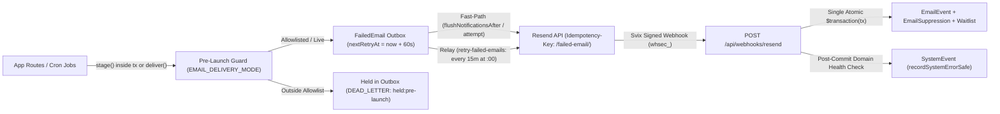

# Email Architecture & Delivery Pipeline

> Canonical architecture reference for outbound email delivery (`lib/email/`), pre-launch recipient gating (`EMAIL_DELIVERY_MODE`), outbox lease protection, row-scoped idempotency, stateless RFC 8058 one-click unsubscribes, Svix-signed Resend webhook ingestion (`POST /api/webhooks/resend`), ops alert routing, and DNS authentication records.

**Last Updated**: 2026-10-11

---

## 1. Architecture Overview

Resend sends every transactional, operational, and newsletter email on the platform across isolated sending subdomains:

- **Transactional & Ops Mail**: Sent from `mail.familiarisenow.com` (`onboarding@`, `security@`, `notifications@`, `payments@`, `finance@`, `dpdp@`, `noreply@`, `system@`).
- **Newsletter & Waitlist Mail**: Sent from `news.familiarisenow.com` (`newsletter@`) to isolate bulk sender reputation from transactional delivery.
- **In-App Notifications**: Novu manages in-app feed notifications exclusively and never dispatches email. Both channels share unified post-commit flushing via `flushNotificationsAfter` (`lib/novu/stage-then-attempt.ts`).

---

## 2. Outbound Catalog (`lib/email/config.ts`)

### Transactional & Lifecycle Emails (`@mail.familiarisenow.com`)

| Type                                                                                                                       | Trigger                                                                                        | Sender           | Recipient                               | Channel                                                       | Source Path                                                                                     |
| -------------------------------------------------------------------------------------------------------------------------- | ---------------------------------------------------------------------------------------------- | ---------------- | --------------------------------------- | ------------------------------------------------------------- | ----------------------------------------------------------------------------------------------- |
| `WELCOME`, `EMAIL_VERIFICATION`                                                                                            | Verified signup, 6-digit verification code                                                     | `onboarding@`    | Customer                                | Outbox via `deliver()`                                        | `emails/auth/`, `lib/email/index.ts`                                                            |
| `PASSWORD_RESET`, `PASSWORD_CHANGED`, `ACCOUNT_LINKED`, `EXISTING_ACCOUNT_SIGN_UP`                                         | Reset link, password changed, social account linked, sign-up attempt on an existing address    | `security@`      | Customer                                | Outbox via `deliver()`                                        | `emails/auth/`, `lib/email/index.ts`                                                            |
| `ACCOUNT_SUSPENDED`, `ACCOUNT_BANNED`                                                                                      | Back-office moderation (mandatory account notice, `category: null`)                            | `security@`      | Customer                                | Outbox via `senders/people.ts`                                | `emails/account/`, `lib/email/senders/people.ts`                                                |
| `SSO_PROVIDER_SUBMITTED`, `SSO_PROVIDER_APPROVED`, `SSO_PROVIDER_REVOKED`                                                  | SSO provider registered (to ADMINs), approved or revoked (to OWNERs)                           | `security@`      | Platform ADMINs, org OWNERs             | Outbox via `senders/sso.ts`                                   | `emails/organizations/SsoProviderEmail.tsx`, `lib/email/senders/sso.ts`                         |
| `SECURITY_EVENT`                                                                                                           | Authenticator or passkey added, backup codes regenerated or used, admin 2FA reset, 2FA lockout | `security@`      | Operator / User                         | Outbox via `deliver()`                                        | `emails/auth/SecurityEventEmail.tsx`, `lib/email/senders/security.ts`                           |
| `APPOINTMENT_BOOKED`, `APPOINTMENT_CANCELLED`, `APPOINTMENT_RESCHEDULED`, `TRIAL_SESSION_SCHEDULED`, `NEW_BOOKING_REQUEST` | Booking lifecycle                                                                              | `notifications@` | Customer or consultant                  | Staged in booking `$transaction`, flushed post-response       | `emails/booking/`, `lib/email/senders/booking.ts`                                               |
| `APPOINTMENT_REMINDER`, `WINDOW_OPENED`, subscription unscheduled nudge                                                    | Reminder and nudge sweeps                                                                      | `notifications@` | Customer or consultant                  | Outbox, sent by cron sweep                                    | `emails/booking/`, `lib/email/senders/booking.ts`                                               |
| `PAYMENT_LINK`, `PAYMENT_LINK_REMINDER`, `PAYMENT_LINK_MANUAL_REMINDER`                                                    | Approved request awaiting payment, reminders                                                   | `payments@`      | Customer                                | Outbox via `deliver()`                                        | `emails/payments/PaymentLinkEmail.tsx`, `lib/email/index.ts`, `lib/booking/remind-payment.ts`   |
| `PAYMENT_SUCCESS`, `PAYMENT_FAILED`                                                                                        | Payment webhook pipeline                                                                       | `payments@`      | Customer                                | Staged in webhook `$transaction`, flushed post-commit         | `emails/payments/`, `lib/payments/webhooks/staged-emails.ts`                                    |
| `REFUND_PROCESSED`, `REFUND_FAILED`, `PAYOUT_STATUS`, `DISPUTE_NOTICE`                                                     | Refund settles/fails, consultant payout status, dispute alerts                                 | `payments@`      | Customer or consultant                  | Outbox via `senders/money.ts`                                 | `emails/payments/`, `lib/email/senders/money.ts`                                                |
| `VERIFICATION_DECIDED`, `ORG_CREATED`, `ORG_WELCOME`                                                                       | Verification decision, organisation created                                                    | `onboarding@`    | Applicant or org admin                  | Outbox via `senders/onboarding.ts`                            | `emails/verification/`, `emails/organizations/`, `lib/email/senders/onboarding.ts`              |
| `ORG_MEMBERSHIP_ROLE_CHANGED`, `ORG_MEMBERSHIP_REMOVED`, organisation invitation                                           | Membership change, invitation                                                                  | `notifications@` | Member                                  | Outbox via `senders/onboarding.ts` & `lib/email/index.ts`     | `emails/organizations/`, `emails/org/`, `lib/email/senders/onboarding.ts`, `lib/email/index.ts` |
| `ORG_BILLING_RECEIPT`, `ORG_PAYOUT_FAILED`, `ORG_INVOICE_OVERDUE`, `ORG_WALLET_LOW`, `ORG_PROGRAM_OVERAGE_DUE`             | Organisation billing receipts, invoices, low wallet, payouts, member overages                  | `finance@`       | Org admin roster                        | Outbox via `senders/money.ts`                                 | `emails/orgs/`, `lib/email/senders/money.ts`                                                    |
| `SUPPORT_TICKET_RECEIVED`, `SUPPORT_TICKET_RESPONSE`, `SUPPORT_TICKET_UPDATE`, `NEW_REVIEW_RECEIVED`                       | Ticket created/escalated, reply, status change, new review                                     | `notifications@` | Customer or consultant                  | Outbox via `senders/people.ts`                                | `emails/support/`, `emails/reviews/`, `lib/email/senders/people.ts`                             |
| `MODERATION_REPORT_OUTCOME`                                                                                                | Moderation action concludes a report                                                           | `security@`      | Reporter                                | Outbox via `senders/people.ts`                                | `app/api/staff/moderation/reports/[reportId]/action/route.ts`, `lib/email/senders/people.ts`    |
| Contact inquiry                                                                                                            | `/contactus` form                                                                              | `notifications@` | Support inbox (`contactInboxAddress()`) | Outbox via `deliver()` (`emails/contact/ContactInquiryEmail`) | `emails/contact/ContactInquiryEmail.tsx`, `lib/email/index.ts`                                  |

### Single-Use Credentials Are Never Stored or Replayed

`EMAIL_VERIFICATION` (the 6-digit code) and `PASSWORD_RESET` (the reset link) are credential email types (`carriesCredential` in `lib/email/classify.ts`). `deliver()` stages their outbox row with `htmlBody: REDACTED_CREDENTIAL_BODY` and `textBody: null`, so a live code or link never reaches the `FailedEmail` table. If the first delivery attempt fails, the retry relay dead-letters the row without sending (`lastError = "not replayed: <type> carried a single-use credential"`); the user requests a fresh code or link directly from the auth page.

### Operational & Compliance Alerts (`Familiarise Ops <system@mail.familiarisenow.com>`)

All ops alerts set `Reply-To: ops@familiarisenow.com` (`OPS_EMAIL` in `lib/email/config.ts`) so replies route to operations rather than looping back to the sender.

| Alert                       | Trigger                                      | Recipient Variable                                       | Slack Mirror (`SLACK_OPS_WEBHOOK_URL`) | Source Path                                     |
| --------------------------- | -------------------------------------------- | -------------------------------------------------------- | -------------------------------------- | ----------------------------------------------- |
| Sentry ingest canary alert  | Ingest canary detects discarded errors       | `OBSERVABILITY_ALERT_EMAIL` (fallback: `supportEmail()`) | Yes (5s timeout, after send)           | `lib/observability/ingest-alert.ts`             |
| Sentry quota alert          | Accepted errors reach 70% monthly quota      | `OBSERVABILITY_ALERT_EMAIL` (fallback: `supportEmail()`) | No                                     | `lib/observability/quota-alert.ts`              |
| DPDP breach deadline alert  | Unreported breach nears 72h statutory window | `DATABREACH_ALERT_EMAIL`                                 | Yes (5s timeout, after send)           | `jobs/compliance/databreach-deadline-alerts.ts` |
| MSME payment deadline alert | Payouts near Section 43B(h) deadline         | `MSME_ALERT_EMAIL`                                       | No                                     | `jobs/compliance/msme-payment-alerts.ts`        |

### Newsletter & Waitlist (`newsletter@news.familiarisenow.com`)

| Type                            | Trigger                             | Recipient             | Guard & Channel                                             | Source Path                                 |
| ------------------------------- | ----------------------------------- | --------------------- | ----------------------------------------------------------- | ------------------------------------------- |
| Waitlist confirmation & welcome | Double opt-in signup / confirmation | Subscriber            | `deliver()`                                                 | `emails/waitlist/`, `lib/email/index.ts`    |
| `WAITLIST_BROADCAST`            | Admin newsletter broadcast          | Confirmed subscribers | `heldRecipientDomain()` per subscriber + `FailedEmailBatch` | `app/api/admin/waitlist/broadcast/route.ts` |

---

## 3. Outbox Staging, Row-Scoped Idempotency, Relay Cadence & RFC 8058 Unsubscribe

1. **60-Second Inline Lease Grace Window**:
   - `stage()` (`lib/email/deliver.ts`) persists each rendered message to `FailedEmail` with `status = "PENDING"` and `nextRetryAt = new Date(Date.now() + 60_000)`.
   - `runEmailRetryTick` (`jobs/email/retry-failed-emails.ts`) only selects `PENDING` `FailedEmail` and `FailedEmailBatch` rows where `nextRetryAt IS NULL OR nextRetryAt <= now` (and `RETRY` rows where `nextRetryAt <= now`), preventing the cron relay from racing in-flight inline attempts.
2. **Row-Scoped Idempotency Keys (`lib/email/idempotency.ts`)**:
   - Both `stage()` (`lib/email/deliver.ts`) and `runEmailRetryTick` (`jobs/email/retry-failed-emails.ts`) pass `row.id` to `idempotencyKeyFor(payload, emailType, row.id)`, producing `<EMAIL_TYPE>/failed-email/<row.id>`.
   - Inline attempts and relay retries for the same `FailedEmail` row share identical idempotency keys, while legitimate repeat transactional emails (e.g., two booking confirmations or receipts within 24 hours) receive distinct keys and are never dropped by Resend's 24-hour deduplication cache.
3. **Post-Commit Fast-Path (`flushNotificationsAfter`) & Scheduled Relay (`retry-failed-emails`)**:
   - Transactional producers prepare emails outside `$transaction` (`prepareRecipientEmails`), stage rows inside `tx` (`stagePreparedEmails` / `stageToRecipients`), and flush staged `bells` and `emails` concurrently post-response via `flushNotificationsAfter` (`lib/novu/stage-then-attempt.ts` -> `scheduleAfter`). Outside Next.js request scope (e.g., CLI scripts, cron jobs, Jest), `scheduleAfter` executes and settles inline.
   - `netlify/functions/cron-tick.mts` dispatches `retry-failed-emails` **every 15 minutes at offset `:00`** (`:00, :15, :30, :45`) with `limit=20` and a `20_000 ms` per-target timeout, paced at `SEND_GAP_MS = 125 ms`. Active queue scans and 7-day `SENT` body scrubs use partial indexes `FailedEmail_active_outbox_idx`, `FailedEmail_sent_unscrubbed_updatedAt_idx`, and `FailedEmailBatch_active_outbox_idx` defined in `prisma/sql/check-constraints.sql`.
   - Dead-letter alerts aggregate per tick (`0` per-row loop `Sentry.captureMessage` calls), update the `email.outbox.dead_letter` gauge metric, and post a single summary message to operations chat (`postOpsChat`).
4. **Stateless RFC 8058 One-Click Unsubscribe & Link-Scanner Protection**:
   - `reconstructUnsubscribeHeaders(row)` (`lib/email/unsubscribe.ts`) reconstructs `List-Unsubscribe: <url>` and `List-Unsubscribe-Post: List-Unsubscribe=One-Click` statelessly on retry from persisted body links (`/api/notifications/unsubscribe?u=...` for lifecycle emails and `/api/waitlist/unsubscribe` for waitlist broadcasts), returning `undefined` for mandatory (`category === null`) notices.
   - Both `GET /api/notifications/unsubscribe` (303 redirect to confirmation page) and `GET /api/waitlist/unsubscribe` (HTML confirmation page with `<form method="post">`) **never mutate database rows**, protecting subscribers from aggressive enterprise link-scanner prefetching. Only `POST` mutates state (`emailEnabled = false` mirrored to Novu, or waitlist opt-out).

---

## 4. Resend Webhook Verification, Atomic Transaction & Full Event Coverage (`POST /api/webhooks/resend`)

Resend delivers webhooks over Svix (`standardwebhooks.com`) signed with `RESEND_WEBHOOK_SECRET` (`whsec_...`).

### 1. Svix Cryptographic Verification & Replay Window

`app/api/webhooks/resend/route.ts` validates payload size (`readBodyWithinCap`), checks presence of `svix-id`, `svix-timestamp`, and `svix-signature`, and verifies the exact raw request buffer using `new Resend(...).webhooks.verify(...)`, enforcing HMAC-SHA256 authenticity plus Svix's **5-minute (300 s) timestamp tolerance** to block replay attacks. Invalid signatures return HTTP `401` without logging untrusted payload bytes.

### 2. Atomic Single-Transaction Persistence Under `PG_POOL_MAX=1`

Both `EmailEvent` creation (`@unique` on `svixId`) and recipient suppression / waitlist side effects execute inside **one atomic `prisma.$transaction(async (tx) => ...)`** passing `tx` sequentially to every helper:

- Duplicate redeliveries hit `EmailEvent.svixId` unique constraint (`isUniqueViolation`) and immediately return HTTP `200 { received: true, duplicate: true }`.
- If any database write fails mid-transaction, the entire transaction rolls back (`EmailEvent` is **not** committed) and the route returns **HTTP `500`** so Resend/Svix retries the delivery cleanly.

### 3. Complete Handled Resend Event Catalog

| Event Family                   | Event Name(s)                                                                                                                                   | Action                                                                                                                                                                                                                  |
| ------------------------------ | ----------------------------------------------------------------------------------------------------------------------------------------------- | ----------------------------------------------------------------------------------------------------------------------------------------------------------------------------------------------------------------------- |
| **Delivery & Bounce**          | `email.bounced`                                                                                                                                 | When `data.bounce?.type === "Permanent"`, upserts `EmailSuppression` (`HARD_BOUNCE`) via `tx` and transitions `Waitlist` (`PENDING`/`SUBSCRIBED` → `BOUNCED`). Transient bounces log `EmailEvent` only.                 |
| **Spam Complaints**            | `email.complained`                                                                                                                              | Upserts `EmailSuppression` (`COMPLAINT`) via `tx` and transitions `Waitlist` to `UNSUBSCRIBED`.                                                                                                                         |
| **Pre-Send Suppression Block** | `email.suppressed`                                                                                                                              | Fired when Resend blocks an outbound message due to upstream suppression; synchronizes `EmailSuppression` (`MANUAL`) via `tx` and marks `Waitlist` (`BOUNCED`) so future sends short-circuit locally without API calls. |
| **Audience / Contact Sync**    | `contact.created`, `contact.updated`, `contact.deleted`, `contact.topics.updated`                                                               | When `type === "contact.deleted"` or `type === "contact.updated"` with `unsubscribed === true`, upserts `EmailSuppression` (`MANUAL`) via `tx` and marks `Waitlist` (`UNSUBSCRIBED`).                                   |
| **Sending Domain Health**      | `domain.created`, `domain.updated`, `domain.deleted`                                                                                            | Calls `recordSystemErrorSafe` **after transaction commit** when `domain.updated` reports `status` as `"failed"` or `"not_started"`, or when `domain.deleted` fires.                                                     |
| **Telemetry & Inbound Events** | `email.sent`, `email.delivered`, `email.delivery_delayed`, `email.opened`, `email.clicked`, `email.failed`, `email.scheduled`, `email.received` | Persisted idempotently on `EmailEvent` for delivery auditing; `archive-webhook-events` prunes `EmailEvent` rows older than **90 days** every Sunday UTC midnight.                                                       |

---

## 5. Pre-Launch Delivery Guard (`EMAIL_DELIVERY_MODE`) & DNS Authentication

Enforced in `lib/email/delivery-guard.ts` across `stage()`, `attempt()`, `retry-failed-emails.ts`, and `heldRecipientDomain()`:

- **Mode**: Only `EMAIL_DELIVERY_MODE=live` disables the guard; any other value or unset defaults to `allowlist`.
- **Allowlist Matching**: Permits recipients on `familiarisenow.com` (and its subdomains) or explicit entries in comma-separated `EMAIL_ALLOWLIST` (exact addresses or `@domain`/`domain`). If any recipient in `to`, `cc`, or `bcc` is disallowed, the entire message is held in `FailedEmail` as `DEAD_LETTER` (`lastError = "held:pre-launch"`).
- **Production Launch Requirement**: Set `EMAIL_DELIVERY_MODE=live` in both Netlify production environment variables AND GitHub repository variables (`cron-intra-day.yml`, `cron-daily.yml`).

| Host                               | Type     | Value                                                                              | Purpose                                                                        |
| ---------------------------------- | -------- | ---------------------------------------------------------------------------------- | ------------------------------------------------------------------------------ |
| `@` (apex)                         | MX       | ImprovMX `mx1.improvmx.com` (10) & `mx2.improvmx.com` (20)                         | Routes `support@`, `ops@`, `dpdp@`, `billing@`, and `dmarc@` to operator inbox |
| `@` (apex)                         | TXT      | `v=spf1 -all`                                                                      | Prevents spoofing on non-sending root domain                                   |
| `_dmarc`                           | TXT      | `v=DMARC1; p=quarantine; rua=mailto:dmarc@familiarisenow.com`                      | Enforces DMARC alignment and aggregate reporting                               |
| `resend._domainkey.mail` / `.news` | TXT      | Resend DKIM public keys                                                            | Signs transactional (`mail.`) and newsletter (`news.`) traffic                 |
| `send.mail` / `send.news`          | MX + TXT | `feedback-smtp.ap-northeast-1.amazonses.com` + `v=spf1 include:amazonses.com ~all` | Return-Path bounce handling and SPF alignment                                  |

---

## Deprecated & Superseded Approaches

- **Immediate `nextRetryAt: NOW()` on Outbox Insert & Content-Hashed Retry Keys**: Superseded by `nextRetryAt: NOW() + 60s` inline lease grace windows and `<EMAIL_TYPE>/failed-email/<row.id>` keys (`idempotencyKeyFor(..., row.id)`), eliminating concurrent inline-vs-relay races and preventing Resend's 24-hour payload hash cache from silently dropping legitimate repeat emails.
- **Dropping RFC 8058 Unsubscribe Headers on Relay Retries & Mutating DB on `GET /api/waitlist/unsubscribe`**: Superseded by stateless `reconstructUnsubscribeHeaders(row)` header extraction on retry and read-only HTML confirmation on `GET /api/waitlist/unsubscribe` so link scanners cannot trigger false unsubscribes.
- **Per-Row Loop Sentry Captures in Outbox Sweepers**: Superseded by per-tick alert deduplication in `runEmailRetryTick` (`alerts` map + `email.outbox.dead_letter` gauge + `postOpsChat` fallback) to protect Sentry's 5,000/month error budget.
- **Non-Transactional `EmailEvent.create` Followed by Separate `suppressRecipient` Writes**: Superseded by a single atomic Prisma `$transaction(tx)` in `app/api/webhooks/resend/route.ts` with weekly 90-day `EmailEvent` pruning in `archive-webhook-events`.
