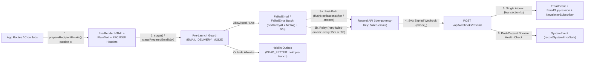
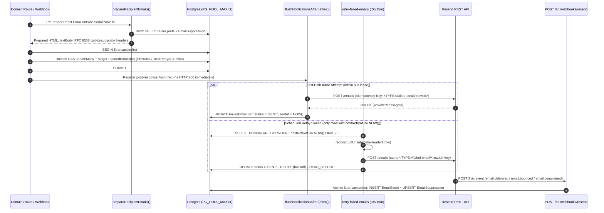
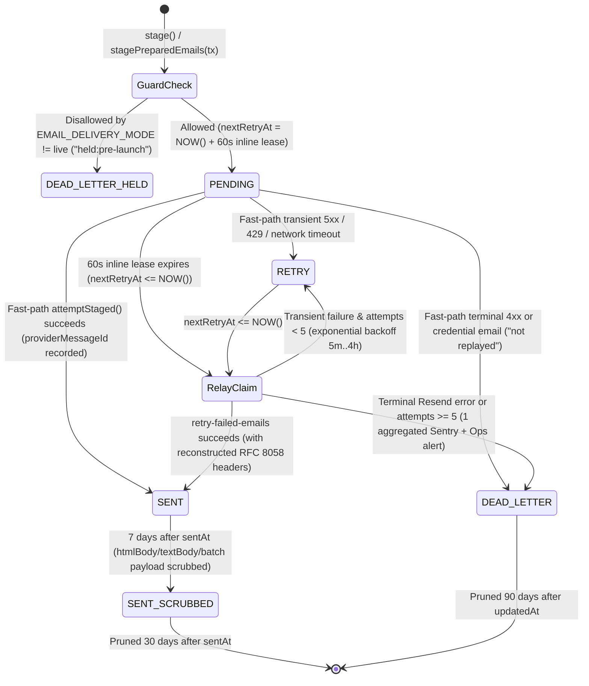
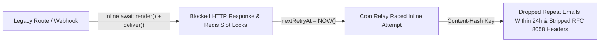

# Email Architecture & Delivery Pipeline

> Canonical architecture reference for outbound email delivery (`lib/email/`), pre-launch recipient gating (`EMAIL_DELIVERY_MODE`), outbox lease protection, row-scoped idempotency, stateless RFC 8058 one-click unsubscribes, Svix-signed Resend webhook ingestion (`POST /api/webhooks/resend`), ops alert routing, and DNS authentication records.

**Last Updated**: 2026-11-07

---

## 1. Architecture Overview

Resend sends every transactional, operational, and newsletter email on the platform across isolated sending subdomains:

- **Transactional & Ops Mail**: Sent from `mail.familiarisenow.com` (`onboarding@`, `security@`, `notifications@`, `payments@`, `finance@`, `dpdp@`, `noreply@`, `system@`).
- **Newsletter Mail**: Sent from `news.familiarisenow.com` (`newsletter@`) to isolate bulk sender reputation from transactional delivery.
- **In-App Notifications**: Novu manages in-app feed notifications exclusively and never dispatches email. Both channels share unified post-commit flushing via `flushNotificationsAfter` (`lib/novu/stage-then-attempt.ts`).



### ASCII High-Level & Low-Level Email Outbox Pipeline

```text
+===================================================================================================+
|                      PRODUCERS (API Routes, Webhooks, Server Actions, Cron)                       |
+===================================================================================================+
   |
   | [Phase 0 — Pre-Render Outside Serializable $transaction(tx)]
   |  prepareRecipientEmails() / preparePaymentSuccessEmail() / prepareOrgBillingEmail()
   |  - Batch-loads User preference rows (`allNotifications`, `emailEnabled`, category column)
   |    + `EmailSuppression` (`HARD_BOUNCE`, `COMPLAINT`, `MANUAL`)
   |  - Renders React Email JSX -> HTML + `toPlainText(html)` + HMAC-SHA256 RFC 8058 `List-Unsubscribe`
   v
+---------------------------------------------------------------------------------------------------+
| [Phase 1 — Atomic Outbox Staging (`stage()` / `stagePreparedEmails(tx)`)]                         |
|  - `EMAIL_DELIVERY_MODE` Guard: non-allowlisted recipients -> `DEAD_LETTER ("held:pre-launch")`   |
|  - Credential Emails (`EMAIL_VERIFICATION`, `PASSWORD_RESET`): `htmlBody = "[REDACTED]"`          |
|  - Standard Lifecycle Emails: `status = "PENDING"`, `nextRetryAt = NOW() + 60s` (60s lease)       |
|  - Newsletter Broadcasts: chunked `FailedEmailBatch` (`<= 100` recipients, `nextRetryAt = +60s`)  |
+---------------------------------------------------------------------------------------------------+
   |                                                          |
   | [Phase 2a — Fast-Path (`flushNotificationsAfter`)]       | [Phase 2b — Relay (`retry-failed-emails`)]
   |  `scheduleAfter` -> `attemptStaged()`                    |  Every 15m at `:05` (`limit=20`, `125ms` gap)
   |  Sends `<EMAIL_TYPE>/failed-email/<row.id>`              |  Reconstructs RFC 8058 headers statelessly via
   |  Updates `status = "SENT"`, `sentAt = NOW()`             |  `reconstructUnsubscribeHeaders(row)`
   v                                                          v
+===================================================================================================+
|            RESEND API (`mail.familiarisenow.com` & `news.familiarisenow.com`)                     |
|  - Single-row idempotency (`Idempotency-Key: <TYPE>/failed-email/<row.id>`)                       |
|  - Batch sends with `batchValidation: "permissive"` (`partial` vs `sent` tracking)                |
+===================================================================================================+
   |
   | Svix Signed Webhook (`svix-id`, `svix-timestamp`, `svix-signature`, 300s replay window)
   v
+---------------------------------------------------------------------------------------------------+
| [Phase 3 — Inbound Webhook (`POST /api/webhooks/resend`)]                                         |
|  - Single atomic `prisma.$transaction(async (tx) => ...)` (`PG_POOL_MAX=1` safe):                 |
|    1. Insert `EmailEvent` (`@unique svixId`)                                                      |
|    2. Upsert `EmailSuppression` + transition `NewsletterSubscriber` on bounce/complaint/suppressed/unsub      |
|  - Post-commit: `prune-system-job-executions` scrubs `SENT` bodies at 7d & prunes outbox rows at 30d/90d and `EmailEvent` at 1 year (calendar) |
+---------------------------------------------------------------------------------------------------+
```

### Low-Level End-to-End Sequence Diagram (`prepare` → `stage` → `flush` → `Resend` → `Svix Webhook`)



### `FailedEmail` & `FailedEmailBatch` Outbox State Machine



---

## 2. Outbound Catalog (`lib/email/config.ts`)

### Transactional & Lifecycle Emails (`@mail.familiarisenow.com`)

| Type                                                                                                                                                                                                                                                     | Trigger                                                                                                                                                                                                | Sender           | Recipient                               | Channel                                                                                                               | Source Path                                                                                                               |
| -------------------------------------------------------------------------------------------------------------------------------------------------------------------------------------------------------------------------------------------------------- | ------------------------------------------------------------------------------------------------------------------------------------------------------------------------------------------------------ | ---------------- | --------------------------------------- | --------------------------------------------------------------------------------------------------------------------- | ------------------------------------------------------------------------------------------------------------------------- |
| `WELCOME`, `EMAIL_VERIFICATION`                                                                                                                                                                                                                          | Verified signup, 6-digit verification code                                                                                                                                                             | `onboarding@`    | Customer                                | Outbox via `deliver()` + `ACCOUNT_SECURITY_NOTICE` bell                                                               | `emails/auth/`, `lib/auth/account-lifecycle.ts`                                                                           |
| `PASSWORD_RESET`, `STAFF_INVITE`, `PASSWORD_CHANGED`, `ACCOUNT_LINKED`, `EXISTING_ACCOUNT_SIGN_UP`                                                                                                                                                       | Reset link, password changed, social account linked, sign-up attempt on an existing address                                                                                                            | `security@`      | Customer                                | Outbox via `deliver()` + `ACCOUNT_SECURITY_NOTICE` bell                                                               | `emails/auth/`, `lib/auth/account-lifecycle.ts`                                                                           |
| `ACCOUNT_SUSPENDED`, `ACCOUNT_BANNED`, `ACCOUNT_REINSTATED`, `MODERATION_WARNING`, `CONTENT_REMOVED`, `REVIEW_EXCLUDED`                                                                                                                                  | Back-office moderation, reinstatement, content takedown, excluded review (`category: null`)                                                                                                            | `security@`      | Customer / Consultant                   | Staged in moderation `$transaction`, flushed post-commit                                                              | `emails/auth/AccountRestrictedEmail.tsx`, `lib/moderation/side-effects.ts`                                                |
| `SSO_PROVIDER_SUBMITTED`, `SSO_PROVIDER_APPROVED`, `SSO_PROVIDER_REJECTED`, `SSO_PROVIDER_REVOKED`, `SSO_PROVIDER_DELETED`                                                                                                                               | SSO provider registered, approved, rejected, revoked, or removed                                                                                                                                       | `security@`      | Platform ADMINs, org OWNERs             | Staged via `senders/sso.ts`, flushed via `flushNotificationsAfter`                                                    | `emails/organizations/SsoProviderEmail.tsx`, `lib/email/senders/sso.ts`                                                   |
| `SECURITY_EVENT`                                                                                                                                                                                                                                         | Authenticator or passkey added/removed, backup codes regenerated/used, admin 2FA reset, lockout                                                                                                        | `security@`      | Operator / User                         | Outbox via `deliver()` + `ACCOUNT_SECURITY_NOTICE` bell                                                               | `emails/auth/SecurityEventEmail.tsx`, `lib/auth/security-email.ts`                                                        |
| `APPOINTMENT_BOOKED`, `APPOINTMENT_CANCELLED`, `APPOINTMENT_RESCHEDULED`, `APPOINTMENT_COMPLETED`, `CLASS_EXIT_AVAILABLE`, `SESSION_OUTCOME_PROPOSED`, `SESSION_OUTCOME_REVIEWED`, `CLASS_SESSION_MISSED_RECORDING` | Booking lifecycle, class sessions, make-ups, a proposed negative session verdict to both sides (staged in the verdict's transaction) and its ops review, missed recordings, completion | `notifications@` | Customer or consultant                  | Staged in booking `$transaction`, flushed post-response                                                               | `emails/booking/`, `lib/email/senders/booking.ts`                                                                         |
| `DOCUMENT_UPLOADED`, `DOCUMENT_REVIEWED`, `RECORDING_READY`, `RECORDING_FAILED`, `RECORDING_REMOVED`                                                                                                                                                     | Shared session documents uploaded/reviewed and session recordings ready/failed/removed                                                                                                                 | `notifications@` | Customer or consultant                  | Staged in `$transaction` / outbox, flushed post-commit                                                                | `emails/booking/DocumentAndRecordingEmail.tsx`, `lib/email/senders/booking.ts`                                            |
| `CHAT_UNREAD_DIGEST`                                                                                                                                                                                                                                     | Stream `user.unread_message_reminder`; one per user per 30-minute window, never quoting message text                                                                                                   | `notifications@` | Customer or consultant                  | Staged with the `CHAT_UNREAD_DIGEST` bell in one `$transaction`, flushed post-commit                                  | `emails/chat/UnreadMessagesDigestEmail.tsx`, `lib/email/senders/chat.ts`, `lib/stream/chat/unread-digest.ts`              |
| `EVENT_SEAT_OPENED`                                                                                                                                                                                                                                      | A seat opened on a sold-out webinar or class the recipient asked to hear about (notify-me); staged after the freeing transaction commits, claimed once per waiter and 12-hour bucket, sent at any hour | `notifications@` | Customer                                | Outbox, then `deliver()`                                                                                              | `emails/booking/EventSeatOpenedEmail.tsx`, `stageEventSeatOpenedEmails` in `lib/email/senders/booking.ts`                 |
| `TRIAL_SESSION_SCHEDULED`, `TRIAL_COMPLETED`, `TRIAL_CANCELLED`, `SUBSCRIPTION_STARTED`, `SUBSCRIPTION_RENEWED`, `APPOINTMENT_REMINDER`, `WINDOW_OPENED`, `SUBSCRIPTION_UNSCHEDULED_NUDGE`                                                               | Trial lifecycle, subscription starts/renewals, reminders, and nudge sweeps                                                                                                                             | `notifications@` | Customer or consultant                  | Staged in `$transaction` / outbox, flushed post-commit                                                                | `emails/booking/`, `lib/email/senders/booking.ts`                                                                         |
| `PAYMENT_LINK`, `PAYMENT_LINK_REMINDER`, `PAYMENT_LINK_MANUAL_REMINDER`, `REFERRAL_BONUS_EARNED`, `REFERRAL_WELCOME_BONUS`, `REFERRAL_CREDITS_APPLIED`                                                                                                   | Approved request awaiting payment, reminders, referral bonuses & applied credits                                                                                                                       | `payments@`      | Customer                                | Outbox via `deliver()` / `senders/money.ts`                                                                           | `emails/payments/`, `lib/email/senders/money.ts`, `lib/booking/remind-payment.ts`                                         |
| `PAYMENT_SUCCESS`, `PAYMENT_FAILED`                                                                                                                                                                                                                      | Payment webhook pipeline                                                                                                                                                                               | `payments@`      | Customer                                | Staged in webhook `$transaction`, flushed post-commit                                                                 | `emails/payments/`, `lib/payments/webhooks/staged-emails.ts`                                                              |
| `DIGITAL_PRODUCT_PURCHASED`                                                                                                                                                                                                                              | Digital product sale settled or free product claimed (receipt, `category: null`)                                                                                                                       | `payments@`      | Customer                                | Staged once per purchase (`IdempotencyRecord` claim) in the settling or claiming `$transaction`, flushed after commit | `emails/payments/DigitalProductPurchaseEmail.tsx`, `lib/email/senders/money.ts`, `lib/digital-products/purchase-email.ts` |
| `REFUND_PROCESSED`, `REFUND_FAILED`, `PAYOUT_STATUS`, `DISPUTE_NOTICE`                                                                                                                                                                                   | Refund settles/fails, consultant payout status, dispute alerts                                                                                                                                         | `payments@`      | Customer or consultant                  | Outbox via `senders/money.ts`                                                                                         | `emails/payments/`, `lib/email/senders/money.ts`                                                                          |
| `VERIFICATION_DECIDED`, `ORG_CREATED`, `ORG_WELCOME`                                                                                                                                                                                                     | Verification decision (`UNDER_REVIEW`, `VERIFIED`, `NEEDS_INFO`, `REJECTED`), org created                                                                                                              | `onboarding@`    | Applicant or org admin                  | Staged in `$transaction`, flushed post-commit                                                                         | `emails/verification/`, `emails/organizations/`, `lib/email/senders/onboarding.ts`                                        |
| `ORG_MEMBERSHIP_ROLE_CHANGED`, `ORG_MEMBERSHIP_REMOVED`, `ORG_CONTRACT_AND_SEAT`, `ORG_INVITATION`                                                                                                                                                       | Membership role/removal, seat assignments/revocations, contract lifecycle, organization invites                                                                                                        | `notifications@` | Member / Org admin                      | Staged via `senders/onboarding.ts` & `lib/email/index.ts`                                                             | `emails/organizations/`, `lib/email/senders/onboarding.ts`                                                                |
| `ORG_BILLING_RECEIPT`, `ORG_PAYOUT_FAILED`, `ORG_INVOICE_OVERDUE`, `ORG_WALLET_LOW`, `ORG_PROGRAM_OVERAGE_DUE`, `ORG_MEMBER_OVERAGE_TIMED_OUT`, `ORG_LICENSE_RENEWAL_UPCOMING`, `ORG_PROGRAM_CAP_NEAR`, `ORG_PROGRAM_EXHAUSTED`, `ORG_DATA_EXPORT_READY` | Organization billing receipts, invoices, dunning, overages, license renewals, cap & exports                                                                                                            | `finance@`       | Org admin roster / Member               | Staged via `senders/money.ts`, flushed post-commit                                                                    | `emails/payments/OrgDunningEmail.tsx`, `emails/orgs/`, `lib/email/senders/money.ts`                                       |
| `SUPPORT_TICKET_RECEIVED`, `SUPPORT_TICKET_RESPONSE`, `SUPPORT_TICKET_UPDATE`, `PLATFORM_FEEDBACK_UPDATE`, `NEW_REVIEW_RECEIVED`                                                                                                                         | Ticket created/escalated, reply, status change, product feedback update, new review                                                                                                                    | `notifications@` | Customer or consultant                  | Staged in `$transaction`, flushed via `flushNotificationsAfter`                                                       | `emails/support/`, `emails/reviews/`, `lib/email/senders/people.ts`                                                       |
| `MODERATION_REPORT_OUTCOME`                                                                                                                                                                                                                              | Moderation action concludes a report                                                                                                                                                                   | `security@`      | Reporter                                | Staged in moderation `$transaction`, flushed post-commit                                                              | `app/api/staff/moderation/reports/[reportId]/action/route.ts`, `lib/email/senders/people.ts`                              |
| Contact inquiry                                                                                                                                                                                                                                          | `/contactus` form                                                                                                                                                                                      | `notifications@` | Support inbox (`contactInboxAddress()`) | Outbox via `deliver()` (`emails/contact/ContactInquiryEmail`)                                                         | `emails/contact/ContactInquiryEmail.tsx`, `lib/email/index.ts`                                                            |

### Calendar Links in the Booked Email

`APPOINTMENT_BOOKED` carries two add-to-calendar links for the attendee only, never for the host: a Google Calendar template URL and a signed link to `GET /api/calendar/[appointmentId]?u=&t=`, which serves an `.ics` with the title, the times and the dashboard link (`calendarLinks` in `lib/appointments/calendar-links.ts`). The Google link names the next session still ahead (`nextSessionAhead`, the same helper the checkout success page uses), so a late class enrolment never links a past session. They are links, not attachments, because `deliver()` sends no attachments and the route re-checks the paid seat on every read. The token signs with the shared link key (`signToken` in `lib/auth/link-signing.ts`, derived from `BETTER_AUTH_SECRET`) under its own purpose label; when the key is unavailable the links are left out and the email still sends. See [the attendee comms decision](../decisions/2026-11-07-attendee-comms.md).

### Single-Use Credentials Are Never Stored or Replayed

`EMAIL_VERIFICATION` (the 6-digit code), `PASSWORD_RESET` (the reset link) and `STAFF_INVITE` (a new operator's set-your-password link) are credential email types (`carriesCredential` in `lib/email/classify.ts`). `deliver()` stages their outbox row with `htmlBody: REDACTED_CREDENTIAL_BODY` and `textBody: null`, so a live code or link never reaches the `FailedEmail` table. If the first delivery attempt fails, the retry relay dead-letters the row without sending (`lastError = "not replayed: <type> carried a single-use credential"`); the user requests a fresh code or link directly from the auth page.

### Per-Recipient Daily Cap on Auth Mail

Four email types can be aimed at any inbox by a stranger who types an address into a public auth form: `EMAIL_VERIFICATION`, `PASSWORD_RESET`, `EXISTING_ACCOUNT_SIGN_UP` and `STAFF_INVITE` (a forgot-password request for an operator who has not enrolled 2FA sends the invitation wording). `deliver()` sends at most **5 of each type per recipient per rolling 24 hours** (`lib/email/recipient-cap.ts`). The check runs before staging, so a capped send writes no outbox row, never reaches Resend, logs one `email_recipient_capped` line with the email type only, and returns `{ success: false, error: EmailRecipientCappedError }`. The auth endpoints answer exactly as they would have, because they already answer the same way whether or not a mail went out.

- **Example.** Someone requests a password reset for `asha@example.com` six times in an hour from six different IP addresses. The first five reset emails go out; the sixth is dropped. A verification code for the same address still goes out, because each type has its own bucket, so a flood of one kind of mail cannot block another.
- **Key.** `@upstash/ratelimit` sliding window via `makeLimiter` (`lib/rate-limit.ts`), prefix `rl:mail-recipient`, identifier `<emailType>:<sha256(lower(trim(address)))>`. Redis holds only the digest, never the address.
- **Fails open.** A Redis error sends the mail and reports a throttled Sentry warning (`email:recipient-cap`), at most one per minute per instance, never one per send. A Redis reply slower than the limiter's 500 ms timeout also lets the send through.
- **Not capped.** Money receipts, booking mail, org invitations (an authenticated org admin sends them, under the per-org `orgInviteLimiter`) and every other type. Staff invitations have their own bucket, so a flood of reset requests cannot spend the budget an ADMIN's setup link needs.
- **What the user sees.** Auth mail is sent after the HTTP response, so the endpoint cannot report a dropped send. The verify-email and forgot-password pages always state the limit ("You can request at most 5 codes a day"), which tells nobody whether the address has an account.

### Operational & Compliance Alerts (`Familiarise Ops <system@mail.familiarisenow.com>`)

All ops alerts set `Reply-To: connect@practitionist.com` (`SUPPORT_EMAIL` in `lib/company.ts`) so replies reach the one live mailbox rather than looping back to the sender. `familiarisenow.com` is send-only (Resend): it publishes a null MX (`0 .`), so nothing sent to an address on it arrives. Every inbound address is `connect@practitionist.com` through `SUPPORT_EMAIL` in `lib/company.ts`.

| Alert                       | Trigger                                      | Recipient Variable                                       | Slack Mirror (`SLACK_OPS_WEBHOOK_URL`) | Source Path                                    |
| --------------------------- | -------------------------------------------- | -------------------------------------------------------- | -------------------------------------- | ---------------------------------------------- |
| Sentry ingest canary alert  | Ingest canary detects discarded errors       | `OBSERVABILITY_ALERT_EMAIL` (fallback: `supportEmail()`) | Yes (5s timeout, after send)           | `lib/observability/ingest-alert.ts`            |
| Sentry quota alert          | Accepted errors reach 70% monthly quota      | `OBSERVABILITY_ALERT_EMAIL` (fallback: `supportEmail()`) | No                                     | `lib/observability/quota-alert.ts`             |
| DPDP breach deadline alert  | Unreported breach nears 72h statutory window | `COMPLIANCE_ALERT_EMAIL` (`lib/company.ts`)              | Yes (5s timeout, after send)           | `lib/compliance/databreach-deadline-alerts.ts` |
| MSME payment deadline alert | Payouts near Section 43B(h) deadline         | `COMPLIANCE_ALERT_EMAIL` (`lib/company.ts`)              | No                                     | `jobs/compliance/msme-payment-alerts.ts`       |

### Newsletter (`newsletter@news.familiarisenow.com`)

| Type                                       | Trigger                             | Recipient                                    | Guard & Channel                                            | Source Path                                   |
| ------------------------------------------ | ----------------------------------- | -------------------------------------------- | ---------------------------------------------------------- | --------------------------------------------- |
| `NEWSLETTER_CONFIRM`, `NEWSLETTER_WELCOME` | Double opt-in signup / confirmation | Subscriber                                   | `deliver()`                                                | `emails/newsletter/`, `lib/email/index.ts`    |
| `NEWSLETTER_BROADCAST`                     | Admin newsletter broadcast          | A filtered audience of confirmed subscribers | `heldRecipientDomain()` per recipient + `FailedEmailBatch` | `app/api/admin/newsletter/broadcast/route.ts` |

### The newsletter broadcast

The back-office Newsletter page (`components/admin/NewsletterManagement.tsx`, surface `newsletter.manage`; only an admin sends) posts to `POST /api/admin/newsletter/broadcast`. The body is Zod-validated and has one of four modes:

- `preview` returns the audience's counts without sending (the page keeps every send button off until a preview of the current filters has settled successfully, and the confirmation quotes that count): how many confirmed subscribers match, how many of those are suppressed or held by the pre-launch guard, and how many are sendable.
- `test` sends the message only to the calling admin's own address, through the same suppression check and pre-launch guard.
- `warmup` with `limit` N sends to the N sendable subscribers who confirmed most recently (`confirmedAt` descending).
- `all` sends to every sendable subscriber in the audience, in signup order (`createdAt`, then `id`), so a retried send that gained a new confirmation keeps every earlier batch and its idempotency key unchanged and appends the newcomer to the last batch. Only `warmup` orders by `confirmedAt`.

The audience filter (`broadcastAudienceSchema` in `lib/newsletter/broadcast-audience.ts`, applied by `audienceWhere` in `lib/newsletter/service.ts`) narrows the `SUBSCRIBED` rows by `sources`, by `tags` (a subscriber matches when it carries any of the given tags) and by `role`: `EXPERT` is a linked account with a consultant profile, `LEARNER` is a linked account without one, and `NO_ACCOUNT` is a row with no `userId`. A send whose sendable audience is above `BROADCAST_AUDIENCE_LIMIT` (2,000) is refused with `422 AUDIENCE_TOO_LARGE`, because the route sends every batch inside one request; a larger list needs a ticker-driven campaign outbox. Each batch of up to 100 messages is a `FailedEmailBatch` row keyed `NEWSLETTER_BROADCAST/<digest>` before the request goes out, so the relay replays a lost or failed batch under the same idempotency key. The footer appended to every message says "You received this because you subscribed to the Familiarise newsletter." and carries the unsubscribe link and the RFC 8058 one-click headers.

### The newsletter follows marketing consent

The newsletter list is the `NewsletterSubscriber` model and table. A visitor joins from the footer form (`POST /api/newsletter`, rate limited to three an hour per IP by `newsletterLimiter`), which shows the purpose notice `NEWSLETTER_NOTICE` (`lib/newsletter/notice.ts`), with double opt-in (`subscribe` and `confirmSubscription` in `lib/newsletter/service.ts`). Confirming writes the `SUBSCRIBED` status and a `MARKETING_COMMS` `ConsentArtifact` in one transaction, stamped with `NEWSLETTER_NOTICE_VERSION` (`recordNewsletterConsent` in `lib/newsletter/consent-link.ts`). A sign-up links the row to the signed-in account only when that account's verified email is the submitted address, and confirmation resolves the account from the confirmed address itself, never from a stored `userId`. When the normalised address belongs to an account, the row and the artifact are linked to that user; otherwise the artifact carries a pseudonymous subject id, an HMAC of the normalised address under its own key derived from `BETTER_AUTH_SECRET` (`newsletterSubjectId`), so the address itself is never stored on the artifact. The id is written to the row's `consentSubjectId` at confirmation and every withdrawal and erasure reads it back, so rotating `BETTER_AUTH_SECRET` cannot orphan the artifact; the id is recomputed only for a row that has none. A live artifact for the same subject is reused, so a repeat confirmation writes no second one. A signed-in account has one marketing control, its DPDP `MARKETING_COMMS` consent (`app/api/user/privacy/consent/route.ts`, shown in Settings › Account › Data consent & privacy rights):

- **Granting** it upserts the `NewsletterSubscriber` row for the account's normalised address in the same transaction as the consent artifact: `userId` set, `SUBSCRIBED`, `confirmedAt` now, `unsubscribedAt` null, and the hashed IP and user agent recorded (`subscribeForMarketingConsent` in `lib/newsletter/consent-link.ts`). No confirmation email is sent, because the authenticated consent artifact is the evidence. A row the grant creates carries the `account-consent` tag.
- **Withdrawing** it sets every `PENDING` or `SUBSCRIBED` row linked to the account, by `userId` or address, to `UNSUBSCRIBED` with `unsubscribedAt` now, and withdraws any pseudonymous newsletter artifact for the address left from a sign-up made before the account existed, in the withdrawal's transaction (`unsubscribeForWithdrawnConsent`).
- **The newsletter's own unsubscribe** (`POST /api/newsletter/unsubscribe`) writes `UNSUBSCRIBED` and withdraws the address's `MARKETING_COMMS` consent, the linked account's and the pseudonymous subject's, in one transaction (`withdrawNewsletterConsent`). If the transaction fails, the page says "We could not unsubscribe you" with a 500, never "You are unsubscribed". An invalid or incomplete link answers 400 and points the reader to their account settings, because rotating `BETTER_AUTH_SECRET` voids every signed link.
- **A complaint or a vendor-side unsubscribe** reported by the Resend webhook (`email.complained`, `contact.deleted`, or `contact.updated` with `unsubscribed`) flips the matching `PENDING` and `SUBSCRIBED` rows to `UNSUBSCRIBED` and withdraws the consent of every matching row, a `BOUNCED` one included, in the webhook's transaction. A hard bounce or a provider suppression only marks the row `BOUNCED`; that is a delivery state, not a withdrawal.
- **One lock order.** Every withdrawal path (the newsletter unsubscribe, the Resend webhook, the account's consent withdrawal and erasure) first row-locks the matching `NewsletterSubscriber` rows with `lockNewsletterRows` (`lib/newsletter/consent-link.ts`), which also returns their account link and subject id as committed after the lock, and only then writes `ConsentArtifact` rows. Concurrent withdrawals therefore cannot deadlock, and a confirmation racing a withdrawal is seen rather than missed.
- `NotificationPreference.marketingEmails` is no longer written or read by any sender, and the preferences PUT rejects it. It stays in the data export until the schema batch drops it.

Both unsubscribe pages render bare: the text wordmark and the message only, with no site navigation or footer newsletter form. `/email/unsubscribe` is in `NO_CHROME_PREFIXES` (`lib/navigation/public-chrome.ts`); the newsletter page is a standalone HTML response from the route.

### What erasure does to mail

`scrubUser` (`lib/compliance/erasure/scrub-user.ts`) calls `scrubMailFootprintTx` (`lib/compliance/erasure/mail-footprint.ts`) inside the erasure transaction, matching the user by id and by the address held before the scrub rewrites it:

- Every `NewsletterSubscriber` row with the user's `userId` or address is deleted, and any live pseudonymous `MARKETING_COMMS` artifact for the address is withdrawn. Like the account's own artifacts, which `scrubUser` withdraws and stamps with the user's pseudonym, it is kept as audit evidence until `auditRetainedUntil`, which the withdrawal restarts at seven years and never shortens; the weekly consent retention sweeper is the only path that deletes it.
- Every `PENDING` or `RETRY` `FailedEmail` row with the user's `deliveryUserId` or `recipient` becomes `DEAD_LETTER` with `lastError = policy:recipient_erased` (`RECIPIENT_ERASED_REFUSAL` in `lib/email/delivery-policy.ts`, the same reason the relay writes for an erased account), through a compare-and-set on `UNSETTLED`. Its `subject` and `htmlBody` become `REDACTED_ERASED_BODY` (`lib/email/classify.ts`) and `textBody` becomes null, the same way credential mail is stored redacted. `policy:` is an expected refusal, so it never pages and the admin replay refuses it.
- Then **every** `FailedEmail` row of the user, `SENT` and `DEAD_LETTER` included, has its `recipient` replaced by `erased:` and the first 16 hex characters of the SHA-256 of the normalised address (`erasedRecipientMarker`). The column has no constraint or index, and the marker can never be mailed: `emailPolicyRefusal` answers `recipient_erased` for it before any send, inline or in the relay, and `emailReplayRefusal` refuses to requeue it (`isErasedRecipient`, `lib/email/erased-recipient.ts`). The same address always gives the same marker, so support can still group an erased user's rows without knowing the address. Newsletter confirm and welcome mail is anchored on `entityRef = newsletter:<address>` and contact-form mail on `contact:<address>` (`lib/email/index.ts`); erasure replaces either `entityRef`, matched case-insensitively, with the same marker, and redacts those rows' subject and body because they are about the person. A `replyTo` that holds the address (the contact form replies to the visitor) is cleared to `null`, not set to the marker, so a replay of that row still sends to the support inbox.
- Every `FailedEmailBatch` whose payload holds the address (found with a JSON containment filter; batch addresses come from `NewsletterSubscriber.email`, which is stored normalised) loses the user's messages. A queued batch the provider has never seen (`firstAttemptAt` null) keeps the rest and sends them under its key, as the relay's own suppression narrowing does. A queued batch the provider may have seen cannot reuse its key with a narrowed payload, so it becomes `DEAD_LETTER` with `review:erased_recipient` for an operator; a queued batch addressed only to the user becomes `DEAD_LETTER` with `policy:recipient_erased`. A settled batch (`SENT` or `DEAD_LETTER`) keeps its status and simply loses the messages, which is safe because no path ever replays a settled batch. Either way the stored payload no longer holds the user's messages.
- `EmailSuppression` is **kept**. It holds only the address and the reason, and it is the one record that stops a bounced or complaining address being mailed again if it is ever re-entered, for example by a new footer sign-up. Deleting it would let erasure re-open mail to an address that asked not to receive any.
- The bodies of rows already `SENT` or `DEAD_LETTER` are left to the retention prune (`prune-system-job-executions`), which scrubs `SENT` bodies after seven days and deletes sent rows at 30 days and dead letters at 90.
- Bells need no scrub: the bell relay drops an erased recipient at send time (`unerasedRecipients` and `currentBellRecipients` in `lib/novu/policy.ts`), and an email with a delivery policy is refused as `policy:recipient_erased` if it reaches the relay before the scrub.

---

## 3. Outbox Staging, Row-Scoped Idempotency, Relay Cadence & RFC 8058 Unsubscribe

1. **60-Second Inline Lease Grace Window**:
   - `stage()` (`lib/email/deliver.ts`) persists each rendered message to `FailedEmail` with `status = "PENDING"` and `nextRetryAt = new Date(Date.now() + 60_000)`.
   - `runEmailRetryTick` (`jobs/email/retry-failed-emails.ts`) only selects `PENDING` `FailedEmail` and `FailedEmailBatch` rows where `nextRetryAt IS NULL OR nextRetryAt <= now` (and `RETRY` rows where `nextRetryAt <= now`), preventing the cron relay from racing in-flight inline attempts.
2. **Row-Scoped Idempotency Keys (`lib/email/idempotency.ts`)**:
   - Both `stage()` (`lib/email/deliver.ts`) and `runEmailRetryTick` (`jobs/email/retry-failed-emails.ts`) pass `row.id` to `idempotencyKeyFor(payload, emailType, row.id)`, producing `<EMAIL_TYPE>/failed-email/<row.id>`.
   - Inline attempts and relay retries for the same `FailedEmail` row share identical idempotency keys, while legitimate repeat transactional emails (e.g., two booking confirmations or receipts within 24 hours) receive distinct keys and are never dropped by Resend's 24-hour deduplication cache.
3. **Conditional settle (compare-and-set).** Every status write on `FailedEmail` and `FailedEmailBatch` is an `updateMany` whose `WHERE` carries `status: UNSETTLED` (`PENDING` or `RETRY`, from `lib/retry/provider-window.ts`). The writers are `settleRow` in `lib/email/deliver.ts`, the relay in `jobs/email/retry-failed-emails.ts` and `settleBatch` in `app/api/admin/newsletter/broadcast/route.ts`. A writer that lost a race to another attempt matches no row, is skipped and is not counted, so a late writer can never overwrite `SENT` with a retry or dead-letter state.
4. **Post-Commit Fast-Path (`flushNotificationsAfter`) & Scheduled Relay (`retry-failed-emails`)**:
   - Transactional producers prepare emails outside `$transaction` (`prepareRecipientEmails`, or a sender's `prepare*Email(args)` built on `prepareBuiltSpec`), stage rows inside `tx` (`stagePreparedEmails`, or `stage*Email(tx, args, pre)`, which renders inside `tx` only when the in-transaction arguments differ from the pre-render's), and flush staged `bells` and `emails` concurrently post-response via `flushNotificationsAfter` (`lib/novu/stage-then-attempt.ts` -> `scheduleAfter`). Outside Next.js request scope (e.g., CLI scripts, cron jobs, Jest), `scheduleAfter` executes and settles inline.
   - A notice's render failure never rolls back the business write (decision 15 of `docs/decisions/2026-11-06-notification-single-preference-owner.md`). A required notice sets `traceRenderFailure: true` on its spec (refund processed and failed, the payment receipt, organisation billing receipts, the dunning overdue email, the payout status emails and the organisation payout-failed email): a render failure then stages a body-less `DEAD_LETTER` row with `lastError` `review:render_failed` in the same transaction instead of a per-recipient Sentry event, and replay refuses that row. Dunning renders its overdue email before each claim; every stage (first overdue notice, each reminder, suspension) stages its email and bell inside the winning claim transaction, and the relays below deliver whatever the inline attempt after commit did not.
   - `netlify/functions/cron-tick.mts` dispatches `retry-failed-emails` **every 15 minutes at offset `:05`** (`:05, :20, :35, :50`) with `limit=20` and a `20_000 ms` per-target timeout, paced at `SEND_GAP_MS = 125 ms`. Active queue scans and 7-day `SENT` body scrubs use partial indexes `FailedEmail_active_outbox_idx`, `FailedEmail_sent_unscrubbed_updatedAt_idx`, and `FailedEmailBatch_active_outbox_idx` defined in `prisma/sql/check-constraints.sql`.
   - Dead-letter alerts aggregate per tick (`0` per-row loop `Sentry.captureMessage` calls), update the `email.outbox.dead_letter` gauge metric, and post a single summary message to operations chat (`postOpsChat`).
5. **Stateless RFC 8058 One-Click Unsubscribe & Link-Scanner Protection**:
   - `reconstructUnsubscribeHeaders(row)` (`lib/email/unsubscribe.ts`) reconstructs `List-Unsubscribe: <url>` and `List-Unsubscribe-Post: List-Unsubscribe=One-Click` statelessly on retry from persisted body links (`/api/notifications/unsubscribe?u=...` for lifecycle emails and `/api/newsletter/unsubscribe` for newsletter mail), returning `undefined` for mandatory (`category === null`) notices.
   - Both `GET /api/notifications/unsubscribe` (303 redirect to confirmation page) and `GET /api/newsletter/unsubscribe` (HTML confirmation page with `<form method="post">`) **never mutate database rows**, protecting subscribers from aggressive enterprise link-scanner prefetching. Only `POST` mutates state (`emailEnabled = false` in Postgres, with no Novu call, or the newsletter opt-out).
   - The lifecycle link carries two query parameters: `u` (the user id) and `t` (a 64-character hex HMAC-SHA256 of the id under the `email-unsubscribe` purpose). `signedLinkUser` in `lib/email/unsubscribe.ts` parses both with Zod and verifies the signature; the unsubscribe and resubscribe routes both call it and write through `setEmailEnabled`, which answers an unknown user exactly like a real one so the link is not an oracle.
6. **What an unsubscribe stops, and its undo (`/email/unsubscribe`)**:
   - Unsubscribing sets `emailEnabled = false` and nothing else. That stops every optional email, which is every email sent with a category: booking updates and reminders, refunds and payouts, support replies, reviews, and subscription and trial updates. Required emails have a `null` category and ignore the switch (`isEmailAllowedForUser` in `lib/email/preferences.ts`): account and security notices, payment receipts (`PAYMENT_SUCCESS`, `PAYMENT_FAILED`, a digital-product purchase), dispute notices, support-case intake, moderation decisions, organisation invitations and membership changes, and collaborator notices (an invitation, a change of its terms, an accept, a decline, a departure, a removal and an expiry, and the notice to seat holders when a plan's co-presenter joins or leaves; only the reminder before an invitation lapses is optional). A booking email about a change someone else made (an expert's, host's or staff cancel and its refund, a decline, a reschedule proposal, a lapsed proposal's restored time, an automatic move, a class or webinar time change, a removed seat, a host-caused class refund) is staged with a `null` category for that recipient (`requiredFor`, `lib/notifications/required-notices.ts`), so it arrives too. Bells are not affected.
   - When the confirmation page's form posts, the route answers `303` to `/email/unsubscribe?done=1&u=…&t=…`, so the done page still holds the signed pair. The done page re-verifies it and offers **Resubscribe**, a `<form method="post">` to `POST /api/notifications/resubscribe?u=…&t=…`. That route refuses with `403` any request whose `Origin` header is not one of this site's origins (`isSameOriginRequest` in `lib/api/same-origin.ts`), redirects a bad token to `?error=1` without writing, sets `emailEnabled = true` and lands on `?resubscribed=1`. It exports no `GET`, so the RFC 8058 rule holds for the undo too: nothing a prefetch can reach mutates state. A one-click `POST` from a mail client still receives JSON and never sees the page.
   - Every state of the page links to "Manage notification preferences" (`/dashboard/go/auto/settings/notifications`), which resolves to the viewer's own settings page after sign-in.
   - Example: Asha clicks the footer link in a booking reminder. The `GET` sends her to the confirmation page without writing anything. She confirms; `emailEnabled` becomes `false`, and her next booking reminder is not sent, but tomorrow's payment receipt still is. She clicks Resubscribe on the done page, the browser posts with `Origin: https://familiarisenow.com`, `emailEnabled` returns to `true`, and the next reminder goes out again.

---

## 4. Resend Webhook Verification, Atomic Transaction & Full Event Coverage (`POST /api/webhooks/resend`)

Resend delivers webhooks over Svix (`standardwebhooks.com`) signed with `RESEND_WEBHOOK_SECRET` (`whsec_...`).

### 1. Svix Cryptographic Verification & Replay Window

`app/api/webhooks/resend/route.ts` validates payload size (`readBodyWithinCap`), checks presence of `svix-id`, `svix-timestamp`, and `svix-signature`, and verifies the exact raw request buffer using `new Resend(...).webhooks.verify(...)`, enforcing HMAC-SHA256 authenticity plus Svix's **5-minute (300 s) timestamp tolerance** to block replay attacks. Invalid signatures return HTTP `401` without logging untrusted payload bytes.

### 2. Atomic Single-Transaction Persistence Under `PG_POOL_MAX=1`

Both `EmailEvent` creation (`@unique` on `svixId`) and recipient suppression, newsletter status and consent withdrawal side effects execute inside **one atomic `prisma.$transaction(async (tx) => ...)`** passing `tx` sequentially to every helper:

- Duplicate redeliveries hit `EmailEvent.svixId` unique constraint (`isUniqueViolation`) and immediately return HTTP `200 { received: true, duplicate: true }`.
- If any database write fails mid-transaction, the entire transaction rolls back (`EmailEvent` is **not** committed) and the route returns **HTTP `500`** so Resend/Svix retries the delivery cleanly.

### 3. Handled Resend Event Catalog, and what is actually subscribed

The handler understands every event in the table below, but it only receives the ones the Resend dashboard subscribes to. Since 2026-11-07 the one endpoint is subscribed to `email.sent`, `email.delivered`, `email.delivery_delayed`, `email.bounced`, `email.complained`, `email.failed`, `email.suppressed`, `domain.updated` and `domain.deleted`. `contact.*` is deliberately left out, because the app does not use Resend Contacts: the newsletter is the `NewsletterSubscriber` model with its own unsubscribe link. `domain.created` is left out because the handler ignores it. Check the subscription in the dashboard or with `mcp__resend__list-webhooks`; the code cannot show it.

| Event Family                   | Event Name(s)                                                                                                                                   | Action                                                                                                                                                                                                                              |
| ------------------------------ | ----------------------------------------------------------------------------------------------------------------------------------------------- | ----------------------------------------------------------------------------------------------------------------------------------------------------------------------------------------------------------------------------------- |
| **Delivery & Bounce**          | `email.bounced`                                                                                                                                 | When `data.bounce?.type === "Permanent"`, upserts `EmailSuppression` (`HARD_BOUNCE`) via `tx` and transitions `NewsletterSubscriber` (`PENDING`/`SUBSCRIBED` → `BOUNCED`). Transient bounces log `EmailEvent` only.                 |
| **Spam Complaints**            | `email.complained`                                                                                                                              | Upserts `EmailSuppression` (`COMPLAINT`) via `tx` and transitions `NewsletterSubscriber` to `UNSUBSCRIBED`, withdrawing its `MARKETING_COMMS` consent in the same transaction.                                                      |
| **Pre-Send Suppression Block** | `email.suppressed`                                                                                                                              | Fired when Resend blocks an outbound message due to upstream suppression; synchronizes `EmailSuppression` (`MANUAL`) via `tx` and marks `NewsletterSubscriber` (`BOUNCED`) so future sends short-circuit locally without API calls. |
| **Audience / Contact Sync**    | `contact.created`, `contact.updated`, `contact.deleted`, `contact.topics.updated`                                                               | When `type === "contact.deleted"` or `type === "contact.updated"` with `unsubscribed === true`, upserts `EmailSuppression` (`MANUAL`) via `tx`, marks `NewsletterSubscriber` (`UNSUBSCRIBED`) and withdraws its consent.            |
| **Sending Domain Health**      | `domain.created`, `domain.updated`, `domain.deleted`                                                                                            | Calls `recordSystemErrorSafe` **after transaction commit** when `domain.updated` reports `status` as `"failed"` or `"not_started"`, or when `domain.deleted` fires.                                                                 |
| **Telemetry & Inbound Events** | `email.sent`, `email.delivered`, `email.delivery_delayed`, `email.opened`, `email.clicked`, `email.failed`, `email.scheduled`, `email.received` | Persisted idempotently on `EmailEvent` for delivery auditing; `prune-system-job-executions` prunes `EmailEvent` rows older than **1 year (calendar)** in its nightly window (20:00–23:30 UTC).                                      |

---

## 5. Pre-Launch Delivery Guard (`EMAIL_DELIVERY_MODE`) & DNS Authentication

Enforced in `lib/email/delivery-guard.ts` across `stage()`, `attempt()`, `retry-failed-emails.ts`, and `heldRecipientDomain()`:

- **Mode**: Only `EMAIL_DELIVERY_MODE=live` disables the guard; any other value or unset defaults to `allowlist`.
- **Allowlist Matching**: Permits recipients on `familiarisenow.com` (and its subdomains) or explicit entries in comma-separated `EMAIL_ALLOWLIST` (exact addresses or `@domain`/`domain`). If any recipient in `to`, `cc`, or `bcc` is disallowed, the entire message is held in `FailedEmail` as `DEAD_LETTER` (`lastError = "held:pre-launch"`).
- **Production Launch Requirement**: Set `EMAIL_DELIVERY_MODE=live` in the Netlify production environment variables. Every scheduled job that sends mail runs on the Netlify ticker.

The full zone is in [Domains and DNS records](../deployment/README.md#domains-and-dns-records). In short:

- The apex has SPF `v=spf1 -all` and a null MX (`0 .`), so `familiarisenow.com` neither sends nor receives as itself.
- `_dmarc` is `v=DMARC1; p=none; rua=mailto:connect@practitionist.com; fo=1`. The policy tightens to `quarantine` and then `reject` after about two weeks of reports.
- `mail.` and `news.` each have four records (DKIM, bounce MX, SPF and the `rsend` CNAME), verified in Resend region `ap-northeast-1`.
- `EMAIL_ALLOWLIST` in the Netlify context `all` includes `connect@practitionist.com`, so pre-launch support and compliance mail is not held.

---

## Deprecated & Superseded Approaches

- **Per-kind hourly caps in `lib/auth.ts`** (`rl:mail:{reset|verify}`, 3 per hour) and the 2-per-hour `existingAccountNoticeLimiter`: replaced by the one daily cap inside `deliver()`, so every auth send meets the same check.

```text
Legacy Asymmetric Dual-Path (Superseded):
  Mutation ─▶ stageBell(tx) ─▶ NotificationOutbox ─▶ sequential for..await attemptTrigger()
           └─ inline send*Email() in request body or fire-and-forget post-tx (unpaired channels, blocking 502s)
              ├─ FailedEmail created with nextRetryAt = NOW() (cron raced in-flight inline sends)
              ├─ Resend Idempotency-Key = SHA256(to + subject + html) (dropped repeat emails for 24h)
              └─ Retry relay stripped RFC 8058 List-Unsubscribe headers & fired per-row Sentry alerts
```



- **Asymmetric Bell-Only or Email-Only Producers & Inline Request-Blocking Sends**: Superseded by atomic dual-channel staging (`stageBell` / `notify*({ tx | deferAttempt: true })` + `defineLifecycleStager` / `stage*Email(tx, ...)`) paired with unified post-commit concurrent flushing via `flushNotificationsAfter` (`lib/novu/stage-then-attempt.ts`).
- **Immediate `nextRetryAt: NOW()` on Outbox Insert & Content-Hashed Retry Keys**: Superseded by `nextRetryAt: NOW() + 60s` inline lease grace windows and `<EMAIL_TYPE>/failed-email/<row.id>` keys (`idempotencyKeyFor(..., row.id)`), eliminating concurrent inline-vs-relay races and preventing Resend's 24-hour payload hash cache from silently dropping legitimate repeat emails.
- **Dropping RFC 8058 Unsubscribe Headers on Relay Retries & Mutating DB on `GET /api/waitlist/unsubscribe`**: Superseded by stateless `reconstructUnsubscribeHeaders(row)` header extraction on retry and read-only HTML confirmation on `GET /api/newsletter/unsubscribe` so link scanners cannot trigger false unsubscribes.
- **Per-Row Loop Sentry Captures in Outbox Sweepers & Non-Transactional Webhook Suppression**: Superseded by per-tick alert aggregation in `runEmailRetryTick` (`email.outbox.dead_letter` gauge + `postOpsChat`) and single-`$transaction(tx)` `EmailEvent` + `EmailSuppression` writes with batched pruning.
- **Inbound forwarding via ImprovMX (planned, never configured)**: the design routed role addresses (`support@`, `ops@`, `dpdp@`, `billing@`) on `familiarisenow.com` to the operator inbox through MX records `mx1.improvmx.com` and `mx2.improvmx.com`. Those records were never created; the apex now publishes a null MX instead. Delete any residual references instead of configuring them.
- **Personal-inbox DMARC reports and an unpublished root SPF**: the `rua` target used to be a personal Gmail that never authorised external reports, and the apex had no SPF. Both were replaced on 2026-10-28 by the records in the deployment inventory.
- **One-way unsubscribe page**: the done page once redirected to a bare `?done=1`, so it could not offer an undo, and its copy said receipts stop. It now keeps the signed pair for the Resubscribe form and names the required emails that still arrive.
- **The `marketingEmails` switch (removed 2026-11-07)**: the notification panel had a "Marketing & Promotions" switch and the consent route copied `MARKETING_COMMS` into `NotificationPreference.marketingEmails` and `CookiePreference.marketing`, but no sender read either. `MARKETING_COMMS` consent now drives the `NewsletterSubscriber` row directly. Delete any new reader of the column.
- **The "waitlist" names and `WAITLIST_HMAC_SECRET` (replaced 2026-11-08)**: the newsletter list was called the waitlist in its routes (`/api/waitlist/*`), templates, email types (`WAITLIST_*`), rate limiter and Postgres table, and its links were signed with a standalone `WAITLIST_HMAC_SECRET`. Everything is now named for the newsletter, and the links use the key derived from `BETTER_AUTH_SECRET`. No alias was kept, so delete any reference to the old names.
- **Workspace notification routing in the email gate (removed 2026-11-07)**: `isEmailAllowedForUser` also refused optional email when an operator's `OrgWorkspaceProfile.notificationRoutingMode` was `BELL_ONLY` or `NEITHER`. It duplicated the same person's Email switch, so the gate now reads only `NotificationPreference`; the column is dropped with the next schema batch.
