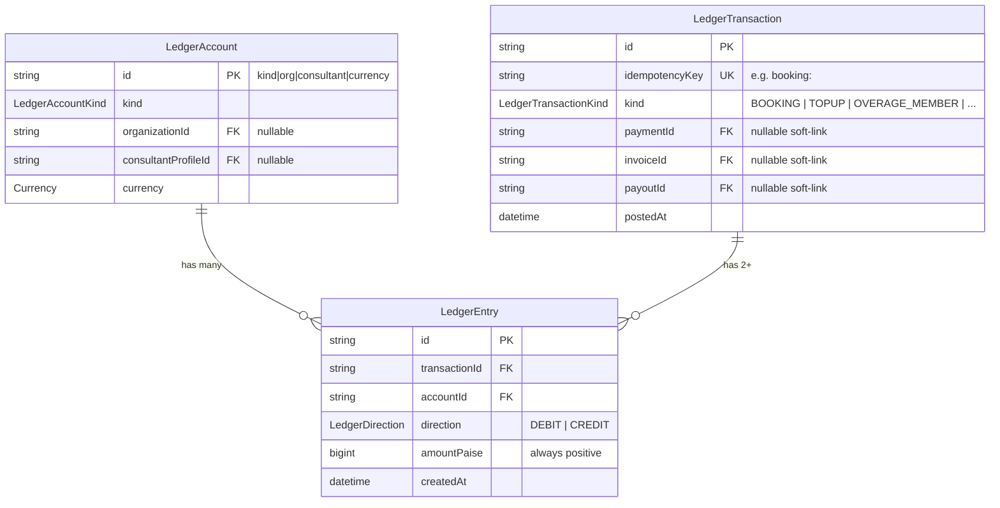
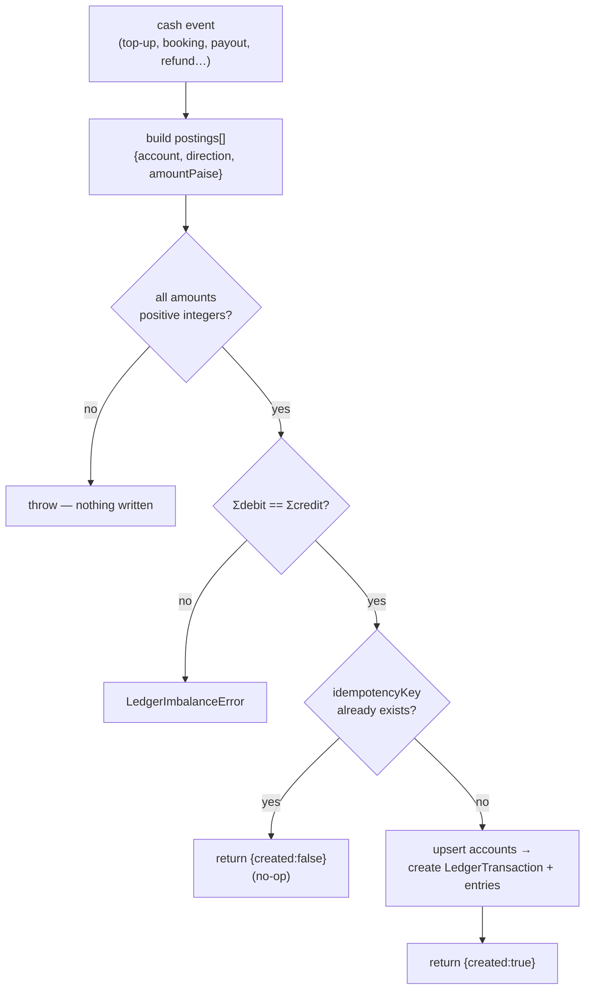

# Ledger & postings

**What this covers:** the double-entry journal in detail — the `postLedgerTxn()` API, the balance invariant, idempotency, immutability, and the **exact legs every money flow posts**, transcribed from code. This is the reference the rest of the money band cites.

> Replaces the old "three-ledger discipline" doc. The three single-entry logs it described (`FundingLedgerEntry` / `WalletEntry` / `SettlementLedgerEntry`) were collapsed into this one journal by **#772** — see [money model overview](01-money-model-overview.md) for the why.

---

## 1. The three tables



- `LedgerAccount` — a bucket; id is its [deterministic scope string](02-chart-of-accounts.md).
- `LedgerTransaction` — one balanced cash event. `idempotencyKey @unique` is the dedupe anchor; `kind` is a **typed `LedgerTransactionKind` enum** (#778 §B made it an enum — a free-string typo like `"BOOKNG"` used to silently break reconcile's `groupBy`; now it's a compile error); `paymentId`/`invoiceId`/`payoutId` are optional indexed soft-links for tracing.
- `LedgerEntry` — one leg. `amountPaise` is a **positive** `BigInt`; the sign lives in `direction`.

Both tables are immutable at the database, not merely by application convention: `prisma/sql/ledger-triggers.sql` installs `ledger_entry_immutable` and `ledger_transaction_immutable`, `BEFORE UPDATE OR DELETE` triggers that raise on any attempt to touch a posted row (owner decision Q5). Nothing in the codebase updates or deletes a journal row, and no balance is stored beside it, so the trigger pair closes off the one write path that was previously only a code-review convention.

---

## 2. `postLedgerTxn()` — the only way money is recorded

```ts
postLedgerTxn(db, {
  idempotencyKey: "booking:pay_123",
  kind: "BOOKING",
  paymentId: "pay_123",
  postings: [ /* { account, direction, amountPaise }, ... */ ],
}): Promise<{ transactionId: string; created: boolean }>
```

What it guarantees (`lib/payments/ledger/post.ts`):

1. **Positive integers only.** Each posting's `amountPaise` must be a positive integer — non-integer or `<= 0` throws.
2. **Balance or bust.** It sums DEBIT and CREDIT legs; if `Σdebit !== Σcredit` it throws `LedgerImbalanceError` and writes nothing.
3. **Idempotent on `idempotencyKey`.** A fast-path `findUnique` returns `{ created: false }` for a repeat key. The `@unique` constraint is the hard guard underneath: if two callers race, the loser's insert hits `P2002`, aborts its transaction, and the retry lands on the fast-path. **Redeliveries and retries are safe.**
4. **Composable in a `$transaction`.** Pass the tx client (`tx`) and the posting joins the caller's atomic unit — so the money leg and the business write (claim a top-up, mark a payout paid) commit together or not at all.
5. **Accounts resolve on demand.** Each posting's `AccountRef` is upserted to its deterministic id, so callers never pre-create accounts.

`ledgerBalancePaise(db, ref)` is the read side: it groups the account's entries by direction and returns `Number(Σdebit − Σcredit)` — the **signed** balance. Interpret the sign per the account's normal side ([chart of accounts](02-chart-of-accounts.md)).



---

## 3. The posting vocabulary (`kind`)

`kind` is a value of the `LedgerTransactionKind` enum, paired with a structured `idempotencyKey`. The enum (verbatim) is `BOOKING · TOPUP · TOPUP_REFUND · INVOICE_ISSUED · INVOICE_PAID · INVOICE_REFUND · PAYOUT · ORG_PAYOUT · REFUND · OVERAGE_MEMBER · GRANT · REFERRAL_CREDIT · UNAPPLIED_RECEIPT`:

| `kind`              | `idempotencyKey`                                                                                                                          | Posted by                                                                                                                                                                                                                        |
| ------------------- | ----------------------------------------------------------------------------------------------------------------------------------------- | -------------------------------------------------------------------------------------------------------------------------------------------------------------------------------------------------------------------------------- |
| `TOPUP`             | `topup:<providerOrderId>`                                                                                                                 | `walletCredit()` — `lib/api/organizations/wallet.ts`                                                                                                                                                                             |
| `BOOKING`           | `booking:<paymentId>`                                                                                                                     | `createEarningsFromPayment()` — `lib/payments/payouts/earnings-service.ts`                                                                                                                                                       |
| `INVOICE_ISSUED`    | `invoice-issued:<invoiceId>`, `invoice-voided:<invoiceId>`, `overage-accrual:<childPaymentId>`, `overage-accrual-voided:<childPaymentId>` | invoice issue and void — `lib/payments/billing/org-invoice-journal.ts`; CHARGE_ORG child accrual — `lib/payments/billing/overage-settlement.ts`; its void on a reversed booking — `lib/payments/billing/overage-accrual-void.ts` |
| `INVOICE_PAID`      | `invoicepaid:<invoiceId>`, `invoicereceipt:<receiptId>`                                                                                   | gateway capture — `applyOrgInvoiceCapture()` in `lib/payments/billing/org-invoice-settlement.ts`; bank transfer — `recordBankTransferReceipt()` in the same file                                                                 |
| `INVOICE_REFUND`    | `invoice-refund:<refundId>`                                                                                                               | invoice refund webhook — `app/api/webhooks/utils.ts`                                                                                                                                                                             |
| `TOPUP_REFUND`      | `topup-refund:<gatewayRefundId>`, `topup-refund-shortfall:<gatewayRefundId>`                                                              | refund webhook — `app/api/webhooks/utils.ts`                                                                                                                                                                                     |
| `REFUND`            | `refund:<refundId>`                                                                                                                       | refund cascade — `lib/payments/operations/refund.ts`                                                                                                                                                                             |
| `PAYOUT`            | `payout:<payoutId>`                                                                                                                       | consultant payout — `lib/payments/payouts/payout-service.ts`                                                                                                                                                                     |
| `ORG_PAYOUT`        | `orgpayout:<payoutId>`                                                                                                                    | host-org payout — `lib/payments/payouts/org-payout-service.ts`                                                                                                                                                                   |
| `OVERAGE_MEMBER`    | `overage:<sideChargePaymentId>`                                                                                                           | CHARGE_MEMBER overage settle — `lib/payments/webhooks/overage-handlers.ts` (see [§4.8](#48-member-overage--overage_member-overagesidechargepaymentid))                                                                           |
| `UNAPPLIED_RECEIPT` | `unapplied:<paymentId>`, `unapplied-released:<paymentId>`                                                                                 | a capture that funds no booking parks its cash, and an operator recovery releases it — `lib/payments/ledger/unapplied-receipts.ts`                                                                                               |

**`GRANT` is declared but posts no journal leg today.** `INVOICE_ISSUED` posts only for an invoice that bills a supply no booking journal has booked — a licence subscription fee or a manual programme or contract fee (§4.3a). An invoice that bills bookings (the accrual rollup, which stamps `billedPayments`) posts nothing at issue, because each booking already debited `ORG_RECEIVABLE` and credited `GST_PAYABLE` in its own transaction; **payment** is what clears the receivable in both cases.

**There is no `OVERAGE` kind.** Overage money rides existing kinds (#778 §B): a **CHARGE_ORG** overage is billed through the normal invoice path (its marginal is an `OVERAGE_INVOICE_ACCRUAL` leg → `ORG_RECEIVABLE`, cleared by `INVOICE_PAID`), and a **CHARGE_MEMBER** overage settles as its own `BOOKING`-shaped side-charge — `OVERAGE_MEMBER` is the kind reserved for that member side-payment. Either way the overage's surcharge carries 18% GST by the payer's place of supply; the over-cap `basePaise` does not, because it is a slice of the parent's tax-inclusive price whose GST the parent booking journal already credited. See [booking → earnings](05-booking-to-earnings.md) for the overage flow.

---

## 4. The postings, flow by flow

All amounts are paise; every block balances (`Σdebit == Σcredit`).

### 4.1 Top-up — `TOPUP` (`topup:<orderId>`)

Org pays by card or netbanking through Razorpay; we now owe it wallet spending power. Razorpay PG money posts to `GATEWAY_CLEARING` through `gatewayCashAccount()` (`lib/payments/ledger/gateway-account.ts`), never straight to `CASH`. The gateway fee is a separate `gatewayfee:<pay_id>` journal, and the daily `settlement:<setl_id>` journal moves the net from `GATEWAY_CLEARING` to `CASH`. RazorpayX payouts and bank-transfer invoice receipts stay on `CASH`.

```
Dr GATEWAY_CLEARING      amount
   Cr WALLET(org)        amount
```

### 4.2 Booking — `BOOKING` (`booking:<paymentId>`)

The funding legs of the checkout become debits; the fee/payable/tax split becomes credits. The debit side is assembled from the payment's `PaymentLeg` rows ([payment legs](09-payment-legs.md)):

```
Dr GATEWAY_CLEARING           sum of CARD legs
Dr WALLET(org)               sum of WALLET legs
Dr ORG_RECEIVABLE(org)       sum of INVOICE_ACCRUAL + OVERAGE_INVOICE_ACCRUAL legs
Dr PLATFORM_PROMO            sum of REFERRAL_CREDIT legs
Dr DISCOUNT                  max(0, originalAmount + taxAmount − Σ(funding-leg debits))
   Cr PLATFORM_FEE           platform fee
   Cr CONSULTANT_PAYABLE(consultant)   total consultant pool
   Cr ORG_PAYABLE(org)       org share (only if > 0)
   Cr GST_PAYABLE            tax amount
```

`LICENSE` legs carry `amountPaise = 0` (no money moves — the seat is pre-paid), so they contribute nothing. The `DISCOUNT` plug is the platform-absorbed gap basing on **Σ(funding-leg debits)**, not `Payment.amount`: a `REFERRAL_CREDIT` leg funds the booking (debited as `PLATFORM_PROMO`) yet is excluded from `amount` (which is post-credit), so basing DISCOUNT on `amount` would double-count the credit and imbalance the posting (#776; see §5b). **Only single-consultant bookings post this transaction inline**; multi-collaborator bookings defer the journal (tracked coverage gap **#773**) — see [booking → earnings](05-booking-to-earnings.md).

> **Example — a Wipro INVOICE booking.** When a Wipro-sponsored learner books past their LICENSED*SEAT coverage, the `ORG_RECEIVABLE(wipro)` debit equals the `INVOICE_ACCRUAL` leg (no cash moves at booking — Wipro pays at month-end). Because two concurrent disjoint-slot Wipro bookings take \_different* per-slot locks, the contract's credit-limit ceiling has to be re-checked **inside** the Serializable booking tx, not just before it — otherwise both could straddle the limit. That in-tx re-check (`ab241b0a`, #785 B6) is what makes SSI abort the loser of a racing pair so the retry sees the sibling's committed accrual. See [concurrency & idempotency](../30-programs-and-lifecycle/01-concurrency-and-idempotency.md) for the in-tx-revalidation pattern, and §5b.

### 4.3 Invoice paid — `INVOICE_PAID` (`invoicepaid:<invoiceId>`)

The org settles its NET-NN invoice; the receivable accrued at booking clears. A card payment through `/pay` posts to `GATEWAY_CLEARING` (`applyOrgInvoiceCapture()`), and an admin-recorded bank transfer posts to `CASH` under `invoicereceipt:<receiptId>`, once per receipt, so a part-payment posts only its own amount.

```
Dr GATEWAY_CLEARING (or CASH for a bank transfer)   amount received
   Cr ORG_RECEIVABLE(org)                          amount received
```

### 4.3a Invoice issued, voided and refunded — `INVOICE_ISSUED` / `INVOICE_REFUND`

An invoice whose GST no booking has booked (subscription invoices from `generate-subscription-invoices`, and every manual invoice, since only the rollup stamps `billedPayments`) books the whole supply in the transaction that issues it, whether that is the cron, the manual `POST` with `issueImmediately`, or the `DRAFT → ISSUED` `PATCH`. The fee counts as income when invoiced; there is no deferral.

```
invoice-issued:<invoiceId>
Dr ORG_RECEIVABLE(org)       invoice total
   Cr PLATFORM_FEE           taxable value
   Cr GST_PAYABLE            IGST + CGST + SGST (only if > 0)
```

Voiding an issued or overdue invoice (`ISSUED/OVERDUE → VOID`) posts the exact mirror of that transaction under `invoice-voided:<invoiceId>`, built from the issue journal's own entries, so the receivable, the fee and the GST all return to zero. An invoice that never posted an issue journal posts nothing on void.

Paying the invoice posts §4.3, which nets the receivable to zero. A gateway refund of a paid, issue-journalled invoice posts `invoice-refund:<refundId>` with the GST share taken from the credit note minted for the same refund, so the reversal is proportional and agrees with the document. Past the CGST s.34(2) cutoff the credit note is commercial and carries no tax, so the GST stays with the government and the whole refund comes off the fee, the same treatment the booking cascade gives a late refund.

```
invoice-refund:<refundId>   (issue-journalled invoice)
Dr PLATFORM_FEE              refund − credit-note tax
Dr GST_PAYABLE               credit-note tax (0 past the cutoff)
   Cr CASH | WALLET(org)     refund
```

A refund of an invoice that bills bookings keeps its original shape, `Dr ORG_RECEIVABLE / Cr CASH | WALLET`, because the bookings' own refunds reverse their fee and GST.

### 4.4 Consultant payout — `PAYOUT` (`payout:<payoutId>`)

We pay what we owed the consultant; TDS is withheld for the government.

```
Dr CONSULTANT_PAYABLE(consultant)   net + TDS
   Cr CASH(platform)                net paid
   Cr TDS_PAYABLE                   TDS withheld (only if > 0)
```

### 4.5 Host-org payout — `ORG_PAYOUT` (`orgpayout:<payoutId>`)

The host-org mirror of 4.4.

```
Dr ORG_PAYABLE(org)          netPayoutPaise   (pre-withholding org share)
   Cr CASH(platform)         amountPaise      (what the rail transferred)
   Cr TDS_PAYABLE            tdsAmountPaise   (withheld, only if > 0)
```

`OrganizationPayout.netPayoutPaise` is the pre-withholding figure and `amountPaise` is the post-withholding one, so `amountPaise + tdsAmountPaise` must equal `netPayoutPaise` for these legs to be right. `markOrgPayoutCompleted` asserts exactly that before posting and throws — rolling the completion back rather than journalling a guess — when it does not hold (#1470). The same assertion also refuses a payout whose figures are negative, because the equation alone accepts one (minus one lakh plus nothing does equal minus one lakh) and the posting is skipped for anything that is not greater than zero, which would let such a row settle with no journal at all. `markOrgPayoutReversed` posts the exact mirror, `Dr CASH amountPaise` and `Dr TDS_PAYABLE tdsAmountPaise` against `Cr ORG_PAYABLE netPayoutPaise`, under the same assertion. See the [payout pipeline](07-payout-pipeline.md) for the history: the earlier shape debited the payable at `net + TDS` and credited cash at `net`, which balanced and so passed every write-time check while overstating both sides by the withholding.

A payout already claimed against `ORG_PAYOUT` can still be clawed back after the fact — a dispute lost on one of its earnings, or a later refund cascade touching a booking it already paid out. `postPayoutClawback` (`lib/payments/operations/reversal-engine.ts`) posts `Dr CASH / Cr ORG_PAYABLE`, keyed `clawback:<refundId>:<payoutId>`, and every writer that can trigger a clawback — the dispute-lost path and both refund-cascade paths — calls the same function in the same transaction as the earnings counter it updates, so the reconciler's `LEDGER_DUAL_WRITE_GAP` finding, which compares the payout's stamped clawback total against the sum of the CASH debit legs actually posted, never sees a gap from a path that forgot to post (#1582 C-P1-02c).

### 4.6 Top-up refund — `TOPUP_REFUND` (`topup-refund:<gatewayRefundId>`)

A confirmed top-up that Razorpay refunds is booked when the refund webhook arrives; the IOU shrinks and cash returns to the gateway. The key names the gateway refund, so each partial refund posts once. No in-app door starts a top-up refund today; one is **planned** and not yet on `dev`.

```
Dr WALLET(org)               refund amount (clamped to original top-up)
   Cr GATEWAY_CLEARING       refund amount
```

The wallet cache is reduced only by what it still holds (the `billing_account_wallet_nonnegative` CHECK would otherwise reject the write), and any part the org had already spent posts as a receivable under `topup-refund-shortfall:<gatewayRefundId>`: `Dr ORG_RECEIVABLE(org) / Cr WALLET(org)`.

### 4.7 Booking refund — `REFUND` (`refund:<refundId>`)

A booking is refunded (fully or partially). The original booking legs are reversed **proportionally**: the fee/payable/GST credits become debits, and the funding legs become credits. The `DISCOUNT` the payment's booking and carve journals debited comes back as a credit in the same proportion, and the refund that completes the payment (counting only refunds already cascaded) takes the exact remainder of the `DISCOUNT`, the shares and the GST, so a full refund (in one go or split) leaves every account of the payment at zero, except that a refund past the GST credit-note cutoff reverses no GST, so `GST_PAYABLE` keeps that part and the platform bears it. `PLATFORM_FEE` carries the balancing _plug_ so the set ties out; on a full refund it equals the booking's fee.

```
Dr PLATFORM_FEE              platform plug (funding − consultant − org − GST share)
Dr CONSULTANT_PAYABLE(owner) refunded consultant share
Dr ORG_PAYABLE(org)          refunded org share
Dr GST_PAYABLE               refunded GST share
   Cr GATEWAY_CLEARING / WALLET / ORG_RECEIVABLE / PLATFORM_PROMO   the original funding legs, prorated
   Cr DISCOUNT                  the booked DISCOUNT, prorated (remainder on the completing refund)
```

Posted only when the debit side balances to the refunded funding total (a guard in `refund.ts`); a partial/edge case that wouldn't balance is skipped and logged rather than written half-formed. The whole reversal block is wrapped so a ledger imbalance can never block the customer refund (gateway money may already have moved) — the failure is logged + paged and the reconciler's `EARNINGS_LEDGER_DRIFT` and `REVERSED_EARNING_WITHOUT_REFUND_TXN` checks catch any divergence.

### 4.8 Member overage — `OVERAGE_MEMBER` (`overage:<sideChargePaymentId>`)

A `CHARGE_MEMBER` program booked past its cap creates a parent-linked side-`Payment` at checkout; when the member settles it via the resume-checkout surface, the gateway webhook posts the **org-relief** transaction (`lib/payments/webhooks/overage-handlers.ts`). The booking already charged the org the full price and paid the consultant once, so the member's marginal _relieves_ the org:

```
Dr GATEWAY_CLEARING      side-charge amount   (the member's card)
   Cr ORG_PAYABLE(org)   base + surcharge     (a credit the org realises in settlement)
   Cr GST_PAYABLE        side-charge taxAmount (18% on the surcharge)
```

The side-`Payment` is priced through the shared tax engine (`determineTax`) for the member's own place of supply: `amount` is base plus surcharge plus GST on the surcharge, `taxAmount` is that GST, and the event's `marginalPaise` equals the side-`Payment` amount. A refund of the side-payment reverses the GST through the normal cascade, and the capture mints the member's consumer tax invoice through the same best-effort path as a booking capture.

The side-`Payment` carries a single `CARD` leg (`sourceRef` = gateway order id), and the same webhook flips the `OverageEvent` `PENDING → CHARGED`. There is **no separate overage debit on the parent** — checkout already carved the over-cap pass-through (`basePaise`) out of the parent's funding leg so the member isn't double-charged (#785); see [booking → earnings](05-booking-to-earnings.md). (How a buyer org nets this `ORG_PAYABLE` credit against its wallet/invoice is a tracked refinement, #775; the journal stays balanced regardless.)

---

## 5. Invariants

1. **Balanced.** Enforced at write (`postLedgerTxn`) and by the deferred constraint trigger `ledger_txn_balanced` at COMMIT (`prisma/sql/ledger-triggers.sql`). No application sweep re-checks it.
2. **Immutable.** `LedgerEntry.transactionId` is `onDelete: Restrict` — postings are never deleted or updated. A wrong posting is corrected by a **counter-transaction**, not an edit (that's what `REFUND`/`TOPUP_REFUND` are).
3. **Positive amounts only.** Sign is `direction`, never a negative `amountPaise`.
4. **One event, one key.** Every flow's `idempotencyKey` is derived from a stable upstream id, so at-least-once webhooks and cron retries collapse to one posting. See [concurrency & idempotency](../30-programs-and-lifecycle/01-concurrency-and-idempotency.md).
5. **INR-denominated (#783).** Razorpay settles in INR, `amountPaise` is INR paise, and no FX conversion happens before posting — `displayCurrencyAtCheckout` is a cosmetic buyer label, not the settlement currency. So every posting leaves `AccountRef.currency` unset (→ `INR`); keying an account by a display currency would file INR-paise amounts into a foreign-labelled account and break receivable/payable clearing. The `ledger_account_currency_inr` CHECK in `prisma/sql/check-constraints.sql` enforces this at write time until a real multi-currency ledger is designed.

## 5a. Design decisions & trade-offs

- **Positive amounts + a `direction` enum, never a signed amount.** A signed `amountPaise` would let a single column carry both "add" and "subtract", but it also lets a typo (a stray `-`) silently invert a posting that still _looks_ balanced. Splitting sign into `direction` makes the balance check a pure `Σdebit == Σcredit` over magnitudes and makes a malformed amount (`<= 0`) a hard throw. The cost is callers must pick `DEBIT`/`CREDIT` explicitly; the benefit is no posting can be sign-wrong yet pass.
- **Immutable journal + counter-transactions, never edits.** `LedgerEntry.transactionId` is `onDelete: Restrict`; a wrong posting is corrected by posting its reverse (`REFUND`/`TOPUP_REFUND`), not by `UPDATE`. This keeps the journal append-only and auditable (every correction is itself a dated, balanced event) at the cost of more rows. An editable ledger would be smaller and unauditable — the wrong trade for money.
- **Typed `kind` enum over a free string (#778 §B).** `kind` was a free string; a typo like `"BOOKNG"` silently broke reconcile's `groupBy` (the mistyped transaction just vanished from the aggregation). Making `LedgerTransactionKind` an enum turns that into a compile error. Cost: adding a flow is now a schema change; benefit: no silent reconciliation hole.
- **Balances aggregated on read, never stored.** `ledgerBalancePaise()` sums the account's journal entries. A stored per-account balance would be one row every posting to `CASH`, `PLATFORM_FEE` or `GST_PAYABLE` must update, and under Serializable isolation that row forces every concurrent confirmation platform-wide to queue behind the last one. No request path reads a ledger balance in O(1); the wallet's hot read is its own guarded `walletBalance` cache.

## 5b. What this design survived

- **The silently-dropped DISCOUNT plug on referral-funded bookings (`d335901e`, #776 / #785 review).** The booking `DISCOUNT` leg is the platform-absorbed gap between gross (`originalAmount + taxAmount`) and the funding actually applied. It was computed as `originalAmount + tax − Payment.amount` — but a `REFERRAL_CREDIT` leg funds the booking (debited as `PLATFORM_PROMO`) and is _already excluded_ from `Payment.amount` (which is the post-credit figure). So the credit was counted **twice** (once as `PLATFORM_PROMO`, once inside `DISCOUNT`), the posting failed `Σdebit == Σcredit`, and `postLedgerTxn` threw — which meant the _entire booking transaction was silently dropped_ for any referral-funded booking. The fix bases the plug on `Σ(funding-leg debits)` (`fundingDebitTotal`) instead of `Payment.amount`, so the credit is counted once. This is why §4.2 is emphatic that the `DISCOUNT` plug bases on the funding-leg sum.
- **The refund reversal that must never block a customer refund (refund.ts, §4.7).** Gateway money may already have moved by the time the ledger reversal runs, so the whole reversal block is wrapped: a `LedgerImbalanceError` on an edge-case partial is logged + paged, the customer refund still completes, and the reconciler's `EARNINGS_LEDGER_DRIFT` and `REVERSED_EARNING_WITHOUT_REFUND_TXN` checks catch any divergence. The design explicitly trades "perfectly-balanced books at this instant" for "never trap a customer's money behind a bookkeeping bug" — the reconciler is the backstop that makes that safe.

## 6. What NOT to do

- **Don't read a balance from a column.** Sum the journal via `ledgerBalancePaise()` (the one cache, `walletBalance`, is the documented exception in [money model overview](01-money-model-overview.md) §4).
- **Don't post an unbalanced set** "to fix later" — there is no later; it throws.
- **Don't delete or update a `LedgerEntry`.** Post a counter-transaction.
- **Don't invent a `kind`** outside the `LedgerTransactionKind` enum — adding a value is a schema change, paired with a structured `idempotencyKey` in the vocabulary table above (the enum makes a stray string a compile error, not a silent reconcile break).
- **Don't post in a non-INR currency** — leave `AccountRef.currency` unset (§5.5).

---

## 7. The twenty ledger permutations

Every financial state change in `familiarise_web` maps to one of the **20 canonical double-entry ledger permutations** below. In every permutation, `∑ Debit === ∑ Credit` is enforced at `COMMIT` by the deferred constraint trigger `ledger_txn_balanced`:

### Permutation 1: Standard B2C Direct Card Booking

- **Context**: List price ₹1,000 + 18% GST (₹180) = ₹1,180 charged to card. 20% platform commission (₹200).
- **Idempotency Key**: `booking:pay_b2c_std`

| Account                   | Direction | Amount (Paise) | Display Amount | Notes                            |
| :------------------------ | :-------- | -------------: | -------------: | :------------------------------- |
| `GATEWAY_CLEARING`        | `DEBIT`   |        118,000 |      ₹1,180.00 | Gateway gross card collection    |
| `PLATFORM_FEE`            | `CREDIT`  |         20,000 |        ₹200.00 | 20% platform revenue cut         |
| `CONSULTANT_PAYABLE(c_1)` | `CREDIT`  |         80,000 |        ₹800.00 | 80% consultant share             |
| `GST_PAYABLE`             | `CREDIT`  |         18,000 |        ₹180.00 | 18% Output GST (Principal model) |

- **Balance Check**: `∑ Debit = 118,000 == ∑ Credit = 118,000 ✓`

### Permutation 2: B2C Card Booking with Partial Referral Credit

- **Context**: List ₹1,000 + GST ₹180 = ₹1,180. User applies ₹500 referral credit. Net gateway charge = ₹680.
- **Idempotency Key**: `booking:pay_b2c_split_credit`

| Account                   | Direction | Amount (Paise) | Display Amount | Notes                             |
| :------------------------ | :-------- | -------------: | -------------: | :-------------------------------- |
| `GATEWAY_CLEARING`        | `DEBIT`   |         68,000 |        ₹680.00 | Net cash charged to gateway       |
| `PLATFORM_PROMO`          | `DEBIT`   |         50,000 |        ₹500.00 | Platform-absorbed referral credit |
| `PLATFORM_FEE`            | `CREDIT`  |         20,000 |        ₹200.00 | Commission on full nominal base   |
| `CONSULTANT_PAYABLE(c_1)` | `CREDIT`  |         80,000 |        ₹800.00 | Consultant receives full earnings |
| `GST_PAYABLE`             | `CREDIT`  |         18,000 |        ₹180.00 | 18% GST on full nominal base      |

- **Balance Check**: `∑ Debit = 118,000 == ∑ Credit = 118,000 ✓`

### Permutation 3: B2C Booking with Platform Discount / Coupon

- **Context**: List ₹1,000 with ₹200 coupon. Discounted base = ₹800 + 18% GST (₹144) = ₹944 charged to card.
- **Idempotency Key**: `booking:pay_b2c_coupon`

| Account                   | Direction | Amount (Paise) | Display Amount | Notes                                  |
| :------------------------ | :-------- | -------------: | -------------: | :------------------------------------- |
| `GATEWAY_CLEARING`        | `DEBIT`   |         94,400 |        ₹944.00 | Discounted price + GST charged to card |
| `DISCOUNT`                | `DEBIT`   |         20,000 |        ₹200.00 | Platform-absorbed discount plug        |
| `PLATFORM_FEE`            | `CREDIT`  |         20,000 |        ₹200.00 | Platform commission base               |
| `CONSULTANT_PAYABLE(c_1)` | `CREDIT`  |         80,000 |        ₹800.00 | Consultant share of nominal list       |
| `GST_PAYABLE`             | `CREDIT`  |         14,400 |        ₹144.00 | 18% GST on discounted base             |

- **Balance Check**: `∑ Debit = 114,400 == ∑ Credit = 114,400 ✓`

### Permutation 4: 100% Free Referral-Funded Booking

- **Context**: ₹500 consultation fully paid using ₹590 referral credits (covering base + 18% GST). Card charge = ₹0.
- **Idempotency Key**: `booking:pay_b2c_100free`

| Account                   | Direction | Amount (Paise) | Display Amount | Notes                                |
| :------------------------ | :-------- | -------------: | -------------: | :----------------------------------- |
| `PLATFORM_PROMO`          | `DEBIT`   |         59,000 |        ₹590.00 | Platform absorbs 100% of price & tax |
| `PLATFORM_FEE`            | `CREDIT`  |         10,000 |        ₹100.00 | Platform fee accounting allocation   |
| `CONSULTANT_PAYABLE(c_1)` | `CREDIT`  |         40,000 |        ₹400.00 | Consultant owed their delivery fee   |
| `GST_PAYABLE`             | `CREDIT`  |          9,000 |         ₹90.00 | 18% GST remitted to government       |

- **Balance Check**: `∑ Debit = 59,000 == ∑ Credit = 59,000 ✓`

### Permutation 5: Backoffice Administrative Referral Credit Revocation (`#1844`)

- **Context**: Admin revokes ₹1,000 unspent referral credit due to abuse or expiration.
- **Idempotency Key**: `referral-reverse:crd_bad_991` (the admin reversal route keys it `referral-reverse:<creditId>`)

| Account          | Direction | Amount (Paise) | Display Amount | Notes                               |
| :--------------- | :-------- | -------------: | -------------: | :---------------------------------- |
| `PLATFORM_FEE`   | `DEBIT`   |        100,000 |      ₹1,000.00 | De-allocates platform promo reserve |
| `PLATFORM_PROMO` | `CREDIT`  |        100,000 |      ₹1,000.00 | Reverses contra-revenue liability   |

- **Balance Check**: `∑ Debit = 100,000 == ∑ Credit = 100,000 ✓`

### Permutation 6: Organization Wallet Top-Up

- **Context**: Client org `org_wipro` tops up prepaid balance by ₹5,00,000.
- **Idempotency Key**: `topup:order_topup_882`

| Account             | Direction | Amount (Paise) | Display Amount | Notes                              |
| :------------------ | :-------- | -------------: | -------------: | :--------------------------------- |
| `GATEWAY_CLEARING`  | `DEBIT`   |     50,000,000 |   ₹5,00,000.00 | Payment gateway receipt            |
| `WALLET(org_wipro)` | `CREDIT`  |     50,000,000 |   ₹5,00,000.00 | Prepaid balance liability credited |

- **Balance Check**: `∑ Debit = 50,000,000 == ∑ Credit = 50,000,000 ✓`

### Permutation 7: B2B Prepaid Wallet Booking (Direct Consultant)

- **Context**: Employee books session using company wallet. Price ₹2,000 + 18% GST (₹360) = ₹2,360.
- **Idempotency Key**: `booking:pay_org_wlt_dir`

| Account                   | Direction | Amount (Paise) | Display Amount | Notes                              |
| :------------------------ | :-------- | -------------: | -------------: | :--------------------------------- |
| `WALLET(org_wipro)`       | `DEBIT`   |        236,000 |      ₹2,360.00 | Atomic decrement of wallet balance |
| `PLATFORM_FEE`            | `CREDIT`  |         40,000 |        ₹400.00 | 20% platform commission            |
| `CONSULTANT_PAYABLE(c_1)` | `CREDIT`  |        160,000 |      ₹1,600.00 | 80% consultant share               |
| `GST_PAYABLE`             | `CREDIT`  |         36,000 |        ₹360.00 | 18% Output GST                     |

- **Balance Check**: `∑ Debit = 236,000 == ∑ Credit = 236,000 ✓`

### Permutation 8: B2B Wallet Booking with 3-Way Split (Host Academy)

- **Context**: Session with consultant affiliated with `org_learnpro` (Host Org). Rate card: Platform 10%, Host Org 20%, Consultant 70%. Base ₹10,000 + GST ₹1,800 = ₹11,800.
- **Idempotency Key**: `booking:pay_3way_split`

| Account                     | Direction | Amount (Paise) | Display Amount | Notes                            |
| :-------------------------- | :-------- | -------------: | -------------: | :------------------------------- |
| `WALLET(org_wipro)`         | `DEBIT`   |      1,180,000 |     ₹11,800.00 | Corporate wallet debited in full |
| `PLATFORM_FEE`              | `CREDIT`  |        100,000 |      ₹1,000.00 | 10% platform share               |
| `ORG_PAYABLE(org_learnpro)` | `CREDIT`  |        200,000 |      ₹2,000.00 | 20% host organization share      |
| `CONSULTANT_PAYABLE(c_1)`   | `CREDIT`  |        700,000 |      ₹7,000.00 | 70% expert delivery share        |
| `GST_PAYABLE`               | `CREDIT`  |        180,000 |      ₹1,800.00 | 18% Output GST                   |

- **Balance Check**: `∑ Debit = 1,180,000 == ∑ Credit = 1,180,000 ✓`

### Permutation 9: B2B Postpaid Invoice Accrual (Monthly Invoiced Booking)

- **Context**: Booking on `INVOICE` rail. Base ₹5,000 + GST ₹900 = ₹5,900. No immediate funds move.
- **Idempotency Key**: `booking:pay_inv_accrual`

| Account                   | Direction | Amount (Paise) | Display Amount | Notes                               |
| :------------------------ | :-------- | -------------: | -------------: | :---------------------------------- |
| `ORG_RECEIVABLE(org_tcs)` | `DEBIT`   |        590,000 |      ₹5,900.00 | Unbilled accrual owed by enterprise |
| `PLATFORM_FEE`            | `CREDIT`  |        100,000 |      ₹1,000.00 | Accrued commission revenue          |
| `CONSULTANT_PAYABLE(c_1)` | `CREDIT`  |        400,000 |      ₹4,000.00 | Earnings held for delivery          |
| `GST_PAYABLE`             | `CREDIT`  |         90,000 |        ₹900.00 | GST liability recognized            |

- **Balance Check**: `∑ Debit = 590,000 == ∑ Credit = 590,000 ✓`

### Permutation 10: Settlement of Monthly Enterprise Invoice (`INVOICE_PAID`)

- **Context**: `org_tcs` wires ₹1,18,000 settling their consolidated monthly invoice.
- **Idempotency Key**: `invoicepaid:inv_oct_2026_01`

| Account                   | Direction | Amount (Paise) | Display Amount | Notes                              |
| :------------------------ | :-------- | -------------: | -------------: | :--------------------------------- |
| `CASH`                    | `DEBIT`   |     11,800,000 |   ₹1,18,000.00 | Bank deposit receipt               |
| `ORG_RECEIVABLE(org_tcs)` | `CREDIT`  |     11,800,000 |   ₹1,18,000.00 | Clears monthly accounts receivable |

- **Balance Check**: `∑ Debit = 11,800,000 == ∑ Credit = 11,800,000 ✓`

### Permutation 11: Consultant Payout with Exact bps TDS (Section 194-O)

- **Context**: Consultant payout batch of ₹80,000 gross. Section 194-O rate = 10 bps (0.10%). Math: `(8,000,000 * 10) / 10,000 = 8,000 paise` (₹80.00). Net transfer = ₹79,920.
- **Idempotency Key**: `payout:pout_cons_991`

| Account                   | Direction | Amount (Paise) | Display Amount | Notes                                |
| :------------------------ | :-------- | -------------: | -------------: | :----------------------------------- |
| `CONSULTANT_PAYABLE(c_1)` | `DEBIT`   |      8,000,000 |     ₹80,000.00 | Settles consultant liability in full |
| `CASH`                    | `CREDIT`  |      7,992,000 |     ₹79,920.00 | Net wire via RazorpayX               |
| `TDS_PAYABLE`             | `CREDIT`  |          8,000 |         ₹80.00 | Exact 10 bps statutory withholding   |

- **Balance Check**: `∑ Debit = 8,000,000 == ∑ Credit = 8,000,000 ✓`

### Permutation 12: Host Organization Payout Disbursement (`ORG_PAYOUT`)

- **Context**: Payout to `org_learnpro` of ₹2,00,000 gross. Section 194-O TDS @ 10 bps = ₹200. Net wire = ₹1,99,800.
- **Idempotency Key**: `orgpayout:pout_org_552`

| Account                     | Direction | Amount (Paise) | Display Amount | Notes                              |
| :-------------------------- | :-------- | -------------: | -------------: | :--------------------------------- |
| `ORG_PAYABLE(org_learnpro)` | `DEBIT`   |     20,000,000 |   ₹2,00,000.00 | Gross host org share cleared       |
| `CASH`                      | `CREDIT`  |     19,980,000 |   ₹1,99,800.00 | Net wire to corporate bank account |
| `TDS_PAYABLE`               | `CREDIT`  |         20,000 |        ₹200.00 | Withholding under Section 194-O    |

- **Balance Check**: `∑ Debit = 20,000,000 == ∑ Credit = 20,000,000 ✓`

### Permutation 13: Host Org Payout Post-Completion Bank Bounce / Reversal

- **Context**: Permutation 12 is returned by the bank due to invalid account details (`markOrgPayoutReversed`).
- **Idempotency Key**: `orgpayout-reversal:pout_org_552`

| Account                     | Direction | Amount (Paise) | Display Amount | Notes                              |
| :-------------------------- | :-------- | -------------: | -------------: | :--------------------------------- |
| `CASH`                      | `DEBIT`   |     19,980,000 |   ₹1,99,800.00 | Funds returned to platform bank    |
| `TDS_PAYABLE`               | `DEBIT`   |         20,000 |        ₹200.00 | Tax withholding liability reversed |
| `ORG_PAYABLE(org_learnpro)` | `CREDIT`  |     20,000,000 |   ₹2,00,000.00 | Re-opens payable owed to host org  |

- **Balance Check**: `∑ Debit = 20,000,000 == ∑ Credit = 20,000,000 ✓`

### Permutation 14: Payout Clawback (Refund on Already-Disbursed Earnings)

- **Context**: A booking is cancelled/refunded, but the consultant has already received the payout. Platform claws back the debt from the consultant's balance.
- **Idempotency Key**: `clawback:rfnd_123:pout_cons_991`

| Account                   | Direction | Amount (Paise) | Display Amount | Notes                               |
| :------------------------ | :-------- | -------------: | -------------: | :---------------------------------- |
| `CASH`                    | `DEBIT`   |         80,000 |        ₹800.00 | Cash recovery from payout debt      |
| `CONSULTANT_PAYABLE(c_1)` | `CREDIT`  |         80,000 |        ₹800.00 | Offsets negative consultant balance |

- **Balance Check**: `∑ Debit = 80,000 == ∑ Credit = 80,000 ✓`

### Permutation 15: Full Refund of B2C Card Booking (`REFUND`)

- **Context**: Reversing Permutation 1 (₹1,180 card booking).
- **Idempotency Key**: `refund:rfnd_b2c_full`

| Account                   | Direction | Amount (Paise) | Display Amount | Notes                                    |
| :------------------------ | :-------- | -------------: | -------------: | :--------------------------------------- |
| `CONSULTANT_PAYABLE(c_1)` | `DEBIT`   |         80,000 |        ₹800.00 | Consultant earnings debited              |
| `GST_PAYABLE`             | `DEBIT`   |         18,000 |        ₹180.00 | Reverses Output GST (Credit Note issued) |
| `PLATFORM_FEE`            | `DEBIT`   |         20,000 |        ₹200.00 | Platform fee plug debited                |
| `GATEWAY_CLEARING`        | `CREDIT`  |        118,000 |      ₹1,180.00 | Gateway refund returns cash to card      |

- **Balance Check**: `∑ Debit = 118,000 == ∑ Credit = 118,000 ✓`

### Permutation 16: Partial Refund (50% Cancellation Tier)

- **Context**: Permutation 1 cancelled within 2–24h notice window (50% tier). Consultee receives ₹590.
- **Idempotency Key**: `refund:rfnd_b2c_half`

| Account                   | Direction | Amount (Paise) | Display Amount | Notes                                     |
| :------------------------ | :-------- | -------------: | -------------: | :---------------------------------------- |
| `CONSULTANT_PAYABLE(c_1)` | `DEBIT`   |         40,000 |        ₹400.00 | 50% prorated consultant earnings clawback |
| `GST_PAYABLE`             | `DEBIT`   |          9,000 |         ₹90.00 | 50% tax reversal via Credit Note          |
| `PLATFORM_FEE`            | `DEBIT`   |         10,000 |        ₹100.00 | 50% platform fee reversed                 |
| `GATEWAY_CLEARING`        | `CREDIT`  |         59,000 |        ₹590.00 | Gateway partial refund to buyer           |

- **Balance Check**: `∑ Debit = 59,000 == ∑ Credit = 59,000 ✓`

### Permutation 17: Full Refund of B2B Wallet Booking

- **Context**: Reversing Permutation 7 (₹2,360 wallet booking). Re-credits corporate wallet balance.
- **Idempotency Key**: `refund:rfnd_wlt_rev`

| Account                   | Direction | Amount (Paise) | Display Amount | Notes                                 |
| :------------------------ | :-------- | -------------: | -------------: | :------------------------------------ |
| `CONSULTANT_PAYABLE(c_1)` | `DEBIT`   |        160,000 |      ₹1,600.00 | Consultant earnings reversed          |
| `GST_PAYABLE`             | `DEBIT`   |         36,000 |        ₹360.00 | Tax reversed                          |
| `PLATFORM_FEE`            | `DEBIT`   |         40,000 |        ₹400.00 | Platform fee reversed                 |
| `WALLET(org_wipro)`       | `CREDIT`  |        236,000 |      ₹2,360.00 | Wallet balance re-credited atomically |

- **Balance Check**: `∑ Debit = 236,000 == ∑ Credit = 236,000 ✓`

### Permutation 18: Full Refund of B2B Invoice-Accrued Booking

- **Context**: Reversing Permutation 9 (₹5,900 invoiced booking).
- **Idempotency Key**: `refund:rfnd_inv_rev`

| Account                   | Direction | Amount (Paise) | Display Amount | Notes                                  |
| :------------------------ | :-------- | -------------: | -------------: | :------------------------------------- |
| `CONSULTANT_PAYABLE(c_1)` | `DEBIT`   |        400,000 |      ₹4,000.00 | Consultant earnings reversed           |
| `GST_PAYABLE`             | `DEBIT`   |         90,000 |        ₹900.00 | Output GST reversed                    |
| `PLATFORM_FEE`            | `DEBIT`   |        100,000 |      ₹1,000.00 | Platform fee reversed                  |
| `ORG_RECEIVABLE(org_tcs)` | `CREDIT`  |        590,000 |      ₹5,900.00 | Clears unbilled accrual before invoice |

- **Balance Check**: `∑ Debit = 590,000 == ∑ Credit = 590,000 ✓`

### Permutation 19: Member Overage Side-Charge Settlement (`OVERAGE_MEMBER`)

- **Context**: Employee books past corporate cap and pays ₹1,000 marginal directly via personal card. This provides an org-relief credit.
- **Idempotency Key**: `overage:pay_side_charge_44`

| Account                  | Direction | Amount (Paise) | Display Amount | Notes                                  |
| :----------------------- | :-------- | -------------: | -------------: | :------------------------------------- |
| `GATEWAY_CLEARING`       | `DEBIT`   |        100,000 |      ₹1,000.00 | Collected from member's personal card  |
| `ORG_PAYABLE(org_wipro)` | `CREDIT`  |        100,000 |      ₹1,000.00 | Relief credit realized by organization |

- **Balance Check**: `∑ Debit = 100,000 == ∑ Credit = 100,000 ✓`

### Permutation 20: Member Overage Late-Capture Invoice Recarve (`#1900`)

- **Context**: Employee side-charge was initially marked `FAILED` (so `basePaise` ₹800 was restored to the parent invoice accrual). The member later pays via late capture (`FAILED → CHARGED`). The engine reverses the invoice accrual on the parent invoice to prevent double collection.
- **Idempotency Key**: `overage-recarve-invoice:pay_side_charge_44`

| Account                     | Direction | Amount (Paise) | Display Amount | Notes                           |
| :-------------------------- | :-------- | -------------: | -------------: | :------------------------------ |
| `PLATFORM_FEE`              | `DEBIT`   |         80,000 |        ₹800.00 | Clears restored accrual plug    |
| `ORG_RECEIVABLE(org_wipro)` | `CREDIT`  |         80,000 |        ₹800.00 | Reverses parent invoice accrual |

- **Balance Check**: `∑ Debit = 80,000 == ∑ Credit = 80,000 ✓`

## Balance reads — aggregated from the journal

`ledgerBalancePaise()` returns Σ(DEBIT) − Σ(CREDIT) over the account's
`LedgerEntry` rows, grouped by direction. `postLedgerTxn` writes only the
transaction and its entries, so two postings that share an account never touch
a common row and never abort each other under Serializable isolation. The
journal is the only balance; there is no snapshot to drift.

## Deprecated & Superseded Approaches

- **The unjournaled manual and subscription invoice.** Issuance used to post
  nothing for every invoice kind, on the assumption that a booking had always
  accrued the receivable first. That held only for the rollup; a subscription
  or manual invoice then drove `ORG_RECEIVABLE` negative when paid, and its
  GST never reached `GST_PAYABLE`. Those invoices now post `invoice-issued:`.
- **The untaxed overage.** Overage side-payments and `CHARGE_ORG` accruals
  carried `taxAmount: 0`, so the surcharge was billed and collected without
  GST. The surcharge now carries GST on every overage path.

- **The maintained `LedgerAccountBalance` snapshot (#776).** `postLedgerTxn`
  used to fold every posting into a per-account balance row inside the posting
  transaction, and the reconciler validated it as
  `LEDGER_BALANCE_SNAPSHOT_DRIFT`. Nothing on a request path read it, while the
  fold made `CASH`, `PLATFORM_FEE` and `GST_PAYABLE` hot rows that serialized
  every confirmation. The fold, the finding and the Prisma model are gone; the
  live table is unread and unwritten until the owner drops it
  (`DROP TABLE IF EXISTS "LedgerAccountBalance";`).

### Related docs

- [Money model overview](01-money-model-overview.md) · [Chart of accounts](02-chart-of-accounts.md) — the principles and buckets this doc applies.
- [Wallet & top-ups](04-wallet-and-topups.md) · [Booking → earnings](05-booking-to-earnings.md) · [Payout pipeline](07-payout-pipeline.md) · [Invoicing](08-invoicing.md) — each flow in narrative.
- [Payment legs](09-payment-legs.md) — how the booking debit side is assembled.
- [Ledger integrity](13-ledger-integrity.md) — the reconciler.
- Ground truth: `lib/payments/ledger/post.ts`; posting call sites in `earnings-service.ts`, `wallet.ts`, `org-payout-service.ts`, `payout-service.ts`, `refund.ts`, `app/api/webhooks/utils.ts`.
