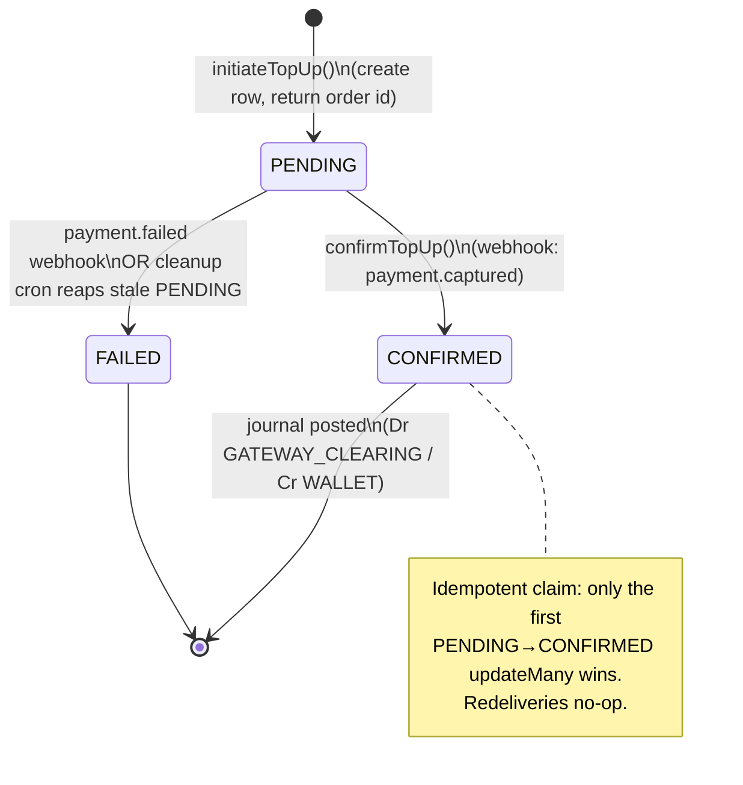
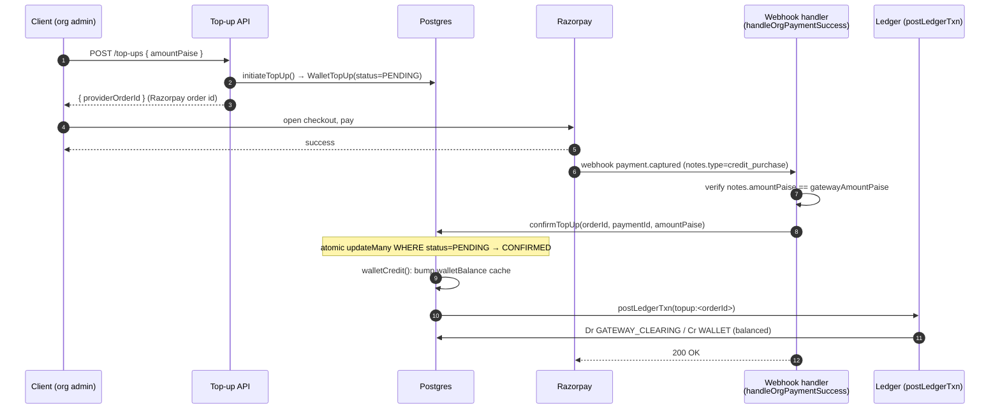

# Wallet & Top-ups

**What this covers:** how an organization's prepaid **wallet** works — the `WalletTopUp` lifecycle (initiate → Razorpay checkout → webhook confirm), how money lands in the wallet via the double-entry journal, and how bookings debit it. The wallet is a _prepaid liability we owe the org_; its balance is **derived from the journal**, with `BillingAccount.walletBalance` kept only as a fast cache.

> **Mental model.** A wallet is not a bank account we hold money in — it is an IOU. When an org tops up, the platform receives real money that Razorpay still holds (`GATEWAY_CLEARING` rises, and the daily settlement journal later moves the net to `CASH`) and in exchange owes the org spending power (`WALLET`, a liability, rises). When the org books, the IOU shrinks. The single source of truth for "how much do we owe this org" is the org's `WALLET` ledger account, **not** the `walletBalance` integer.

---

## 1. The two records behind a wallet

A wallet is not a single model — it is a `WalletTopUp` lifecycle record paired with a `WALLET` ledger account; understanding which is truth (the account) versus which is the fast-path cache (`walletBalance`) is essential before touching any top-up or debit code.

| Thing                                             | Where                                                           | Role                                                                                                                                 |
| ------------------------------------------------- | --------------------------------------------------------------- | ------------------------------------------------------------------------------------------------------------------------------------ |
| **`WalletTopUp`**                                 | `prisma/schema.prisma` model `WalletTopUp` (~1000)              | Lifecycle + idempotency record for one top-up attempt (PENDING → CONFIRMED / FAILED).                                                |
| **`WALLET` ledger account**                       | one `LedgerAccount` per org, derived via `ledgerBalancePaise()` | **Source of truth** for the balance (credit-normal liability).                                                                       |
| **`BillingAccount.walletBalance`** (`Int?` paise) | `prisma/schema.prisma` model `BillingAccount`                   | **Derived cache** of the WALLET account, used for the atomic overdraft guard. Reconcile asserts `-balance(WALLET) == walletBalance`. |

> **History note (#772 B3).** The old per-row `WalletEntry` log (and its "deltaPaise = 0 placeholder" trick for pending top-ups) was **removed**. Wallet history is now the `LedgerEntry` rows on the org's `WALLET` account, and top-up lifecycle lives on `WalletTopUp`. If you read "WalletEntry" anywhere, it is stale — see [Ledger & postings](03-ledger-and-postings.md).

The `walletBalance` cache exists for exactly one reason: a conditional SQL `UPDATE … WHERE walletBalance >= amount` is the cheapest correct overdraft guard under concurrency. We can't run that guard against a derived sum, so we keep a cache and let the reconcile cron prove it never drifts. See [Concurrency & idempotency](../30-programs-and-lifecycle/01-concurrency-and-idempotency.md).

The column is nullable, and an account that has never been credited carries `NULL` rather than zero, which is a real distinction in Postgres because `NULL + amount` is `NULL` and not the new balance. Both `walletCredit` and `walletDebit` therefore write a zero over a `NULL` in the same transaction before they touch the arithmetic, and they read the resulting balance back off the mutated row instead of coercing a `NULL` to zero (#1459). Giving the column a non-null default so the seeding step becomes unnecessary is a schema change, and it belongs to the pre-MVP database reset rather than to any migration written today.

---

## 2. WalletTopUp lifecycle

A top-up moves through three states. Razorpay is the only gateway in v1.



Key fields (`model WalletTopUp`, `lib/api/organizations/wallet.ts`):

- `providerOrderId @unique` — the Razorpay order id, **also** the public `topUpId`. The unique constraint is the idempotency anchor: a double-POST or webhook redelivery cannot create or confirm twice.
- `providerPaymentId?` — gateway payment id (`pay_…`), set on confirm.
- `amountPaise` — stored **up front** so `confirmTopUp` can assert the webhook-captured amount matches what was authorized.
- `status` — `PENDING | CONFIRMED | FAILED`.
- `confirmedAt?` — stamped when the claim wins.
- `capturedAt?` (#785) — stamped **outside** `confirmTopUp`'s transaction the moment the gateway reports capture, so it survives a ledger-post rollback. The stale-reaper cron skips `capturedAt`-set rows (real money landed — don't GC them), and the `sweep-orphaned-topup-captures` reconciler re-credits any row that was captured but never confirmed (e.g. the confirm tx crashed after capture). This closes the "money in, no wallet credit" gap.

> In code the failed top-up is **deleted**, not flipped to `FAILED`: `handleOrgPaymentFailure` (`app/api/webhooks/utils.ts`) runs `walletTopUp.deleteMany({ where: { status: PENDING, providerPaymentId: null } })` so the UI immediately shows "retry". The `FAILED` enum value is reserved for paths that want to keep the tombstone; the stale-reaper cron also GCs orphaned PENDING rows.

---

## 3. The top-up flow end to end



> **Worked example — TCS tops up ₹2,00,000** (hypothetical; Tata Consultancy Services, a WALLET-funded buyer). An admin POSTs `{ amountPaise: 20000000 }`; `initiateTopUp` writes `WalletTopUp(PENDING, providerOrderId=order_…, amountPaise=20000000)` and returns the Razorpay order id. TCS pays; the `payment.captured` webhook arrives, `confirmTopUp` claims the row `PENDING → CONFIRMED`, bumps `walletBalance` by `20000000`, and posts `Dr GATEWAY_CLEARING 20000000 / Cr WALLET(tcs) 20000000`. The org's true balance — `-balance(WALLET, tcs)` — and the `walletBalance` cache now both read ₹2,00,000. If TCS had set `minBalancePaise = 5000000` (₹50,000), the low-balance cron (§7) would alert finance once the pool later dips below that floor — _notify-only today_, no auto-charge.

### 3.1 `initiateTopUp` — create the PENDING claim

`initiateTopUp(db, { billingAccountId, amountPaise, providerOrderId, notes? })` writes one `WalletTopUp` row with `status = PENDING`. No money has moved and **no journal entry exists yet** — the row is purely a pending claim keyed by `providerOrderId`. The API returns the Razorpay order id to the client for checkout.

### 3.2 `confirmTopUp` — atomic claim, then post the journal

The webhook (`handleOrgPaymentSuccess`, branch `notes.type === "credit_purchase"`) first does **defence-in-depth**: it compares `notes.amountPaise` to the gateway-captured amount and refuses to credit on mismatch (logs an audit row, returns 200 so Razorpay stops retrying). Then it calls:

```
confirmTopUp(prisma, { providerOrderId, providerPaymentId, amountPaise })
```

Inside one `$transaction`:

1. **Atomic idempotent claim** — a single conditional `updateMany`:
   ```
   updateMany WHERE providerOrderId = ? AND status = "PENDING"
              SET status = "CONFIRMED", providerPaymentId, confirmedAt
   ```
   Exactly one racing delivery sees `count === 1` and proceeds. A redelivery (or the losing race) sees `count === 0` and falls through to a no-op that just returns the current balance. If the order id is unknown entirely, it throws.
2. **Credit the wallet** via `walletCredit(tx, { reason: "TOPUP", … })`, which:
   - bumps the `walletBalance` cache (`COALESCE(walletBalance,0) + amount`), then
   - posts the journal (only the `TOPUP` reason posts here):

```
LedgerTransaction kind=TOPUP  idempotencyKey="topup:<providerOrderId>"
  Dr GATEWAY_CLEARING     amountPaise   (money Razorpay holds for the platform rises)
  Cr WALLET(org)          amountPaise   (we now owe the org this much)
```

Both legs are positive integer paise and sum equal, so `postLedgerTxn` accepts it (it throws `LedgerImbalanceError` otherwise). The transaction is idempotent twice over: the `WalletTopUp` claim and the `LedgerTransaction.idempotencyKey @unique`.

---

## 4. `walletDebit` — spending the wallet

When an org-WALLET-funded booking is checked out, the commit first checks the **wallet-freeze gate**: `isWalletFrozen()` (`lib/payments/wallet-freeze.ts`) is read inside the checkout transaction in `lib/payments/checkout/commit/org-utilization.ts`, and a frozen wallet throws `WalletFrozenError` (409), so a drifted wallet cannot spend. Then `walletDebit(tx, { billingAccountId, amountPaise, reason, … })` runs the **overdraft guard**:

```sql
UPDATE "BillingAccount"
SET "walletBalance" = "walletBalance" - :amount
WHERE "id" = :id
  AND "walletBalance" IS NOT NULL
  AND "walletBalance" >= :amount
```

If `rowsAffected === 0`, the balance was insufficient and it throws `WalletInsufficientFundsError`. Because the predicate and the decrement are one atomic statement, two concurrent bookings can never both drain the same last rupee.

That refusal carries the stable code `WALLET_INSUFFICIENT_FUNDS` and `httpStatus` 402 (#1477), so checkout rethrows it unchanged, `POST /api/checkout` answers 402 with copy telling the buyer to ask their billing admin for a top-up, and Sentry records it as an expected outcome rather than a payment fault. It reports only the requested amount, never the available balance: the guard refuses without reading the row, and re-reading it would add a query inside the checkout transaction that `PG_POOL_MAX=1` would serialise behind everything else.

> **Important:** `walletDebit` only moves the **cache**. It does **not** post a journal leg. The accounting leg `Dr WALLET` is posted later from the settlement layer (`createEarningsFromPayment`), where the full fee/payable/GST split is known — that single balanced `booking:<paymentId>` transaction is also the authoritative wallet-history record. See [Booking → earnings](05-booking-to-earnings.md) and [Payment legs](09-payment-legs.md).
>
> **The journal leg is asserted, not assumed.** After `createEarningsFromPayment` returns, `assertWalletDebitJournaled()` (`lib/api/organizations/wallet.ts`, called from `lib/payments/checkout/commit/ledger.ts`) looks for a `Dr WALLET` line in `booking:<paymentId>` and throws `WalletDebitUnjournaledError` (`WALLET_DEBIT_UNJOURNALED`) if there is none. The whole checkout transaction then rolls back, so the cache move never commits without its journal line. This is an application check on the one path that could otherwise drift the cache; it does not replace the nightly `WALLET_BALANCE_DRIFT` audit.

`walletCredit` is the mirror: it bumps the cache for any reason, but **only posts a journal txn when `reason === "TOPUP"`**. Refund credits post their WALLET leg from the refund layer (next section), not here — this keeps each cash event owning exactly one posting.

---

## 5. Top-up refund

Two paths book a top-up refund, and both call `bookTopUpRefund()` (`lib/payments/operations/wallet-refund.ts`) with the same journal key, so whichever arrives second is a no-op.

- **An admin door.** `POST /api/admin/billing-accounts/[billingAccountId]/refund-remaining` (`refundRemainingWalletBalance()` in the same file) returns the wallet balance as gateway refunds against the organisation's `CONFIRMED` top-ups, newest first, each keyed `wallet-refund:<billingAccountId>:<topUpId>`. It is a step-up, second-admin door (above ₹25,000 it answers `202`), and it refuses a drifted wallet with `409 WALLET_DRIFTED` before any money moves.
- **A refund issued at the gateway** (for example from the Razorpay dashboard). When Razorpay reports a refund of a confirmed top-up, `handleRefundCreated` (`app/api/webhooks/utils.ts`) finds the `WalletTopUp` by `providerPaymentId` (status `CONFIRMED`) and books it.

Each booking reverses the original posting:

```
LedgerTransaction kind=TOPUP_REFUND  idempotencyKey="topup-refund:<gatewayRefundId>"
  Dr WALLET(org)        refundAmt   (the IOU we owe the org shrinks)
  Cr GATEWAY_CLEARING   refundAmt   (the money returns to the gateway)
```

Notes:

- The key names the **gateway refund**, not the payment, because Razorpay allows several partial refunds per payment. A payment-scoped key would have made the second partial refund a silent no-op, with real money leaving and no `WALLET` debit.
- The refund amount is **clamped** to the original `amountPaise` (`Math.min(amount, topUp.amountPaise)`).
- `postLedgerTxn` returns `{ created: false }` on a redelivery (idempotent on the key), and the handler short-circuits before touching the cache, so a double webhook is a no-op.
- **The wallet floor wins.** The cache is decremented only by what the wallet still holds, with a conditional `updateMany` (`walletBalance >= clawback`), because the `billing_account_wallet_nonnegative` CHECK would reject a negative balance and the webhook would then fail and redeliver forever. If the org had already spent part of the credited funds, the unrecovered part posts as a receivable under `topup-refund-shortfall:<gatewayRefundId>` (`Dr ORG_RECEIVABLE(org) / Cr WALLET(org)`), which reconciliation consumes. For example, IIT Madras tops up ₹5,00,000, spends ₹4,90,000, and Razorpay refunds the whole ₹5,00,000: the wallet cache falls by ₹10,000 (1,000,000 paise) and ₹4,90,000 (49,000,000 paise) becomes a receivable from the organisation.
- No `Refund` row is written for org-level refunds — `Refund.paymentId` is scoped to the B2C `Payment` table. The `TOPUP_REFUND` journal transaction is the authoritative record.

---

## 6. Why `walletBalance` is "just a cache"

Every wallet movement is a journal posting:

| Event                             | Journal                                                                                                                                | Cache effect                                     |
| --------------------------------- | -------------------------------------------------------------------------------------------------------------------------------------- | ------------------------------------------------ |
| Top-up confirmed                  | `Dr GATEWAY_CLEARING / Cr WALLET` (`topup:<orderId>`)                                                                                  | `walletBalance += amount`                        |
| Booking debit                     | `Dr WALLET …` inside `booking:<paymentId>`                                                                                             | `walletBalance -= amount` (via `walletDebit`)    |
| Top-up refund (gateway-initiated) | `Dr WALLET / Cr GATEWAY_CLEARING` (`topup-refund:<gatewayRefundId>`)                                                                   | `walletBalance -= min(amount, balance)`          |
| Operator correction               | `WALLET_ADJUSTMENT`, `walletadj:<billingAccountId>:<key>`: credit `Dr PLATFORM_PROMO / Cr WALLET`, debit `Dr WALLET / Cr PLATFORM_FEE` | `walletBalance ± amount` in the same transaction |

The org's true balance is always `-ledgerBalancePaise({ kind: "WALLET", organizationId })` (WALLET is credit-normal, so the amount we owe is the negative of the signed balance). The reconcile cron's `WALLET_BALANCE_DRIFT` check asserts this equals the cache; any drift is an incident. See [Ledger integrity](13-ledger-integrity.md).

The operator correction is `adjustWallet()` (`lib/api/organizations/wallet.ts`), reached through `POST /api/admin/billing-accounts/[billingAccountId]/wallet-adjustment` (step-up, second-admin above ₹25,000). Because it moves the cache and the journal by the same signed amount, it cannot close a drift between them. Use it to give or take real value from an organisation, not to repair the cache. A drift is repaired by posting a balanced correcting journal for whichever side is wrong; see the repair steps in [Ledger integrity](13-ledger-integrity.md).

---

## 7. Wallet floor and low-balance alert (notify-only)

A WALLET-funded org can set a **minimum balance** so it learns the pool is running low _before_ a booking gets refused for insufficient funds. The fields live on `BillingAccount`:

```prisma
model BillingAccount {
  walletBalance        BigInt?    // paise; NULL for INVOICE-funded accounts
  minBalancePaise      BigInt?    // the floor; null means no alert
  autoTopUpLastFiredAt DateTime?  // low-balance alert cooldown, CAS-stamped by the cron
}
```

> The wallet never auto-charges. The earlier auto-top-up columns (`autoTopUpEnabled`, `autoTopUpAmountPaise`, `autoTopUpMandateId`) were removed from the schema. The cron (`jobs/billing/wallet-low-balance.ts`) moves no money and creates no `WalletTopUp`: it detects the dip, **notifies finance** (`notifyOrgWalletLow`), and stamps the cooldown in `autoTopUpLastFiredAt` (the column keeps its old name).

**The cron** (the `wallet-low-balance` target on the Netlify ticker, `netlify/functions/cron-tick.mts`, inside its daily window that opens at 23:30 UTC, after `dunning`):

1. Select WALLET `BillingAccount`s with a non-null `minBalancePaise` whose `autoTopUpLastFiredAt` is null or older than 24h (the `walletBalance < minBalancePaise` comparison can't be a Prisma column-compare, so it's narrowed here and checked in JS).
2. Skip any whose live `walletBalance >= minBalancePaise`.
3. **Claim** the row with a conditional `updateMany WHERE autoTopUpLastFiredAt = <value-read>` → stamp `now`. `autoTopUpLastFiredAt` doubles as the **idempotency gate + 24h notify cooldown**: a second replica or same-day re-run sees `count === 0` and skips, so an org is alerted at most once per day.
4. Fire `notifyOrgWalletLow` (Novu) with the balance, the floor, and a deep link to the billing top-up surface.

> **Related — overage-as-expansion.** A low wallet is the _funding-side_ nudge; the [program-overage](05-booking-to-earnings.md) preview is the _consumption-side_ one (a member about to breach a program cap). Both steer an org toward topping up / expanding rather than hitting a hard `BLOCK`. They are independent surfaces — overage meters a `ProgramAssignment` cap, the floor watches the wallet pool — but share the "warn before refuse" philosophy.

---

## 8. Design decisions & trade-offs

- **A `walletBalance` cache at all (vs always-derive).** The wallet is the _one_ place the money model keeps a balance-shaped column, and only because an overdraft guard must atomically test-and-decrement under concurrency — `UPDATE … WHERE walletBalance >= amount` needs a real column; you can't run that predicate against a derived `SUM`. The cost is a standing reconciliation invariant (`WALLET_BALANCE_DRIFT`); the benefit is the booking hot path stays a single conditional statement instead of a sum-then-check race. See [money model overview §4](01-money-model-overview.md).
- **`walletDebit` moves only the cache; the journal leg posts at settlement.** A booking's `Dr WALLET` leg is posted later inside the balanced `booking:<paymentId>` transaction, where the full fee/payable/GST split is known — not at debit time. This keeps "one cash event, one posting": the cache decrement reserves the funds atomically, the journal records the accounting once. The cost is that the cache and the journal leg are written at _different moments_ (reconciled nightly); the alternative — posting a half-known journal leg at debit time — would need a correction once the split resolved.
- **Failed top-ups are deleted, not tombstoned.** `handleOrgPaymentFailure` deletes the `PENDING`/un-captured row so the UI immediately offers "retry" rather than showing a dead `FAILED` attempt. The `FAILED` enum value is kept for paths that _want_ the tombstone. Trade-off: a cleaner retry UX vs losing the failed-attempt history (acceptable — a never-captured top-up moved no money).
- **Low-balance is an alert, not an auto-charge.** The mandate columns were deleted rather than kept as written-but-unread fields; the cron only detects the dip and notifies. A recurring-debit wallet would have to be designed afresh inside RBI's e-mandate rules.

## 9. What this design survived

- **Captured-but-uncredited top-ups: money in, no wallet credit (`ca6e9073`, #785 task #23).** `confirmTopUp`'s body was one `$transaction` — claim + credit + ledger post. If the ledger post threw, the whole tx rolled back, flipping the `CONFIRMED` claim _back_ to `PENDING`. But the gateway had already captured the money and would not resend, and the 6-hour abandoned-top-up cleanup then **hard-deleted** the now-orphaned `PENDING` row — silently losing the org's cash. The fix: stamp `capturedAt` + `providerPaymentId` **outside** the transaction the moment the gateway reports capture, so the captured-money trace survives a ledger-post rollback; guard the cleanup cron on `capturedAt IS NULL` so it never reaps a captured row; and add `sweep-orphaned-topup-captures` (a new 30-minute cron) that finds `PENDING` rows with `capturedAt` set and re-runs the idempotent `confirmTopUp` to land the credit. Live-verified: the zombie survives the reaper and the reconciler re-credits it, idempotently on re-sweep. This is the `capturedAt` field in §2.
- **The amount-mismatch defence (`96275d68`, #785).** `confirmTopUp` asserts the webhook-captured amount equals the amount authorized at `initiateTopUp` and refuses to credit on mismatch (logs an audit row, returns 200 so Razorpay stops retrying). Storing `amountPaise` up front at initiation is what makes that assertion possible — a top-up can't be confirmed for a different number than it was started for.

---

### Related docs

- [Money model overview](01-money-model-overview.md) — double-entry principles, integer paise.
- [Chart of accounts](02-chart-of-accounts.md) — `CASH`, `WALLET`, and the rest.
- [Ledger & postings](03-ledger-and-postings.md) — `postLedgerTxn`, balanced postings, idempotency.
- [Booking → earnings](05-booking-to-earnings.md) — where the `Dr WALLET` booking leg actually posts.
- [Payment legs](09-payment-legs.md) — `WALLET` as one funding leg of a stacked checkout.
- [Concurrency & idempotency](../30-programs-and-lifecycle/01-concurrency-and-idempotency.md) — the atomic-debit guard pattern.
- [Ledger integrity](13-ledger-integrity.md) — the `WALLET_BALANCE_DRIFT` reconcile check.
