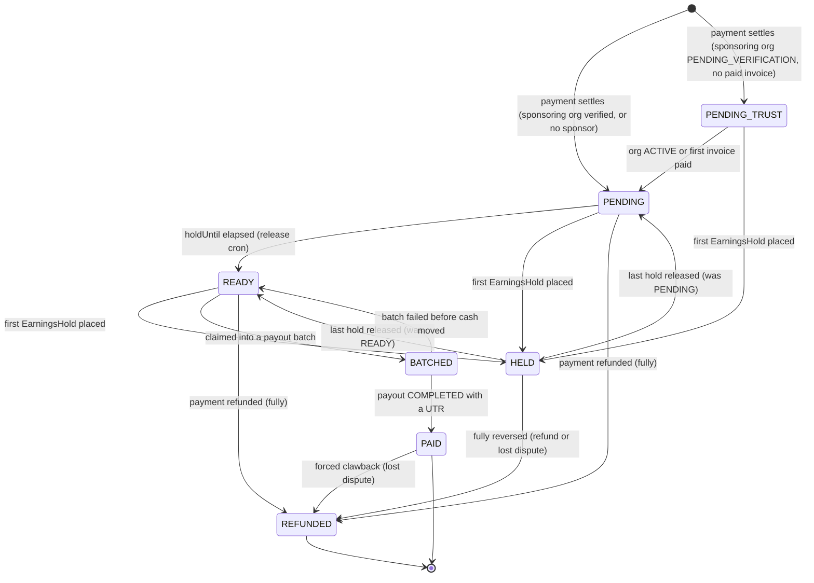

# Earnings lifecycle

**What this covers:** how an earnings row is minted when a payment settles, every `EarningStatus` it can move through, and how it is held, released, refunded, and finally paid. It covers both the consultant-side row (`ConsultantEarnings`) and the host-org-side row (`OrganizationEarnings`), because they share one status enum and one set of transition rules. The batching that consumes a `READY` row and turns it into an actual bank transfer lives in [payout pipeline](07-payout-pipeline.md); this doc stops at the moment a row becomes eligible for that batch.

> Every host-side booking mints one `ConsultantEarnings` row, and — when the expert settles to a HOST org — one `OrganizationEarnings` row as well. Both start life in a hold, move to `READY` when the hold elapses, and end in `PAID` when a payout's gateway leg confirms. A refund never deletes a row; it increments a cumulative refunded column and, when the row is fully reversed, flips it to `REFUNDED`.

---

## 1. How a row is minted

Earnings are minted from a settled payment, not from the booking request, so a payment that never captures never accrues anything. The entry point is `createEarningsFromPayment` (`lib/payments/payouts/earnings-service.ts`), called from the payment-success path. The function runs inside one `prisma.$transaction` and is idempotent: it first looks for an existing `ConsultantEarnings` row for the same `(paymentId, consultantProfileId)` and returns early if one is found, so an at-least-once webhook redelivery cannot double-mint.

The split is computed from the rate card that was effective **at payment-creation time**, not at settlement time — `resolveOrgSplit` is passed `payment.createdAt` precisely because a hold can be days long and the live card may have been bumped in the interim. The full split arithmetic (the marketplace 20% path versus the HOST-org three-way `RateCard` path, and the floor-and-subtract rounding) is documented in [booking → earnings §2.1](05-booking-to-earnings.md); this doc only needs the result: a `consultantSharePaise` for the expert and, on the HOST path, an `orgSharePaise` for the org.

The two row types differ in what they cache and how the split is stamped. A `ConsultantEarnings` row carries `consultantSharePaise`, `platformFeePaise`, the collaborator `shareBps`, and `refundedShareAmount`. An `OrganizationEarnings` row carries `grossAmountPaise`, `platformFeePaise`, `orgSharePaise`, `consultantSharePaise`, `refundedAmountPaise`, and the basis-point snapshot — `rateCardIdApplied`, `platformBpsApplied`, `orgBpsApplied`, and `consultantBpsApplied` — so that payout reconciliation reads the exact split that was applied rather than the live `RateCard`. That snapshot is the whole reason a retroactive rate change can never restate already-minted earnings.

The table below summarises which row each settlement path produces.

| Settlement path                                | `ConsultantEarnings`                      | `OrganizationEarnings`       | Notes                                                                                                 |
| ---------------------------------------------- | ----------------------------------------- | ---------------------------- | ----------------------------------------------------------------------------------------------------- |
| Marketplace (solo expert, no HOST org)         | one row, full consultant pool             | none                         | flat 20% platform fee; no org leg exists                                                              |
| HOST org, `payoutRecipient = SELF`             | one row per party (owner + collaborators) | one row, `orgSharePaise > 0` | three-way `RateCard` split                                                                            |
| HOST org, `payoutRecipient = ORGANIZATION`     | expert leg collapses into the org         | one row                      | salaried/internal expert; see [expert lifecycle](../30-programs-and-lifecycle/03-expert-lifecycle.md) |
| HOST org, platform-only mode (`orgShare == 0`) | one row                                   | none                         | a zero-value org row is intentionally skipped as noise                                                |

> A single payment can carry **N** `OrganizationEarnings` rows post-A3 — the primary expert's org plus one per collaborator who settles to a different HOST org — bounded by the `@@unique([paymentId, organizationId])` constraint. See [booking → earnings §4](05-booking-to-earnings.md).

---

## 2. The `EarningStatus` state machine

Both row types move through the same `EarningStatus` enum (`prisma/schema.prisma`): `PENDING`, `PENDING_TRUST`, `HELD`, `READY`, `BATCHED`, `PAID`, and `REFUNDED`. The diagram below shows the legal transitions; each is explained in the paragraphs that follow.

Both the consultant row and any org row begin in **`PENDING`** — the hold period — when the booking's **sponsoring** org (`payment.organizationId`) is already verified or the booking has no sponsor. When the sponsoring org is still `PENDING_VERIFICATION` and has never paid an invoice, every row the booking writes — the consultant row included — begins in **`PENDING_TRUST`** instead; this is the #687 guard explained in §3.

The **`PENDING_TRUST` release** has two triggers. When a platform admin verifies the sponsoring org, `releaseSponsorTrustPark()` (`lib/payments/payouts/trust-park.ts`, called from the verify route under `withOpsAction`) releases every earning parked on that sponsor, consultant and host-org alike, keyed on the payment's sponsor rather than the earner: a matured, releasable row goes straight to `READY`, any other to `PENDING`, and a `HELD` row restores to `PENDING` when its last hold lifts. When the sponsor's first invoice is paid, `settleOrgInvoicePaid()` moves its parked rows to `PENDING`. Until then the row is invisible to payout batching, which only ever claims `READY` rows.

The **`PENDING → READY`** transition is the hold elapsing. The scheduled release job (`scripts/earnings/release-earnings.ts`) flips every row whose `status` is `PENDING` and whose `holdUntil <= now` to `READY`, for both `ConsultantEarnings` and `OrganizationEarnings` under a bounded `Serializable` transaction. Hold mechanics are detailed in §4.

The **`PENDING → HELD`** and **`READY → HELD`** transitions freeze a row. An earning is `HELD` exactly when it carries at least one active `EarningsHold` row, and each hold names a reason: `DISPUTE` (placed by `placeDisputeHolds()` when a dispute opens), `MODERATION` (a ban of the consultant), `OPERATOR` (an admin) or `OVERAGE` (a member overage on the payment is unpaid). `lib/payments/payouts/earnings-holds.ts` (`placeEarningsHolds()` and `releaseEarningsHolds()`) is the only writer of `HELD`; the placement is a CAS scoped to `PENDING`, `PENDING_TRUST` or `READY` rows, so a `PAID` or `REFUNDED` row can never be re-frozen. The first hold records the row's prior status in `preHoldStatus` (the database column keeps its old name, `preDisputeStatus`), and the last release restores exactly that status, so a row frozen from `READY` returns to `READY` and a row frozen from `PENDING` returns to `PENDING` and keeps waiting out its hold. Each owner releases only its own hold, so winning a dispute does not free money that a ban or an operator still holds. The database requires every hold to name exactly one earning (`earnings_hold_one_earning`) and allows one active hold per earning, reason and source (`earnings_hold_active_consultant_key` and `earnings_hold_active_org_key`), all in `prisma/sql/check-constraints.sql`.

### 2.1 What the consultant sees — the three buckets

The consultant Earnings page (`app/dashboard/consultant/[consultantId]/(features)/earnings/`) never shows these enum names. Since PR-Y (#1675, #1527 W2) every row passes through `deriveEarningPresentation` in `lib/dashboard/earnings-state.ts`, a pure module that maps the seven statuses onto three tiles — Available, Pending, Paid out — plus a Refunded segment that appears only when a refunded row exists. The table below is that map; the tone names the badge colour from `money-state.ts`, and the line is the one sentence shown under the badge.

| `EarningStatus` | Bucket    | Badge                                                                    | Tone    | Line under the badge                                                                            |
| --------------- | --------- | ------------------------------------------------------------------------ | ------- | ----------------------------------------------------------------------------------------------- |
| `READY`         | Available | Available                                                                | info    | "Goes out in your next payout", or "Reserved for you until payouts begin" while the flag is off |
| `BATCHED`       | Available | "In this week's payout" when `ENABLE_LIVE_PAYOUTS` is on, else Available | info    | "Locked into this week's payout run", or the reserved line while the flag is off                |
| `PENDING`       | Pending   | Pending                                                                  | neutral | "available on <date>" from `holdUntil`; "releasing shortly" once it has passed                  |
| `HELD`          | Pending   | On hold                                                                  | caution | Names the dispute when a `DISPUTE` hold is active, otherwise an account review                  |
| `PENDING_TRUST` | Pending   | Waiting for <Org>                                                        | neutral | "Waiting for <Org>'s first paid invoice"                                                        |
| `PAID`          | Paid out  | Paid                                                                     | success | "Paid out to your bank"                                                                         |
| `REFUNDED`      | Refunded  | Refunded                                                                 | caution | "Returned to the client"                                                                        |

The Available tile sums the consultant share of `READY` and `BATCHED` rows less `refundedShareAmount`; the Pending tile sums the three waiting states the same way; the Paid out tile sums `netAmount`, or `amount − tdsDeducted` where `netAmount` is null, over `COMPLETED` `ConsultantPayout` rows, which is what actually reached the bank after TDS. These are whole-account figures computed in the read (`getConsultantBucketTotals`), not a total of the page of rows the list happens to show. The Available tile's subtitle comes from `nextPayoutCopy`: "Payouts begin at launch — your balance is safe with us" while `ENABLE_LIVE_PAYOUTS` is off, and "Paid every Monday, or get paid now once a day · next: <date>" (#1771 row 6) from the mirrored `PAYOUT_BATCH_UTC` constant (Monday 20:00 UTC, the start of the `create-payout-batch` ticker window) once it is on.

---

## 3. `PENDING_TRUST` — the #687 invoice-fraud guard

`PENDING_TRUST` exists to close a fraud hole. An organization that is still `PENDING_VERIFICATION` and funds its bookings by INVOICE could otherwise accrue real consultant earnings against bookings it has not yet paid for, and then disappear before its first invoice ever clears — leaving the platform owing experts for work an unverified, unpaid org commissioned. To prevent that, `createEarningsFromPayment` resolves the booking's **sponsoring** org (`payment.organizationId` — the org that owes the invoice, not the expert's HOST org) once, up front: if that sponsoring org is `PENDING_VERIFICATION` and its count of `PAID` `OrganizationInvoice` rows is zero, **every** earnings row the booking writes — the consultant row, the primary org row, and each collaborator-org row — is minted in `PENDING_TRUST` rather than `PENDING` (`earnings-service.ts`). Keying on the sponsor rather than the host is what stops an unverified sponsor from letting either consultant _or_ org earnings clear.

A row parked in `PENDING_TRUST` is excluded from the hold-release sweep (which only touches `PENDING` rows) and therefore can never reach `READY` or be batched into a payout. It is promoted only once the org has earned trust — an admin verifies it, or it pays its first invoice. The rejected alternative, accruing straight to `PENDING`, would have been one less state to carry but would have re-opened the ghost-org hole.

Upstream of parking, the checkout path now hard-requires a **verified domain claim** before an org may fund anything by INVOICE at all (`assertVerifiedDomainOrThrow`, called on the INVOICE funding branch of `resolveOrgFunding` in `lib/payments/checkout/org-funding.ts`). The ghost-org window is therefore narrowed on two fronts: an unverified sponsor cannot accrue INVOICE debt without first proving domain ownership, and any earnings its bookings do generate park in `PENDING_TRUST` until it earns trust.

---

## 4. Hold windows, dispute holds, and release

The hold window is what gives the platform time to absorb a refund or dispute before money leaves. At mint time, `createEarningsFromPayment` sets `holdUntil = now + HOLD_PERIOD_HOURS[appointmentType]` (`lib/payments/payouts/constants.ts`). The windows are keyed by appointment type and run from the moment of earnings creation, not from the appointment's completion time.

Since #1569 the anchor is the later of the capture and the end of the last live occurrence, and since #1766 (PR-Z2) a subscription is the exception to "set at mint time": its earnings are one row per cycle with `holdUntil` NULL, meaning not yet delivered, and the completion path stamps each tranche's hold once its cycle's last session completes. A NULL hold is skipped by `recomputeEarningsHold` and never matched by the release job, because `holdUntil <= now` is NULL-safe in SQL.

The table below lists the configured hold periods and the reasoning behind each.

| Appointment type | Hold (hours) | Rationale                                 |
| ---------------- | ------------ | ----------------------------------------- |
| `CONSULTATION`   | 24           | short engagement, quick refund resolution |
| `CLASS`          | 24           | same profile as a consultation            |
| `WEBINAR`        | 48           | leaves room for participant feedback      |
| `SUBSCRIPTION`   | 168 (7 days) | longer commitment, higher refund risk     |

> 🟡 **Gap (doc-vs-code, no issue filed yet):** earlier drafts of the payout doc described the hold as roughly `completedAt + 3 days`. The code derives `holdUntil` from `Date.now()` at earnings-creation time using the per-type `HOLD_PERIOD_HOURS` table above (24h / 48h / 168h), and the default when the type is unknown is the 24-hour `CONSULTATION` window — there is no three-day default and the anchor is the creation timestamp, not `completedAt`. Treat the per-type table as ground truth.

Release is the `release-earnings` sweep (`scripts/earnings/release-earnings.ts`), which runs on the five-minute ticker every 15 minutes and flips `PENDING` rows whose `holdUntil <= now` to `READY` across both `ConsultantEarnings` and `OrganizationEarnings`. It does not touch `HELD` rows: a hold is released only by its owner's own release (the dispute settlement for a `DISPUTE` hold, an admin for `OPERATOR` and `MODERATION`, the overage settlement for `OVERAGE`), never by the timer.

**New experts wait seven days longer.** `withNewExpertHold()` (`lib/payments/payouts/earnings-hold.ts`) adds `NEW_EXPERT_EXTRA_HOLD_DAYS` (7) to `holdUntil` while the consultant's first earning on a succeeded payment is under 30 days old (or they have none), or their lifetime share net of refunds is under ₹50,000 (5,000,000 paise). Deferred holds stamped later (subscription tranches, trial cancellations, cancelled-session settlement) get the same days through `stampConsultantHolds()`.

A dispute hold is the manual override on top of the timed hold. `placeDisputeHolds()` in `app/api/webhooks/utils.ts` places a `DISPUTE` hold on the payment's `PENDING`, `PENDING_TRUST`, `READY` or already `HELD` earnings, after cancelling any `PENDING` or `APPROVED` payout that had batched one of them, so disputes can only freeze money that has not yet been paid out. When the dispute settles, `settleDisputeVerdict()` releases only that dispute's hold, and a lost dispute first reverses the lost fraction of each share (§5 and [disputes](11-disputes.md)).

---

## 5. Refunds: append-only decrements via CAS helpers

A refund never deletes an earnings row and never subtracts from the principal columns. Instead, earnings reversals increment a cumulative refunded column — `refundedShareAmount` on `ConsultantEarnings`, `refundedAmountPaise` on `OrganizationEarnings` — and flip the row to `REFUNDED` only once that cumulative figure reaches the full share.

To prevent two concurrent partial refunds under `ReadCommitted` from reading the same stale `refundedShareAmount` / `refundedAmountPaise` and either over-reversing the share or failing to flip `status` to `REFUNDED`, all bounded earning reversals go through `lib/payments/payouts/earning-reversal-cas.ts`:

- `applyCappedEarningReversal(db, row, requestPaise, refundableSource)` — a compare-and-set on `ConsultantEarnings`. The `WHERE` pins the exact status and cumulative `refundedShareAmount` that were read, and the write is the absolute value `min(consultantSharePaise, alreadyRefunded + requestPaise)`. If the CAS is refused, it re-reads once and takes only the residual; two refusals in a row report `lostRace` and write nothing. A row whose status is not in `refundableSource` is refused, never reversed. When the cumulative figure reaches the full share, the same atomic write moves `status` to `REFUNDED`, and the transition is asserted legal first.
- `applyCappedOrgEarningReversal(db, row, requestPaise)` — the symmetric CAS helper on `OrganizationEarnings`, pinning `(status, refundedAmountPaise)` and flipping `status` to `REFUNDED` when the cumulative figure reaches `orgSharePaise`. Two lost-dispute reversals on one row compose to `min(share, a + b)`.
- `REFUNDABLE_UNPAID_EARNING_SOURCE` (`[PENDING, PENDING_TRUST, READY, HELD]`) — the canonical status list for unpaid earnings eligible for normal refund reversal (`BATCHED` and `PAID` are excluded unless forced).

Partial refunds are proportional. When `refundEarnings` (`lib/payments/payouts/earnings-service.ts`) is given a `refundAmount` smaller than the `paymentAmount`, it reverses that ratio of every linked earnings row (owner and each collaborator via `applyCappedEarningReversal`, or per-cycle subscription tranches via `allocateCycleClawback`), and of every `OrganizationEarnings` row for the payment via `applyCappedOrgEarningReversal`. Because the refunded amount is tracked rather than subtracted, the payout pipeline's net-payout math is always `share − refunded`, which it reads directly off the row.

A refund of an earning that is **already `PAID`** is the clawback case, and it is gated. `refundEarnings` refuses to reverse a `PAID` row unless the caller passes `forceRefund: true` (or the lost-dispute handler `settleLostDispute` in `app/api/webhooks/utils.ts` reverses it directly). When a `PAID` row is reversed:

- For `ConsultantEarnings`: `recordTdsReversal` writes a negative `TDSRecord` row (and corresponding `TdsAdjustment` when the original quarter's 26Q return was already filed) so withheld tax is unwound alongside the principal. When the earning belongs to a `COMPLETED` B2C `ConsultantPayout`, the unified reversal engine (`lib/payments/operations/reversal-engine.ts`, `kind: "CONSULTANT_CLAWBACK"`) increments `ConsultantPayout.clawbackAmountPaise` (net of TDS), stamps `ConsultantPayout.clawbackInitiatedAt`, and posts `Dr CONSULTANT_RECEIVABLE / Cr CONSULTANT_PAYABLE` under idempotency key `clawback:<refundId>:consultant-payout:<consultantPayoutId>`.
- For `OrganizationEarnings`: when the earning has already rolled into a `COMPLETED` `OrganizationPayout`, the unified reversal engine (`kind: "PAYOUT_CLAWBACK"`) increments `OrganizationPayout.clawbackAmountPaise`, stamps `OrganizationPayout.clawbackInitiatedAt`, and posts `Dr ORG_RECEIVABLE / Cr ORG_PAYABLE` under idempotency key `clawback:<refundId>:payout:<orgPayoutId>`.

The clawback mechanics on the payout side are detailed in [payout pipeline](07-payout-pipeline.md) and [disputes](11-disputes.md).

---

## 6. Where earnings appear in the ledger

The earnings rows are reconciled **caches**, not the source of truth. The authoritative split is the `BOOKING` journal's credits — `PLATFORM_FEE`, `CONSULTANT_PAYABLE`, `ORG_PAYABLE`, `GST_PAYABLE` — posted by the same transaction that mints the rows (see [ledger & postings §4.2](03-ledger-and-postings.md)). The earnings tables exist so that payout code can read one row per seller instead of re-summing the journal, and the nightly reconciler asserts that the cached amounts still equal the journal credits (`EARNINGS_LEDGER_DRIFT`, [ledger integrity](13-ledger-integrity.md)).

When a row finally reaches `PAID`, no new earnings-side number is written to the journal; the cash-leaving entry is the payout's own `PAYOUT` / `ORG_PAYOUT` posting (`Dr *_PAYABLE / Cr CASH + TDS_PAYABLE`), built via `buildPayoutSettlementPostings` (`lib/payments/payouts/shared-lifecycle.ts`), which draws down the payable that the `BOOKING` posting created. The full posting and its reconciliation invariant are in [payout pipeline §3](07-payout-pipeline.md) and [ledger & postings §4.4–4.5](03-ledger-and-postings.md).

---

### Related docs

- [Booking → earnings](05-booking-to-earnings.md) — the rate-card bps split that feeds each earnings row.
- [Payout pipeline](07-payout-pipeline.md) — how `READY` rows roll up into payouts and reach `PAID`.
- [Ledger & postings](03-ledger-and-postings.md) — the `BOOKING` credits the earnings rows cache.
- [Ledger integrity](13-ledger-integrity.md) — `EARNINGS_LEDGER_DRIFT`, the reconciler that checks the cache.
- [Expert lifecycle](../30-programs-and-lifecycle/03-expert-lifecycle.md) — how `payoutRecipient` decides whether an org earnings row exists.
