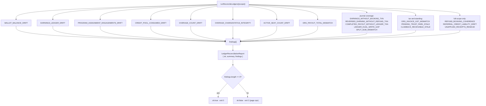
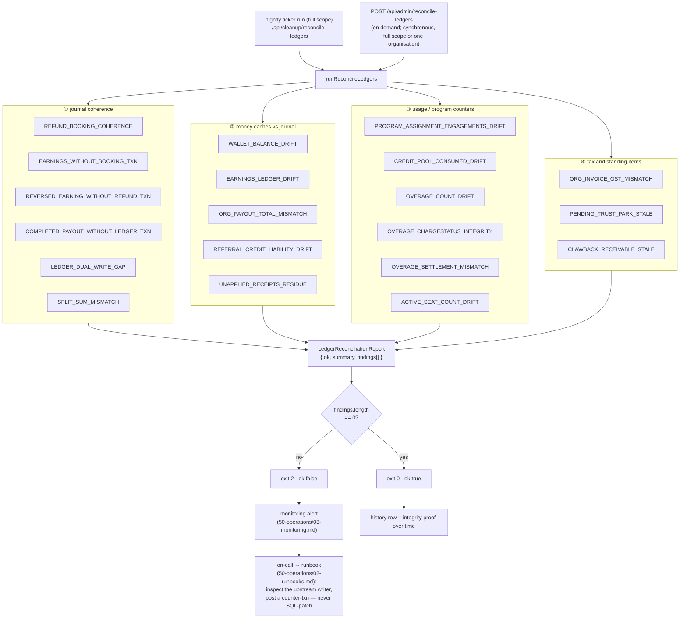

# Ledger integrity & reconciliation

**What this covers:** the auditor that proves the money model holds — the invariants it checks, the one informational coverage metric, how it runs (nightly job plus an on-demand admin door), what a finding means, and the single protective action a wallet-cache drift triggers. The auditor is read-only: it reports drift and never repairs it. This is the safety net that lets us trust derived balances and reconciled caches.

> **Why this exists.** The journal is the source of truth, but a few numbers are **cached** for the hot path (`walletBalance`) or **denormalized** for query speed (`engagementsUsed`, `activeSeatCount`, the `Earnings` amount columns). A cache is only safe if something independently re-derives it and screams on drift. That something is `scripts/reconcile/reconcile-ledgers.ts` — it never hand-patches an audited table, writing only `LedgerReconciliationReport`. Its one protective side effect is that every door that runs a reconcile (the nightly job, the `CRON_SECRET` twin and the admin door) **freezes the spend of each wallet with a `WALLET_BALANCE_DRIFT` finding** through `freezeDriftedWallets()`, and the nightly job also pages P0 (see the design notes below); it still never SQL-patches the drifted cache itself.

---

## 1. The checks

The auditor emits the `Finding` kinds listed below via set-based PostgreSQL aggregations (`$queryRaw` / `groupBy`). Four checks run **full-scope only** (`REFUND_BOOKING_COHERENCE`, the consultant-payout journal check inside `COMPLETED_PAYOUT_WITHOUT_LEDGER_TXN`, `REFERRAL_CREDIT_LIABILITY_DRIFT` and `UNAPPLIED_RECEIPTS_RESIDUE`); the rest accept an `organizationId` filter for incident triage. Invariants that Postgres already enforces at COMMIT are **not** re-scanned here: a balanced journal (`ledger_txn_balanced`), the payment-leg sum (`payment_legs_sum_to_amount`), INR-only rows (the `*_currency_inr` CHECKs), invoice tax totals and safe money ranges all live in `prisma/sql/*.sql`.

| Finding `kind`                         | Scope                                                                           | Asserts                                                                                                                                                                                                                         | Drift means                                                                                                                                                                                                 |
| -------------------------------------- | ------------------------------------------------------------------------------- | ------------------------------------------------------------------------------------------------------------------------------------------------------------------------------------------------------------------------------- | ----------------------------------------------------------------------------------------------------------------------------------------------------------------------------------------------------------- |
| `WALLET_BALANCE_DRIFT`                 | per `BillingAccount`                                                            | `-balance(WALLET, org) == walletBalance` (WALLET is credit-normal, so owed = Σcredit−Σdebit)                                                                                                                                    | the cache diverged from the journal — a writer skipped the journal or a manual SQL edit slipped in                                                                                                          |
| `EARNINGS_LEDGER_DRIFT`                | per payment **with** a `BOOKING` txn                                            | cached `ConsultantEarnings(platformFee+consultantShare) + OrganizationEarnings(orgShare)` == journal `PLATFORM_FEE+CONSULTANT_PAYABLE+ORG_PAYABLE` credits                                                                      | the earnings cache disagrees with the booking journal                                                                                                                                                       |
| `PROGRAM_ASSIGNMENT_ENGAGEMENTS_DRIFT` | per **active** `ProgramAssignment` (`periodEnd >= now`)                         | `sum(UsageLedgerEntry.engagementsConsumed) == engagementsUsed`                                                                                                                                                                  | a partial-rollback bug, a missing ledger write, or manual SQL desynced the denormalized counter                                                                                                             |
| `CREDIT_POOL_CONSUMED_DRIFT`           | per **active** CREDIT_POOL `ProgramAssignment`                                  | `sum(UsageLedgerEntry.priceAtBookingPaise) == consumedPaise` (refund rows post negative, so the sum nets)                                                                                                                       | the CREDIT_POOL money-meter write in `recordBookingUtilization`/`reverseBookingUtilization` desynced                                                                                                        |
| `OVERAGE_COUNT_DRIFT`                  | per **active** `ProgramAssignment`                                              | `count(OverageEvent where chargeStatus ∉ {REVERSED,BLOCKED}) == overageCount`                                                                                                                                                   | the over-cap counter bump/decrement missed; a charged-then-refunded overage awaiting a credit note is the expected benign cause                                                                             |
| `OVERAGE_CHARGESTATUS_INTEGRITY`       | per `OverageEvent` (link/state)                                                 | CHARGE_MEMBER pending/failed/charged ⇒ has a side-`Payment`; CHARGE_ORG accrued/charged ⇒ has an `InvoiceLineItem`; any `CHARGED` ⇒ `settledAt` set                                                                             | the `transitionOverage` state machine was bypassed or a write half-completed                                                                                                                                |
| `ACTIVE_SEAT_COUNT_DRIFT`              | per `BillingSubscription`                                                       | `activeSeatCount == count(in-period LICENSED_SEAT ACTIVE assignments)`                                                                                                                                                          | the per-seat invoice line-item counter missed a write (or reflects historical drift before its writer existed)                                                                                              |
| `ORG_PAYOUT_TOTAL_MISMATCH`            | per `OrganizationPayout` in `PENDING` / `APPROVED` / `PROCESSING` / `COMPLETED` | `sum(orgShare − refunded) of batched earnings == netPayoutPaise`                                                                                                                                                                | the batch claim updated earnings but the payout total diverged. Terminal-with-release statuses (`FAILED`, `REVERSED`, `CANCELLED`) are skipped because they detach their earnings back to `READY` by design |
| `REFUND_BOOKING_COHERENCE`             | per `BookingUtilization` (**full scope only**)                                  | fully-refunded payment ⇒ utilization reversed; reversed utilization ⇒ a `SUCCEEDED` refund backs it                                                                                                                             | a cap leak (money back but the seat still consumed) or a seat released for free                                                                                                                             |
| `LEDGER_DUAL_WRITE_GAP`                | per `OrganizationPayout` with `clawbackAmountPaise > 0`                         | a `clawback:*` `LedgerTransaction` exists against that payout                                                                                                                                                                   | the payout claims recovered cash the journal never saw                                                                                                                                                      |
| `ORG_INVOICE_GST_MISMATCH`             | per issued `OrganizationInvoice`, one finding per invoice                       | output tax less credit notes == net `GST_PAYABLE` behind it: the billed bookings' journals (a paisa per booking), else its `invoice-issued:` and refund journals                                                                | one side taxed something the other did not, or a subscription or manual invoice issued without its `invoice-issued:` journal                                                                                |
| `CLAWBACK_RECEIVABLE_STALE`            | one finding per run, listing every payee                                        | no clawback receivable is older than 90 days                                                                                                                                                                                    | the payee has had no payout large enough to net the clawback, so ops must recover it another way                                                                                                            |
| `EARNINGS_WITHOUT_BOOKING_TXN`         | global (payments with earnings, not filtered by organisation)                   | every payment with earnings has a `BOOKING` journal transaction (allowed count `RECONCILE_UNJOURNALED_MAX`, default 0)                                                                                                          | an earnings row exists whose booking journal was never posted                                                                                                                                               |
| `REVERSED_EARNING_WITHOUT_REFUND_TXN`  | per consultant earning with `refundedShareAmount > 0`                           | a `REFUND` journal transaction exists for that payment                                                                                                                                                                          | a reversal was recorded on the earning without its refund journal                                                                                                                                           |
| `COMPLETED_PAYOUT_WITHOUT_LEDGER_TXN`  | per completed `OrganizationPayout` and, full scope, `ConsultantPayout`          | a payout journal transaction exists for every completed payout                                                                                                                                                                  | a payout reached `COMPLETED` without posting its `ORG_PAYOUT` or `PAYOUT` journal                                                                                                                           |
| `SPLIT_SUM_MISMATCH`                   | per payment                                                                     | Σ(platform fee + consultant shares + organisation shares) of a payment's earnings equals `Payment.originalAmount`                                                                                                               | a split leaked or minted paise                                                                                                                                                                              |
| `OVERAGE_SETTLEMENT_MISMATCH`          | per `CHARGE_MEMBER` `OverageEvent`                                              | a `CHARGED` member overage has a `SUCCEEDED` side-payment of its `marginalPaise`, an `overage:<sidePaymentId>` journal and a `settledAt`; an uncollected one has no overage journal; a recarve reversal matches its credit note | a member overage was settled on one side only                                                                                                                                                               |
| `PENDING_TRUST_PARK_STALE`             | one finding per sponsor with earnings parked over 24 hours                      | detect-only: age never releases a park                                                                                                                                                                                          | a sponsor's earnings are parked in `PENDING_TRUST` and need an admin verify or a paid invoice                                                                                                               |
| `REFERRAL_CREDIT_LIABILITY_DRIFT`      | platform (full scope)                                                           | the `REFERRAL_CREDIT_LIABILITY` account equals the remaining value of vested credits that posted a vest journal                                                                                                                 | a referral credit was vested, redeemed or voided without its journal                                                                                                                                        |
| `UNAPPLIED_RECEIPTS_RESIDUE`           | per parked capture (full scope)                                                 | a settled refund of a parked capture leaves `UNAPPLIED_RECEIPTS` at zero                                                                                                                                                        | a refund of a parked capture did not clear the parking account                                                                                                                                              |

**Grouped by what each check protects:**

The grouping is conceptual, not a code boundary (all checks run in one pass); it's how to _triage_: a ① finding means a journal is missing or incoherent with its business rows (rare, high-severity — a writer that bypassed `postLedgerTxn`, since the balance of each transaction is already enforced by Postgres); ②–④ mean a _cache_ or counter drifted from a sound journal (fix the writer, re-derive the cache via a counter-transaction).

Each `Finding` is a compact row: `{ kind, organizationId?, billingAccountId?, billingSubscriptionId?, invoiceId?, paymentId?, payoutId?, programAssignmentId?, expectedPaise, actualPaise, deltaPaise, details? }`. For the count-based checks (`…ENGAGEMENTS_DRIFT`, `…SEAT_COUNT_DRIFT`, `OVERAGE_COUNT_DRIFT`) and the link/state ones the `*Paise` fields hold **counts / events**, not paise — `details.unit` records the real unit.

---

## 2. The coverage metric (informational, not a finding)

`summary.earningsPaymentsWithoutBookingTxn` counts earnings-bearing payments that have **no** `BOOKING` journal transaction yet. It is reported for visibility but does **not** fail the run, because `EARNINGS_LEDGER_DRIFT` only checks payments that _do_ have a booking txn.

A related but stricter check, the `EARNINGS_WITHOUT_BOOKING_TXN` finding, does fail the run: it flags an earnings-bearing payment missing its `BOOKING` journal transaction. An earnings row and its journal always commit in one transaction, and the check reads earnings before journal transactions, so it needs no grace window.

---

## 3. How it runs

- **Library:** `runReconcileLedgers({ scope, organizationId?, triggeredById? })` → `ReconcileReport`. Scope is `"full"` or `"org:<id>"`; passing `organizationId` limits every per-row check to one org and **skips the four full-scope-only checks** listed in §1.
- **Nightly run:** the Netlify five-minute ticker (`netlify/functions/cron-tick.mts`) calls the `reconcile-ledgers` twin once a day at 03:55 UTC (inside its 03:00 to 04:00 UTC window; one slot, because every run writes a report row). The twin calls `runReconcileLedgers({ scope: "full", onWalletDrift })`, which persists a `LedgerReconciliationReport`. `freezeDriftingWallets()` (`scripts/reconcile/ledger-drift-response.ts`) freezes the spend of every wallet with `WALLET_BALANCE_DRIFT` from the audit's wallet step, so a run cut off later has already frozen. `respondToLedgerDrift()` then records a `SystemEvent` and reports the findings to Sentry once per standing set. The route answers `200` (clean), `207` (discrepancies, page ops) or `500` (the audit or a freeze failed); there is no process exit code. The auditor in `scripts/reconcile/reconcile-ledgers.ts` itself only reads and reports.
- **On-demand door and HTTP twin:** `POST /api/admin/reconcile-ledgers` is an admin money door (ADMIN, step-up, reason, one `OpsActionLog` row; `startLedgerReconciliation()` in `lib/backoffice/ledger-run.ts` is the one helper behind it and the console's reconcile job), and `POST /api/cleanup/reconcile-ledgers` (with `Authorization: Bearer $CRON_SECRET`) is the twin the ticker calls and the way to run it by hand. Both run `runReconcileLedgers` synchronously in-process under the `reconcile-ledgers` cron lock, and a full-scope run that is already `RUNNING` answers 409. Both then freeze every drifted wallet through the same `freezeDriftedWallets()` (`lib/payments/wallet-freeze.ts`) that the nightly run uses, and report the count as `frozenWallets`. A full-scope run completes in a few seconds without chunking or background workers.
- **Report storage:** every run writes a `LedgerReconciliationReport { scope, ok, durationMs, summary, findings, triggeredById }`. The history is the audit trail of integrity over time.

---

## 4. When a finding fires

A finding is an **incident signal, never a thing to hand-patch.** The drift is a symptom; the fix is upstream (the writer that diverged), and the correction — if money is involved — is a **counter-transaction**, not a SQL `UPDATE` on a balance. See [runbooks](../50-operations/02-runbooks.md) for the per-finding triage procedure (which writer to inspect, how to post a correcting entry, when to page).

---

## 5. Design decisions & trade-offs

- **Never hand-patches a cache — but fails closed on wallet drift.** The auditor writes _only_ `LedgerReconciliationReport` and never touches an audited table. When any reconcile door (the nightly job, `POST /api/cleanup/reconcile-ledgers` or `POST /api/admin/reconcile-ledgers`) sees a `WALLET_BALANCE_DRIFT` finding, which means a wallet's cached balance no longer matches its journal, `freezeDriftedWallets()` freezes spend for that `BillingAccount`; the nightly job also pages P0. The freeze rides the append-only `SystemEvent` log (a `WALLET_FREEZE` / `WALLET_UNFREEZE` pair keyed on `correlationId`), fails closed so an unreadable log blocks the spend rather than leaking it, and gates only discretionary checkout spend — never a top-up credit. An admin lifts it with `POST /api/admin/billing-accounts/[billingAccountId]/unfreeze` once the drift is reconciled. The door re-reads that one wallet's drift first and refuses with 409 `WALLET_STILL_DRIFTED` while the cache and the journal still disagree.
- **Counts and events reuse the `*Paise` fields.** Rather than a separate schema per check kind, count-based findings (`…ENGAGEMENTS_DRIFT`, `…SEAT_COUNT_DRIFT`, `OVERAGE_COUNT_DRIFT`) and link/state findings stuff counts into `expectedPaise`/`actualPaise`/`deltaPaise` and record the real unit in `details.unit`.

### Related docs

- [Money model overview](01-money-model-overview.md) §4 — the reconciled-cache contract.
- [Ledger & postings](03-ledger-and-postings.md) — the postings these checks re-sum.
- [Payment legs](09-payment-legs.md) — the leg-sum invariant, enforced by the `payment_legs_sum_to_amount` trigger.
- [Runbooks](../50-operations/02-runbooks.md) — per-finding incident response.
- [Monitoring](../50-operations/03-monitoring.md) — alerting on report `ok:false`.
- Ground truth: `scripts/reconcile/reconcile-ledgers.ts`, `LedgerReconciliationReport` in `prisma/schema.prisma`.

---

## Deprecated & Superseded Approaches

> [!WARNING]
> **Do NOT re-introduce these patterns.** They were superseded by fast set-based PostgreSQL aggregation in `scripts/reconcile/reconcile-ledgers.ts`.

1. **Chunked Cursor State Machine (`advanceReconcileRun` / `ReconcileCursorState`)**: Previously, `reconcile-ledgers.ts` walked 5 tables row-by-row in TypeScript (139 serialised DB round trips taking 22–27 seconds), persisting a keyset cursor (`summary.progress`) on `LedgerReconciliationReport` with a 12-second soft chunk deadline (`RECONCILE_CHUNK_BUDGET_MS`). Rewriting those checks as set-based SQL `GROUP BY` / `HAVING` queries reduced full-scope execution to ~1–2 seconds in a single pass, making the multi-step cursor engine obsolete.
2. **Netlify Background Function Driver (`netlify/functions/reconcile-ledgers-background`)**: Previously, `POST /api/admin/reconcile-ledgers` kicked a Netlify Background Function that looped `POST /api/cleanup/reconcile-ledgers?runId=...` up to 400 times. Because full-scope runs now finish well within a standard HTTP request budget, `POST /api/admin/reconcile-ledgers` runs `runReconcileLedgers` synchronously in-process and the background function was removed.
3. **A reconcile baseline that mutes known drift** was deleted. Every finding now counts, and a standing set is reported to Sentry once per window instead (`reportStandingFinding()`).
4. **Re-verifying invariants Postgres enforces** (`LEDGER_TXN_IMBALANCE`, `PAYMENT_LEG_SUM_MISMATCH`, `INVOICE_TOTAL_MISMATCH`, `LEDGER_ACCOUNT_NON_INR`) was removed from the auditor. The deferred triggers and CHECK constraints in `prisma/sql/*.sql` are the enforcers, and a JS sweep over them only adds a second, weaker copy.
