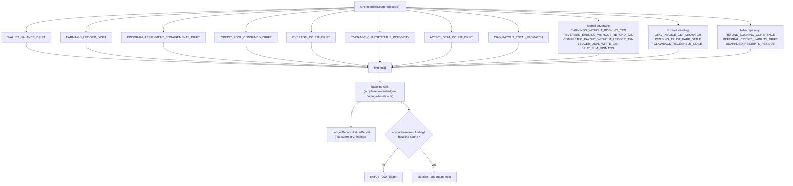
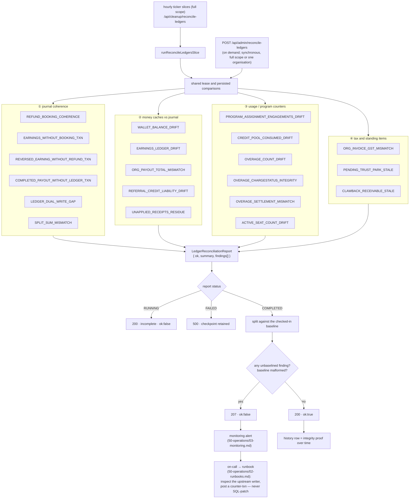

# Ledger integrity & reconciliation

**What this covers:** the auditor that proves the money model holds — the invariants it checks, the one informational coverage metric, the checked-in baseline that separates known findings from new drift, how it runs (daily audit advanced by scheduled slices plus an on-demand admin door), what a finding means, and the single protective action a wallet-cache drift triggers. The auditor is read-only: it reports drift and never repairs it. This is the safety net that lets us trust derived balances and reconciled caches.

> **Why this exists.** The journal is the source of truth, but a few numbers are **cached** for the hot path (`walletBalance`) or **denormalized** for query speed (`engagementsUsed`, `activeSeatCount`, the `Earnings` amount columns). A cache is only safe if something independently re-derives it and screams on drift. That something is `scripts/reconcile/reconcile-ledgers.ts` — it never hand-patches an audited table, writing only `LedgerReconciliationReport`. Its one protective side effect is that every door that runs a reconcile (the scheduled slices, the `CRON_SECRET` twin and the admin door) **freezes the spend of each wallet with a `WALLET_BALANCE_DRIFT` finding** through `freezeDriftedWallets()`, and the scheduled audit also pages P0 (see the design notes below); it still never SQL-patches the drifted cache itself.

---

## 1. The checks

The auditor emits the `Finding` kinds listed below via set-based PostgreSQL aggregations (`$queryRaw` / `groupBy`). Four checks run **full-scope only** (`REFUND_BOOKING_COHERENCE`, the consultant-payout journal check inside `COMPLETED_PAYOUT_WITHOUT_LEDGER_TXN`, `REFERRAL_CREDIT_LIABILITY_DRIFT` and `UNAPPLIED_RECEIPTS_RESIDUE`); the rest accept an `organizationId` filter for incident triage. Checkout also relies on the deferred payment-leg trigger rather than re-reading its just-written legs for a warn-only check. Invariants that Postgres already enforces at COMMIT are **not** re-scanned here: a balanced journal (`ledger_txn_balanced`), the payment-leg sum (`payment_legs_sum_to_amount`), INR-only rows (the `*_currency_inr` CHECKs), invoice tax totals and safe money ranges all live in `prisma/sql/*.sql`.

| Finding `kind`                         | Scope                                                                           | Asserts                                                                                                                                                                                                                         | Drift means                                                                                                                                                                                                 |
| -------------------------------------- | ------------------------------------------------------------------------------- | ------------------------------------------------------------------------------------------------------------------------------------------------------------------------------------------------------------------------------- | ----------------------------------------------------------------------------------------------------------------------------------------------------------------------------------------------------------- |
| `WALLET_BALANCE_DRIFT`                 | per `BillingAccount`                                                            | `-balance(WALLET, org) == walletBalance` (WALLET is credit-normal, so owed = Σcredit−Σdebit)                                                                                                                                    | the cache diverged from the journal — a writer skipped the journal or a manual SQL edit slipped in                                                                                                          |
| `EARNINGS_LEDGER_DRIFT`                | per payment **with** a `BOOKING` txn                                            | cached `ConsultantEarnings(platformFee+consultantShare) + OrganizationEarnings(orgShare)` == journal `PLATFORM_FEE+CONSULTANT_PAYABLE+ORG_PAYABLE` credits                                                                      | the earnings cache disagrees with the booking journal                                                                                                                                                       |
| `PROGRAM_ASSIGNMENT_ENGAGEMENTS_DRIFT` | per **active** `ProgramAssignment` (`periodEnd >= now`)                         | `sum(UsageLedgerEntry.engagementsConsumed) == engagementsUsed`                                                                                                                                                                  | a partial-rollback bug, a missing ledger write, or manual SQL desynced the denormalized counter                                                                                                             |
| `CREDIT_POOL_CONSUMED_DRIFT`           | per **active** CREDIT_POOL `ProgramAssignment`                                  | `sum(UsageLedgerEntry.priceAtBookingPaise) == consumedPaise` (refund rows post negative, so the sum nets)                                                                                                                       | the CREDIT_POOL money-meter write in `recordBookingUtilization`/`reverseBookingUtilization` desynced                                                                                                        |
| `OVERAGE_COUNT_DRIFT`                  | per **active** `ProgramAssignment`                                              | `count(OverageEvent where chargeStatus ∉ {REVERSED,BLOCKED}) == overageCount`                                                                                                                                                   | the over-cap counter bump/decrement missed; a charged-then-refunded overage awaiting a credit note is the expected benign cause                                                                             |
| `OVERAGE_CHARGESTATUS_INTEGRITY`       | per `OverageEvent` (link/state)                                                 | CHARGE_MEMBER pending/failed/charged ⇒ has a side-`Payment`; CHARGE_ORG accrued/charged ⇒ has an `InvoiceLineItem`; any `CHARGED` ⇒ `settledAt` set                                                                             | the `transitionOverage` state machine was bypassed or a write half-completed                                                                                                                                |
| `ACTIVE_SEAT_COUNT_DRIFT`              | per `BillingSubscription`                                                       | `activeSeatCount == count(in-period LICENSED_SEAT ACTIVE assignments)`                                                                                                                                                          | the per-seat invoice line-item counter missed a write (or reflects historical drift before its writer existed)                                                                                              |
| `ORG_PAYOUT_TOTAL_MISMATCH`            | per `OrganizationPayout` in `PENDING` / `APPROVED` / `PROCESSING` / `COMPLETED` | `sum(orgShare − refunded) of batched earnings == netPayoutPaise`                                                                                                                                                                | the batch claim updated earnings but the payout total diverged. Terminal-with-release statuses (`FAILED`, `REVERSED`, `CANCELLED`) are skipped because they detach their earnings back to `READY` by design |
| `REFUND_BOOKING_COHERENCE`             | per `BookingUtilization` (**full scope only**)                                  | fully-refunded payment ⇒ utilization reversed; reversed utilization ⇒ a `SUCCEEDED` refund backs it                                                                                                                             | a cap leak (money back but the seat still consumed) or a seat released for free                                                                                                                             |
| `LEDGER_DUAL_WRITE_GAP`                | per `OrganizationPayout` with `clawbackAmountPaise > 0`                         | a `clawback:*` `LedgerTransaction` exists against that payout                                                                                                                                                                   | the payout claims recovered cash the journal never saw                                                                                                                                                      |
| `ORG_INVOICE_GST_MISMATCH`             | per issued `OrganizationInvoice`, one finding per invoice                       | output tax less credit notes == net `GST_PAYABLE` behind it: the billed bookings' journals (a paisa per booking), else its `invoice-issued:` and refund journals                                                                | one side taxed something the other did not, or a subscription or manual invoice issued without its `invoice-issued:` journal                                                                                |
| `CLAWBACK_RECEIVABLE_STALE`            | one finding per run, listing every payee                                        | no clawback receivable is older than 90 days                                                                                                                                                                                    | the payee has had no payout large enough to net the clawback, so ops must recover it another way                                                                                                            |
| `EARNINGS_WITHOUT_BOOKING_TXN`         | global (payments with earnings, not filtered by organisation)                   | every payment with earnings has a `BOOKING` journal transaction; each missing transaction is identified by `paymentId`                                                                                                          | an earnings row exists whose booking journal was never posted                                                                                                                                               |
| `REVERSED_EARNING_WITHOUT_REFUND_TXN`  | per consultant earning with `refundedShareAmount > 0`                           | a `REFUND` journal transaction exists for that payment                                                                                                                                                                          | a reversal was recorded on the earning without its refund journal                                                                                                                                           |
| `COMPLETED_PAYOUT_WITHOUT_LEDGER_TXN`  | per completed `OrganizationPayout` and, full scope, `ConsultantPayout`          | a payout journal transaction exists for every completed payout                                                                                                                                                                  | a payout reached `COMPLETED` without posting its `ORG_PAYOUT` or `PAYOUT` journal                                                                                                                           |
| `SPLIT_SUM_MISMATCH`                   | per payment                                                                     | Σ(platform fee + consultant shares + organisation shares) of a payment's earnings equals `Payment.originalAmount`                                                                                                               | a split leaked or minted paise                                                                                                                                                                              |
| `OVERAGE_SETTLEMENT_MISMATCH`          | per `CHARGE_MEMBER` `OverageEvent`                                              | a `CHARGED` member overage has a `SUCCEEDED` side-payment of its `marginalPaise`, an `overage:<sidePaymentId>` journal and a `settledAt`; an uncollected one has no overage journal; a recarve reversal matches its credit note | a member overage was settled on one side only                                                                                                                                                               |
| `PENDING_TRUST_PARK_STALE`             | one finding per sponsor with earnings parked over 24 hours                      | detect-only: age never releases a park                                                                                                                                                                                          | a sponsor's earnings are parked in `PENDING_TRUST` and need an admin verify or a paid invoice                                                                                                               |
| `REFERRAL_CREDIT_LIABILITY_DRIFT`      | platform (full scope)                                                           | the `REFERRAL_CREDIT_LIABILITY` account equals the remaining value of vested credits that posted a vest journal                                                                                                                 | a referral credit was vested, redeemed or voided without its journal                                                                                                                                        |
| `UNAPPLIED_RECEIPTS_RESIDUE`           | per parked capture (full scope)                                                 | a settled refund of a parked capture leaves `UNAPPLIED_RECEIPTS` at zero                                                                                                                                                        | a refund of a parked capture did not clear the parking account                                                                                                                                              |

**Grouped by what each check protects:**

The grouping is conceptual, not a code boundary (checks advance through persisted pages); it's how to _triage_: a ① finding means a journal is missing or incoherent with its business rows (rare, high-severity — a writer that bypassed `postLedgerTxn`, since the balance of each transaction is already enforced by Postgres); ②–④ mean a _cache_ or counter drifted from a sound journal (fix the writer, re-derive the cache via a counter-transaction).

Each `Finding` is a compact row: `{ kind, organizationId?, billingAccountId?, billingSubscriptionId?, invoiceId?, paymentId?, payoutId?, programAssignmentId?, expectedPaise, actualPaise, deltaPaise, details? }`. For the count-based checks (`…ENGAGEMENTS_DRIFT`, `…SEAT_COUNT_DRIFT`, `OVERAGE_COUNT_DRIFT`) and the link/state ones the `*Paise` fields hold **counts / events**, not paise — `details.unit` records the real unit.

---

## 2. The coverage metric (informational, not a finding)

`summary.earningsPaymentsWithoutBookingTxn` counts earnings-bearing payments that have **no** `BOOKING` journal transaction yet. It is reported for visibility but does **not** fail the run, because `EARNINGS_LEDGER_DRIFT` only checks payments that _do_ have a booking txn.

Each missing journal also raises one `EARNINGS_WITHOUT_BOOKING_TXN` finding pinned to `paymentId`, with `details.unit = "transactions"` and expected/actual counts of 1/0. The summary counter is informational; these individual findings fail the completed audit unless explicitly baselined. Both reads share a read-only Repeatable Read snapshot, so a concurrent booking cannot create a mixed comparison. There is no count threshold or grace window.

---

## 3. The known-findings baseline

A finding that is already known must not keep the daily audit red forever: an auditor that is permanently red is an auditor nobody reads. The auditor therefore splits its findings against a checked-in baseline — `scripts/reconcile/ledger-findings-baseline.ts` — and only the findings the baseline does not excuse fail the run.

**The baseline never hides evidence.** Every finding still lands in the persisted `LedgerReconciliationReport.findings` array and still counts in `summary.discrepanciesCount`. The baseline decides which findings fail the run; it never mutes, repairs or deletes one.

**An entry pins one finding by fingerprint.** Missing-booking-journal entries must include `paymentId`; aggregate count entries are rejected. Known fixture identities must be verified before adding individual entries. An entry names the finding `kind`, the `deltaPaise`, the entity ids the finding carries (`organizationId`, `billingAccountId`, `paymentId`, `payoutId`, `invoiceId`, `programAssignmentId`, `billingSubscriptionId`) and, for a finding that identifies itself only through its `details` (for example `details.bookingUtilizationId`), that one detail key with its value. A finding is excused only when the kind, the delta and **every** identifier agree, so a new row, a changed amount, or a finding that grew an identifier the entry never pinned is never excused. `occurrences` says how many findings of one fingerprint the entry excuses; a fingerprint that occurs more often than that leaves the surplus failing the run.

**Every entry carries an owner, a reason and an expiry.** `owner` says who carries the cleanup, `reason` says in one line why the finding is knowingly carried, and `expires` is the ISO date after which the entry excuses nothing. An expired entry excuses nothing, so its finding fails the run again and an allowlist can never become permanent. The auditor counts expired entries in `summary.baselineExpiredCount`.

**A malformed baseline fails the run.** An entry that is missing its owner, reason or expiry, that carries an unparseable date, or that names a finding kind the auditor cannot raise is ignored as a baseline entry **and** fails the run: the problem is recorded in `summary.baselineProblems` and the report is not ok. A broken baseline can never silently green a run.

| Report field                   | Meaning                                                        |
| ------------------------------ | -------------------------------------------------------------- |
| `summary.discrepanciesCount`   | Every finding the run raised, baselined or not.                |
| `summary.baselinedCount`       | How many of them the baseline excuses.                         |
| `summary.unbaselinedCount`     | How many it does not — each one fails the run.                 |
| `summary.baselineExpiredCount` | Baseline entries whose expiry has passed.                      |
| `summary.baselineProblems`     | Why the baseline was rejected. A non-empty list fails the run. |

The gate in one line: the report is ok when `unbaselinedCount` is zero **and** `baselineProblems` is empty.

---

## 4. How it runs

- **Library:** `runReconcileLedgers({ scope, organizationId?, triggeredById? })` → `ReconcileReport`. Scope is `"full"` or `"org:<id>"`; passing `organizationId` limits every per-row check to one org and **skips the four full-scope-only checks** listed in §1.
- **Scheduled slices:** the ticker offers an hourly `:55` slice, yielding that slot to gateway settlement and statutory jobs when dispatch is already at its target cap. `runReconcileLedgersSlice({ scope: "full", onWalletDrift })` creates or resumes one full-scope report. Pages contain at most 100 primary entities; their related journal history remains complete. Each non-wallet comparison uses its transaction client throughout a read-only Repeatable Read snapshot, with a 6-second SQL statement timeout, 8-second transaction timeout and 1-second connection wait. Wallet comparisons use the same bounds in their own snapshot. A slice stops starting pages after six seconds. This is a sequence of coherent comparisons at different times, **not one global snapshot of the entire audit**.
- **Durable progress:** `summary.nextStep`, optional `cursor`, `calls`, `executing`, `interruptions`, counts and findings persist on the existing report. A completed page advances its keyset cursor; crashes retry the unfinished page. Caught failures mark the report `FAILED`; hard interruptions leave `executing:true`, and the next invocation counts the interruption before resuming. Unfinished audits continue across dates until every comparison finishes. Completed audits are reused for the remaining UTC day; the next day's slice starts a new audit. No age cutoff discards an unfinished historical tail. A comparison that exceeds its SQL/transaction bounds remains visibly failed at its checkpoint rather than being skipped.
- **Protective action and result:** drifted wallets freeze immediately after their wallet page, before later comparisons. Freeze failure prevents that page from advancing; replay uses the existing idempotent freeze function. Scheduled slices aggregate wallet evidence before emitting a fatal alert, including when freezing fails. The persisted standing-finding key contains the logical report id, so pages, retries and later slices of that report share one seven-day alert window; the report retains every later finding. Partial reports stay `ok:false`, return HTTP 200 with `status: "RUNNING"`, and never claim full-scope completion or send the completed-audit drift response. Final reports return 200 (clean) or 207 (unbaselined findings). Exceptions return 500. The auditor never repairs a cache or journal.
- **On-demand door:** `POST /api/admin/reconcile-ledgers` remains the authenticated, step-up-protected money door. Its `runReconcileLedgers()` API resumes an existing report under the same fail-closed `reconcile-ledgers` lease and continues to completion. Full and sliced callers cannot overlap. The CRON_SECRET HTTP twin advances one bounded slice; repeat it until `report.summary.status` is `COMPLETED`.
- **Report storage:** every run writes a `LedgerReconciliationReport { scope, ok, durationMs, summary, findings, triggeredById }`. The history is the audit trail of integrity over time; the `summary` carries the count of findings, how many the baseline excused and why the baseline was rejected (§3).

---

## 5. When a finding fires

A finding is an **incident signal, never a thing to hand-patch.** The drift is a symptom; the fix is upstream (the writer that diverged), and the correction — if money is involved — is a **counter-transaction**, not a SQL `UPDATE` on a balance. See [runbooks](../50-operations/02-runbooks.md) for the per-finding triage procedure (which writer to inspect, how to post a correcting entry, when to page).

---

## 6. Design decisions & trade-offs

- **Never hand-patches a cache — but fails closed on wallet drift.** The auditor writes _only_ `LedgerReconciliationReport` and never touches an audited table. When any reconcile door (the scheduled audit, `POST /api/cleanup/reconcile-ledgers` or `POST /api/admin/reconcile-ledgers`) sees a `WALLET_BALANCE_DRIFT` finding, which means a wallet's cached balance no longer matches its journal, `freezeDriftedWallets()` freezes spend for that `BillingAccount`; the scheduled audit also pages P0. The freeze rides the append-only `SystemEvent` log (a `WALLET_FREEZE` / `WALLET_UNFREEZE` pair keyed on `correlationId`), fails closed so an unreadable log blocks the spend rather than leaking it, and gates only discretionary checkout spend — never a top-up credit. An admin lifts it with `POST /api/admin/billing-accounts/[billingAccountId]/unfreeze` once the drift is reconciled. The door re-reads that one wallet's drift first and refuses with 409 `WALLET_STILL_DRIFTED` while the cache and the journal still disagree.
- **Counts and events reuse the `*Paise` fields.** Rather than a separate schema per check kind, count-based findings (`…ENGAGEMENTS_DRIFT`, `…SEAT_COUNT_DRIFT`, `OVERAGE_COUNT_DRIFT`) and link/state findings stuff counts into `expectedPaise`/`actualPaise`/`deltaPaise` and record the real unit in `details.unit`.
- **A checked-in baseline of known findings (`scripts/reconcile/ledger-findings-baseline.ts`).** The daily signal has to mean "new drift", not "the same seeded row again", or ops learns to ignore a red reconciler. The baseline records what is already known without hiding it: every finding still reaches the report, and only the findings the baseline does not excuse fail the run. Its three rules — fingerprint, expiry, fail-closed on a malformed entry — are in §3.

### Related docs

- [Money model overview](01-money-model-overview.md) §4 — the reconciled-cache contract.
- [Ledger & postings](03-ledger-and-postings.md) — the postings these checks re-sum.
- [Payment legs](09-payment-legs.md) — the leg-sum invariant, enforced by the `payment_legs_sum_to_amount` trigger.
- [Runbooks](../50-operations/02-runbooks.md) — per-finding incident response.
- [Monitoring](../50-operations/03-monitoring.md) — alerting on report `ok:false`.
- Ground truth: `scripts/reconcile/reconcile-ledgers.ts`, `scripts/reconcile/ledger-findings-baseline.ts`, `LedgerReconciliationReport` in `prisma/schema.prisma`.

---

## Deprecated & Superseded Approaches

1. **Unbounded single-request full audits:** all comparisons previously ran inside one HTTP request with no persisted progress. A timeout left a RUNNING report and the next daily request restarted the historical tail. Current bounded entity pages preserve completed work while continuing to use set-based aggregation inside each comparison.
2. **Row-by-row cursor drivers and a Netlify background function:** the older implementation serialized individual entity reads and repeatedly called a runId-specific HTTP endpoint. Current pages aggregate related rows together and use the ordinary scheduled HTTP twin, with no vendor background-function driver or loop of remote calls.
3. **Aggregate missing-journal baseline:** one entry excused a count of seven missing journals without identifying the payments. One repaired fixture and one newly broken payment could leave that count unchanged. Current findings pin paymentId, and baseline validation rejects entries without that identity; the old count entry was removed rather than assigning unverified identities.
4. **Re-verifying Postgres guarantees:** journal balance, funding-leg sum, invoice totals and INR constraints are enforced by the SQL sidecars. The auditor does not sweep these invariants, and checkout no longer re-reads freshly written legs for a warn-only comparison. Pure leg-calculation helpers remain available for construction and tests.
