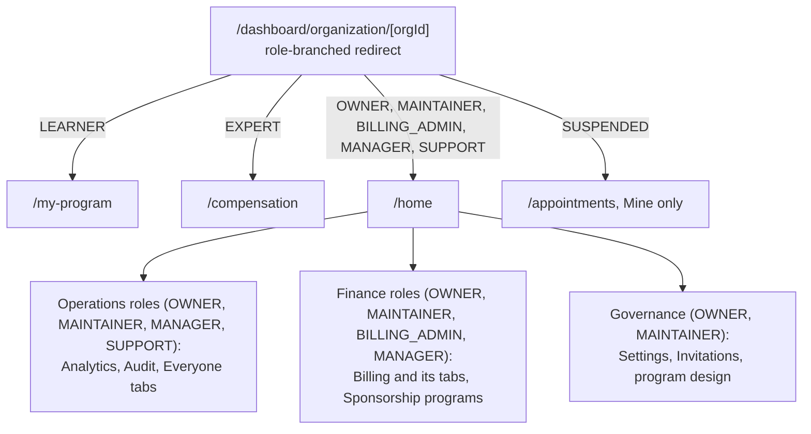

# Dashboard pages

Every organization-scoped dashboard page lives under
`app/dashboard/organization/[orgId]/**`. Roles are granted through the
permission matrix in `lib/auth/org-permissions.ts`; the sidebar
(`lib/dashboard/nav/organization.ts`), the page guards and the API routes all
read the same keys. The sidebar is cosmetic. The API route is the enforcer,
and the page guard keeps the URL honest.

Two page-guard styles coexist. A server guard protects the page's own server
reads, and the API routes protect API requests; neither relies on the other.
Pages that read through server data helpers (for example `my-program`, which
calls `getMyProgramData` and `getOrgMemberCatalog` after its guard) are
enforced by the page guard alone. The client-guarded pages below are safe
because the API behind each checks the same key:

- **Server guard** (`requireOrgAccess` in the page): `members`, `billing`,
  `analytics`, `catalog`, `collaborations`, `library`, `messages`, `requests`,
  `appointments`, `compensation`, `my-program`, `support/*`, `settings`.
- **Client guard** (`useRequireOrgAccess` redirecting to `/home`): `programs`,
  `contracts`, `payouts`, `audit`, `consent`. The page shell renders for a beat
  before the redirect, but the data routes refuse the role regardless.

## Page tree

The active route set under `app/dashboard/organization/[orgId]/` (see
[ADR 19](../70-design-decisions/19-personal-vs-org-dashboard-split.md)). The
sidebar groups are Overview, My work, Messages, Library, People, Sponsor, Host,
Insights and Help & support; Settings opens from the header avatar menu.

```
/dashboard/organization                        -> server-redirect: OrgWorkspace -> /dashboard/org-workspace/<id>/home,
                                                  everyone else -> /dashboard
/dashboard/organization/create                 -> org-creation wizard
/dashboard/organization/[orgId]                -> role-aware redirect:
                                                  SUSPENDED -> /appointments;
                                                  LEARNER -> /my-program (canSponsor) else /appointments;
                                                  EXPERT -> /compensation (canHost) else /appointments;
                                                  OWNER, MAINTAINER, BILLING_ADMIN, MANAGER, SUPPORT -> /home;
                                                  no membership -> the personal dashboard
/home                    Overview. Operators: action center + checklist + stats. BILLING_ADMIN:
                         finance overview. SUPPORT: member-support queue counts. LEARNER and
                         EXPERT: a card pointing at My Program or Compensation.
/my-program              LEARNER's allocation: assignments, cycle usage, coverage rules, upcoming
                         sessions, utilization history. A host-only org shows an empty state.
/compensation            The viewer's split and earnings under the org (anyone with a consultant
                         profile). A sponsor-only org shows an empty state.
/appointments            Tabs Mine | Everyone | Unscheduled; /appointments/[id] is the detail
                         page, with /documents and /recordings beneath it.
/requests                Booking requests for members who deliver (a consultant profile on a host org).
/messages                Stream chat for this org's conversations only.
/collaborations          Collaborators on this org's hosted webinar and class plans.
/library                 Session documents | Session recordings, each Mine | Everyone.
/members                 Tabs Members (roster, or the names-only directory) | Invitations.
/programs                Sponsorship programs: seats, assignments, amendments.
/contracts               Contracts and the programs attached to them.
/billing                 Tabs Invoices & usage | Wallet & licence | Purchase orders |
                         Payment disputes | Member spend.
/catalog                 Org-owned webinar and class plans; /catalog/[type]/new creates one.
/payouts                 Tabs Runs & earnings | Payout account | Rate cards & routing.
/analytics               Rollups, session-quality aggregate, Utilization CSV.
/audit                   Per-org OrgAuditLog with category filters.
/consent                 ConsentArtifact roster; records withdrawal requests.
/support                 Help & support: Support cases | Evidence requests | Member support
                         activity (/support/activity); detail at /support/requests/[caseKey]
                         and /support/evidence/[requestId].
/settings/[section]      general | branding | sso | billing | webhooks | data-exports.
```

### Surfaces that are tabs, not routes

Several former sidebar entries were a filter or a single table, so they became
tabs on the page that owns the object. The standalone `purchase-orders`,
`reimbursements` and `disputes` routes are deleted and answer 404; their
content is now Billing tabs.

| Page            | Tabs / sections                                                                                                                                                                                           | Notes                                                                                                                               |
| --------------- | --------------------------------------------------------------------------------------------------------------------------------------------------------------------------------------------------------- | ----------------------------------------------------------------------------------------------------------------------------------- |
| `/members`      | `members` (roster), `invitations`                                                                                                                                                                         | Learners and Experts are role chips on the roster, not tabs. Invitations needs `invitations.manage`.                                |
| `/billing`      | `invoices` (Invoices & usage), `wallet` (WALLET or LICENSE funding), `purchase-orders` (`purchaseOrders.read`), `disputes` (`disputes.read`), `member-spend` (PERSONAL funding and `reimbursements.read`) | The Purchase orders tab opens by permission, not by `requiresPO`: `requiresPO` only makes a PO mandatory on contracts and invoices. |
| `/payouts`      | `runs` (Runs & earnings), `payout-account`, `rate-cards` (Rate cards & routing)                                                                                                                           | A BILLING_ADMIN repoints an expert's payout recipient from the routing section.                                                     |
| `/support`      | Support cases, Evidence requests, Member support activity                                                                                                                                                 | Layout-level links, not `?tab=`. Activity needs `operations.read`.                                                                  |
| `/settings`     | one URL per section                                                                                                                                                                                       | Rendered by `SettingsLayout`; each section carries its own gate (see the matrix).                                                   |
| `/library`      | Session documents, Session recordings; each with Mine and Everyone                                                                                                                                        | See "Library: Mine and Everyone".                                                                                                   |
| `/appointments` | Mine, Everyone, Unscheduled                                                                                                                                                                               | See "Appointments scopes".                                                                                                          |

### Appointments scopes

| Scope            | Query              | Data source                | Who sees it                                                               |
| ---------------- | ------------------ | -------------------------- | ------------------------------------------------------------------------- |
| `mine` (default) | `?scope=mine`      | `getOrgMemberAppointments` | any ACTIVE or SUSPENDED member, so a pure LEARNER sees their own sessions |
| `everyone`       | `?scope=everyone`  | `getOrgAppointments`       | ACTIVE with `operations.read`                                             |
| `unscheduled`    | `?tab=unscheduled` | org pending-requests read  | ACTIVE with `appointments.unscheduled.read` (OWNER, MAINTAINER, MANAGER)  |

A viewer without the grant never sees the toggle, and a hand-edited URL falls
back to Mine rather than erroring. The Mine scope mounts a video-only
`StreamProvider` so Join works without opening a chat socket. The Everyone
scope of a sponsoring organization also lists the webinar and class seats its
own members hold on its money in sessions hosted elsewhere: each row shows the
member, the session title, the date and attendance, and nothing about other
attendees or the host.

A row opens `/appointments/[id]`, which resolves three views in order: the
attendee's full detail, the deliverer's detail, then the operator view of
metadata only (`operations.read`). The funding org's payer-side actors can also
cancel or ask to reschedule a 1:1 booking from it. Every refusal is
`notFound()`, so the page never confirms that an appointment exists.

### Payout routing, approval and compensation

Three pages and tabs here each read a matrix key. Org › Payouts carries an "Experts' payout routing" section, where
a holder of `payouts.read` sees each EXPERT member's name and current payout
recipient, and a holder of `members.payoutRecipient.change` (OWNER or BILLING_ADMIN)
changes it through a confirm dialog backed by
`/api/organizations/[orgId]/expert-payout-routing`; this is where a
BILLING_ADMIN, who cannot open the member list, decides where experts are
paid. Org › Payouts › Runs labels a PENDING batch "Awaiting approval", offers
an "Awaiting approval (n)" filter, and shows Approve to holders of
`payouts.approve`, because an org batch is paid only after approval. An
EXPERT's `/compensation` page shows only the split that applies to that
expert, resolved as their membership override, else the org default, else the
platform default, and the offering editor's Materials tab shows the expert a
"Changed by <Org>" line for every file the organization changed on an
org-owned plan.

There is no `/credits` route; the wallet view is a tab inside `/billing`. There
is no org `/plans` page either: discovery reads each per-type plan's visibility
(see [public pages & discovery](05-public-pages-and-discovery.md)).

A few additional surfaces are not in the org-scoped tree:

- `/organizations/invite/[token]` — invite-accept landing
  (`app/organizations/invite/[token]/page.tsx`).
- `/dashboard/org-workspace/[orgWorkspaceId]/**` — **the cross-org portfolio**,
  titled "All organizations" in the UI. Keyed on `OrgWorkspaceProfile.id`. Has
  its own sidebar (mirrors `/dashboard/admin` and `/dashboard/staff`) with four
  pages. Its labels were deliberately renamed away from `Billing` and
  `Settings`: both collided head-on with the per-org dashboard's entries of the
  same name, and an operator moving between the two layers had no way to tell
  which one they were looking at.
  - `/home` — "Overview". Cross-org stats row + grid of orgs you OWN (showing live `walletBalance`, low-wallet warning, dunning suspension, or pending verification badges) + "+ New organization" CTA. Organisations that are not active sit in the same collapsed "Not active" group as on Spend.
  - `/activity` — cross-org audit feed aggregating `OrgAuditLog` rows
    across all owned orgs with `<FilterBar>` organization and category filters (including `WEBHOOK`). Cursor-paginated. Distinct from per-org
    `/audit` which scopes to one org and supports rich filters.
  - `/billing` — labelled **"Spend"**. Cross-org outstanding invoices +
    wallet balance roll-up using `StatRow`/`Stat`. Distinct from per-org `/billing`, which mutates
    one org's wallet and invoices. Read-only. The headline totals and the
    Overview stats count ACTIVE organisations only; a deactivated, suspended
    or unverified organisation is listed with its status in a collapsed
    "Not active" group below the table and adds nothing to the totals.
  - `/settings` — renders through `SettingsLayout` (`WORKSPACE_SETTINGS_SECTIONS` in `lib/dashboard/nav/workspace.ts`):
    - `/settings/account` — personal Account details, Sign-in & security, Privacy & data, and Consent (`<AccountSettings />`), reached from the avatar menu's "Account settings" entry.
    - `/settings/landing`, `/settings/notifications`, `/settings/account` — the default landing org (persisted via `PATCH /api/org-workspace/[orgWorkspaceId]/settings`), the operator's personal notification panel (`PUT /api/novu/preferences`) and account security, reached from the avatar menu's "All organizations settings" entry.
  - The bare `/dashboard/org-workspace/[orgWorkspaceId]` URL redirects to
    `/home`.
  - `/create` — same `<CreateOrganizationWizard />` as
    `/dashboard/organization/create`, but inside this dashboard's
    chrome (operators creating their 2nd, 3rd, … org never leave the
    chrome). Both entry points redirect to
    `/dashboard/organization/<newOrgId>/home` on success.
- `/dashboard/admin/**` — the platform admin surface that can verify,
  suspend, or deactivate any org. Lives outside this doc set.

The bare `/dashboard/organization` URL is a server-redirect:
OrgWorkspace → `/dashboard/org-workspace/<id>/home`; everyone else → `/dashboard`.
Members move between orgs through the `ContextSwitcher`, anchored at the top of
every dashboard sidebar and repeated in the mobile Menu sheet.

## Role-visibility nav-map

The same `[orgId]` URL lands different people on different surfaces.
`[orgId]/page.tsx` does the role-branched redirect; from there the sidebar shows
only what that role's gate lets through. Capability gates apply on top: a
`canHost=false` org hides Catalog, Collaborations and Payouts even from an
OWNER, and a `canSponsor=false` org hides Sponsorship programs, Contracts,
Billing and My Program.



Access is not a cumulative rank floor. Every surface is a key in the matrix
that lists exactly the roles it admits, so the "Roles" column below names the
keys and the roles each one holds.

## Route × Role matrix

Derived from `lib/auth/org-permissions.ts` (the keys), `lib/dashboard/nav/organization.ts`
(the sidebar) and each page's guard. `✓` means the role holds the page's
gate. `p` means the role passes only with a consultant profile on the
membership (an OWNER can deliver too). `—` means the gate refuses the role: a
server-guarded page answers a neutral "You don't have access to this page", a
client-guarded one redirects to `/home`. Every member can reach `/home`,
`/appointments` (Mine), `/messages`, `/library` (Mine) and `/support`; a
SUSPENDED member keeps only Overview, Appointments (Mine) and Library (Mine).
"(nav only)" in the Needs column means the capability gates the sidebar item,
while the page itself renders an empty state when the capability is absent.

| Route                                  | Needs                   | Gate (matrix key)                                                        | OWNER | MAINT. | BILLING | MANAGER | SUPPORT | EXPERT | LEARNER |
| -------------------------------------- | ----------------------- | ------------------------------------------------------------------------ | :---: | :----: | :-----: | :-----: | :-----: | :----: | :-----: |
| `/home`                                | —                       | any active member                                                        |   ✓   |   ✓    |    ✓    |    ✓    |    ✓    |   ✓    |    ✓    |
| `/my-program`                          | `canSponsor` (nav only) | `myProgram.read`                                                         |   —   |   —    |    —    |    —    |    —    |   —    |    ✓    |
| `/compensation`                        | `canHost` (nav only)    | consultant profile or EXPERT (`deliversForOrg`)                          |   p   |   p    |    p    |    p    |    p    |   ✓    |    p    |
| `/appointments` Mine                   | —                       | active or suspended member                                               |   ✓   |   ✓    |    ✓    |    ✓    |    ✓    |   ✓    |    ✓    |
| `/appointments` Everyone               | —                       | `operations.read`                                                        |   ✓   |   ✓    |    —    |    ✓    |    ✓    |   —    |    —    |
| `/appointments` Unscheduled            | —                       | `appointments.unscheduled.read`                                          |   ✓   |   ✓    |    —    |    ✓    |    —    |   —    |    —    |
| `/appointments/[id]`                   | —                       | on the booking, or `operations.read`                                     |   ✓   |   ✓    |    —    |    ✓    |    ✓    | on it  |  on it  |
| `/requests`                            | `canHost`               | consultant profile (others are redirected)                               |   p   |   p    |    p    |    p    |    p    |   p    |    p    |
| `/messages`                            | —                       | active member                                                            |   ✓   |   ✓    |    ✓    |    ✓    |    ✓    |   ✓    |    ✓    |
| `/library` Mine                        | —                       | active or suspended member                                               |   ✓   |   ✓    |    ✓    |    ✓    |    ✓    |   ✓    |    ✓    |
| `/library` Everyone                    | —                       | `operations.read`, ACTIVE                                                |   ✓   |   ✓    |    —    |    ✓    |    ✓    |   —    |    —    |
| `/members` directory                   | —                       | `members.directory`                                                      |   ✓   |   ✓    |    ✓    |    ✓    |    ✓    |   ✓    |    ✓    |
| `/members` roster                      | —                       | `members.read`                                                           |   ✓   |   ✓    |    —    |    ✓    |    ✓    |   —    |    —    |
| `/members` Invitations                 | —                       | `invitations.manage`                                                     |   ✓   |   ✓    |    —    |    —    |    —    |   —    |    —    |
| `/programs`                            | `canSponsor`            | `programs.read`; manage `programs.manage`                                |   ✓   |   ✓    |  read   |  read   |    —    |   —    |    —    |
| `/contracts`                           | `canSponsor`            | `contracts.read`; manage `contracts.manage`                              |   ✓   |  read  |  read   |    —    |    —    |   —    |    —    |
| `/billing`                             | `canSponsor`            | `billing.read`; manage `billing.manage`                                  |   ✓   |  read  |    ✓    |  read   |    —    |   —    |    —    |
| `/catalog`, `/catalog/[type]/new`      | `canHost`               | `catalog.manage`                                                         |   ✓   |   ✓    |    —    |    ✓    |    —    |   —    |    —    |
| `/collaborations`                      | `canHost`               | `catalog.manage` sees every hosted plan; `deliversForOrg` sees their own |  all  |  all   |    —    |   all   |    —    |  own   | own (p) |
| `/payouts`                             | `canHost`               | `payouts.read`; manage and approve `payouts.manage` / `payouts.approve`  |   ✓   |  read  |    ✓    |    —    |    —    |   —    |    —    |
| `/analytics`                           | —                       | `operations.read`; money tiles `billing.read`                            |   ✓   |   ✓    |    —    |    ✓    |    ✓    |   —    |    —    |
| `/audit`                               | —                       | `audit.read`; CSV `dataExports.people`                                   |   ✓   |   ✓    |    ✓    |    ✓    |    ✓    |   —    |    —    |
| `/consent`                             | —                       | `consent.read`, `consent.requestWithdrawal`                              |   ✓   |   ✓    |    —    |    ✓    |    —    |   —    |    —    |
| `/support` Support cases               | —                       | `supportRequests.org` (others get an empty state)                        |   ✓   |   ✓    |    ✓    |    ✓    |    ✓    |   —    |    —    |
| `/support` Evidence requests           | —                       | any active member                                                        |   ✓   |   ✓    |    ✓    |    ✓    |    ✓    |   ✓    |    ✓    |
| `/support/activity`                    | —                       | `operations.read`                                                        |   ✓   |   ✓    |    —    |    ✓    |    ✓    |   —    |    —    |
| `/settings/general`, `/branding`       | —                       | `settings.manage`                                                        |   ✓   |   ✓    |    —    |    —    |    —    |   —    |    —    |
| `/settings/sso`                        | —                       | `identity.read`; writes `identity.manage`                                |   ✓   |  read  |    —    |    —    |    —    |   —    |    —    |
| `/settings/billing` (Billing contacts) | —                       | `billing.manage`                                                         |   ✓   |   —    |    ✓    |    —    |    —    |   —    |    —    |
| `/settings/webhooks`                   | —                       | `integrations.manage`                                                    |   ✓   |   —    |    ✓    |    —    |    —    |   —    |    —    |
| `/settings/data-exports`               | —                       | `dataExports.people` or `dataExports.finance`                            |   ✓   |   ✓    |    ✓    |    —    |    —    |   —    |    —    |

Points the table compresses:

- **Billing tabs.** Invoices & usage opens with `billing.read`. Purchase orders
  opens with `purchaseOrders.read` and Payment disputes with `disputes.read`,
  both the same four finance readers. Member spend also needs PERSONAL funding.
  Mutations are `billing.manage` and `purchaseOrders.manage` (OWNER,
  BILLING_ADMIN). A reader without `billing.manage` (MAINTAINER, MANAGER) sees
  one line naming the role that can pay or request an invoice
  (`rolesHoldingLabel` in `lib/labels/org-labels.ts`, read from the permission
  matrix) and pointing at Ask us. Draft invoices are listed, exported and
  opened only by a role with `billing.manage`; for anyone else the server
  leaves them out and answers 404 by id (`visibleInvoiceWhere` in
  `lib/enterprise/invoice-visibility.ts`), and a usage row billed on a draft
  reads "On an invoice not yet issued". A void or cancelled invoice shows no
  due date, nor does a draft (`shownDueDate`). The Purchase orders tab tells the same readers
  which role can add, edit or cancel a PO, and its Linked column counts in
  words ("1 contract · 3 invoices"), drafts counted only for a role with
  `billing.manage`.
- **Billing figures.** "Pending charges · N bookings not yet invoiced" counts
  SUCCEEDED payments with no `billableToOrgInvoiceId`. A Usage charges row
  reads the same field: a booking charge names the invoice its payment was
  billed on ("WIPRO-2026-0004 · Void"), and says "Not yet invoiced" only under
  that predicate (`lib/data/org-receivables.ts`). "Outstanding" counts issued
  and overdue invoices; "Unpaid balance" is the `ORG_RECEIVABLE` ledger
  balance, every charge not yet paid whether invoiced or not.
- **Payouts.** Three tabs. A BILLING_ADMIN cannot read the member list, so the
  Expert routing section on the Rate cards & routing tab is where it decides
  where experts are paid.
- **Compensation and Requests are not role pages.** They follow the member's
  own consultant profile, which is why the sidebar offers Compensation only to
  the EXPERT role while the page also admits an OWNER who delivers.
  Compensation and My Program render an empty state, not a 404, when the org
  lacks the capability.
- **Consent.** OWNER, MAINTAINER and MANAGER read the roster. Granting and
  withdrawing are the member's own acts; the operator's button only records a
  withdrawal request the member then sees in Account settings.
- **Audit.** The categories a role may filter by follow `audit.read.ops` and
  `audit.read.money`; the CSV export needs `dataExports.people`.
- **Support cases.** OWNER, MAINTAINER, BILLING_ADMIN, MANAGER and SUPPORT read
  and raise org-owned cases; the other roles see a pointer to their own
  appointment instead.

### Capability kinds

An org's capability decides which structural gate a route needs, on top of the
role. `deriveCapabilityKind` in `lib/labels/org-labels.ts` names the four
shapes:

| Kind      | `canSponsor` | `canHost` | Routes it unlocks                                                            |
| --------- | :----------: | :-------: | ---------------------------------------------------------------------------- |
| `SPONSOR` |      ✓       |     —     | My Program, Sponsorship programs, Contracts, Billing                         |
| `HOST`    |      —       |     ✓     | Compensation, Requests, Catalog, Collaborations, Payouts                     |
| `HYBRID`  |      ✓       |     ✓     | both sets                                                                    |
| `INERT`   |      —       |     —     | none; creation refuses it, so an existing INERT org is a configuration error |

### Library: Mine and Everyone

The Library (`lib/library/library-query.ts`, `lib/data/document-library.ts`,
`lib/data/recording-library.ts`) is one component with two scopes per artifact.

| Rule                                     | Mine                                                                           | Everyone                                                                                                                                                                    |
| ---------------------------------------- | ------------------------------------------------------------------------------ | --------------------------------------------------------------------------------------------------------------------------------------------------------------------------- |
| Who                                      | any ACTIVE or SUSPENDED member                                                 | ACTIVE with `operations.read`; the route re-checks `libraryScopeFor`                                                                                                        |
| Which bookings                           | the viewer's own bookings (as buyer, attendee or deliverer) tagged to this org | `orgOwnedAppointmentWhere(orgId)`: tagged to the org and unpaid or paid from an org rail (WALLET, INVOICE, LICENSE), or delivered on a plan the org hosts whoever bought it |
| A personally paid, org-tagged booking    | listed (it is the viewer's own)                                                | not listed: the tag alone is not ownership                                                                                                                                  |
| An org-hosted plan bought by a B2C buyer | listed only if the viewer is a party                                           | listed, because the org hosts it                                                                                                                                            |
| What a row carries                       | files, plan materials, recordings                                              | counts only: document threads open and done, recordings count and minutes; never a file name, URL or title of a file                                                        |
| Filters                                  | search `q`, person, source, status, kind, dates                                | kind, dates and status only; `q`, person and source are ignored server-side so a match cannot confirm a file name or a participant                                          |
| Row link                                 | the session's documents or recordings page                                     | the operator-metadata session detail at `/appointments/[id]`                                                                                                                |

Documents list consultations, subscriptions and trials; webinar and class
bookings appear only in recordings.

### Open policy question

`members.directory` is held by every role, so any member, a LEARNER included,
can list every active member's name, avatar and role. Whether a LEARNER should
see the other learners (and which fields) is undecided; the matrix pins the
current grant, and narrowing it means a new key rather than a rank change.

## `/home` — the state-aware activation center

`/home` is not a static dashboard; it renders the org's **real next actions**
from one derived model. `home/page.tsx` is a thin server shell that renders
`HomePageClient`, which fetches `GET …/analytics` (+ `…/activity`), maps the
payload → an `OrgActivationSnapshot`, and runs two **pure** derivations from
`lib/enterprise/org-activation.ts`:

- **`deriveActionCenter(snapshot, orgId)`** → severity-ordered banners
  (`critical` / `warning` / `info`) for conditions that need action _now_:
  overdue invoices, credit-pool cap ≥ 80%,
  contract expiring within 30 days, pending overages, **stuck payouts**, low
  wallet (balance strictly below the organisation's own floor,
  `BillingAccount.minBalancePaise`; no floor means no banner, the same test as
  the `wallet-low-balance` job). Only conditions whose backing
  data exists today render. Pending verification and suspension are not
  repeated here: the dashboard shell's status banner owns them on every page.
- **`deriveActivationChecklist(snapshot, orgId)`** → the Getting-Started steps,
  capability-aware: a SPONSOR runs verify → KYB(INVOICE) → billing → contract →
  program → invite → assign; a HOST-only org collapses to verify → invite. The
  checklist auto-hides once every applicable step is done.

Branching: the roles holding `activity.read` (OWNER, MAINTAINER, MANAGER) get
the operator stat grid, checklist and activity feed; BILLING_ADMIN gets the
finance overview (`FinanceLeadViewCard`); SUPPORT gets the member-support queue
counts, each linking to Help & support › Member support activity with the
matching status filter; LEARNER and EXPERT get a card pointing at My Program or
Compensation. The header reads "Overview" for every role.

> **Honest "pending platform enablement" payout copy.** While
> `ENABLE_LIVE_PAYOUTS=false`, the server counts `PROCESSING` payouts and the
> action center renders _"N payouts pending platform enablement — payout
> disbursement isn't live yet; these are held, not failed."_ The flag is read
> **server-side** (in `resolveActivationSignals`); when it's on, the stuck-payout
> count is forced to 0 so the banner disappears. The copy never calls a held
> payout a failure (see [feature flags](06-feature-flags-and-rollout.md)).

The derivations are pure (unit-testable without a DB); the few extra reads the
analytics payload doesn't carry (`hasContract`, expiring-soon count, KYB,
pending-overage sum, stuck-payout count, cap-near %) are done by
`resolveActivationSignals(orgId)`, which the analytics route merges in.

## Program / contract safe-field edit UI (config-lock)

The program and contract edit surfaces are **lock-aware** so an operator can't
even attempt a money-field edit that the server would 409. Both GET routes
return a derived `locked` boolean alongside the row (no second round-trip):

- **Programs** (`programs/page.tsx`): the edit dialog reads `program.locked`
  (`?? true` — fail-safe: lock until known). When locked it disables every money
  input, shows a `LockedHint` ("money config is locked — only the name can be
  changed"), and sends `name` alone. The server re-checks via
  `getProgramLockState` and 409s `PROGRAM_CONFIG_LOCKED` on any money field that
  slips through. Locking is triggered by the first assignment
  (`Program.configLockedAt`) — see [programs](02-programs.md).
- **Contracts** (`contracts/page.tsx`): the term-edit drawer disables the locked
  term fields (`effectiveFrom`, `effectiveTo`, `paymentTermsDays`) when the
  contract is in use; `autoRenew` stays editable (forward-looking). The server
  enforces `CONTRACT_TERMS_LOCKED` — see [contract lifecycle](07-contract-lifecycle.md).

The UI is convenience; the server is authoritative in both cases.

## DPDP data-export & consent surfaces

Two compliance surfaces sit under the org dashboard:

- **`/settings/data-exports`** — DPDP §11 right-to-access. OWNER and
  MAINTAINER request, list and download the people bundle through
  `dataExports.people`, and OWNER and BILLING_ADMIN do the same for the
  finance bundle through `dataExports.finance`; each requests a bundle (rate-limited 1/24h via `orgDataExportLimiter`);
  a worker picks up the `OrgDataExportJob` within ~10 min, uploads to Supabase
  Storage, and the page exposes a 7-day signed-URL download. The page polls every
  15s while `PENDING`/`PROCESSING` and stops on terminal states
  (`READY`/`FAILED`/`EXPIRED`). (Model is `OrgDataExportJob` — not `OrgDataExport`.)
- **`/consent`** — DPDP consent-artifact roster, read-only. Lists active and
  withdrawn `ConsentArtifact`s. Granting and withdrawing are the member's own
  acts (DPDP §6(4)): an operator records a withdrawal request, which the member
  sees in Account settings next to their own Withdraw control, and nothing is
  withdrawn until they act. Gated by `consent.read` and
  `consent.requestWithdrawal` (OWNER, MAINTAINER, MANAGER) through
  `useRequireOrgAccess`.

## Navigation source of truth

The sidebar is built by `buildOrganizationNav` in
`lib/dashboard/nav/organization.ts` (mounted by `OrgDashboardShell` in
`app/dashboard/organization/[orgId]/OrgDashboardShell.tsx`) from the org's
`canSponsor` / `canHost` flags, the member's consultant profile and their
`MemberRole` checked against the permission matrix, which reads the same
`lib/auth/org-permissions.ts` keys as the API routes. The same file owns
`ORGANIZATION_PAGE_LABELS`, so the sidebar label, the page header and the
breadcrumb for a route share one name: Overview, Booking requests,
Collaborations, Sponsorship programs, Audit, Consent, Help & support, and
"Billing contacts" for the `settings/billing` section. The sidebar is
cosmetic — it does not enforce authorization. Every page and API route
calls `requireOrgAccess` / `useRequireOrgAccess` independently. Items
that would 404/403/501 are hidden to keep the nav tidy.

## Personal dashboard routing & ContextSwitcher

Users switch between their personal dashboards (Expert / Learner),
every organization they belong to, their `OrgWorkspace` portfolio, and
backoffice consoles through `ContextSwitcher`
(`components/dashboard/ContextSwitcher.tsx`) at the top of the shared
`DashboardShell` sidebar. When a route needs a fallback redirect target
for a user without an active/suspended membership (such as
`/dashboard/organization/[orgId]/page.tsx` or the invitations dialog),
it resolves the destination through `resolvePersonalDashboardHref` in
`lib/labels/personal-dashboard.ts` (`orgWorkspaceProfile →
consultantProfile → consulteeProfile`). Do not inline a ternary.

## Invitations dialog polish

`/dashboard/organization/[orgId]/members?tab=invitations` disables the "Send
invite" button with a tooltip when the org's status is
`PENDING_VERIFICATION`. Any `ORG_NOT_VERIFIED` error returned from
the POST is run through `humanizeOrgError` (`lib/labels/org-errors.ts`)
before it reaches the toast, so users see the friendly sentence
instead of the raw error code.

## Wizard

`/dashboard/organization/create` uses the self-service narrowers from
`lib/labels/org-labels.ts`:

- `SelfServiceFundingSourceSchema` limits the dropdown to `PERSONAL |
WALLET | LICENSE`; INVOICE credit is set by a platform admin.
- `SelfServiceMemberRoleSchema` limits the invite role selector to
  `OWNER | MAINTAINER | BILLING_ADMIN | MANAGER | LEARNER`.

The steps are Org Info, then Billing (sponsors) and Revenue Rates (hosts), then
Invite Team and Review. Logo and banner are uploaded afterwards under
Settings › Branding.

The wizard POSTs `{ canSponsor, canHost, fundingSource, ... }` to
`/api/organizations`. An INERT-result body (both booleans false) is
blocked at the Zod layer before reaching the server.

## Session refetch on membership change

Any API call that flips a membership role (e.g.
`PATCH /members/[memberId]`) returns a fresh `Membership` shape. The
dashboard shell listens for the response and re-fetches the session
via BetterAuth's session client so `organizationMemberships[]` is
updated without a full reload.

## Related docs

- `overview` — the session shape each page consumes.
- `organization-types` — capability behaviour that drives
  visibility.
- `roles-and-permissions` — role gates at the API layer.
- `api-reference` — the route each page calls.
- [`feature-flags-and-rollout`](06-feature-flags-and-rollout.md) — the capability/flag gates that drive page visibility.
- [`contract-lifecycle`](07-contract-lifecycle.md) — the contract term-lock the edit drawer reflects.

## Deprecated & Superseded Approaches

Delete any of these if you meet them in the code; they were replaced on purpose.

- **Two collaborator pages.** `/collaborators` (operators) and `/collaborations`
  (experts) over the same panel are one `/collaborations` route now, and the
  server picks the view. There is no `/collaborators` route.
- **"Programs" as the page name.** The route is still `programs`, but the nav
  label, header and breadcrumb read "Sponsorship programs".
- **`requiresPO` as the Purchase orders tab gate.** The tab follows
  `purchaseOrders.read`; the flag only makes a PO mandatory.
- **Raw `organizationId` as Library ownership.** The Everyone scope used the
  tag, which a member's personally paid booking also carries, and honoured
  `q` and `person`. It now uses `orgOwnedAppointmentWhere` and ignores both.
- **Standalone `purchase-orders`, `reimbursements`, `disputes` routes** and the
  `/credits` alias: all folded into Billing tabs.
- **A branding step in the wizard.** It collected two colours nothing rendered;
  the wizard no longer asks, and the PATCH route still accepts the fields.
- **Bulk `auto-enroll` API and its rate limiter.** No page ever called it;
  assignment goes through the single assignments route.
- **Verification and suspension in the action center.** The shell banner owns
  both; the action center lists only actionable conditions.
