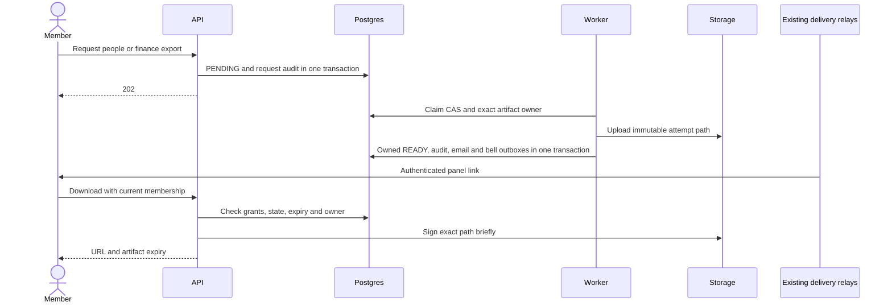

# Organization data exports

Organization exports produce an asynchronous, kind-scoped JSON bundle. The
request creates a durable job; the ten-minute ticker invokes the registered
worker; authorized members obtain a fresh short-lived download link after the
bundle is ready. The seven-day artifact lifetime is separate from the download
link lifetime. The [privacy reference](../../compliance/02-dpdp-and-privacy.md)
owns legal scope and commencement analysis; this page describes the implemented
organization export mechanism. Per-person erasure remains a
[separate flow](02-deletion-policy.md).

## Access and bundle contents

| Kind                    | Permission            | Roles holding the permission | Bundle sections                                     |
| ----------------------- | --------------------- | ---------------------------- | --------------------------------------------------- |
| PEOPLE                  | `dataExports.people`  | OWNER, MAINTAINER            | Members, memberships and audit log                  |
| FINANCE                 | `dataExports.finance` | OWNER, BILLING_ADMIN         | Contracts, programs, invoices, earnings and payouts |
| FULL (legacy rows only) | Both                  | OWNER                        | Both sets                                           |

Every bundle also includes organization metadata, generation time, schema
version and the exported kinds. New POST requests accept `people` or `finance`;
FULL remains a stored kind for existing rows. List and download filter by the
caller's current grants. The worker checks that the requesting membership is
still active and entitled to the requested kind before building.

The current builder reads the full organization graph before projecting the
requested kind. It applies primary-processing consent filtering to member
name/email data and the embedded membership users. This is not a claim that
every field across the financial and audit graph has a separate consent filter.
It exports retained rows; it cannot reconstruct rows already pruned by their
retention policy. A whole organization is still built in memory, so a one-job
selection limit does not prove a byte-size, snapshot-isolation or runtime bound.

## JSON bundle examples

Flat JSON, schemaVersion `1`. New requests select one kind; keys from the
other kind are absent. These examples show the top-level shape with empty
collections.

`PEOPLE`:

```json
{
  "organizationId": "org_xxx",
  "generatedAt": "2026-05-15T10:00:00.000Z",
  "schemaVersion": 1,
  "kinds": ["PEOPLE"],
  "organization": { "id": "org_xxx" },
  "members": [],
  "memberships": [],
  "auditLog": [],
  "excludedForConsent": 0
}
```

`FINANCE`:

```json
{
  "organizationId": "org_xxx",
  "generatedAt": "2026-05-15T10:00:00.000Z",
  "schemaVersion": 1,
  "kinds": ["FINANCE"],
  "organization": { "id": "org_xxx" },
  "contracts": [],
  "programs": [],
  "invoices": [],
  "earnings": [],
  "payouts": []
}
```

An existing `FULL` job combines both sets and declares both entries in `kinds`.
New requests do not accept `FULL`.

## Routes and user workflow

| Verb | Path under `/api/organizations/[orgId]` | Behavior                                                                                                                                                       |
| ---- | --------------------------------------- | -------------------------------------------------------------------------------------------------------------------------------------------------------------- |
| POST | `/data-exports`                         | Validates requested kind, applies the per-organization request limiter, commits PENDING plus request audit and returns 202                                     |
| GET  | `/data-exports`                         | Lists at most 50 jobs from the last 30 days, newest first, filtered by grants; failed rows expose fixed safe error text                                        |
| GET  | `/data-exports/[exportId]/download`     | Requires READY, current grants and exact ownership; audits successful signing after its expiry check, then rechecks expiry before returning `{url, expiresAt}` |

A request is limited to one export per organization per 24 hours through
`orgDataExportLimiter`; this is a rate limiter, not a database uniqueness
constraint. The dashboard polls the list. Email and in-app notices link to the
authenticated settings panel, never a stored storage bearer URL.

Download returns 409 `EXPORT_NOT_READY` while unavailable by state; 410
`EXPORT_EXPIRED` at the expiry boundary; 410 `EXPORT_UNAVAILABLE` if exact
ownership is missing; and 503 for a reported signing failure. A kind the caller
does not hold reads as absent. Responses carrying download information are
`private, no-store` and vary by Cookie. A successful response signs only the
exact owned bucket/path, for at most 60 seconds and capped by the remaining
artifact lifetime using a fresh clock after the owner lookup. If signing or
audit latency crosses the artifact deadline, the route returns `EXPORT_EXPIRED`
without returning the URL.

`DATA_EXPORT_DOWNLOAD_REQUESTED` is written after signing succeeds and the
post-signing expiry check passes. Signing failures and requests that expire
before or during signing write no audit row. The row can still exist if audit
latency later crosses the deadline; it does not assert that the URL was returned
or that the recipient read any bytes.

An issued signed URL remains a bearer capability under the provider's contract.
Changing a member's role prevents a new authorized download but does not
retroactively revoke a token already issued. See
[Supabase private downloads](https://supabase.com/docs/guides/storage/serving/downloads).

## Durable job and attempt ownership

The canonical implementation is
`scripts/cleanup/process-data-exports.ts:processDataExports`, lazily imported by
`lib/cron/cleanup-registry.ts`. The ticker runs it every ten minutes through the
authenticated cleanup route. Staff can use the existing System Jobs door; there
is no separate scheduled Actions owner. The Postgres job lease fails closed.

`OrgDataExportJob` retains PENDING → PROCESSING → READY → EXPIRED, with FAILED
for generation failure. A PROCESSING row older than the long-job lease is
eligible for reclaim. The exact observed status and `startedAt` participate in
the claim CAS; each claim writes a distinct millisecond timestamp. Terminal
updates require PROCESSING and that same attempt token. A superseded worker
cannot publish or fail a successor's job.

The claim transaction also creates `OrgDataExportArtifact` before upload. That
row owns the bucket, immutable storage path, attempt identity and expiry. It has
no parent foreign key, so deleting the organization or job cannot delete the
remote cleanup responsibility. The path is
`{organizationId}/{exportId}/{attemptStartedAtMilliseconds}.json`; upload uses
`upsert:false`. Separate paths prevent a late worker from replacing a newer
attempt's bytes. The bucket uses `SUPABASE_DATA_EXPORT_BUCKET`, default
`org-exports`; the deployment must provide private storage and service access.



Publication and delivery are separate. READY commits with its audit and existing
email/notification outboxes, using only the transaction client inside that
transaction. Provider attempts occur after commit and can fail independently;
the existing relays retain delivery responsibility. A notice failure never
rewrites READY as FAILED. Safe job/list error text stays organization-visible;
engineering diagnostics go to the system-event surface keyed by export ID.
Missing storage configuration fails the job rather than publishing a local
`file://` artifact.

## Artifact expiry

The same worker first examines at most ten expired artifact owners, with a
shared admission deadline. `lastDeleteAttemptedAt` rotates failed delete work.
Every attempt retains its exact owner until its seven-day expiry, including
unpublished and superseded uploads. Cleanup avoids deleting the exact attempt
while the job still reports it as PROCESSING.

Remove failure, uncertain presence, permission error or local commit failure
retains the owner and makes the run unsuccessful. After removal reports success,
an exact `info()` read must identify `NoSuchKey`. A missing bucket, generic 404,
ambiguous response or `exists()` false value with an error does not qualify.
Only that key-specific absence permits retiring the owner and marking the matching published job
EXPIRED transactionally. A parent deletion does not remove that obligation.
This grace assumes invocation and transport lifetimes remain far shorter than
seven days; the row cap and admission deadline do not cancel a vendor call that
has already started.

## Rollout, verification and operations

The release owner applies only `prisma/sql/org-data-export-artifacts.sql` and
verifies the live catalog before deploying the new reader. Mock data is reset
before cutover; this rollout neither adopts old URLs nor migrates old artifact
ownership. New attempts record their own owner before uploading. An ownerless
stored URL is never a download fallback. Preserve owned artifacts on rollback
and keep incompatible old writers from creating new unowned objects.

The [worker recovery guide](../../maintenance/12-worker-recovery.md) contains the
full failure matrix and operating gates. `/api/health/jobs` requires an owned
successful export-core completion within 45 minutes in the current deployment
environment. That does not measure oldest queued work, sufficient drain rate,
private-bucket configuration or human alert receipt.

Mocked regression tests cover stale reclaim, losing claim/finalization, immutable
paths, retained delete obligations after uncertain responses, postcommit notice
failure, safe legacy errors and fresh authorized download signing. Deployed
verification must separately establish schema/catalog correctness, storage
permissions and representative bundle size/runtime. Tests must not create real
exports or write the shared database as fixtures.

## Deprecated & Superseded Approaches

The worker formerly selected PENDING only, so killed PROCESSING jobs could be
stranded indefinitely. It uploaded with upsert to `{orgId}/{jobId}.json`, stored a
seven-day signed URL on the job and sent that URL in notices. Link expiry alone
did not delete the bytes. Exact attempt ownership, immutable paths and confirmed
expiry replace those mechanisms.

Notices formerly ran after READY inside the same generation catch boundary;
their failure could overwrite READY with FAILED and expose raw error text.
Transactional outbox staging and safe read responses replace that coupling.
A local `/tmp` export fallback and the old per-job Actions schedule are no longer
the runtime contract. The bundle remains JSON-only; no CSV/ZIP generation is
implemented.

Historical `DATA_EXPORT_DOWNLOADED` audit rows are retained as recorded; the new
request action makes the observed attempt explicit without claiming delivery.
