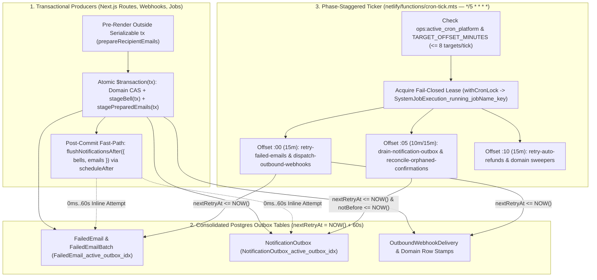
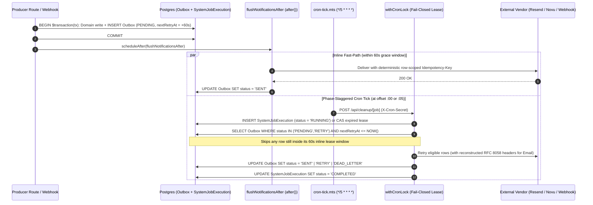
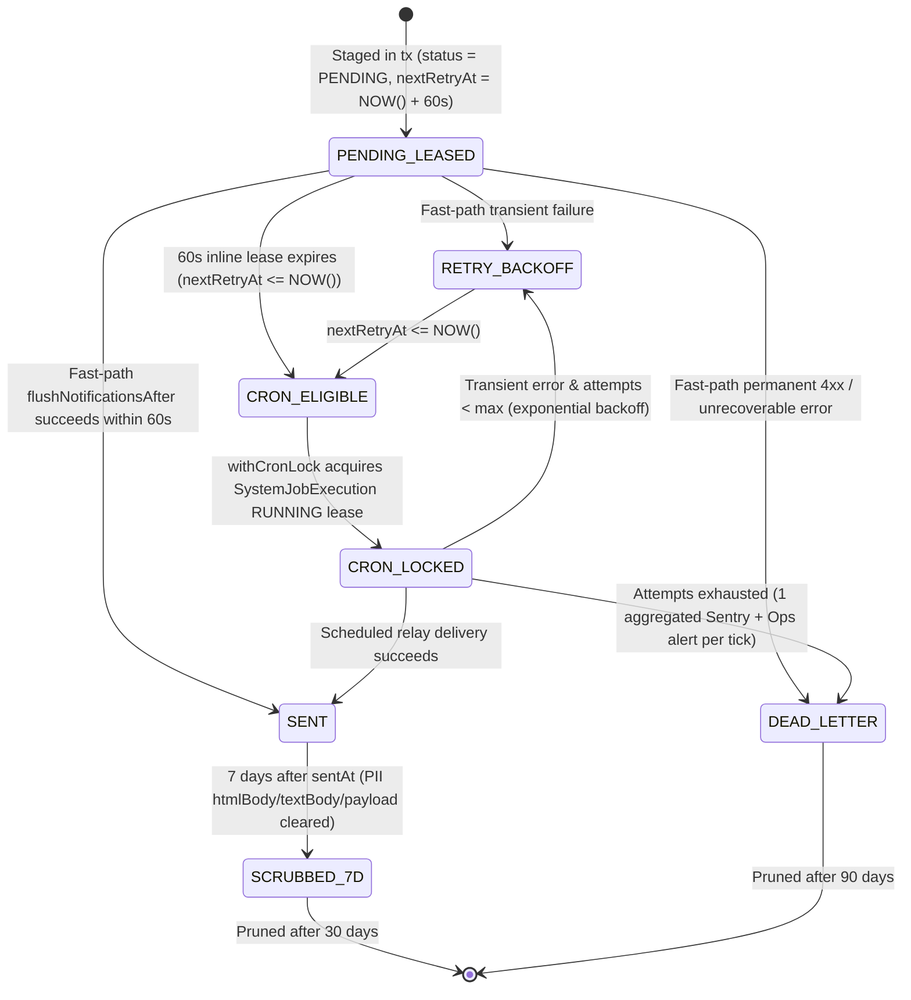
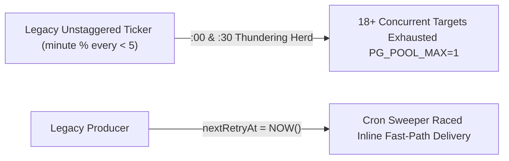

# ADR 27 — State-as-outbox with a scheduled ticker

## Context

Serverless functions on Netlify have no built-in durable queue worker and freeze immediately once an HTTP response settles. Three platform facts govern background work and transactional side effects:

1. **Postgres already holds the durable state an outbox provides**: `WebhookEvent` is an inbound idempotent inbox (`processed` flag + `svixId`/`eventId` uniqueness); `FailedEmail` (`FailedEmailBatch`), `NotificationOutbox`, and `OutboundWebhookDelivery` are transactional outboxes with retry ladders; and domain-row obligations are anchored directly on business tables (`Payment`, `Appointment`, `Refund`, `WalletTopUp`).
2. **Every background job is exposed through `app/api/cleanup/[job]/route.ts`** built by `lib/cron/cleanup-route.ts` (`lib/cron/cleanup-registry.ts`), gated by `CRON_SECRET` and guarded by `withCronLock` (`lib/cron/with-cron-lock.ts`), so any HTTP scheduler can invoke targets safely.
3. **External message brokers cannot participate in a Postgres `$transaction` without a dual-write**, meaning a Postgres outbox table is required even when an external broker exists.

| Broker / Pattern                                           | Atomic with Postgres `$transaction`?                                  | Serverless (Netlify) Fit                                                                    | Operational & Cost Overhead                    | Verdict                                                                       |
| :--------------------------------------------------------- | :-------------------------------------------------------------------- | :------------------------------------------------------------------------------------------ | :--------------------------------------------- | :---------------------------------------------------------------------------- |
| **Apache Kafka**                                           | **No** (Requires DB outbox + CDC/Debezium to avoid dual-write)        | **Poor** (Long-lived consumer groups & partition rebalancing)                               | **Very High** (\$150–\$500+/mo + ops overhead) | **Rejected**                                                                  |
| **RabbitMQ / BullMQ**                                      | **No** (Redis/AMQP enqueue inside DB tx is a dual-write)              | **Poor** (Requires persistent TCP workers on a separate 24/7 VM tier)                       | **High** (Separate compute fleet required)     | **Rejected**                                                                  |
| **AWS SQS**                                                | **No** (HTTP `SendMessage` inside DB tx is a dual-write)              | **Mediocre** (No native SQS event source mapping on Netlify)                                | **Moderate** (Cross-cloud IAM + poller)        | **Rejected**                                                                  |
| **Upstash QStash**                                         | **No on its own** (Still needs DB outbox)                             | **Excellent** (Stateless HTTP push with retries, DLQ, and `FlowControl`)                    | **Low** (~$1 / 100k messages)                  | **Optional Stage-2 Escalation** (if `OutboundWebhookDelivery` exceeds >10k/d) |
| **Postgres Transactional Outbox + Phase-Staggered Ticker** | **100% Atomic** (`stage()` / `stageBell()` writes inside caller `tx`) | **Native** (Post-commit fast-path settles in ~150ms; phase-staggered ticker drains retries) | **Zero Incremental Cost** (\$0/mo)             | **Active Production Architecture**                                            |

---

## Decision

1. **Consolidated 3-Table Transactional Outbox + Domain Stamps.**
   - `FailedEmail` (and `FailedEmailBatch`), `NotificationOutbox`, and `OutboundWebhookDelivery` are the dedicated transactional outbox tables.
   - Domain-row obligations use explicit nullable stamps (e.g., `Appointment.chatChannelEnsuredAt`, `Payment.description` `Auto-refund pending:` prefix) walked by idempotent sweepers.
2. **Pre-Render Outside `Serializable` `$transaction`, Stage Inside `tx` with 60s Lease Window, Flush via `flushNotificationsAfter`.**
   - High-contention `Serializable` money and billing transactions (`handlePaymentSuccess`, `handlePaymentFailure`, `invoice-rollup`) pre-render React Email payloads outside database transactions via `prepare*` (`prepareRecipientEmails` / `prepareSpecEmails` in `lib/email/send-to-recipients.ts`) and call `stagePreparedEmails(tx, ...)` inside `tx` so `PG_POOL_MAX=1` connections are never held during CPU-bound rendering, while standard low-contention routes stage via `stage*Email` + `flushNotificationsAfter` and bulk loops (`assignments`, `session-outcome-sweep`) stage/render after commit.
   - Inside `$transaction(tx)`, producers stage emails (`stage()` / `stagePreparedEmails()`) and in-app bells (`stageBell(tx, ...)` in `lib/novu/stage-bell.ts`, which filters out `EMAIL_ONLY`, `NEITHER`, `allNotifications: false`, `inAppEnabled: false`, and muted categories while computing quiet-hours `notBefore`).
   - Staged rows receive `status = "PENDING"` and `nextRetryAt = NOW() + 60s` (`INLINE_ATTEMPT_LEASE_MS = 60_000`) so background cron sweeps skip rows whose inline post-commit delivery is still in flight.
   - Post-commit, `flushNotificationsAfter({ bells, emails }, op)` (`lib/novu/stage-then-attempt.ts`) dispatches all staged triggers and emails concurrently via `scheduleAfter` (`lib/api/after-safe.ts`, backed by Next.js `after()` inside a request scope and awaited inline outside request scopes).
   - Both `stage()` and `runEmailRetryTick` scope Resend idempotency keys to the outbox row ID (`<EMAIL_TYPE>/failed-email/<row.id>` via `idempotencyKeyFor`), preventing Resend's 24-hour payload hash cache from dropping repeat transactional emails.
   - On relay retries, `reconstructUnsubscribeHeaders(row)` (`lib/email/unsubscribe.ts`) statelessly rebuilds RFC 8058 `List-Unsubscribe` + `List-Unsubscribe-Post: List-Unsubscribe=One-Click` headers from persisted body URLs without persisting redundant JSON columns.
3. **Phase-Staggered Netlify Scheduled Ticker (`netlify/functions/cron-tick.mts`).**
   - `cron-tick.mts` runs every 5 minutes (`*/5 * * * *`) and distributes 10-minute, 15-minute, and 30-minute targets across deterministic phase offsets (`TARGET_OFFSET_MINUTES`) so no 5-minute tick fires more than **8 targets** concurrently:
     - `retry-failed-emails`: **every 15 minutes at offset `:00`** (`:00, :15, :30, :45`), `limit=20`, `20_000 ms` timeout, sequential `SEND_GAP_MS = 125 ms` pacing.
     - `drain-notification-outbox`: **every 10 minutes at offset `:05`** (`:05, :15, :25, :35, :45, :55`), `limit=20`, `20_000 ms` timeout, sequential probe + `DRAIN_CONCURRENCY = 5`.
   - Default target timeout is `15_000 ms` (`20_000 ms` for vendor round-trip sweeps), keeping every tick inside Netlify's 30-second ceiling.
4. **Atomic Postgres Lease Lock (`withCronLock`) & Sidecar Partial Indexes (`prisma/sql/check-constraints.sql`).**
   - `lib/cron/with-cron-lock.ts` acquires fail-closed Postgres leases on `SystemJobExecution` enforced by `CREATE UNIQUE INDEX "SystemJobExecution_running_jobName_key" ON "SystemJobExecution" ("jobName") WHERE "status" = 'RUNNING'` in `prisma/sql/check-constraints.sql` with single-`UPDATE` CAS takeover for expired leases.
   - Active outbox scans and 7-day `SENT` body scrubs are backed by partial indexes in `prisma/sql/check-constraints.sql`:
     - `FailedEmail_active_outbox_idx` (`ON "FailedEmail" ("nextRetryAt" ASC NULLS FIRST) WHERE "status" IN ('PENDING', 'RETRY')`)
     - `FailedEmailBatch_active_outbox_idx` (`ON "FailedEmailBatch" ("nextRetryAt" ASC NULLS FIRST) WHERE "status" IN ('PENDING', 'RETRY')`)
     - `NotificationOutbox_active_outbox_idx` (`ON "NotificationOutbox" ("nextRetryAt" ASC NULLS FIRST, "notBefore") WHERE "status" IN ('PENDING', 'RETRY')`)
     - `FailedEmail_sent_unscrubbed_updatedAt_idx` (`ON "FailedEmail" ("updatedAt") WHERE "status" = 'SENT' AND ("htmlBody" <> '' OR "textBody" IS NOT NULL)`)
5. **Per-Tick Aggregated Telemetry & Retention Pruning.**
   - Outbox drains aggregate failures once per tick (`0` per-row loop Sentry calls), update queue depth gauges (`email.outbox.pending`, `email.outbox.dead_letter`, `notifications.outbox.pending`, `notifications.outbox.dead_letter`), and send fallback ops alerts via `postOpsChat`.
   - `scripts/cleanup/prune-system-job-executions.ts` scrubs `htmlBody`/`textBody` on `SENT` `FailedEmail` rows after 7 days and deletes terminal outbox/execution rows on schedule.

---

## Active Architecture Diagram

```text
+===================================================================================================+
|                     PRODUCERS (API Routes, Webhooks, Server Actions, Jobs)                        |
+===================================================================================================+
   |
   | 1. Pre-render React Email OUTSIDE $transaction (`prepareRecipientEmails` -> `render` + `toPlainText`)
   | 2. Gate bell recipients via `stageBell(tx, ...)` (routing mode, channel/category prefs, quiet hours)
   | 3. Stage emails via `stage()` / `stagePreparedEmails(tx, ...)` inside `$transaction(tx)`:
   |    - `status: "PENDING"`, `nextRetryAt: NOW() + 60s` (`INLINE_ATTEMPT_LEASE_MS`)
   |    - Row-scoped Resend key: `<EMAIL_TYPE>/failed-email/<row.id>`
   |    - Deterministic Novu key: `<workflowId>:<sha256[:32]>` + `NotificationScope` on `ORG_*` workflows
   | 4. Post-commit fast-path: `flushNotificationsAfter({ bells, emails }, op)` dispatches concurrently
   |    via `scheduleAfter` (`after()` in Next.js request context; awaited inline in CLI/cron/tests)
   v
+---------------------------------------------------------------------------------------------------+
|               CONSOLIDATED OUTBOX LAYER (Postgres + `prisma/sql/check-constraints.sql`)           |
|  1. `FailedEmail` & `FailedEmailBatch` (`FailedEmail_active_outbox_idx`, `FailedEmailBatch_*`)    |
|  2. `NotificationOutbox` (`NotificationOutbox_active_outbox_idx`)                                 |
|  3. `OutboundWebhookDelivery` (Enterprise Customer Webhooks)                                      |
|  * Stateless RFC 8058 `reconstructUnsubscribeHeaders(row)` rebuilds one-click headers on retry    |
|  * 7d `SENT` body scrub (`FailedEmail_sent_unscrubbed_updatedAt_idx`) + 30d/90d row pruning       |
+---------------------------------------------------------------------------------------------------+
   |
   v
+===================================================================================================+
|              PHASE-STAGGERED CRON & LOCKING ENGINE (`netlify/functions/cron-tick.mts`)            |
+===================================================================================================+
  Netlify `cron-tick.mts` (`*/5 * * * *`, max 8 concurrent targets per tick):
  - `retry-failed-emails`: every 15m at offset `:00` (`limit=20`, `20s` timeout, `SEND_GAP_MS = 125ms`)
  - `drain-notification-outbox`: every 10m at offset `:05` (`limit=20`, `20s` timeout, `DRAIN_CONCURRENCY = 5`)
   - Atomic Postgres lease lock (`SystemJobExecution_running_jobName_key` in `prisma/sql/check-constraints.sql`)
   - Per-tick aggregated Sentry alerts + `*.outbox.dead_letter` gauges + `postOpsChat` fallback alerts
```

### Mermaid Phase-Staggered Ticker & Outbox Architecture Flowchart



### Mermaid End-to-End Outbox Lease & Ticker Sequence Diagram



### Mermaid `withCronLock` & Outbox Row Lifecycle State Machine



---

## Side Effects Riding This Pattern

| Side effect                          | Outbox row / stamp                                        | Written where                                                                      | Relay (ticker target & cadence)                                            |
| ------------------------------------ | --------------------------------------------------------- | ---------------------------------------------------------------------------------- | -------------------------------------------------------------------------- |
| Partner webhook delivery             | `OutboundWebhookDelivery`                                 | Emitting domain service before any POST                                            | `dispatch-outbound-webhooks`, every 15m (offset `:00`, `limit=15`)         |
| Stream chat channels after a capture | `Appointment.chatChannelEnsuredAt` (`NULL` until synced)  | Payment confirmation pipeline                                                      | `reconcile-orphaned-confirmations`, every 15m (offset `:05`, `limit=10`)   |
| Transactional & batch email          | `FailedEmail` / `FailedEmailBatch` (`nextRetryAt = +60s`) | `stage()` in `lib/email/deliver.ts` inside caller `tx` where applicable            | `retry-failed-emails`, every 15m (offset `:00`, `limit=20`, `20s` timeout) |
| Novu in-app notifications            | `NotificationOutbox` (`nextRetryAt = now + 60s`)          | `stageBell()` (`lib/novu/stage-bell.ts`) / `stageTrigger()` (`lib/novu/outbox.ts`) | `drain-notification-outbox`, every 10m (offset `:05`, `limit=20`, `20s`)   |
| Capture-webhook auto-refunds         | `Payment.description` (`Auto-refund pending:` prefix)     | Capture webhook Phase 1 transaction across auto-refund branches                    | `retry-auto-refunds`, every 15m (offset `:10`, `limit=10`, `20s` timeout)  |

---

## Deprecated & Superseded Approaches

```text
  [API / Webhook Producer]
     ├── Path A (Bell): mixed `NotificationOutbox` vs post-commit floating `notify*()`,
     │                  `stageBell()` skipped preference/routing/quiet-hours filtering.
     └── Path B (Email): inline `await deliver()` blocking HTTP + Redis slot locks,
                         `FailedEmail` due at `NOW()` (racing cron), body-hash Resend key,
                         and retried rows stripped of RFC 8058 `List-Unsubscribe` headers.
```



- **Unstaggered Ticker Thundering Herd (`minute % every < 5` without offsets)**: Previously fired 18+ targets simultaneously at `:00`/`:30` while leaving `:05, :25, :35, :55` idle, exhausting `PG_POOL_MAX=1` connections; superseded by deterministic `TARGET_OFFSET_MINUTES` capping concurrent targets at `<= 8` per 5-minute tick.
- **Removed Reliability Asymmetries vs. Retained Provider Split**: Eliminated mixed outbox atomicity, immediate `nextRetryAt: NOW()` inline/cron races, 24h payload-hash Resend collisions (`<EMAIL_TYPE>/failed-email/<row.id>`), and stripped retry headers (`reconstructUnsubscribeHeaders`), while deliberately keeping Novu (WebSocket `<Inbox />`) and Resend (direct React Email + `EmailEvent` Svix telemetry) as independent delivery planes underneath one unified Postgres outbox contract.
