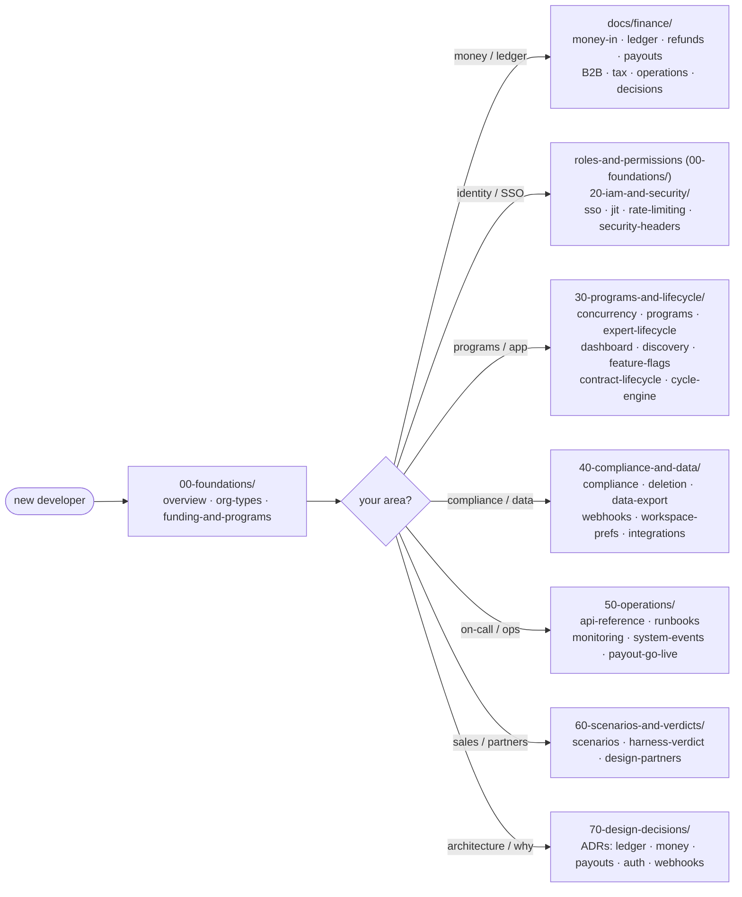

# Familiarise Enterprise — documentation

The **enterprise layer** is a capability-driven B2B surface on top of the marketplace: organizations sponsor and/or host, fund sessions through wallets, invoices, or licenses, run programs with seat or credit caps, and settle money through a double-entry ledger. This folder is the engineer's map of that layer. The **banded folders** are written to be read **in order, as one continuous story**, with each band building on the last: `00-foundations/` → [`docs/finance/`](../finance/README.md) → `20-iam-and-security/` → `30-programs-and-lifecycle/` → `40-compliance-and-data/` → `50-operations/` → `60-scenarios-and-verdicts/`. One band sits outside the story line: `70-design-decisions/` collects the architecture decision records that explain _why_ the system is shaped the way it is. Audit findings and their status are tracked in GitHub issues, not in this folder.

> **New here?** Read the [overview](00-foundations/01-overview.md) for the system shape. For the end-to-end booking, organizational scoping, and money narrative across B2C and B2B, read [03-booking-and-money-machinery](../start-here/03-booking-and-money-machinery.md) first — the cross-rail visual guide with the data model, sequence, state, permission, and 20 double-entry ledger permutation tables — then start at [money-model-overview](../finance/20-ledger/01-double-entry-model.md) and walk [`docs/finance/`](../finance/README.md) in order. If you want a curated path matched to your experience level, use the [reading paths](#reading-paths-by-level) below.

---

## How to read this

The flowchart below routes you from "new developer" to the band that owns your area. Every path assumes you have read the foundations band first.



---

## Reading paths by level

The bands are one source of truth — these paths are navigation, not copies. Each path includes everything from the previous one, so an SDE3 is expected to have covered the SDE2 list. Every doc carries an `audience:` tag in its frontmatter stating the lowest level for whom it is primary reading; nothing stops an SDE1 from reading an `sde4` doc, but the paths below are the order that builds context without forward references.

### SDE1 — ship a feature without breaking money

This path gives you the system shape, the role model, and just enough of the money model to know what you must not touch casually.

1. [overview](00-foundations/01-overview.md) — read the "anatomy of one booking" sequence diagram twice; it is the spine every other doc hangs detail off.
2. [organization-types](00-foundations/02-organization-types.md) — the two booleans (`canSponsor`/`canHost`) that define every org.
3. [roles-and-permissions](00-foundations/04-roles-and-permissions.md) — the `MemberRole` ladder that gates every API route and dashboard page.
4. [money-model-overview](../finance/20-ledger/01-double-entry-model.md) — the three money rules (integer paise, balanced transactions, derived balances). You do not need the rest of the band yet.
5. [dashboard-pages](30-programs-and-lifecycle/04-dashboard-pages.md) — what each org dashboard page shows, per role.
6. [api-reference](50-operations/01-api-reference.md) — keep this open as a reference while you work; do not read it cover to cover.

### SDE2 — own a subsystem

This path makes you productive inside any one band and safe at its boundaries with the others.

1. Everything in the SDE1 path.
2. The finance documentation, starting at [`docs/finance/`](../finance/README.md) — the money story only makes sense read front to back.
3. All of [`20-iam-and-security/`](20-iam-and-security/01-sso-and-authentication.md) — SSO, JIT, rate limiting, headers.
4. All of [`30-programs-and-lifecycle/`](30-programs-and-lifecycle/01-concurrency-and-idempotency.md) — programs are where the commercial terms live.
5. [compliance map](40-compliance-and-data/01-compliance-dpdp-gst-tds-msme.md), [deletion-policy](40-compliance-and-data/02-deletion-policy.md), [data-export](40-compliance-and-data/03-data-export.md), and [outbound-webhooks](40-compliance-and-data/04-outbound-webhooks.md).
6. Re-read [concurrency-and-idempotency](30-programs-and-lifecycle/01-concurrency-and-idempotency.md) after the money band — the idempotency keys will mean more the second time.

### SDE3 — design changes and review them

This path adds the _why_ behind the design and the integrity machinery you must preserve when changing it.

1. Everything in the SDE2 path.
2. All of [`70-design-decisions/`](70-design-decisions/00-README.md) — the ADRs; read these before proposing structural changes.
3. [cross-cutting-integrations](40-compliance-and-data/06-cross-cutting-integrations.md) — the wired/partial/skipped map of all eight subsystems.
4. [ledger-integrity](../finance/20-ledger/06-integrity-and-reconciliation.md) — the scheduled reconciler and the invariants your change must not break.
5. [monitoring](50-operations/03-monitoring.md) and [system-events](50-operations/04-system-events.md) — how a change announces itself in production.

### SDE4 — architecture and regulatory sign-off

This path covers the whole surface and the regulatory rails the money flows must satisfy.

1. Everything in the SDE3 path.
2. [03-booking-and-money-machinery](../start-here/03-booking-and-money-machinery.md) — the canonical cross-rail booking, org-scoping, and money narrative.
3. [compliance map](40-compliance-and-data/01-compliance-dpdp-gst-tds-msme.md) together with the authoritative rule set in [`docs/compliance/`](../compliance/00-overview.md).
4. [go-live checklist](../finance/70-operations/07-go-live-checklist.md) — the one flag flip with real-money consequences.
5. [scenarios-and-examples](60-scenarios-and-verdicts/01-scenarios-and-examples.md) — worked end-to-end enterprise scenarios.

---

## Section map

The table below lists every band in reading order, with the documents each one contains.

| Band folder                  | Section                                          | Docs                                                                                                                                                            |
| ---------------------------- | ------------------------------------------------ | --------------------------------------------------------------------------------------------------------------------------------------------------------------- |
| `00-foundations/`            | **Foundations**                                  | overview, org types, funding & programs, roles, lifecycle, scheduling glossary                                                                                  |
| `docs/finance/`              | **Money & ledger** (moved)                       | the money story: checkout, ledger, refunds, payouts, organisation funding, tax and operations                                                                   |
| `20-iam-and-security/`       | **IAM / SSO / security**                         | SSO, JIT, rate-limiting, security headers                                                                                                                       |
| `30-programs-and-lifecycle/` | **Programs / dashboard / discovery / lifecycle** | concurrency & idempotency, programs, experts, dashboard, discovery, feature flags, contract lifecycle, cycle engine & rollover                                  |
| `40-compliance-and-data/`    | **Compliance / integrations / data**             | compliance map, deletion, data export, outbound webhooks, workspace prefs, cross-cutting integrations, RBI payment aggregator posture                           |
| `50-operations/`             | **Operations**                                   | API reference, non-money runbooks, monitoring, system events, chaos test, required secrets, capacity ladder, load gate, Novu console conditions, load test plan |
| `60-scenarios-and-verdicts/` | **Scenarios**                                    | worked end-to-end scenarios                                                                                                                                     |
| `70-design-decisions/`       | **Design decisions (ADRs)**                      | why the ledger, money representation, payouts, auth, and webhook designs are what they are                                                                      |

---

## Full index

### Foundations — `00-foundations/`

These six docs define the primitives every other band assumes: what an organization is, who its members are, and how its lifecycle runs.

| #   | Doc                                                                   | Focus                                            |
| --- | --------------------------------------------------------------------- | ------------------------------------------------ |
| 01  | [overview](00-foundations/01-overview.md)                             | system shape, master ER, capability model        |
| 02  | [organization-types](00-foundations/02-organization-types.md)         | `canSponsor`/`canHost` → BUYER/HOST/HYBRID/INERT |
| 03  | [funding-and-programs](00-foundations/03-funding-and-programs.md)     | `FundingSource` enum + program subtypes          |
| 04  | [roles-and-permissions](00-foundations/04-roles-and-permissions.md)   | `MemberRole` ladder + every API gate             |
| 05  | [organization-lifecycle](00-foundations/05-organization-lifecycle.md) | `OrgStatus` + contract/program state machines    |
| 06  | [scheduling-glossary](00-foundations/06-scheduling-glossary.md)       | canonical booking and scheduling terminology     |

### Money & ledger — now in `docs/finance/`

The money and ledger band moved to [`docs/finance/`](../finance/README.md), which tells the same story front to back and adds the gateway, tax and operations pages. Where each former document lives:

| Former document      | Now                                                                                                                                                                             |
| -------------------- | ------------------------------------------------------------------------------------------------------------------------------------------------------------------------------- |
| money-model-overview | [double-entry model](../finance/20-ledger/01-double-entry-model.md)                                                                                                             |
| chart-of-accounts    | [chart of accounts](../finance/20-ledger/02-chart-of-accounts.md)                                                                                                               |
| ledger-and-postings  | [postings](../finance/20-ledger/04-postings.md)                                                                                                                                 |
| wallet-and-topups    | [wallet and top-ups](../finance/50-b2b/02-wallet-and-top-ups.md)                                                                                                                |
| booking-to-earnings  | [rate cards and overage](../finance/50-b2b/03-rate-cards-and-overage.md)                                                                                                        |
| earnings-lifecycle   | [earnings lifecycle](../finance/40-payouts/02-earnings-lifecycle.md)                                                                                                            |
| payout-pipeline      | [consultant payouts](../finance/40-payouts/03-consultant-payouts.md) and [organisation payouts](../finance/40-payouts/05-org-payouts-and-clawbacks.md)                          |
| invoicing            | [invoices, purchase orders and dunning](../finance/50-b2b/04-invoices-purchase-orders-and-dunning.md) and [GST invoices](../finance/60-tax/02-gst-invoices-and-credit-notes.md) |
| payment-legs         | [payment legs](../finance/20-ledger/03-payment-legs.md)                                                                                                                         |
| refunds              | [refunds](../finance/30-refunds-disputes/01-refunds.md)                                                                                                                         |
| disputes             | [chargebacks](../finance/30-refunds-disputes/02-chargebacks.md)                                                                                                                 |
| payment-webhooks     | [capture confirmation and webhooks](../finance/10-money-in/02-capture-confirmation-and-webhooks.md)                                                                             |
| ledger-integrity     | [integrity and reconciliation](../finance/20-ledger/06-integrity-and-reconciliation.md)                                                                                         |

### IAM / SSO / security — `20-iam-and-security/`

These four docs cover how people get into orgs (OIDC SSO and JIT) and the protective layers around those entry points. Platform sign-in itself (passwords, 2FA, sessions, staff accounts) is documented in [`docs/authentication/`](../authentication/README.md).

| #   | Doc                                                                          | Focus                                                   |
| --- | ---------------------------------------------------------------------------- | ------------------------------------------------------- |
| 01  | [sso-and-authentication](20-iam-and-security/01-sso-and-authentication.md)   | `OrganizationSSOSettings`, `SsoProvider`, domain claims |
| 02  | [jit-and-session-refresh](20-iam-and-security/02-jit-and-session-refresh.md) | JIT auto-join, role-change refresh                      |
| 03  | [rate-limiting](20-iam-and-security/03-rate-limiting.md)                     | BetterAuth limiter on Upstash + edge rules              |
| 04  | [security-headers](20-iam-and-security/04-security-headers.md)               | CSP + header posture                                    |

### Programs / dashboard / discovery / lifecycle — `30-programs-and-lifecycle/`

This band holds the commercial logic (programs, contracts, cycles) and the app surfaces that expose it.

| #   | Doc                                                                                        | Focus                                                                |
| --- | ------------------------------------------------------------------------------------------ | -------------------------------------------------------------------- |
| 01  | [concurrency-and-idempotency](30-programs-and-lifecycle/01-concurrency-and-idempotency.md) | atomic patterns + every idempotency key                              |
| 02  | [programs](30-programs-and-lifecycle/02-programs.md)                                       | program / assignment / `BookingUtilization` internals                |
| 03  | [expert-lifecycle](30-programs-and-lifecycle/03-expert-lifecycle.md)                       | expert apply/approve; `PayoutRecipient`                              |
| 04  | [dashboard-pages](30-programs-and-lifecycle/04-dashboard-pages.md)                         | every `app/dashboard/organization/[orgId]/**` page                   |
| 05  | [public-pages-and-discovery](30-programs-and-lifecycle/05-public-pages-and-discovery.md)   | org catalog, search, marketplace identity                            |
| 06  | [feature-flags-and-rollout](30-programs-and-lifecycle/06-feature-flags-and-rollout.md)     | `ENABLE_HOST_ORGS` + capability-gated UI                             |
| 07  | [contract-lifecycle](30-programs-and-lifecycle/07-contract-lifecycle.md)                   | `Contract` state machine, auto-renew, supersession, end-early guard  |
| 08  | [cycle-engine-and-rollover](30-programs-and-lifecycle/08-cycle-engine-and-rollover.md)     | `ProgramAssignment` lifecycle, nightly cycle-advance, successor mint |

### Compliance / integrations / data — `40-compliance-and-data/`

These docs map the regulatory rails (DPDP, GST, TDS, MSME) onto the models and crons that implement them, plus the org-facing data plumbing.

| #   | Doc                                                                                           | Focus                                      |
| --- | --------------------------------------------------------------------------------------------- | ------------------------------------------ |
| 01  | [compliance-dpdp-gst-tds-msme](40-compliance-and-data/01-compliance-dpdp-gst-tds-msme.md)     | enterprise touchpoints → `../compliance/*` |
| 02  | [deletion-policy](40-compliance-and-data/02-deletion-policy.md)                               | erasure, retention, immutable ledger       |
| 03  | [data-export](40-compliance-and-data/03-data-export.md)                                       | `OrgDataExportJob`                         |
| 04  | [outbound-webhooks](40-compliance-and-data/04-outbound-webhooks.md)                           | `WebhookEndpoint`, delivery, signing       |
| 05  | [workspace-preferences](40-compliance-and-data/05-workspace-preferences.md)                   | `OrgWorkspaceProfile` prefs                |
| 06  | [cross-cutting-integrations](40-compliance-and-data/06-cross-cutting-integrations.md)         | per-subsystem wired/skipped map            |
| 07  | [rbi-payment-aggregator-posture](40-compliance-and-data/07-rbi-payment-aggregator-posture.md) | RBI PA-CB regulatory posture               |

### Operations — `50-operations/`

This band is the on-call surface: every route, cron, alert, and go-live runbook.

| #   | Doc                                                                            | Focus                                                                                                            |
| --- | ------------------------------------------------------------------------------ | ---------------------------------------------------------------------------------------------------------------- |
| 01  | [api-reference](50-operations/01-api-reference.md)                             | exhaustive route table (roles + audit actions)                                                                   |
| 02  | [runbooks](50-operations/02-runbooks.md)                                       | non-money incident response + scheduled tasks (money runbooks are in `docs/finance`)                             |
| 03  | [monitoring](50-operations/03-monitoring.md)                                   | log taxonomy, alerts, dashboards                                                                                 |
| 04  | [system-events](50-operations/04-system-events.md)                             | system-event / audit-action taxonomy                                                                             |
| 05  | [live-payout-go-live-runbook](50-operations/05-live-payout-go-live-runbook.md) | superseded by the [finance go-live checklist](../finance/70-operations/07-go-live-checklist.md); pending removal |
| 06  | [chaos-test-runbook](50-operations/06-chaos-test-runbook.md)                   | chaos and fault-injection drills                                                                                 |
| 07  | [required-secrets](50-operations/07-required-secrets.md)                       | production and CI secret inventory                                                                               |
| 08  | [capacity-ladder](50-operations/08-capacity-ladder.md)                         | infrastructure scaling thresholds                                                                                |
| 09  | [load-gate-runbook](50-operations/09-load-gate-runbook.md)                     | k6 load gate verification                                                                                        |
| 10  | [novu-console-conditions](50-operations/10-novu-console-conditions.md)         | where notification opt-outs are enforced (server-side; no Novu step conditions)                                  |
| 11  | [load-test-plan](50-operations/11-load-test-plan.md)                           | staged 100 / 300 / 1,000 user load test, run only after the database split                                       |

### Scenarios — `60-scenarios-and-verdicts/`

This doc validates the system against worked end-to-end enterprise scenarios.

| #   | Doc                                                                              | Focus                       |
| --- | -------------------------------------------------------------------------------- | --------------------------- |
| 01  | [scenarios-and-examples](60-scenarios-and-verdicts/01-scenarios-and-examples.md) | worked end-to-end scenarios |

### Design decisions — `70-design-decisions/`

This band collects the architecture decision records (`01` through `36`): each one states a decision the system embodies, the alternatives that were rejected, and the consequences we live with. Start at the [band index](70-design-decisions/00-README.md), which lists every ADR and the format they follow.

### Cross-Rail Explainers — `docs/start-here/`

For the full component-by-component enterprise design, start with the [enterprise system design](../start-here/07-enterprise-system-design.md). It traces the current schema through the code, includes worked examples, distinguishes three-, five- and seven-axis views, and records recommendations and implementation boundaries.

| File                                                                                         | Purpose                                                                                                                                                                                                                                                       |
| -------------------------------------------------------------------------------------------- | ------------------------------------------------------------------------------------------------------------------------------------------------------------------------------------------------------------------------------------------------------------- |
| [start-here/03-booking-and-money-machinery](../start-here/03-booking-and-money-machinery.md) | Canonical end-to-end visual guide combining booking lifecycle, organizational scoping (`?orgScope=`), role & permission matrices, funding/program/overage permutations, all 20 double-entry ledger permutations, and worked numeric examples with seeded cast |

---

## Doc conventions: frontmatter

Every document in this tree opens with a YAML frontmatter block. The fields mean the following:

```yaml
---
title: Contract lifecycle # mirrors the H1
band: 30-programs-and-lifecycle # the band folder slug; "index" for this README and the explainers
audience: sde2 # sde1 | sde2 | sde3 | sde4 — the lowest level for whom this doc is primary reading
status: live # live | partial | designed-not-active
last-reviewed: 2026-06-05 # the date a human last verified this doc's claims against code
---
```

`status: partial` means the doc covers at least one designed-but-not-active surface (these are also flagged 🟡 inline). `status: designed-not-active` means the entire doc describes a surface that is built in schema or docs but not running in production. When you change behavior a doc describes, update the doc and bump its `last-reviewed` date in the same PR.

---

## Ground-truth files

Docs **defer to code** when prose drifts. The load-bearing sources:

- `prisma/schema.prisma` — the schema is the source of truth; docs cite model/field names verbatim.
- `lib/payments/ledger/post.ts` — `postLedgerTxn`, `ledgerAccountId`, `ledgerBalancePaise`.
- `scripts/reconcile/reconcile-ledgers.ts` — the integrity invariants.
- `lib/api/organizations/{wallet,program-helpers,rate-card}.ts` — transactional primitives.
- `lib/enterprise/cycle-engine.ts` — assignment roll-vs-close + successor mint (#779 §A/§B → [cycle-engine-and-rollover](30-programs-and-lifecycle/08-cycle-engine-and-rollover.md)).
- `lib/enterprise/config-lock.ts` — which contract/program term fields freeze once in use (#779 §A → [contract-lifecycle](30-programs-and-lifecycle/07-contract-lifecycle.md)).
- `lib/enterprise/org-activation.ts` — the one org-state model behind the activation checklist + action-required banners (#777 §A / #779 §F); server-side reads split into `org-activation-signals.ts`.
- `lib/enterprise/governance.ts` — `verifiedAt`-gated feature locks (SSO / INVOICE billing / unverified seat cap) (#675/#687).
- `lib/auth/org-permissions.ts` — the org permission matrix; the finance keys (`billing.manage`, `purchaseOrders.manage`, `payouts.manage`, `integrations.manage`) hold OWNER and `BILLING_ADMIN` only.
- `lib/labels/org-labels.ts`, `lib/enterprise/{audit-actions,role-transitions}.ts`, `lib/auth.ts` (the `customSession` hook).

---

## Post-#772 note

> **The double-entry journal (`LedgerTransaction` / `LedgerEntry` / `LedgerAccount`) replaced the three single-entry logs.** `FundingLedgerEntry`, `WalletEntry`, and `SettlementLedgerEntry` (+ `SettlementKind`) are **gone**; `WalletTopUp` carries top-up lifecycle, and balances derive from the journal. Revenue splits are integer **basis points**, not floats. If you find any of those removed names anywhere in this doc set, it's a stale reference — fix it.

## Post-v2 note

> **The v2 mega-audit (#777/#778/#779) was absorbed into these docs on 2026-06-05.** It closed the "silent stuck money / zombie row" gaps: the `Contract` lifecycle (auto-renew, supersede, end-early) → [contract-lifecycle](30-programs-and-lifecycle/07-contract-lifecycle.md); the cycle engine + assignment rollover (nightly cycle-advance, successor mint) → [cycle-engine-and-rollover](30-programs-and-lifecycle/08-cycle-engine-and-rollover.md); the `OverageEvent` system (breaker / surcharge / `CHARGE_MEMBER` timeout); dunning; wallet auto-top-up (**notify-only today** — the cron warns, it does not charge); verification resubmit; webhook secret-rotation grace; field-level RBAC on org/contract/program edits; and the IRN payload mapper behind `ENABLE_IRP_UPLOADER`. Refund-driven TDS reversal is now wired via a negative `TDSRecord` (`recordTdsReversal`, #813); the richer `TdsAdjustment` consolidation model remains schema-only. New idempotency anchors: `rolledAt` (cycle mint), `autoRenewedAt` (contract renew), `autoTopUpLastFiredAt` (auto-top-up).

## Conventions

- **Money is integer paise**; splits/percentages are integer **basis points** (`10000 = 100%`).
- **Idempotency keys** are structured: money keys like `booking:<paymentId>`, `topup:<providerOrderId>`, `orgpayout:<payoutId>`; cron claims gate on a stamped timestamp — `rolledAt` (cycle mint), `autoRenewedAt` (contract renew), `autoTopUpLastFiredAt` (auto-top-up) ([concurrency-and-idempotency](30-programs-and-lifecycle/01-concurrency-and-idempotency.md)).
- **Ledger rows are immutable** — corrections are counter-transactions, never edits or deletes.
- **Balances are derived** by summing the journal; the few cached numbers are reconciled nightly.
- **Prose is full sentences** — paragraphs or full-sentence bullets; tables get a sentence lead-in. Terse fragments are reserved for table cells and Mermaid labels.
