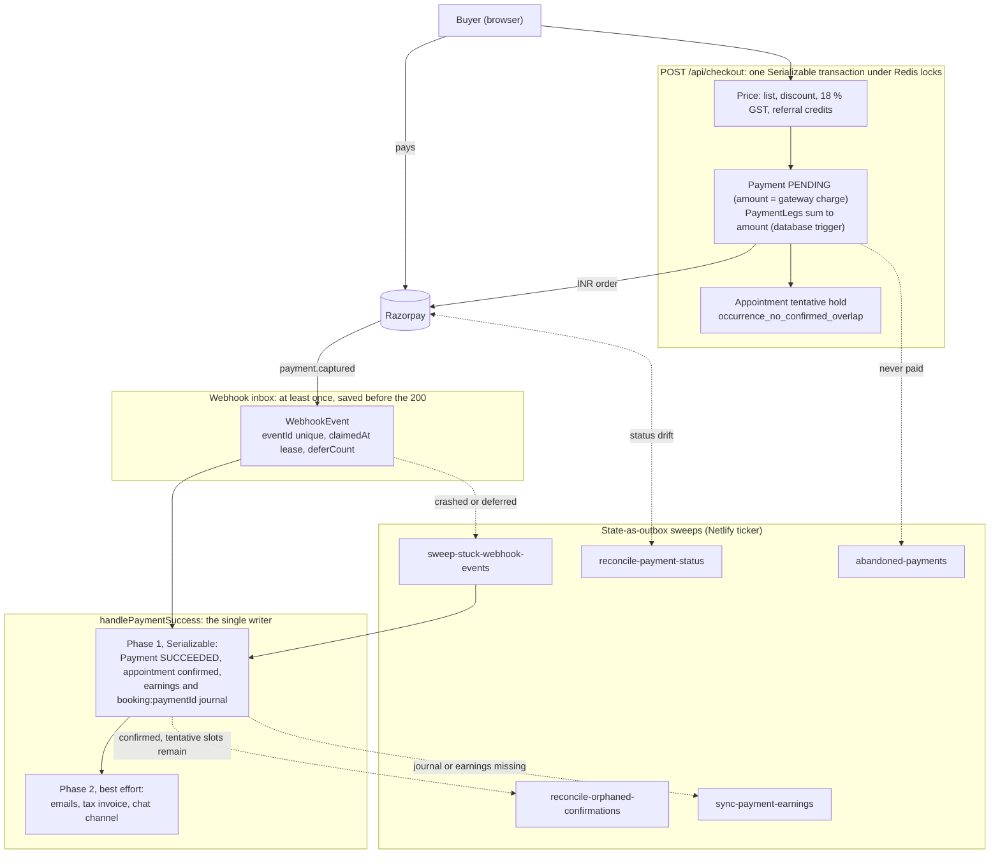
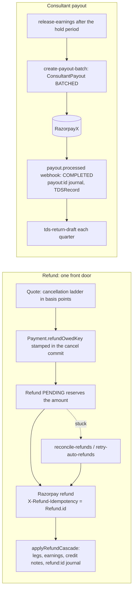
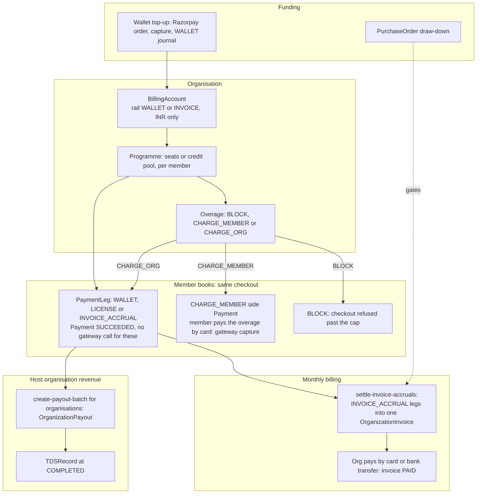
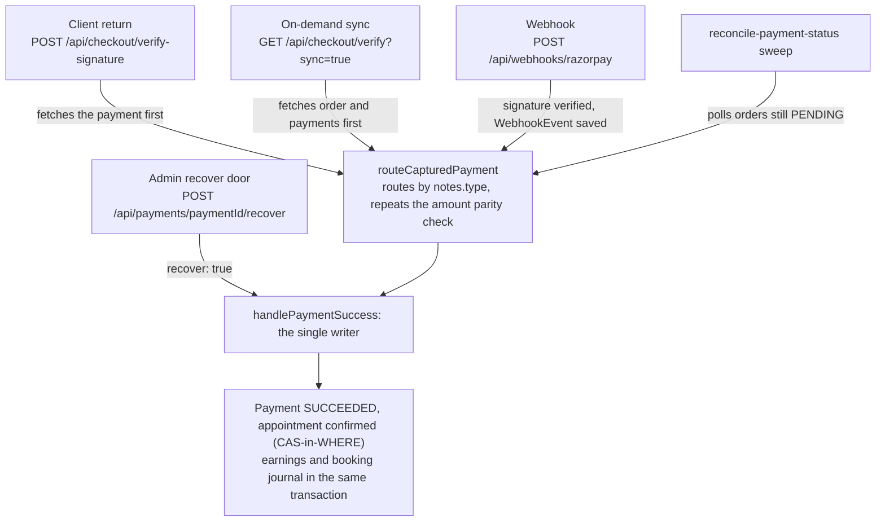

# Money map

This page draws the money subsystem five ways: a consumer booking from click to books, a refund and a payout, an organisation funding its members, the layers that keep it all correct, and the four doors that lead to the single writer of a confirmed capture. Read [the money system HLD](../../start-here/02-money-system-hld.md) first for the narrative; this page goes deeper on each picture and names the code behind every box.

Everything drawn runs inside one Next.js application, one Postgres database and one Redis instance. There are no services, queues or brokers. The domain rows carry every pending obligation, and scheduled sweeps read those rows to finish work that did not complete, which is why the diagrams show sweeps rather than a message bus. The reasoning for this posture is in [ADR 14](../../enterprise/70-design-decisions/14-async-queue-posture.md), [ADR 22](../../enterprise/70-design-decisions/22-queue-posture-revisited-with-measurements.md) and [ADR 27](../../enterprise/70-design-decisions/27-state-as-outbox-and-scheduled-ticker.md), and the single-writer rule is [ADR 21](../../enterprise/70-design-decisions/21-single-writer-for-payment-confirmation.md).

## 1. A consumer pays for a session

The synchronous part is one Serializable database transaction taken under Redis locks. It writes the `Payment`, its legs and the tentative appointment hold together, so all three exist or none does. Razorpay then calls back, the webhook row is saved before the request is acknowledged, and `handlePaymentSuccess` confirms the capture. Its first phase is one Serializable transaction that moves the payment to `SUCCEEDED`, the appointment to confirmed, and writes earnings and the booking journal inside a savepoint; its second phase is best effort and sends emails, mints the tax invoice and creates the chat channel.

Three guarantees follow. The buyer's money state is exact when Phase 1 commits, because payment and appointment change in one transaction. Side effects are eventually consistent and each has a named sweep. Every sweep is idempotent, so a sweep racing a webhook redelivery cannot post anything twice. Detail: [checkout and pricing](../10-money-in/01-checkout-and-pricing.md) and [capture confirmation](../10-money-in/02-capture-confirmation-and-webhooks.md).

## 2. A refund and a payout

A refund is two-phase: the `Refund` row reserves the amount, Razorpay is called outside any transaction with the refund id as its idempotency key, and the cascade (legs, earnings, tax documents, journal) runs only when the gateway confirms. A consultant payout releases earnings after the hold, batches them, and writes the withholding record only when the RazorpayX webhook says the money moved.

The refund path has one front door on purpose. Every rail that can return money, whether a cancellation, a removed seat, an incident or a support remedy, produces a `Refund` row through `refundBookingPayment`, so the reservation, the idempotency key and the credit note are never skipped. Detail: [refunds](../30-refunds-disputes/01-refunds.md), [consultant payouts](../40-payouts/03-consultant-payouts.md).

## 3. An organisation funds its members

The checkout, the price derivation, the tax calculation, the single writer and the journal are the same code as the consumer path. What changes is the funding leg: a wallet, a licence seat, an invoice accrual or an overage charge replaces the card, and for wallet and licence legs no gateway call happens. Accrued legs roll up into one organisation invoice per month, and organisations that sell on the platform receive their own payouts with their own withholding records.

Detail: [funding rails](../50-b2b/01-funding-rails-and-permutations.md), [wallet and top-ups](../50-b2b/02-wallet-and-top-ups.md), [invoices](../50-b2b/04-invoices-purchase-orders-and-dunning.md).

## 4. Truth, audit, schedulers and reconciliation

The first three pictures mix four layers that are best seen apart. Money truth is strongly consistent and guarded by the database. The audit trail is append-only rows written in the same transactions, so it cannot disagree with the money. The schedulers are the only asynchronous machinery, and they only call HTTP routes that already exist. Reconciliation has four purposes, and every scheduled money job maps to one.

```mermaid
flowchart LR
  subgraph Truth["Money truth: one transaction"]
    T1["Payment, Refund, Payout rows<br/>status moves only by CAS-in-WHERE"]
    T2["Journal: LedgerTransaction and LedgerEntry<br/>walletBalance is a reconciled cache"]
    T3["Database guards: payment_legs_sum_to_amount,<br/>ledger_txn_balanced, payment_refunds_within_amount, CHECKs"]
  end
  subgraph Audit["Audit trail: append only"]
    A1["OrgAuditLog"]
    A2["SystemEvent, OpsActionLog"]
    A3["SystemJobExecution: every run, its lease, its outcome"]
    A4["WebhookEvent: raw inbound payload"]
  end
  subgraph Sched["Schedulers"]
    N["Netlify scheduled function cron-tick.mts<br/>every 5 minutes, at most 9 due targets"]
    R["/api/cleanup/slug<br/>Bearer CRON_SECRET, withCronLock lease in Postgres"]
    G["GitHub Actions: non-money batch jobs only"]
  end
  subgraph Recon["Reconciliation: four purposes"]
    R1["database against gateway"]
    R2["database against journal caches"]
    R3["crash-gap re-drives"]
    R4["time expiry"]
  end
  N --> R --> Recon --> Truth --> Audit
  G --> R
```

Before firing anything, a tick reads the fleet switch `ops:active_cron_platform` from Upstash (one second timeout, failing open), so a standby Netlify never double-fires jobs while another host is active. Mutual exclusion is a Postgres lease on `SystemJobExecution`, not Redis. Money reconcilers, payout batching and processing, invoice and contract lifecycle and the statutory exports all run on the ticker in bounded slices; the cadence of each is in `netlify/functions/cron-tick.mts` and [scheduled jobs](../70-operations/01-scheduled-jobs.md). The ledger auditor `reconcile-ledgers` is read-only and does not re-check anything a database constraint already guarantees ([integrity and reconciliation](../20-ledger/06-integrity-and-reconciliation.md)).

## 5. Four doors, one writer

A captured payment can be reported through four doors, and only one function is allowed to confirm it. The client verify door (the checkout modal's client return or an on-demand sync, drawn as two boxes), the Razorpay webhook and the `reconcile-payment-status` sweep each learn about a capture differently, yet all resolve to the same order-level facts and hand them to `routeCapturedPayment` (`app/api/webhooks/razorpay-dispatch.ts`), which calls `handlePaymentSuccess`. The fourth, the admin recover door, calls that function directly for a capture that failed metadata validation. The client verify door and the sweep fetch the payment from Razorpay first, because a client signature proves the ids belong together, not that money moved.

| Term                  | One-sentence definition                                                                                                                                                                                     |
| --------------------- | ----------------------------------------------------------------------------------------------------------------------------------------------------------------------------------------------------------- |
| Webhook               | Razorpay's callback to `POST /api/webhooks/razorpay`, saved as a `WebhookEvent` row before the request is acknowledged so it can be re-driven without Razorpay resending it                                 |
| Idempotency key       | A value that makes a repeated call do its work once: `x-razorpay-event-id` for a webhook, `Refund.id` for a gateway refund, `booking:<paymentId>` for a journal                                             |
| CAS-in-WHERE          | Every status move puts the expected prior status inside the `UPDATE … WHERE`, so a second writer racing the first matches zero rows                                                                         |
| Single writer         | `handlePaymentSuccess` confirms a gateway card capture; no-gateway rails and side payments have their own writers, listed in [capture confirmation](../10-money-in/02-capture-confirmation-and-webhooks.md) |
| Payment legs          | `PaymentLeg` rows recording what funded a payment; non-reversal legs except referral credit and licence sum to `Payment.amount`                                                                             |
| Reconciled cache      | A stored figure such as `BillingAccount.walletBalance` that the reconciler checks against the journal; never a second source of truth                                                                       |
| State-as-outbox       | A sweep that finds rows whose side effect never landed and re-drives that effect, instead of a separate queue table                                                                                         |
| Transient vs terminal | A transient failure is retried by the next tick; a terminal one (Razorpay answering that it has no record of an id) is recorded once with a reason and not retried                                          |

## When this design should change

A broker earns its place when a second independently deployed consumer needs the same events, when inbound webhooks sustain tens of events per second, or when the application leaves a serverless host and can run a consumer around the clock. None of those holds today. The first step if one does is an HTTP queue driving the same cleanup routes, not a streaming platform. Until then the cost of this design is readability, not correctness: a reader must know the sweeps exist, which is why [scheduled jobs](../70-operations/01-scheduled-jobs.md) lists them.

## Where in code

- `lib/payments/checkout/`, `lib/payments/webhooks/handlers.ts`, `app/api/webhooks/razorpay-dispatch.ts`.
- `lib/payments/operations/booking-refund.ts` (`refundBookingPayment`), `lib/payments/operations/refund.ts`, `lib/payments/payouts/`.
- `netlify/functions/cron-tick.mts`, `lib/cron/cleanup-registry.ts`, `lib/cron/with-cron-lock.ts`.

## Related

- [Glossary and status reference](02-glossary-and-status-reference.md), [double-entry model](../20-ledger/01-double-entry-model.md), [refunds, chargebacks and complaints](../30-refunds-disputes/README.md).

## Deprecated & Superseded Approaches

Earlier versions of these diagrams showed Stripe as a co-gateway, a GitHub Actions workflow as the backstop for the money sweeps, a `cascade-refund-earnings` sweep and per-sweep script paths under `scripts/payments/` that no longer exist, a "ten money routes" ticker, and a Redis cron lock. None of it matches the code: Razorpay is the only gateway, the refund cascade runs inline and is repaired by `reconcile-refunds`, the ticker carries dozens of targets and fires up to nine per tick, and mutual exclusion is a Postgres lease. A diagram annotation that earnings and the ledger were always written after the Phase 1 commit is superseded: they are attempted inside Phase 1 and deferred to Phase 2 only if that attempt fails. Delete any picture that still shows these.
