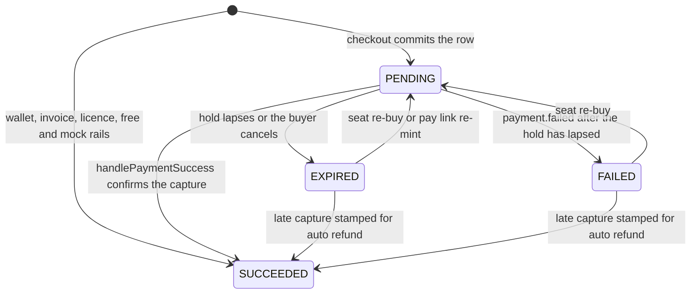
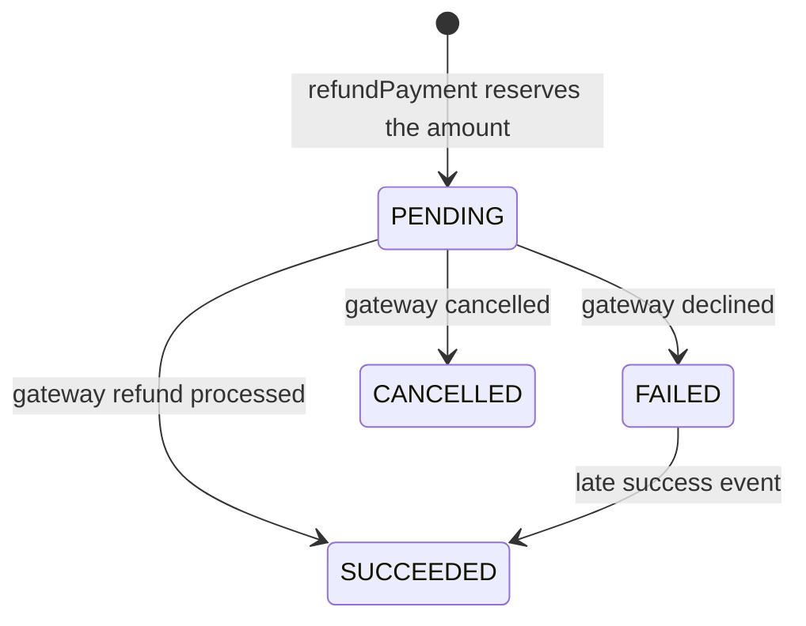

# Glossary and status reference

This page is the lookup table for the money subsystem. It defines the words the other finance pages use, lists every money enum with its exact values copied from `prisma/schema.prisma`, and draws the state machines that a reader most often needs when a row looks stuck. It explains no flow; each section links to the page that does.

## 1. Terminology that must not be mixed up

| Term               | Meaning                                                                                                                                                                                                                                    |
| ------------------ | ------------------------------------------------------------------------------------------------------------------------------------------------------------------------------------------------------------------------------------------ |
| Refund             | Money returned to the payer for a booking, recorded as a `Refund` row. See [refunds](../30-refunds-disputes/01-refunds.md).                                                                                                                |
| Dispute            | A gateway chargeback: the cardholder's bank asks Razorpay to pull money back, recorded as a `Dispute` row. See [chargebacks](../30-refunds-disputes/02-chargebacks.md).                                                                    |
| Service complaint  | A `SupportCase` a person files about a booking. It is not a dispute and it moves no money by itself; a refund it leads to is a normal `Refund`. See [service complaints](../30-refunds-disputes/03-service-complaints-and-remedies.md).    |
| Capture            | The moment Razorpay confirms it holds the buyer's money for an order. The platform treats a capture as real only after `handlePaymentSuccess` has recorded it.                                                                             |
| Single writer      | `handlePaymentSuccess` in `lib/payments/webhooks/handlers.ts`, the only function that turns a gateway card capture into a `SUCCEEDED` booking payment. See [capture and webhooks](../10-money-in/02-capture-confirmation-and-webhooks.md). |
| Payment leg        | One `PaymentLeg` row recording one funding source of a payment (card, wallet, invoice accrual, licence, referral credit). See [payment legs](../20-ledger/03-payment-legs.md).                                                             |
| Journal            | The double-entry record: a `LedgerTransaction` with two or more `LedgerEntry` rows that sum to zero. See [double-entry model](../20-ledger/01-double-entry-model.md).                                                                      |
| Idempotency key    | A string that makes a repeated call do its work once: `x-razorpay-event-id` for webhooks, `Refund.id` for a gateway refund call, `booking:<paymentId>` for a journal, `Refund.dedupeKey` for one logical refund.                           |
| CAS-in-WHERE       | Compare-and-swap: the expected prior status sits inside the `updateMany` condition, so a racing second writer matches zero rows and changes nothing.                                                                                       |
| Hold               | Either a slot hold (`Payment.expiresAt`, 30 minutes for a direct checkout) or an earnings hold (`EarningsHold`, which freezes a payout). The context always says which.                                                                    |
| Sweep              | A scheduled job that finds rows whose expected side effect never happened and finishes that work. Every money sweep is an HTTP route under `/api/cleanup/<job>` driven by the Netlify ticker.                                              |
| Tombstone          | An `EXPIRED` `Payment` row kept for a gateway order whose booking was abandoned, so a late capture on that order still finds a row and is refunded.                                                                                        |
| Paise              | One hundredth of a rupee. Every stored amount is an integer count of paise: ₹1,180 is 118,000 paise.                                                                                                                                       |
| bps (basis points) | One hundredth of a percent: 2,000 bps is 20 %.                                                                                                                                                                                             |

## 2. Money enums

Each block is copied from `prisma/schema.prisma`. When a value is added there, this page is the first place a reviewer should look for a stale list.

### 2.1 PaymentStatus

```prisma
enum PaymentStatus {
  PENDING
  SUCCEEDED
  FAILED
  EXPIRED
}
```

There is no partially refunded status. A partial refund leaves the payment `SUCCEEDED`; the refunded amount is the sum of its `Refund` rows.



The enforcers are the CAS-in-WHERE `updateMany` calls named in [capture and webhooks](../10-money-in/02-capture-confirmation-and-webhooks.md) and [checkout and pricing](../10-money-in/01-checkout-and-pricing.md).

### 2.2 RefundStatus

```prisma
enum RefundStatus {
  PENDING // Refund initiated but not yet processed
  SUCCEEDED // Refund completed successfully
  FAILED // Refund failed
  CANCELLED // Refund cancelled
}
```

`CANCELLED` is only ever produced by mapping a gateway status of `cancelled` or `canceled` (`mapGatewayRefundStatus` in `lib/payments/refund-status.ts`); the platform never cancels a refund itself. An unrecognised gateway status maps to `PENDING` so the reconcile sweep keeps polling.



### 2.3 DisputeStatus

```prisma
enum DisputeStatus {
  WARNING_NEEDS_RESPONSE // Early fraud warning, needs response
  WARNING_UNDER_REVIEW // Early fraud warning under review
  WARNING_CLOSED // Early fraud warning closed
  NEEDS_RESPONSE // Dispute filed, needs evidence
  UNDER_REVIEW // Evidence submitted, under review
  CHARGE_REFUNDED // Charge was refunded
  WON // Dispute won
  LOST // Dispute lost
  CLOSED // Proceedings ended without a verdict (Razorpay `closed`) — terminal
}
```

The legal transitions are encoded in `isLegalDisputeTransition` (`lib/payments/dispute-status.ts`) and drawn in [chargebacks](../30-refunds-disputes/02-chargebacks.md). `WON`, `LOST`, `CHARGE_REFUNDED` and `CLOSED` are terminal.

### 2.4 EarningStatus and PayoutStatus

```prisma
enum EarningStatus {
  PENDING // In hold period
  HELD // Has at least one active EarningsHold
  READY // Ready for payout
  BATCHED
  PAID // Cash actually disbursed (payout COMPLETED + UTR)
  REFUNDED // Refunded to consultee
  PENDING_TRUST
}

enum PayoutStatus {
  PENDING // Awaiting approval
  APPROVED // Admin approved
  PROCESSING // Being processed
  COMPLETED // Successfully sent
  FAILED // Provider rejected
  CANCELLED // Manually cancelled
  REVERSED // bank returned funds AFTER COMPLETED; ORG_PAYOUT posting reversed, earnings re-opened
}
```

The edges between these values are drawn in [earnings lifecycle](../40-payouts/02-earnings-lifecycle.md) and [consultant payouts](../40-payouts/03-consultant-payouts.md).

### 2.5 EarningsHoldReason

```prisma
enum EarningsHoldReason {
  DISPUTE
  MODERATION
  OPERATOR
  OVERAGE // a CHARGE_MEMBER side charge on the parent payment is still unpaid
  SUPPORT_CASE // a support case froze the payment's unpaid earnings
}
```

`lib/payments/payouts/earnings-holds.ts` is the only writer of `EarningStatus.HELD`. A release clears only the reason it names, so an earning stays `HELD` while any other reason remains.

### 2.6 PaymentLegSource

```prisma
enum PaymentLegSource {
  CARD // external gateway charge
  WALLET // BillingAccount wallet debit (was SEAT_PACK)
  REFERRAL_CREDIT // platform-issued personal credit
  INVOICE_ACCRUAL // rolled into an OrganizationInvoice at month-end
  OVERAGE_INVOICE_ACCRUAL // marginal charge beyond a LICENSED_SEAT cap (CHARGE_ORG path); distinct source prevents @@unique([paymentId, source]) collision with the base INVOICE_ACCRUAL leg
  LICENSE // absorbed by a LICENSED_SEAT program (no money moves)
  INVOICE_ACCRUAL_REVERSAL
  OVERAGE_INVOICE_ACCRUAL_REVERSAL
}
```

### 2.7 FundingSource and OverageBehavior

```prisma
enum FundingSource {
  PERSONAL // learner pays own card; Payment.organizationId tagged only
  LICENSE // flat enterprise license (was PREPAID_UNLIMITED)
  WALLET // credit pool (was SEAT_PACK)
  INVOICE // NET-X postpaid (was INVOICED_MONTHLY)
}

enum OverageBehavior {
  BLOCK // cap hit → checkout blocked
  CHARGE_MEMBER // cap hit → learner pays overage on own card
  CHARGE_ORG // cap hit → overage added to org invoice
}
```

Every combination of funding source, programme type and overage behaviour is accepted at configuration time (`overageConfigRefusals` in `lib/enterprise/reachable-paths.ts` returns an empty list); the interface only classifies each combination as recommended, advanced or discouraged. See [funding rails](../50-b2b/01-funding-rails-and-permutations.md).

### 2.8 PaymentGateway

```prisma
enum PaymentGateway {
  STRIPE
  RAZORPAY
  DODO_PAYMENTS
  CARD
}
```

Only Razorpay has an implementation. `STRIPE` and `DODO_PAYMENTS` are labels without code, and `UNIMPLEMENTED_GATEWAYS` (`lib/payments/constants.ts`) together with `assertGatewayUsable` (`lib/payments/validation/gateway-guards.ts`) refuse them on every money path. See [gateway and currency](../10-money-in/04-razorpay-gateway-and-currency.md).

### 2.9 Ledger enums

`LedgerAccountKind` (16 values) and `LedgerTransactionKind` (16 values) are listed with their meaning and posting rules in [chart of accounts](../20-ledger/02-chart-of-accounts.md) and [postings](../20-ledger/04-postings.md). `LedgerDirection` is `DEBIT` or `CREDIT`.

## 3. WebhookEvent states

`WebhookEvent` has no status enum. Its state is read from four columns, and two database checks keep them consistent (`webhook_event_processed_error_exclusive` and `webhook_event_processed_timestamp_consistent` in `prisma/sql/check-constraints.sql`).

| State               | `processed` | `error`                    | Notes                                                                                                                 |
| ------------------- | ----------- | -------------------------- | --------------------------------------------------------------------------------------------------------------------- |
| Received, in flight | false       | null                       | `claimedAt` is the lease stamp; a lease older than 5 minutes may be reclaimed by a redelivery.                        |
| Done                | true        | null                       | `processedAt` is set.                                                                                                 |
| Failed, retryable   | false       | free text                  | The next delivery or the sweep reclaims it with a CAS on `claimedAt`.                                                 |
| Deferred            | false       | null                       | A handler answered `DeferSignal`; `deferCount` rises. Looks identical to a crash, which is why the counter exists.    |
| Terminal            | false       | `permanent:` or `gave up:` | Skipped by every sweep. `permanent:` marks an unparseable payload; `gave up:` marks an event deferred past 168 hours. |

The full ingestion path is in [capture and webhooks](../10-money-in/02-capture-confirmation-and-webhooks.md); the diagnosis procedure is in [webhook recovery](../70-operations/04-webhook-recovery.md).

## Where in code

- `prisma/schema.prisma`: every enum above.
- `lib/payments/refund-status.ts`: `mapGatewayRefundStatus`.
- `lib/payments/dispute-status.ts`: `isLegalDisputeTransition`, `mapDisputeStatus`, `DISPUTE_INACTIVE_FOR_GATING`.
- `lib/payments/payouts/earnings-holds.ts`: the single writer of `HELD`.

## Related

- [Money map](01-money-map.md) for how these states fit the whole system.
- [The money system HLD](../../start-here/02-money-system-hld.md) for the narrative version.

## Deprecated & Superseded Approaches

An older status reference described `PaymentStatus` without `EXPIRED`, `DisputeStatus` with eight values, a `PARTIALLY_REFUNDED` payment status and a `Stripe` dispute vocabulary. None of those exist in the schema; delete any code or doc that branches on them. The `REFERRAL_BONUS` wallet-entry reason, the `WalletEntry` table and the `SettlementKind` enum belong to the journal collapse and are gone; the journal is the only record of money movement.
