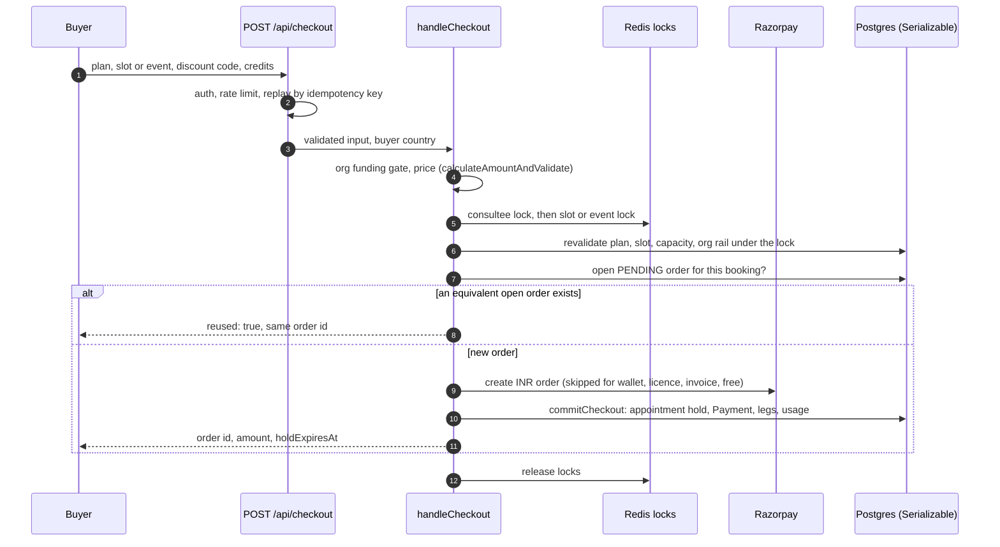
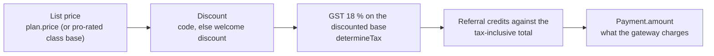

# Checkout and pricing

Checkout turns a buyer's click into three things that commit together or not at all: a `Payment` row, the `PaymentLeg` rows that say what funds it, and a tentative booking that holds the slot or seat. The one row that outlives a failed commit is the `EXPIRED` tombstone for an already-minted gateway order, described in section 1. This page explains how `handleCheckout` (`lib/payments/checkout/orchestrate.ts`) does that, how the amount is derived, and how the locks, the open-order reuse and the idempotency key keep a double click, a second tab or a crashed request from charging twice. Capture is the next stage and has its own page: [capture and webhooks](02-capture-confirmation-and-webhooks.md).

## 1. The pipeline in one picture

`POST /api/checkout` (`app/api/checkout/route.ts`) authenticates the buyer, spends one of five requests per minute from `checkoutLimiter`, validates the body with `checkoutSchema`, mints a `clientIdempotencyKey` if the client sent none, and replays any earlier attempt that used the same key (`replayByIdempotencyKey`). It then resolves the buyer's country, routes to Razorpay (`routeGateway`) and calls `handleCheckout`.

The gateway order is created inside the lock but outside the database transaction, because an external call must never sit inside a Serializable transaction. If the transaction then fails, `handleCheckout` writes an `EXPIRED` tombstone `Payment` for the order (`tombstoneAbortedGatewayOrder`), because Razorpay has no order-cancel call: a buyer who still completes it needs a row for the late capture to land on, where it is refunded automatically.

## 2. How the amount is derived

`deriveCheckoutAmount` (`lib/payments/pricing/derive-checkout-amount.ts`) is a pure function. The order of its four stages is fixed, and the checkout page, the price preview and the server all call it, so a displayed price cannot drift from a charged one (`__tests__/payments/checkout-price-parity.test.ts`).

1. **Discount.** A `DiscountCode` is re-validated against the database on the server. A `PERCENTAGE` code takes `round(list × value / 100)` capped by `maxDiscount`; a `FIXED_AMOUNT` code never takes more than the list price. With no code, the referee's welcome discount applies (`computeWelcomeDiscountPaise`, `lib/referrals/promo-math.ts`) and is dropped again if the cash left after it falls under its floor (`keepsWelcomeDiscount`).
2. **GST.** `determineTax` (`lib/payments/tax/tax-engine.ts`) charges 18 % to every domestic buyer on the discounted base. An overseas buyer is zero-rated only while a platform Letter of Undertaking is valid for the financial year (`hasValidPlatformLut`); without one the sale is taxed at 18 % IGST. Buyer country is the profile country if it is a two-letter code, else `cf-ipcountry`, else India. `Accept-Language` is deliberately not used, because it once zero-rated Indian sales as exports.
3. **Referral credits.** Credits apply only when the tax-inclusive total is at least `MIN_CREDIT_REDEMPTION_PAISE` (₹500, 50,000 paise), and the amount is the smallest of the available balance, the total, and `floor(list × creditCapBps / 10,000)` less any welcome discount (`creditCapPaise`). `creditCapBps` is the smaller of the programme's redemption cap (20 % by default) and the sale's take rate, and it is zero while the expert's fee waiver means the take cannot fund a promotion (`lib/referrals/attribution.ts`).
4. **Floor.** An amount between ₹0.01 and ₹0.99 is refused, because Razorpay's minimum order is ₹1 (100 paise). An amount of exactly zero with credits applied takes the free path described in section 5.

### Worked example

Charlotte Brown, an independent marketplace consultee, books Hannah Anderson's consultation, listed at ₹2,000, with a 10 % discount code and ₹500 of vested referral credit. The seeded fee schedule (`prisma/seedFiles/13a-create-referral-codes.ts`) is 2,000 bps marketplace and 1,000 bps own link, and Charlotte reaches Hannah through the marketplace.

| Step                                   |   Paise |    Rupees |
| -------------------------------------- | ------: | --------: |
| List price (`Payment.originalAmount`)  | 200,000 | ₹2,000.00 |
| Discount, 10 %                         |  20,000 |   ₹200.00 |
| Discounted base                        | 180,000 | ₹1,800.00 |
| GST 18 % (`Payment.taxAmount`)         |  32,400 |   ₹324.00 |
| Tax-inclusive total                    | 212,400 | ₹2,124.00 |
| Credit cap: 20 % of list               |  40,000 |   ₹400.00 |
| Credits applied (balance 50,000)       |  40,000 |   ₹400.00 |
| Charged to the card (`Payment.amount`) | 172,400 | ₹1,724.00 |

The checkout transaction writes a `CARD` leg of 172,400 and a `REFERRAL_CREDIT` leg of 40,000. When the capture is confirmed, the booking journal debits `GATEWAY_CLEARING` 172,400, `PLATFORM_PROMO` 40,000 and `DISCOUNT` 20,000, and credits `PLATFORM_FEE` 40,000 (20 % of the list price), `CONSULTANT_PAYABLE` 160,000 and `GST_PAYABLE` 32,400; both sides total 232,400 paise. Section 5 of [postings](../20-ledger/04-postings.md) walks through the same booking line by line.

### The platform fee is not a flat 20 %

The fee on a business-to-consumer sale is `grossAmount × bps / 10,000`, where `grossAmount` is `Payment.originalAmount`, so discounts are funded by the platform and never reduce the consultant's share. The bps come from `readActiveFeeSchedule` (`lib/payments/pricing/platform-fee.ts`): the latest `PlatformFeeSchedule` that has an approver and an `effectiveFrom` in the past, using `marketplaceBps` for a marketplace sale and `ownLinkBps` for a sale through an expert's own link (`fam_via` cookie). A live `ConsultantFeeWaiver` makes the fee zero unless the order carries platform-funded promotion. Twenty percent (`PAYOUT_CONSTANTS.PLATFORM_FEE_PERCENTAGE`) is only the fallback when no approved schedule exists. A new schedule needs a second administrator (`feeScheduleApprovalRefusal`); a sole administrator may approve their own schedule only after 24 hours. Bookings funded by an organisation use a rate card instead; see [rate cards and overage](../50-b2b/03-rate-cards-and-overage.md).

## 3. Locks, TTLs and the transaction

Concurrency is handled in three layers, each with a named owner.

| Layer                    | What it protects                                             | Enforcer                                                                                   |
| ------------------------ | ------------------------------------------------------------ | ------------------------------------------------------------------------------------------ |
| Consultee lock           | One buyer booking two different experts at overlapping times | `lockConsulteeBooking` in `utils/appointmentlock.ts`                                       |
| Slot or event lock       | Two buyers taking one slot or the last seat                  | `lockSlotBooking` or `lockEventCheckout`, taken after the consultee lock for slot bookings |
| Serializable transaction | Phantom reads on capacity when a lock expires under load     | `commitCheckout` (`lib/payments/checkout/commit/index.ts`) with `withSerializableRetry`    |
| Database                 | A confirmed overlap for one expert                           | `occurrence_no_confirmed_overlap` (`prisma/sql/check-constraints.sql`)                     |

The lock order is always event or expert first, consultee second, slot third, which is what keeps it deadlock free. Grants are sized by appointment type in `CHECKOUT_LOCK_TTL_MS`: consultation 60 s, subscription 120 s, webinar 120 s, class 600 s. Each transaction attempt renews the grant to at least its own 25 s timeout plus 10 s, so a slow retry loop cannot outlive the lock. A buyer who cannot get a lock is retried up to five times and is then told the slot or event is being booked by someone else.

Inside `commitCheckout`, one Serializable transaction does the following in order: re-checks the invoice credit limit when the rail is `INVOICE`; asserts the buyer has no overlapping session (`assertConsulteeHasNoOverlappingSession`); creates the tentative appointment through the per-type handler; writes the `Payment` row (`writeCheckoutPayment`); writes the org funding leg and meters programme usage (`recordCheckoutUtilization`); writes the `CARD` leg, spends the discount use and re-reads referral credits (`settleCheckoutLegs`); and, on the rails that confirm immediately, creates earnings and the `booking:<paymentId>` journal (`recordSynchronousEarnings`). A credit shortfall discovered here aborts the checkout with a retryable 409 `CREDIT_SHORTFALL` so the buyer is re-priced rather than undercharged.

`settleCheckoutLegs` does not re-read the legs it writes. The database is the only guard: the `payment_legs_sum_to_amount` constraint trigger refuses the commit if the legs do not sum to `Payment.amount` ([payment legs](../20-ledger/03-payment-legs.md)).

## 4. Holds, open-order reuse and idempotency

A direct checkout is born `PENDING` with `expiresAt` thirty minutes out (`DIRECT_CHECKOUT_HOLD_MS`) and the same deadline is given to Razorpay as the order's capture window (`holdCaptureSettings` in `lib/payments/core/razorpay.ts`, clamped between 12 minutes and five days). The `abandoned-payments` sweep expires a `PENDING` row past its deadline, releases the hold and restores credits. A row with no `expiresAt` is treated as lapsed 35 minutes after creation. Separately, `cleanup-tentative-occurrences` frees any tentative occurrence older than 24 hours as a belt-and-braces backstop.

Three mechanisms stop a repeat attempt from creating a second charge.

- **Same key.** `Payment.clientIdempotencyKey` is unique. A second request with the same key gets the first attempt's answer: the open order to resume, `skipPayment` for a completed one, or 409 `IDEMPOTENT_REPLAY_TERMINAL` for a dead one (`replayByIdempotencyKey`).
- **Open-order reuse.** A remounted page or a second tab sends a new key. Before any gateway call, `findReusablePendingOrderPayment` (`lib/payments/checkout/order-reuse.ts`) looks for the buyer's own `PENDING` payment on the same gateway and organisation whose window is still open. It is adopted only if it is for the same booking (same slot window or scheduling period) and its frozen amount equals the amount this request just computed. Candidates that fail those tests are superseded in one transaction: `PENDING` to `EXPIRED` by CAS, and the tentative occurrences released through `transitionOccurrenceCompletion`, so the buyer's next attempt is not blocked by their own dead hold.
- **Own-hold exclusion.** The slot occupancy check ignores the buyer's own live `PENDING` hold for exactly the requested window (`findSelfHoldAppointmentIds`), so resuming never collides with itself.

A buyer who abandons a checkout can release the hold at once with `DELETE /api/checkout/pending/[paymentId]` (`cancelPendingCheckout`, `lib/payments/operations/cancel-pending.ts`, ten requests per minute). It runs in one Serializable transaction whose first write is `UPDATE payment SET status = EXPIRED WHERE status = PENDING`; zero rows means a capture or another cancel already won, and nothing else runs. Afterwards it calls `cancelPaymentIntent` on a best-effort basis; for Razorpay that only checks the order for a live payment, since an order cannot be voided and a late capture lands on the `EXPIRED` row and is refunded.

## 5. Rails that skip the gateway

Four rails confirm in the checkout transaction itself, because there is nothing to wait for:

- **Wallet, invoice accrual and licence** (`isOrgSponsoredPayment`): the order id is synthetic (`org_wallet_…`, `org_invoice_…`, `org_license_…`), the payment is born `SUCCEEDED`, and the funding leg is `WALLET`, `INVOICE_ACCRUAL` or a zero-value `LICENSE`. A wallet debit is refused if it has no `Dr WALLET` line in the booking journal (`assertWalletDebitJournaled`).
- **Free** (`amount === 0` with credits applied): the order id is `free_…` and no funding leg is written because there is no funding amount; the only leg is the `REFERRAL_CREDIT` leg for the credit.
- **Mock** (`isMockPayment`, honoured only when `NODE_ENV === "development"`): an `order_mock_…` id and a `SUCCEEDED` row for local work.

These payments never see a capture webhook, so checkout also mints the consumer tax invoice and ensures the chat channels itself. Their refunds do not go to a gateway; see [refunds](../30-refunds-disputes/01-refunds.md).

## 6. Event seats, late joiners and guards

- **Seat re-buy.** A webinar or class shares one appointment among attendees, so a buyer's earlier dead payment is re-minted in place: `UPDATE … WHERE id AND paymentStatus IN (EXPIRED, FAILED)`, with the old order moved to a tombstone row in the same transaction. A live `SUCCEEDED` seat answers 409 `ALREADY_REGISTERED` before any gateway call; a fully refunded seat answers 409 `SEAT_REBUY_UNSUPPORTED`; a `PENDING` payment in a different scope answers 409 `PAYMENT_ALREADY_EXISTS`.
- **Late joining a class.** `classEnrolmentFrom` (`lib/booking/class-enrolment.ts`) counts the sessions that have already begun. A learner who joins after session 1 pays `floor(price × remaining / totalSessions)`, the discount and credits then apply to that base, and the seat stores `sessionsPurchased` so every later refund unit divides by the right number. Enrolment closes once the session chosen in `ClassPlan.lateJoinUntilSession` has started (409 `ENROLMENT_CLOSED`). If a session starts between the quote and the transaction, checkout answers 409 `CLASS_PRICE_CHANGED` and the retry mints a new order at the new price.
- **Window length.** A consultation window must equal the plan duration (`WINDOW_DURATION_MISMATCH`, 400).
- **Paused experts.** An expert who is not accepting requests cannot be booked directly (`NOT_ACCEPTING_BOOKINGS`, 409). Pay links already minted for an approved request are unaffected.
- **Saved cards and EMI.** With `ENABLE_SAVED_CARDS` on, a personal checkout resolves the buyer's Razorpay Customer (`savedCardCustomerId`) before taking the slot lock, and a Customer API failure only costs the buyer the saved-card offer. With `ENABLE_CHECKOUT_EMI` on, the bank EMI block is shown for totals of at least ₹3,000 (`EMI_MIN_PAISE`).

## 7. Invariants

| Rule                                             | Enforcer                                                         | Test                                                                | Repair                                  |
| ------------------------------------------------ | ---------------------------------------------------------------- | ------------------------------------------------------------------- | --------------------------------------- |
| Payment, legs and hold commit together           | One Serializable transaction in `commitCheckout`                 | `__tests__/payments/checkout-pool-1-nesting.test.ts`                | None needed; the transaction rolls back |
| Funding legs sum to `Payment.amount`             | `payment_legs_sum_to_amount` trigger                             | `__tests__/payments/dispute-payout-block.test.ts` (source contract) | None; uncommittable                     |
| One order per logical attempt                    | `clientIdempotencyKey` unique, `findReusablePendingOrderPayment` | `__tests__/payments/checkout-open-order-reuse.test.ts`              | `abandoned-payments` expires leftovers  |
| A 1:1 slot is held by one buyer                  | Redis slot lock plus `occurrence_no_confirmed_overlap`           | `__tests__/payments/checkout-lock-ttl.test.ts`                      | `cleanup-tentative-occurrences`         |
| Only INR is charged                              | `assertInrSettlement`; `payment_currency_inr` CHECK              | `__tests__/payments/currency-and-tax-gates.test.ts`                 | None; refused at the boundary           |
| Status moves only from the expected prior status | CAS-in-WHERE on every `Payment` update                           | `__tests__/payments/cancel-pending-checkout.test.ts`                | `reconcile-payment-status`              |

## Where in code

- `app/api/checkout/route.ts`: the route, rate limit and replay.
- `lib/payments/checkout/orchestrate.ts`: `handleCheckout`.
- `lib/payments/checkout/commit/`: `commitCheckout` and its four steps.
- `lib/payments/pricing/derive-checkout-amount.ts` and `platform-fee.ts`.
- `lib/payments/checkout/order-reuse.ts`, `self-hold.ts`, `seats.ts`.
- `lib/payments/operations/cancel-pending.ts`, `checkout-replay.ts`, `approval-payment.ts`.

## Related

- [Capture and webhooks](02-capture-confirmation-and-webhooks.md) for what happens after the buyer pays.
- [Approval payments](05-approval-payments.md) for the request-then-pay flow.
- [Funding rails](../50-b2b/01-funding-rails-and-permutations.md) for the organisation rails.

## Deprecated & Superseded Approaches

Older checkout documents described a Stripe checkout session, a `SKIP_PAYMENT` environment flag, a flat 20 % marketplace fee, an appointment created by the webhook after payment, a class lock TTL of 300 seconds, and a cap of three concurrent attempts per slot. None of these exists: Razorpay is the only gateway, the appointment is created in the checkout transaction, the class TTL is 600 seconds, and the live hold itself is the cap on attempts per slot. Older documents named a local cleanup script, a GitHub Actions workflow and a `vercel.json` cron as the scheduler of the abandoned-payment sweep; today the Netlify ticker runs it. Delete any reference to those artifacts.
