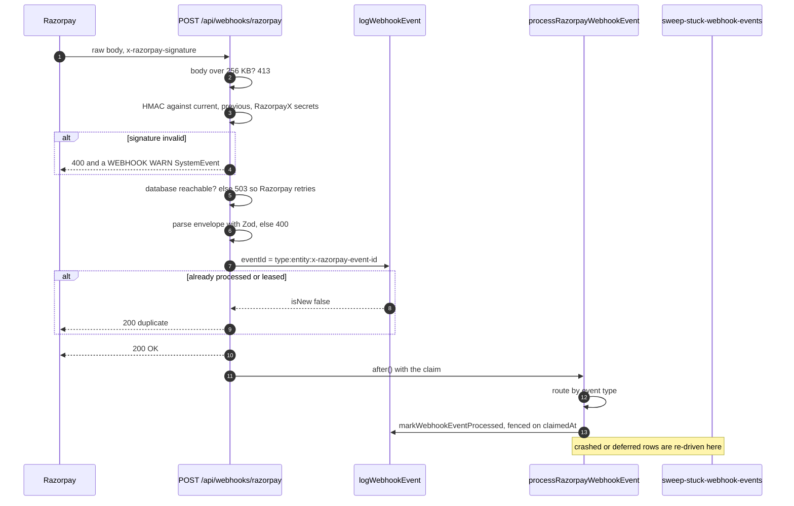
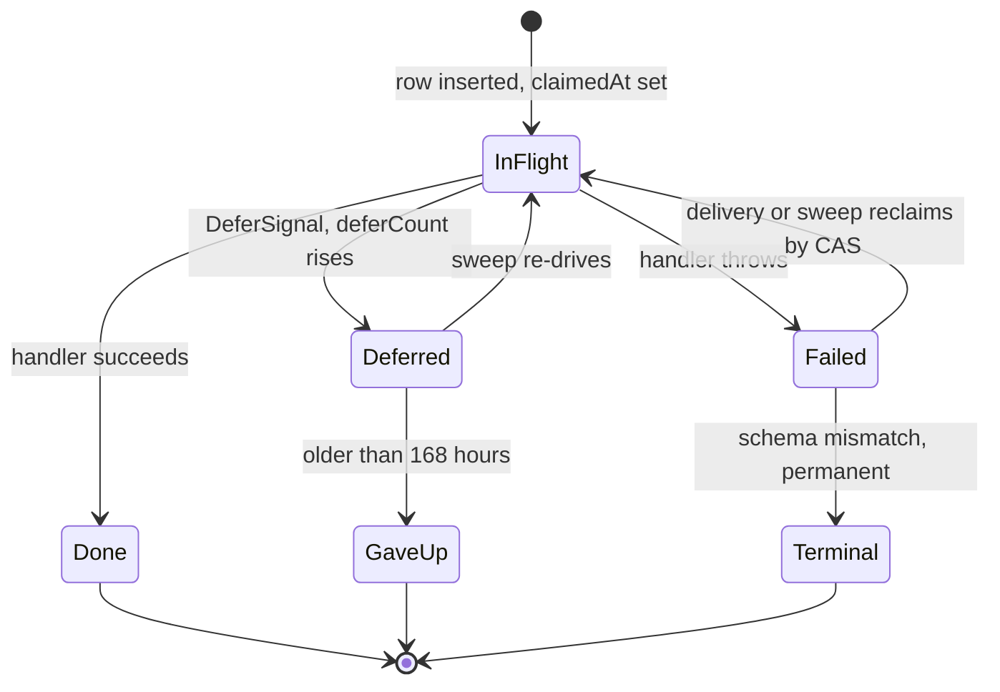

# Capture confirmation and webhooks

This page is the reference for how a gateway card capture becomes a confirmed booking. It states who is allowed to write `PaymentStatus.SUCCEEDED`, how the inbound webhook inbox deduplicates and recovers events, what happens to a capture that arrives at the wrong moment, and which sweep repairs each failure. The pricing and order creation that precede it are in [checkout and pricing](01-checkout-and-pricing.md); field-level payload details are in [the webhook reference](03-razorpay-webhook-reference.md).

## 1. One writer, four doors

`handlePaymentSuccess` in `lib/payments/webhooks/handlers.ts` is the only function that confirms a gateway card capture. It is reached from four doors. The first three call `routeCapturedPayment` (`app/api/webhooks/razorpay-dispatch.ts`), which selects the handler from the order's `notes.type`; the admin recover door calls `handlePaymentSuccess` directly:

| Door               | Entry point                                                                           | What it adds before calling in                                                                                                 |
| ------------------ | ------------------------------------------------------------------------------------- | ------------------------------------------------------------------------------------------------------------------------------ |
| Webhook            | `POST /api/webhooks/razorpay`, events `payment.captured` and `order.paid`             | HMAC check of the raw body; `WebhookEvent` row saved before the 200                                                            |
| Client verify      | `POST /api/checkout/verify-signature` and `GET /api/checkout/verify?sync=true`        | The first checks an HMAC of the order id and payment id keyed by `RAZORPAY_SECRET`; both fetch the payment from Razorpay first |
| Reconcile sweep    | `reconcile-payment-status`, every 15 minutes, payments 5 minutes to 7 days old        | Polls Razorpay for orders still `PENDING` locally, and for orders we closed in the last 72 hours                               |
| Admin recover door | `POST /api/payments/[paymentId]/recover` (`payments.manage`, step-up, `OpsActionLog`) | Builds the appointment for a `SUCCEEDED` payment whose metadata failed validation, passing `{ recover: true }`                 |

A client-side signature proves only that the order and payment ids belong together; it says nothing about whether money moved. That is why the client verify routes and the sweep fetch gateway truth (the webhook carries it in its signed body), and why `handlePaymentSuccess` refuses to settle when no captured amount is supplied (`capture without gateway amount - staying PENDING`). The recover door is the one caller that passes no amount: `{ recover: true }` admits only a row already `SUCCEEDED` with no appointment, whose capture was checked when it was first stamped, and the door refuses metadata that does not match the checkout order (`RECOVER_TARGET_MISMATCH`).

The recover door also refuses money that has already gone back or is contested. There is no `REFUNDED` payment status, so a late capture that was refunded automatically still reads `SUCCEEDED` with no booking, exactly like a capture waiting for recovery. Booking it would create an appointment and expert earnings on money the buyer already holds. `unreturnedCaptureWhere` (`lib/payments/webhooks/auto-refund-marker.ts`) therefore refuses a payment with any `PENDING` or `SUCCEEDED` refund, an owed-refund marker (`refundOwedKey`), an `Auto-refund pending:`, `Auto-refunded:` or `Auto-refund stuck:` description, or a dispute that is open or lost (a dispute that was won or closed keeps the money with the platform and does not block). The route answers 409 `PAYMENT_RETURNED`, and `handlePaymentSuccess` re-reads the same predicate inside its Serializable transaction and throws `RecoveryRefusedError`, so a refund that lands between the two aborts the booking. The owner chose to refuse on any such refund, not only a full one, and not to leave the judgement to the operator; the options are in [the 2026-11-12 decision record](../../decisions/2026-11-12-bug-hunt-money-doors.md).

Other code also writes `SUCCEEDED`, for rows that are not a gateway card capture of a booking. They are exempt because their confirmation is either synchronous or a different product:

| Writer                                                                           | Row it confirms                                                    |
| -------------------------------------------------------------------------------- | ------------------------------------------------------------------ |
| `writeCheckoutPayment` (`lib/payments/checkout/commit/payment-row.ts`)           | Wallet, invoice, licence, free and mock payments, born `SUCCEEDED` |
| `handleOverageMemberSuccess` (`lib/payments/webhooks/overage-handlers.ts`)       | A member's overage side payment                                    |
| `handleRecordingPurchaseSuccess` (`lib/payments/webhooks/recording-purchase.ts`) | A replay purchase                                                  |
| `mintChildOverageAccrualPayment` (`lib/payments/billing/overage-settlement.ts`)  | A child payment accruing onto an invoice                           |

The capture-race stamps inside `handlePaymentSuccess` itself are described in section 4. A test pins that no second confirmer appears (`__tests__/payments/confirmation-single-writer.test.ts`).

## 2. The webhook inbox

`POST /api/webhooks/razorpay` (`app/api/webhooks/razorpay/route.ts`) answers inside Razorpay's five-second limit and does the real work after the response.

**Secrets.** `resolveRazorpayPaymentSecrets` (`app/api/webhooks/razorpay/signature.ts`) returns `RAZORPAY_WEBHOOK_SECRET` and, during a rotation, `RAZORPAY_WEBHOOK_SECRET_PREVIOUS`. A delivery that matches the previous secret is accepted and logged as a `WEBHOOK` warning so a variable left behind after the rotation is loud. The RazorpayX secret (`RAZORPAYX_WEBHOOK_SECRET`, with its own `_PREVIOUS`) is tried only when `isPayoutEventName` shows an event beginning `payout.` or `fund_account.`, so a payout credential can never forge a payment event. A missing current secret answers 500 rather than accepting anything. Rotation steps are in [the go-live checklist](../70-operations/07-go-live-checklist.md).

**Identity.** The dedupe key is `<eventType>:<entityId>:<razorpayEventId>`. The type and entity id come from the signed body. The third part is the `x-razorpay-event-id` header when it matches `^[A-Za-z0-9_-]{1,64}$` and a 16-character SHA-256 of the body otherwise. Razorpay keeps the header stable across retries and dashboard replays, so redeliveries collapse, while two real updates on one entity (a second `payout.updated`, a later dispute phase) carry different ids and both run. The header is unsigned; replaying a captured body under a new id is absorbed because every handler is idempotent.

**Claim and lease.** `logWebhookEvent` (`lib/webhooks/event-log.ts`) inserts the row and returns a claim whose `claimedAt` is the lease stamp. A row that is processed, terminal or leased for less than five minutes returns `isNew: false`. A previously failed row, or a row leased for more than five minutes, is reclaimed with a CAS on the old `claimedAt`, so exactly one worker wins. `markWebhookEventProcessed` is fenced on the same stamp, which means a Netlify container that wakes after its lease was reclaimed cannot overwrite the new worker's result.

A handler answers `DeferSignal` when the event is valid but its subject row does not exist yet: a refund before its capture, a dispute before its payment, a refund bound to a reservation not yet written. The row is left `processed = false`, `error = null` and its `deferCount` rises; that is indistinguishable from a crash, which is exactly why the counter exists. A Zod failure is recorded as `permanent: schema mismatch` and never retried.

## 3. Event-to-handler table

| Event                                                                          | Handler                                                                                            |
| ------------------------------------------------------------------------------ | -------------------------------------------------------------------------------------------------- |
| `payment.captured`, `order.paid`                                               | `routeCapturedPayment`, then `postGatewayFee` when the payload carries a fee                       |
| `payment.failed`                                                               | `handlePaymentFailure`, `handleOrgPaymentFailure`, overage or recording failure by `notes.type`    |
| `refund.created`, `refund.processed`, `refund.failed`                          | `handleRefundCreated`                                                                              |
| `refund.speed_changed`                                                         | Stores `speedRequested` and `speedProcessed` on `Refund.metadata`; defers if the refund is unknown |
| `payment.dispute.created`                                                      | `handleDisputeCreated`                                                                             |
| `payment.dispute.under_review`, `.action_required`, `.won`, `.lost`, `.closed` | `handleDisputeUpdated`                                                                             |
| `payout.*` (nine events)                                                       | `handleRazorpayPayoutWebhook`, organisation payout first, then consultant payout                   |
| `fund_account.validation.completed`, `.failed`                                 | `handleFundAccountValidationWebhook`                                                               |
| `settlement.processed`                                                         | Logged only; the settlement job reads Razorpay's report itself                                     |

`notes.type` selects the capture handler: `credit_purchase` and `invoice_payment` go to the organisation handlers, `overage_member` to the overage handler, `recording_purchase` to the replay handler, and everything else to `handlePaymentSuccess`. Organisation, overage and replay handlers receive the captured amount only when it came from a payment entity, because on `order.paid` the order total is not what was settled.

## 4. What `handlePaymentSuccess` does

It runs in two phases. Phase 1 is one Serializable transaction (15 second timeout, retried on `P2034`); Phase 2 runs after commit and is best effort.

**Phase 1.**

1. Read the payment by `paymentIntent`. A row still carrying a `premint_` intent is adopted only if the order, read from Razorpay, names that row in its notes and the amount and currency match (`verifiedPreMintAdoption`, `adoptPreMintRow`).
2. A payment already `SUCCEEDED` returns at once (idempotent redelivery) unless the delivery contradicts it: a supplied captured amount that differs from the row, or a supplied gateway id that differs from a stamped one. A missing amount or id matches, and a row with no gateway id yet is stamped with the supplied one.
3. Apply the capture-race rules in the table below.
4. Otherwise CAS the payment `PENDING` to `SUCCEEDED`, stamping `gatewayPaymentId` and `capturedAt`, then confirm the appointment (`confirmExistingAppointment`): tentative occurrences become confirmed, the participant becomes confirmed, a trial becomes `SCHEDULED`.
5. Create earnings and the `booking:<paymentId>` journal inside a savepoint. If that fails for any reason other than a serialization abort, the booking still confirms and Phase 2 retries the earnings.
6. Stage the payment-success email, the booked emails and the notification bells in the outbox.

**Phase 2** flushes the staged email and bells, creates earnings if Phase 1 deferred them, mints the consumer tax invoice (`mintConsumerInvoiceBestEffort`), and ensures the Stream chat channels. Each external step has a five-second deadline (`withPhase2Deadline`) so a slow vendor cannot hold the database connection.

### Captures that arrive at the wrong moment

Every row below is decided inside Phase 1 and leaves a durable marker, so a crash after commit loses nothing.

| Situation                                                                                                                                                                                                                  | Phase 1 result                                                                   | Money outcome                                                                                              |
| -------------------------------------------------------------------------------------------------------------------------------------------------------------------------------------------------------------------------- | -------------------------------------------------------------------------------- | ---------------------------------------------------------------------------------------------------------- |
| Capture on an `EXPIRED` or `FAILED` payment (hold lapsed)                                                                                                                                                                  | CAS to `SUCCEEDED` with an `Auto-refund pending:` description; cash parked       | Refunded by `refundBookingPayment` after commit                                                            |
| Captured amount differs from `Payment.amount`                                                                                                                                                                              | `SUCCEEDED` with the marker; cash parked; P1 log line                            | Refund of `min(captured, expected)`; any surplus above the order stays `REQUIRES_MANUAL_RECOVERY:` for ops |
| Metadata fails validation                                                                                                                                                                                                  | `SUCCEEDED` with `REQUIRES_MANUAL_RECOVERY:`; no appointment; cash parked        | Ops use the recover door (which refuses a refunded, marked or disputed payment), or refund                 |
| Event is full, trial no longer awaiting payment, seat released, booking cancelled                                                                                                                                          | `SUCCEEDED` with the marker; cash parked                                         | Refunded after commit                                                                                      |
| Held webinar or class seat that checkout would no longer sell: the webinar is over or completed, the class is over or its enrolment has closed, or the buyer now has another live booking at one of its remaining sessions | Seat released `HELD` to `CANCELLED`; `SUCCEEDED` with the marker; cash parked    | Refunded in full after commit                                                                              |
| Payer already holds another live booking at that time                                                                                                                                                                      | `doubleBookingBlocked`; marker; cash parked                                      | Refunded; the loser's tentative slots released                                                             |
| Legacy-shape capture trips `occurrence_no_confirmed_overlap`                                                                                                                                                               | Caught outside the transaction; restamped `SUCCEEDED` with the marker and parked | Refunded                                                                                                   |
| Capture on a payment that is already terminal in another way                                                                                                                                                               | Status left alone; `CAPTURE_AFTER_TERMINAL_PAYMENT` recorded                     | Operator refunds by hand                                                                                   |

"Parked" means the cash is booked to `UNAPPLIED_RECEIPTS` (`Dr GATEWAY_CLEARING / Cr UNAPPLIED_RECEIPTS`, key `unapplied:<paymentId>`) so revenue, GST and earnings are never recognised for money that funds no booking. The refund returns it with `Dr UNAPPLIED_RECEIPTS / Cr GATEWAY_CLEARING`. See [postings](../20-ledger/04-postings.md).

The `Auto-refund pending:` prefix on `Payment.description` (`lib/payments/webhooks/auto-refund-marker.ts`) is the work queue. The `retry-auto-refunds` sweep drains it: it skips a payment that already has a `PENDING` refund (that belongs to `reconcile-refunds`) or a live dispute, and after three failed gateway attempts it rewrites the prefix to `Auto-refund stuck:` and pages once. The marker becomes `Auto-refunded:` when the refund settles.

### Worked example

Charlotte Brown's order for Hannah Anderson's session (172,400 paise, ₹1,724.00, see [checkout and pricing](01-checkout-and-pricing.md)) had a hold that lapsed at 10:30 IST on Monday 26 October 2026, and the `abandoned-payments` sweep moved the row to `EXPIRED`. Charlotte finishes paying at 10:41 IST. Razorpay sends `payment.captured` for 172,400 paise. `handlePaymentSuccess` finds the `EXPIRED` row, CASes it to `SUCCEEDED` with `Auto-refund pending: capture landed on a EXPIRED payment whose hold was already released. Booking NOT confirmed.`, and posts `unapplied:<paymentId>` for 172,400 paise. After commit, `refundBookingPayment` reserves a `Refund` of 172,400 keyed `late-capture:<pay_id>`, calls Razorpay with the refund id as its idempotency key and `late_capture_<pay_id>` as its receipt, and the refund cascade posts `refund:<refundId>` (`Dr UNAPPLIED_RECEIPTS / Cr GATEWAY_CLEARING`, 172,400). No earnings row, no GST and no tax invoice exist for this payment. If Razorpay is down at 10:41, the marker stays and the next `retry-auto-refunds` tick finishes the job. Had the `payment.captured` webhook never arrived, the next `reconcile-payment-status` run would have read the order's payments, found the capture and sent it through the same `handlePaymentSuccess` call, because the row was moved to `EXPIRED` less than 72 hours earlier.

A late webhook after the sweep, or the sweep after the webhook, refunds nothing more. Three layers make one refund per capture. The `EXPIRED → SUCCEEDED` compare-and-set lets only one caller reach the refund. The `Refund.dedupeKey` `late-capture:<pay_id>` makes a repeat call return the first refund. Razorpay refuses a second refund on the same payment carrying the receipt `late_capture_<pay_id>` with `400 BAD_REQUEST_ERROR` ([refund receipt](https://razorpay.com/docs/api/refunds/create-normal/)). The `X-Refund-Idempotency` header stays the reservation id, so a retry of one reservation still replays its own refund. A key released after a definitive refusal moved no money and can be used again.

## 5. Recovery sweeps

| Failure                                     | Sweep (all under `/api/cleanup/<job>`, run by the Netlify ticker) | What it does                                                                                                                                                                                                           |
| ------------------------------------------- | ----------------------------------------------------------------- | ---------------------------------------------------------------------------------------------------------------------------------------------------------------------------------------------------------------------- |
| Handler crashed or deferred after the 200   | `sweep-stuck-webhook-events`                                      | Re-drives rows idle for 6 minutes through the same dispatcher; warns at 72 hours, gives up at 168 hours                                                                                                                |
| Webhook lost entirely                       | `reconcile-payment-status`                                        | Polls Razorpay for local `PENDING` orders and routes any capture through `routeCapturedPayment`                                                                                                                        |
| Capture on an order we closed, webhook lost | `reconcile-payment-status`                                        | Re-reads `EXPIRED` orders closed in the last 72 hours with no capture recorded, plus one read after them; a capture found is recorded through the `EXPIRED` arm and refunded, net of any refund already at the gateway |
| Capture committed but slots still tentative | `reconcile-orphaned-confirmations`                                | Re-runs `confirmExistingAppointment`; also stamps `chatChannelEnsuredAt` for confirmed bookings missing a channel                                                                                                      |
| Earnings or booking journal not written     | `sync-payment-earnings`                                           | Writes earnings for `SUCCEEDED` payments with none, oldest first, skipping refunded and parked payments                                                                                                                |
| Auto-refund marker not yet settled          | `retry-auto-refunds`                                              | Drives the refund, three attempts, then pages                                                                                                                                                                          |
| `PENDING` payment past its hold             | `abandoned-payments`                                              | Expires the row, releases the hold, restores credits, the discount use and the organisation engagement, checks the gateway order for a live payment                                                                    |
| Gateway fee missing from the books          | `reconcile-gateway-settlements`                                   | Books `gatewayfee:<pay_id>` from Razorpay's settlement report under the same key the webhook uses                                                                                                                      |

The sweeps count only; the cadence of each lives in `netlify/functions/cron-tick.mts` and is described in [scheduled jobs](../70-operations/01-scheduled-jobs.md). Stuck-event triage is in [webhook recovery](../70-operations/04-webhook-recovery.md).

Retention is separate. `archive-webhook-events` prunes every processed or failed event after 1 year (calendar), and it runs weekly on the Sunday ticker slot in time-budgeted batches.

## 6. Invariants

| Rule                                                            | Enforcer                                                                                                        | Test                                                        | Repair                                |
| --------------------------------------------------------------- | --------------------------------------------------------------------------------------------------------------- | ----------------------------------------------------------- | ------------------------------------- |
| Only `handlePaymentSuccess` confirms a gateway capture          | Code structure; doors reach it only through `routeCapturedPayment` or the recover door                          | `__tests__/payments/confirmation-single-writer.test.ts`     | None; a review rule                   |
| A recovery never books money that was returned or is contested  | `unreturnedCaptureWhere` in the recover route and again inside the capture transaction (`RecoveryRefusedError`) | `__tests__/payments/recover-door.test.ts`                   | None; refused with `PAYMENT_RETURNED` |
| A redelivered or duplicate event does the work once             | `WebhookEvent.eventId` unique; claim lease; `claimedAt`-fenced completion; handler idempotency                  | `__tests__/payments/webhook-replay-matrix.test.ts`          | `sweep-stuck-webhook-events`          |
| An event cannot be both processed and errored                   | `webhook_event_processed_error_exclusive` CHECK                                                                 | none (database)                                             | None; uncommittable                   |
| A capture never confirms a booking at the wrong amount          | Parity check inside Phase 1                                                                                     | `__tests__/payments/capture-amount-parity.test.ts`          | `retry-auto-refunds`                  |
| Two confirmed sessions never overlap for one expert             | `occurrence_no_confirmed_overlap` exclusion constraint                                                          | `__tests__/payments/legacy-capture-tentative-birth.test.ts` | Auto-refund of the loser              |
| Parked cash is never recognised as revenue                      | `UNAPPLIED_RECEIPTS` journal; earnings refused for a parked capture (`ParkedCaptureEarningsError`)              | `__tests__/payments/earnings-sync-healer.test.ts`           | `retry-auto-refunds`                  |
| A payment status moves only from the status the writer expected | `updateMany` with the prior status in `WHERE`                                                                   | `__tests__/payments/money-races.test.ts`                    | `reconcile-payment-status`            |

## Where in code

- `app/api/webhooks/razorpay/route.ts`, `signature.ts`, `razorpay-dispatch.ts`.
- `lib/webhooks/event-log.ts`: `logWebhookEvent`, `markWebhookEventProcessed`.
- `lib/payments/webhooks/handlers.ts`: `handlePaymentSuccess`, `handlePaymentFailure`, `confirmExistingAppointment`.
- `lib/payments/webhooks/auto-refund-marker.ts`, `lib/payments/ledger/unapplied-receipts.ts`.
- `scripts/cleanup/sweep-stuck-webhook-events.ts`, `scripts/payments/reconcile-payment-status.ts`, `scripts/payments/reconcile-orphaned-confirmations.ts`, `scripts/payments/retry-auto-refunds.ts`.

## Related

- [Razorpay webhook reference](03-razorpay-webhook-reference.md) for payload fields and wire quirks.
- [Refunds](../30-refunds-disputes/01-refunds.md) for what the auto-refund does after the marker.
- [Admin money doors](../70-operations/02-admin-money-doors.md) for the recover door's guard rails.

## Deprecated & Superseded Approaches

The client verify route once flipped `Payment.paymentStatus` to `SUCCEEDED` itself. A client return that beat the webhook then made the webhook hit the already-`SUCCEEDED` early return, which skipped appointment confirmation, earnings, the booking journal and the amount check. The webhook, client verify and sweep doors now call `routeCapturedPayment`, and the recover door calls `handlePaymentSuccess` directly; delete any direct status write you find. A payment failure used to cancel the slot and restore credits immediately; it now preserves both while the hold is open, because Razorpay fires `payment.failed` on each failed attempt inside one order. Stripe and Redlock were documented here at one point; neither exists in the code, and locking is Upstash `SET NX` through `utils/appointmentlock.ts`.
