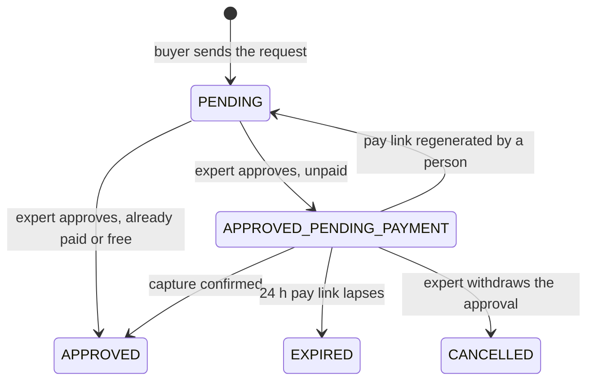

# Approval payments

Some bookings are paid after the expert says yes. A buyer sends a request for a consultation, or a trial is accepted, and only then does the buyer get a pay link. A subscription plan never gets one: a paid plan is charged at checkout, a free plan needs no charge, and approving or allocating a subscription that has no successful payment is refused with `SUBSCRIPTION_UNPAID`. This page explains how that link is minted without ever leaving an order and a row out of step, how long it lives, and how an unpaid approval ends. Direct checkout, where the buyer pays first, is in [checkout and pricing](01-checkout-and-pricing.md); both flows end in the same confirmation path ([capture confirmation](02-capture-confirmation-and-webhooks.md)).

## 1. The shape of the flow

A consultation approval can land in two places. A request whose booking already carries a `SUCCEEDED` payment, or whose plan is free, goes straight to `APPROVED`. Any other consultation request goes to `APPROVED_PENDING_PAYMENT` and mints a pay order after the approval commits. A subscription approval only ever lands in `APPROVED`. The predicates for both arms live in `lib/booking/approve-request.ts` and ride inside the compare-and-swap `WHERE` of the approving write, so an approval can never confirm a booking nobody paid for. Every writer that approves a consultation (the detail `PATCH` route, the allocation handler and the allocation page) calls `mintApprovalPaymentAfterCommit` afterwards.

A lapse ends in `EXPIRED` only for a window that really ran out. When the expert deliberately takes back a live, still-payable approval the request ends `CANCELLED`, because telling the buyer "Expired" about something the expert withdrew would be false (`LAPSED_TO` in `lib/booking/lapse-approved-request.ts`). Rejection is the expert declining, which neither of these is.

## 2. Minting the link

`createApprovalPaymentIntent` (`lib/payments/operations/approval-payment.ts`) runs under a Redis lock keyed `approval-payment-mint:<kind>:<id>` (Upstash `SET NX`, 30 second TTL) so two clicks cannot mint two orders. It prices the booking with the same `deriveCheckoutAmount` as checkout, so the link charges the same GST and sets the same `buyerCountry` and `consumerStateCode`. No discount code and no referral credits ride a pay link by decision; the figure is the list price plus tax. The list price is the price the request was made at, not the plan's price today. `calculateAmount` in the same file reads `Consultation.agreedPricePaise` through `agreedConsultationPricePaise`, and `Trial.agreedPricePaise` through `agreedTrialPricePaise`, and falls back to the plan only for a row whose column is null (created before the column).

**Example.** Priya Anderson requests Hannah Anderson's 60-minute 1:1 while the plan costs ₹500 (50,000 paise). Hannah then edits the plan to ₹2,000 and 30 minutes. When she approves the request, Priya's link is ₹500 plus 18 % GST, which is ₹590 (59,000 paise), and the booking stays 60 minutes for every later move, because the length is read from the session she holds. Hannah's new price applies to requests made after the edit.

The order of operations is chosen so a crash at any point leaves something the sweeps can read.

1. **Write the row first.** A `PENDING` `Payment` is created with a throwaway intent beginning `premint_`, a `CARD` leg equal to the amount, `expiresAt` 24 hours out (`APPROVAL_PAYMENT_EXPIRATION_HOURS`), and the request's own appointment as `appointmentId`. The row exists before Razorpay is called.
2. **Mint the order.** The order's notes carry `familiarisePaymentId` as their first key, so even if the next step fails a capture on this order can find its row. The same deadline is passed to Razorpay as the capture window.
3. **Fill by CAS.** One transaction does `UPDATE … SET paymentIntent = <order id> WHERE id AND paymentIntent = <premint> AND paymentStatus = PENDING` and updates the `CARD` leg's `sourceRef` to the order id. If it matches zero rows, another mint won; this order is tombstoned (`tombstoneAbortedGatewayOrder`: an `EXPIRED` row for the orphan order so a late capture is refunded) and the caller gets `ApprovalPaymentExistsError`, a retryable 409.
4. **Failure paths.** If the gateway call throws, the pre-mint row is set `EXPIRED` so the next mint re-mints into it. If the fill throws, the minted order is tombstoned and the row expired.

If a live `PENDING` payment already exists for the request, the mint is idempotent: it returns the existing order unless the frozen figures no longer match the request's frozen price or the tax classification (a plan edit alone no longer changes the price, so it never re-mints a live link), in which case it re-mints in place (`claimRowForRemint`, a CAS on the row's prior status and intent). A dead row is re-minted into rather than duplicated, because `Payment` is unique on user and appointment. A request whose own window has lapsed is refused with `ApprovalWindowLapsedError` and the buyer must ask again. A `SUCCEEDED` payment refuses with `ALREADY_PAID`. A re-mint that wins its compare-and-swap returns the referral credit the old order used (`reverseCreditsForPayment`) in the same transaction, before the tombstone is written. The new order charges the full price, so the credit is not used by it, and the tombstone holds no usage. A late capture on the old order is refunded and returns no credit a second time.

For Razorpay the stored link is the order id, not a URL. `payPagePath` turns it into `/checkout/pay/<paymentId>`, and `lib/payments/pay-page.ts` decides what that page shows: open the order, re-mint first, already paid, or no longer payable. The pay page is the only way a buyer opens the order.

## 3. Time and expiry

The link lives for 24 hours from the mint. The `abandoned-payments` sweep (`scripts/payments/cleanup-abandoned-payments.ts`) does three jobs for approvals:

- **Half-window reminder.** When half the window is left (`APPROVAL_PAYMENT_REMINDER_MS`, 12 hours) it sends one reminder, deduplicated by the payment id and the reminder email type; it never sends after expiry. The expert can also nudge the buyer manually, once per 24 hours per appointment, under a separate email type so the two never dedupe each other (`lib/booking/remind-payment.ts`), and only while the newest `PENDING` order is unexpired (`lib/booking/payment-reminder-eligibility.ts`).
- **Lapse.** A `PENDING` payment past `expiresAt` is expired, its tentative holds are released by status, and the request is moved to `EXPIRED` by `lapseApprovedRequest` with reason `PAYMENT_LAPSED`. The request's compare-and-swap carries the unpaid predicate in its `WHERE`, so a capture that already flipped the row matches zero rows and nothing below runs. In the same transaction, `expirePendingPaymentsInTx` claims each open order `PENDING` to `EXPIRED` by its own compare-and-swap and, for each order it moved, returns what its checkout consumed: the referral credit (under the buyer's rules for expired credit), the discount-code use and the programme engagement. No gateway cancel runs. The Withdraw and the too-close lapse share this body ([decision record](../../decisions/2026-11-20-unpaid-approval-orders-return-what-checkout-consumed.md)).
- **Gateway cleanup.** The Razorpay order cannot be voided, so the `EXPIRED` row is its tombstone. A capture that lands on it is refunded automatically ([capture confirmation](02-capture-confirmation-and-webhooks.md#4-what-handlepaymentsuccess-does)).

`expire-stale-requests` is a slower backstop: it expires any `APPROVED_PENDING_PAYMENT` request older than seven days, and any `PENDING` subscription request older than 30 days, using the same `lapseApprovedRequest` core.

### Worked example

Olivia Anderson asks Grace Anderson (an independent consultant) for a consultation listed at ₹1,500 and Grace approves on Monday 26 October 2026 at 11:00 IST. The mint prices 150,000 paise of list price, 27,000 paise of GST and a 177,000 paise charge (₹1,770.00), writes the `premint_` row with `expiresAt` Tuesday 27 October 11:00 IST, creates the Razorpay order and fills the row. At 23:00 IST the sweep sends the reminder. Olivia does not pay. At 11:15 IST Tuesday the sweep expires the payment, releases the slot and moves the request to `EXPIRED`; Olivia is told the link lapsed. Had Olivia paid at 10:59 IST Tuesday, `payment.captured` would have confirmed the existing appointment and moved the request to `APPROVED`. Had she paid at 11:20 IST, the capture would land on the `EXPIRED` row and be refunded in full.

## 4. Invariants

| Rule                                                   | Enforcer                                                                                                                             | Test                                                                                                                                     | Repair                                                                                                       |
| ------------------------------------------------------ | ------------------------------------------------------------------------------------------------------------------------------------ | ---------------------------------------------------------------------------------------------------------------------------------------- | ------------------------------------------------------------------------------------------------------------ |
| One live pay order per request                         | Mint lock, `Payment` unique on user and appointment, fill CAS on the pre-mint intent                                                 | `__tests__/payments/approval-payment-appointment-link.test.ts`                                                                           | `abandoned-payments`; tombstone refund                                                                       |
| An order always has a row to land on                   | Row written before the order; `familiarisePaymentId` first in the notes; tombstone on loss                                           | `__tests__/payments/approval-path-correctness.test.ts`                                                                                   | Capture adoption in `handlePaymentSuccess`                                                                   |
| A pay link charges the price the request was made at   | `calculateAmount` reads `agreedPricePaise`; sidecar CHECKs `consultation_agreed_price_valid` and `trial_agreed_price_valid` bound it | `__tests__/payments/approval-payment-appointment-link.test.ts`                                                                           | `freezeConsultationPrice` and `freezeTrialPrice` stamp a still-null row before a plan edit changes the price |
| An approval never confirms an unpaid booking           | `SETTLED_*` and `UNPAID_*` predicates inside the approving CAS                                                                       | `__tests__/payments/approval-path-correctness.test.ts`                                                                                   | None; refused at write                                                                                       |
| A paid request is never lapsed                         | The lapse CAS carries the unpaid predicate in its `WHERE`                                                                            | `__tests__/payments/pay-link-reminder.test.ts`                                                                                           | None                                                                                                         |
| A lapse or re-mint returns what checkout consumed once | Given back only for an order the lapse's or re-mint's own compare-and-swap moved, in the same transaction                            | `__tests__/db/booking/lapse-returns-what-checkout-consumed.db.test.ts`, `__tests__/db/booking/approval-remint-returns-credit.db.test.ts` | None; orders before 2026-11-20 are not backfilled                                                            |
| One reminder per window                                | Outbox dedupe on payment id and email type                                                                                           | `__tests__/payments/pay-link-reminder.test.ts`                                                                                           | None                                                                                                         |

## Where in code

- `lib/booking/approve-request.ts`: the two approval arms and `mintApprovalPaymentAfterCommit`.
- `lib/payments/operations/approval-payment.ts`: `createApprovalPaymentIntent`.
- `lib/booking/lapse-approved-request.ts`, `lib/booking/pay-link-persist.ts`, `lib/booking/remind-payment.ts`.
- `lib/payments/pay-page.ts`, `lib/payments/pay-link-href.ts`, `lib/payments/pre-mint-intent.ts`, `lib/payments/constants.ts`.
- `scripts/payments/cleanup-abandoned-payments.ts`, `scripts/appointments/expire-stale-requests.ts`.

## Related

- [Checkout and pricing](01-checkout-and-pricing.md).
- [Scheduled jobs](../70-operations/01-scheduled-jobs.md) for the sweep cadence.

## Deprecated & Superseded Approaches

Earlier documents described a 48 hour pay link, a Redlock-based distributed lock, a mint that happened inside the approval transaction, React Email templates priced in US dollars, a Stripe checkout URL, and a test suite and troubleshooting guide that cited files which do not exist. The code uses 24 hours, Upstash `SET NX` with a 30 second TTL, a mint after commit, and the row-first order described above. The sweep never resets an unpaid request to `PENDING`; the only `APPROVED_PENDING_PAYMENT` to `PENDING` edge is a person regenerating the link. Delete any lock, email or test reference that does not match.

A lapse used to expire the open order with a plain `updateMany` and leave the referral credit, the code use and the engagement spent, and a re-mint left the old order's credit on its tombstone; both now return it (sections 2 and 3).

A pending request used to be priced from the plan's current price at approval, and a live pay link was re-minted at the new amount when the plan changed. The request now carries its own price from the moment it is made.
