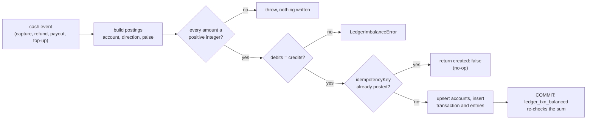

# The double-entry model

Every movement of money on the platform is recorded as one balanced transaction in a single journal, and every balance is a sum over that journal. This page explains the model: what a transaction is, why amounts are integer paise, which numbers are caches rather than truth, and what the database refuses to store. The accounts themselves are in [chart of accounts](02-chart-of-accounts.md) and the exact lines each flow posts are in [postings](04-postings.md).

## 1. Four rules that never bend

1. **Money is integer paise.** There are no floats anywhere in a money path. ₹1 is 100 paise, so ₹1,180 is `118000`. Splits are basis points (bps, one hundredth of a percent, 10,000 bps = 100 %), and a split must sum to its whole as an integer equality: `platformBps + orgBps + consultantBps = 10000`. Every money column is `BigInt` in Postgres, and `lib/prisma.ts` converts each of them to a plain `number` at the client boundary, so application code and JSON never see a `bigint`. That is safe up to `Number.MAX_SAFE_INTEGER` paise, about ₹90 lakh crore. The one read shape the extension cannot convert is an aggregate (`_sum`, `groupBy`), so every aggregation goes through `sumPaise` (`lib/payments/utils/money.ts`), which throws if a total leaves the safe range, and proportional arithmetic goes through `prorate`, which multiplies in `BigInt` so the intermediate product cannot overflow. `scripts/ci/check-money-columns.ts` rejects a new `Int` money column, and `__tests__/lib/prisma-money-extension.test.ts` fails if a `BigInt` column is missing from the boundary map.
2. **Every cash event is one balanced transaction.** A `LedgerTransaction` owns two or more `LedgerEntry` rows, each a positive `amountPaise` with a `direction` of `DEBIT` or `CREDIT`, and the debits equal the credits. `postLedgerTxn` (`lib/payments/ledger/post.ts`) refuses an unbalanced set before writing, and the deferred constraint trigger `ledger_txn_balanced` refuses it again at `COMMIT` (`prisma/sql/ledger-triggers.sql`). The trigger proves only balance. It does not prove that every business event was posted, or that a cache agrees with the journal; the reconciler covers those ([integrity and reconciliation](06-integrity-and-reconciliation.md)).
3. **The journal is append-only.** `ledger_entry_immutable` and `ledger_transaction_immutable` are `BEFORE UPDATE OR DELETE` triggers that raise, and `ledger_entry_amount_positive` requires `amountPaise > 0`. A wrong posting is corrected by a counter-transaction, never an edit.
4. **Balances are derived.** "How much do we owe this expert?" is `Σ debit − Σ credit` over that account's entries (`ledgerBalancePaise`), not a stored column. For a credit-normal account, which is every liability and revenue, the amount owed is the negative of that signed figure.

## 2. The three things in the journal

| Thing               | Role                                                                                                                                                  |
| ------------------- | ----------------------------------------------------------------------------------------------------------------------------------------------------- |
| `LedgerAccount`     | A bucket, scoped to the platform, an organisation or a consultant. Its id is its scope: `<kind>\|<org or _>\|<consultantProfileId or _>\|<currency>`. |
| `LedgerTransaction` | One balanced event. `idempotencyKey` is unique and names the flow (`booking:<paymentId>`), and `kind` is the typed `LedgerTransactionKind` enum.      |
| `LedgerEntry`       | One line: an account, a direction and a positive amount. `LedgerEntry.transactionId` is `onDelete: Restrict`.                                         |

Two ledgers exist, not one. The money journal above records cash. `UsageLedgerEntry` is a separate single-entry log that counts engagements a member has consumed against a programme cap; it answers a different question and has its own immutability trigger.

## 3. Derived, but with checked caches

Always deriving would make the wallet overdraft guard impossible, because two bookings must not both spend the last rupee, and the cheapest correct primitive for that is a conditional `UPDATE … WHERE walletBalance >= amount`. So `BillingAccount.walletBalance` is a stored cache of the organisation's `WALLET` account. The journal is the truth, the cache is what the hot path reads and decrements, and the scheduled reconciler compares them in bounded, resumable pages and raises `WALLET_BALANCE_DRIFT` on any difference. A difference is an incident, never something to patch by hand. The database adds a floor: `billing_account_wallet_nonnegative`.

The same contract holds wherever a column mirrors a journal figure. Earnings amounts are caches the reconciler checks against the booking journal (`EARNINGS_LEDGER_DRIFT`), and the programme counters `ProgramAssignment.engagementsUsed` and `consumedPaise` are re-derived from `UsageLedgerEntry` (`PROGRAM_ASSIGNMENT_ENGAGEMENTS_DRIFT`, `CREDIT_POOL_CONSUMED_DRIFT`). A per-account stored balance was rejected on purpose, because one row updated by every booking would force every concurrent confirmation platform-wide to queue behind the last one under Serializable isolation.

## 4. INR only

Razorpay settles in INR and no conversion happens before posting, so every posting leaves `AccountRef.currency` unset, which means `INR`. The currency is the last segment of the account id, so keying an account by a display currency would silently mint a second account and split a balance. The `ledger_account_currency_inr` CHECK refuses a non-INR account. See [gateway and currency](../10-money-in/04-razorpay-gateway-and-currency.md).

## 5. Idempotency per flow

Each flow derives its key from a stable upstream id, so an at-least-once webhook or a retried sweep collapses to one posting: `booking:<paymentId>`, `refund:<refundId>`, `topup:<orderId>`, `topup-refund:<gatewayRefundId>`, `payout:<payoutId>`. A booking and its refund are different events on the same payment, and per-flow keys let each post once. If two callers race, the loser's insert hits the unique index, aborts its transaction, and the retry finds the first posting. The full vocabulary of keys is in [postings](04-postings.md#1-the-journal-vocabulary).

A booking of a ₹0-priced plan moves no money, so it posts no journal (a full discount or a credit-funded order still journals its `DISCOUNT` or `PLATFORM_PROMO` line): `postBookingLedgerJournal` skips the journal only when it has no lines **and** the payment charged nothing (`bookingNeedsJournal`); a paid booking that computes no lines still reaches `postLedgerTxn`, which refuses an empty journal. Its earnings rows are ₹0 caches with nothing to mirror, so the reconciler expects a `booking:<paymentId>` journal for earnings with `grossAmount > 0` or a payment with `amount > 0` (`EARNINGS_WITHOUT_BOOKING_TXN`).

## Worked example

IIT Madras tops up its prepaid wallet with ₹5,00,000 by card. The capture posts one transaction, `topup:<razorpay order id>`:

| Account                              | Direction |      Paise |       Rupees |
| ------------------------------------ | --------- | ---------: | -----------: |
| `GATEWAY_CLEARING`                   | DEBIT     | 50,000,000 | ₹5,00,000.00 |
| `WALLET` (organisation `iit-madras`) | CREDIT    | 50,000,000 | ₹5,00,000.00 |

Debits equal credits, so `ledger_txn_balanced` passes. `WALLET` is a liability: the platform now owes IIT Madras ₹5,00,000 of spending power, and `BillingAccount.walletBalance` rises by 50,000,000 in the same transaction. Later a ₹5,000 session with 18 % GST debits `WALLET` 590,000 and the cache falls by the same amount. If the two ever disagree, the reconciler reports `WALLET_BALANCE_DRIFT` and the wallet is frozen ([integrity and reconciliation](06-integrity-and-reconciliation.md)).

## 6. Five different money flows

These are distinct and must not be conflated.

- **Refund**: money back to the buyer for a booking. A `Refund` row plus the `refund:<refundId>` journal. See [refunds](../30-refunds-disputes/01-refunds.md).
- **Payout**: money from the platform to a seller (a consultant or a host organisation), net of withholding. `ConsultantPayout` or `OrganizationPayout`, journals `payout:<id>` and `orgpayout:<id>`.
- **Referral**: a platform-funded incentive, never a buyer payment. See [referral credits](07-referral-credits.md).
- **Wallet credit**: an organisation's prepaid balance, owed back to the organisation, a liability on the `WALLET` account.
- **Chargeback**: the bank pulling money back through the gateway, a `Dispute` and a `chargeback:<disputeId>` journal. See [chargebacks](../30-refunds-disputes/02-chargebacks.md).

## Where in code

- `lib/payments/ledger/post.ts`: `postLedgerTxn`, `ledgerAccountId`, `ledgerBalancePaise`.
- `prisma/sql/ledger-triggers.sql` and `prisma/sql/check-constraints.sql`: the database enforcers.
- `lib/prisma.ts`, `lib/payments/utils/money.ts`: the paise boundary.
- `scripts/reconcile/reconcile-ledgers.ts`: the reconciler.

## Related

- Decision records: [double entry over three logs](../../enterprise/70-design-decisions/01-double-entry-over-three-logs.md), [integer paise and basis points](../../enterprise/70-design-decisions/02-integer-paise-and-basis-points.md), [deterministic ledger account ids](../../enterprise/70-design-decisions/03-deterministic-ledger-account-ids.md).
- [Chart of accounts](02-chart-of-accounts.md), [payment legs](03-payment-legs.md), [postings](04-postings.md).

## Deprecated & Superseded Approaches

Until 2026-11-05 a ₹0 booking called `postLedgerTxn` with an empty journal, which threw, so every ₹0 plan failed at checkout with a 500 and nothing was booked.

Before the journal collapse the schema kept three single-entry, signed-delta logs: `FundingLedgerEntry`, `WalletEntry` and `SettlementLedgerEntry` with a `SettlementKind` enum. They could each be internally consistent while disagreeing with each other, and nothing forced them to agree. They were replaced by the one double-entry journal, and a reseed that reconciled with zero findings was the gate for deleting them. Treat any reference to those four names outside this note as stale. A maintained `LedgerAccountBalance` snapshot, folded on every posting and reconciled as `LEDGER_BALANCE_SNAPSHOT_DRIFT`, was removed because nothing on a request path read it and it made `CASH`, `PLATFORM_FEE` and `GST_PAYABLE` hot rows; its Prisma model and the fold are gone. An `OrganizationReimbursement` model was once listed beside refunds and payouts; it does not exist.
