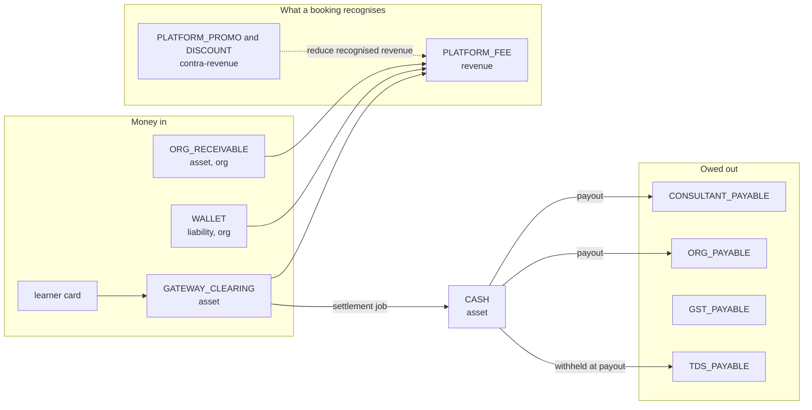

# Chart of accounts

Sixteen `LedgerAccountKind` values are the buckets every posting touches. This page lists each one with its normal side, its scope, what it means and who writes to it, then explains how an account is addressed and how to read a balance. The postings that use these accounts are in [postings](04-postings.md).

## 1. Reading a balance

`ledgerBalancePaise` returns the signed balance `Σ DEBIT − Σ CREDIT` in paise. For a debit-normal account, which is every asset, expense and contra-revenue account, that figure is the balance as is. For a credit-normal account, which is every liability and revenue account, the meaningful figure is the negative of it: the amount owed, or the revenue booked. Callers must therefore know an account's normal side.

```prisma
enum LedgerAccountKind {
  CASH // platform gateway/settlement cash
  WALLET // an org's prepaid balance (a liability we owe the org)
  PLATFORM_FEE // platform revenue
  PLATFORM_PROMO // contra-revenue: platform-funded grants/comps + referral credits
  REFERRAL_CREDIT_LIABILITY // vested, unredeemed referral credit owed as future discount
  DISCOUNT // contra-revenue: discount given to the buyer (booking posting)
  CONSULTANT_PAYABLE // owed to a consultant
  ORG_PAYABLE // owed to a host org
  ORG_RECEIVABLE // an INVOICE-funded org owes us (accrued, cleared on invoice payment)
  CONSULTANT_RECEIVABLE // clawback owed BY a consultant (no inbound recovery path)
  TDS_PAYABLE // TDS withheld, owed to the government
  GST_PAYABLE // GST collected, owed to the government
  UNAPPLIED_RECEIPTS // a capture staged for auto-refund, owed back to the payer
  GATEWAY_CLEARING // PG captures the gateway holds for us until it settles them to CASH
  GATEWAY_FEE // expense: the gateway's fee net of its GST
  GST_INPUT_CREDIT // asset: GST charged on the gateway fee, claimable as input tax credit
}
```

## 2. The sixteen accounts

| Kind                        | Class          | Normal | Scope      | Means                                                              | Written by                                                                                                              |
| --------------------------- | -------------- | ------ | ---------- | ------------------------------------------------------------------ | ----------------------------------------------------------------------------------------------------------------------- |
| `GATEWAY_CLEARING`          | asset          | DEBIT  | platform   | Card money Razorpay holds for the platform and has not yet settled | Every capture, wallet top-up, card invoice payment, gateway refund and chargeback, through `gatewayCashAccount()`       |
| `CASH`                      | asset          | DEBIT  | platform   | Settled bank cash                                                  | The settlement job (`settlement:<id>`), bank-transfer invoice receipts, payouts (credit), organisation payout clawbacks |
| `GATEWAY_FEE`               | expense        | DEBIT  | platform   | The gateway's fee net of its GST                                   | `postGatewayFee`, key `gatewayfee:<pay_id>`                                                                             |
| `GST_INPUT_CREDIT`          | asset          | DEBIT  | platform   | GST Razorpay charges on its fee, claimable as input credit         | `postGatewayFee`                                                                                                        |
| `ORG_RECEIVABLE`            | asset          | DEBIT  | org        | An invoice-funded organisation owes the platform                   | Booking (`INVOICE_ACCRUAL` legs), invoice issue, overage accrual, top-up refund shortfall, invoice payment (credit)     |
| `CONSULTANT_RECEIVABLE`     | asset          | DEBIT  | consultant | Cash already paid out that a refund or lost dispute now takes back | Clawback of a paid earning, key `clawback:<driver>:<payoutId>`; recovered from the next payout                          |
| `PLATFORM_PROMO`            | contra-revenue | DEBIT  | platform   | Platform-funded referral credit and operator wallet credits        | Booking (the `REFERRAL_CREDIT` leg), referral moves, `adjustWallet`                                                     |
| `DISCOUNT`                  | contra-revenue | DEBIT  | platform   | Discount the platform funded for the buyer                         | Booking (the gap between list price plus tax and funding), overage carve moves, refund (credit)                         |
| `WALLET`                    | liability      | CREDIT | org        | Prepaid balance the platform owes an organisation                  | Top-up, wallet-funded booking (debit), refunds, `adjustWallet`, top-up refund                                           |
| `CONSULTANT_PAYABLE`        | liability      | CREDIT | consultant | Earnings owed to a consultant and not yet paid                     | Booking (credit), payout and refund (debit), clawback                                                                   |
| `ORG_PAYABLE`               | liability      | CREDIT | org        | Host-organisation share owed                                       | Booking, member overage relief (credit), organisation payout and refund (debit)                                         |
| `TDS_PAYABLE`               | liability      | CREDIT | platform   | Tax withheld at payout and owed to the government                  | Payout completion (credit) and its reversal                                                                             |
| `GST_PAYABLE`               | liability      | CREDIT | platform   | GST collected, owed to the government                              | Booking and invoice issue (credit), refund (debit)                                                                      |
| `UNAPPLIED_RECEIPTS`        | liability      | CREDIT | platform   | A capture that funds no booking, owed back to the payer            | `postUnappliedReceipt` (credit), the refund that returns it (debit)                                                     |
| `REFERRAL_CREDIT_LIABILITY` | liability      | CREDIT | platform   | Vested, unredeemed referral credit owed as a future discount       | Referral vest, redemption, restore, breakage, ops issue and reverse                                                     |
| `PLATFORM_FEE`              | revenue        | CREDIT | platform   | The platform's recognised take                                     | Booking, invoice issue and overage surcharge (credit); refund plug (debit)                                              |

`CONSULTANT_RECEIVABLE` is described by its schema comment as having no inbound recovery path, but the code recovers it from the consultant's next payout (`Dr CONSULTANT_PAYABLE / Cr CONSULTANT_RECEIVABLE`, key `clawback-recovery:<payoutId>`, `recoverClawbackOnPayout`). See [organisation payouts and clawbacks](../40-payouts/05-org-payouts-and-clawbacks.md).



The arrows show where obligation points, not individual postings. Each liability and revenue box is credit-normal, and each asset and contra-revenue box is debit-normal.

## 3. Scope and addressing

An account belongs to the platform, an organisation or a consultant, and its id is its scope.

```
<kind>|<organizationId or _>|<consultantProfileId or _>|<currency>
```

- **Platform-wide** (both owners `_`): `CASH`, `GATEWAY_CLEARING`, `GATEWAY_FEE`, `GST_INPUT_CREDIT`, `PLATFORM_FEE`, `PLATFORM_PROMO`, `DISCOUNT`, `TDS_PAYABLE`, `GST_PAYABLE`, `UNAPPLIED_RECEIPTS`, `REFERRAL_CREDIT_LIABILITY`.
- **Organisation-scoped**: `WALLET`, `ORG_PAYABLE`, `ORG_RECEIVABLE`.
- **Consultant-scoped**: `CONSULTANT_PAYABLE`, `CONSULTANT_RECEIVABLE`.

Examples: `CASH|_|_|INR`, `WALLET|<org id>|_|INR`, `CONSULTANT_PAYABLE|_|<consultantProfileId>|INR`. `ledgerAccountId` in `lib/payments/ledger/post.ts` builds the string, and `resolveAccountId` upserts on it, so two concurrent first postings to one scope converge on one row. A composite unique index on the owner columns, kind and currency exists too, but Postgres treats `NULL` owners as distinct in a unique index, so the literal `_` inside the primary key is the guard that actually dedupes. The `ledger_account_currency_inr` CHECK rejects any account whose currency is not INR.

The schema comment on `LedgerAccount.id` still says `membershipId`; the third segment is `consultantProfileId`.

## Worked example

LearnPro Academy is a host organisation on the 10/10/80 default rate card (1,000 bps platform, 1,000 bps organisation, 8,000 bps consultant). A learner pays by card for Aarav Anderson's session, listed at ₹10,000 (1,000,000 paise), plus 18 % GST of ₹1,800 (180,000 paise): the card is charged ₹11,800 (1,180,000 paise). Aarav is paid by himself (`payoutRecipient = SELF`), so the split is the card's: 100,000 platform, 800,000 consultant, and the remainder 100,000 to the organisation. Once the capture is confirmed, the booking posts `booking:<paymentId>`:

| Account                            | Direction |     Paise |     Rupees |
| ---------------------------------- | --------- | --------: | ---------: |
| `GATEWAY_CLEARING`                 | DEBIT     | 1,180,000 | ₹11,800.00 |
| `PLATFORM_FEE`                     | CREDIT    |   100,000 |  ₹1,000.00 |
| `CONSULTANT_PAYABLE` (Aarav)       | CREDIT    |   800,000 |  ₹8,000.00 |
| `ORG_PAYABLE` (`learnpro-academy`) | CREDIT    |   100,000 |  ₹1,000.00 |
| `GST_PAYABLE`                      | CREDIT    |   180,000 |  ₹1,800.00 |

Debits 1,180,000 equal credits 1,180,000. Had Aarav been a salaried expert (`payoutRecipient = ORGANIZATION`), the organisation would take the consultant slice as well, `CONSULTANT_PAYABLE` would be absent, and `ORG_PAYABLE` would be 900,000. When the weekly organisation payout runs, `ORG_PAYABLE` is debited against `CASH` and `TDS_PAYABLE`; after Aarav's own payout and the organisation's, both payables return to zero and `PLATFORM_FEE` carries the recognised ₹1,000. Elsewhere, the wallet of IIT Madras is `WALLET|iit-madras|_|INR`, a credit-normal balance whose negative is the spending power the platform owes it, while Wipro, being invoice-funded, has no wallet at all and its obligation sits in `ORG_RECEIVABLE|wipro|_|INR`.

## Where in code

- `prisma/schema.prisma`: `LedgerAccountKind`, `LedgerDirection`, `LedgerAccount`.
- `lib/payments/ledger/post.ts`: `AccountRef`, `ledgerAccountId`, `ledgerBalancePaise`.
- `lib/payments/ledger/gateway-account.ts`: `gatewayCashAccount`.

## Related

- [Double-entry model](01-double-entry-model.md), [postings](04-postings.md), [gateway clearing](05-gateway-clearing-and-settlement.md), [integrity and reconciliation](06-integrity-and-reconciliation.md).

## Deprecated & Superseded Approaches

Older chart documents debited `CASH` for every card capture and top-up. Card money now sits in `GATEWAY_CLEARING` until a settlement journal moves its net to `CASH`, and RazorpayX payouts and bank-transfer receipts are the flows that still use `CASH` directly; delete any posting or doc that debits `CASH` on a capture. An earlier worked example showed LearnPro entries of 10, 10 and 80 that did not balance; the rate card is 1,000, 1,000 and 8,000 bps. A schema comment calls the third id segment `membershipId`, and a code comment on `CONSULTANT_RECEIVABLE` says it has no recovery path; both are stale.
