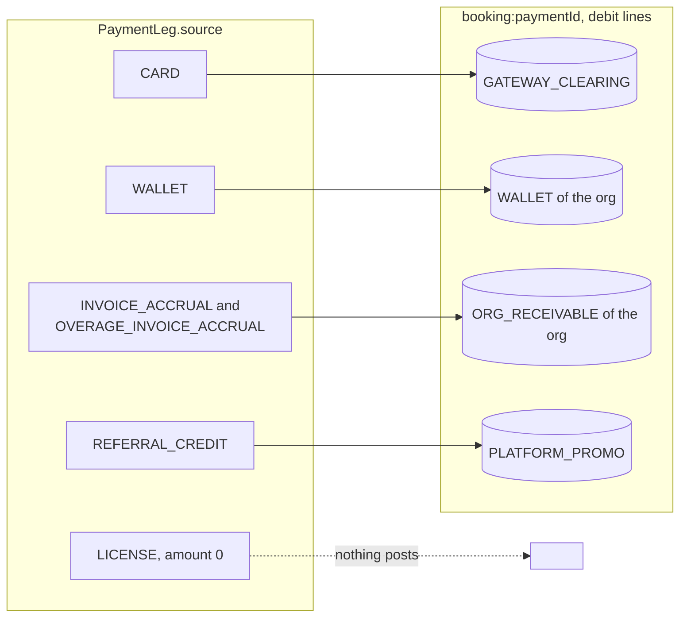

# Payment legs

A `Payment` says how much was charged. Its `PaymentLeg` rows say what funded it. One booking can be funded by several sources at once, such as an organisation's wallet and a referral credit, and the legs become the debit side of the booking journal. This page lists the leg sources, the identity that ties legs to the payment amount, who enforces it, and what a refund does to each leg.

## 1. The model

```prisma
model PaymentLeg {
  id          String           @id @default(uuid())
  paymentId   String
  source      PaymentLegSource
  amountPaise BigInt
  sourceRef   String?
  createdAt   DateTime         @default(now())

  @@unique([paymentId, source])
  @@index([paymentId])
  @@index([source])
}
```

```prisma
enum PaymentLegSource {
  CARD // external gateway charge
  WALLET // BillingAccount wallet debit (was SEAT_PACK)
  REFERRAL_CREDIT // platform-issued personal credit
  INVOICE_ACCRUAL // rolled into an OrganizationInvoice at month-end
  OVERAGE_INVOICE_ACCRUAL // marginal charge beyond a LICENSED_SEAT cap (CHARGE_ORG path); distinct source prevents @@unique([paymentId, source]) collision with the base INVOICE_ACCRUAL leg
  LICENSE // absorbed by a LICENSED_SEAT program (no money moves)
  INVOICE_ACCRUAL_REVERSAL
  OVERAGE_INVOICE_ACCRUAL_REVERSAL
}
```

At most one leg of each source exists per payment (`@@unique([paymentId, source])`), so a duplicate insert fails with `P2002` instead of corrupting a sum. That is also why `OVERAGE_INVOICE_ACCRUAL` is its own value: a charge-the-organisation overage needs a second invoice leg on a payment that already carries a base `INVOICE_ACCRUAL` leg. If split billing across sub-organisations ever becomes real, the unique index would be dropped for a group id.

## 2. Each source, its writer and its debit

| Source                             | Written by                                                                 | `sourceRef` holds                                              | Booking journal debit                |
| ---------------------------------- | -------------------------------------------------------------------------- | -------------------------------------------------------------- | ------------------------------------ |
| `CARD`                             | `settleCheckoutLegs`, the approval mint, overage and recording handlers    | The Razorpay order id (a `premint_` id until the order exists) | `GATEWAY_CLEARING`                   |
| `WALLET`                           | `recordCheckoutUtilization`, with the wallet debit in the same transaction | The `ProgramAssignment` id                                     | `WALLET` of the organisation         |
| `INVOICE_ACCRUAL`                  | `recordCheckoutUtilization` on the invoice rail                            | The `ProgramAssignment` id                                     | `ORG_RECEIVABLE` of the organisation |
| `OVERAGE_INVOICE_ACCRUAL`          | Overage settlement for a charge-the-organisation overage                   | The `ProgramAssignment` id                                     | `ORG_RECEIVABLE`                     |
| `LICENSE`                          | `recordCheckoutUtilization` on a licensed seat, amount 0                   | The `ProgramAssignment` id                                     | none, no money moves                 |
| `REFERRAL_CREDIT`                  | `applyCreditsToPayment` (`lib/referrals/service.ts`)                       | The first `ReferralCreditUsage` id                             | `PLATFORM_PROMO`                     |
| `INVOICE_ACCRUAL_REVERSAL`         | The refund cascade on a still-unbilled accrual                             | The original sibling's `sourceRef`                             | none; the refund journal carries it  |
| `OVERAGE_INVOICE_ACCRUAL_REVERSAL` | The same, for the overage accrual                                          | The original sibling's `sourceRef`                             | none                                 |

`resolveBookingJournalDebits` (`lib/payments/payouts/earnings-service.ts`) sums the legs by source and emits one debit per non-zero bucket, then adds a `DISCOUNT` debit for any gap between list price plus tax and the funding debits. A licensed booking's `taxAmount` is 0, because the licence invoice books the GST.



## 3. The sum identity

For every payment, the sum of the non-reversal legs, excluding `REFERRAL_CREDIT` and `LICENSE`, equals `Payment.amount`. `Payment.amount` is the figure funded after discounts, tax and referral credits, so on the personal card rail it is the gateway charge, and on organisation rails it is the funded amount with no gateway call. A `REFERRAL_CREDIT` leg records value that was already taken out of `amount`, and adding it back would demand the same credit twice, so it is excluded. A `LICENSE` leg is 0 by design.

A payment whose only non-reversal legs are zero-value `LICENSE` legs skips the sum comparison, because `Payment.amount` stays at the full list price while the leg is deliberately 0. That carve removes the sum check and nothing else: the reversal-pair rule still applies.

**Reversal legs.** A refund never edits an original leg. It adds or grows a negative `*_REVERSAL` sibling, so the original legs always still sum to `Payment.amount`. A reversal leg must be negative, and its magnitude may never exceed the sum of its original sibling.

| Rule                                                      | Enforcer                                                                                                                         | Test                                                                | Repair              |
| --------------------------------------------------------- | -------------------------------------------------------------------------------------------------------------------------------- | ------------------------------------------------------------------- | ------------------- |
| Legs sum to `Payment.amount` (with the carve-outs)        | `payment_legs_sum_to_amount` constraint trigger, deferred to `COMMIT`; also `payment_amount_vs_legs` on `Payment.amount` updates | `__tests__/payments/dispute-payout-block.test.ts` (source contract) | None; uncommittable |
| A reversal leg is negative and no larger than its sibling | The same trigger (`assert_payment_legs_ok`)                                                                                      | `__tests__/payments/dispute-payout-block.test.ts` (source contract) | None; uncommittable |
| A non-reversal leg is not negative                        | `payment_leg_nonreversal_nonnegative` CHECK                                                                                      | none (database)                                                     | None                |
| One leg per source per payment                            | `@@unique([paymentId, source])`                                                                                                  | none (database)                                                     | None                |

The trigger fires on `PaymentLeg` writes and on `Payment.amount` updates, validates both payments when a leg is re-parented, and re-checks the whole payment each time, which is idempotent when several rows commit together. Because it is a database guarantee, no application sweep re-verifies the identity and the ledger auditor carries no leg-sum check. Checkout does not re-read the legs after writing them; the trigger is the only check.

## 4. Worked examples

### A card payment with a referral credit

Charlotte Brown books Hannah Anderson's ₹2,000 consultation with a 10 % code and ₹400 of credit, as in [checkout and pricing](../10-money-in/01-checkout-and-pricing.md). `Payment.amount` is 172,400 paise.

```
CARD             172,400   counts toward the sum  → 172,400 = Payment.amount
REFERRAL_CREDIT   40,000   excluded from the sum
```

The booking journal debits `GATEWAY_CLEARING` 172,400 and `PLATFORM_PROMO` 40,000, and a `DISCOUNT` line of 20,000 closes the gap to list price plus tax (232,400). If the discount plug were based on `Payment.amount` instead of the funding debits, the credit would be counted twice and the booking transaction would fail to balance; basing it on the funding-leg debits is what keeps a credit-funded booking posting at all.

### A wallet-funded booking

A learner at IIT Madras books a ₹5,000 session on the organisation's wallet. With 18 % GST the funded amount is 590,000 paise, so one leg is written and the wallet cache decrements by the same figure in the same transaction:

```
WALLET   590,000   → Payment.amount = 590,000, no gateway call
```

### A licensed seat

Olivia Anderson, a Wipro learner, books under Wipro's licensed-seat programme. The programme absorbed the cost at contract time, so:

```
LICENSE   0   → the sum comparison is skipped; Payment.amount is the full price
```

If the booking passes the programme's cap and the programme charges the member for overage, the extra is a separate parent-linked side payment with its own `CARD` leg, not a second leg on the booking. See [rate cards and overage](../50-b2b/03-rate-cards-and-overage.md).

## 5. What a refund does to each leg

`applyRefundCascade` reverses legs in proportion to the refund, and the last leg absorbs the rounding remainder so the parts equal the refund to the paise. See [refunds](../30-refunds-disputes/01-refunds.md#4-the-refund-cascade).

- `WALLET`: `walletCredit` returns the spending power, and the cache and the `WALLET` ledger line move together.
- `INVOICE_ACCRUAL` and `OVERAGE_INVOICE_ACCRUAL`: if the invoice is not yet paid, a negative reversal sibling is created or grown. If it is paid, the organisation earnings clawback and a credit note handle the money.
- `LICENSE`: no money; the booking utilisation reversal restores the engagement.
- `CARD`: the gateway refund moves the cash.
- `REFERRAL_CREDIT`: restored by `reverseCreditsForPayment` after the refund row reads `SUCCEEDED`, not inside the cascade.
- `*_REVERSAL`: never reversed again.

When a payment's legs sum to more than its amount, the cascade leaves `REFERRAL_CREDIT` out of the proportional split so the funding that was actually paid is what is returned.

## 6. How the legs are shown to the payer

The legs are the source of truth for which rail paid. `Payment.paymentMethod` is read only for a row that has no legs. Two functions in `lib/appointments/payment-display.ts` do the work, and pages must call them instead of reading the method:

- `paymentRailLabel` gives the short "via …" wording. A self-paid row names the gateway, and an organisation or credit row names its lead leg.
- `paymentFundingBreakdown` returns one entry per rail in a fixed order (card, referral credit, wallet, invoiced, licence). It merges `INVOICE_ACCRUAL` and `OVERAGE_INVOICE_ACCRUAL` into one "invoiced to the organisation" entry, drops every `*_REVERSAL` leg because refunds have their own lines, and drops zero-value legs. The learner's payment list and payment detail page show it as "Paid with …" only when the payment is `SUCCEEDED` and more than one rail remains.

In the example in section 4, Charlotte Brown's payment reads "₹1,724 card / UPI + ₹400 referral credit". The card entry is worded "card / UPI" because `CARD` is recorded for every gateway charge, UPI included. The referral credit entry is shown even though it is outside the sum identity, since it is part of what paid for the booking.

## Where in code

- `prisma/schema.prisma`: `PaymentLeg`, `PaymentLegSource`.
- `prisma/sql/payment-legs-triggers.sql`: `assert_payment_legs_ok` and the three triggers.
- `lib/payments/payment-legs.ts`: `sourceRefKindFor`, `makeLeg`.
- `lib/payments/checkout/commit/payment-legs.ts`, `org-utilization.ts`: the checkout writers.
- `lib/appointments/payment-display.ts`: `paymentRailLabel`, `paymentFundingBreakdown`, `formatFundingBreakdown`.

## Related

- [Postings](04-postings.md) for the booking and refund journals built from legs.
- [Funding rails](../50-b2b/01-funding-rails-and-permutations.md).

## Deprecated & Superseded Approaches

An earlier definition of the identity summed every non-reversal leg including `REFERRAL_CREDIT`. Because `Payment.amount` already excludes the credit, the trigger rejected every checkout that spent credit, so the identity was narrowed and the credit leg kept for the journal; delete any checker or doc that adds the credit leg back into the sum. A refund once edited the original accrual leg; it now nets through a negative sibling. `WalletEntry` no longer records wallet movement: the authoritative movement is the journal's `Dr WALLET` line, and the cache write is `walletDebit`. `lib/payments/payment-legs.ts` describes the `CARD` `sourceRef` as a gateway payment id and mentions Stripe and a `WalletEntry` row; the code stores the order id and neither of those exists. A TypeScript twin of the trigger (`checkPaymentLegsSumToAmount` and its throwing sibling) once logged drift warn-only after checkout; it was deleted because the trigger already makes drift uncommittable, so recreate neither. A separate map of leg wording (the former payment-leg-labels module) and a `legs` field on the consultee payment detail read were deleted; the display has one vocabulary, in `payment-display.ts`.
