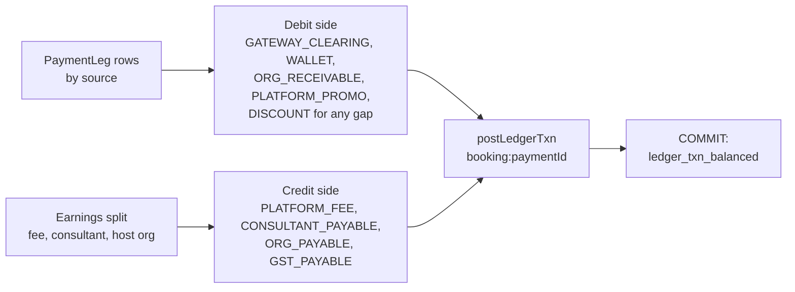

# Journal postings

This page lists every transaction the platform writes to the double-entry journal: its `LedgerTransactionKind`, its idempotency key, the function that posts it and the exact debit and credit lines, with worked numbers. It is derived from the code paths that call `postLedgerTxn`, not from earlier documents. The model and the accounts are explained in [the double-entry model](01-double-entry-model.md) and [the chart of accounts](02-chart-of-accounts.md).

All amounts are integer paise. In every example the debits equal the credits, because `postLedgerTxn` refuses anything else and the `ledger_txn_balanced` trigger refuses it again at `COMMIT`.

## 1. The journal vocabulary

`LedgerTransactionKind` has sixteen values. Each posting carries one, plus a structured `idempotencyKey` so a repeat call is a no-op.

| Kind                 | Idempotency keys                                                                                                                                                                      | Posted by                                                                                                                                                           |
| -------------------- | ------------------------------------------------------------------------------------------------------------------------------------------------------------------------------------- | ------------------------------------------------------------------------------------------------------------------------------------------------------------------- |
| `BOOKING`            | `booking:<paymentId>`; `overage-accrual:<overageEventId>` (wallet overage surcharge)                                                                                                  | `createEarningsFromPayment` (`lib/payments/payouts/earnings-service.ts`); `recordWalletCollectedOrgOverage`                                                         |
| `TOPUP`              | `topup:<providerOrderId>`                                                                                                                                                             | `confirmTopUp` (`lib/api/organizations/wallet.ts`)                                                                                                                  |
| `TOPUP_REFUND`       | `topup-refund:<gatewayRefundId>`; `topup-refund-shortfall:<gatewayRefundId>`                                                                                                          | `bookTopUpRefund` (`lib/payments/operations/wallet-refund.ts`)                                                                                                      |
| `INVOICE_ISSUED`     | `invoice-issued:<invoiceId>`; `invoice-voided:<invoiceId>`; `overage-accrual:<childPaymentId>`; `overage-accrual-voided:<childPaymentId>`                                             | `postInvoiceIssuedJournal`, `postInvoiceVoidedJournal` (`lib/payments/billing/org-invoice-journal.ts`); `mintChildOverageAccrualPayment`; `overage-accrual-void.ts` |
| `INVOICE_PAID`       | `invoicepaid:<invoiceId>`; `invoicereceipt:<receiptId>`                                                                                                                               | `applyOrgInvoiceCapture`, `recordBankTransferReceipt` (`lib/payments/billing/org-invoice-settlement.ts`)                                                            |
| `INVOICE_REFUND`     | `invoice-refund:<refundId>`                                                                                                                                                           | The invoice branch of `handleRefundCreated` (`app/api/webhooks/utils.ts`)                                                                                           |
| `PAYOUT`             | `payout:<payoutId>`; `payout-reversal:<payoutId>`; `clawback:<driver>:<payoutId>`; `clawback-recovery:<payoutId>`; `clawback-recovery-release:<payoutId>`; `clawback-void:<key>`      | `payout-service.ts`, `reversal-engine.ts`, `paid-consultant-clawback.ts`, `clawback-recovery.ts`                                                                    |
| `ORG_PAYOUT`         | `orgpayout:<payoutId>`; `orgpayout-reversal:<payoutId>`; `clawback:<driver>:<payoutId>[:<orgEarningsId>]`; `clawback-recovery:<payoutId>`                                             | `org-payout-service.ts`, `postPayoutClawback`, `clawback-recovery.ts`                                                                                               |
| `REFUND`             | `refund:<refundId>`; `chargeback:<disputeId>`                                                                                                                                         | `applyRefundCascade` (`lib/payments/operations/refund.ts`), `booking-refund.ts`; `app/api/webhooks/utils.ts`                                                        |
| `OVERAGE_MEMBER`     | `overage:<sidePaymentId>`; `overage-carve-credit:<overageEventId>`; `overage-restore:<overageEventId>`; `overage-recarve:<overageEventId>`; `overage-recarve-invoice:<sidePaymentId>` | `overage-handlers.ts`, `overage-settlement.ts`, `overage-base-carve.ts`                                                                                             |
| `GRANT`              | none                                                                                                                                                                                  | Declared and never posted                                                                                                                                           |
| `REFERRAL_CREDIT`    | `referral-vest:`, `referral-redeem:`, `referral-restore:`, `referral-breakage:`, `referral-reverse:`, `referral-issue:`                                                               | `lib/referrals/service.ts`, `vesting.ts`, the admin referral credit routes                                                                                          |
| `UNAPPLIED_RECEIPT`  | `unapplied:<paymentId or gatewayPaymentId>`; `unapplied-released:<paymentId>`                                                                                                         | `lib/payments/ledger/unapplied-receipts.ts`                                                                                                                         |
| `GATEWAY_FEE`        | `gatewayfee:<gatewayPaymentId>`                                                                                                                                                       | `postGatewayFee` (`lib/payments/ledger/gateway-fee.ts`)                                                                                                             |
| `GATEWAY_SETTLEMENT` | `settlement:<settlementId>`                                                                                                                                                           | `postSettlementJournals` (`jobs/reconcile/reconcile-gateway-settlements.ts`)                                                                                        |
| `WALLET_ADJUSTMENT`  | `walletadj:<billingAccountId>:<key>`                                                                                                                                                  | `adjustWallet` (`lib/api/organizations/wallet.ts`)                                                                                                                  |

There is no `OVERAGE` kind. A charge-the-organisation overage rides the invoice kinds, a charge-the-member overage settles as `OVERAGE_MEMBER`. A refund-driven reversal of a payout uses the `PAYOUT` or `ORG_PAYOUT` kind of the payout it counters, not `REFUND`.

## 2. What `postLedgerTxn` guarantees

`postLedgerTxn(db, { idempotencyKey, kind, paymentId?, invoiceId?, payoutId?, postings })` in `lib/payments/ledger/post.ts`:

1. Rejects an empty set, and any posting whose amount is not a positive integer.
2. Sums debits and credits and throws `LedgerImbalanceError` unless they match, writing nothing.
3. Returns `{ created: false }` if the key is already posted. The unique index is the hard guard under the fast-path read: two racing callers both pass the read, one insert wins, and the loser's transaction aborts and its retry finds the winner.
4. Resolves each account by upserting its deterministic id, sequentially, because concurrent writes on the single pooled connection (`PG_POOL_MAX=1`) would deadlock.
5. Composes with the caller's transaction when given a `tx`, so the money lines and the business write commit together or not at all.



## 3. Booking: `booking:<paymentId>`

The debit side is built from the payment's legs, one line per non-zero source; the credit side is the earnings split plus GST.

```
Dr GATEWAY_CLEARING           sum of CARD legs
Dr WALLET(org)                sum of WALLET legs
Dr ORG_RECEIVABLE(org)        sum of INVOICE_ACCRUAL + OVERAGE_INVOICE_ACCRUAL legs
Dr PLATFORM_PROMO             sum of REFERRAL_CREDIT legs
Dr DISCOUNT                   max(0, originalAmount + taxAmount − Σ the four lines above)
   Cr PLATFORM_FEE            platform fee (+ any overage surcharge)
   Cr CONSULTANT_PAYABLE      the consultant's share, one line per collaborator
   Cr ORG_PAYABLE(host org)   the host organisation's share, if greater than 0
   Cr GST_PAYABLE             Payment.taxAmount
```

`LICENSE` legs are 0 and contribute nothing. The `DISCOUNT` line is the gap between what the sale was worth and what funded it, computed from the funding debits and not from `Payment.amount`; a referral credit is already excluded from `amount`, so basing the plug on `amount` would count the credit twice and the transaction would not balance. Credits are summed over the earnings parties, so a multi-collaborator booking posts one `CONSULTANT_PAYABLE` credit per collaborator. A posting failure rolls back the earnings write that wraps it, so earnings never exist without their journal: the whole checkout on the synchronous rails, and the Phase 1 savepoint on a capture, which `sync-payment-earnings` and Phase 2 then retry. The fee is `Payment.originalAmount × bps / 10,000`, with the bps taken from the fee schedule or the host organisation's rate card ([checkout and pricing](../10-money-in/01-checkout-and-pricing.md#the-platform-fee-is-not-a-flat-20-)). Examples use the seeded schedule of 2,000 bps.

### Worked examples

These examples show the journal shape for each funding mix. Checkout's profitability floor ([checkout and pricing](../10-money-in/01-checkout-and-pricing.md#the-profitability-floor)) caps the promotion an order can carry, so examples 2 to 4 use promotion sizes that checkout would now hold lower; the postings follow the same rules at any size.

**1. Card booking.** Charlotte Brown pays ₹1,180 for Hannah Anderson's ₹1,000 consultation.

| Account                       | Dir    |   Paise |    Rupees |
| ----------------------------- | ------ | ------: | --------: |
| `GATEWAY_CLEARING`            | DEBIT  | 118,000 | ₹1,180.00 |
| `PLATFORM_FEE`                | CREDIT |  20,000 |   ₹200.00 |
| `CONSULTANT_PAYABLE` (Hannah) | CREDIT |  80,000 |   ₹800.00 |
| `GST_PAYABLE`                 | CREDIT |  18,000 |   ₹180.00 |

**2. Card plus referral credit.** Same sale, ₹200 of credit (the 20 % cap on a ₹1,000 list): the card is charged ₹980.

| Account              | Dir    |  Paise |  Rupees |
| -------------------- | ------ | -----: | ------: |
| `GATEWAY_CLEARING`   | DEBIT  | 98,000 | ₹980.00 |
| `PLATFORM_PROMO`     | DEBIT  | 20,000 | ₹200.00 |
| `PLATFORM_FEE`       | CREDIT | 20,000 | ₹200.00 |
| `CONSULTANT_PAYABLE` | CREDIT | 80,000 | ₹800.00 |
| `GST_PAYABLE`        | CREDIT | 18,000 | ₹180.00 |

Debits 118,000, credits 118,000. There is no `DISCOUNT` line because the gap is zero.

**3. Discount code.** A 20 % code takes ₹200 off: base ₹800, GST ₹144, card ₹944.

| Account              | Dir    |  Paise |  Rupees |
| -------------------- | ------ | -----: | ------: |
| `GATEWAY_CLEARING`   | DEBIT  | 94,400 | ₹944.00 |
| `DISCOUNT`           | DEBIT  | 20,000 | ₹200.00 |
| `PLATFORM_FEE`       | CREDIT | 20,000 | ₹200.00 |
| `CONSULTANT_PAYABLE` | CREDIT | 80,000 | ₹800.00 |
| `GST_PAYABLE`        | CREDIT | 14,400 | ₹144.00 |

The consultant and the fee are computed on the ₹1,000 list price, so the platform alone funds the discount.

**4. Fully credit-funded.** On a ₹3,000 list with an 85 % code, GST is ₹81 on a ₹450 base, the tax-inclusive total is ₹531 and a ₹531 credit covers it, so the card is not charged (`free_` intent).

| Account              | Dir    |   Paise |    Rupees |
| -------------------- | ------ | ------: | --------: |
| `PLATFORM_PROMO`     | DEBIT  |  53,100 |   ₹531.00 |
| `DISCOUNT`           | DEBIT  | 255,000 | ₹2,550.00 |
| `PLATFORM_FEE`       | CREDIT |  60,000 |   ₹600.00 |
| `CONSULTANT_PAYABLE` | CREDIT | 240,000 | ₹2,400.00 |
| `GST_PAYABLE`        | CREDIT |   8,100 |    ₹81.00 |

**5. Wallet-funded.** A learner at IIT Madras books Grace Anderson's ₹5,000 session on the organisation's wallet. The funded amount is ₹5,900.

| Account                      | Dir    |   Paise |    Rupees |
| ---------------------------- | ------ | ------: | --------: |
| `WALLET` (`iit-madras`)      | DEBIT  | 590,000 | ₹5,900.00 |
| `PLATFORM_FEE`               | CREDIT | 100,000 | ₹1,000.00 |
| `CONSULTANT_PAYABLE` (Grace) | CREDIT | 400,000 | ₹4,000.00 |
| `GST_PAYABLE`                | CREDIT |  90,000 |   ₹900.00 |

**6. Invoice-accrued.** The same ₹5,900 on an invoice-funded organisation (Wipro) debits `ORG_RECEIVABLE` (`wipro`) 590,000 and credits the same three accounts; no cash moves until the invoice is paid.

**7. Licensed seat.** A licensed booking has no funding debit, so `DISCOUNT` carries the whole sale and no GST is posted, because the licence invoice books it. For a ₹1,000 sale: `Dr DISCOUNT 100,000`, `Cr PLATFORM_FEE 20,000`, `Cr CONSULTANT_PAYABLE 80,000`.

**8. Host organisation split.** On LearnPro Academy's 1,000/1,000/8,000 bps card, a ₹10,000 sale with ₹1,800 GST posts `Dr GATEWAY_CLEARING 1,180,000` against `Cr PLATFORM_FEE 100,000`, `Cr CONSULTANT_PAYABLE` 800,000, `Cr ORG_PAYABLE` 100,000 and `Cr GST_PAYABLE` 180,000 (full table in [chart of accounts](02-chart-of-accounts.md#worked-example)).

## 4. Capture-side postings

**Parked capture** (`unapplied:<paymentId>`): `Dr GATEWAY_CLEARING / Cr UNAPPLIED_RECEIPTS` for the captured paise, in the capture's own transaction, for a capture that funds no booking. Recovering it into a booking first posts `unapplied-released:<paymentId>` (`Dr UNAPPLIED_RECEIPTS / Cr GATEWAY_CLEARING` for what is still parked) so the booking journal debits the clearing account once. Its refund posts `refund:<refundId>` as `Dr UNAPPLIED_RECEIPTS / Cr GATEWAY_CLEARING`. An organisation invoice capture no invoice can claim parks under `unapplied:<gatewayPaymentId>`.

**Gateway fee** (`gatewayfee:<pay_id>`, posted when the capture webhook carries the fee, or by the settlement job under the same key): `Dr GATEWAY_FEE (fee − GST)`, `Dr GST_INPUT_CREDIT (GST)`, `Cr GATEWAY_CLEARING (fee)`. For a ₹1,180 capture with an illustrative fee of 2,785 paise including 425 paise of GST: `Dr GATEWAY_FEE 2,360`, `Dr GST_INPUT_CREDIT 425`, `Cr GATEWAY_CLEARING 2,785`.

**Settlement** (`settlement:<settlementId>`, one per settlement on a fully read day): the net of Razorpay's settlement lines, `Dr CASH net / Cr GATEWAY_CLEARING net`, reversed in direction if the net is negative. Continuing the example, a settlement of just that capture nets 115,215 paise. See [gateway clearing](05-gateway-clearing-and-settlement.md).

## 5. Wallet and invoices

- **Top-up** (`topup:<orderId>`): `Dr GATEWAY_CLEARING / Cr WALLET(org)`, after first crediting `ORG_RECEIVABLE(org)` for any open shortfall receivable (`confirmTopUp`). With no open shortfall receivable, a ₹5,00,000 top-up for IIT Madras posts 50,000,000 paise each way; with ₹40,000 open it credits `ORG_RECEIVABLE` 4,000,000 and `WALLET` 46,000,000.
- **Operator adjustment** (`walletadj:<billingAccountId>:<key>`): a credit is `Dr PLATFORM_PROMO / Cr WALLET`, a debit is `Dr WALLET / Cr PLATFORM_FEE`. A ₹250 credit posts 25,000 paise. Reusing a key with a different signed amount is refused. The cache and the journal move by the same amount, so an adjustment cannot repair a drift; repairing drift is a correcting transaction ([ledger drift runbook](../70-operations/06-ledger-drift-runbook.md)).
- **Top-up refund** (`topup-refund:<gatewayRefundId>`): `Dr WALLET / Cr GATEWAY_CLEARING` for the refund, clamped to the original top-up. The cache falls only by what it still holds; the part the organisation had already spent posts as `topup-refund-shortfall:<gatewayRefundId>`, `Dr ORG_RECEIVABLE / Cr WALLET`.
- **Invoice issued** (`invoice-issued:<invoiceId>`): only for an invoice covering a supply for which no booking journal was posted (a licence fee or a manual invoice). `Dr ORG_RECEIVABLE total / Cr PLATFORM_FEE subtotal / Cr GST_PAYABLE tax`. An invoice that bills bookings (its rollup stamps `billedPayments`) posts nothing at issue, because each booking already debited `ORG_RECEIVABLE` and credited `GST_PAYABLE`. A forgiving void posts `invoice-voided:<invoiceId>` for either kind of invoice: `Cr ORG_RECEIVABLE` for what the invoice still carries, against `Dr GST_PAYABLE` for the void credit note's tax and `Dr PLATFORM_FEE` for the rest (`postInvoiceVoidedJournal`). A rebilling void posts nothing; it unlinks the payments so the next rollup bills them again (`lib/payments/billing/org-invoice-void.ts`).
- **Invoice paid**: a card payment posts `invoicepaid:<invoiceId>` as `Dr GATEWAY_CLEARING / Cr ORG_RECEIVABLE`; a bank transfer posts `invoicereceipt:<receiptId>` as `Dr CASH / Cr ORG_RECEIVABLE`, once per receipt, so a part payment posts only its own amount.
- **Invoice refund** (`invoice-refund:<refundId>`): for an issue-journalled invoice, `Dr PLATFORM_FEE (refund − credit-note tax)`, `Dr GST_PAYABLE (credit-note tax)`, `Cr GATEWAY_CLEARING` (or `Cr WALLET` when the organisation is wallet-funded). Past the CGST s.34(2) cutoff the credit note carries no tax and the platform fee takes the whole refund. For an invoice that bills bookings, the debit is `ORG_RECEIVABLE`, because the bookings' own refunds reverse fee and GST.

## 6. Overage

- **Member pays** (`overage:<sidePaymentId>`): when the member settles a charge-the-member side payment, `Dr GATEWAY_CLEARING amount / Cr DISCOUNT (base) / Cr PLATFORM_FEE (surcharge) / Cr GST_PAYABLE (GST)`. The platform funded the carved base as a discount, so the member's base reverses that discount and the organisation is credited nothing. With a base of ₹800, a ₹80 surcharge and 18 % GST on the surcharge (₹14.40): amount 89,440, `Cr DISCOUNT 80,000`, `Cr PLATFORM_FEE 8,000`, `Cr GST_PAYABLE 1,440`.
- **Organisation pays by invoice** (`overage-accrual:<childPaymentId>`): when the parent cannot carry the overage on its own `OVERAGE_INVOICE_ACCRUAL` leg (a licensed, card or lazily allocated parent, or a parent already invoiced, where the accrual is the surcharge alone), a child accrual payment posts `Dr ORG_RECEIVABLE (accrual + GST) / Cr PLATFORM_FEE (accrual) / Cr GST_PAYABLE`; with the same figures, 89,440 against 88,000 and 1,440. If its booking is reversed first, `overage-accrual-voided:<childPaymentId>` posts the exact mirror.
- **Base carved onto a wallet** (`overage-carve-credit:<overageEventId>`): `Dr DISCOUNT / Cr WALLET`, moving the over-cap base back to the wallet; abandoning the charge posts the inverse as `overage-restore:<overageEventId>` (`Dr WALLET / Cr DISCOUNT`), and when the wallet no longer holds the whole base the uncovered part debits `ORG_RECEIVABLE` instead (`restoreOverageBaseCarve`). A retry or late capture of that charge posts `overage-recarve:<overageEventId>` (`recarveOverageBase`): `Dr DISCOUNT` for the base, `Cr WALLET` for the wallet-covered part, and `Cr ORG_RECEIVABLE` for the receivable still open; any part of it a top-up already settled is credited to the wallet instead.
- **Late capture after the parent was invoiced** (`overage-recarve-invoice:<sidePaymentId>`): `Dr DISCOUNT / Cr ORG_RECEIVABLE` for the base, so the organisation is not billed for what the member paid.

## 7. Refunds: `refund:<refundId>`

`applyRefundCascade` reverses the booking in the same transaction that marks the refund `SUCCEEDED`. The rules are:

1. The funding legs go back proportionally: `Cr GATEWAY_CLEARING` for `CARD`, `Cr WALLET(org)` for `WALLET`, `Cr ORG_RECEIVABLE` for accrual legs (`Cr PLATFORM_FEE` instead when a forgiving invoice void already wrote that receivable off), each `floor(leg × refund / payment.amount)`, with the last leg absorbing the remainder so the credits equal the refund exactly. `REFERRAL_CREDIT` is left out whenever the legs sum to more than `Payment.amount`, which is always the case when a credit was spent; the credit is restored separately ([referral credits](07-referral-credits.md#5-refunds-and-restoring-credits)).
2. `DISCOUNT` is credited back with its funding (`refundReversalBasis`, `lib/payments/ledger/refund-reversal-basis.ts`): `floor(booked DISCOUNT × refund / payment.amount)`, capped by what remains.
3. The consultant share, the host organisation share and the GST are debited back in proportion, using the amounts the earnings reversal actually applied.
4. `PLATFORM_FEE` is the plug: whatever makes the lines balance. The one exception is a charge-the-member side payment (it has an `overage:<paymentId>` journal): its positive plug debits the accounts that capture credited (`DISCOUNT` and `PLATFORM_FEE`) pro rata, the completing refund taking each line's remainder (`reverseOverageCapture`), and only GST kept past the cutoff lands on `PLATFORM_FEE`.
5. **The completing refund takes the exact remainder.** A refund completes the payment when it plus the refunds already cascaded reach `Payment.amount`. That refund takes `share total − already reversed` for the consultant, the organisation, the GST and the `DISCOUNT`, instead of a floor, so a payment refunded in one go or in pieces ends with every share at exactly zero. Only refunds already cascaded count, because an uncascaded refund has reversed nothing yet.
6. Past the CGST s.34(2) cutoff (30 November after the supply's financial year) no GST is reversed; `GST_PAYABLE` keeps that part and the fee plug absorbs it.
7. A failure here rolls the whole cascade back and records a `LEDGER` system error; the gateway redelivery or the reconcile sweep retries the refund atomically. The refund is never half applied.

**Worked example, discount booking.** Booking 3 above (card ₹944) is refunded in two halves of 47,200 paise.

| First refund, 47,200 (not completing) | Dir    |  Paise |
| ------------------------------------- | ------ | -----: |
| `CONSULTANT_PAYABLE` (Hannah)         | DEBIT  | 40,000 |
| `GST_PAYABLE`                         | DEBIT  |  7,200 |
| `PLATFORM_FEE` (plug)                 | DEBIT  | 10,000 |
| `GATEWAY_CLEARING`                    | CREDIT | 47,200 |
| `DISCOUNT`                            | CREDIT | 10,000 |

Debits 57,200, credits 57,200. The second refund completes the payment: `CONSULTANT_PAYABLE` takes 80,000 − 40,000 = 40,000, `GST_PAYABLE` 14,400 − 7,200 = 7,200, `DISCOUNT` the remaining 10,000, and the plug is again 10,000. Across both, `GATEWAY_CLEARING`, `CONSULTANT_PAYABLE`, `GST_PAYABLE`, `DISCOUNT` and `PLATFORM_FEE` all net to zero.

**Worked example, rounding.** Booking 1 (₹1,180) refunded in three parts of 39,333, 39,333 and 39,334 paise. The first two each reverse floor shares, `CONSULTANT_PAYABLE` 26,666 and `GST_PAYABLE` 5,999, with a fee plug of 6,668. The third completes the payment: consultant 80,000 − 53,332 = 26,668, GST 18,000 − 11,998 = 6,002, plug 6,664. The fee plugs add to 20,000 and the consultant and GST lines to their booked totals, so nothing is left behind by rounding.

**With a referral credit.** Booking 2 with a full refund credits `GATEWAY_CLEARING` 98,000 and `DISCOUNT` 0, and debits the consultant 80,000 and GST 18,000; the plug is 0. `PLATFORM_FEE` (credit 20,000) and `PLATFORM_PROMO` (debit 20,000) remain as a matched pair, and `reverseCreditsForPayment` then restores the ₹200 to the buyer's credit balance with `referral-restore:<usageId>:<restored total>` (`Dr PLATFORM_PROMO / Cr REFERRAL_CREDIT_LIABILITY`, posted for a vested credit). The pair nets to zero across the two lines but neither line is zero on its own, so a full refund of a card-plus-credit booking leaves `PLATFORM_FEE` and `PLATFORM_PROMO` each grossed up by the credit. A fully credit-funded refund (below) does credit `PLATFORM_PROMO` back and debit the fee, so on that path both lines net to zero.

**Org-funded.** A full refund of booking 5 (wallet) debits fee 100,000, consultant 400,000 and GST 90,000 and credits `WALLET` 590,000, while the wallet cache is credited by `walletCredit` in the same transaction. A full refund of an unbilled invoice-accrued booking credits `ORG_RECEIVABLE` 590,000 instead and adds a negative `INVOICE_ACCRUAL_REVERSAL` leg. A licensed booking has no funding line, so the cascade credits `DISCOUNT` by the same proportion and the plug and payables are debited, the exact inverse of example 7.

**Credit-funded.** A booking paid entirely with credits is refunded by restoring the credits (a zero-amount `Refund` row) and `refund:<refundId>` credits `PLATFORM_PROMO` (and `DISCOUNT` for a coupon) while debiting the payables, GST and fee plug.

**Parked capture.** Covered in section 4: only `UNAPPLIED_RECEIPTS` and `GATEWAY_CLEARING` move.

## 8. Chargebacks: `chargeback:<disputeId>`

A lost dispute settles in `settleLostDispute` (`app/api/webhooks/utils.ts`). The amount to reverse is the deducted amount less any refunds already succeeded on the payment.

- **Card-funded (personal or organisation-tagged):** `applyB2cChargebackReversal` reads the payment's `booking:<paymentId>` entries, flips each direction and floor-scales it by the reversed fraction, and balances the rounding residual on `PLATFORM_FEE`. For a total loss of booking 1: `Dr PLATFORM_FEE 20,000`, `Dr CONSULTANT_PAYABLE 80,000`, `Dr GST_PAYABLE 18,000`, `Cr GATEWAY_CLEARING 118,000`. For a half loss (59,000 deducted) every line halves. Past the GST cutoff the GST line is omitted and the fee absorbs it.
- **Organisation-funded (wallet or invoice legs):** the funder bears it. `Dr WALLET(org)` if the wallet can cover the amount and is debited, otherwise `Dr ORG_RECEIVABLE`, against `Cr GATEWAY_CLEARING`.
- **A consultant share already paid out** is reclassified, not recovered inline: `Dr CONSULTANT_RECEIVABLE / Cr CONSULTANT_PAYABLE` for the net of withholding, key `clawback:dispute:<disputeRowId>:<payoutId>`, and recovered from the next payout. A host organisation's share already paid posts `Dr ORG_RECEIVABLE / Cr ORG_PAYABLE` for the net of withholding under the same key shape.

See [chargebacks](../30-refunds-disputes/02-chargebacks.md) for the lifecycle that decides when this runs.

## 9. Payouts and clawbacks

Completion of a payout posts `Dr <CONSULTANT_PAYABLE or ORG_PAYABLE> gross`, `Cr CASH net`, `Cr TDS_PAYABLE tds` (the withholding line is a debit when excess tax is credited back). The gross is `amount − clawback already recovered` (on an organisation payout, `netPayoutPaise − recovered`), and the identity `amountPaise + tdsAmountPaise + recovered = netPayoutPaise` is asserted before an organisation payout posts (`assertOrgPayoutWithholdingIdentity`). A bank-returned payout posts the same lines with the directions flipped under `payout-reversal:` or `orgpayout-reversal:`. Clawbacks use `clawback:<driver>:<payoutId>` as above; when a later payout nets an outstanding clawback it posts `Dr <payable> / Cr CONSULTANT_RECEIVABLE` (`Cr ORG_RECEIVABLE` on the organisation rail) as `clawback-recovery:<payoutId>`, and a payout that does not complete releases or voids that recovery with its mirror. Illustratively, for a 10 bps withholding on a ₹80,000 consultant payout: `Dr CONSULTANT_PAYABLE 8,000,000`, `Cr CASH 7,992,000`, `Cr TDS_PAYABLE 8,000`. Whether and how much to withhold is decided in [TDS withholding](../40-payouts/06-tds-withholding.md); the lifecycle is in [consultant payouts](../40-payouts/03-consultant-payouts.md) and [organisation payouts](../40-payouts/05-org-payouts-and-clawbacks.md).

## 10. Invariants

| Rule                                                       | Enforcer                                                                                 | Test                                                     | Repair                                                                                         |
| ---------------------------------------------------------- | ---------------------------------------------------------------------------------------- | -------------------------------------------------------- | ---------------------------------------------------------------------------------------------- |
| Every transaction balances                                 | `postLedgerTxn` and `ledger_txn_balanced` at `COMMIT`                                    | `__tests__/payments/multi-party-booking-journal.test.ts` | None; uncommittable                                                                            |
| Entries are positive and immutable                         | `ledger_entry_amount_positive`, `ledger_entry_immutable`, `ledger_transaction_immutable` | none (database)                                          | A counter-transaction                                                                          |
| One event posts once                                       | Unique `idempotencyKey` plus the fast-path read                                          | none (unique index)                                      | None                                                                                           |
| A refund reverses its booking exactly when it completes it | `completesFullRefund` and `refundReversalBasis` in `applyRefundCascade`                  | `__tests__/payments/refund-discount-reversal.test.ts`    | `reconcile-refunds` re-drives an uncascaded refund                                             |
| A failed reversal posting never half-applies a refund      | The cascade rethrows; the Serializable transaction rolls back                            | `__tests__/payments/refund-operation.test.ts`            | Gateway redelivery or `reconcile-refunds`                                                      |
| Earnings agree with the booking journal                    | Detected by `reconcile-ledgers` as `EARNINGS_LEDGER_DRIFT`                               | none                                                     | A correcting transaction ([ledger drift runbook](../70-operations/06-ledger-drift-runbook.md)) |

## Where in code

- `lib/payments/ledger/post.ts`, `gateway-fee.ts`, `unapplied-receipts.ts`, `refund-reversal-basis.ts`.
- `lib/payments/payouts/earnings-service.ts`: the booking journal (`resolveBookingJournalDebits`, `resolveBookingJournalCredits`, `postBookingLedgerJournal`).
- `lib/payments/operations/refund.ts`, `booking-refund.ts`, `reversal-engine.ts`, `wallet-refund.ts`.
- `app/api/webhooks/utils.ts`: chargebacks and invoice refunds.
- `lib/payments/billing/`: invoices and overage.

## Related

- [Payment legs](03-payment-legs.md), [referral credits](07-referral-credits.md), [integrity and reconciliation](06-integrity-and-reconciliation.md), [refunds](../30-refunds-disputes/01-refunds.md).

## Deprecated & Superseded Approaches

Earlier postings documents listed only thirteen transaction kinds and omitted `GATEWAY_FEE`, `GATEWAY_SETTLEMENT` and `WALLET_ADJUSTMENT`; the enum has sixteen. They debited `CASH` for card captures and top-ups (it is `GATEWAY_CLEARING`), showed an operator referral reversal as `Dr PLATFORM_FEE / Cr PLATFORM_PROMO` (it debits `REFERRAL_CREDIT_LIABILITY`), showed a consultant clawback as `Dr CASH / Cr CONSULTANT_PAYABLE` (it is `Dr CONSULTANT_RECEIVABLE / Cr CONSULTANT_PAYABLE`), and showed a member overage as crediting the organisation the whole amount with no GST line. A flat 20 % fee appeared in every example; the fee is a schedule. `GRANT` is declared and has never posted. The maintained account-balance snapshot and the rule that multi-collaborator bookings defer their journal are gone: every party posts in the one `booking:` transaction. A refund once left a platform-fee plug that absorbed the whole `DISCOUNT` and a rounding remainder; the `DISCOUNT` now returns with its funding and the completing refund takes the exact remainder. Delete any copy of the old shapes.
