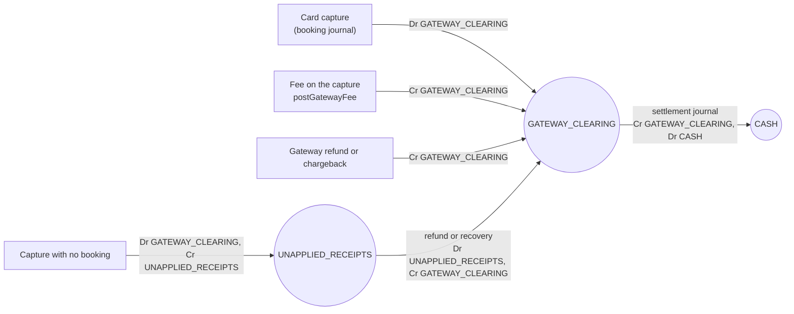
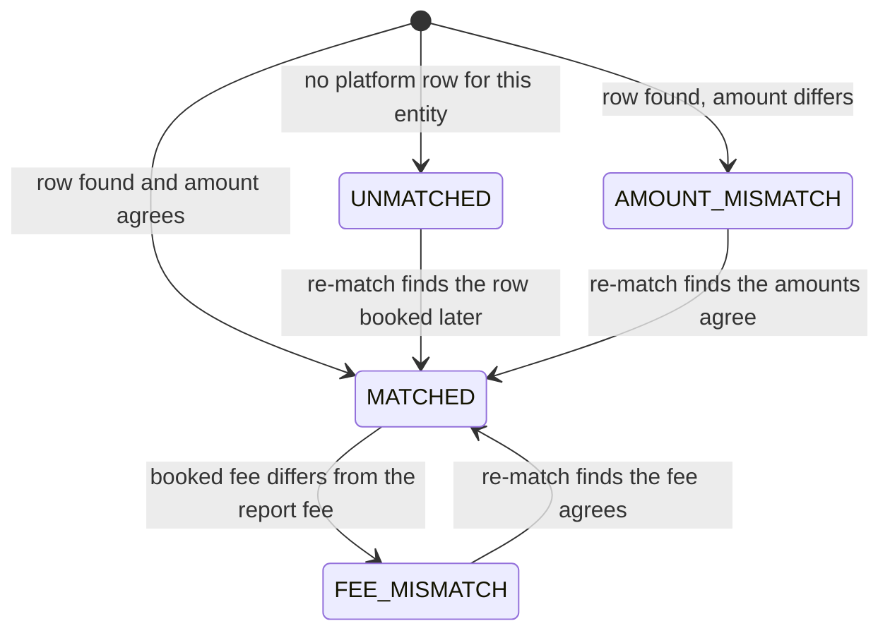

# Gateway clearing and settlement

Razorpay does not pay the platform at the moment a learner pays. It keeps the money, deducts its fee, and settles the net amount to the bank account a day or two later. The ledger models that gap with a holding account, `GATEWAY_CLEARING`. Every card capture, gateway refund and chargeback moves this account instead of `CASH`, and a daily job moves the settled net from clearing to cash once Razorpay's own report confirms it. This page is the reference for that holding account, the fee journal, the settlement journal, the parking account for captures that fund no booking, and the settlement lines that prove the books agree with the gateway.

RazorpayX payouts are the exception. Money leaving through a payout is posted against `CASH` directly (see [consultant payouts](../40-payouts/03-consultant-payouts.md)), because it leaves the RazorpayX balance, not the card-collection balance.

## The five accounts involved

| Account              | Normal side | What it holds                                                                                   | Who posts it                                                                                                  |
| -------------------- | ----------- | ----------------------------------------------------------------------------------------------- | ------------------------------------------------------------------------------------------------------------- |
| `GATEWAY_CLEARING`   | Debit       | Money Razorpay has collected that has not yet reached the bank, net of the fees it has deducted | The booking journal, refund journals, `postGatewayFee`, the settlement journal and the unapplied-receipt code |
| `CASH`               | Debit       | Money in the platform's bank account or RazorpayX balance                                       | The settlement journal (in) and the payout journals (out)                                                     |
| `GATEWAY_FEE`        | Debit       | Razorpay's fee, excluding the GST on it                                                         | `postGatewayFee` in `lib/payments/ledger/gateway-fee.ts`                                                      |
| `GST_INPUT_CREDIT`   | Debit       | The GST Razorpay charged on its fee, which the platform can claim back as input tax credit      | `postGatewayFee`                                                                                              |
| `UNAPPLIED_RECEIPTS` | Credit      | A capture that funds no booking, parked until it is refunded or recovered into a booking        | `lib/payments/ledger/unapplied-receipts.ts`                                                                   |

`gatewayCashAccount()` in `lib/payments/ledger/gateway-account.ts` is the one function that names the clearing account, so a future change of holding account is a one-line edit.

## How money moves through clearing

## Worked example

Priya pays ₹1,180 (118,000 paise) for Hannah's one-hour consultation on Monday 2026-10-19 at 10:00 IST. The numbers for Razorpay's fee are illustrative; the real fee comes from Razorpay's settlement report.

1. **Capture.** The booking journal (`booking:<paymentId>`) debits `GATEWAY_CLEARING` 118,000. The balance of clearing is now 118,000.
2. **Fee.** Razorpay's report says it charged a fee of 2,360 paise (₹23.60), of which 360 paise is GST. `postGatewayFee` posts `Dr GATEWAY_FEE 2,000`, `Dr GST_INPUT_CREDIT 360`, `Cr GATEWAY_CLEARING 2,360` under the key `gatewayfee:<pay_id>`. Clearing is now 115,640.
3. **Settlement.** Razorpay settles on Wednesday 2026-10-21. The report's credit for this payment is 115,640 (the amount less the fee). The job posts `Dr CASH 115,640`, `Cr GATEWAY_CLEARING 115,640` under `settlement:<setl_id>`. Clearing is back to zero for this payment and the bank holds the net.

If the settlement report instead showed a fee of 2,400 paise while the books had 2,360, the line would be stored as `FEE_MISMATCH`, one Sentry message would report it, and nothing would be edited.

## The fee journal

`postGatewayFee` takes the gateway payment id, the fee including GST and the GST part. It posts nothing when the fee is zero or not a safe integer, and it clamps the GST part into the range from zero to the fee. The key `gatewayfee:<pay_id>` (`gatewayFeeKey`) is shared by every caller, so the capture webhook and the settlement job can never both book the same fee: the second caller finds the journal and does nothing. The capture webhook path calls it from `app/api/webhooks/razorpay-dispatch.ts` when the payment event carries the fee. The settlement job calls it for any capture whose fee the webhook missed.

## The settlement job

`reconcile-gateway-settlements` (`jobs/reconcile/reconcile-gateway-settlements.ts`) runs on the five-minute ticker between 06:30 and 12:30 UTC, which is 12:00 to 18:00 IST, after Razorpay's T+1 and T+2 settlements have landed.

**The walk.** Each run reads Razorpay's settlement reconciliation report one IST day at a time, from the day after the last day read in full to yesterday, at most 10 days a run. With no record the walk starts on the day of the last stored line, and never later than the day before yesterday. Once nothing older is unread, the run reads the last two days again from their first page, so late rows are picked up; unread days always come first. A missed day is therefore caught up, and `daysBehind` in the result counts the days still unread. A manual run may name one day (`/api/cleanup/reconcile-gateway-settlements?date=YYYY-MM-DD`, an IST date before today); it reads that day only, from its first page, and leaves the continuation record alone.

**A day.** A day is read page by page (up to 1,000 rows a page) until a short page, at most 20 pages a run. A day cut by the page bound or the deadline is not marked read: the next run resumes it at the page where it stopped, so a day of 20,000 rows or more completes over several runs and never blocks the days after it. Rows are validated one at a time: a row that fails the schema is counted in `rejectedRows` and not stored, the valid rows of the same page are stored, and the run reports the count once. For each page the job works in this order.

1. It skips a row already stored as a `GatewaySettlementLine` (unique on `[provider, entityId, type]`), so a row seen twice is stored once.
2. It matches the row to one of the platform's own money rows: a `Payment`, a wallet top-up, an organisation invoice, a `Refund` or a `Dispute`. A refund of a top-up or an invoice has no `Refund` row, so its journal (`topup-refund:<id>` or `invoice-refund:<id>`) is the record it is compared with.
3. It books any missing capture fee with `postGatewayFee`, then stores the page's new lines in one `createMany` at the end. A fee posting that throws therefore leaves its line unstored, and the next run retries it.

**Later passes.** After the days are read, every run matches again the next 200 lines still `UNMATCHED`, `AMOUNT_MISMATCH` or `FEE_MISMATCH`, in id order after the last line the previous run reached, and starts again from the first once it passes the last. Every unresolved line is therefore reached within a bounded number of runs. A line is updated in place (compare-and-set on its prior status) when the missing refund, capture or fee has since been booked.

**The settlement journal.** For each settlement whose lines fall in days read in full, the job fetches the settlement entity and posts one `settlement:<setl_id>` journal, moving the net of credits less debits from clearing to cash, only when the stored lines add up to the entity's amount. A negative net reverses the direction, and a settlement whose net is zero posts no journal. A settlement whose lines do not add up, or whose entity cannot be read, posts nothing: it is held, counted in `settlementsHeld`, and reported once per run as a standing finding (`reconcile-gateway-settlements:held`) until a later run finds it complete. Unposted settlements are examined in id order, at most 50 entity reads a run, and the next run goes on after the last one examined, so settlements held at the front of the order never keep a later one from being examined. The cohort is the last 60 days; a day read further back while catching up stays in the cohort until one full pass over the order has covered it.

**The continuation record.** Every bound above resumes from one record, stored as JSON in the job's checkpoint on its execution trail (`readJobCheckpoint`, no table of its own): the last day read in full (`read`), the page offset of a day cut short (`day`), the last line re-matched (`rematchAfter`), and the settlement pass (`settle`: the earliest day read outside the lookback and not yet covered, the last settlement examined, and whether such a day was read while a pass was under way). A missing or unreadable record starts the walk from the stored lines.

**A journal already posted.** The ledger is immutable, so a posted `settlement:<setl_id>` journal is never corrected by the job. Each run compares its debit total with the net of the stored lines and reports a difference (`reconcile-gateway-settlements:posted-differs`); a person posts the correcting journal.

The job holds its cron lock fail-closed (`withCronLock`), reads the Razorpay client through `getRazorpayClient`, and stops at a deadline; whatever was cut short resumes from the continuation record. Without a configured gateway client it returns the standard configuration skip `RAZORPAY_KEY_ID or RAZORPAY_SECRET not configured` and finishes; the run is stored as a `CANCELLED` row with outcome `skipped`, so it does not count as a completed settlement read.

What the report said is never edited after a line is stored: its ids, amounts, fee, tax, debit, credit and settlement fields stay as Razorpay sent them. Only the match can change: when the missing refund, capture or fee is booked later, the re-match pass updates `status`, `matchedKind`, `matchedId` and `note` in place, so `UNMATCHED`, `AMOUNT_MISMATCH` and `FEE_MISMATCH` can each move to any other status. A disagreement is reported once per run to Sentry as "Razorpay settlement lines disagree with the books". A real difference between the report and the ledger is resolved by a person posting a correcting journal, never by changing the line's report fields.

## Parked captures

A capture can arrive for a payment that can no longer become a booking: the seat was released, the booking was cancelled, the capture overlapped a confirmed session, or an organisation invoice cannot claim it. Rather than book revenue that the platform will refund, the capture handler posts `Dr GATEWAY_CLEARING`, `Cr UNAPPLIED_RECEIPTS` for the captured paise, under `unapplied:<paymentId>`. The money is a liability to the buyer and touches no revenue, GST or earnings account.

- A refund of the parked capture posts the reverse (`Dr UNAPPLIED_RECEIPTS`, `Cr GATEWAY_CLEARING`) under `refund:<refundId>` and returns exactly the cash.
- An operator recovery that turns the parked capture into a real booking first releases the park (`unapplied-released:<paymentId>`), so the booking journal that follows debits clearing exactly once.
- `hasUnappliedReceipt` answers whether a payment's cash is currently parked. Earnings creation refuses to run for a parked payment, so a parked capture can never mint earnings.

## Rules and their enforcers

| Rule                                                                                            | Enforcer                                                                                          | Test                                                  | Repair                                                                                          |
| ----------------------------------------------------------------------------------------------- | ------------------------------------------------------------------------------------------------- | ----------------------------------------------------- | ----------------------------------------------------------------------------------------------- |
| Every journal balances (debits equal credits) at commit                                         | The `ledger_txn_balanced` constraint trigger in `prisma/sql/ledger-triggers.sql`                  | `__tests__/enterprise/ledger-invariants.test.ts`      | None needed; an unbalanced journal cannot commit                                                |
| A posted journal line and journal header are never edited                                       | `ledger_entry_immutable` and `ledger_transaction_immutable` in `prisma/sql/ledger-triggers.sql`   | `__tests__/enterprise/ledger-invariants.test.ts`      | Post a correcting journal                                                                       |
| One fee journal per capture, at most one settlement journal per settlement (none at a zero net) | The unique idempotency key on `LedgerTransaction` (`gatewayfee:<pay_id>`, `settlement:<setl_id>`) | `__tests__/payments/gateway-settlement-recon.test.ts` | None needed; a replay finds the existing journal                                                |
| A settlement line is stored once per Razorpay entity                                            | The unique index on `[provider, entityId, type]` in `prisma/schema.prisma`                        | `__tests__/payments/gateway-settlement-recon.test.ts` | None needed                                                                                     |
| A disagreement between Razorpay's report and the books is reported                              | `reportMismatches` in the settlement job, one Sentry message per run                              | `__tests__/payments/gateway-settlement-recon.test.ts` | A person posts a correcting journal                                                             |
| A settlement is booked only when its lines are complete                                         | `postSettlementJournals` compares the stored lines with the settlement entity's amount            | `__tests__/payments/gateway-settlement-recon.test.ts` | The next run books it once the lines add up; a posted journal that differs is corrected by hand |
| A missed day is caught up, and bounded work resumes where it stopped                            | The continuation record in the job's checkpoint; `daysBehind` in the result                       | `__tests__/payments/gateway-settlement-recon.test.ts` | The next runs; `?date=` for one day by hand                                                     |
| Two settlement runs never overlap                                                               | `withCronLock("reconcile-gateway-settlements", { failMode: "closed" })`, a Postgres lease         | `__tests__/maintenance/cron-lock-registry.test.ts`    | The lease expires; the next slice runs                                                          |
| The job is held while maintenance is DEGRADED                                                   | `reconcile-gateway-settlements` is in `FINANCIAL_JOB_NAMES` in `lib/cron/financial-jobs.ts`       | `__tests__/maintenance/cron-lock-registry.test.ts`    | The next window after maintenance ends                                                          |

The ledger auditor does not check the size of the clearing balance. `reconcile-ledgers` compares caches with the journal, and the clearing residual and unmatched lines are checked only here (see [integrity and reconciliation](06-integrity-and-reconciliation.md)).

## Where in code

- `lib/payments/ledger/gateway-account.ts` — `gatewayCashAccount`.
- `lib/payments/ledger/gateway-fee.ts` — `postGatewayFee`, `gatewayFeeKey`.
- `lib/payments/ledger/unapplied-receipts.ts` — `postUnappliedReceipt`, `postUnappliedInvoiceReceipt`, `releaseUnappliedReceipt`, `postUnappliedRefund`, `hasUnappliedReceipt`.
- `jobs/reconcile/reconcile-gateway-settlements.ts` — `runReconcileGatewaySettlements`.
- `GatewaySettlementLine`, `GatewaySettlementLineStatus` and `GatewaySettlementMatchKind` in `prisma/schema.prisma`.
- `netlify/functions/cron-tick.mts` — the 06:30 to 12:30 UTC window.

## Related

- [Chart of accounts](02-chart-of-accounts.md)
- [Payment legs](03-payment-legs.md)
- [Integrity and reconciliation](06-integrity-and-reconciliation.md)
- [Capture confirmation and webhooks](../10-money-in/02-capture-confirmation-and-webhooks.md)

## Deprecated & Superseded Approaches

- **A fixed two-day window.** The job once read only yesterday and the day before, one page a slice, from an offset counted from its own stored rows, and posted a settlement from whatever lines it held when the day read empty. A day missed for two days was never read, and a settlement whose lines arrived in two passes was booked at the first total. The walk from a checkpoint, the full read of each day and the comparison with the settlement entity replace all three.
- **`Dr CASH` on a card capture or top-up.** Older documents showed the booking and top-up journals debiting `CASH`. The code debits `GATEWAY_CLEARING` through `gatewayCashAccount()`, and only the settlement journal and the payout journals touch `CASH`. If you find a card-capture journal that debits `CASH`, it is wrong and should not be copied.
- **A second fee key.** The fee is booked once per capture under `gatewayfee:<pay_id>`, by the capture webhook when it carries the fee and by the settlement job otherwise. Do not add a parallel key for the same fee.
