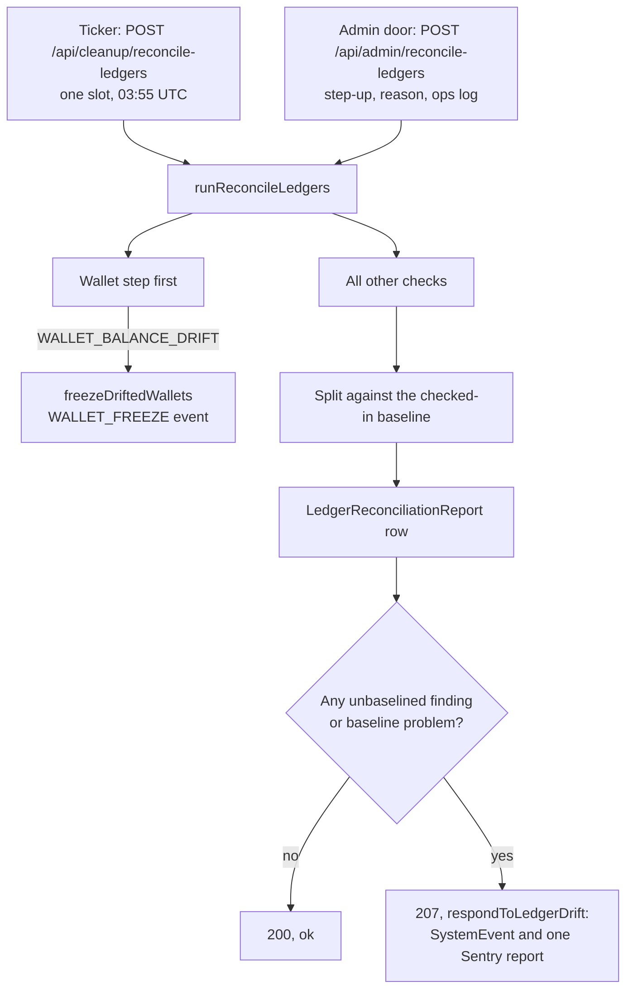

# Ledger integrity and reconciliation

The journal is the source of truth for money. A few numbers are cached beside it for speed, such as the wallet balance and the amount columns on earnings, and a few counters are denormalised, such as engagements used and active seat counts. A cache is only safe if something independently re-derives it and raises an alarm when it drifts. That something is the ledger auditor, `runReconcileLedgers` in `scripts/reconcile/reconcile-ledgers.ts`. It is read-only: it writes one `LedgerReconciliationReport` row per run and never touches an audited table. Its single protective side effect is that a wallet whose cache disagrees with the journal has its discretionary spend frozen until a person repairs it.

This page has three jobs. It lists which invariants Postgres already enforces, so nobody writes a JavaScript sweep that re-checks them. It lists what the auditor checks instead. And it says what to do when a finding fires.

## What Postgres already guarantees

The rule in `AGENTS.md` is that an invariant the database enforces at commit is not re-verified in application code. The auditor therefore does not scan for any of the following.

| Invariant                                                                               | Database enforcer (all in `prisma/sql/`)                                                                                      | What the application does not re-check                                                    |
| --------------------------------------------------------------------------------------- | ----------------------------------------------------------------------------------------------------------------------------- | ----------------------------------------------------------------------------------------- |
| Every journal has debits equal to credits                                               | `ledger_txn_balanced` constraint trigger (`ledger-triggers.sql`)                                                              | No "unbalanced journal" sweep                                                             |
| A posted journal line or header is never edited                                         | `ledger_entry_immutable`, `ledger_transaction_immutable` (`ledger-triggers.sql`)                                              | No checksum of old entries                                                                |
| A journal line is positive and every ledger account is in rupees                        | `ledger_entry_amount_positive`, `ledger_account_currency_inr` (`check-constraints.sql`)                                       | No currency sweep                                                                         |
| Payment, refund, dispute, earning and payout rows are in rupees                         | the `*_currency_inr` CHECKs (`check-constraints.sql`)                                                                         | No currency sweep                                                                         |
| A payment's funding legs sum to the payment amount, and reversal legs never exceed them | `payment_legs_sum_to_amount` (`payment-legs-triggers.sql`), with `payment_amount_vs_legs` and `payment_refunds_within_amount` | The TS twin `checkPaymentLegsSumToAmount` runs at write time only                         |
| A cached wallet balance is never negative                                               | `billing_account_wallet_nonnegative` (`check-constraints.sql`)                                                                | No negative-balance sweep (drift against the journal is still audited)                    |
| A batched earning always points at a payout                                             | `consultant_earnings_batched_has_payout`, `org_earnings_batched_has_payout` (`check-constraints.sql`)                         | No orphaned-batch sweep                                                                   |
| One host's live confirmed sessions never overlap                                        | `occurrence_no_confirmed_overlap` (`check-constraints.sql`)                                                                   | No double-booking sweep for that case                                                     |
| An earnings hold names exactly one earning, and there is one active hold per owner      | `earnings_hold_one_earning`, `earnings_hold_active_consultant_key`, `earnings_hold_active_org_key`                            | No hold-uniqueness sweep                                                                  |
| A consultant has one TDS catch-up payout per financial year                             | `consultant_payout_one_tds_catch_up_per_fy` (`check-constraints.sql`)                                                         | The loser of a race re-plans (see [TDS withholding](../40-payouts/06-tds-withholding.md)) |
| A TDS record has exactly one deductee, on the right rail                                | `tds_record_deductee_xor`, `tds_record_payout_rail_matches` (`check-constraints.sql`)                                         | No TDS-shape sweep                                                                        |

Everything below is what Postgres cannot see: a cache against the journal, a counter against its rows, an external vendor against the books.

## What the auditor checks

The auditor emits the finding kinds in `RECONCILE_FINDING_KINDS`. All are set-based SQL aggregations, so a full run finishes in a few seconds inside one request. A run for one organisation (`scope: "org:<id>"`) skips the four full-scope-only checks marked below.

| Finding kind                                                                           | Asserts                                                                                                                                                |
| -------------------------------------------------------------------------------------- | ------------------------------------------------------------------------------------------------------------------------------------------------------ |
| `WALLET_BALANCE_DRIFT`                                                                 | The cached `walletBalance` equals the owed balance of the `WALLET` account (credits less debits)                                                       |
| `EARNINGS_LEDGER_DRIFT`                                                                | For a payment with a `BOOKING` journal, the cached earnings amounts equal the journal's `PLATFORM_FEE`, `CONSULTANT_PAYABLE` and `ORG_PAYABLE` credits |
| `EARNINGS_WITHOUT_BOOKING_TXN`                                                         | Every payment that has earnings has a `BOOKING` journal                                                                                                |
| `SPLIT_SUM_MISMATCH`                                                                   | A payment's platform fee plus consultant and organisation shares equal `Payment.originalAmount`                                                        |
| `REVERSED_EARNING_WITHOUT_REFUND_TXN`                                                  | An earning with a refunded share has a `REFUND` journal for its payment                                                                                |
| `COMPLETED_PAYOUT_WITHOUT_LEDGER_TXN`                                                  | Every completed organisation payout has an `ORG_PAYOUT` journal; the consultant half is full-scope only                                                |
| `LEDGER_DUAL_WRITE_GAP`                                                                | An organisation payout with a clawback amount has a `clawback:*` journal                                                                               |
| `ORG_PAYOUT_TOTAL_MISMATCH`                                                            | For payouts in `PENDING`, `APPROVED`, `PROCESSING` or `COMPLETED`, the batched earnings' share less refunds equals `netPayoutPaise`                    |
| `CLAWBACK_RECEIVABLE_STALE`                                                            | No clawback is still unrecovered after 90 days (one finding per run, listing every payee)                                                              |
| `ORG_INVOICE_GST_MISMATCH`                                                             | An issued organisation invoice's output tax less credit notes equals the net `GST_PAYABLE` behind it                                                   |
| `PROGRAM_ASSIGNMENT_ENGAGEMENTS_DRIFT`, `CREDIT_POOL_CONSUMED_DRIFT`                   | An active program assignment's counters equal the sum of its usage-ledger rows                                                                         |
| `OVERAGE_COUNT_DRIFT`, `OVERAGE_CHARGESTATUS_INTEGRITY`, `OVERAGE_SETTLEMENT_MISMATCH` | Overage counters, states and settlement journals agree on both sides                                                                                   |
| `ACTIVE_SEAT_COUNT_DRIFT`                                                              | A subscription's active seat counter equals its in-period active assignments                                                                           |
| `PENDING_TRUST_PARK_STALE`                                                             | Detect-only: a sponsor with earnings parked in `PENDING_TRUST` for more than 24 hours; age never releases a park                                       |
| `REFUND_BOOKING_COHERENCE` (full scope)                                                | A fully refunded payment has its utilisation reversed, and reversed utilisation is backed by a `SUCCEEDED` refund                                      |
| `REFERRAL_CREDIT_LIABILITY_DRIFT` (full scope)                                         | The `REFERRAL_CREDIT_LIABILITY` account equals the remaining value of vested credits                                                                   |
| `UNAPPLIED_RECEIPTS_RESIDUE` (full scope)                                              | A settled refund of a parked capture leaves `UNAPPLIED_RECEIPTS` at zero                                                                               |

The consultant-payout journal check inside `COMPLETED_PAYOUT_WITHOUT_LEDGER_TXN` is the fourth full-scope-only check. Each finding carries `expectedPaise`, `actualPaise`, `deltaPaise` and the entity ids it concerns. For count-based checks those three fields hold counts, and `details.unit` records the real unit.

## The baseline of known findings

A finding that is already known must not keep the nightly run red forever, because an auditor that is permanently red is an auditor nobody reads. The auditor splits its findings against a checked-in baseline, `scripts/reconcile/ledger-findings-baseline.ts`, and only the findings the baseline does not excuse fail the run.

- The baseline never hides evidence. Every finding still lands in the persisted report and still counts in `summary.discrepanciesCount`.
- An entry pins one finding by fingerprint: the kind, the delta and every entity id the finding carries. A new row, a changed amount or a finding that grew an identifier is never excused.
- Every entry carries an owner, a reason and an expiry date. An expired entry excuses nothing.
- A malformed entry is ignored and fails the run, recorded in `summary.baselineProblems`, so a broken baseline can never silently turn a run green.

The report is ok exactly when `summary.unbaselinedCount` is zero and `summary.baselineProblems` is empty. The summary also carries `baselinedCount` and `baselineExpiredCount`.

## How a run happens

The Netlify ticker (`netlify/functions/cron-tick.mts`) calls the `reconcile-ledgers` twin once a day at 03:55 UTC, which is 09:25 IST, inside a one-hour window. It is one slot on purpose, because every run writes a report row. The twin runs the full scope under the `reconcile-ledgers` cron lease and answers 200 for a clean run, 207 when there are unbaselined findings, and 500 when the audit or a freeze failed.

An administrator can run the same audit on demand through `POST /api/admin/reconcile-ledgers`, an admin money door with step-up, a reason and one `OpsActionLog` row. It runs synchronously, can be scoped to one organisation, and answers 409 if a full-scope run is already in progress. `POST /api/cleanup/reconcile-ledgers` with `Authorization: Bearer $CRON_SECRET` is the HTTP twin for a manual run. While maintenance is DEGRADED the admin door is blocked (`/api/admin/reconcile-ledgers` is in `WRITE_BLOCKED_IN_DEGRADED` in `lib/maintenance-edge.ts`); the nightly twin is not in `FINANCIAL_JOB_NAMES` and keeps running.

`respondToLedgerDrift` runs only when the report is not ok. It records a `SystemEvent` and reports to Sentry once per standing set of findings, with a seven-day window so the same set does not page every night.

## Wallet drift: freeze, repair, unfreeze

`BillingAccount.walletBalance` is a reconciled cache of the `WALLET` ledger account. When the wallet step finds a drift, every door that runs a reconcile calls `freezeDriftedWallets` (`lib/payments/wallet-freeze.ts`). The freeze is a `WALLET_FREEZE` event in the append-only `SystemEvent` log, keyed `wallet-freeze:<billingAccountId>`, and the latest event under the key decides the state. It fails closed: an unreadable log blocks spend rather than leaking it. It blocks discretionary spend such as a checkout debit, never a top-up credit and never chargeback recovery. The freeze happens right after the wallet step and before the baseline is evaluated, so a baselined wallet drift still freezes spend and still raises one fatal Sentry report per run.

A drift is an incident, not something to patch by hand. The repair has three steps.

1. **Find the cause.** Which writer moved the cache without its journal line, or the journal without the cache?
2. **Post a balanced correcting journal.** It is a new `LedgerTransaction` that fixes the side that is wrong. It is never an `UPDATE` of a balance (`ledger_entry_immutable` would refuse it). `adjustWallet` cannot close the gap, because it moves the cache and the journal by the same amount.
3. **Unfreeze through the door.** `POST /api/admin/billing-accounts/[billingAccountId]/unfreeze` (step-up, reason, ops log) re-reads that wallet and answers 409 `WALLET_STILL_DRIFTED` while the cache and the journal still disagree.

**Worked example: the 2026-10-18 member-overage carve.** A member overage with `CHARGE_MEMBER` on a wallet-funded booking carves the overage base off the parent payment and back onto the organisation's wallet. On 2026-10-18 two such bookings on one organisation each carved 285,018 paise (₹2,850.18). Each carve credited the wallet cache and posted no ledger line, because the carve journal `overage-carve-credit:<overageEventId>` did not exist yet. The cache was therefore right and the journal was short by 2 × 285,018 = 570,036 paise (₹5,700.36). The nightly audit raised `WALLET_BALANCE_DRIFT` and froze the organisation's spend. Both payments had since been fully refunded under the earlier refund journal, before it reversed `DISCOUNT`, and each refund journal left a 285,018-paise credit on `PLATFORM_FEE` and a 285,018-paise debit on `WALLET` (verified in the live ledger). The correction is therefore one balanced journal, `Dr PLATFORM_FEE 570,036` and `Cr WALLET 570,036`, under its own correction idempotency key, which brings every account of both payments to zero, followed by the unfreeze door. It differs from the live writer: today `journalWalletCarveCredit` in `lib/payments/billing/overage-settlement.ts` books each carve as `Dr DISCOUNT / Cr WALLET` in the carve's own transaction, so a new carve cannot drift.

## Reconciliation across the vendor boundary

The auditor compares caches with the journal. It does not check the `GATEWAY_CLEARING` residual or unmatched settlement lines. Those live in the `reconcile-gateway-settlements` job, which compares the journal with Razorpay's settlement report (see [gateway clearing and settlement](05-gateway-clearing-and-settlement.md)). Money reconcilers that talk to Razorpay or RazorpayX, such as `reconcile-payout-status` and `reconcile-disputes`, are described in [scheduled jobs](../70-operations/01-scheduled-jobs.md).

## Rules and their enforcers

| Rule                                                              | Enforcer                                                                                  | Test                                                       | Repair                                           |
| ----------------------------------------------------------------- | ----------------------------------------------------------------------------------------- | ---------------------------------------------------------- | ------------------------------------------------ |
| A known finding cannot keep the run red forever or hide a new one | Fingerprint, expiry and fail-on-malformed rules in `ledger-findings-baseline.ts`          | `__tests__/payments/ledger-findings-baseline.test.ts`      | Fix the finding or renew the entry with a reason |
| A drifted wallet cannot be spent                                  | `isWalletFrozen` in `lib/payments/wallet-freeze.ts`, read in the checkout transaction     | `__tests__/maintenance/ledger-drift-response.test.ts`      | Correcting journal, then the unfreeze door       |
| An unfreeze cannot hide a live drift                              | The `WALLET_STILL_DRIFTED` re-check in the unfreeze route                                 | `__tests__/enterprise/wallet-doors.test.ts`                | Post the correcting journal first                |
| Two audits never run at once                                      | `withCronLock("reconcile-ledgers")`, a Postgres lease, and a 409 for a running full scope | `__tests__/payments/admin-reconcile-ledgers-async.test.ts` | Wait for the running audit                       |

## Where in code

- `scripts/reconcile/reconcile-ledgers.ts` — `runReconcileLedgers`, `RECONCILE_FINDING_KINDS`, `walletDriftFindings`.
- `scripts/reconcile/ledger-findings-baseline.ts` — the baseline entries and `evaluateLedgerBaseline`.
- `scripts/reconcile/ledger-drift-response.ts` — `respondToLedgerDrift`, `freezeDriftingWallets`.
- `lib/payments/wallet-freeze.ts` — `isWalletFrozen`, `freezeWalletSpend`, `unfreezeWalletSpend`, `freezeDriftedWallets`.
- `lib/backoffice/ledger-run.ts` — `startLedgerReconciliation`, the helper behind the admin door.
- `LedgerReconciliationReport` in `prisma/schema.prisma`.

## Related

- [Double-entry model](01-double-entry-model.md)
- [Payment legs](03-payment-legs.md)
- [Gateway clearing and settlement](05-gateway-clearing-and-settlement.md)
- [Ledger drift runbook](../70-operations/06-ledger-drift-runbook.md)

## Deprecated & Superseded Approaches

- **A chunked cursor engine** (`advanceReconcileRun`, `ReconcileCursorState`) walked five tables row by row in TypeScript across many requests. Set-based SQL replaced it and a full run finishes in one request, so any cursor state or `summary.progress` field is dead.
- **A Netlify background-function driver** (`reconcile-ledgers-background`) looped the cleanup route up to 400 times. It was removed when the admin door became synchronous.
- **A baseline keyed to one entity id** excused a finding by kind and one id, so the same row with a changed amount stayed hidden. The current baseline pins kind, delta and every identifier.
- **Application sweeps over database-enforced invariants** (`LEDGER_TXN_IMBALANCE`, `PAYMENT_LEG_SUM_MISMATCH`, `INVOICE_TOTAL_MISMATCH`, `LEDGER_ACCOUNT_NON_INR`) were removed. The triggers and CHECKs in `prisma/sql/` are the enforcers, and a second copy in JavaScript is only weaker.
- **The trigger name `ledger_balance_check`** appears in older documents and comments. The trigger is `ledger_txn_balanced`.
