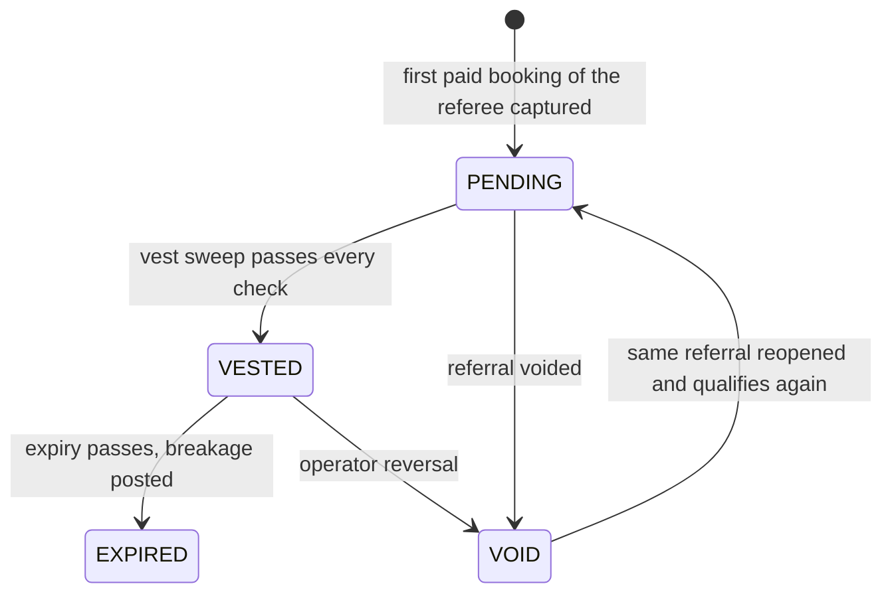

# Referral credits and the ledger

A referral credit is a promotional balance in rupees that the platform grants, most often to a referrer whose friend completed a first paid booking. It is not cash, it cannot be withdrawn or transferred, and it can only reduce what the holder pays on a later order. This page explains the life of a credit, how checkout spends it, and the journal lines that keep the platform's promise to the holder visible as a liability. The programme itself (codes, caps, rewards) is in the referral docs; this page covers the money.

## 1. Where credits come from

`ReferralCredit.source` is a `CreditSource` (`REFERRAL_BONUS`, `REFEREE_BONUS`, `PROMOTION`, `COMPENSATION`, `MANUAL`). Only `REFERRAL_BONUS` is created by the referral programme itself, at the capture of the referee's first paid booking; it starts `PENDING` at the configured reward. `COMPENSATION` and `MANUAL` credits are issued by an administrator through `POST /api/admin/referrals/credits`, spendable at once and counted in the liability the moment they are issued. `REFEREE_BONUS` and `PROMOTION` exist as enum values and filter options but nothing creates them; the referee's reward is a discount, not a credit. A referral can produce at most one `REFERRAL_BONUS` credit for its referrer (`@@unique([userId, referralId, source])`).

## 2. Lifecycle

`ReferralCredit.state` is `ReferralCreditState`: `PENDING` (not spendable), `VESTED` (spendable), `EXPIRED` (a lapsed balance, breakage posted) and `VOID` (qualification failed, or an operator reversed it).

`vest-referral-credits` (`lib/referrals/vesting.ts`, a 30-minute sweep) vests a credit once the booked session was delivered and its earnings hold has passed, no refund is pending or succeeded, no dispute is live or lost, the programme caps and the monthly budget allow it, and the referrer's own checks pass. Any failing check voids the referral with a reason (`REFUNDED`, `CHARGEBACK`, `SESSION_NOT_DELIVERED`, `WINDOW_LAPSED`, `SELF_DEALING`, `CODE_CAP_REACHED`, `REFERRER_YEARLY_CAP`, `KYC_NOT_COMPLETED`). On vest the credit gets an expiry `creditExpiryDays` away (90 by default). A `PENDING` credit holds nothing in the ledger. A `VOID` credit that never vested, was never reversed and was never used can be revived to `PENDING` when the same referral is reopened.

Two database checks protect the balance: `referral_credit_balance_consistent` requires `remainingAmount = amount − usedAmount` with all three non-negative, and `referral_credit_usage_nonnegative` keeps every usage amount non-negative.

## 3. Spending a credit at checkout

The buyer opts in by sending `useReferralCredits`. `deriveCheckoutAmount` then applies credits last, against the tax-inclusive total (see [checkout and pricing](../10-money-in/01-checkout-and-pricing.md#2-how-the-amount-is-derived)), only when that total is at least ₹500 (`MIN_CREDIT_REDEMPTION_PAISE`, 50,000 paise) and capped at `floor(list × creditCapBps / 10,000)` less any welcome discount.

`applyCreditsToPayment` (`lib/referrals/service.ts`) draws soonest-expiring credits first. Each draw is a CAS requiring the credit to be `VESTED`, to hold at least the draw and to be unexpired. If a credit changed since the price was computed, the draw updates zero rows and checkout fails with the retryable 409 `CREDIT_SHORTFALL` so the buyer is re-priced rather than undercharged. Each draw writes a `ReferralCreditUsage` row, and one `REFERRAL_CREDIT` payment leg records the total, with `sourceRef` pointing at the first usage row. That leg is excluded from the funding-leg sum because `Payment.amount` already excludes the credit ([payment legs](03-payment-legs.md)).

## 4. The journal

Each movement of a vested balance is a balanced two-line `REFERRAL_CREDIT` transaction with its own idempotency key.

| Event                  | Debit                       | Credit                      | Idempotency key                               |
| ---------------------- | --------------------------- | --------------------------- | --------------------------------------------- |
| Vest                   | `PLATFORM_PROMO`            | `REFERRAL_CREDIT_LIABILITY` | `referral-vest:<creditId>`                    |
| Redemption draw        | `REFERRAL_CREDIT_LIABILITY` | `PLATFORM_PROMO`            | `referral-redeem:<usageId>`                   |
| Restore after a refund | `PLATFORM_PROMO`            | `REFERRAL_CREDIT_LIABILITY` | `referral-restore:<usageId>:<restored total>` |
| Breakage at expiry     | `REFERRAL_CREDIT_LIABILITY` | `PLATFORM_PROMO`            | `referral-breakage:<creditId>`                |
| Operator reversal      | `REFERRAL_CREDIT_LIABILITY` | `PLATFORM_PROMO`            | `referral-reverse:<creditId>`                 |
| Operator issue         | `PLATFORM_PROMO`            | `REFERRAL_CREDIT_LIABILITY` | `referral-issue:<creditId>`                   |

In plain words: the platform books the cost of a reward when the credit becomes spendable and owes the holder that amount until they use it. Using it pays the debt down, and a balance that expires unused is released as breakage. Draws, restores and breakage post only when the credit's `vestedAt` is set, which means the vest journal posted the liability.

The booking itself separately debits `PLATFORM_PROMO` for the `REFERRAL_CREDIT` leg when the sale is confirmed, so the platform's cost is recognised once, as a promotion, at the sale. The welcome discount has no ledger line of its own: it is a discount before tax, so it lowers revenue at the sale, and the platform's take funds it.

### Worked example

Priya Anderson refers Charlotte Brown, and Charlotte's first paid booking is delivered and past its hold, so the sweep vests Priya's credit of ₹500 (50,000 paise) on Monday 26 October 2026 at 09:00 IST. It posts `referral-vest:<creditId>` with `Dr PLATFORM_PROMO 50,000 / Cr REFERRAL_CREDIT_LIABILITY 50,000`, and the liability shows ₹500. Later Priya books a ₹2,000 session with a 10 % code and spends ₹400 of the credit:

- `referral-redeem:<usageId>`: `Dr REFERRAL_CREDIT_LIABILITY 40,000 / Cr PLATFORM_PROMO 40,000`. The liability falls to 10,000.
- When her payment is confirmed, `booking:<paymentId>` debits `PLATFORM_PROMO 40,000` for the credit leg, together with `GATEWAY_CLEARING 172,400` and `DISCOUNT 20,000`, so the net promotion cost over the credit's life is one 50,000 reward of which 40,000 was used.
- If the booking is later fully refunded, `reverseCreditsForPayment` restores the ₹400 and posts `referral-restore:<usageId>:40000` (`Dr PLATFORM_PROMO / Cr REFERRAL_CREDIT_LIABILITY`), and the liability is back to 50,000.

## 5. Refunds and restoring credits

When a payment that used credits is refunded or cancelled, `reverseCreditsForPayment` returns the value through the `ReferralCreditUsage` rows. A full refund restores everything. A partial refund restores in proportion to the cumulative refunded amount, so rounding never drifts across several partial refunds. A credit-funded class seat, whose refund rows are for ₹0, uses `restoreCreditsForPaymentUpTo`, which restores up to a stated amount and keeps the usage row at 0 so later returns have a stable basis.

What a restore is worth depends on who caused the refund, read from the refund row's `metadata.initiatedByUserId` through `refundInitiatedByBuyer` (the buyer's own id, or an unreadable value, counts as a buyer cancel).

- If the expert or the platform caused it, the restored credit is valid for at least 30 more days, even if its original expiry has passed.
- If the buyer cancelled, the credit keeps its original expiry, and if that has already passed the credit is lost.

A live credit has its `expiresAt` extended in place by a conditional update. An `EXPIRED` credit is never revived: its row shrinks by the restored amount, and a new `VESTED` credit carries the value with a 30-day expiry and the vest journal when the original was vested. A failed checkout's restore follows the buyer rule.

## 6. Expiry and breakage

Spending ignores a credit the instant its date passes. The `expire-referral-credits` job, which runs on the first of each month inside its ticker window, later moves each one to `EXPIRED` by a conditional update that checks the balance has not changed, and posts the breakage entry for the unused remainder. A credit with a zero balance expires without posting anything.

## 7. Invariants

| Rule                                                        | Enforcer                                                                                                 | Test                                            | Repair                            |
| ----------------------------------------------------------- | -------------------------------------------------------------------------------------------------------- | ----------------------------------------------- | --------------------------------- |
| A credit balance is consistent                              | `referral_credit_balance_consistent` CHECK                                                               | none (database)                                 | None; uncommittable               |
| A credit is drawn only while spendable                      | CAS on `state = VESTED`, `remainingAmount >= use`, unexpired in `applyCreditsToPayment`                  | `__tests__/referrals/referral-v2-money.test.ts` | `CREDIT_SHORTFALL` re-price       |
| The liability account equals the vested, unredeemed balance | Detected by the reconciler step `stepReferralCreditLiability`, finding `REFERRAL_CREDIT_LIABILITY_DRIFT` | `__tests__/referrals/referral-v2-money.test.ts` | Correcting journal by an operator |

The liability invariant spans the credit table and the journal, which no single Postgres constraint can, so the reconciler is the right enforcer.

## Where in code

- `lib/referrals/service.ts`: `applyCreditsToPayment`, `reverseCreditsForPayment`, `restoreCreditsForPaymentUpTo`, the journal moves.
- `lib/referrals/vesting.ts`: vest and breakage.
- `lib/referrals/promo-math.ts`: the welcome discount and credit cap maths.
- `app/api/admin/referrals/credits/route.ts` and `[creditId]/reverse/route.ts`: operator issue and reversal.
- `scripts/reconcile/reconcile-ledgers.ts`: `stepReferralCreditLiability`.

## Related

- [Payment legs](03-payment-legs.md), [postings](04-postings.md), [chart of accounts](02-chart-of-accounts.md).

## Deprecated & Superseded Approaches

The first version gave a credit its full value at capture and had no `state` column: a credit was active when it had a balance and an unexpired date, expiry was only a read-time filter, and nothing was posted to the ledger on issue, so cost appeared only at redemption and there was no liability and no breakage. Delete any code that infers status from `remainingAmount` and `usedAt` instead of `state`, any `usedOnPaymentId` field (usage is `ReferralCreditUsage`), and any expectation that a refund deletes usage rows after a partial restore. A six-month expiry, flat ₹500 and ₹200 reward amounts and a plain first-in-first-out example belonged to the earlier credit guide. A pre-existing description of the operator reversal as `Dr PLATFORM_FEE / Cr PLATFORM_PROMO` was wrong; the reversal debits the liability.
