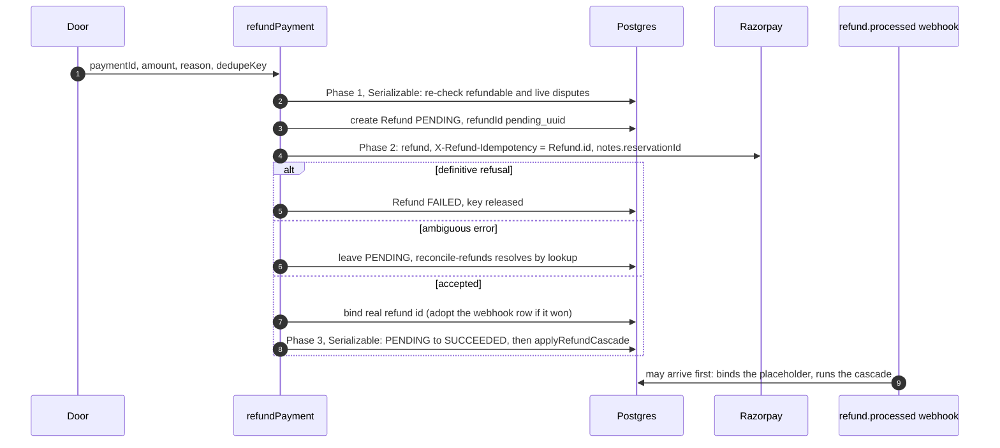
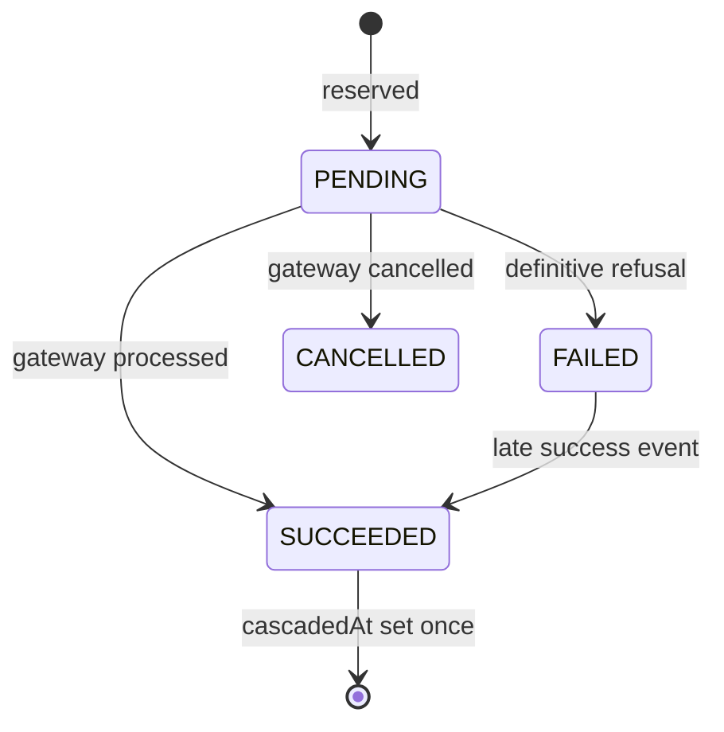

# Refunds

A refund returns money to a payer for a booking. It looks like one action, but it has to touch the gateway, the funding legs, the consultant's and organisation's earnings, the journal, the tax documents and the referral credits, and it has to survive a crash between any two of those. This page explains how refunds are started, how the amount is decided, how the two-phase gateway pattern works, what the refund cascade does step by step, and what repairs a refund that did not finish. Chargebacks and service complaints are different mechanisms and are described in [the section index](README.md).

## 1. Front doors and rails

Every booking refund door goes through `refundBookingPayment` (`lib/payments/operations/booking-refund.ts`). The exception is the capture-race auto-refund in `handlePaymentSuccess` Phase 2: an amount mismatch, a capture after cancellation, a double-booking loser and a legacy overlap loser call `refundPayment` directly, because the payment is a gateway capture by construction. `refundBookingPayment` reads the payment's `paymentIntent` and picks a rail before anything moves (`isFreeCreditIntent` and `isInternalFundedIntent` in `lib/payments/funding-rail.ts`, the predicates `fundingRailForIntent` composes for the cancel preview), so a cancellation quote and the refund itself can never name different rails.

| Rail       | Intent prefix | How value returns                                                                                                                                                |
| ---------- | ------------- | ---------------------------------------------------------------------------------------------------------------------------------------------------------------- |
| `GATEWAY`  | anything else | `refundPayment`: a Razorpay refund to the original instrument                                                                                                    |
| `INTERNAL` | `org_`        | `refundInternalFundedPayment`: one Serializable transaction, no gateway call; the wallet is credited, the accrual leg netted, or the licence engagement restored |
| `CREDITS`  | `free_`       | `refundFreeCreditPayment`: the referral credits are restored in full and a zero-amount `Refund` row records it; the credits rail accepts no amount               |

`refundPayment` itself refuses a payment that is not gateway-funded or not `SUCCEEDED`. Outside the capture-race path above, callers should not call it directly.

| Door                                          | Starts from                                                                      | `Refund.dedupeKey`                                                |
| --------------------------------------------- | -------------------------------------------------------------------------------- | ----------------------------------------------------------------- |
| Cancellation                                  | `POST /api/appointments/[appointmentId]/cancel`                                  | `cancel:<appointmentId>:<paymentId>`                              |
| Whole event cancelled                         | `refundWholeEventPayments` and `stampWholeEventRefundsOwed` (`event-refunds.ts`) | A per-seat key scoped by the calling door                         |
| Attendee removed, seat left                   | `refundRemovedAttendeeSeat`; `lib/booking/seat-leave.ts`                         | `seat-leave:<participantId>` or `seat-exit:<id>`                  |
| Missed class session, series cancel           | `lib/booking/class-sessions.ts`                                                  | `occ:<occurrenceId>:pay:<paymentId>`, `series-cancel:<paymentId>` |
| Consultant no-show, request rejection, expiry | `session-outcome-sweep.ts`, `rejection-refund.ts`, the expire sweeps             | `no-show:<slot>:<user>` and similar                               |
| Platform incident                             | `refundIncidentSeat` (`incident-refunds.ts`)                                     | `incident:<incident>:<occurrence>:<user>`                         |
| Support remedy                                | `executeApprovedRefund` (`lib/support/case-actions.ts`)                          | `case-recommendation:<recommendationId>`                          |
| Admin refund and ladder override              | `POST /api/admin/refunds` and `/api/admin/refunds/issue` (step-up, ops log)      | `admin-refund:<adminId>:<paymentId>:<key>`; `ops:<uuid>` on issue |
| Capture that funds no booking                 | `handlePaymentSuccess` Phase 2                                                   | The `Auto-refund pending:` marker, not a key                      |

`Refund.dedupeKey` is unique. A repeat call with a spent key returns the first refund only when it is for the same payment and, if the call names an amount, the same amount; any other reuse is refused with HTTP 422 and code `IDEMPOTENCY_KEY_REUSED`. A `FAILED` or `CANCELLED` row releases its key for a retry (`findDedupedRefund`). Whether a refund ends the funded seat is decided in the transaction that writes its row and stored as `Refund.metadata.endsSeat` (`refundEndsSeat` in `lib/payments/operations/refund-seat.ts`). A replay applies that stored decision, so resending a ₹100 partial refund's key with no amount returns the ₹100 refund and keeps the seat. A row written before the field existed ends the seat on a replay only when the payment has nothing left to refund. The issue door answers a matching replay without opening a second-approver proposal, and a session-link retry replays its stored refund even after that refund ended the seat. The reasoning and the worked examples are in [a refund key replays a refund only for the request it was spent on](../../decisions/2026-11-21-refund-idempotency-key-binding.md).

**A free seat is not refunded.** The credits writer, `refundFreeCreditPayment` (`lib/payments/operations/booking-refund.ts`), refuses a price-free seat (a `free_` payment of zero paise on a zero list price) with `PRICE_FREE_PAYMENT`, because nothing was paid and no credit was spent, so a refund would only revoke the seat. It refuses with `ALREADY_FULLY_REFUNDED` a credit booking whose referral credit was spent and has all come back, meaning its `ReferralCreditUsage` rows exist and hold nothing now. A booking made free by a 100% discount code has no usage rows at all, so the writer still refunds it, and its discount journal, credit note and earnings reverse as for any other cancellation. `driveRefundOwed` (`lib/payments/operations/refund-owed.ts`) treats `PRICE_FREE_PAYMENT`, like `ALREADY_FULLY_REFUNDED`, as settled and clears the owed-refund marker instead of retrying it. The operator doors check the same eligibility before the writer (`refundDoorRefusal` in `lib/backoffice/refund-eligibility.ts`), so a free seat is refused there too. A booking made free by a 100% discount code (`isDiscountFreeBooking`: a `free_` payment of zero paise on a list price above zero, with no credit-usage rows) passes that check once, as a ₹0 refund, so an operator can end it and the writer reverses its discount journal, credit note and earnings. If it already has a `SUCCEEDED` or `PENDING` refund the door refuses it with `ALREADY_FULLY_REFUNDED` ("This booking was already ended, so nothing is left to refund."). A price-free seat is refused with `PRICE_FREE_PAYMENT`, and a credit booking whose credit has already come back with `ALREADY_FULLY_REFUNDED` ("The credits behind this booking were already returned."). Support's refund quote (`quoteCaseRefund` in `lib/support/case-actions.ts`) shows a discount-free booking at ₹0 with a plain note and no block, and approving it sends the ₹0 refund. Support's recommendation (`recommendRefundTx`) applies the same `refundDoorRefusal` first, so a recommendation the door would refuse, such as ending a discount-free booking Ops already ended, is never opened. Organisation top-up refunds are separate and are described in [wallet and top-ups](../50-b2b/02-wallet-and-top-ups.md).

## 2. How much is refunded

**The notice ladder.** A booking is bound at purchase to a `CancellationPolicy` version (`Appointment.cancellationPolicyId`), published and immutable, so an organisation editing its ladder later never changes a buyer's terms. With no policy row the platform default applies (`PLATFORM_DEFAULT_TIERS`, `lib/payments/operations/cancellation-policy.ts`): 100 % when the booking starts at least 24 hours away, 50 % at least 2 hours away, 0 % inside two hours. A consultant-initiated cancellation refunds the policy's `consultantInitiatedPct`: 100 % under the platform default, and whatever an organisation's published policy sets (0 to 100 %) otherwise. Negative notice (already started) refunds nothing unless the consultant cancelled. A ladder may have up to six rungs and its last rung must start at 0 hours.

**Proration and clamps.** `quoteBookingRefund` prices a 1:1 cancellation in four steps: notice (a booking never scheduled has infinite notice, not negative), the tier, proration for a subscription (the undelivered share of the price), and a clamp to the remaining refundable balance. A booking paid wholly with referral credit restores the credit in full for any non-zero tier rather than escalating, because the credits rail cannot pay a fraction; a zero tier still returns nothing.

**Quote binding.** The cancel preview and the cancel route call the same function. The cancel click sends `expectedRefundPaise`; if the quote computed under the lock differs, the route refuses with `RefundQuoteChangedError` before anything commits, so a buyer is never refunded a different figure from the one they accepted. An older client that omits the field is logged and refunded at the server's quote unchecked.

**Event seats.** A webinar seat, or a class seat before any of its sessions has been delivered, cancelled at least `refundWindowHours` before the next start refunds in full; inside the window it is refused. The host sets 24 to 168 hours on the plan and the seat keeps the window it was sold under. Once a class session has been delivered, leaving refunds only the undelivered sessions, each priced by the booking's cancellation ladder at its own notice (`quoteClassSeatRefund` in `cancellation-policy.ts`, called from `lib/booking/seat-leave.ts`). A class refund unit is the seat's amount divided by `sessionsPurchased`, floored.

### Worked example

Charlotte Brown paid ₹1,180 (118,000 paise) for Hannah Anderson's 10:00 IST Monday consultation. She cancels at 11:00 IST Sunday, 23 hours ahead. 23 hours clears the 2-hour rung but not the 24-hour rung, so the tier is 50 % and the quote is 59,000 paise (₹590.00). The cancel transaction moves the appointment to `CANCELLED` by CAS and, in the same commit, stamps `Payment.refundOwedKey = cancel:<appointmentId>:<paymentId>` with `refundOwedPaise = 59000`. Straight after commit the route drives the marker: a `Refund` of 59,000 is reserved `PENDING`, Razorpay is called with the refund's id as its idempotency key, and the cascade runs. The cascade reverses 59,000 of the card leg, Hannah's `CONSULTANT_PAYABLE` by 40,000 (half of 80,000), `GST_PAYABLE` by 9,000, the platform fee by 10,000, and it mints a consumer credit note for ₹590.00. Had the same cancellation come from Hannah, the tier would be 100 % and the refund 118,000.

## 3. The two-phase gateway refund

`refundPayment` follows a fixed sequence so that a crash at any point leaves a row a sweep can finish, and the gateway is never called twice for one logical refund.

**Phase 1** runs in a Serializable transaction. It re-derives the refundable balance as `Payment.amount − (SUCCEEDED and PENDING refunds) − (disputes LOST or CHARGE_REFUNDED)` and refuses an amount above it (`AMOUNT_EXCEEDS_REFUNDABLE`), refuses while a dispute is live (`REFUND_BLOCKED_BY_DISPUTE`), and creates the `PENDING` row with a throwaway `pending_` id. Reading the dispute table inside the transaction makes serializable isolation abort the loser when a lost chargeback interleaves, which closes the double-reversal window. A database trigger is the final guard: `payment_refunds_within_amount` refuses any `Refund` write that would push refunds plus lost chargebacks above `Payment.amount`.

**Phase 2** is outside any transaction, because external input/output must not sit inside one and a serialization retry must not call the gateway twice. `createRefund` posts to Razorpay over raw HTTP with a bounded timeout. The `X-Refund-Idempotency` header is the Phase 1 reservation id, so a retry returns the original refund; a malformed key is rejected rather than repaired, because a repaired key could collide with another refund. A concurrent duplicate is retried once after a second, but a "different request, same key" answer is surfaced as `REFUND_IDEMPOTENCY_KEY_REUSED`. The reservation id also travels in the gateway notes (`reservationId`) so a webhook can bind back to the exact row.

**Phase 3** binds the real gateway refund id. The Razorpay webhook races the REST response, and if the webhook's row (unique on the real id) commits first, the bind hits a unique violation; the placeholder is retired and the surviving webhook row adopted (`retireSupersededPlaceholderTx`), which first re-points any support recommendation that references the placeholder, because that foreign key restricts deletion. When the gateway reports `processed`, one Serializable transaction does `UPDATE Refund SET status = SUCCEEDED WHERE id AND status = PENDING`, then runs `applyRefundCascade`, restores referral credits, and stages the refund-processed notification and email. A gateway answer that is still pending leaves the row `PENDING`; the webhook or the reconcile sweep completes it.

A `SUCCEEDED` refund is complete only when `cascadedAt` is set. The cascade claims it first (`UPDATE Refund SET cascadedAt = now() WHERE id AND cascadedAt IS NULL`), so the webhook, the Phase 3 transaction and the reconcile sweep can all try and exactly one does the work. If the cascade throws, its transaction rolls back and the claim reverts for a clean retry.

## 4. The refund cascade

`applyRefundCascade` (`lib/payments/operations/refund.ts`) is the single reversal engine. It runs inside the caller's Serializable transaction and is shared by the application path, the Razorpay webhook (`handleRefundCreated`) and the stranded-refund sweep. Its steps are:

1. **Claim and clamp.** Claim `cascadedAt`. Then compute the payment's refundable balance from every other returned refund and every lost chargeback, and reverse at most that, recording `REFUND_CASCADE_CLAMPED` when it had to reduce the figure. This closes the window where a pending refund and a lost dispute would together reverse more than the payment.
2. **Completion test.** A refund completes the payment when it plus the other `SUCCEEDED` refunds already cascaded reach `Payment.amount`. Only refunds already cascaded count, because an uncascaded refund has reversed nothing yet. A full refund also revokes replay-purchase access. A zero-value payment, or a parked capture whose only record is `UNAPPLIED_RECEIPTS`, takes a short path that reverses only utilisation and the parked cash.
3. **Reverse the legs** in proportion, the last leg absorbing the remainder: `WALLET` credits the wallet back, accrual legs get a negative `*_REVERSAL` sibling if the invoice is unbilled, `LICENSE` is handled by the utilisation reversal, and `CARD` is the gateway's job. See [payment legs](../20-ledger/03-payment-legs.md).
4. **Reverse booking utilisation**, restoring the engagement or credit-pool paise in proportion.
5. **Reverse consultant earnings** with a compare-and-swap that caps the reversal at the share and asserts a legal status transition (`applyCappedEarningReversal`). A share already paid out in a `COMPLETED` payout accumulates a clawback of the net after withholding. Tax withheld on a paid share is reversed through `recordTdsReversal`. A subscription's rows are one tranche per cycle, and the clawback is taken newest tranche first.
6. **Reverse organisation earnings** the same way, and record a clawback on the organisation payout when it has already completed.
7. **Mint credit notes** for the invoiced portion: the organisation's GST credit note (`mintRefundCreditNote`) and the personal buyer's consumer credit note (`mintConsumerCreditNote`). Past the CGST s.34(2) cutoff the note is commercial and carries no tax. See [GST invoices and credit notes](../60-tax/02-gst-invoices-and-credit-notes.md).
8. **Credit back overage** when the completing refund reverses a booking that carried a charged overage: a charge-the-organisation overage is flipped `REVERSED` once its credit note exists; a charge-the-member side payment is stamped refund-owed and refunded by its own cascade.
9. **Write the audit row** for organisation-tagged payments.
10. **Post the journal** `refund:<refundId>`, described below.

Referral credits are restored outside the cascade, immediately after the refund row reads `SUCCEEDED`, because the restoration is sized by the cumulative `SUCCEEDED` refund total. The credit's value and expiry depend on who caused the refund ([referral credits](../20-ledger/07-referral-credits.md#5-refunds-and-restoring-credits)).

### The journal and the remainder rule

The `refund:<refundId>` journal is the booking reversed in proportion. Funding legs are credited back, the booked `DISCOUNT` is credited back pro rata with its funding, the consultant and organisation shares and GST are debited back, and `PLATFORM_FEE` takes the balancing plug. `refundReversalBasis` (`lib/payments/ledger/refund-reversal-basis.ts`) reads the payment's `DISCOUNT` and `GST_PAYABLE` lines to size the discount and GST already reversed.

The refund that completes the payment takes the exact remainder of the consultant share, the organisation share, the GST and the `DISCOUNT`, instead of a floor of its own proportion. A payment refunded in one go or in several pieces therefore ends with every one of those shares at exactly zero, with no rounding left behind. A refund past the GST cutoff reverses no GST, so `GST_PAYABLE` keeps that part and the fee plug bears it. If the debit and credit totals ever differ, the cascade throws, records a `LEDGER` system error and rolls back; the refund is retried whole rather than half applied.

The numbers, with a discount and a three-way split, are in [postings](../20-ledger/04-postings.md#7-refunds-refundrefundid).

## 5. When a refund does not finish

| Failure                                                     | Repair                                                                                                                                                                                                                                              |
| ----------------------------------------------------------- | --------------------------------------------------------------------------------------------------------------------------------------------------------------------------------------------------------------------------------------------------- |
| Gateway call failed or the function died before the refund  | The door's marker is on `Payment` (`refundOwedKey`, `refundOwedPaise`, `refundOwedReason`). `retry-auto-refunds` drives it under its own key, backing off between failures; after `MAX_REFUND_OWED_ATTEMPTS` (3) failures an operator is paged once |
| Capture refund for a booking that was not confirmed         | The `Auto-refund pending:` description marker, drained by the same sweep; see [capture confirmation](../10-money-in/02-capture-confirmation-and-webhooks.md)                                                                                        |
| `PENDING` placeholder with no real id (crash after Phase 2) | `reconcile-refunds` matches it to the gateway refund by the reservation id in the notes, never by guessing; it is failed only if the gateway listing succeeded and shows nothing after 24 hours                                                     |
| `PENDING` row with a real id                                | `reconcile-refunds` polls it by id until Razorpay reports processed or failed; it is never aged out locally, because a normal refund legitimately takes days                                                                                        |
| `SUCCEEDED` but `cascadedAt` still empty                    | `reconcile-refunds` re-drives the cascade for rows idle for 10 minutes, retiring a row to an operator after 3 failed re-drives                                                                                                                      |

A Razorpay 404 on refund create is the typed refusal `GATEWAY_NOT_FOUND` (`lib/payments/core/types.ts`): these keys hold no such payment, so no retry can succeed. `driveRefundOwed` treats it as permanent, so `countFailedAttempt` spends the whole `MAX_REFUND_OWED_ATTEMPTS` budget on the first attempt. The marker stays on the payment but leaves the sweep's `refundOwedAttempts < MAX` filter, and one "refund by hand" alert is the only report: the refund path does not capture it separately, and `retry-auto-refunds` does not repeat it. Each retry would otherwise only add another `FAILED` `Refund` row.

### Retry timing

The sweep runs on the 15-minute ticker and drives a marker only once it is 15 minutes old (the grace that lets the door's own drive finish) and its `Payment.refundOwedNextAt` is empty or past. A failed drive counts one attempt by compare-and-swap on the marker key and the attempt count it read, and in the same write sets `refundOwedNextAt`: 1 hour out after the first failure, 4 hours out after the second. The third failure pages and empties `refundOwedNextAt`.

Worked example: Charlotte cancels at 10:00 during a Razorpay outage. The route's own drive fails at 10:00 (attempt 1, next drive 11:00). The 11:00 tick fails again (attempt 2, next drive 15:00). If Razorpay is still down at 15:00, the third failure pages an operator, about 5 hours after the cancel. If it recovered at 10:45, the 11:00 drive refunds her and nobody is paged. Before the backoff, the 10:15 and 10:30 ticks spent all three attempts, so a 45-minute outage paged once for every owed refund.

A marker still unresolved six hours after its door committed, which is after the last scheduled retry, is reported once a day as a `WARN` system event (`reportAgedRefundsOwed`).

### A hand refund settles the owed refund

Any refund an operator sends on a payment settles that payment's owed refund as far as it goes. The operator doors (Issue refund and Ladder override, the admin single-payment refund, an approved support remedy, and Return credits) call `refundBookingPayment` with `settlesOwedByHand`. In the same Serializable transaction that creates the operator's `Refund` row, `settleOwedByHand` compares the hand refund with what the marker owes. A marker owing the full balance (`refundOwedPaise` null) is read as the refundable balance before the hand refund. The write is a compare-and-swap on the marker key and the owed amount it read, so a concurrent change writes nothing:

- **The hand refund covers the owed amount.** The marker is cleared, `refundOwedNextAt` included, and the operator sees "The owed ₹Y is fully settled."
- **The hand refund is smaller.** `refundOwedPaise` drops by the hand refund's amount and the marker stays live, with its attempts and `refundOwedNextAt` unchanged. The operator sees "Settled ₹X of the owed ₹Y; ₹Z still owed and retrying." The next drive refunds only that remainder, still capped by the refundable balance. If the marker has already spent its automatic retries, the note says instead that the rest is still owed and must be refunded by hand, because the sweep no longer picks it up.

The outcome is recorded on the Refund row as `metadata.settledOwed` (`key`, `reason`, `owedPaise` as stamped, `settledPaise`, `stillOwedPaise`, `note`), returned as `settledOwed`, and shown in the refund dialog.

Worked example: Charlotte's cancel stamped 59,000 paise owed, and the first drive failed. An operator then sends ₹200 (20,000 paise) by hand. The marker drops to 39,000 paise and keeps its next drive at 11:00. The operator reads "Settled ₹200.00 of the owed ₹590.00; ₹390.00 still owed and retrying." At 11:00 the sweep refunds 39,000 paise. Had the operator sent ₹590 or more, the marker would have been cleared and the sweep would send nothing.

These guards keep this from paying twice or losing the debt:

- If the marker's own refund is already `PENDING` at the gateway, the hand refund is refused with 409 `OWED_REFUND_IN_FLIGHT` and nothing is committed.
- Every marker drive, the door's own first drive included, carries the marker it drives as `owedMarker` (key and amount). Each rail's transaction checks the marker still holds the payment at that amount (`assertOwedMarkerHeld`). A drive whose marker was cleared ends `settled`, and one whose marker was reduced ends `blocked`. Neither moves money, and the next drive reads the reduced amount afresh.
- A partial credit return against a credits-rail marker (which always owes the whole restoration) is refused with 409 `OWED_RESTORATION_WHOLE`, because the whole-restoration drive cannot shrink to a remainder.
- A hand refund that fails gives back exactly what it settled, in the same transaction as its move to `FAILED`, whoever writes it: the front door on a definitive refusal or decline, `reconcile-refunds`, or the `refund.failed` webhook. All of them go through `failRefund` or call `restoreOwedOnFailedRefund` on their own transaction. A marker that is still live grows back by what this refund settled, against the debt as it stands now: if another hand refund moved it in the meantime, the restore re-reads it and compares-and-swaps again (up to three times) instead of writing back a stale snapshot. A cleared marker is re-stamped under a new key (`<old key>:restored:<refund id>`) for the settled amount, with attempts at zero and `refundOwedNextAt` 15 minutes out. Both are capped at the refundable balance, so a payment fully refunded since then gets nothing back. The refund records `settledOwedRestored` (with the amount and key) through a compare-and-swap on its own row, so a replayed webhook restores nothing twice. If another door's marker now holds the payment, the restore records a "refund by hand" system error instead.
- A failed hand refund that the gateway later reports as succeeded takes the given-back amount off the marker again, once (`resettleOwedOnLateSuccess`). If that marker has already moved on, a system error flags a possible double refund.

`stampRefundOwed` is first-writer-wins: a payment that already owes a refund keeps its marker, so two doors never share one. Each door then either refuses or proceeds:

- **Refuse, nothing committed.** The cancel route, trial cancel, seat leave, the whole-event cancel (`stampWholeEventRefundsOwed`, reached from the cancel route, the ADMIN `cancel-series` door, the admin whole-event refund and the moderation cancel), the plan-end settlement, the settled-plan incident remedy and the stale-request expiry. The interactive ones answer 409 `REFUND_IN_PROGRESS` or `REFUND_NEEDS_SUPPORT` through `heldMarkerRefusal`; the sweeps retry next run. A whole-event cancel accepts a replay of its own key and refuses on any other marker, so a class is never cancelled with a seat's refund owned by nobody.
- **Proceed, and hold for a hand top-up.** Rejection, moderation of a 1:1 booking or a removed attendee, a consultant no-show, the maintenance freeze and the overage credit-back end the booking anyway. A full-balance holding marker already covers them, so they record nothing. Otherwise, through `stampOwedOrHeld` (or `heldInsteadOf` for a batch), the door works out its top-up (its own amount, or for a full-balance door what the holding marker leaves, capped at the balance) and, in its own transaction, records one `WARN` event keyed `owed-already-held:<payment>:<its key>` with that amount and places an `OPERATOR` `EarningsHold` with that key as its source on every unpaid earning of the payment (consultant and host organisation). A replay adds neither. A hold that races refuses with a retryable 409 `PAYMENT_BUSY` ("Another update is in progress on this payment — try again.") and rolls the door back, so no earning is left HELD without a hold. A holding refund already sent or in flight is in the balance and is not subtracted again. Its response carries the note "A refund of ₹Y was already owed on payment … for another reason (…), so this action added nothing to it. Refund any difference by hand." (the rejection's `alreadyOwed`, the moderation summary's `refundsAlreadyOwed`, the no-show run's `refundsAlreadyOwed`; the freeze and the credit-back have no response). The Refunds tab's needs-human list shows "Another refund is still owed on this payment; refund the remaining ₹X by hand, then release the hold." with the issue door preset to ₹X. The row reads money, not the hold: it stays open while the refunds landed since the event cover less than ₹X and a refundable balance remains (never counting the holding refund, nor a hand refund's share that settled it; two rows on one payment take later refunds oldest first), then offers **Release hold**, which releases only that top-up's hold (`releaseTopUpHold`, `POST /api/admin/earnings/top-up-hold`, scoped to the event's key) and waits while another top-up on the same payment is unpaid; the Earnings tab's release leaves top-up holds alone. While the holding marker is still stamped the preset covers it plus ₹X. The list reads the last 180 days oldest first, page by page, skipping settled top-ups until it has enough open rows (500), and then says more are waiting; a row whose hold is still active is listed at any age.

## 6. Invariants

| Rule                                                   | Enforcer                                                                                    | Test                                                     | Repair                               |
| ------------------------------------------------------ | ------------------------------------------------------------------------------------------- | -------------------------------------------------------- | ------------------------------------ |
| Refunds plus lost chargebacks never exceed the payment | `payment_refunds_within_amount` constraint trigger; the Phase 1 re-check; the cascade clamp | `__tests__/payments/refund-balance.test.ts`              | None; uncommittable                  |
| One logical refund calls the gateway once              | `Refund.dedupeKey` unique; reservation id as `X-Refund-Idempotency`                         | `__tests__/payments/razorpay-refund-idempotency.test.ts` | `reconcile-refunds`                  |
| A cascade runs once                                    | `cascadedAt` claim                                                                          | `__tests__/payments/refund-operation.test.ts`            | `reconcile-refunds` stranded pass    |
| A paid-out share is clawed back, not lost              | `applyPaidConsultantClawbacks`; organisation payout clawback counter                        | `__tests__/payments/consultant-payout-clawback.test.ts`  | Recovery netted from the next payout |
| A full refund reverses every share exactly             | `completesFullRefund` and `refundReversalBasis`                                             | `__tests__/payments/refund-discount-reversal.test.ts`    | None                                 |
| A refund is never half applied                         | The cascade rethrows; the Serializable transaction rolls back                               | `__tests__/payments/refund-operation.test.ts`            | Gateway redelivery or the sweep      |
| A binding race adopts the webhook row                  | `retireSupersededPlaceholderTx`                                                             | `__tests__/payments/refund-placeholder-retire.test.ts`   | None                                 |
| A hand refund settles at most what is owed             | `settleOwedByHand` in the refund's transaction; `assertOwedMarkerHeld` on every drive       | `__tests__/payments/refund-owed.test.ts`                 | None                                 |

## Where in code

- `lib/payments/operations/booking-refund.ts`, `refund.ts`, `refund-owed.ts`, `refund-placeholder.ts`, `cancellation-policy.ts`, `event-refunds.ts`, `incident-refunds.ts`.
- `app/api/admin/refunds/issue/route.ts`, `app/api/admin/refunds/route.ts`, `app/api/admin/refunds/credits/route.ts`, `lib/support/case-actions.ts` (the operator doors).
- `lib/payments/ledger/refund-reversal-basis.ts`.
- `app/api/appointments/[appointmentId]/cancel/route.ts`, `app/api/webhooks/utils.ts` (`handleRefundCreated`).
- `scripts/refunds/reconcile-pending-refunds.ts`, `scripts/payments/retry-auto-refunds.ts`.

## Related

- [Postings](../20-ledger/04-postings.md) for the refund journal numbers; [chargebacks](02-chargebacks.md); [service complaints](03-service-complaints-and-remedies.md).
- [Scheduled jobs](../70-operations/01-scheduled-jobs.md); [money runbooks](../70-operations/05-money-runbooks.md).

## Deprecated & Superseded Approaches

A first design held the gateway call inside the database transaction, which keeps a connection open across a network call and re-calls the gateway on a serialization retry; a second moved the call outside with no reservation, which let two refunds race past the balance check. The reserve, call, settle sequence replaced both. An earlier account claimed refunds are not automatic and that an administrator posts to `/api/payments/refunds`; that route does not exist, the cancel route quotes and drives the refund itself, and a hand-written `UPDATE` of a `Refund` row as a repair step is banned. A cascade that "skipped and logged" a ledger imbalance was replaced by one that rolls back. A `cascade-refund-earnings` cron and a `release-pending-trust` cron were documented and never existed: the cascade runs inline. The refund fee-plug used to absorb the whole `DISCOUNT` and floor remainders; the discount now returns with its funding and the completing refund takes the remainder. Refund speed is no longer log-only: `refund.speed_changed` stores both speeds on `Refund.metadata`. The owed-refund sweep used to retry every 15 minutes with no backoff, so three failures and a page came about 30 minutes after the stamp. An operator's refund cleared only a marker that had used all its attempts, and only when the hand refunds covered it (`clearStuckRefundOwed`, with a `markerStillOwed` answer). For a short while every operator refund cleared the marker whatever its amount; a smaller hand refund now reduces it instead. A whole-event cancel used to commit with a seat whose payment already owed another door's refund, record only a WARN event, and drive whatever marker it then found; it now refuses and drives only its own keys. A door that lost the stamp used to record only that WARN event, read by nobody; it now holds the payment's earnings and lists the top-up for ops. Delete references to any of these.
