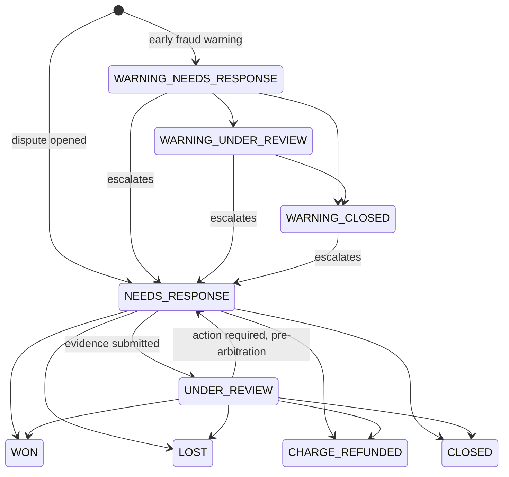

# Chargebacks

A chargeback, called a dispute in this codebase, is a cardholder asking their bank to take money back from a payment. Razorpay relays it, the platform holds the payee's money while it is open, an administrator can contest it with evidence, and when it ends the verdict either releases the hold or reverses the sale. This page explains the lifecycle, the evidence path, what each verdict does to money, who bears a loss, and how the platform stays correct if a webhook is missed. A complaint a person files with support is a different thing and is covered in [service complaints](03-service-complaints-and-remedies.md).

## 1. The lifecycle

`Dispute.status` is a `DisputeStatus`, and `isLegalDisputeTransition` (`lib/payments/dispute-status.ts`) enforces which moves are allowed. An early fraud warning can be closed or can escalate into a real dispute; a real dispute ends in one of four terminal states.

`WON`, `LOST`, `CHARGE_REFUNDED` and `CLOSED` are terminal and have no outgoing edge. `WARNING_CLOSED` is treated as resolved for blocking purposes (`DISPUTE_INACTIVE_FOR_GATING`) but may still escalate later. Razorpay's `open` maps to `NEEDS_RESPONSE`; `closed`, which means proceedings ended without a win or loss verdict, maps to `CLOSED`. An unmapped gateway status is never coerced into a live state: on update it is skipped and recorded as one `WARN` `SystemEvent` (`ERROR` when the dispute is terminal), and on creation it falls back to the protective `NEEDS_RESPONSE` so earnings are held.

An event that reaches a terminal dispute (a `created` under its id, or an update) changes nothing. When it reports another status, or a phase past the first round (anything but `fraud`, `retrieval` or `chargeback`, so `pre_arbitration` and `arbitration`), it records one `ERROR` `SystemEvent` (category `razorpay_webhook`) with the stored status, the incoming status, the phase, the dispute id and the payment id, so operations sees a re-challenge on the day (`isTerminalDisputeChange` in `lib/payments/dispute-status.ts`). The event is written after the handler's transaction commits, with the webhook event id as its `correlationId`, so the stuck-event sweeper's re-drive of the same delivery adds no second row while a distinct delivery adds its own. A redelivery of the stored status in a first-round phase stays a quiet no-op. Whether Razorpay reuses a dispute id for a later phase is not documented, so the stored status and money are left alone until an operator looks.

The webhook arrives as `payment.dispute.created`, then `.under_review`, `.action_required`, and `.won`, `.lost` or `.closed` ([webhook reference](../10-money-in/03-razorpay-webhook-reference.md)). Each update is a compare-and-swap on the prior status inside a Serializable transaction, so a duplicate or out-of-order delivery changes nothing.

## 2. What happens when a dispute opens

`handleDisputeCreated` (`app/api/webhooks/utils.ts`) defers until the payment is captured (`dispute_before_payment`), links the dispute to the payment by gateway id or order, creates the `Dispute` row, and in the same transaction:

- **Cancels any not-yet-sent payout** that includes this payment's earnings (`cancelOpenPayoutsForPayment`), returning the other earnings in that batch to `READY`.
- **Places an `EarningsHold` of reason `DISPUTE`** on the payment's unpaid consultant and organisation earnings, keyed to the dispute row.
- **Notifies the payer** by bell and email.

While the dispute is live, two guards apply to the payment: a new refund is refused (`REFUND_BLOCKED_BY_DISPUTE`, also re-checked inside the refund reservation), and a payout is refused for the payment (`DISPUTE_GATED_PAYMENT_WHERE`, `lib/payments/payouts/shared-lifecycle.ts`). A cancel or reschedule of a 1:1 booking (a consultation or a plan) is blocked too, because the appointment is the evidence (`hasActiveDisputeForAppointment`, 409 `DISPUTE_ACTIVE`).

A class or a webinar is one appointment carrying every seat's payment, so that freeze does not apply to it: the host or staff can cancel the event, and the host can re-time a webinar, while one seat is disputed. The cancel stamps every owed seat in its commit (`stampWholeEventRefundsOwed`), the disputed one included, and `refundWholeEventPayments` refunds every other seat and leaves the disputed seat's marker undriven, with no attempt spent. `retry-auto-refunds` skips a marker whose payment has a live dispute. Once the dispute is decided the sweep drives it: after `WON` the seat is refunded the share stamped at the cancel, and after `LOST` or `CHARGE_REFUNDED` the refund door finds nothing left to return (`ALREADY_FULLY_REFUNDED`, because `refundableBalancePaise` counts the charged-back amount) and the drive clears the marker. A partial loss refunds the stamped share capped at what the bank left. Example: Hannah Anderson cancels her 8-session class after 3 sessions while Rohan Mehta's ₹8,000 seat is disputed. The other 19 seats get ₹5,000 each at once; Rohan's ₹5,000 waits, is paid when the dispute is won, and is cleared unpaid if it is lost.

## 3. Evidence

Evidence is submitted by an administrator holding `disputes.manage`, through `POST /api/payments/disputes`, and only while Razorpay will take it: the dispute must be `NEEDS_RESPONSE` and its `dueBy` must not have passed (`EVIDENCE_DEADLINE_PASSED`, 410). There are two shapes of request.

1. **Upload.** A multipart request with `disputeId` and a `file` (JPG, PNG or PDF, up to 4 MB, because Netlify buffers at most 6 MB per request) is sent to Razorpay's documents API (`uploadDisputeDocument`) and returns a `documentId`. Larger files must be split or compressed. It is rate limited with `moneyOpsLimiter` (10 a minute).
2. **Contest.** A JSON request with `action` of `draft` or `submit`, a summary of at most 1,000 characters, an optional amount to contest, and lists of document ids by Razorpay's own categories (`proof_of_service`, `customer_communication`, `refund_cancellation_policy`, `term_and_conditions`, `explanation_letter`, and `others`). It runs through `withOpsAction` (a typed reason, an `OpsActionLog` row, `assertMoneyOpsBudget`), calls `contestDispute` against Razorpay, then stamps the result locally with `stampContest`. If Razorpay accepted the contest but the local write fails, the response says `localStampFailed` and a Sentry event is raised, because Razorpay's state has moved and the caller must not retry.

The deadline Razorpay reports in `respond_by` (Unix seconds on the wire, stored as `dueBy`) is the one that counts. Assigning an owner is a separate door, `PATCH /api/admin/disputes/[disputeId]`, which requires an active administrator and an `expectedUpdatedAt` match so two operators cannot silently reassign each other; it moves no money.

## 4. Deadlines and alerts

The `support-sla-sweep` job (every 30 minutes) looks at disputes in `NEEDS_RESPONSE` or `WARNING_NEEDS_RESPONSE` whose `dueBy` is from 24 hours ago to 72 hours ahead. For each it stages a notification to administrators keyed `dispute-due:<disputeId>:<72|24>`, the second when 24 hours or fewer remain, so each window alerts once. Any dispute due within 12 hours or past due with no response also records one standing `SystemEvent` finding (severity `WARN`, key `dispute-deadline:critical`) and sends one Sentry warning when the batch holds a dispute not paged before, so each dispute pages once. It is a money exception to the escalations-only Sentry policy. This job, not a dispute-specific one, owns the alert.

## 5. What each verdict does

Both the webhook and `reconcile-disputes` call the same function, `settleDisputeVerdict`, so a verdict is settled identically whichever arrives first.

| Verdict                    | Effect                                                                                                                                                                                                                                                |
| -------------------------- | ----------------------------------------------------------------------------------------------------------------------------------------------------------------------------------------------------------------------------------------------------- |
| `WON`, or `WARNING_CLOSED` | `settleWonDispute`: release only this dispute's `DISPUTE` holds. Other holds (moderation, operator, overage, support) and other open disputes keep their own rows                                                                                     |
| `LOST`, `CHARGE_REFUNDED`  | `settleLostDispute` for `amount_deducted` when it is above 0, capped at the disputed amount, otherwise for the disputed amount; a reported figure that differs from the disputed amount records one `INFO` `SystemEvent` after the settlement commits |
| `CLOSED`                   | A loss for `amount_deducted` when it is positive, capped at the disputed amount, otherwise a release                                                                                                                                                  |

`settleLostDispute` reverses `lost ÷ payment.amount` of every share, capped at 1, and then:

1. **Reverses consultant earnings** (statuses `HELD`, `BATCHED`, `PENDING_TRUST`, `PAID`) by `prorate(share, lost, payment.amount)`, an integer floor, through the same compare-and-swap writer the refund cascade uses, so two partial losses compose without exceeding the share. Tax withheld on a paid share is reversed with `recordTdsReversal`.
2. **Claws back a paid share.** If a `PAID` share sits in a `COMPLETED` payout and the payment was not organisation-funded, the net of withholding, `prorate(reversed, payout amount − TDS, payout amount)` on integers, is booked as a receivable: `Dr CONSULTANT_RECEIVABLE / Cr CONSULTANT_PAYABLE`, key `clawback:dispute:<disputeRowId>:<payoutId>`, once per payout, and operations is paged with the net figure to collect. The withheld tax is reversed separately and is not collected.
3. **Reverses host organisation earnings** the same way, and posts `Dr CASH / Cr ORG_PAYABLE` for a share already paid in a completed organisation payout.
4. **Releases this dispute's holds**, so a partial loss leaves the rest payable.
5. **Books the money.** For a card-funded payment, personal or organisation-tagged, the booking journal is mirrored in proportion: `chargeback:<disputeId>` flips each `booking:<paymentId>` line, scaled by the reversed fraction, with the rounding residual on `PLATFORM_FEE`; refunds already succeeded are subtracted first, and past the GST cutoff the GST line is omitted. For an organisation-funded payment (wallet, invoice or licence legs) the funder bears the loss: its wallet is debited if it can cover it, otherwise the amount is booked as `ORG_RECEIVABLE` for dunning.
6. **Mints credit notes** for the lost amount, keyed to the dispute and idempotent: the organisation's note (`mintRefundCreditNote`) and the personal buyer's consumer note (`mintConsumerCreditNote`). Replay purchases lose their playback entitlement.
7. **Takes back an unspent referral reward.** If the payment qualified a vested referral, `voidVestedReferralRewards` voids the unspent balance of the referrer's credit under `referral-reverse:<creditId>` and ends the unused fee-waiver sessions of an expert referral ([referral credits](../20-ledger/07-referral-credits.md#6-a-lost-chargeback-after-vest)).

### Who bears a loss

| Funding                                 | Who loses                                                                                                                                                               |
| --------------------------------------- | ----------------------------------------------------------------------------------------------------------------------------------------------------------------------- |
| Personal card                           | The cash is gone to the bank. The consultant's unpaid share, the GST and the platform fee are reversed; a share already paid out becomes the consultant's receivable    |
| Organisation wallet or invoice          | The funding organisation, by wallet debit or receivable. Consultant and host shares are still reversed in proportion, but a paid share creates no consultant receivable |
| Host organisation's share, already paid | The host organisation, as a payout clawback                                                                                                                             |

### Worked example

Charlotte Brown paid ₹1,180 (118,000 paise) for Hannah Anderson's session on Monday 19 October 2026. On Friday 23 October at 09:00 IST her bank opens a dispute. The webhook creates the `Dispute` as `NEEDS_RESPONSE` with `dueBy` set, cancels no payout (none was batched), and holds Hannah's unpaid earning of 80,000 paise. At 09:30 IST a new refund request on this payment is refused. An administrator uploads Charlotte's booking confirmation (800 KB PDF), submits the contest, and Razorpay moves the dispute to `UNDER_REVIEW`. On Tuesday 3 November the bank settles for half: Razorpay sends `payment.dispute.closed` with `amount_deducted` of 59,000. `settleClosedDispute` treats it as a loss of 59,000, fraction one half: Hannah's earning is reversed by 40,000, her `DISPUTE` hold is released so the remaining 40,000 stays payable, and `chargeback:<disputeId>` posts `Dr PLATFORM_FEE 10,000`, `Dr CONSULTANT_PAYABLE 40,000`, `Dr GST_PAYABLE 9,000`, `Cr GATEWAY_CLEARING 59,000`. A consumer credit note for ₹590.00 is minted. Had Hannah already been paid, the 40,000 would be a receivable recovered from her next payout.

## 6. If a webhook is missed

`reconcile-disputes` (`scripts/disputes/reconcile-disputes.ts`, hourly, under a fail-closed `withCronLock`) polls Razorpay for disputes still in `NEEDS_RESPONSE`, `UNDER_REVIEW` or the warning equivalents: those with `dueBy` within seven days first, and a third of a bounded run is reserved for ones not updated in 24 hours. For each it fetches the gateway status, and if it differs adopts it and settles any verdict in one transaction through `settleDisputeVerdict`, so a failed settlement rolls the adoption back for the next tick and a later webhook finds nothing left to do. The adoption is a compare-and-swap on the status the loop read, so a webhook that landed in between wins. A dispute it cannot link to a payment, or whose status it cannot map, is flagged for manual review in `evidence` without changing status. The two cohorts are polled in turn, a near-deadline dispute and then a stale one, and the poll stops starting disputes at half the run's start budget (8 seconds), which leaves the other half to the discovery pass below, so a slow gateway cuts both cohorts short and not the stale one alone; a dispute it did not start keeps its `updatedAt` and is first in the next run, and `totalProcessed` counts only the ones started.

That poll only asks about disputes the database already holds and still reads as open. The job's last pass, `discoverGatewayDisputes` (`lib/payments/discovery/dispute-discovery.ts`), covers the rest: a dispute whose `payment.dispute.created` never arrived, and a decided dispute that changed afterwards. It pages Razorpay's whole dispute list, 100 a page and at most 3 pages a run, from the place kept in the job's checkpoint, and compares each listed dispute with its row:

| Listed dispute                                                             | What the pass does                                                                                                                                                                                                                                                                                                                                                                          |
| -------------------------------------------------------------------------- | ------------------------------------------------------------------------------------------------------------------------------------------------------------------------------------------------------------------------------------------------------------------------------------------------------------------------------------------------------------------------------------------- |
| No row                                                                     | Calls `handleDisputeCreated` with status `open`, as the created webhook carries, which writes the row and places the holds; then, when the listed status is not `open`, calls `handleDisputeUpdated` with it, which settles the verdict. A dispute first seen already lost is therefore booked.                                                                                             |
| A row in another status                                                    | Calls `handleDisputeUpdated` with the listed status, `amount_deducted` and phase: the same compare-and-swap and `settleDisputeVerdict` the webhook runs.                                                                                                                                                                                                                                    |
| A decided row listed in another status, or in a phase past the first round | Calls `handleDisputeUpdated`, which changes nothing and records its one `ERROR` event, keyed on the dispute, listed status and phase so later runs add none. This is how a won dispute re-opened for pre-arbitration under the same id is seen when its webhook is lost.                                                                                                                    |
| A row in the listed status                                                 | Nothing.                                                                                                                                                                                                                                                                                                                                                                                    |
| No payment row for it, or one still `PENDING`                              | `handleDisputeCreated` defers: nothing is written, and the dispute id is reported (a standing finding). That is the handler's whole payment guard. It finds the row by the gateway payment id or by the order, and a row in any other status is enough: a dispute on a `FAILED` or `EXPIRED` order's payment row gets its `Dispute` row and its holds, exactly as it does from the webhook. |

A dispute whose payment no row holds by its capture id costs the handler one gateway read to look for its order, and such a dispute can stay unmatched for good, so those hand-overs are rationed (`gatewayReadTurn` in `lib/payments/discovery/checkpoint.ts`). One the handler defers is remembered in the checkpoint with the time it was tried and is passed over, with no hand-over, until 6 hours later. Once 5 of them have ended deferred in a run, no further one starts in that run: it is remembered as due and is handed over when the walk next reaches it with the run's 5 unspent. It gets no priority: the next run resumes at the stored place in the list, so that is the next run only when the walk has wrapped to the top (a list of up to 300 disputes does so every run), and otherwise when the walk comes round to its page again. A hand-over that imports its dispute does not count towards the 5. Either way the pass moves on to the disputes behind it in the same run. The checkpoint remembers at most 100 deferrals: past that, a further dispute with no payment under its capture id is not tried. A dispute the pass did not hand over, for either reason, is reported by id under `reconcile-disputes:discovery-not-attempted`, apart from the disputes the handler deferred (`reconcile-disputes:discovery-unknown-payment`), and the run's result counts both kinds of pass-over (`discovery.waiting`, `discovery.untried`). A remembered deferral is dropped when the dispute gets a row or when 7 days pass without the walk meeting it. A dispute whose payment row exists and only awaits its capture costs no gateway read, so it is tried on every walk and not remembered.

The pass adds no hold and no settlement of its own: every write is the shared handler's, so discovery and the webhook end as one row, one hold and one settlement whichever comes first. The position moves past a page when every dispute on it was handed over or passed over as a remembered deferral; a failed hand-over, a failed list call or database read, or a deadline cut keeps the page, and the run still records the position it had reached; a page bound or the run deadline that cuts the pass is named in the run's result (`discovery.stoppedShort`), and two cut runs in a row raise a standing finding. This is a reconciler across the vendor boundary, which the rule against JavaScript reconcilers allows: only Razorpay knows of a dispute it never told us about.

Two limits come from the gateway's list as the SDK exposes it, neither checked against the gateway (`.claude/skills/finance/references/razorpay/references/disputes.md`): it takes no time filter and a dispute carries no update time, so the pass cannot ask for "changed since" and walks the whole list instead, and its ordering is unknown, so past 300 disputes a new one is found when the walk next reaches it. A dispute discovered after it was decided sends the payer both the opened and the resolved notice. A dispute closed with a deduction is still not counted in the refundable balance; discovery records more of those rows than the webhook alone did and does not change how they are counted.

## 7. Invariants

| Rule                                                                           | Enforcer                                                                                       | Test                                                        | Repair                       |
| ------------------------------------------------------------------------------ | ---------------------------------------------------------------------------------------------- | ----------------------------------------------------------- | ---------------------------- |
| Only legal status transitions are recorded                                     | `isLegalDisputeTransition`; CAS on the prior status                                            | `__tests__/payments/dispute-status.test.ts`                 | `reconcile-disputes`         |
| A verdict settles once, by either path                                         | CAS on status; `chargeback:<disputeId>` idempotency key; credit notes unique on the dispute id | `__tests__/payments/reconcile-disputes-cas.test.ts`         | None                         |
| A gateway dispute becomes one row and one hold, by its webhook or by discovery | `Dispute.disputeId` unique; both call `handleDisputeCreated` and `handleDisputeUpdated`        | `__tests__/db/booking/gateway-dispute-discovery.db.test.ts` | None                         |
| A live dispute blocks refunds and payouts                                      | `REFUND_BLOCKED_BY_DISPUTE`; `DISPUTE_GATED_PAYMENT_WHERE`                                     | `__tests__/payments/dispute-payout-block.test.ts`           | Resolves with the verdict    |
| Refunds plus lost chargebacks never exceed the payment                         | `payment_refunds_within_amount` trigger; the cascade clamp                                     | `__tests__/payments/dispute-refund-correctness.test.ts`     | None; uncommittable          |
| A loss reverses only its fraction and never over-reverses                      | `applyCappedEarningReversal` CAS                                                               | `__tests__/payments/dispute-earnings-hardening.test.ts`     | None                         |
| A paid share lost to a chargeback is recorded as owed                          | `Dr CONSULTANT_RECEIVABLE` posting with the page                                               | `__tests__/payments/dispute-consultant-clawback.test.ts`    | Netting from the next payout |

## Where in code

- `app/api/webhooks/utils.ts`: `handleDisputeCreated`, `handleDisputeUpdated`, `settleLostDispute`, `settleWonDispute`, `settleClosedDispute`, `settleDisputeVerdict`, `applyB2cChargebackReversal`, `applyOrgChargeback`.
- `lib/payments/dispute-status.ts`, `dispute-guard.ts`, `core/razorpay-disputes.ts`.
- `app/api/payments/disputes/route.ts`, `app/api/admin/disputes/[disputeId]/route.ts`.
- `scripts/disputes/reconcile-disputes.ts`, `lib/payments/discovery/dispute-discovery.ts`, `lib/support/sla-sweep.ts`.

## Related

- [Refunds](01-refunds.md), [postings](../20-ledger/04-postings.md#8-chargebacks-chargebackdisputeid), [earnings lifecycle](../40-payouts/02-earnings-lifecycle.md), [admin money doors](../70-operations/02-admin-money-doors.md).

## Deprecated & Superseded Approaches

A Stripe-era description of the dispute flow (Stripe evidence fields, Stripe event names, an 8-state machine) is superseded: the machine has nine states and Razorpay is the only gateway. A claim that Razorpay disputes were handled by webhook alone is wrong: evidence upload and contest are in the application, and `reconcile-disputes` polls. The older rule that a dispute win released earnings only when no other dispute was open, by counting disputes, is replaced by reason-scoped hold rows. Three handler bugs once fixed here (a dispute update before creation, a verdict applied twice, a `closed` event falling into a live state) are covered by the deferral signal, the status CAS and the explicit `CLOSED` mapping. Delete any code that writes `Dispute.status` unconditionally, or documents a dispute response by a `comments` field Razorpay does not send.
