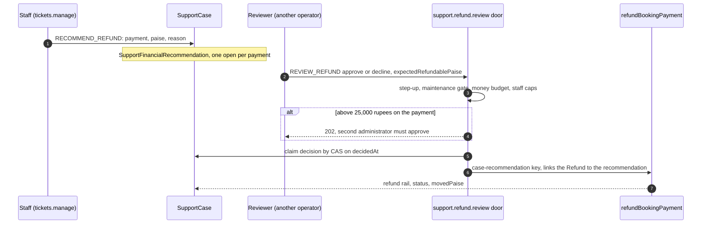

# Service complaints and remedies

A service complaint is a `SupportCase` a person files about a booking. It is not a chargeback and it moves no money by itself. Money enters only at two seams: a staff member can recommend a refund, which another operator reviews and which then runs through the ordinary refund door, and an operator can freeze the payee's unpaid earnings while the case is worked. This page covers those two seams. Everything else about cases (queues, SLA, evidence requests, decisions, appeals) is in [the support docs](../../support/README.md) and is not repeated here.

## 1. The refund seam

**Recommending.** `RECOMMEND_REFUND` (`lib/support/case-actions.ts`) records a `SupportFinancialRecommendation` for one payment linked to the case: the amount in paise, a reason and whether to release the seat. A recommendation moves no money. The database allows one undecided recommendation per payment (`support_recommendation_one_open_per_payment`), and the row shape is checked by `support_recommendation_shape`.

**Reviewing.** `REVIEW_REFUND` is executed through `reviewSupportRefundDoor` (`lib/support/refund-door.ts`), which requires a fresh session (step-up, within 15 minutes) and writes an `OpsActionLog` row. On approval it also requires the maintenance gate to be open (`assertMoneyDoorsOpen`), and it takes the per-staff lock and the money-operations budget. A completed review releases the lock after its `OpsActionLog` row commits, and a refusal decided before money could move (a typed 4xx) releases it at once. Any other failure keeps it for its 120-second time-to-live, so a refund of unknown outcome cannot be followed by a second one the rolling limit has not counted yet. The reviewer must not be the author when at least two administrators are active (`assertNotOwnRemedy`), the previewed refundable balance the reviewer saw must still be current (`expectedRefundablePaise`, else `PREVIEW_CHANGED`), the amount may not exceed the refundable balance, and the payment must be captured and have no live gateway chargeback. The decision is claimed by compare-and-swap on the recommendation's `decidedAt`, so two reviewers cannot both decide.

**Limits.** Staff may execute a remedy within two bounds (`assertBoundedRefund`, `lib/support/money-policy.ts`): at most ₹5,000 (500,000 paise) refunded on one payment, counting every live refund and every approved support remedy on it from any door (`committedSupportPaiseByPayment`), and at most ₹50,000 (5,000,000 paise) per staff member over a rolling 24 hours, summed from their own ops-log rows. A remedy on a credit-funded payment (paid with referral credit, no card money) restores credit rather than sending cash, and is counted at the credit it restores, not at its cash amount: `remedyValuePaise` in `lib/support/case-actions.ts` feeds the per-payment bound, the rolling bound and the second-approver price alike. An administrator is not bound by the two staff bounds. When this remedy plus everything already refunded or committed on the payment comes to strictly more than ₹25,000 (2,500,000 paise), counted at credit value for a credit restoration (`priceCaseRefundReview`, `lib/support/case-actions.ts`), the door answers 202 and opens an `OpsActionProposal` that a different administrator must approve ([admin money doors](../70-operations/02-admin-money-doors.md)).

**Executing.** After the decision commits, `executeApprovedRefund` calls `refundBookingPayment` with the dedupe key `case-recommendation:<recommendationId>` and `supportRecommendationId`, so the reservation creates the `Refund` already linked to the recommendation and a retry resumes the same refund. The seat is kept unless the recommendation asked to release it. If the refund fails or never started, the decider can retry the same approval; a recommendation whose refund failed, or which has not started within 15 minutes, can be voided by an administrator through `support.recommendation.void`, but not while a refund for it is pending, sent or being retried. A webhook that binds a gateway refund to the reservation moves the recommendation to the surviving row first, so the link survives the race ([refunds](01-refunds.md#3-the-two-phase-gateway-refund)).

**Deciding the case.** Recording a case decision releases its payout holds, so `DECIDE` is refused while any recommendation is awaiting review (`RECOMMENDATION_OPEN`). Review or void it first.

## 2. The hold seam

A hold is an `EarningsHold` of reason `SUPPORT_CASE` whose source is the case id. The shared writer `lib/payments/payouts/earnings-holds.ts` places and releases it, and the case timeline events `HOLD_APPLIED` and `HOLD_RELEASED` own the intent: the latest event for a payment says whether the case still holds it, so earnings created later for a held payment are frozen too (`applyCaseHoldsToNewEarnings`).

- **Applying** (`support.hold.apply`, `supportHolds.manage`, step-up, maintenance gate) first cancels any payout not yet sent that includes the payment's earnings and refuses with `PAYOUT_IN_FLIGHT` if one is already being sent. Earnings in `PENDING`, `PENDING_TRUST`, `READY` or `HELD` are frozen.
- **Releasing a hold on one payment** (`support.hold.release`) takes the same step-up and gate.
- **Releasing when the case ends.** Moving a case to `RESOLVED` or `CLOSED` releases all its holds, but only behind the same protections: a fresh session (`REAUTH_REQUIRED` otherwise), an open maintenance gate, and no open recommendation (`RECOMMENDATION_OPEN`). The release writes an `OpsActionLog` row `support.case.release-holds` naming the holds. Incident cases resolved by their parent problem take the same path in `resolveIncidentTx` (`lib/support/problem-cascade.ts`), and the incident stays open under a code when a hold was placed after the problem resolved (`HOLD_AFTER_PROBLEM_RESOLVED`, which the resolver never saw), when a recommendation is open (`RECOMMENDATION_OPEN`), or when the money doors are closed.
- **Scope.** A support release clears only the `SUPPORT_CASE` reason. It never releases a `DISPUTE`, `MODERATION`, `OPERATOR` or `OVERAGE` hold, and it does not cancel a refund reservation; an earning stays `HELD` while any other reason remains. A hold cannot recall money already sent, and a payout in flight is refused.

### Worked example

On Friday 23 October 2026 Charlotte Brown files a case that Hannah Anderson's session of 19 October never took place; her payment was ₹1,180 (118,000 paise). Maria Brown (staff) applies a `SUPPORT_CASE` hold at 10:05 IST, freezing Hannah's 80,000-paise earning, then recommends a refund of 59,000 paise. Olivia Brown (administrator) opens the review at 10:40 IST, confirms her session within the last 15 minutes, and sees refundable 118,000. She approves. The door checks that 59,000 paise (₹590), plus nothing already refunded on the payment, is under the ₹25,000 second-approval threshold and that Olivia, an administrator, is not bound by the staff cap. The refund runs as `case-recommendation:<id>` and the cascade reverses 40,000 of Hannah's earning, 9,000 of GST and a 10,000 fee. Maria then moves the case to `RESOLVED`; the door sees no open recommendation, and since Maria has not re-authenticated within 15 minutes the first attempt is refused with `REAUTH_REQUIRED`, and after she confirms it the release posts `support.case.release-holds` and the remaining 40,000 of earning becomes payable again once no other hold remains.

## 3. Invariants

| Rule                                                        | Enforcer                                                                                | Test                                                   | Repair                               |
| ----------------------------------------------------------- | --------------------------------------------------------------------------------------- | ------------------------------------------------------ | ------------------------------------ |
| One undecided recommendation per payment                    | `support_recommendation_one_open_per_payment` partial unique index                      | none (database)                                        | Void or review the open one          |
| A decision is made once                                     | CAS on `decidedAt IS NULL` in `reviewRefundTx`                                          | `__tests__/support/case-refund-approval.test.tsx`      | None                                 |
| A refund is sent once per recommendation                    | `Refund.dedupeKey` `case-recommendation:<id>`; the reservation links the recommendation | `__tests__/payments/refund-placeholder-retire.test.ts` | Retry by the decider; void if failed |
| Staff cannot refund beyond the bounds                       | `assertBoundedRefund` over the ops log, under `lockStaffRefunds`                        | `__tests__/support/case-money-hardening.test.ts`       | An administrator executes            |
| A case does not release holds around an open recommendation | `holdReleaseRefusalTx`, `assertNoOpenRecommendation`                                    | `__tests__/support/case-hold-lifecycle.test.ts`        | Review or void the recommendation    |

## Where in code

- `lib/support/case-actions.ts`: `RECOMMEND_REFUND`, `REVIEW_REFUND`, `VOID_RECOMMENDATION`, `APPLY_HOLD`, `RELEASE_HOLD`, `executeApprovedRefund`.
- `lib/support/refund-door.ts`, `case-doors.ts`: the audited doors.
- `lib/support/money-policy.ts`: staff caps, `committedSupportPaiseByPayment`, `assertNotOwnRemedy`.
- `lib/support/case-holds.ts`, `case-service.ts` (`holdReleaseRefusalTx`, `recordLifecycleHoldReleaseTx`), `problem-cascade.ts`.
- `lib/payments/operations/refund-placeholder.ts`.

## Related

- [Refunds](01-refunds.md), [chargebacks](02-chargebacks.md), [earnings lifecycle](../40-payouts/02-earnings-lifecycle.md) for the hold reasons.

## Deprecated & Superseded Approaches

An earlier account said a support refund needed an administrator to approve and staff only inspected money. Staff now execute bounded remedies under the per-payment and rolling limits, and an administrator is needed only above them. Earlier code released a case's holds as a side effect of closing the case with no step-up, gate or audit row, and a per-payment staff cap that ignored refunds not created by a remedy; both are replaced by the guards above, and the cap now counts every live refund. A reconcile that retired a refund placeholder used to fail on the recommendation's restricting foreign key; it now re-points the recommendation first. Delete any code that treats a `SupportCase` as a `Dispute`, releases holds without the case protections, or sums the staff cap from remedies alone.
